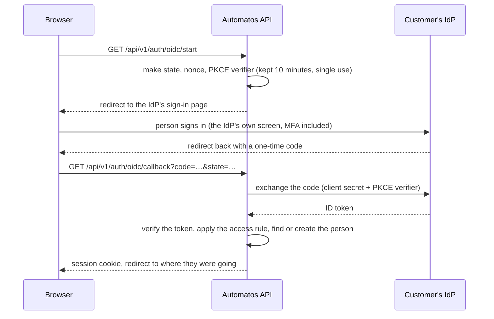

# PRD-277: Enterprise sign-in — a self-hosted install signs people in through the customer's own identity provider (OIDC)

**Status:** Draft for Dave's review. Written 19 Nov 2026 and revised the same day: trimmed to basic sign-in (G5), and every decision in §8 answered by Gerard (G6). No code has been written.
**Owner:** Gerard · **Reviewer:** Dave (auth)
**Grounded on:** `automatos-ai` `main @ abcc3f813` and `automatos-go` main, read on 19 Nov 2026. 277 is the next free number: 276 is the highest on main.
**Labels:** **[T]** read in code at that commit; **[I]** inferred; **[G]** Gerard's decision; **[?]** not known.
**Relates to:** PRD-257 (draft, on branch `docs/prd-257-enterprise-estate-agents`): this PRD takes over its decision D5 for people and answers its open question 4. Runner workload identity stays in PRD-257. PRD-266 §4.11 reserved the phone contract this PRD fills in. PRD-175 defined the edition seam this PRD extends.

**Decisions already taken [G] (Gerard, 19 Nov 2026):**

| | Decision |
|---|---|
| G1 | "This is how enterprise build will go: self hosted with OIDC." A customer install signs people in through the customer's own identity provider. |
| G2 | Clerk stays for the hosted SaaS. Nothing about Clerk sign-in changes there or in any app. |
| G3 | "It could be AWS, Azure, Google." The build is provider-neutral: standard OpenID Connect only, no provider-specific code. |
| G4 | OIDC is built before the first customer install, and that install's development environment is the test bed. |
| G5 | Basic OIDC sign-in is part of core, for every self-hosted install: "more people using Automatos the better". Roles taken from the identity provider, provisioning and removal driven by it, SAML and audit export are not part of this PRD. Agreed with Dave. |
| G6 | Every decision in §8 is answered (19 Nov 2026). |

---

## 1. Introduction

Automatos has two editions today. `saas` signs people in with Clerk. `local` has no sign-in at all: one operator, one workspace, and anyone who can reach the address is the admin.

Neither fits a company that installs Automatos in its own cloud. That company already has an identity provider (Microsoft Entra ID, Google Workspace, Okta, Keycloak, Amazon Cognito and others). Its staff must sign in with their work accounts, every action must be tied to a named person, and access must end when the company removes someone.

This PRD adds a third edition, `enterprise`. People sign in through the customer's identity provider using OpenID Connect (OIDC). OIDC is used only to prove who someone is at sign-in. After that, Automatos issues its own session, which it can expire and revoke.

**Terms used here**

- **Identity provider (IdP):** the customer's system that holds staff accounts and signs them in.
- **OIDC:** OpenID Connect, the standard way an application asks an IdP to sign someone in and gets back a signed statement (the **ID token**) saying who they are.
- **Issuer:** the IdP's address, as it appears in every ID token. **Subject:** the IdP's fixed id for one person. Together they name one person for good.
- **Claim:** one field in the ID token, such as `email` or `groups`.
- **Session:** what Automatos issues after sign-in so the browser or phone does not sign in again on every request.

## 2. What exists today

| Piece | Today | Read in | Verdict |
|---|---|---|---|
| Edition flag | `AUTH_EDITION` accepts `local` or `saas`. Any other value becomes `saas`, so a typo never opens the install. | `orchestrator/config.py:213-214` **[T]** | Extend with a third value. |
| Edition checks | 91 places outside tests compare the edition, almost all as `== "local"`. A third value would take the `saas` branch in every one: billing on, Clerk expected. | grep at `abcc3f813` **[T]** | Replace with named capabilities (Wave 1). This is the largest hidden risk. |
| Where a request gets its identity | `get_request_context_hybrid`. Registered token prefixes are resolved first; today only `amd_` (a paired device). Every other bearer token goes to Clerk. Then the platform API key, then the anonymous lane. | `core/auth/bearer_registry.py:60-62, 112-125`; `core/auth/hybrid.py:799-826` **[T]** | Reuse the registry. Its own header says new token kinds add an entry there, "never another branch in `hybrid.py`". |
| Who a person is | `users.clerk_user_id` (unique, nullable). `users` has no role column. | `core/models/core.py:1122-1131` **[T]** | Add a neutral identity link. Do not reuse the Clerk column. |
| Linking a sign-in to a person | `ensure_user_row` finds the row by Clerk id or inserts it. If another row already has the email it answers 409 and changes nothing. It never attaches an identity to an existing row by email. | `core/auth/user_link.py:95-132` **[T]** | Keep the rule: never link by email. |
| Reading someone's role | By joining `users.clerk_user_id`. The device lane is the exception: it reads by `users.id`. About 25 API files also query by Clerk id. | `core/auth/workspace_permission.py:99-129` **[T]**; sweep **[T]** | Route every read through one resolver keyed on `users.id` (Wave 2). The device lane proves a non-Clerk person works end to end. |
| Install-wide role | `super_admin`, `admin` or `user`, read only from Clerk token claims. | `core/auth/clerk.py:131-143` **[T]** | Needs a home that is not a Clerk claim. |
| Workspace roles | `owner`, `admin`, `editor`, `viewer` in `workspace_members`, with one permission matrix. One person can be in many workspaces. | `modules/policy/roles.py:105-150`; `core/workspaces/models.py:6-19` **[T]** | Reuse unchanged. |
| First sign-in | Creates the person, a **personal** workspace, an owner membership and a trial grant. | `core/auth/hybrid.py:283-357` **[T]** | Not right for a company install. Enterprise creates the person and joins them to shared workspaces. |
| Invitations | Stored by us, but Clerk sends the email, and accepting verifies a Clerk token. | `core/workspaces/invitations.py:158-212`; `api/team.py:444-458` **[T]** | Off in enterprise v1. Core has no mail sender of its own. |
| Sessions | The backend issues none for people. It only verifies Clerk's tokens. No cookie, no CSRF code, no sign-out route. | sweep: no `set_cookie`, `csrf` or logout in non-test code **[T]** | Build (Wave 3). This is new ground for core. |
| Step-up | 25 sensitive routes require a sign-in fresher than `STEP_UP_MAX_AGE_MINUTES` (10). The check reads Clerk's `fva` claim. `local` skips it. | `core/auth/step_up.py:175-189` **[T]** | Needs an OIDC equivalent. |
| Device tokens | `amd_` plus 32 random bytes; only the SHA-256 is stored; rotation with a 600-second overlap; revoke keeps the hash so the next call is refused. Local edition only. | `core/auth/device.py:187-220`; `services/mobile/pairing.py` **[T]** | Reuse the kernel for sessions and for phones. |
| Phone discovery | `GET /.well-known/automatos.json` lists `auth.modes`. The code comment reserves `"oidc"` and says this build never emits it. A test pins that. | `services/mobile/discovery.py:4-8` **[T]**; `tests/test_prd266_discovery.py:165-173` **[T]** | Emit it in enterprise. |
| Device rows | `mobile_devices.kind` may be `paired` or `clerk`. A test asserts `oidc` is refused. PRD-266 §4.11 says an OIDC phone becomes a third kind, not a new table. | `alembic/versions/prd266_mobile_devices.py:71` **[T]** | Widen the check in a new migration. |
| Web app seam | Components import `useAuth`, `useUser` and friends from `frontend/lib/auth-hooks.ts`, which switches on the edition. All API calls take their token from one getter on `apiClient`. | `frontend/lib/auth-hooks.ts`; `frontend/lib/api-client.ts:1469` **[T]** | Add a third provider behind the same seam. |
| Web app edition | Fixed when the image is built (`NEXT_PUBLIC_AUTH_EDITION`). Only the `local` image is published. | `frontend/lib/auth-edition.ts:33-37`; `.github/workflows/images.yml:253-257` **[T]** | Publish an enterprise image. See §9. |
| Phone app | Knows three modes (`clerk`, `device`, `oidc`) but registers only the first two. `expo-auth-session` is installed and unused. Its PRD planned an `oidc.ts` provider. | `automatos-go/src/auth/providers/registry.ts:10-13`, `types.ts:27`; `package.json:39` **[T]** | Add the provider in a later app release. Pairing covers phones until then. |
| JWT libraries | `PyJWT` 2.15.1 and `cryptography` 50.0.2 are installed. `PyJWKClient` already verifies Clerk's keys. No `authlib`, no `python-jose`. | `orchestrator/requirements.lock:2856, 791`; `core/auth/clerk.py:59-67` **[T]** | No new dependency needed. |
| Audit | `audit_logs` records who did what, with the person's id, IP and browser. Sign-ins are not recorded. | `core/workspaces/audit.py:10-55` **[T]** | Add sign-in events. |
| Private addresses | Outbound calls to private network ranges are always refused. | `core/security/web_access.py` **[T]** | An IdP inside the customer's network must still be reachable. See FR-9. |

## 3. Goals

- A person signs in to a self-hosted install with their work account, through any standards-compliant OIDC provider.
- Every action is tied to that named person in `audit_logs`.
- The customer controls who gets in, through their own IdP and an access rule, and sets what each person can do in Automatos.
- Access ends when the session expires, when an admin ends it, or when the person is deactivated.
- The `local` and `saas` editions behave exactly as they do today. Their existing tests pass unchanged.
- No Automatos code names a provider. One configuration shape works for all of them.
- An install is configured entirely from settings. Nobody edits the database by hand to get the first admin in.

## 4. Non-goals

- **Changing Clerk sign-in** in the hosted SaaS or in any app (G2).
- **SAML.** This PRD is OIDC only (G5).
- **Provisioning and removal driven by the IdP:** SCIM, logout notices, and re-checking a live session with the IdP. Access ends by session lifetime and by an admin (G5).
- **Roles taken from the IdP's groups or roles.** Roles are set in Automatos (G5).
- **Exporting the audit log.** Sign-in events are written to it. Sending it elsewhere is not in this PRD (G5).
- **More than one identity provider per install** (decision D-11).
- **Email invitations.** Core has no mail sender without Clerk.
- **Billing, credits, plans and trial grants.** They are off in enterprise, as they are in `local`.
- **Session mode** (the operator's own coding sessions as agents). PRD-253 already says that needs its own PRD in an enterprise edition.
- **Runner and workload identity** for agents' tools. That is PRD-257.

## 5. Design

### 5.1 The edition and what it switches

`AUTH_EDITION` gains a third value, `enterprise` (decision D-2). An unknown value still becomes `saas`.

Today the edition flag answers many different questions at once: is there a sign-in, is there billing, may one person act as operator. Those 91 comparisons are replaced by **named capabilities**, defined once beside the flag:

| Capability | `local` | `saas` | `enterprise` |
|---|---|---|---|
| How people sign in | Nobody signs in | Clerk | OIDC |
| A request with no credential acts as the operator | Yes, unless pairing is required | No | **No, never** |
| Several people, workspace roles, the Team page | No | Yes | Yes |
| Billing, credits, plans, quotas, trial grant | Off | On | Off |
| A personal workspace for each new person | n/a | Yes | **No** |
| Profile edited in Automatos | Yes | No (managed by Clerk) | No (managed by the IdP) |
| Step-up for sensitive actions | Skipped | Clerk's freshness claim | Sign in again at the IdP |
| Device pairing | By setting | No | By setting (D-7) |
| Session mode | Yes | No | No |
| Calls to Automatos's hosted services (theme revocations, Cloud sync, marketplace) | On by default | It is the host | **Off unless switched on** (D-12) |

Wave 1 builds the full table from the 91 call sites. The table above shows the intent, not the final list.

**Fail closed.** With `AUTH_EDITION=enterprise`:
- startup refuses to run unless the issuer, client id, client secret and the install's public address are set;
- `REQUIRE_AUTH` is forced on and cannot be turned off;
- the anonymous operator does not exist;
- until US-704 builds the per-service settings, every call to Automatos's hosted services is off.

### 5.2 Signing in from a browser

Automatos's backend is the OIDC client. The browser never holds a token from the IdP.

- **Flow:** authorization code with PKCE (S256), plus `state` and `nonce`. No other flow is supported.
- **What the customer registers at their IdP:** one web application with one redirect address, `https://<install>/api/v1/auth/oidc/callback`.
- **What Automatos learns:** only what the ID token says. It does not call the IdP's user-info or directory APIs in v1.

### 5.3 Sessions

A session issued and stored by Automatos (decision D-3):

- **The token** is opaque: a prefix (`ams_`) and 32 random bytes. Only its SHA-256 is stored, the same way device tokens are.
- **In a browser** it travels in a cookie the page's scripts cannot read: `__Host-` prefixed, `HttpOnly`, `Secure`, `SameSite=Lax`.
- **It is resolved through the bearer registry.** A new entry maps the `ams_` prefix to a session resolver. The resolver reads the token from the `Authorization` header or, when there is none, from the cookie.
- **Two clocks:** an idle timeout and an absolute lifetime. Defaults: 2 hours idle, 12 hours absolute (decision D-15).
- **A new session is made at every sign-in.** A session from before sign-in is never upgraded.
- **Cross-site request forgery:** a request that changes something and is authenticated by cookie must come from the install's own origin and carry a header a cross-site form cannot send. A request authenticated by an `Authorization` header is exempt.

The web app and the API are served from one address (`/` and `/api` on one host), so the cookie is same-origin and no CORS change is needed.

### 5.4 People, identities and roles

**Identity.** A new table, `user_identities`, links a person to `(issuer, subject)`, unique on the pair. `users.clerk_user_id` is untouched and stays Clerk's.

**Never by email.** A sign-in is matched to a person only by issuer and subject. If the email in the token is already on another person's row, the sign-in is refused with a clear message for an admin, and no row changes. This is today's rule in `ensure_user_row`, and it is also what Microsoft tells applications to do: its `email` claim "isn't guaranteed to be correct".

**Who gets in (the access rule).** The first gate is the customer's own IdP: only people assigned to the application there can complete sign-in. Automatos adds a second gate, `OIDC_REQUIRED_CLAIMS`: named claims that must have given values. For an issuer shared by many organisations (Google's, or Microsoft's multi-tenant addresses) startup refuses to run without such a rule, because otherwise anyone with an account at that provider could sign in.

**First sign-in.** The person's row and identity link are created. No personal workspace and no trial grant. What they can reach is decided next.

**Workspaces and roles.** Roles live in `workspace_members`, as today, and are set in Automatos: an admin gives a person a workspace and a role on the Team page. A person who has signed in but is in no workspace is shown as waiting. Sign-in never changes a role someone already has.

A default role for everyone who passes the access rule is a setting (decision D-4). The default is none: signed in, in no workspace, sees a page saying to ask an admin.

**Install admins (decision D-6).** `users` gains a nullable `system_role`, read only in enterprise. `ENTERPRISE_BOOTSTRAP_ADMINS`, a list in settings, makes the named people install admins when they first sign in. The list names subjects, or emails where the IdP marks the email verified. That is how the first admin gets in without anyone touching the database. After that, an install admin can make another person one, in Automatos.

### 5.5 Step-up

The 25 sensitive routes keep their gate. In enterprise the gate reads when the person last proved who they are, stored on the session (`auth_time` from the ID token). When that is older than `STEP_UP_MAX_AGE_MINUTES`, the route answers with a body the web app recognises. The web app sends the person through `/start` again with `max_age=0`, the IdP makes them sign in again, and the callback refreshes the session's `auth_time`. An IdP that returns no `auth_time` after being asked fails the step-up closed.

### 5.6 Signing out and losing access

- **Sign out** revokes the session on the server, clears the cookie, and sends the browser to the IdP's end-session address when its metadata lists one.
- **An admin can end** one session or all of a person's sessions, and can deactivate a person. `users.is_active` already exists and the device lane already checks it.
- **A person removed at the IdP** cannot start a new session. Their existing session ends at its absolute lifetime at the latest.

### 5.7 Phones

Two steps (decision D-7).

**Now: pairing, bound to a person.** The device lane is allowed in enterprise. A signed-in person creates a pairing code in Settings, and the phone that uses it acts as **that person**, with their role. In `local` a paired device acts as the operator; in enterprise it never does. Today's Automatos Go release already supports pairing, so phones work on day one with no app release.

**Later: sign in on the phone.** The phone opens the system browser at Automatos's own start address, the person signs in at the IdP, and Automatos hands the app a one-time code that it exchanges for a device token. The device row gets `kind = 'oidc'`. This is decision D-8: the phone talks to Automatos, and Automatos talks to the IdP. The customer still registers one application and one redirect address, and no IdP token is ever on a phone.

**Discovery.** In enterprise the document lists `auth.modes: ["oidc", "device"]` (or `["oidc"]` when pairing is off) and an `oidc` block. The app picks the first mode it supports, so today's release uses pairing and a later release uses sign-in. The schema stays `automatos-discovery/v1`.

The app work is a companion PRD in `automatos-go`. Core only defines the contract.

### 5.8 Web app

- `resolveEdition()` accepts `enterprise`. A third provider sits behind `auth-hooks.ts`, giving the same shapes the components already use.
- **Sign-in page:** one button, "Sign in with <name>", which goes to `/api/v1/auth/oidc/start`. No password field, no sign-up, no reset: those belong to the IdP.
- **Signed-out visitors:** `middleware.ts` gets a third branch that sends a browser with no session cookie to the sign-in page. The API remains the real check.
- **API calls:** the token getter returns nothing in enterprise; the cookie travels by itself. The Next.js server routes that call the API on the browser's behalf forward the cookie.
- **Who am I and what is my role:** read from the API. Today the `saas` build reads the role from Clerk's session data (`contexts/role-context.tsx:51-73`).
- **Team page:** members and role changes stay. Invitations are hidden. People waiting for a workspace are listed.
- **Profile:** read-only, with a line saying the account is managed by the organisation's identity provider.

### 5.9 Provider neutrality

Automatos reads the provider's own metadata document (`<issuer>/.well-known/openid-configuration`) and uses only what the OIDC standard defines. Differences between providers are handled by settings, never by code.

| Provider | Issuer looks like | Groups in the ID token | What to watch |
|---|---|---|---|
| Microsoft Entra ID | `https://login.microsoftonline.com/<tenant>/v2.0` | Optional. Above 200 groups the list is left out of the token. App roles arrive in `roles`. | `email` is optional and unverified. Use the tenant's own issuer, never `common`. An access rule on `groups` fails for a person over the limit; a rule on an app role does not. |
| Google Workspace | `https://accounts.google.com` | None | One issuer for every Google account, so the access rule must require the `hd` (domain) claim. |
| Okta, Auth0 | `https://<domain>` | Through a custom claim | The claim's name is the customer's choice; the access rule names it. |
| Keycloak | `https://<host>/realms/<realm>` | Through a mapper | May sit on a private address with a private certificate authority (FR-9, FR-10). Used in CI. |
| Amazon Cognito | `https://cognito-idp.<region>.amazonaws.com/<pool>` | `cognito:groups` | The claim name contains a colon; the access rule's syntax must allow it. |
| AWS IAM Identity Center | **[?]** | **[?]** | AWS's FAQ says it supports only SAML applications; its user guide describes OAuth 2.0 applications. Confirm before telling an AWS customer it works. |

Groups matter in this PRD only for the access rule. Roles are set in Automatos.

Rows marked without **[T]** come from the providers' documentation and are **[I]** until the conformance run (US-703) proves them. The Microsoft rows were checked against Microsoft's documentation on 19 Nov 2026.

### 5.10 Settings

Names are provisional. Final names are fixed in each wave's PR and recorded in `orchestrator/reports/config-surface.json`.

| Setting | Default | What it is |
|---|---|---|
| `AUTH_EDITION` | `saas` | `enterprise` turns this edition on. |
| `OIDC_ISSUER` | none, required | The IdP's address, `https` only. |
| `OIDC_CLIENT_ID` | none, required | The application's id at the IdP. |
| `OIDC_CLIENT_SECRET` | none, required | From the install's Secret, never from plain settings. |
| `FRONTEND_URL` | none, required in enterprise | The install's public address, which the web app and the API share. An existing setting: its built-in `localhost` default does not count (US-103). |
| `OIDC_SCOPES` | `openid profile email` | What is asked for at sign-in. |
| `OIDC_DISPLAY_NAME` | `your organisation` | The text on the sign-in button. |
| `OIDC_REQUIRED_CLAIMS` | empty | Claims that must match before anyone is let in. Required for shared issuers. |
| `OIDC_CLAIM_EMAIL`, `OIDC_CLAIM_NAME` | `email`, `name` | Which claims carry these. |
| `OIDC_CA_BUNDLE_FILE` | empty | A certificate authority file for an IdP with a private certificate. |
| `ENTERPRISE_BOOTSTRAP_ADMINS` | empty | People who become install admins at first sign-in. |
| `ENTERPRISE_DEFAULT_ROLE` | `none` | Role in the default workspace for anyone who passes the access rule. |
| `ENTERPRISE_DEVICE_PAIRING` | `on` | Whether phones and browsers may pair. |
| `SESSION_IDLE_MINUTES`, `SESSION_ABSOLUTE_HOURS` | `120`, `12` | The two session clocks. |

`FRONTEND_URL` is not a new setting: the existing one is reused as the install's public address.

### 5.11 Security requirements

These are requirements, each with a test.

- **The ID token** is accepted only if its signature verifies against the IdP's published keys, with an allow-list of algorithms (RS256, PS256, ES256). `none` and the shared-secret algorithms are refused.
- **Issuer** must equal `OIDC_ISSUER` exactly, and the metadata document must name the same issuer.
- **Audience** must contain the client id. With several audiences, `azp` must equal the client id.
- **Times:** `exp`, `iat` and `nbf` are checked with at most 60 seconds of leeway.
- **`nonce`** must match the one made at `/start`. **`state`** must match and is single use.
- **Redirect addresses** are exact. The "where to go after sign-in" value accepts only a path on the install's own address.
- **Keys rotate:** an unknown key id triggers one refetch of the keys, rate limited.
- **Nothing sensitive is logged or shown:** no code, token, secret or raw IdP error reaches a log line, a span or the browser.
- **Rate limits** on `/start` and `/callback`, per IP.
- **Server keys and the platform key are unchanged** as machine credentials. They cannot pass step-up, as today. The platform API key stays as it is (decision D-14).

### 5.12 Audit

New `audit_logs` actions, each with the person's id where one is known, the IP and the browser:
`auth:sign_in`, `auth:sign_in_refused` (with the reason: access rule, email conflict, deactivated, invalid token), `auth:sign_out`, `auth:session_revoked`, `auth:step_up`, `auth:identity_linked`, `auth:bootstrap_admin`. Role changes are already recorded.

### 5.13 Where more can plug in

Sign-in is built so that more can be added later without changing the code that issues sessions or checks permissions.

- **One interface for proving who someone is.** `start` sends the person to sign in. `finish` returns a verified identity: issuer, subject, email, name, when they signed in, and the claims. OIDC is the one implementation in core.
- **One hook, after the identity is verified and before the session is issued.** Code registered there may refuse the sign-in or set the person's memberships. With nothing registered, sign-in behaves exactly as this PRD describes.
- **One service for people.** Creating a person, linking an identity, setting a membership, deactivating a person and ending their sessions are functions in one module. Sign-in and the Team page call them, and so can other code.
- **Registration closes at startup.** Nothing can be registered after the first request, and registering the same thing twice is an error.

## 6. Waves and user stories

Each wave is one pull request or a short series. Waves 1 to 3 change nothing for `local` or `saas`. CI is the only gate: nothing here is run on a developer's machine.

### Wave 0: Record the decisions

#### US-001: Decisions answered and a tracking issue opened · S
**Description:** As a maintainer, I want the §8 decisions answered and an issue opened before any code, because AGENTS.md requires an issue before changing authentication, permissions or tenancy.

**Acceptance Criteria:**
- [x] Every row in §8 is marked decided, with Gerard's choice.
- [ ] An issue in `automatos-ai` links this PRD and lists the waves.
- [x] This PRD's status line says which decisions are settled.

### Wave 1: One place that knows what an edition does

#### US-101: A table of every edition check · M · analysis only
**Description:** As a maintainer, I want every place that compares the edition listed with what it decides, so that the third edition's behaviour is chosen on purpose in each one.

**Acceptance Criteria:**
- [x] A table lists each call site: file, line, what it switches, and its value in `local`, `saas` and `enterprise`. It is [PRD-277-EDITION-CHECKS.md](PRD-277-EDITION-CHECKS.md), which finds 99 lines in the backend and says why that is more than the 91 first counted.
- [x] Each row names one capability from a short list. No capability means "is this edition X".
- [x] Rows where the enterprise answer is not obvious are listed for Gerard, not guessed: G-1 to G-11 in that file.

#### US-102: Named capabilities replace raw comparisons · L
**Description:** As a developer, I want code to ask "is billing on" instead of "is the edition local", so that adding an edition cannot silently switch a feature.

**Acceptance Criteria:**
- [x] Capabilities are defined in one module, `orchestrator/core/editions.py`. They are not in `config.py`, which is over the file-size limit and must not grow.
- [x] No file outside that module and the tests compares `AUTH_EDITION` or reads `IS_LOCAL_EDITION` / `IS_SAAS_EDITION`. A test fails if one does. `orchestrator/tests/test_prd277_no_raw_edition_checks.py`; `config.py` (the flag's own file, whose boot guards US-103 rewrites) and `alembic/versions/` (history) are exempt, and the two helpers are deleted.
- [x] A truth-table test pins every capability for `local` and `saas` to today's behaviour.
- [ ] All existing tests pass unchanged, except those that assert on the removed comparisons, which are listed in the PR.
- [ ] `ruff check` and the backend test lanes pass in CI.

#### US-103: `enterprise` is a known edition that refuses to start half-configured · M
**Description:** As an operator, I want a clear refusal at startup when a required setting is missing, so that an install never runs open.

**Acceptance Criteria:**
- [x] `AUTH_EDITION=enterprise` is accepted. An unknown value still becomes `saas`.
- [x] Startup aborts, naming the missing setting and never its value, when any of the issuer, client id, client secret or public address is unset. The public address is the existing `FRONTEND_URL`, set in the environment (§5.10).
- [x] `REQUIRE_AUTH` is true in enterprise whatever the environment says.
- [x] A request with no credential gets 401. A test proves no operator context is ever returned (`orchestrator/tests/test_prd277_enterprise_no_operator.py`).
- [x] Until Wave 4 merges, startup in enterprise aborts with "not available in this build", so a half-built edition cannot be run. One switch, `OIDC_SIGN_IN_IN_THIS_BUILD` in `orchestrator/core/edition_start_up.py`, which Wave 4 deletes.
- [x] New settings are in `config-surface.json`: `OIDC_ISSUER`, `OIDC_CLIENT_ID`, `OIDC_CLIENT_SECRET`.

### Wave 2: People without Clerk

#### US-201: An identity link that is not Clerk's · M · migration review
**Description:** As the platform, I want to record which issuer and subject a person signs in with, so that a person is recognised without a Clerk id.

**Acceptance Criteria:**
- [x] A migration adds `user_identities` (`user_id`, `issuer`, `subject`, timestamps), unique on (`issuer`, `subject`). It chains onto the single head, is idempotent, and survives a database built by `create_all`. The two head-pin tests move. `prd277_w2_identities_20261120`, which also carries US-203's column; the model is `core/models/user_identities.py`.
- [x] A link service finds or creates the link. It never matches on email. `link_identity` in `core/auth/user_link.py`.
- [x] When the token's email is already on another person's row, the service raises a refusal that carries a clear message and changes no row. `IdentityLinkRefused`, whose message names no issuer, subject or email.
- [x] The link service uses an email only when the provider verified it. `link_identity` takes a required `email_verified` with no default. Only a verified email becomes the person's address and is checked against other people's addresses; an unverified one gets the per-identity placeholder, is no conflict, and is kept nowhere, so it never holds an address from its real owner.
- [x] Tests cover: first link, repeat sign-in, email held by another row, and two first requests racing. `orchestrator/tests/test_prd277_w2_identity_link_realdb.py`, with exact comparison of issuer and subject; the migration in `test_prd277_w2_migration.py`.

#### US-202: One way to ask who this person is · L · security review + Dave
**Description:** As a developer, I want every membership and role read to go through one resolver keyed on `users.id`, so that it works for any way of signing in.

**Acceptance Criteria:**
- [x] `workspace_permission.py`, `workspace_admin.py` and the workspace lookups in `hybrid.py` read by `users.id`. The reads are `core/auth/person.py`; a Clerk caller's `users.id` is read inside the same statement (`core/auth/clerk_person.py`), so each check makes the round trips it made before.
- [ ] No SQL outside `core/auth/clerk*.py` and `core/auth/user_link.py` mentions `clerk_user_id`. A test fails if one does. The API files that query by Clerk id are changed to the resolver and listed in the PR. The test is `orchestrator/tests/test_prd277_us202_no_clerk_id_sql.py`. Three functions are still on its allow-list, each inside a function over the 50-line limit: `install_item` in `api/marketplace.py`, `install_recipe_from_marketplace` in `api/workflow_recipes.py` and `_stream_tool_loop` in `consumers/chatbot/service.py`.
- [ ] In `saas`, every existing auth, permission and boundary-sweep test passes unchanged.
- [ ] Dave and the security reviewer sign off before merge.

#### US-203: An install-wide role that does not come from a Clerk claim · S · migration review
**Description:** As an install admin, I want my admin role stored by the install, so that it does not depend on a Clerk token.

**Acceptance Criteria:**
- [x] A migration adds nullable `users.system_role`. `prd277_w2_identities_20261120`, with a CHECK to `super_admin`, `admin` and `user`; no such column or equivalent existed.
- [x] It is read only when the edition's sign-in capability is OIDC. In `saas` the role still comes from Clerk claims, and a test proves the column is ignored there. `core/auth/system_role.py`; `orchestrator/tests/test_prd277_w2_system_role_realdb.py`.
- [x] Changing it is audited. `set_system_role` writes one `audit_logs` row (`user:system_role_changed`) through `AuditService.log`, in the same commit as the change.

### Wave 3: Sessions

#### US-301: A session Automatos issues, stores and resolves · L · security review
**Description:** As a signed-in person, I want a session that lasts while I work and ends when it should, so that I do not sign in on every request.

**Acceptance Criteria:**
- [ ] A migration adds `auth_sessions` (person, token hash, created, last seen, idle and absolute expiry, `auth_time`, revoked at and why, IP, browser).
- [ ] Tokens are `ams_` plus 32 random bytes. Only the SHA-256 is stored, using the hashing kernel device tokens use.
- [ ] `BEARER_RESOLVERS` gains an `ams_` entry. `hybrid.py` gains no branch.
- [ ] The resolver accepts the token from the `Authorization` header, or from the `__Host-` cookie when there is no header.
- [ ] An expired, revoked or unknown session gets 401 with a code the web app recognises.
- [ ] A session for a deactivated person is refused.
- [ ] The session records the ID token's `sid` when the IdP sends one.
- [ ] `last seen` is written at most every 5 minutes, as the device lane does.
- [ ] The resolver is registered only in enterprise. In `local` and `saas` an `ams_` token is refused.

#### US-302: Requests that change things cannot be forged from another site · M · security review
**Description:** As a signed-in person, I want another website to be unable to act as me, so that a session cookie is safe.

**Acceptance Criteria:**
- [ ] A cookie-authenticated request with an unsafe method is refused unless its origin is the install's own and it carries the required header.
- [ ] A request authenticated by the `Authorization` header is not subject to the check.
- [ ] Tests cover: cross-site form post refused, same-origin fetch allowed, header-authenticated call allowed.

#### US-303: Ending a session · M
**Description:** As a person or an admin, I want to end a session now, so that access stops when it should.

**Acceptance Criteria:**
- [ ] `POST /api/v1/auth/sign-out` revokes the caller's session and clears the cookie.
- [ ] An admin route revokes one session or every session of a person. It requires step-up.
- [ ] Deactivating a person revokes their sessions and device tokens in the same transaction.
- [ ] New routes are in `route-manifest.json`, authenticated and authorised.

#### US-304: Sign-ins are in the audit log · S
**Description:** As a compliance reviewer, I want every sign-in, refusal and sign-out recorded, so that I can show who had access and when.

**Acceptance Criteria:**
- [ ] The actions in §5.12 are written through `AuditService.log`.
- [ ] A refusal records its reason and never the token.
- [ ] A test asserts one row per event with the person's id where known.

### Wave 4: OIDC

#### US-401: Reading the provider's metadata and keys · M · security review
**Description:** As the platform, I want to read the IdP's published metadata and signing keys safely, so that I can verify what it sends.

**Acceptance Criteria:**
- [ ] The metadata is fetched from `<OIDC_ISSUER>/.well-known/openid-configuration` over `https` only. Its `issuer` must equal the setting.
- [ ] Keys are fetched with the `PyJWKClient` pattern already in `core/auth/clerk.py`. An unknown key id causes one rate-limited refetch.
- [ ] The configured issuer's host is reachable even on a private address. No other private address becomes reachable through sign-in. A test proves both. (PRD-282 covers the private addresses an operator may name for other purposes.)
- [ ] `OIDC_CA_BUNDLE_FILE` is honoured.
- [ ] If the IdP cannot be reached, the API still starts; sign-in answers with a clear error and `/health/bootstrap` reports it.
- [ ] No new Python dependency.

#### US-402: Start and callback · L · security review + Dave
**Description:** As a person, I want to sign in with my work account, so that I can use Automatos.

**Acceptance Criteria:**
- [ ] `GET /api/v1/auth/oidc/start` makes `state`, `nonce` and a PKCE verifier, keeps them server-side for 10 minutes, and redirects to the IdP.
- [ ] `GET /api/v1/auth/oidc/callback` exchanges the code, verifies the ID token against every rule in §5.11, and issues a session.
- [ ] Tests, each against the fake issuer (US-407): wrong signature, `alg: none`, wrong issuer, wrong audience, expired, missing or wrong nonce, reused state, replayed code, redirect to another host.
- [ ] No token, code or secret appears in any log line or response body. A test scans the captured logs.
- [ ] Both routes are public, rate limited per IP, and in `route-manifest.json`.

#### US-403: The access rule · M
**Description:** As an operator, I want to say which claims a person must have, so that only my organisation's people get in.

**Acceptance Criteria:**
- [ ] `OIDC_REQUIRED_CLAIMS` is parsed at startup. A malformed value aborts startup.
- [ ] A sign-in whose token fails a rule is refused, audited, and shown a plain message.
- [ ] With an issuer on the known shared list and no rule, startup aborts and says why.
- [ ] A claim name containing a colon or a dot can be named.

#### US-404: First sign-in · M
**Description:** As a new person, I want my first sign-in to work without anyone preparing my account, so that I can start as soon as an admin gives me a workspace.

**Acceptance Criteria:**
- [ ] A `users` row and an identity link are created. No personal workspace, no trial grant.
- [ ] With `ENTERPRISE_DEFAULT_ROLE=none`, the person is signed in and in no workspace, and the API tells the web app so.
- [ ] With `ENTERPRISE_DEFAULT_ROLE` set to a role, the person gets that role in the default workspace at first sign-in only.
- [ ] A later sign-in changes no membership. A test proves a role an admin changed survives the next sign-in.
- [ ] Sign-in succeeds when the ID token carries only a subject and an email.
- [ ] The caller passes the provider's own statement that the email is verified, taken from the verified ID token, as `email_verified`; the link service (US-201) enforces it: an email the token does not mark verified is no email.
- [ ] The refusal a person sees never differs by whether an address is already known to the install.

#### US-405: The first admin · S
**Description:** As the operator, I want to name the first admins in settings, so that nobody edits the database to get in.

**Acceptance Criteria:**
- [ ] A person listed in `ENTERPRISE_BOOTSTRAP_ADMINS` becomes an install admin and owner of the default workspace at first sign-in. It is audited.
- [ ] An entry given as an email matches only when the token marks the email verified.
- [ ] An install admin can make another person an install admin. It requires step-up and is audited.
- [ ] The migration Job creates the default workspace with no owner, as the local first-run seed does.

#### US-406: Step-up by signing in again · M
**Description:** As a person doing something sensitive, I want to prove it is still me, so that a borrowed session cannot change roles or keys.

**Acceptance Criteria:**
- [ ] In enterprise, `check_step_up` reads `auth_time` from the session.
- [ ] `/start?step_up=1` sends `max_age=0`. The callback updates the session's `auth_time` only when the returned token carries a fresh one.
- [ ] No `auth_time` in the token means the step-up fails.
- [ ] The `local` and `saas` step-up tests pass unchanged.

#### US-407: A fake identity provider for CI · M
**Description:** As a developer, I want a small OIDC issuer that runs inside the test process, so that every flow is tested without a real provider.

**Acceptance Criteria:**
- [ ] A test helper serves metadata, keys, an authorize step that approves at once, and a token endpoint, on a loopback address, using `PyJWT` and `cryptography` only.
- [ ] It can be told to misbehave: wrong signature, rotated key, missing claim, shared issuer.
- [ ] A separate CI job runs the sign-in flow against a real Keycloak container. It is allowed to fail at first and becomes required at the end of the wave.

#### US-408: One interface and one hook for sign-in · M
**Description:** As a developer, I want sign-in written against a small interface with a hook, so that another way of proving identity can be added without touching sessions or permissions.

**Acceptance Criteria:**
- [ ] The start and callback routes call an identity interface. OIDC is its implementation in core.
- [ ] A hook runs after the identity is verified and before the session is issued. It can refuse the sign-in, or set memberships through the people service.
- [ ] Creating a person, linking an identity, setting a membership and deactivating a person are functions in one module, used by sign-in and by the Team routes.
- [ ] Registration is refused after startup, and registering the same thing twice raises an error.
- [ ] A test registers a second, fake implementation and a hook, and signs in through them with no change to the session or permission code.
- [ ] With no hook registered, every US-402 and US-404 test passes unchanged.

### Wave 5: Web app

#### US-501: The enterprise provider behind the existing seam · M
**Description:** As a developer, I want the web app's sign-in hooks to work in enterprise, so that components do not change.

**Acceptance Criteria:**
- [ ] `resolveEdition()` accepts `enterprise`.
- [ ] `auth-hooks.ts` returns the same shapes in enterprise, filled from a "who am I" API call.
- [ ] The role comes from the API, not from Clerk session data.
- [ ] No component outside the existing Clerk files imports `@clerk/*`. The existing rule's test covers it.
- [ ] `tsc` and `vitest` pass in CI.

#### US-502: Sign-in page, signed-out redirect and sign-out · M
**Description:** As a person, I want one button that takes me to my organisation's sign-in, so that I never see a password field that is not my employer's.

**Acceptance Criteria:**
- [ ] `/sign-in` in enterprise shows one button with `OIDC_DISPLAY_NAME`. No sign-up, no reset.
- [ ] A browser with no session cookie is sent to `/sign-in` and returned to where it was going afterwards.
- [ ] A 401 from the API in the middle of work shows "your session ended" with a button to sign in again. Unsaved text in the chat box is kept.
- [ ] Sign-out calls the API and then goes to the IdP's end-session address when there is one.
- [ ] The browser e2e lane runs sign-in, a protected page and sign-out against the fake issuer.

#### US-503: Server routes forward the session · S
**Description:** As a person, I want pages that load through the web app's own server to know who I am.

**Acceptance Criteria:**
- [ ] The theme files route and `boot-server.ts` forward the session cookie in enterprise, as they use Clerk's token in `saas`.
- [ ] The chat and stream routes pass the cookie through.
- [ ] A test covers each.

#### US-504: Team and profile screens · M
**Description:** As an admin, I want to see who has signed in and set their workspace and role.

**Acceptance Criteria:**
- [ ] The Team page lists members and people waiting for a workspace. Role changes work and require step-up.
- [ ] Invitations are not shown in enterprise.
- [ ] The profile page is read-only and says the account is managed by the organisation's identity provider.
- [ ] An admin can end a person's sessions and deactivate them.

#### US-505: An enterprise web image · S
**Description:** As an operator, I want a published web image for this edition, so that I do not build one myself.

**Acceptance Criteria:**
- [ ] `images.yml` publishes an enterprise build beside the local one, signed and scanned the same way.
- [ ] It calls the API by relative address, so the same image works on any install's address.
- [ ] The chart selects it when `edition.authEdition=enterprise`.

### Wave 6: Phones

#### US-601: A paired phone acts as the person who paired it · M · security review
**Description:** As a signed-in person, I want to pair my phone from Settings, so that I can use Automatos Go with my own role.

**Acceptance Criteria:**
- [ ] The device lane is allowed in enterprise when `ENTERPRISE_DEVICE_PAIRING` is on.
- [ ] The pairing code is made by a signed-in person and the device row carries their `user_id`.
- [ ] The device's role is that person's membership role. A test proves a paired device in enterprise is never the operator and never `super_admin` by default.
- [ ] Deactivating the person or removing their membership refuses the device, as `device.py` already checks.
- [ ] In enterprise, agreeing that push notifications leave through the push service is an install admin's decision, not a workspace admin's.
- [ ] A device paired while the install was `local` does not survive the install becoming `enterprise`: every paired device is revoked when the edition changes, and a test proves a token issued before the change is refused.

#### US-602: Discovery says how to sign in · S
**Description:** As the phone app, I want the server to say which sign-in it offers, so that one app works with every install.

**Acceptance Criteria:**
- [ ] In enterprise, `auth.modes` is `["oidc", "device"]`, or `["oidc"]` with pairing off, and `auth.oidc` carries what the app needs to start sign-in.
- [ ] `local` and `saas` documents are byte-for-byte unchanged.
- [ ] `tests/test_prd266_discovery.py` is updated: `"oidc"` is emitted only in enterprise.

#### US-603: Signing in on the phone · L · security review
**Description:** As a person, I want to sign in on my phone with my work account, so that I do not need a code from a browser.

**Acceptance Criteria:**
- [ ] The phone starts at Automatos's own start address with its own PKCE challenge. Automatos returns a one-time code to the app's registered link, and the app exchanges it with its verifier for a device token.
- [ ] A migration widens `ck_mobile_devices_kind` to allow `oidc`. `tests/test_prd266_mobile_devices_model.py:333` flips.
- [ ] The token is an `amd_` device token with today's rotation and revoke.
- [ ] No IdP token is sent to the phone.
- [ ] The return link is one of a fixed set of app links, never a value the caller supplies.

#### US-604: The app's OIDC provider · companion PRD in `automatos-go`
**Description:** As a phone user, I want Automatos Go to offer "Sign in with my organisation" when the server says so.

**Acceptance Criteria:**
- [ ] Specified in an app PRD under `automatos-go/docs/prd/`, against the contract in US-602 and US-603.
- [ ] That PRD checks the app standard's rules 7.6, 8.4, 13.2c and 13.6, and Apple's sign-in guideline for enterprise accounts.

### Wave 7: Install and proof

#### US-701: The chart installs this edition · S
**Description:** As an operator, I want to switch the edition on from the chart's values.

**Acceptance Criteria:**
- [ ] `edition.authEdition=enterprise` renders the OIDC settings and reads `OIDC_CLIENT_SECRET` from the existing Secret.
- [ ] Rendering fails with a clear message when a required value is missing.
- [ ] helm-unittest covers both.

#### US-702: A setup guide for each provider · M
**Description:** As a customer's administrator, I want exact steps for my IdP, so that I register the application correctly the first time.

**Acceptance Criteria:**
- [ ] Guides for Microsoft Entra ID, Google Workspace, Okta, Keycloak and Amazon Cognito, each with the application registration, the redirect address, the claims to send and the matching settings.
- [ ] Each guide says what that provider cannot do (for example, Google sends no groups).
- [ ] AWS IAM Identity Center is either documented from a working run or listed as not supported, with the reason.

#### US-703: Proof on the first install · M
**Description:** As the team, I want the edition proven against real providers on the dev install, so that we know it works before a customer relies on it.

**Acceptance Criteria:**
- [ ] On the dev install: sign-in, first-admin bootstrap, a role set by an admin, step-up, sign-out, session expiry and a paired phone, each recorded with the evidence.
- [ ] The same run against at least three providers from §5.9, with the differences found written into the table.
- [ ] One independent security review of Waves 2 to 4, with findings fixed or recorded.

#### US-704: The operator switches on each call to Automatos's hosted services · M
**Description:** As an operator, I want to choose which of Automatos's hosted services my install calls, so that nothing leaves the install unless I switched it on (D-12).

**Acceptance Criteria:**
- [ ] One named setting for each hosted service the code calls: theme revocations (the revocation pull, its schedule, its sync status and manual pull), Cloud sync (the Cloud Sync routes and the sync pull) and Cloud items (the "Items brought from Cloud" routes). The list is the `calls_automatos_cloud` rows of `PRD-277-EDITION-CHECKS.md`; a service added later gets its own setting.
- [ ] Each setting is off by default in enterprise, and the code reads it through a capability, never the edition's name.
- [ ] `local` and `saas` behave as before: `local` calls each service as today, and `saas` remains the host.
- [ ] Tests prove each service is not called in enterprise with its setting off, is called with it on, and that `local` and `saas` are unchanged.

## 7. Functional requirements

- **FR-1:** `AUTH_EDITION` must accept `enterprise`. Any unknown value must still resolve to `saas`.
- **FR-2:** In enterprise the system must refuse to start unless the issuer, client id, client secret and public address are set, and must name the missing setting without printing any value.
- **FR-3:** In enterprise a request with no valid credential must receive 401. The anonymous operator must not exist.
- **FR-4:** No code outside the capability module may compare the edition directly.
- **FR-5:** The system must sign people in with the OIDC authorization code flow with PKCE (S256), `state` and `nonce`, and no other flow.
- **FR-6:** The system must verify every ID token as listed in §5.11 and refuse on any failure.
- **FR-7:** The system must identify a person only by issuer and subject, and must never attach a sign-in to an existing person by email.
- **FR-8:** The system must apply `OIDC_REQUIRED_CLAIMS` before creating a person or a session, and must refuse to start with a shared issuer and no rule.
- **FR-9:** The system must reach the configured issuer's host even on a private address, and sign-in must not make any other private address reachable. PRD-282 covers the private addresses an operator may name for other purposes.
- **FR-10:** The system must accept a certificate authority file for the IdP.
- **FR-11:** The system must issue its own session after sign-in. A token from the IdP must never be sent to a browser or a phone.
- **FR-12:** Session tokens must be stored only as hashes, must expire on an idle clock and an absolute clock, and must be revocable.
- **FR-13:** In a browser the session must travel in a cookie scripts cannot read, and a cookie-authenticated request that changes something must be refused unless it is same-origin and carries the required header.
- **FR-14:** Session tokens must be resolved through `BEARER_RESOLVERS`. `hybrid.py` must gain no branch.
- **FR-15:** First sign-in must create the person and their identity link, and must not create a personal workspace or a trial grant.
- **FR-16:** Workspace roles must be stored in `workspace_members` and checked by the existing permission matrix.
- **FR-17:** Roles must be set in Automatos. Sign-in must work when the ID token carries only a subject and an email, and must never change a role a person already has.
- **FR-18:** The first admin must be able to get in using settings alone.
- **FR-19:** Step-up must require a fresh sign-in at the IdP and must fail closed without `auth_time`.
- **FR-20:** Sign-out must revoke the session on the server. An admin must be able to revoke a person's sessions and deactivate them.
- **FR-21:** Every sign-in, refusal, sign-out, revocation and step-up must be written to `audit_logs`.
- **FR-22:** In enterprise a paired device must act as the person who paired it, with that person's role.
- **FR-23:** The discovery document must list `oidc` only in enterprise and must be unchanged in `local` and `saas`.
- **FR-24:** Billing, credits, plans, quotas and the trial grant must be off in enterprise.
- **FR-25:** `local` and `saas` must behave as before. Their existing tests must pass without being weakened.
- **FR-26:** No source file may name an identity provider.
- **FR-27:** Sign-in must be written against one identity interface, with one hook after verification, and registration must close at startup.
- **FR-28:** In enterprise the system must call each of Automatos's hosted services only when the operator has switched that service on with its own setting, each off by default, and `local` and `saas` must call them as before.

## 8. Decisions for Gerard

All answered by Gerard on 19 Nov 2026. The options he was given are kept, so each choice can be read against them.

| # | Decision | Options | Decided |
|---|---|---|---|
| D-1 | Where the OIDC sign-in code lives | n/a | In core (G5). |
| D-2 | The edition's name | A `enterprise` · B `oidc` · C a neutral name such as `team` | **A, `enterprise`.** The sign-in mode keeps the name `oidc`. |
| D-3 | What a browser holds after sign-in | A a session Automatos issues, in a cookie scripts cannot read · B the IdP's own token, sent on every call · C a token in the page's storage, as a paired browser has today | **A.** It works the same on every provider, the IdP's tokens never leave the server, and Automatos can end it. |
| D-4 | What someone gets who passes the access rule and has not yet been given a workspace | A nothing: signed in, in no workspace, asks an admin · B `viewer` in the default workspace · C `editor` | **A** as the shipped default. `ENTERPRISE_DEFAULT_ROLE` can loosen it on an install. |
| D-5 | Where roles are managed | n/a | In Automatos (G5). |
| D-6 | Install admins | A a stored role, set first from a list in settings and afterwards by install admins in Automatos · B the first person to sign in | **A.** |
| D-7 | Phones in the first release | A pairing from a signed-in browser now, sign-in on the phone in a later app release · B wait for sign-in on the phone · C no phones | **A.** |
| D-8 | How the phone signs in, when it does | A the phone talks to Automatos, Automatos talks to the IdP · B the phone talks to the IdP directly, as PRD-266 §4.11 sketched | **A.** This replaces the `oidc` block PRD-266 reserved, which was never emitted. |
| D-9 | How access ends when someone leaves the company | n/a | The session's lifetime, plus an admin's deactivate (G5). |
| D-10 | SAML | n/a | Not in this PRD (G5). |
| D-11 | Identity providers per install | A one · B several | **A, one.** |
| D-12 | Calls to Automatos's hosted services from an enterprise install | A off unless the operator switches each on · B on, as in `local` | **A.** |
| D-13 | Step-up | A sign in again at the IdP · B no step-up in enterprise | **A.** |
| D-14 | The platform API key in enterprise | A keep it as it is, an admin-level key held by the web app's server · B narrow it to what the web app's server needs · C remove it and give the web app's server its own credential | **A, keep it as it is.** |
| D-15 | Session clocks | A 2 hours idle, 12 hours absolute · B other | **A,** changeable per install. |

## 9. Technical considerations

- **The web app's build-time settings.** The enterprise image calls the API by relative address, which removes the per-install API address. Media origins in the content security policy are still fixed at build time, so an install whose stored media lives on another host needs the web app to read those settings at run time. That work is a sibling PRD, not yet written. The first development install can run before it lands.
- **PRD-257.** Its people sign-in (D5, question 4) moves here. Its runner identity (W2a) reuses US-401's key handling. The two should share one module.
- **PRD-253.** Session mode in an enterprise edition stays out, as that PRD's own decision O1 says.
- **PRD-276.** Sweeping expired sessions should be a scheduled job on the durable queue, not a new loop.
- **Seeds.** `AUTH_EDITION` is in the seed fingerprint (`core/seeds/fingerprint.py:85`), so the enterprise first-run seed needs its own path: a default workspace, no operator.
- **Tests that pin today's shape and must be updated on purpose:** `test_prd175_auth_edition.py`, `test_prd266_discovery.py`, `test_prd266_mobile_devices_model.py:333`, `test_prd266_device_lane.py`, `test_prd261_step_up.py`, and the boundary sweep. None may be weakened.
- **House rules that apply:** settings only through `config.py`; every route in `route-manifest.json`; one Alembic head; replace, don't shim; pull requests under about 400 lines; signed-off commits.
- **Pull request size.** US-102 and US-202 touch many files. Each is split by directory into a series, with the capability or resolver added first and call sites moved in follow-ups.

## 10. Success metrics

- A person at the customer signs in to the dev install with their work account, and each thing they do afterwards carries their id in `audit_logs`.
- The first admin gets in using settings alone. No manual database change is made on the install.
- The conformance run passes on at least three providers.
- `local` and `saas`: zero changed behaviour. The existing auth, permission, discovery and step-up suites pass, and the truth-table test holds.
- The two guard tests hold: no raw edition comparison and no Clerk-id SQL outside their allowed modules.
- No source file names a provider.
- One independent security review of Waves 2 to 4, with no open critical or high finding.

## 11. Risks

| Risk | Mitigation |
|---|---|
| A missed edition check leaves billing or Clerk switched on in enterprise | US-101's table, US-102's guard test, and the truth table |
| Wave 2 changes how `saas` reads roles, and hosted deploys from `main` on every merge | Behaviour-neutral by test; Dave and a security reviewer on US-202; merged outside demo weeks |
| Cookie sessions bring cross-site request forgery, which core has never had to handle | US-302, with tests; the header-authenticated lanes are untouched |
| A shared issuer lets strangers in | FR-8: startup refuses without an access rule |
| Email used as identity lets one person take another's account | FR-7: issuer and subject only |
| The IdP is inside the customer's network and the outbound guard blocks it | FR-9, tested both ways |
| Providers differ in ways the standard does not cover | Settings for claim names; the conformance run; a guide per provider |
| A person removed at the IdP keeps a live session until it expires | Absolute lifetime; admin deactivate |
| The phone's device token has no enforced expiry | `ENTERPRISE_DEVICE_PAIRING` can be off; an enforced expiry is a candidate for a later change |
| The platform API key is an admin credential with no person behind it | Accepted: it stays as it is (D-14) |
| Core has never issued sessions, so this is the first code of its kind here | Reuse the device-token kernel; one security review before the wave merges |

## 12. Open questions

1. **[?] Does AWS IAM Identity Center serve an OIDC-only application?** AWS's own pages disagree. If the first customer uses it for staff, OIDC sign-in may not reach them.
2. **[?] Which identity provider does the first customer use?** The dev install's conformance run starts with it.
3. **[?] Does anything in the 25 API files that query by Clerk id run in `local` today?** If so, US-202 fixes a latent bug there; if not, those routes are `saas`-only and need a capability.
4. **[?] Apple's rule on third-party sign-in** has an exemption for apps that sign in with an existing enterprise account. Confirm against the current text in the app PRD (US-604).
5. **[?] Where pre-sign-in state is kept** for its 10 minutes: Redis with `SET NX EX`, as webhook dedup does, or a table. Decided in US-402's PR.
6. **[?] Emails that differ only by case must belong to one person**, on the OIDC path and on the Clerk path. The check before an insert compares emails case-insensitively; for it to hold when two sign-ins arrive at the same moment, `users` needs a unique index on `LOWER(email)`. Adding it needs the owner's decision and a check of existing data for rows it would refuse.
7. **[?] Which workspace an install-wide role change is audited under.** A change to `users.system_role` belongs to no workspace, and `audit_logs.workspace_id` is required. Today the caller of `set_system_role` passes it. US-405 settles it.
8. **[?] Whether a person's placeholder address becomes their real address** once a later sign-in carries it verified. Today a repeat sign-in never rewrites a stored address. Open: Wave 4 decides it.
