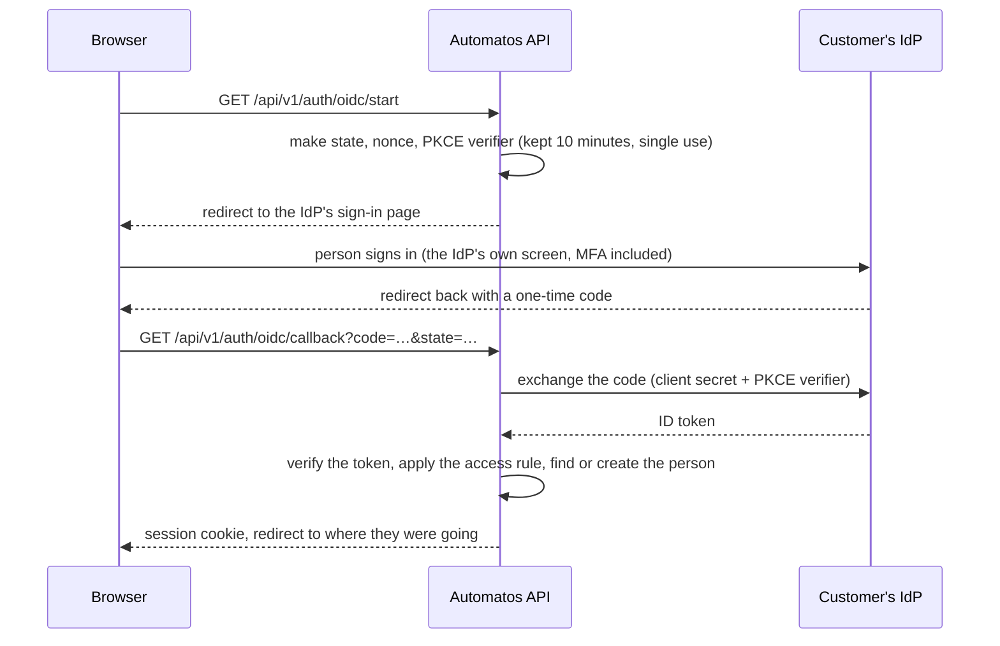

# PRD-277: Enterprise sign-in — a self-hosted install signs people in through the customer's own identity provider (OIDC)

**Status:** Draft for Dave's review. Written 19 Nov 2026 and revised the same day: trimmed to basic sign-in (G5), and every decision in §8 answered by Gerard (G6). No code has been written.
**Owner:** Gerard · **Reviewer:** Dave (auth)
**Grounded on:** `automatos-ai` `main @ abcc3f813` and `automatos-go` main, read on 19 Nov 2026. 277 is the next free number: 276 is the highest on main.
**Labels:** **[T]** read in code at that commit; **[I]** inferred; **[G]** Gerard's decision; **[?]** not known.
**Relates to:** PRD-257 (draft, on branch `docs/prd-257-enterprise-estate-agents`): this PRD takes over its decision D5 for people and answers its open question 4. Runner workload identity stays in PRD-257. PRD-266 §4.11 reserved the phone contract this PRD fills in. PRD-175 defined the edition seam this PRD extends.

**Decisions already taken [G] (Gerard, 19 Nov 2026):**

| | Decision |
|---|---|
| G1 | "This is how enterprise build will go: self hosted with OIDC." A customer install signs people in through the customer's own identity provider. |
| G2 | Clerk stays for the hosted SaaS. Nothing about Clerk sign-in changes there or in any app. |
| G3 | "It could be AWS, Azure, Google." The build is provider-neutral: standard OpenID Connect only, no provider-specific code. |
| G4 | OIDC is built before the first customer install, and that install's development environment is the test bed. |
| G5 | Basic OIDC sign-in is part of core, for every self-hosted install: "more people using Automatos the better". Roles taken from the identity provider, provisioning and removal driven by it, SAML and audit export are not part of this PRD. Agreed with Dave. |
| G6 | Every decision in §8 is answered (19 Nov 2026). |

---

## 1. Introduction

Automatos has two editions today. `saas` signs people in with Clerk. `local` has no sign-in at all: one operator, one workspace, and anyone who can reach the address is the admin.

Neither fits a company that installs Automatos in its own cloud. That company already has an identity provider (Microsoft Entra ID, Google Workspace, Okta, Keycloak, Amazon Cognito and others). Its staff must sign in with their work accounts, every action must be tied to a named person, and access must end when the company removes someone.

This PRD adds a third edition, `enterprise`. People sign in through the customer's identity provider using OpenID Connect (OIDC). OIDC is used only to prove who someone is at sign-in. After that, Automatos issues its own session, which it can expire and revoke.

**Terms used here**

- **Identity provider (IdP):** the customer's system that holds staff accounts and signs them in.
- **OIDC:** OpenID Connect, the standard way an application asks an IdP to sign someone in and gets back a signed statement (the **ID token**) saying who they are.
- **Issuer:** the IdP's address, as it appears in every ID token. **Subject:** the IdP's fixed id for one person. Together they name one person for good.
- **Claim:** one field in the ID token, such as `email` or `groups`.
- **Session:** what Automatos issues after sign-in so the browser or phone does not sign in again on every request.

## 2. What exists today

| Piece | Today | Read in | Verdict |
|---|---|---|---|
| Edition flag | `AUTH_EDITION` accepts `local` or `saas`. Any other value becomes `saas`, so a typo never opens the install. | `orchestrator/config.py:213-214` **[T]** | Extend with a third value. |
| Edition checks | 91 places outside tests compare the edition, almost all as `== "local"`. A third value would take the `saas` branch in every one: billing on, Clerk expected. | grep at `abcc3f813` **[T]** | Replace with named capabilities (Wave 1). This is the largest hidden risk. |
| Where a request gets its identity | `get_request_context_hybrid`. Registered token prefixes are resolved first; today only `amd_` (a paired device). Every other bearer token goes to Clerk. Then the platform API key, then the anonymous lane. | `core/auth/bearer_registry.py:60-62, 112-125`; `core/auth/hybrid.py:799-826` **[T]** | Reuse the registry. Its own header says new token kinds add an entry there, "never another branch in `hybrid.py`". |
| Who a person is | `users.clerk_user_id` (unique, nullable). `users` has no role column. | `core/models/core.py:1122-1131` **[T]** | Add a neutral identity link. Do not reuse the Clerk column. |
| Linking a sign-in to a person | `ensure_user_row` finds the row by Clerk id or inserts it. If another row already has the email it answers 409 and changes nothing. It never attaches an identity to an existing row by email. | `core/auth/user_link.py:95-132` **[T]** | Keep the rule: never link by email. |
| Reading someone's role | By joining `users.clerk_user_id`. The device lane is the exception: it reads by `users.id`. About 25 API files also query by Clerk id. | `core/auth/workspace_permission.py:99-129` **[T]**; sweep **[T]** | Route every read through one resolver keyed on `users.id` (Wave 2). The device lane proves a non-Clerk person works end to end. |
| Install-wide role | `super_admin`, `admin` or `user`, read only from Clerk token claims. | `core/auth/clerk.py:131-143` **[T]** | Needs a home that is not a Clerk claim. |
| Workspace roles | `owner`, `admin`, `editor`, `viewer` in `workspace_members`, with one permission matrix. One person can be in many workspaces. | `modules/policy/roles.py:105-150`; `core/workspaces/models.py:6-19` **[T]** | Reuse unchanged. |
| First sign-in | Creates the person, a **personal** workspace, an owner membership and a trial grant. | `core/auth/hybrid.py:283-357` **[T]** | Not right for a company install. Enterprise creates the person and joins them to shared workspaces. |
| Invitations | Stored by us, but Clerk sends the email, and accepting verifies a Clerk token. | `core/workspaces/invitations.py:158-212`; `api/team.py:444-458` **[T]** | Off in enterprise v1. Core has no mail sender of its own. |
| Sessions | The backend issues none for people. It only verifies Clerk's tokens. No cookie, no CSRF code, no sign-out route. | sweep: no `set_cookie`, `csrf` or logout in non-test code **[T]** | Build (Wave 3). This is new ground for core. |
| Step-up | 25 sensitive routes require a sign-in fresher than `STEP_UP_MAX_AGE_MINUTES` (10). The check reads Clerk's `fva` claim. `local` skips it. | `core/auth/step_up.py:175-189` **[T]** | Needs an OIDC equivalent. |
| Device tokens | `amd_` plus 32 random bytes; only the SHA-256 is stored; rotation with a 600-second overlap; revoke keeps the hash so the next call is refused. Local edition only. | `core/auth/device.py:187-220`; `services/mobile/pairing.py` **[T]** | Reuse the kernel for sessions and for phones. |
| Phone discovery | `GET /.well-known/automatos.json` lists `auth.modes`. The code comment reserves `"oidc"` and says this build never emits it. A test pins that. | `services/mobile/discovery.py:4-8` **[T]**; `tests/test_prd266_discovery.py:165-173` **[T]** | Emit it in enterprise. |
| Device rows | `mobile_devices.kind` may be `paired` or `clerk`. A test asserts `oidc` is refused. PRD-266 §4.11 says an OIDC phone becomes a third kind, not a new table. | `alembic/versions/prd266_mobile_devices.py:71` **[T]** | Widen the check in a new migration. |
| Web app seam | Components import `useAuth`, `useUser` and friends from `frontend/lib/auth-hooks.ts`, which switches on the edition. All API calls take their token from one getter on `apiClient`. | `frontend/lib/auth-hooks.ts`; `frontend/lib/api-client.ts:1469` **[T]** | Add a third provider behind the same seam. |
| Web app edition | Fixed when the image is built (`NEXT_PUBLIC_AUTH_EDITION`). Only the `local` image is published. *Correction (US-505): `images.yml` now builds and publishes an enterprise image too, `automatos-enterprise-frontend`.* | `frontend/lib/auth-edition.ts:33-37`; `.github/workflows/images.yml:253-257` **[T]** | Publish an enterprise image. See §9. |
| Phone app | Knows three modes (`clerk`, `device`, `oidc`) but registers only the first two. `expo-auth-session` is installed and unused. Its PRD planned an `oidc.ts` provider. | `automatos-go/src/auth/providers/registry.ts:10-13`, `types.ts:27`; `package.json:39` **[T]** | Add the provider in a later app release. Pairing covers phones until then. |
| JWT libraries | `PyJWT` 2.15.1 and `cryptography` 50.0.2 are installed. `PyJWKClient` already verifies Clerk's keys. No `authlib`, no `python-jose`. | `orchestrator/requirements.lock:2856, 791`; `core/auth/clerk.py:59-67` **[T]** | No new dependency needed. |
| Audit | `audit_logs` records who did what, with the person's id, IP and browser. Sign-ins are not recorded. | `core/workspaces/audit.py:10-55` **[T]** | Add sign-in events. |
| Private addresses | Outbound calls to private network ranges are always refused. | `core/security/web_access.py` **[T]** | An IdP inside the customer's network must still be reachable. See FR-9. |

## 3. Goals

- A person signs in to a self-hosted install with their work account, through any standards-compliant OIDC provider.
- Every action is tied to that named person in `audit_logs`.
- The customer controls who gets in, through their own IdP and an access rule, and sets what each person can do in Automatos.
- Access ends when the session expires, when an admin ends it, or when the person is deactivated.
- The `local` and `saas` editions behave exactly as they do today. Their existing tests pass unchanged.
- No Automatos code names a provider. One configuration shape works for all of them.
- An install is configured entirely from settings. Nobody edits the database by hand to get the first admin in.

## 4. Non-goals

- **Changing Clerk sign-in** in the hosted SaaS or in any app (G2).
- **SAML.** This PRD is OIDC only (G5).
- **Provisioning and removal driven by the IdP:** SCIM, logout notices, and re-checking a live session with the IdP. Access ends by session lifetime and by an admin (G5).
- **Roles taken from the IdP's groups or roles.** Roles are set in Automatos (G5).
- **Exporting the audit log.** Sign-in events are written to it. Sending it elsewhere is not in this PRD (G5).
- **More than one identity provider per install** (decision D-11).
- **Email invitations.** Core has no mail sender without Clerk.
- **Billing, credits, plans and trial grants.** They are off in enterprise, as they are in `local`.
- **Session mode** (the operator's own coding sessions as agents). PRD-253 already says that needs its own PRD in an enterprise edition.
- **Runner and workload identity** for agents' tools. That is PRD-257.

## 5. Design

### 5.1 The edition and what it switches

`AUTH_EDITION` gains a third value, `enterprise` (decision D-2). An unknown value still becomes `saas`.

Today the edition flag answers many different questions at once: is there a sign-in, is there billing, may one person act as operator. Those 91 comparisons are replaced by **named capabilities**, defined once beside the flag:

| Capability | `local` | `saas` | `enterprise` |
|---|---|---|---|
| How people sign in | Nobody signs in | Clerk | OIDC |
| A request with no credential acts as the operator | Yes, unless pairing is required | No | **No, never** |
| Several people, workspace roles, the Team page | No | Yes | Yes |
| Billing, credits, plans, quotas, trial grant | Off | On | Off |
| A personal workspace for each new person | n/a | Yes | **No** |
| Profile edited in Automatos | Yes | No (managed by Clerk) | No (managed by the IdP) |
| Step-up for sensitive actions | Skipped | Clerk's freshness claim | Sign in again at the IdP |
| Device pairing | By setting | No | By setting (D-7) |
| Session mode | Yes | No | No |
| Calls to Automatos's hosted services (theme revocations, Cloud sync, Cloud items) | On by default | It is the host | **Off unless switched on**, each by its own setting (D-12, US-704: `ENTERPRISE_CALLS_THEME_REVOCATIONS`, `ENTERPRISE_CALLS_CLOUD_SYNC`, `ENTERPRISE_CALLS_CLOUD_ITEMS`) |

Wave 1 builds the full table from the 91 call sites. The table above shows the intent, not the final list.

**Fail closed.** With `AUTH_EDITION=enterprise`:
- startup refuses to run unless the issuer, client id, client secret and the install's public address are set;
- `REQUIRE_AUTH` is forced on and cannot be turned off;
- the anonymous operator does not exist;
- every call to Automatos's hosted services is off until the operator switches that service on with its own setting (US-704). *Built: the three settings are off by default, and start-up refuses a value that is not true or false, Cloud sync without theme revocations and Cloud items without Cloud sync.*

### 5.2 Signing in from a browser

Automatos's backend is the OIDC client. The browser never holds a token from the IdP.

- **Flow:** authorization code with PKCE (S256), plus `state` and `nonce`. No other flow is supported.
- **What the customer registers at their IdP:** one web application with one redirect address, `https://<install>/api/v1/auth/oidc/callback`.
- **What Automatos learns:** only what the ID token says. It does not call the IdP's user-info or directory APIs in v1.

### 5.3 Sessions

A session issued and stored by Automatos (decision D-3):

- **The token** is opaque: a prefix (`ams_`) and 32 random bytes. Only its SHA-256 is stored, the same way device tokens are.
- **In a browser** it travels in a cookie the page's scripts cannot read: `__Host-` prefixed, `HttpOnly`, `Secure`, `SameSite=Lax`.
- **It is resolved through the bearer registry.** A new entry maps the `ams_` prefix to a session resolver. The resolver reads the token from the `Authorization` header or, when there is none, from the cookie.
- **Two clocks:** an idle timeout and an absolute lifetime. Defaults: 2 hours idle, 12 hours absolute (decision D-15).
- **A new session is made at every sign-in.** A session from before sign-in is never upgraded.
- **Cross-site request forgery:** a request that changes something and is authenticated by cookie must come from the install's own origin and carry a header a cross-site form cannot send. A request authenticated by an `Authorization` header is exempt.

The web app and the API are served from one address (`/` and `/api` on one host), so the cookie is same-origin and no CORS change is needed.

### 5.4 People, identities and roles

**Identity.** A new table, `user_identities`, links a person to `(issuer, subject)`, unique on the pair. `users.clerk_user_id` is untouched and stays Clerk's.

**Never by email.** A sign-in is matched to a person only by issuer and subject. If the email in the token is already on another person's row, the sign-in is refused with a clear message for an admin, and no row changes. This is today's rule in `ensure_user_row`, and it is also what Microsoft tells applications to do: its `email` claim "isn't guaranteed to be correct".

**Who gets in (the access rule).** The first gate is the customer's own IdP: only people assigned to the application there can complete sign-in. Automatos adds a second gate, `OIDC_REQUIRED_CLAIMS`: named claims that must have given values. For an issuer shared by many organisations (Google's, or Microsoft's multi-tenant addresses) startup refuses to run without such a rule, because otherwise anyone with an account at that provider could sign in. That list of shared issuers cannot be complete; the rule is the control. Startup also refuses a default role (`ENTERPRISE_DEFAULT_ROLE`) with no rule, and a rule on a claim every valid token carries (`iss`, `aud`, `azp`, `exp`, `iat`, `nbf`, `nonce`, `auth_time`, `at_hash`, `c_hash`, `sid`, `jti`), which would let everyone in.

**First sign-in.** The person's row and identity link are created. No personal workspace and no trial grant. What they can reach is decided next.

**Workspaces and roles.** Roles live in `workspace_members`, as today, and are set in Automatos: an admin gives a person a workspace and a role on the Team page. A person who has signed in but is in no workspace is shown as waiting. Sign-in never changes a role someone already has.

A default role for everyone who passes the access rule is a setting (decision D-4). The default is none: signed in, in no workspace, sees a page saying to ask an admin.

**Install admins (decision D-6).** `users` gains a nullable `system_role`, read only in enterprise. `ENTERPRISE_BOOTSTRAP_ADMINS`, a list in settings, makes the named people install admins when they first sign in, and at any sign-in while the install has no active install admin (counted under the lock the last-admin guard takes), so a list corrected after a mistyped first try still works. Once an install admin exists, the list does nothing for people who already exist. The list names subjects, or emails where the IdP marks the email verified in the standard `email` claim. A listed person becomes the default workspace's owner when it has none, and an admin of it when it has one. That is how the first admin gets in without anyone touching the database. After that, an install admin can make another person one, in Automatos.

### 5.5 Step-up

The 25 sensitive routes keep their gate. In enterprise the gate reads when the person last proved who they are, stored on the session (`auth_time` from the ID token). When that is older than `STEP_UP_MAX_AGE_MINUTES`, the route answers with a body the web app recognises. The web app sends the person through `/start` again. That start asks the IdP to make them sign in again, with `max_age=0` and, where the IdP takes it, `prompt=login`. Like every sign-in, it also asks for `auth_time` in the ID token with the `claims` parameter (§5.9). The callback then refreshes the session's `auth_time`. These parameters only ask: freshness is judged from the returned token's `auth_time` alone. An IdP that ignores them signs people in as before, but returns no `auth_time` or an old one, and the step-up fails closed (`step_up_no_auth_time`, `step_up_refused`). So an install whose IdP never sends it cannot use the admin actions (§5.9). Fresh means not earlier than the step-up's start; the ID token's 60-second leeway allows only for the two clocks disagreeing, either way. A step-up starts only from the install's own pages or the address bar (`Sec-Fetch-Site` `same-origin` or `none`); a browser that sends no such header is let through, since a step-up can only refresh the session's own person.

### 5.6 Signing out and losing access

- **Sign out** revokes the session on the server, clears the cookie, and sends the browser to the IdP's end-session address when its metadata lists one.
- **An admin can end** one session or all of a person's sessions, and can deactivate a person. `users.is_active` already exists and the device lane already checks it.
- **A person removed at the IdP** cannot start a new session. Their existing session ends at its absolute lifetime at the latest.

### 5.7 Phones

Two steps (decision D-7).

**Now: pairing, bound to a person.** The device lane is allowed in enterprise. A signed-in person creates a pairing code in Settings, and the phone that uses it acts as **that person**, with their role. In `local` a paired device acts as the operator; in enterprise it never does. Today's Automatos Go release already supports pairing, so phones work on day one with no app release.

**Later: sign in on the phone.** The phone opens the system browser at Automatos's own start address, the person signs in at the IdP, and Automatos hands the app a one-time code that it exchanges for a device token. The device row gets `kind = 'oidc'`. This is decision D-8: the phone talks to Automatos, and Automatos talks to the IdP. The customer still registers one application and one redirect address, and no IdP token is ever on a phone.

**Discovery.** In enterprise the document lists `auth.modes: ["oidc", "device"]` (or `["oidc"]` when pairing is off) and an `oidc` block. The app picks the first mode it supports, so today's release uses pairing and a later release uses sign-in. The schema stays `automatos-discovery/v1`.

The app work is a companion PRD in `automatos-go`. Core only defines the contract.

### 5.8 Web app

- `resolveEdition()` accepts `enterprise`. A third provider sits behind `auth-hooks.ts`, giving the same shapes the components already use.
- **Sign-in page:** one button, "Sign in with <name>", which goes to `/api/v1/auth/oidc/start`. No password field, no sign-up, no reset: those belong to the IdP.
- **Signed-out visitors:** `middleware.ts` gets a third branch that sends a browser with no session cookie to the sign-in page. The API remains the real check.
- **API calls:** the token getter returns nothing in enterprise; the cookie travels by itself. The Next.js server routes that call the API on the browser's behalf forward the cookie.
- **Who am I and what is my role:** read from the API. Today the `saas` build reads the role from Clerk's session data (`contexts/role-context.tsx:51-73`).
- **Team page:** members and role changes stay. Invitations are hidden. People waiting for a workspace are listed.
- **Profile:** read-only, with a line saying the account is managed by the organisation's identity provider.

### 5.9 Provider neutrality

Automatos reads the provider's own metadata document (`<issuer>/.well-known/openid-configuration`) and uses only what the OIDC standard defines. Differences between providers are handled by settings, never by code.

| Provider | Issuer looks like | Groups in the ID token | What to watch |
|---|---|---|---|
| Microsoft Entra ID | `https://login.microsoftonline.com/<tenant>/v2.0` | Optional. Above 200 groups the list is left out of the token. App roles arrive in `roles`. | `email` is optional and unverified. Use the tenant's own issuer, never `common`. An access rule on `groups` fails for a person over the limit; a rule on an app role does not. |
| Google Workspace | `https://accounts.google.com` | None | One issuer for every Google account, so the access rule must require the `hd` (domain) claim. |
| Okta, Auth0 | `https://<domain>` | Through a custom claim | The claim's name is the customer's choice; the access rule names it. |
| Keycloak | `https://<host>/realms/<realm>` | Through a mapper | May sit on a private address with a private certificate authority (FR-9, FR-10). Used in CI. |
| Amazon Cognito | `https://cognito-idp.<region>.amazonaws.com/<pool>` | `cognito:groups` | The claim name contains a colon; the access rule's syntax must allow it. |
| AWS IAM Identity Center | **[?]** | **[?]** | AWS's FAQ says it supports only SAML applications; its user guide describes OAuth 2.0 applications. Confirm before telling an AWS customer it works. |

Groups matter in this PRD only for the access rule. Roles are set in Automatos.

**Endpoint hosts.** Automatos calls two addresses the metadata names: the token endpoint and the keys address (`jwks_uri`). Each must be on the issuer's own host, or on a host listed in `OIDC_ENDPOINT_HOSTS`. The sign-in page (`authorization_endpoint`) is opened by the browser, not by Automatos, so its host is not limited. Some providers publish the two on other hosts:

| Provider | Token endpoint and keys address | What to list in `OIDC_ENDPOINT_HOSTS` |
|---|---|---|
| Google Workspace | Token endpoint `https://oauth2.googleapis.com/token`; keys `https://www.googleapis.com/oauth2/v3/certs` | `oauth2.googleapis.com, www.googleapis.com` |
| Amazon Cognito | Token endpoint on the user pool's domain (`https://<prefix>.auth.<region>.amazoncognito.com/oauth2/token`, or the pool's custom domain) | That domain |
| Microsoft Entra ID | Both on `login.microsoftonline.com`, the issuer's host | Nothing |
| Keycloak | Both under the realm's own address (`https://<host>/realms/<realm>/protocol/openid-connect/token` and `…/certs`), the issuer's host | Nothing |
| Okta | Both on the Okta domain, the issuer's host (`https://<okta-domain>/oauth2/<server>/v1/token` and `…/v1/keys`; the org server's under `/oauth2/v1/`) | Nothing |

Google's and Entra's rows were checked against their published metadata documents, and Cognito's against Amazon's token endpoint documentation, on 20 Nov 2026. Keycloak's and Okta's were checked against their own documentation on 20 Nov 2026. Auth0 is left out: its documentation read that day did not settle the token endpoint's host for a tenant with a custom domain. Other providers are not listed until their metadata is checked.

**Signing out at the provider (§5.6).** Automatos sends only `client_id` and `post_logout_redirect_uri` (`<install>/sign-in`, which the customer registers at the provider), and no `id_token_hint`, because no ID token is kept. Providers differ on that: Keycloak accepts it with `client_id` and shows its own confirm page; Okta's documentation requires `id_token_hint`, so the person may stay signed in at Okta; Auth0 asks the person to confirm. The conformance run (US-703) records what each does. The end-session address must be on the issuer's host or a host in `OIDC_ENDPOINT_HOSTS`, as the token endpoint and the keys address must; one anywhere else is treated as no address, and the person is signed out of Automatos only.

**Shared issuers.** Startup refuses these with no access rule: Google's (`https://accounts.google.com`; Google's OpenID Connect page says its ID tokens carry that or `accounts.google.com`, but `OIDC_ISSUER` must be an https address, so the second form is refused at startup for that and is not on the list), and Microsoft's `common`, `organizations` and `consumers` authorities and the personal-accounts tenant `9188040d-6c67-4c5b-b112-36a304b66dad` (Microsoft's v2.0 OpenID Connect and ID token claims pages), with their v1 forms. Checked on 20 Nov 2026. Others are added only when the provider's own documentation shows one. The list cannot be complete: the access rule is the control.

**The email address.** `email_verified` speaks only for the standard `email` claim. An address read from any other claim (`OIDC_CLAIM_EMAIL` set to another name) counts as unverified and is not kept, unless the operator sets `OIDC_CLAIM_EMAIL_HOLDS_ONLY_VERIFIED_ADDRESSES=true` to say the provider puts only addresses it has verified in that claim. Set it only when that is true: a person who can edit that claim at the provider can take another person's address. `ENTERPRISE_BOOTSTRAP_ADMINS` reads only the standard `email` claim, whatever this says.

**`auth_time` (step-up, §5.5).** Every sign-in asks for it with the standard `claims` parameter, `{"id_token":{"auth_time":{"essential":true}}}` (OIDC Core §5.5). A step-up also sends `max_age=0` and `prompt=login`. All three only ask; whether a step-up passes is still read from the returned token's `auth_time` alone.

- **`claims`** is left out only when the provider's metadata says it does not take it: `claims_parameter_supported` present and anything but `true`. Discovery 1.0 reads an absent field as false. But OIDC Core says a provider that does not support the parameter should still answer with the claims it judges useful, ignores parameters it does not recognise, and never errors over a claim it does not return, even an essential one. Google, Microsoft, Okta and Auth0 publish no such field, and Google documents the parameter as the way to ask for `auth_time`. So absent is read as "send it".
- **`prompt=login`** is sent where the metadata's `prompt_values_supported` lists `login`. A provider listing its values without `login` is not sent it, because it may answer `invalid_request` (Initiating User Registration 1.0 §4.1). A provider that lists no values is sent it, because OIDC Core §15.1 requires every provider to support `prompt` "including ... none and login". The one exception is an issuer whose own documentation lists its values without `login`: Google's (`oidc_provider.PROMPT_LOGIN_UNLISTED_HOSTS`).

What each provider's documentation says, read on 20 Nov 2026:

| Provider | `auth_time` in the ID token | What its side needs |
|---|---|---|
| Okta | Always: one of the "base claims (always present)". `max_age` is an `/authorize` parameter, and `prompt=login` is documented: "Always prompt the user for authentication, regardless of whether they have an Okta session." The `claims` parameter is not listed. | Nothing. |
| Auth0 | Included when the request carries `prompt=login` or `max_age=0`. | Nothing: a step-up sends both. |
| Amazon Cognito | Listed among the ID token's claims; only `iss`, `sub`, `aud`, `exp` and `iat` are guaranteed. `prompt=login` "requires users to re-authenticate even if they have an existing session", and is "available in the managed login branding version only, not in the classic hosted UI". With the hosted UI (classic), Cognito "silently ignores `acr_values` and `max_age`". | Managed login, for a step-up to make the person sign in again. Whether an ordinary token carries `auth_time` is not settled by the documentation; the conformance run checks it. |
| Microsoft Entra ID | An optional claim ("Time when the user last authenticated", JWT), not in the token by default. `prompt=login` "forces the user to enter their credentials on that request". `max_age` is not among the documented request parameters; Entra documents the `claims` parameter for claims challenges. | Add `auth_time` to the ID token's optional claims in the app registration. |
| Google Workspace | "Provided when the `auth_time` claim is included in the authentication request and enabled in settings"; the request is the `claims` parameter Automatos now sends. `prompt` lists only `none`, `consent` and `select_account`, so no `prompt=login` is sent; `max_age` is not among the documented request parameters. | Enable `auth_time` in the client's settings. Nothing documented makes Google ask for the password again, so a step-up passes only when Google's `auth_time` is newer than the step-up's start. |
| Keycloak | Its metadata (built by Keycloak's `OIDCWellKnownProvider`; read in its source, not its documentation) lists `auth_time` among the claims, says it takes the `claims` parameter, and lists `none`, `login` and `consent` as prompt values. | Nothing found; the Keycloak CI job checks a step-up end to end. |

An install whose provider never sends `auth_time` signs in, but cannot use the admin actions: each refuses with `step_up_no_auth_time`.

Rows marked without **[T]** come from the providers' documentation and are **[I]** until the conformance run (US-703) proves them. The Microsoft rows were checked against Microsoft's documentation on 19 Nov 2026.

### 5.10 Settings

Names are provisional. Final names are fixed in each wave's PR and recorded in `orchestrator/reports/config-surface.json`.

| Setting | Default | What it is |
|---|---|---|
| `AUTH_EDITION` | `saas` | `enterprise` turns this edition on. |
| `OIDC_ISSUER` | none, required | The IdP's address, `https` only. |
| `OIDC_CLIENT_ID` | none, required | The application's id at the IdP. |
| `OIDC_CLIENT_SECRET` | none, required | From the install's Secret, never from plain settings. |
| `FRONTEND_URL` | none, required in enterprise | The install's public address, which the web app and the API share. An existing setting: its built-in `localhost` default does not count (US-103). |
| `OIDC_SCOPES` | `openid profile email` | What is asked for at sign-in. |
| `OIDC_DISPLAY_NAME` | `your organisation` | The text on the sign-in button. |
| `OIDC_REQUIRED_CLAIMS` | empty | Claims that must match before anyone is let in. Required for shared issuers and with a default role; never on a claim every token carries (§5.4). |
| `OIDC_CLAIM_EMAIL`, `OIDC_CLAIM_NAME` | `email`, `name` | Which claims carry these. |
| `OIDC_CLAIM_EMAIL_HOLDS_ONLY_VERIFIED_ADDRESSES` | `false` | `true` says the provider puts only addresses it has verified in the claim `OIDC_CLAIM_EMAIL` names, when that is not `email`, so they are kept as verified. Off, an address from such a claim is unverified and not kept. Risk: a person who can edit that claim at the provider can take another person's address (§5.9). `true` or `false`; start-up refuses anything else. |
| `OIDC_CA_BUNDLE_FILE` | empty | A certificate authority file for an IdP with a private certificate. |
| `ENTERPRISE_BOOTSTRAP_ADMINS` | empty | People who become install admins at first sign-in, or at any sign-in while the install has no active install admin (§5.4). |
| `ENTERPRISE_DEFAULT_ROLE` | `none` | Role in the default workspace for anyone who passes the access rule. A role needs `OIDC_REQUIRED_CLAIMS`: start-up refuses one with no rule. |
| `OIDC_ENDPOINT_HOSTS` | empty | Host names, comma separated, besides the issuer's own, on which the metadata may put the token endpoint and the keys address (§5.9). Host names only: no scheme, port, wildcard or address. |
| `OIDC_PENDING_SIGN_INS_MAX` | `10000` | Sign-ins started and not finished that may be held at once. At the ceiling a new start is never refused: the oldest sign-ins under way are ended to make room for it (§5.11). A whole number of at least 1. |
| `OIDC_PENDING_SIGN_INS_PER_ADDRESS` | `100` | Sign-ins started and not finished that one client address (one IPv4 address or one IPv6 /64, as the per-address rate limits count) may hold at once. The bound exists so that one address can never hold more than a small share of the table: when an address starts another, its own oldest are ended to make room. The default leaves room for a whole office or VPN signing in through one shared address in the same minute. Lower it where people reach the install from addresses of their own, so that one address's flood ends fewer of the others' sign-ins; raise it only for a shared address busier than that. A whole number of at least 1, and no greater than `OIDC_PENDING_SIGN_INS_MAX`: start-up refuses either otherwise. |
| `DEFAULT_WORKSPACE_ID` | none, required in enterprise | An existing setting (the local edition's one workspace): in enterprise, the workspace sign-ins are recorded in, `ENTERPRISE_DEFAULT_ROLE` gives a role in and the first admins own. A UUID; the migration Job makes the workspace with no owner. |
| `CLIENT_IP_HEADER` | none, required in enterprise | An existing setting: the header the proxy in front writes the caller's address to. Sign-in limits requests by that address and writes it to the audit log, so where sign-in is OIDC start-up refuses to start without it. Name the header your proxy sets on every request; if your proxies append to it instead, say how many in `CLIENT_IP_PROXY_COUNT`. |
| `CLIENT_IP_PROXY_COUNT` | empty | How many of your own proxies append the caller's address to `CLIENT_IP_HEADER`: 1 for one load balancer (an AWS application load balancer appends to `X-Forwarded-For`), 2 for a content network in front of one. The count is for proxies that append (the load balancer's default mode); one that passes the header on unchanged is not counted. The address is the value that many from the header's end, read with the header's repeated lines as one list; empty, it is the first value of the header's last line. A plain whole number from 1 to 8. In enterprise start-up requires it when `CLIENT_IP_HEADER` is `X-Forwarded-For` or `X-Original-Forwarded-For` (an operator whose proxies append to another header states it too), and refuses `0`, any other value out of range, and a count without `CLIENT_IP_HEADER`; it also refuses `CLIENT_IP_HEADER=Forwarded`, whose values are `for=` parameters, not addresses. In `local` and `saas` nothing about it stops start-up: an unusable count is logged once at start and ignored, so the address is read as if it were unset. A request whose header carries fewer values than the count is answered with the connection's address, and the first one logs one warning for the process (`core/client_ip_settings.py`, `core/security/client_ip.py`). |
| `ENTERPRISE_DEVICE_PAIRING` | `on` | Whether phones and browsers may pair. |
| `SESSION_IDLE_MINUTES`, `SESSION_ABSOLUTE_HOURS` | `120`, `12` | The two session clocks. |

`FRONTEND_URL` is not a new setting: the existing one is reused as the install's public address.

### 5.11 Security requirements

These are requirements, each with a test.

- **The ID token** is accepted only if its signature verifies against the IdP's published keys, with an allow-list of algorithms (RS256, PS256, ES256). `none` and the shared-secret algorithms are refused.
- **Issuer** must equal `OIDC_ISSUER` exactly, and the metadata document must name the same issuer.
- **Audience** must contain the client id. With several audiences, `azp` must equal the client id.
- **Times:** `exp`, `iat` and `nbf` are checked with at most 60 seconds of leeway.
- **`nonce`** must match the one made at `/start`. **`state`** must match and is single use.
- **Redirect addresses** are exact. The "where to go after sign-in" value accepts only a path on the install's own address.
- **Keys rotate:** an unknown key id triggers one refetch of the keys, rate limited.
- **Nothing sensitive is logged or shown:** no code, token, secret or raw IdP error reaches a log line, a span or the browser.
- **Rate limits** on `/start` and `/callback`, per IP.
- **Unfinished sign-ins are bounded so that a flood costs the flooder.** Each one records the SHA-256 of the client address that started it, never the address. One address holds at most `OIDC_PENDING_SIGN_INS_PER_ADDRESS`: starting another ends that address's oldest, so a person who clicks sign-in again and again loses only their own older attempts. Overall, at `OIDC_PENDING_SIGN_INS_MAX`, a start ends the oldest sign-ins under way and is stored, in the same transaction; a start is never refused for want of room. What this does not do: a sign-in ended to make room comes back as "sign-in expired, start again". With enough addresses a flood can still end real sign-ins at the ceiling, but only by starting more than the ceiling inside the few seconds a real sign-in takes to come back, and it can never stop a new sign-in from starting.
- **Server keys and the platform key are unchanged** as machine credentials. They cannot pass step-up, as today. The platform API key stays as it is (decision D-14).

### 5.12 Audit

New `audit_logs` actions, each with the person's id where one is known, the IP and the browser:
`auth:sign_in`, `auth:sign_in_refused` (with the reason: access rule, email conflict, deactivated, invalid token), `auth:sign_out`, `auth:session_revoked`, `auth:step_up` (confirmed, or refused: another person, no `auth_time`, a stale or a future one, an ended session, a deactivated person), `auth:identity_linked`, `auth:bootstrap_admin` (with the workspace role given). Role changes are already recorded. Every sign-in makes the default workspace, when it is missing, before its first row, so no row is lost to a missing workspace.

### 5.13 Where more can plug in

Sign-in is built so that more can be added later without changing the code that issues sessions or checks permissions.

- **One interface for proving who someone is.** `start` sends the person to sign in. `finish` returns a verified identity: issuer, subject, email, name, when they signed in, and the claims. OIDC is the one implementation in core.
- **One hook, after the identity is verified and before the session is issued.** Code registered there may refuse the sign-in or set the person's memberships. With nothing registered, sign-in behaves exactly as this PRD describes.
- **One service for people.** Creating a person, linking an identity, setting a membership, deactivating a person and ending their sessions are functions in one module. Sign-in and the Team page call them, and so can other code.
- **Registration closes at startup.** Nothing can be registered after the first request, and registering the same thing twice is an error.

## 6. Waves and user stories

Each wave is one pull request or a short series. Waves 1 to 3 change nothing for `local` or `saas`. CI is the only gate: nothing here is run on a developer's machine.

### Wave 0: Record the decisions

#### US-001: Decisions answered and a tracking issue opened · S
**Description:** As a maintainer, I want the §8 decisions answered and an issue opened before any code, because AGENTS.md requires an issue before changing authentication, permissions or tenancy.

**Acceptance Criteria:**
- [x] Every row in §8 is marked decided, with Gerard's choice.
- [ ] An issue in `automatos-ai` links this PRD and lists the waves.
- [x] This PRD's status line says which decisions are settled.

### Wave 1: One place that knows what an edition does

#### US-101: A table of every edition check · M · analysis only
**Description:** As a maintainer, I want every place that compares the edition listed with what it decides, so that the third edition's behaviour is chosen on purpose in each one.

**Acceptance Criteria:**
- [x] A table lists each call site: file, line, what it switches, and its value in `local`, `saas` and `enterprise`. It is [PRD-277-EDITION-CHECKS.md](PRD-277-EDITION-CHECKS.md), which finds 99 lines in the backend and says why that is more than the 91 first counted.
- [x] Each row names one capability from a short list. No capability means "is this edition X".
- [x] Rows where the enterprise answer is not obvious are listed for Gerard, not guessed: G-1 to G-11 in that file.

#### US-102: Named capabilities replace raw comparisons · L
**Description:** As a developer, I want code to ask "is billing on" instead of "is the edition local", so that adding an edition cannot silently switch a feature.

**Acceptance Criteria:**
- [x] Capabilities are defined in one module, `orchestrator/core/editions.py`. They are not in `config.py`, which is over the file-size limit and must not grow.
- [x] No file outside that module and the tests compares `AUTH_EDITION` or reads `IS_LOCAL_EDITION` / `IS_SAAS_EDITION`. A test fails if one does. `orchestrator/tests/test_prd277_no_raw_edition_checks.py`; `config.py` (the flag's own file, whose boot guards US-103 rewrites) and `alembic/versions/` (history) are exempt, and the two helpers are deleted.
- [x] A truth-table test pins every capability for `local` and `saas` to today's behaviour.
- [ ] All existing tests pass unchanged, except those that assert on the removed comparisons, which are listed in the PR.
- [ ] `ruff check` and the backend test lanes pass in CI.

#### US-103: `enterprise` is a known edition that refuses to start half-configured · M
**Description:** As an operator, I want a clear refusal at startup when a required setting is missing, so that an install never runs open.

**Acceptance Criteria:**
- [x] `AUTH_EDITION=enterprise` is accepted. An unknown value still becomes `saas`.
- [x] Startup aborts, naming the missing setting and never its value, when any of the issuer, client id, client secret or public address is unset. The public address is the existing `FRONTEND_URL`, set in the environment (§5.10).
- [x] `REQUIRE_AUTH` is true in enterprise whatever the environment says.
- [x] A request with no credential gets 401. A test proves no operator context is ever returned (`orchestrator/tests/test_prd277_enterprise_no_operator.py`).
- [x] Until Wave 4 merges, startup in enterprise aborts with "not available in this build", so a half-built edition cannot be run. One switch, `OIDC_SIGN_IN_IN_THIS_BUILD` in `orchestrator/core/edition_start_up.py`, which Wave 4 deletes. Deleted in Wave 4 part 2, with its check and its message: the start-up checks are now the only gate, a correctly configured install starts, and each half-configured one names what is missing (`test_prd277_enterprise_start_up.py`).
- [x] New settings are in `config-surface.json`: `OIDC_ISSUER`, `OIDC_CLIENT_ID`, `OIDC_CLIENT_SECRET`.
- [ ] Behind proxies that append to the client address header (issue #1600), startup names `CLIENT_IP_PROXY_COUNT`, never a value, when `CLIENT_IP_HEADER` is `X-Forwarded-For` or `X-Original-Forwarded-For` and the count is unset, when the count is not a plain whole number from 1 to 8, and when a count is set without `CLIENT_IP_HEADER` (that one named before the missing header); it names `CLIENT_IP_HEADER` when that is `Forwarded`. `local` and `saas` start whatever the two hold, and ignore a count that is not one. The chart refuses the same values, and `config.FORWARDED_ALLOW_IPS`, at render. *Built: `core/client_ip_settings.py` holds the rules, `core/edition_start_up.py` applies them, and `core/security/client_ip.py` reads the address that many values from the header's end (`test_prd277_client_ip_proxy_count.py`, `test_client_ip_behind_appending_proxies.py`). Left unticked until CI runs the tests.*

### Wave 2: People without Clerk

#### US-201: An identity link that is not Clerk's · M · migration review
**Description:** As the platform, I want to record which issuer and subject a person signs in with, so that a person is recognised without a Clerk id.

**Acceptance Criteria:**
- [x] A migration adds `user_identities` (`user_id`, `issuer`, `subject`, timestamps), unique on (`issuer`, `subject`). It chains onto the single head, is idempotent, and survives a database built by `create_all`. The two head-pin tests move. `prd277_w2_identities_20261120`, which also carries US-203's column; the model is `core/models/user_identities.py`.
- [x] A link service finds or creates the link. It never matches on email. `link_identity` in `core/auth/user_link.py`.
- [x] When the token's email is already on another person's row, the service raises a refusal that carries a clear message and changes no row. `IdentityLinkRefused`, whose message names no issuer, subject or email.
- [x] The link service uses an email only when the provider verified it. `link_identity` takes a required `email_verified` with no default. Only a verified email becomes the person's address and is checked against other people's addresses; an unverified one gets the per-identity placeholder, is no conflict, and is kept nowhere, so it never holds an address from its real owner.
- [x] Tests cover: first link, repeat sign-in, email held by another row, and two first requests racing. `orchestrator/tests/test_prd277_w2_identity_link_realdb.py`, with exact comparison of issuer and subject; the migration in `test_prd277_w2_migration.py`.

#### US-202: One way to ask who this person is · L · security review + Dave
**Description:** As a developer, I want every membership and role read to go through one resolver keyed on `users.id`, so that it works for any way of signing in.

**Acceptance Criteria:**
- [x] `workspace_permission.py`, `workspace_admin.py` and the workspace lookups in `hybrid.py` read by `users.id`. The reads are `core/auth/person.py`; a Clerk caller's `users.id` is read inside the same statement (`core/auth/clerk_person.py`), so each check makes the round trips it made before.
- [ ] No SQL outside `core/auth/clerk*.py` and `core/auth/user_link.py` mentions `clerk_user_id`. A test fails if one does. The API files that query by Clerk id are changed to the resolver and listed in the PR. The test is `orchestrator/tests/test_prd277_us202_no_clerk_id_sql.py`. One statement is still on its allow-list, keyed on the statement itself so a second use in the same function fails: in `_stream_tool_loop` in `consumers/chatbot/service.py`, the read of the driving user's Clerk user ID from their `users.id` (the way back, not a lookup by Clerk user ID). That function is far over the 50-line limit, so moving the read to `clerk_id_row` in `core/auth/clerk_person.py` means splitting the function first.
- [ ] In `saas`, every existing auth, permission and boundary-sweep test passes unchanged.
- [ ] Dave and the security reviewer sign off before merge.

#### US-203: An install-wide role that does not come from a Clerk claim · S · migration review
**Description:** As an install admin, I want my admin role stored by the install, so that it does not depend on a Clerk token.

**Acceptance Criteria:**
- [x] A migration adds nullable `users.system_role`. `prd277_w2_identities_20261120`, with a CHECK to `super_admin`, `admin` and `user`; no such column or equivalent existed.
- [x] It is read only when the edition's sign-in capability is OIDC. In `saas` the role still comes from Clerk claims, and a test proves the column is ignored there. `core/auth/system_role.py`; `orchestrator/tests/test_prd277_w2_system_role_realdb.py`.
- [x] Changing it is audited. `set_system_role` writes one `audit_logs` row (`user:system_role_changed`) through `AuditService.log`, in the same commit as the change.

### Wave 3: Sessions

#### US-301: A session Automatos issues, stores and resolves · L · security review
**Description:** As a signed-in person, I want a session that lasts while I work and ends when it should, so that I do not sign in on every request.

**Acceptance Criteria:**
- [x] A migration adds `auth_sessions` (person, token hash, created, last seen, idle and absolute expiry, `auth_time`, revoked at and why, IP, browser). `prd277_w3_sessions_20261120`, unique on the token hash and indexed on the person; the model is `core/models/auth_sessions.py`, and the two head pins moved.
- [x] Tokens are `ams_` plus 32 random bytes. Only the SHA-256 is stored, using the hashing kernel device tokens use. `issue_session` in `core/auth/sessions.py` (`mint_token`, `hash_secret`); a lookup is confirmed in constant time (`secrets_match`).
- [x] `BEARER_RESOLVERS` gains an `ams_` entry. `hybrid.py` gains no branch. The lane is `core/auth/session_lane.py`.
- [x] The resolver accepts the token from the `Authorization` header, or from the `__Host-` cookie when there is no header. The cookie is read only when there is no `Authorization` header of any scheme and no API key; its name is `SESSION_COOKIE_NAME`, which start-up refuses without the `__Host-` prefix.
- [x] An expired, revoked or unknown session gets 401 with a code the web app recognises. `{"code": "session_ended", "reason": "expired" | "revoked" | "unknown"}`. When the token came from the cookie, the answer also clears the cookie.
- [x] A session for a deactivated person is refused. At resolution (`session_ended`, `revoked`), and `issue_session` issues none (`SignInRefused`).
- [x] The session records the ID token's `sid` when the IdP sends one. `auth_sessions.idp_session_id`; Wave 4's callback passes it to `issue_session`.
- [x] `last seen` is written at most every 5 minutes, as the device lane does. With the idle clock, by the device lane's own `LAST_SEEN_WRITE_INTERVAL`.
- [x] The resolver is registered only in enterprise. In `local` and `saas` an `ams_` token is refused. The new capability `issues_sessions` gates the registry entry (`LANE_REGISTERED_WHEN`); elsewhere an `ams_` token reaches the Clerk lane as before and is refused there. Tests: `test_prd277_w3_session_lane.py`, `test_prd277_w3_sessions_realdb.py`, `test_prd277_w3_migration.py`.

#### US-302: Requests that change things cannot be forged from another site · M · security review
**Description:** As a signed-in person, I want another website to be unable to act as me, so that a session cookie is safe.

**Acceptance Criteria:**
- [x] A cookie-authenticated request with an unsafe method is refused unless its origin is the install's own and it carries the required header. `core/auth/session_cookie.py`: the `Origin` (else the `Referer`) must equal `FRONTEND_URL`'s origin, and `SESSION_CSRF_HEADER` must be present; checked before the session is looked up.
- [x] A request authenticated by the `Authorization` header is not subject to the check.
- [x] Tests cover: cross-site form post refused, same-origin fetch allowed, header-authenticated call allowed. `test_prd277_w3_session_lane.py`.

#### US-303: Ending a session · M
**Description:** As a person or an admin, I want to end a session now, so that access stops when it should.

**Acceptance Criteria:**
- [x] `POST /api/v1/auth/sign-out` revokes the caller's session and clears the cookie. `api/auth_sessions.py`. Sending the browser to the IdP's end-session address (§5.6) needs the IdP metadata, which Wave 4 reads. Since Wave 4 part 2 the answer is 200 `{"redirect_to": …}` when the metadata lists one (`oidc_sign_in.end_session_address`), else 204.
- [x] An admin route revokes one session or every session of a person. It requires step-up. `POST /api/v1/auth/sessions/{session_id}/revoke` and `POST /api/v1/auth/people/{user_id}/sessions/revoke`, with `GET /api/v1/auth/people/{user_id}/sessions` to list them. Step-up in enterprise goes through `step_up.confirm_by_signing_in_again`, which US-406 filled.
- [x] Deactivating a person revokes their sessions and device tokens in the same transaction. `deactivate_person` in `core/auth/people.py`, served as `POST /api/v1/auth/people/{user_id}/deactivate` (step-up).
- [x] New routes are in `route-manifest.json`, authenticated and authorised. Sign-out by the session itself; the others by an install admin on the session lane, in the boundary sweep. In `local` and `saas` each route's declared method answers 404 before any authentication or database work; another method on the same path answers 405, as it does in every edition.

#### US-304: Sign-ins are in the audit log · S
**Description:** As a compliance reviewer, I want every sign-in, refusal and sign-out recorded, so that I can show who had access and when.

**Acceptance Criteria:**
- [x] The actions in §5.12 are written through `AuditService.log`. Wave 3 writes `auth:sign_in`, `auth:sign_in_refused` (deactivated), `auth:sign_out`, `auth:session_revoked` and `user:deactivated`. `auth:step_up`, `auth:identity_linked`, `auth:bootstrap_admin` and the other refusal reasons are named in `core/auth/session_audit.py` and written by Wave 4's code (US-401 to US-406). Wave 4 writes `auth:identity_linked`, the `access_rule`, `email_conflict` and `invalid_token` refusals, and `auth:step_up` (confirmed, or refused with its reason) through it. `auth:bootstrap_admin`, like a hook's `member:role_changed`, is an `audit_logs` row added to the first sign-in's own transaction (`stage_bootstrap_admin`), so the grant and its row land together or not at all; the commit that writes it is `AuditService.log`'s for `auth:identity_linked`.
- [x] A refusal records its reason and never the token. `record_sign_in_refused` in `core/auth/session_audit.py` writes only the reason, one of the four in §5.12.
- [x] A test asserts one row per event with the person's id where known. `test_prd277_w3_sessions_realdb.py`: sign-in, refusal, sign-out, ended sessions and deactivation.

### Wave 4: OIDC

#### US-401: Reading the provider's metadata and keys · M · security review
**Description:** As the platform, I want to read the IdP's published metadata and signing keys safely, so that I can verify what it sends.

**Acceptance Criteria:**
- [x] The metadata is fetched from `<OIDC_ISSUER>/.well-known/openid-configuration` over `https` only. Its `issuer` must equal the setting. `core/auth/oidc_provider.py`, through `core/auth/oidc_http.py`; its endpoints must be `https` too, and it must offer the code flow, PKCE S256, an allowed algorithm and a secret-based client authentication.
- [x] Keys are fetched with the `PyJWKClient` pattern already in `core/auth/clerk.py`. An unknown key id causes one rate-limited refetch. The same pattern (a key set held five minutes, a key picked by `kid` among signing keys, built by PyJWT's `PyJWK`), fetched through `oidc_http` rather than by `PyJWKClient` itself, which opens addresses with `urllib` where the pinned connection and the private-address rule cannot apply. At most one refetch a minute.
- [x] The configured issuer's host is reachable even on a private address. No other private address becomes reachable through sign-in. A test proves both. (PRD-282 covers the private addresses an operator may name for other purposes.) The token endpoint and key address come from the metadata; any host other than the issuer's must resolve to public addresses only, and the checked address is the one connected to. `test_prd277_w4_oidc_http.py`.
- [x] `OIDC_CA_BUNDLE_FILE` is honoured. Trusted on top of the operating system's authorities; start-up refuses a file it cannot read. `test_prd277_w4_provider_and_tokens.py` signs in against a provider whose certificate only that file trusts.
- [x] If the IdP cannot be reached, the API still starts; sign-in answers with a clear error and `/health/bootstrap` reports it. The `oidc_provider` stage of the background boot (`core/auth/sign_in_start_up.py`); sign-in sends the person to `/sign-in?error=identity_provider_unavailable`.
- [x] No new Python dependency. `httpx`, `PyJWT` and `cryptography`, already pinned.

#### US-402: Start and callback · L · security review + Dave
**Description:** As a person, I want to sign in with my work account, so that I can use Automatos.

**Acceptance Criteria:**
- [x] `GET /api/v1/auth/oidc/start` makes `state`, `nonce` and a PKCE verifier, keeps them server-side for 10 minutes, and redirects to the IdP. In `oidc_pending_sign_ins` (§12, entry 5), as digests of the state and nonce; the state is also bound to the browser by a `__Host-` cookie, so a callback carried to another browser is not a sign-in there.
- [x] `GET /api/v1/auth/oidc/callback` exchanges the code, verifies the ID token against every rule in §5.11, and issues a session. The state is ended in one `DELETE … RETURNING` before the code is exchanged, so two callbacks with one state cannot both use it (`core/auth/oidc_pending.py`); the rules are `core/auth/oidc_tokens.py`.
- [x] Tests, each against the fake issuer (US-407): wrong signature, `alg: none`, wrong issuer, wrong audience, expired, missing or wrong nonce, reused state, replayed code, redirect to another host. `test_prd277_w4_sign_in_realdb.py`, `test_prd277_w4_provider_and_tokens.py`, `test_prd277_w4_pending_realdb.py`.
- [x] No token, code or secret appears in any log line or response body. A test scans the captured logs. Over a sign-in that succeeds and each way one fails; the access log replaces a sign-in path's query with `?{redacted}`.
- [x] Both routes are public, rate limited per IP, and in `route-manifest.json`. `oidc_start_ip` and `oidc_callback_ip`, 300 per IP per 10 minutes each; both 404 unless the edition signs in with OIDC.

#### US-403: The access rule · M
**Description:** As an operator, I want to say which claims a person must have, so that only my organisation's people get in.

**Acceptance Criteria:**
- [x] `OIDC_REQUIRED_CLAIMS` is parsed at startup. A malformed value aborts startup. `core/auth/access_rule.py`: `name=value` rules joined by `;`, split at the first `=`; every rule must hold, and a rule holds for a claim that is that exact string or a list holding it. The refusal names the setting, never its value; `local` and `saas` never read it (`test_prd277_w4b_access_rule.py`). A rule on a claim every token carries (`access_rule.PROTOCOL_CLAIMS`) is malformed, and a default role with no rule stops start-up.
- [x] A sign-in whose token fails a rule is refused, audited, and shown a plain message. Before any person is found or created: `/sign-in?error=sign_in_not_allowed`, one `auth:sign_in_refused` row with reason `access_rule`, no person, link or session. Only the verified ID token's claims are read (`test_prd277_w4b_sign_in_rules_realdb.py`).
- [x] With an issuer on the known shared list and no rule, startup aborts and says why. `access_rule.SHARED_ISSUERS`: Google's issuer (its https form: a configured issuer must be https), Microsoft's `common`, `organizations` and `consumers` addresses (v1 and v2.0) and the personal-accounts tenant. The list cannot be complete; the rule is the control (§5.9).
- [x] A claim name containing a colon or a dot can be named. A name is one top-level claim read literally: `cognito:groups`, `https://example.test/roles`.

#### US-404: First sign-in · M
**Description:** As a new person, I want my first sign-in to work without anyone preparing my account, so that I can start as soon as an admin gives me a workspace.

**Acceptance Criteria:**
- [x] A `users` row and an identity link are created. No personal workspace, no trial grant. Through `people.link_person`, with one `auth:identity_linked` row.
- [x] With `ENTERPRISE_DEFAULT_ROLE=none`, the person is signed in and in no workspace, and the API tells the web app so. `403 {"code": "workspace_required"}` from the session lane.
- [x] With `ENTERPRISE_DEFAULT_ROLE` set to a role, the person gets that role in the default workspace at first sign-in only. `viewer`, `editor` or `admin`; start-up refuses any other value, and a role without `DEFAULT_WORKSPACE_ID`.
- [x] A later sign-in changes no membership. A test proves a role an admin changed survives the next sign-in.
- [x] Sign-in succeeds when the ID token carries only a subject and an email. With no `auth_time`, the session records the epoch, so a step-up can never pass on it.
- [x] The caller passes the provider's own statement that the email is verified, taken from the verified ID token, as `email_verified`; the link service (US-201) enforces it: an email the token does not mark verified is no email. Only the JSON `true` counts: absent, `false`, `"true"` and `1` are not verified.
- [x] The refusal a person sees never differs by whether an address is already known to the install. An email conflict and a bad token give the same answer (`/sign-in?error=sign_in_refused`); only the audit row's reason differs.

#### US-405: The first admin · S
**Description:** As the operator, I want to name the first admins in settings, so that nobody edits the database to get in.

**Acceptance Criteria:**
- [x] A person listed in `ENTERPRISE_BOOTSTRAP_ADMINS` becomes an install admin and owner of the default workspace at first sign-in, or at any sign-in while the install has no active install admin (counted under the last-admin guard's lock). Once an admin exists, the list does nothing for a person who already exists. It is audited. `core/auth/first_admin.py`, after the access rule: `system_role = admin`, an `owner` membership and `owner_id` when the workspace has no owner, else an `admin` membership (one owner stays one owner), one `auth:bootstrap_admin` row naming the workspace role. Entries are `sub:<subject>` or `email:<address>`; a pattern, an address without a dotted domain or an entry without a prefix stops start-up. `DEFAULT_WORKSPACE_ID` is now required in enterprise.
- [x] An entry given as an email matches only when the token marks the email verified. The `email` claim with `email_verified` the JSON `true`; the domain compared without regard to case.
- [x] An install admin can make another person an install admin. It requires step-up and is audited. `POST /api/v1/auth/people/{user_id}/system-role` (`people.set_install_role`): only a role the admin's own includes, never on a higher stored role, `user:system_role_changed`. The last active install admin can neither lose the role nor be deactivated (409, `people.LastInstallAdmin`; `test_prd277_w4b_install_admins_realdb.py`).
- [x] The migration Job creates the default workspace with no owner, as the local first-run seed does. `core/seeds/seed_default_workspace.py`, in the full seed loader, only where sign-in is OIDC; insert-if-absent.

#### US-406: Step-up by signing in again · M
**Description:** As a person doing something sensitive, I want to prove it is still me, so that a borrowed session cannot change roles or keys.

**Acceptance Criteria:**
- [x] In enterprise, `check_step_up` reads `auth_time` from the session. `step_up.confirm_by_signing_in_again`: older than `STEP_UP_MAX_AGE_MINUTES` is 403 `step_up_required` with `step_up.start`, never a `clerk_error`.
- [x] Every `/start` sends the `claims` parameter asking for `auth_time` in the ID token as essential, unless the metadata's `claims_parameter_supported` says otherwise; `/start?step_up=1` also sends `max_age=0` and `prompt=login`, the last only where the metadata lists `login` or lists no prompt values and the issuer is not one whose documentation leaves `login` out (§5.9; `oidc_sign_in.auth_time_values`, `test_prd277_w4b_auth_time_request_realdb.py`). A provider that ignores them still signs people in. The callback updates the session's `auth_time` only when the returned token carries a fresh one. Only for a live session, and only for the same person: another person, an ended session, or an `auth_time` older than the step-up's start is refused (`step_up_refused`), changes nothing and never switches the session's person. No session is issued; `auth:step_up` is written either way (`core/auth/step_up_sign_in.py`, migration `prd277_w4b_step_up_20261120`).
- [x] No `auth_time` in the token means the step-up fails. Reason `no_auth_time`, shown as its own code, `step_up_no_auth_time`. An `auth_time` that is not a finite number, is before the epoch or is out of range refuses the sign-in (`sign_in_refused`), never an error. Fresh means not earlier than the step-up's start and not later than now, each allowing only the 60-second clock leeway (`future_auth_time`, `stale_auth_time`). A step-up started from another site (`Sec-Fetch-Site` neither `same-origin` nor `none`) is refused.
- [ ] The `local` and `saas` step-up tests pass unchanged. Not edited in Wave 4 part 2; CI proves it.

#### US-407: A fake identity provider for CI · M
**Description:** As a developer, I want a small OIDC issuer that runs inside the test process, so that every flow is tested without a real provider.

**Acceptance Criteria:**
- [x] A test helper serves metadata, keys, an authorize step that approves at once, and a token endpoint, on a loopback address, using `PyJWT` and `cryptography` only. `orchestrator/tests/helpers_fake_oidc_provider.py`, over TLS with a certificate made at run time.
- [x] It can be told to misbehave: wrong signature, rotated key, missing claim, shared issuer. Also `alg: none`, HS256 with the public key, a wrong or missing nonce, other metadata, an error status and a redirect.
- [ ] A separate CI job runs the sign-in flow against a real Keycloak container. It is allowed to fail at first and becomes required at the end of the wave. `.github/workflows/oidc-keycloak.yml` and `test_prd277_w4_keycloak_sign_in.py`: the image pinned by digest, the certificate, credentials and realm made in the job, run only when the sign-in code, its settings, the default workspace's seed, the Team routes or its tests change. A failure fails the job (no `continue-on-error`); the job is named non-required. Not yet seen green, and not yet required.

#### US-408: One interface and one hook for sign-in · M
**Description:** As a developer, I want sign-in written against a small interface with a hook, so that another way of proving identity can be added without touching sessions or permissions.

**Acceptance Criteria:**
- [x] The start and callback routes call an identity interface. OIDC is its implementation in core. `core/auth/sign_in_methods.py` (`IdentityMethod`), `core/auth/oidc_sign_in.py`, called through `core/auth/sign_in_flow.py`.
- [x] A hook runs after the identity is verified and before the session is issued. It can refuse the sign-in, or set memberships through the people service. A refusal is audited as the access rule's.
- [x] Creating a person, linking an identity, setting a membership and deactivating a person are functions in one module, used by sign-in and by the Team routes. In `core/auth/people.py` (`link_person`, `set_membership`, `deactivate_person`) and used by sign-in. Since Wave 4 part 2 the Team routes call it too: a role change (`change_member_role`), a removal (`member_to_remove`, `end_membership`) and accepting an invitation (`person_for_invitee`, `join_from_invitation`), each the same statements the routes ran before, so `local` and `saas` behave as they did. The rules live in the service, not the route: the target is looked up in the workspace named only, the owner's role is never changed, nobody is made owner and the owner is never removed (`MemberNotFound` is 404, `MembershipRefused` 400, with the messages the routes gave before).
- [x] Registration is refused after startup, and registering the same thing twice raises an error. Closed when the background boot runs and by the first sign-in.
- [x] A test registers a second, fake implementation and a hook, and signs in through them with no change to the session or permission code. `test_prd277_w4_sign_in_realdb.py`.
- [ ] With no hook registered, every US-402 and US-404 test passes unchanged. They register none; CI proves it.

### Wave 5: Web app

#### US-501: The enterprise provider behind the existing seam · M
**Description:** As a developer, I want the web app's sign-in hooks to work in enterprise, so that components do not change.

**Acceptance Criteria:**
- [x] `resolveEdition()` accepts `enterprise`. `frontend/lib/edition-name.ts` (re-exported by `lib/auth-edition.ts`, with `isEnterprise`); an unknown value is still `saas`.
- [x] `auth-hooks.ts` returns the same shapes in enterprise, filled from a "who am I" API call. `GET /api/v1/auth/me` (`api/auth_web.py`: the person, their install role, their workspaces; it answers a person in no workspace, which the shared request context refuses), read by `components/enterprise/enterprise-session-provider.tsx` and handed to the five hooks by `lib/enterprise/auth-hooks.ts`; no token (the session cookie travels by itself).
- [x] The role comes from the API, not from Clerk session data. `RoleProvider` reads `/me`'s `system_role` in enterprise (`lib/enterprise/session-context.ts`); `user` until it answers.
- [x] No component outside the existing Clerk files imports `@clerk/*`. `lib/enterprise/__tests__/clerk-import-guard.test.ts` pins the files that import it to the sixteen that did before this wave. Every file this edition adds (any path naming `enterprise`, and `lib/edition-name.ts`, `lib/public-routes.ts`, `lib/initials.ts`) is followed through its imports, and none reaches `@clerk/*`.
- [ ] `tsc` and `vitest` pass in CI.

#### US-502: Sign-in page, signed-out redirect and sign-out · M
**Description:** As a person, I want one button that takes me to my organisation's sign-in, so that I never see a password field that is not my employer's.

**Acceptance Criteria:**
- [x] `/sign-in` in enterprise shows one button with `OIDC_DISPLAY_NAME`. No sign-up, no reset. `components/enterprise/enterprise-sign-in.tsx`; the name from the public `GET /api/v1/auth/sign-in-page`, checked at start-up to be plain text of 1 to 64 characters. `return_to` is passed through to the start route, whose own rule decides it; `?error=` shows one sentence per refusal code (`lib/enterprise/messages.ts`), none saying whether a person is known.
- [x] A browser with no session cookie is sent to `/sign-in` and returned to where it was going afterwards. `lib/enterprise/session-middleware.ts` (middleware.ts's enterprise branch; `/api/…` and the public routes are left alone), and a 401 from `/me` does the same from the browser. The public routes are one list (`lib/public-routes.ts`), read by the middleware in saas and enterprise and by the session provider, so a public page is never sent to sign in.
- [x] A 401 from the API in the middle of work shows "your session ended" with a button to sign in again. Unsaved text in the chat box is kept. Any 401 from the app's own API (apiClient, the chat route, and a request made outside apiClient through `lib/enterprise/session-fetch.ts`) opens `session-ended-dialog.tsx` over the mounted page, with the reason when the API's `session_ended` gives one. The chat box's text is kept in the tab's sessionStorage for 30 minutes with the id of the person who typed it, and given back only to that person (`lib/enterprise/kept-chat-draft.ts`); it is removed at sign-out, when another person signs in, and once expired.
- [x] Sign-out calls the API and then goes to the IdP's end-session address when there is one. `signOutOfEnterprise` (`lib/enterprise/session-context.ts`), else `/sign-in`. The address must parse as a plain `https:` address with a host and no user name or password (`safeEndSessionAddress`).
- [ ] The browser e2e lane runs sign-in, a protected page and sign-out against the fake issuer. `e2e/browser/specs/enterprise-sign-in.spec.ts` (`@enterprise`) is written; it runs only where `E2E_ENTERPRISE_APP_URL` names an enterprise stack, which no lane job starts yet.

#### US-503: Server routes forward the session · S
**Description:** As a person, I want pages that load through the web app's own server to know who I am.

**Acceptance Criteria:**
- [x] The theme files route and `boot-server.ts` forward the session cookie in enterprise, as they use Clerk's token in `saas`. The session cookie alone, never a bearer (`lib/enterprise/server-session.ts`); the boot cache is keyed by the cookie's SHA-256.
- [x] The chat and stream routes pass the cookie through. With the workspace, and for an unsafe call the browser's cross-site header and Origin; no API key or Authorization, which would stop the API reading the cookie. The chat route hands a 401's own body back.
- [x] A test covers each. `lib/enterprise/__tests__/server-routes.test.ts`, `session-transport.test.ts`.

#### US-504: Team and profile screens · M
**Description:** As an admin, I want to see who has signed in and set their workspace and role.

**Acceptance Criteria:**
- [x] The Team page lists members and people waiting for a workspace. Role changes work and require step-up. `GET` and `POST /api/workspaces/{workspace_id}/team/waiting[/{user_id}]` (`api/team_waiting.py`: `members:invite`, an install admin, step-up on the POST; `people.give_workspace` places the person in a role below owner, audited `member:added_from_waiting`). The list is oldest first, a page at a time (`limit` 1 to 100, `offset`, and the `total`), and the card pages through it. In enterprise `useStepUp` sends the browser to sign in again (`lib/enterprise/step-up.ts`), and the change is made again on return. The waiting list and the admin's buttons are components only enterprise renders (`components/team/enterprise-*.tsx`), so the Team page runs no new hook in `local` or `saas`.
- [x] Invitations are not shown in enterprise. No "Invite Member", no pending invitations, no invite dialog.
- [x] The profile page is read-only and says the account is managed by the organisation's identity provider. `app/settings/profile/enterprise-profile.tsx`.
- [x] An admin can end a person's sessions and deactivate them. Two buttons on each member's row for an install admin (`components/team/enterprise-member-actions.tsx`), on the existing step-up routes.
- [x] `/me` reports, for each workspace, the role the permission gate uses: the member row's role as it is, and `owner` only for the workspace's owner with no member row.

#### Wave 5 notes

- **One web build per cookie and header name.** The web image expects the API's default session cookie name (`__Host-automatos_session`) and cross-site header name (`X-Automatos-CSRF`); they are fixed when the web app is built. An install that changes either on the API needs its own web build.
- **Open points for the owners** (not built in this wave):
  - An install admin has no screen across workspaces in this edition: the waiting list and the access buttons are on each workspace's Team page.
  - Theme files and boot cannot carry a workspace, so a person outside the default workspace sees the base theme.
  - The browser e2e spec cannot run until a lane starts this edition's stack (web and API) on one host, with a standalone fake provider.

#### US-505: An enterprise web image · S
**Description:** As an operator, I want a published web image for this edition, so that I do not build one myself.

**Acceptance Criteria:**
- [ ] `images.yml` publishes an enterprise build beside the local one, signed and scanned the same way. *Built: `enterprise-frontend` in images.yml's matrix, published as `ghcr.io/automatosai/automatos-enterprise-frontend` with the build arguments in "US-505 notes", on both arches, through the same measure, scan, sign, signature check, release-tag and edge steps as every published image; the local image's name, tags, inputs and cache scope are unchanged (`tests/test_prd262_image_matrix.py`). Each build job starts the image it pushed (`frontend/scripts/check-enterprise-image.sh`, `tests/test_prd277_enterprise_web_image.py`): it must stop without `BACKEND_INTERNAL_URL` and with a bad `MEDIA_ORIGINS`, naming the setting and not the value, pass the local image's standalone checks on `/sign-in`, and carry the start-up's media origin in a page's content security policy. Left unticked until a push to main has published and signed it and that check has passed on both arches. GHCR makes the new package private; an organisation owner makes it public once (`docs/deployment-infrastructure/releases.md`).*
- [ ] It calls the API by relative address, so the same image works on any install's address. *Built, and left unticked until CI runs the tests and an enterprise image is built from it. `apiClient`'s base address is `''` in enterprise (`lib/api-base-url.ts`), so every call is `/api/…` on the page's own origin; `lib/__tests__/api-base-url.test.ts` loads `apiClient` as each edition builds it and checks the address it fetches. The enterprise build refuses `NEXT_PUBLIC_API_URL` and `NEXT_PUBLIC_WS_URL` (`enterprise-build.js`; `lib/enterprise/__tests__/runtime-csp.test.ts`). The WebSocket address comes from the page (PRD-279 US-401), the CLI's `/automatos-host.json` answers the request's own origin, and the workflow stream route's GET reaches the API at `BACKEND_INTERNAL_URL` (`lib/enterprise/__tests__/one-image-server.test.ts`). The server stops at start-up without `BACKEND_INTERNAL_URL` (`lib/enterprise/start-up.ts`), but never during `next build`. The Playbook webhook address a person copies is the page's origin in enterprise (`lib/api-address-shown.ts`, `lib/__tests__/api-address-shown.test.ts`), and an unset `NEXT_PUBLIC_API_URL` is inlined as `""` in every enterprise build, never as `undefined`.*
- [ ] The chart selects it when `edition.authEdition=enterprise`. *Built: `frontend.enterpriseImage` (`ghcr.io/automatosai/automatos-enterprise-frontend`) runs in place of `frontend.image` in that edition, on port 3000 with `BACKEND_INTERNAL_URL` (the API's Service) and `MEDIA_ORIGINS` (`frontend.mediaOrigins`), and the local edition runs the local image as before (`charts/automatos/tests/enterprise_web_test.yaml`). The routes on one host are the ingress's (chart 0.11.0): in every edition it sends `/api`, `/ws` and exactly `/.well-known/automatos.json` to the API and the rest to the web app, and routes no `/exports/`, `/health`, `/metrics`, `/docs` or `/.well-known/` prefix (`charts/automatos/tests/ingress_test.yaml`). chart.yml's install lane starts the enterprise image built in the same run from the chart's enterprise render, in a namespace that enforces "restricted", and checks that it becomes ready, sends a page to sign in and puts the media origin it was given in the sign-in page's policy (`deploy/kind/strict.sh enterprise`); the enterprise API is rendered there but not started, and nothing signs in. Left unticked until CI runs the suite and that lane.*

#### US-505 notes

- **Same origin is required, not chosen.** The session cookie is `__Host-` and same-origin, the cross-site header is added only to same-origin requests, and the CSRF check reads the Origin (§5.3). So the enterprise build does not accept an absolute API or WebSocket address at all: `next build` stops, naming the variable, rather than producing an image that sends its calls where the cookie does not go.
- **Build arguments for the enterprise image:** `NEXT_PUBLIC_AUTH_EDITION=enterprise`, and `NEXT_PUBLIC_API_URL` and `NEXT_PUBLIC_WS_URL` left empty (the Dockerfile's defaults). Any other value, spaces included, stops the build; an unset one is made `""` before Next inlines it. `NEXT_PUBLIC_MEDIA_ORIGINS` and the Clerk build arguments are not read by this edition.
- **Settings the web app reads when it runs** (environment of the web container, not `NEXT_PUBLIC_*`): `BACKEND_INTERNAL_URL`, the API's origin inside the cluster, required, `http(s)://<host>[:port]` with no path and no trailing slash; `MEDIA_ORIGINS`, the media origins for the content security policy (PRD-279 US-402), optional, at most 16 origins in at most 1,024 characters. Name the narrowest host that works, the storage's own public host, rather than the wildcard form `https://*.<domain>.<suffix>`. A bad or missing value stops the server at start-up with one line naming the setting; `next build` never runs the check.
- **Redirects carry no policy.** The seven `redirects()` in `next.config.js` are answered before the middleware runs (Next's execution order: `headers`, `redirects`, then middleware), so in this edition they carry the other security headers but no content security policy; a redirect renders no document for one to govern.
- **What the `images.yml` line needs:** a second frontend entry with the build arguments above and the same inputs as the local one (which now include `frontend/csp-policy.mjs` and `frontend/enterprise-build.js`), published, signed and scanned as the local one is, and its boot test given `BACKEND_INTERNAL_URL` or it will not start.
- **What the chart line needs:** the web container on port 3000 with `BACKEND_INTERNAL_URL` (the API service's in-cluster origin) and `MEDIA_ORIGINS`. On the one host, `/api` and `/ws` go to the API, and so does exactly `/.well-known/automatos.json` (the discovery document a phone reads); everything else goes to the web app, its own `/.well-known/apple-app-site-association`, `/.well-known/assetlinks.json` and `/automatos-host.json` among it. `/exports/`, `/health`, `/metrics` and `/docs` are not exposed outside the cluster: nothing in the web app or the phone app calls `/exports/`, and a route is added to the ingress when something needs it. The ingress routes `/.well-known/automatos.json` in every edition, but in this edition it answers an error until phone sign-in for this edition is built (Wave 6, US-602). Since `/health` is not exposed, in this edition the web app's connection indicator asks the public `GET /api/v1/auth/sign-in-page` instead of `/health` (under `/api`, so routed to the API on every install; it needs no session, reads one setting, does no database work and is not one of the two sign-in steps limited per address), and counts any answer as reachable and only a network failure, a timeout or a 502, 503 or 504 as down (`lib/enterprise/api-reachable.ts`). The web app's own `/api/chat`, `/api/workflows/stream`, `/api/themes/files/…` and `/api/generated-images/…` handlers share their paths with API routes, so on one host they are bypassed, as intended: they are pass-throughs to the API routes of the same path.

### Wave 6: Phones

#### US-601: A paired phone acts as the person who paired it · M · security review
**Description:** As a signed-in person, I want to pair my phone from Settings, so that I can use Automatos Go with my own role.

**Acceptance Criteria:**
- [ ] The device lane is allowed in enterprise when `ENTERPRISE_DEVICE_PAIRING` is on. *Built: the setting is read in `config.py` only (on when unset, §5.10) and combined with the edition in one place, `editions.with_device_pairing_setting`, so enterprise's `device_pairing` is on only for a plain on form and `local` and `saas` never move; start-up refuses a malformed value naming the setting, never its value; the chart sets it from `edition.enterprise.devicePairing` and refuses it in `config`. With it off the device lane is 401 before any lookup and the pairing routes are 404 (`test_prd277_w6_paired_phone.py`, `test_prd277_edition_capabilities.py`, the chart's `enterprise_api_test.yaml` and `enterprise_refusals_test.yaml`). Left unticked until CI runs the tests.*
- [ ] The pairing code is made by a signed-in person and the device row carries their `user_id`. *Built: in enterprise `POST /api/v1/mobile/pairing-codes` takes only a person signed in on the session lane, for themselves, in a workspace they are an active member of; a device, a key and the all-workspaces view are 403. The code's row, and so the paired device, carries their `users.id`. `local` keeps its workspace-admin gate (`test_prd277_w6_paired_phone.py`, `test_prd277_w6_paired_phone_realdb.py`). Left unticked until CI runs the tests.*
- [ ] The device's role is that person's membership role. A test proves a paired device in enterprise is never the operator and never `super_admin` by default. *Built: in enterprise a device resolves at each request to the person in its row with the plain `user` role, whatever their install role and even when their email is `LOCAL_OPERATOR_EMAIL`; its workspace role is read from their membership at each request (`test_prd277_w6_paired_phone_realdb.py`). Left unticked until CI runs the tests.*
- [ ] Deactivating the person or removing their membership refuses the device, as `device.py` already checks. *Built: proved in enterprise: deactivating revokes the device (`device_revoked`), an inactive person and an ended or deleted membership are 401 at the next request (`test_prd277_w6_paired_phone_realdb.py`). Left unticked until CI runs the tests.*
- [ ] In enterprise, agreeing that push notifications leave through the push service is an install admin's decision, not a workspace admin's. *Built: in enterprise both push-consent routes need an install admin signed in on the session lane who also runs the workspace, and the answer needs a fresh sign-in; each answer is one `push:consent_changed` audit row. A workspace admin who is not an install admin, a device and a key are 403. `local` and `saas` are unchanged (`test_prd277_w6_paired_phone.py`, the web app's `phones-devices-enterprise.test.tsx`). Left unticked until CI runs the tests.*
- [ ] A device paired while the install was `local` does not survive the install becoming `enterprise`: every paired device is revoked when the edition changes, and a test proves a token issued before the change is refused. *Built: each worker, before it serves, compares the edition with the one the install last started as (a `system_settings` row; an install with none was `local`) under an advisory lock, and on a change revokes every paired device and pending code once, with one `device:revoked` row each, in either direction; until the check has run, device tokens and pairing are refused (`test_prd277_w6_paired_phone.py`, `test_prd277_w6_paired_phone_realdb.py`). Left unticked until CI runs the tests.*

#### US-602: Discovery says how to sign in · S
**Description:** As the phone app, I want the server to say which sign-in it offers, so that one app works with every install.

**Acceptance Criteria:**
- [ ] In enterprise, `auth.modes` is `["oidc", "device"]`, or `["oidc"]` with pairing off, and `auth.oidc` carries what the app needs to start sign-in. *Built: `auth.oidc` is `{start_url}`, the install's own `/api/v1/auth/oidc/start` on its API address, and nothing about the identity provider; `clerk` is null and `pairing.enabled` follows the setting (`test_prd266_discovery.py`). Left unticked until CI runs the tests.*
- [ ] `local` and `saas` documents are byte-for-byte unchanged. *Built: both are pinned as the exact bytes the route sends (`test_prd266_discovery.py`). Left unticked until CI runs the tests.*
- [ ] `tests/test_prd266_discovery.py` is updated: `"oidc"` is emitted only in enterprise. *Built. Left unticked until CI runs the tests.*

#### US-603: Signing in on the phone · L · security review
**Description:** As a person, I want to sign in on my phone with my work account, so that I do not need a code from a browser.

**Acceptance Criteria:**
- [ ] The phone starts at Automatos's own start address with its own PKCE challenge. Automatos returns a one-time code to the app's registered link, and the app exchanges it with its verifier for a device token.
- [ ] A migration widens `ck_mobile_devices_kind` to allow `oidc`. `tests/test_prd266_mobile_devices_model.py:333` flips.
- [ ] The token is an `amd_` device token with today's rotation and revoke.
- [ ] No IdP token is sent to the phone.
- [ ] The return link is one of a fixed set of app links, never a value the caller supplies.

#### US-604: The app's OIDC provider · companion PRD in `automatos-go`
**Description:** As a phone user, I want Automatos Go to offer "Sign in with my organisation" when the server says so.

**Acceptance Criteria:**
- [ ] Specified in an app PRD under `automatos-go/docs/prd/`, against the contract in US-602 and US-603.
- [ ] That PRD checks the app standard's rules 7.6, 8.4, 13.2c and 13.6, and Apple's sign-in guideline for enterprise accounts.

### Wave 7: Install and proof

#### US-701: The chart installs this edition · S
**Description:** As an operator, I want to switch the edition on from the chart's values.

**Acceptance Criteria:**
- [ ] `edition.authEdition=enterprise` renders the OIDC settings and reads `OIDC_CLIENT_SECRET` from the existing Secret. *Built (chart 0.11.0): `edition.enterprise.*` sets `FRONTEND_URL`, `CLIENT_IP_HEADER`, `OIDC_ISSUER`, `OIDC_CLIENT_ID`, and when given `CLIENT_IP_PROXY_COUNT` (`clientIpProxyCount`, required when `clientIpHeader` is `X-Forwarded-For`), `OIDC_DISPLAY_NAME`, `OIDC_SCOPES`, `OIDC_REQUIRED_CLAIMS`, `OIDC_ENDPOINT_HOSTS`, `ENTERPRISE_DEFAULT_ROLE`, `ENTERPRISE_BOOTSTRAP_ADMINS` and `OIDC_CA_BUNDLE_FILE` (a ConfigMap mounted read-only), with `DEFAULT_WORKSPACE_ID` from `edition.defaultWorkspaceId`, in the API and the migration Job; `OIDC_CLIENT_SECRET` is a required key of `existingSecret`, and `config.OIDC_CLIENT_SECRET` stops the render in every edition. The other settings in §5.10 have working defaults and go in `config`; the session cookie's name and the CSRF header's may not, because the enterprise web image fixes them. The chart README's "The enterprise edition" lists each. Left unticked until CI runs the suite.*
- [ ] Rendering fails with a clear message when a required value is missing. *Built: each required value missing stops the render with a message naming the value and the setting, never its content, and so do the values the API would refuse at start where the chart can judge them (an issuer or public address that is not https with a host, a header that is not one name, a role it does not know or one with no access rule, a sign-in button text, scopes without `openid`, an endpoint host that is not a host name, a default workspace that is not a UUID), and so do an issuer or public address holding a user name or password, a CA ConfigMap name Kubernetes would refuse, a CA key that is not a plain file name, and an `edition.authEdition` spelled other than `local`, `enterprise` or `saas`; `config.OIDC_CLIENT_SECRET` stops the render in every edition. What only the API can judge, it still judges at start: the access rule's and the first admins' syntax, an issuer many organisations share, and whether the CA file holds a certificate. Left unticked until CI runs the suite.*
- [ ] helm-unittest covers both. *Written: `charts/automatos/tests/enterprise_api_test.yaml` and `enterprise_refusals_test.yaml`, and the install notes in `notes_test.yaml`. Left unticked until CI runs them.*

#### US-702: A setup guide for each provider · M
**Description:** As a customer's administrator, I want exact steps for my IdP, so that I register the application correctly the first time.

**Acceptance Criteria:**
- [ ] Guides for Microsoft Entra ID, Google Workspace, Okta, Keycloak and Amazon Cognito, each with the application registration, the redirect address, the claims to send and the matching settings.
- [ ] Each guide says what that provider cannot do (for example, Google sends no groups), and what to set on the provider's side so `auth_time` arrives, from §5.9's table: Entra's optional claim, Google's client setting, Cognito's managed login. An install whose provider never sends `auth_time` cannot use the admin actions: each step-up refuses with `step_up_no_auth_time`.
- [ ] AWS IAM Identity Center is either documented from a working run or listed as not supported, with the reason.

#### US-703: Proof on the first install · M
**Description:** As the team, I want the edition proven against real providers on the dev install, so that we know it works before a customer relies on it.

**Acceptance Criteria:**
- [ ] On the dev install: sign-in, first-admin bootstrap, a role set by an admin, step-up, sign-out, session expiry and a paired phone, each recorded with the evidence.
- [ ] The same run against at least three providers from §5.9, with the differences found written into the table.
- [ ] One independent security review of Waves 2 to 4, with findings fixed or recorded.

#### US-704: The operator switches on each call to Automatos's hosted services · M
**Description:** As an operator, I want to choose which of Automatos's hosted services my install calls, so that nothing leaves the install unless I switched it on (D-12).

**Acceptance Criteria:**
- [ ] One named setting for each hosted service the code calls: theme revocations (the revocation pull, its schedule, its sync status and manual pull), Cloud sync (the Cloud Sync routes and the sync pull) and Cloud items (the "Items brought from Cloud" routes). The list is the `calls_automatos_cloud` rows of `PRD-277-EDITION-CHECKS.md`; a service added later gets its own setting. *Built: `ENTERPRISE_CALLS_THEME_REVOCATIONS`, `ENTERPRISE_CALLS_CLOUD_SYNC` and `ENTERPRISE_CALLS_CLOUD_ITEMS` (`config.py`, in `reports/config-surface.json`), one capability each (`calls_theme_revocations`, `calls_cloud_sync`, `calls_cloud_items`) replacing `calls_automatos_cloud` everywhere. A setting stops requests; it never stops the install reading what it already holds. Theme revocations also guards the pull itself (`revocation_pull.pull_feed`); the revocations and revoked keys a pull stored still apply once it is off (`revocation_sync_state` reads them everywhere but on the hosted edition). Cloud sync also guards a Cloud theme's package download and the Cloud screenshot address. Cloud items covers the Sync's item and plugin passes, and the bundle and package requests themselves (`services/marketplace_bundles/items_gate.py`, asked by `items_feed` and `plugin_import` before each request); the "Items brought from Cloud" routes only read what the install holds, so they answer in an enterprise install whatever the setting says, and an item brought earlier is still reviewed before anyone adds it (open question 9). Cloud sync needs theme revocations and Cloud items needs Cloud sync, refused at start (`core/edition_start_up.py`) and at chart render; no setting turns another on. The web app reads which are on from `GET /api/hosted-services`. The chart sets each from `edition.enterprise.hostedServices` and refuses them in `config`. In an enterprise install Sync now is an install admin's, after a fresh sign-in (`api/marketplace_cloud_sync.py` `require_sync_admin`, then `require_step_up`; open question 10); `local` is unchanged. Left unticked until CI runs the tests.*
- [ ] Each setting is off by default in enterprise, and the code reads it through a capability, never the edition's name. *Built: `editions.current()` gives each capability its setting's value only where the row says `hosted_services_by_setting` (enterprise), through `with_hosted_service_settings`, on only for `1`, `true`, `yes` or `on` (config's own switch forms), so a malformed value reads as off, and start-up refuses it. Every call site reads the capability (`test_prd277_us704_hosted_services.py`, `test_prd277_edition_capabilities.py`). Left unticked until CI runs the tests.*
- [ ] `local` and `saas` behave as before: `local` calls each service as today, and `saas` remains the host. *Built: their rows hold the three answers and no setting can move them; saas keeps its 404 sentences, and the local and hosted web builds answer from the build and ask nothing. Left unticked until CI runs the tests.*
- [ ] Tests prove each service is not called in enterprise with its setting off, is called with it on, and that `local` and `saas` are unchanged. *Built: `test_prd277_us704_hosted_services.py` (with the HTTP transports and every client seam set to fail and record if touched, and every "off" test asserting that record is empty: no request, no scheduled job, the routes' 404 before anything runs; with it on, the request reaches a mock Automatos host; a key revoked while on still revoked once off; items brought while on still listed and reviewed once off); `test_prd277_us704_cloud_sync_admin.py` (who may run a Sync in enterprise, and `local` unchanged); the chart's `enterprise_api_test.yaml` and `enterprise_refusals_test.yaml`; the web app's `hosted-services.test.ts`, `use-hosted-services.test.tsx`, `cloud-install-gate-enterprise.test.ts`, `enterprise-hosted-services.test.tsx` and `revocations-panel-enterprise.test.tsx`. Left unticked until CI runs them.*

#### US-704 notes

- **Two lists that name hosts follow D-12 too (#1605).** Neither makes a request by itself. The enterprise web app's content security policy names no Automatos host and no host of the hosted edition's sign-in provider or payment provider (`frontend/csp-policy.mjs` `enterpriseContentSecurityPolicy`, at build time and in the middleware). Automatos Cloud's screenshot path is in `img-src` only while Cloud sync is on: the web container reads `ENTERPRISE_CALLS_CLOUD_SYNC` when it starts, as it reads `MEDIA_ORIGINS`, and the chart gives it `edition.enterprise.hostedServices.cloudSync`. An agent's `http_request` tool may call only the install's own hosts, and its description names only those (`agent_http_own_hosts_only`, `modules/tools/execution/http_hosts.py`). `local` and `saas` are unchanged. Tests: `lib/enterprise/__tests__/enterprise-own-hosts-csp.test.ts`, `runtime-csp.test.ts`, `tests/test_prd277_d12_agent_http_hosts.py`, the chart's `enterprise_web_test.yaml` and `hosted_services_web_refusals_test.yaml`, and the image check (`frontend/scripts/check-enterprise-image.sh`), none of them run until CI runs them.

## 7. Functional requirements

- **FR-1:** `AUTH_EDITION` must accept `enterprise`. Any unknown value must still resolve to `saas`.
- **FR-2:** In enterprise the system must refuse to start unless the issuer, client id, client secret and public address are set, and must name the missing setting without printing any value.
- **FR-3:** In enterprise a request with no valid credential must receive 401. The anonymous operator must not exist.
- **FR-4:** No code outside the capability module may compare the edition directly.
- **FR-5:** The system must sign people in with the OIDC authorization code flow with PKCE (S256), `state` and `nonce`, and no other flow.
- **FR-6:** The system must verify every ID token as listed in §5.11 and refuse on any failure.
- **FR-7:** The system must identify a person only by issuer and subject, and must never attach a sign-in to an existing person by email.
- **FR-8:** The system must apply `OIDC_REQUIRED_CLAIMS` before creating a person or a session, and must refuse to start with a shared issuer and no rule.
- **FR-9:** The system must reach the configured issuer's host even on a private address, and sign-in must not make any other private address reachable. PRD-282 covers the private addresses an operator may name for other purposes.
- **FR-10:** The system must accept a certificate authority file for the IdP.
- **FR-11:** The system must issue its own session after sign-in. A token from the IdP must never be sent to a browser or a phone.
- **FR-12:** Session tokens must be stored only as hashes, must expire on an idle clock and an absolute clock, and must be revocable.
- **FR-13:** In a browser the session must travel in a cookie scripts cannot read, and a cookie-authenticated request that changes something must be refused unless it is same-origin and carries the required header.
- **FR-14:** Session tokens must be resolved through `BEARER_RESOLVERS`. `hybrid.py` must gain no branch.
- **FR-15:** First sign-in must create the person and their identity link, and must not create a personal workspace or a trial grant.
- **FR-16:** Workspace roles must be stored in `workspace_members` and checked by the existing permission matrix.
- **FR-17:** Roles must be set in Automatos. Sign-in must work when the ID token carries only a subject and an email, and must never change a role a person already has.
- **FR-18:** The first admin must be able to get in using settings alone.
- **FR-19:** Step-up must require a fresh sign-in at the IdP and must fail closed without `auth_time`.
- **FR-20:** Sign-out must revoke the session on the server. An admin must be able to revoke a person's sessions and deactivate them.
- **FR-21:** Every sign-in, refusal, sign-out, revocation and step-up must be written to `audit_logs`.
- **FR-22:** In enterprise a paired device must act as the person who paired it, with that person's role.
- **FR-23:** The discovery document must list `oidc` only in enterprise and must be unchanged in `local` and `saas`.
- **FR-24:** Billing, credits, plans, quotas and the trial grant must be off in enterprise.
- **FR-25:** `local` and `saas` must behave as before. Their existing tests must pass without being weakened.
- **FR-26:** No source file may name an identity provider.
- **FR-27:** Sign-in must be written against one identity interface, with one hook after verification, and registration must close at startup.
- **FR-28:** In enterprise the system must call each of Automatos's hosted services only when the operator has switched that service on with its own setting, each off by default, and `local` and `saas` must call them as before. *Built in US-704.*

## 8. Decisions for Gerard

All answered by Gerard on 19 Nov 2026. The options he was given are kept, so each choice can be read against them.

| # | Decision | Options | Decided |
|---|---|---|---|
| D-1 | Where the OIDC sign-in code lives | n/a | In core (G5). |
| D-2 | The edition's name | A `enterprise` · B `oidc` · C a neutral name such as `team` | **A, `enterprise`.** The sign-in mode keeps the name `oidc`. |
| D-3 | What a browser holds after sign-in | A a session Automatos issues, in a cookie scripts cannot read · B the IdP's own token, sent on every call · C a token in the page's storage, as a paired browser has today | **A.** It works the same on every provider, the IdP's tokens never leave the server, and Automatos can end it. |
| D-4 | What someone gets who passes the access rule and has not yet been given a workspace | A nothing: signed in, in no workspace, asks an admin · B `viewer` in the default workspace · C `editor` | **A** as the shipped default. `ENTERPRISE_DEFAULT_ROLE` can loosen it on an install. |
| D-5 | Where roles are managed | n/a | In Automatos (G5). |
| D-6 | Install admins | A a stored role, set first from a list in settings and afterwards by install admins in Automatos · B the first person to sign in | **A.** |
| D-7 | Phones in the first release | A pairing from a signed-in browser now, sign-in on the phone in a later app release · B wait for sign-in on the phone · C no phones | **A.** |
| D-8 | How the phone signs in, when it does | A the phone talks to Automatos, Automatos talks to the IdP · B the phone talks to the IdP directly, as PRD-266 §4.11 sketched | **A.** This replaces the `oidc` block PRD-266 reserved, which was never emitted. |
| D-9 | How access ends when someone leaves the company | n/a | The session's lifetime, plus an admin's deactivate (G5). |
| D-10 | SAML | n/a | Not in this PRD (G5). |
| D-11 | Identity providers per install | A one · B several | **A, one.** |
| D-12 | Calls to Automatos's hosted services from an enterprise install | A off unless the operator switches each on · B on, as in `local` | **A.** |
| D-13 | Step-up | A sign in again at the IdP · B no step-up in enterprise | **A.** |
| D-14 | The platform API key in enterprise | A keep it as it is, an admin-level key held by the web app's server · B narrow it to what the web app's server needs · C remove it and give the web app's server its own credential | **A, keep it as it is.** |
| D-15 | Session clocks | A 2 hours idle, 12 hours absolute · B other | **A,** changeable per install. |

## 9. Technical considerations

- **The web app's build-time settings.** The enterprise image calls the API by relative address, which removes the per-install API address. Media origins in the content security policy were fixed at build time; for the enterprise image they are now read when the server starts (`MEDIA_ORIGINS`), and the WebSocket address comes from the page. That work is PRD-279 Wave 4 (US-401, US-402), built with US-505's second line.
- **PRD-257.** Its people sign-in (D5, question 4) moves here. Its runner identity (W2a) reuses US-401's key handling. The two should share one module.
- **PRD-253.** Session mode in an enterprise edition stays out, as that PRD's own decision O1 says.
- **PRD-276.** Sweeping expired sessions should be a scheduled job on the durable queue, not a new loop.
- **Seeds.** `AUTH_EDITION` is in the seed fingerprint (`core/seeds/fingerprint.py:85`), so the enterprise first-run seed needs its own path: a default workspace, no operator.
- **Tests that pin today's shape and must be updated on purpose:** `test_prd175_auth_edition.py`, `test_prd266_discovery.py`, `test_prd266_mobile_devices_model.py:333`, `test_prd266_device_lane.py`, `test_prd261_step_up.py`, and the boundary sweep. None may be weakened.
- **House rules that apply:** settings only through `config.py`; every route in `route-manifest.json`; one Alembic head; replace, don't shim; pull requests under about 400 lines; signed-off commits.
- **Pull request size.** US-102 and US-202 touch many files. Each is split by directory into a series, with the capability or resolver added first and call sites moved in follow-ups.

## 10. Success metrics

- A person at the customer signs in to the dev install with their work account, and each thing they do afterwards carries their id in `audit_logs`.
- The first admin gets in using settings alone. No manual database change is made on the install.
- The conformance run passes on at least three providers.
- `local` and `saas`: zero changed behaviour. The existing auth, permission, discovery and step-up suites pass, and the truth-table test holds.
- The two guard tests hold: no raw edition comparison and no Clerk-id SQL outside their allowed modules.
- No source file names a provider.
- One independent security review of Waves 2 to 4, with no open critical or high finding.

## 11. Risks

| Risk | Mitigation |
|---|---|
| A missed edition check leaves billing or Clerk switched on in enterprise | US-101's table, US-102's guard test, and the truth table |
| Wave 2 changes how `saas` reads roles, and hosted deploys from `main` on every merge | Behaviour-neutral by test; Dave and a security reviewer on US-202; merged outside demo weeks |
| Cookie sessions bring cross-site request forgery, which core has never had to handle | US-302, with tests; the header-authenticated lanes are untouched |
| A shared issuer lets strangers in | FR-8: startup refuses without an access rule |
| Email used as identity lets one person take another's account | FR-7: issuer and subject only |
| The IdP is inside the customer's network and the outbound guard blocks it | FR-9, tested both ways |
| Providers differ in ways the standard does not cover | Settings for claim names; the conformance run; a guide per provider |
| A person removed at the IdP keeps a live session until it expires | Absolute lifetime; admin deactivate |
| The phone's device token has no enforced expiry | `ENTERPRISE_DEVICE_PAIRING` can be off; an enforced expiry is a candidate for a later change |
| The platform API key is an admin credential with no person behind it | Accepted: it stays as it is (D-14) |
| Core has never issued sessions, so this is the first code of its kind here | Reuse the device-token kernel; one security review before the wave merges |

## 12. Open questions

1. **[?] Does AWS IAM Identity Center serve an OIDC-only application?** AWS's own pages disagree. If the first customer uses it for staff, OIDC sign-in may not reach them.
2. **[?] Which identity provider does the first customer use?** The dev install's conformance run starts with it.
3. **[?] Does anything in the 25 API files that query by Clerk id run in `local` today?** If so, US-202 fixes a latent bug there; if not, those routes are `saas`-only and need a capability.
4. **[?] Apple's rule on third-party sign-in** has an exemption for apps that sign in with an existing enterprise account. Confirm against the current text in the app PRD (US-604).
5. **[decided, US-402] Where pre-sign-in state is kept** for its 10 minutes: Redis with `SET NX EX`, as webhook dedup does, or a table. A table, `oidc_pending_sign_ins` (`prd277_w4_oidc_sign_ins_20261120`), holding digests of the state, the nonce, the browser binding and the client address, the PKCE verifier, the return path and the expiry; bounded per address and overall by ending the oldest (§5.11). Single use is one `DELETE … RETURNING`, committed before the code is exchanged, which Postgres serialises: of two callbacks with one state, exactly one gets it, and a test races two. Redis was not chosen because the rate limiter lets requests through when it is unreachable, and single use must never fail open.
6. **[?] Emails that differ only by case must belong to one person**, on the OIDC path and on the Clerk path. The check before an insert compares emails case-insensitively; for it to hold when two sign-ins arrive at the same moment, `users` needs a unique index on `LOWER(email)`. Adding it needs the owner's decision and a check of existing data for rows it would refuse.
7. **[decided, US-405] Which workspace an install-wide role change is audited under.** A change to `users.system_role` belongs to no workspace, and `audit_logs.workspace_id` is required. Today the caller of `set_system_role` passes it. US-405 settles it: the workspace the admin acted from, else the install's default workspace (`people.set_install_role`); a first admin's `auth:bootstrap_admin` is in the default workspace.
8. **[decided, US-404] Whether a person's placeholder address becomes their real address** once a later sign-in carries it verified. No, in v1: a repeat sign-in never rewrites a stored address, placeholder or not. A person is found by issuer and subject only, so a placeholder never stops anyone signing in; rewriting it safely needs the address conflict check under concurrent sign-ins, which waits on entry 6.
9. **[?] What Cloud items covers (US-704).** As built, `ENTERPRISE_CALLS_CLOUD_ITEMS` covers the requests for items: the Sync's item and plugin passes. The "Items brought from Cloud" routes only read what the install holds, so they answer in an enterprise install whatever the setting says, and an item brought while the setting was on is still listed and still reviewed in the web app before anyone adds it. The owner confirms this reading of the acceptance line, which names those routes.
10. **[?] Who may run Sync with Automatos Cloud in an enterprise install (US-704).** As built, an install admin with a fresh sign-in, because a Sync brings packages and items in and moves installs for the whole install; the status read stays with a workspace owner or admin. The web app still shows Sync now to a workspace owner or admin, and the server refuses one who is not an install admin with a plain sentence. Check now, for the revocation list, keeps its admin check and has no step-up: it runs sooner the pull the schedule runs anyway.
