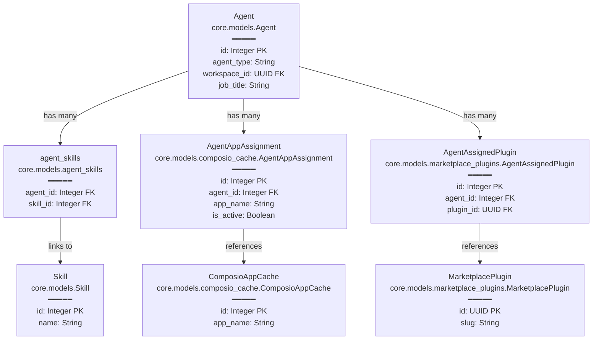
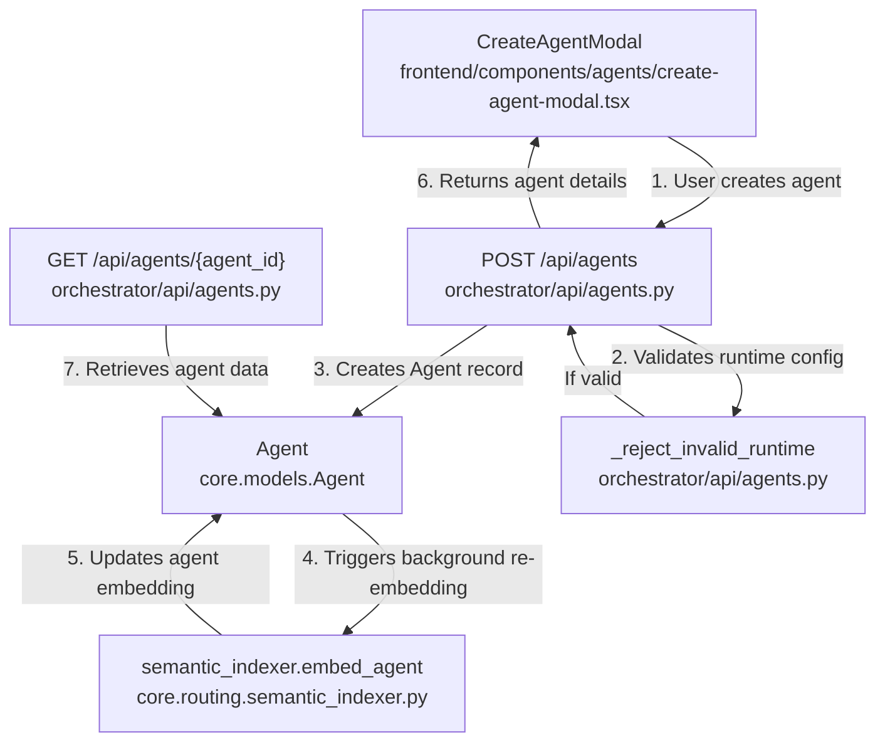

# Agents

Relevant source files

The following files were used as context for generating this wiki page:

- [frontend/components/agents/agent-configuration-modal.tsx](frontend/components/agents/agent-configuration-modal.tsx)
- [frontend/components/agents/agent-configuration.tsx](frontend/components/agents/agent-configuration.tsx)
- [frontend/components/agents/agent-details-modal.tsx](frontend/components/agents/agent-details-modal.tsx)
- [frontend/components/agents/agent-management.tsx](frontend/components/agents/agent-management.tsx)
- [frontend/components/agents/agent-performance.tsx](frontend/components/agents/agent-performance.tsx)
- [frontend/components/agents/agent-roster.tsx](frontend/components/agents/agent-roster.tsx)
- [frontend/components/agents/agent-skills.tsx](frontend/components/agents/agent-skills.tsx)
- [frontend/components/agents/agent-status-control-modal.tsx](frontend/components/agents/agent-status-control-modal.tsx)
- [frontend/components/agents/create-agent-modal.tsx](frontend/components/agents/create-agent-modal.tsx)
- [frontend/components/agents/create-skill-modal.tsx](frontend/components/agents/create-skill-modal.tsx)
- [frontend/components/agents/skill-configuration-modal.tsx](frontend/components/agents/skill-configuration-modal.tsx)
- [frontend/components/documents/document-management.tsx](frontend/components/documents/document-management.tsx)
- [frontend/components/tools/tools-dashboard.tsx](frontend/components/tools/tools-dashboard.tsx)
- [frontend/components/workflows/active-workflows-panel.tsx](frontend/components/workflows/active-workflows-panel.tsx)
- [frontend/components/workflows/workflow-management.tsx](frontend/components/workflows/workflow-management.tsx)
- [frontend/hooks/use-agent-api.ts](frontend/hooks/use-agent-api.ts)
- [frontend/lib/agent-constants.ts](frontend/lib/agent-constants.ts)
- [orchestrator/alembic/versions/add_job_title_to_agents.py](orchestrator/alembic/versions/add_job_title_to_agents.py)
- [orchestrator/api/agents.py](orchestrator/api/agents.py)

## Purpose and Scope

This document provides a high-level overview of the **Agent Management System** within Automatos AI. Agents are autonomous entities responsible for executing tasks, orchestrating workflows, maintaining state, and interacting with external tools and services. 

This is a parent page. For detailed technical specifications, implementation flows, and code hooks, refer to the child pages:
- [Creating Agents](#5.1) — Agent creation flow via `CreateAgentModal`, templates, basic info, and capabilities assignment
- [Agent Configuration](#5.2) — General settings, resources, priority, runtime validation, and configuration modal tabs
- [Agent Personas](#5.3) — Persona system, predefined vs custom prompts, the Auto CTO soul seeds, and voice profiles
- [Agent Plugins & Skills](#5.4) — Plugin and skill assignment, skill loader/materializer, workspace-enabled items, portability and L1/L3 skill execution
- [Agent Factory & Runtime](#5.5) — `AgentLifecycle`, `create_agent`, `activate_agent`, `execute_with_prompt`, tool loop with deduplication
- [LLM Provider Management](#5.6) — `LLMManager` initialization, embeddings/rerank managers, 3-tier API key resolution (BYOK, credential store, env), provider auto-detection, LLM marketplace
- [Agent API Reference](#5.7) — Backend API endpoints for agent CRUD, status, execution, plugins, model-config, assembled-context

Sources:
- [orchestrator/api/agents.py:1-32]()
- [frontend/components/agents/create-agent-modal.tsx:1-65]()

---

## Agent Entity Model

Agents are represented by the `Agent` SQLAlchemy model [orchestrator/api/agents.py:13](). Every workspace is provisioned with a default system agent named **Auto**, which serves as the workspace's primary orchestrator and settings anchor. Agents track performance metrics, model usage configurations, and workspace-specific metadata.

| Field | Type | Description |
|-------|------|-------------|
| `id` | Integer | Primary key [orchestrator/api/agents.py:69]() |
| `name` | String | Agent display name (e.g., "Auto") |
| `agent_type` | String | Role classification (e.g., `assistant`, `support`, `custom`) [orchestrator/api/agents.py:25]() |
| `status` | String | Operational state: `active`, `idle`, `maintenance` [orchestrator/api/agents.py:25]() |
| `configuration` | JSONB | Execution priority, max tasks, and heartbeat settings |
| `performance_metrics` | JSONB | Success rate, total tasks, and execution time stats |
| `workspace_id` | UUID | Multi-tenant isolation foreign key |
| `job_title` | String | Agent's specific job title [frontend/components/agents/agent-roster.tsx:140]() |

### Agent Data Model Relationships

The following diagram bridges natural language entity descriptions to concrete database models and association tables in the codebase.

**Diagram: AgentDatabaseSchemaMapping**

Sources:
- [orchestrator/api/agents.py:13-17]()
- [orchestrator/api/agents.py:175-176]()
- [frontend/components/agents/agent-roster.tsx:140]()

---

## Creating Agents

Agent creation is managed through `CreateAgentModal` in the frontend [frontend/components/agents/create-agent-modal.tsx:67-79](), guiding users through basic identity setup, model configuration, and capability binding. The backend API endpoint `/api/agents` (POST) handles the actual agent creation, including LLM connection verification and triggering knowledge graph updates [orchestrator/api/agents.py:300-370](). The modal allows selection of agent categories like 'Analytics', 'Business', 'Development', etc., which map to database `agent_type` values [frontend/lib/agent-constants.ts:25-42]().

For details, see [Creating Agents](#5.1).

Sources:
- [frontend/components/agents/create-agent-modal.tsx:67-79]()
- [orchestrator/api/agents.py:300-370]()
- [frontend/lib/agent-constants.ts:25-42]()

---

## Agent Configuration

Agents expose granular settings managed via `AgentConfigurationModal` [frontend/components/agents/agent-configuration-modal.tsx:98-171]() and `AgentConfiguration` [frontend/components/agents/agent-configuration.tsx:40-77](). These settings include general parameters, resource limits, execution priority levels, and runtime validation rules organized into intuitive tabs. The `_reject_invalid_runtime` function validates runtime fields such as `cli` session mode configurations [orchestrator/api/agents.py:38-54](). The configuration also includes settings for heartbeat, which enables proactive checks and suggestions [frontend/components/agents/agent-configuration-modal.tsx:155-171]().

For details, see [Agent Configuration](#5.2).

Sources:
- [frontend/components/agents/agent-configuration-modal.tsx:98-171]()
- [frontend/components/agents/agent-configuration.tsx:40-77]()
- [orchestrator/api/agents.py:38-54]()

---

## Agent Personas

Agent personas define specialized behavioral constraints, system prompts, and voice profiles across modes like `none`, `predefined`, and `custom` [frontend/components/agents/create-agent-modal.tsx:57-58](). Predefined soul seeds such as the "Auto CTO" provide ready-to-use configurations for common engineering and operational roles. The `AgentConfigurationModal` manages persona state, including selection, custom prompts, and category filtering [frontend/components/agents/agent-configuration-modal.tsx:140-153](). Personas are fetched from `/api/personas` [frontend/components/agents/create-agent-modal.tsx:136]().

For details, see [Agent Personas](#5.3).

Sources:
- [frontend/components/agents/agent-configuration-modal.tsx:140-153]()
- [frontend/components/agents/create-agent-modal.tsx:44-57]()
- [frontend/components/agents/create-agent-modal.tsx:136]()

---

## Agent Plugins & Skills

Agents can be assigned portable skills and plugins via workspace association tables (`agent_skills`, `AgentAssignedPlugin`) [orchestrator/api/agents.py:13-17](). The skill loader materializes these capabilities into active execution contexts during prompt assembly, utilizing functions like `_fetch_attachable_skills` to guarantee proper workspace scoping [orchestrator/api/agents.py:104-123](). The frontend components `AgentConfigurationModal` and `AgentConfiguration` manage the assignment and display of these plugins and skills [frontend/components/agents/agent-configuration-modal.tsx:128-139](). Plugins are fetched from `/api/workspaces/{workspaceId}/plugins` and assigned plugins from `/api/agents/{selectedAgentId}/plugins` [frontend/components/agents/agent-configuration.tsx:108-109]().

For details, see [Agent Plugins & Skills](#5.4).

Sources:
- [orchestrator/api/agents.py:13-17]()
- [orchestrator/api/agents.py:104-123]()
- [frontend/components/agents/agent-configuration-modal.tsx:128-139]()
- [frontend/components/agents/agent-configuration.tsx:57-67]()
- [frontend/components/agents/agent-configuration.tsx:108-109]()

---

## Agent Factory & Runtime

The execution runtime centers around `AgentLifecycle` and related services. The factory manages agent instance creation, while the lifecycle handles activation, execution loops, tool call deduplication, and periodic health checks. The `_reindex_agent_embedding` function triggers semantic re-embedding for agents in the background [orchestrator/api/agents.py:61-90](). Agent runtime configurations can specify `api` or `cli` modes, with `cli` mode requiring specific provider and model shapes [orchestrator/api/agents.py:45-47]().

The following diagram maps the logical runtime pipeline from UI initiation down to core factory execution classes in the codebase.

**Diagram: RuntimeExecutionPipeline**

For details, see [Agent Factory & Runtime](#5.5).

Sources:
- [orchestrator/api/agents.py:61-90]()
- [orchestrator/api/agents.py:300-370]()
- [orchestrator/api/agents.py:45-47]()

---

## LLM Provider Management

`LLMManager` coordinates multi-model access through a 3-tier API key resolution hierarchy spanning BYOK, encrypted credential stores, and environment variables. The `ModelSelector` component (`frontend/components/agents/model-selector.tsx`) provides the UI for configuring LLM models for agents [frontend/components/agents/agent-configuration-modal.tsx:58](). The `getDefaultModelConfig` function provides initial model settings [frontend/components/agents/create-agent-modal.tsx:6]().

For details, see [LLM Provider Management](#5.6).

Sources:
- [frontend/components/agents/agent-configuration-modal.tsx:58]()
- [frontend/components/agents/create-agent-modal.tsx:39]()
- [frontend/components/agents/create-agent-modal.tsx:6]()

---

## Agent API Reference

Backend endpoints under `/api/agents` (`orchestrator/api/agents.py`) manage agent CRUD operations, performance metrics retrieval, semantic re-indexing, and tool ID resolution [orchestrator/api/agents.py:35](). Key functions include `_resolve_tool_ids_to_app_names` for mapping tool IDs to connected application names and `_fetch_attachable_skills` for skill visibility [orchestrator/api/agents.py:104-176](). The API also handles agent status updates (start/stop) [frontend/hooks/use-agent-api.ts:58-59]() and provides statistics [frontend/hooks/use-agent-api.ts:160-166]().

For details, see [Agent API Reference](#5.7).

Sources:
- [orchestrator/api/agents.py:1-176]()
- [frontend/hooks/use-agent-api.ts:58-59]()
- [frontend/hooks/use-agent-api.ts:160-166]()

---