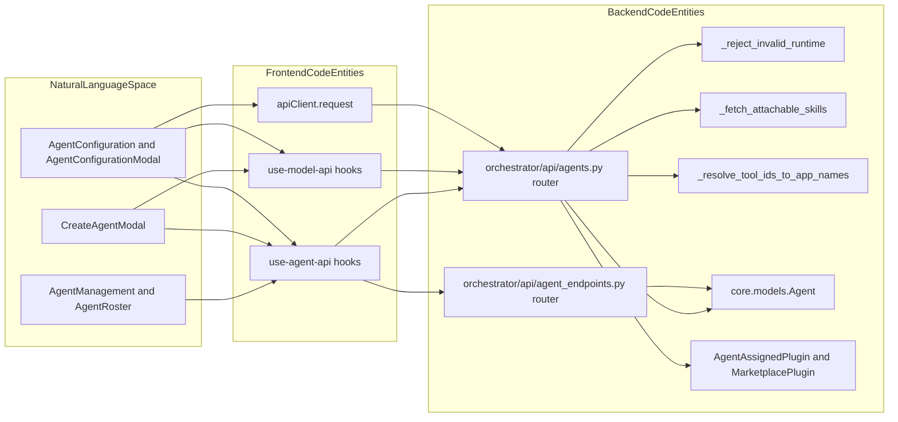
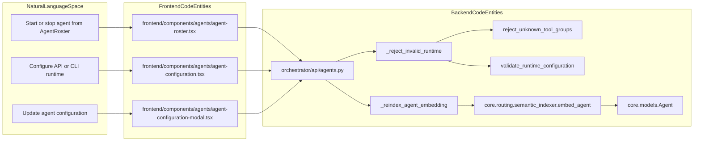

# Agent API Reference

<details>
<summary>Relevant source files</summary>

The following files were used as context for generating this wiki page:

- [frontend/components/agents/agent-configuration-modal.tsx](frontend/components/agents/agent-configuration-modal.tsx)
- [frontend/components/agents/agent-configuration.tsx](frontend/components/agents/agent-configuration.tsx)
- [frontend/components/agents/agent-details-modal.tsx](frontend/components/agents/agent-details-modal.tsx)
- [frontend/components/agents/agent-management.tsx](frontend/components/agents/agent-management.tsx)
- [frontend/components/agents/agent-performance.tsx](frontend/components/agents/agent-performance.tsx)
- [frontend/components/agents/agent-roster.tsx](frontend/components/agents/agent-roster.tsx)
- [frontend/components/agents/agent-skills.tsx](frontend/components/agents/agent-skills.tsx)
- [frontend/components/agents/agent-status-control-modal.tsx](frontend/components/agents/agent-status-control-modal.tsx)
- [frontend/components/agents/create-agent-modal.tsx](frontend/components/agents/create-agent-modal.tsx)
- [frontend/components/agents/create-skill-modal.tsx](frontend/components/agents/create-skill-modal.tsx)
- [frontend/components/agents/model-selector.tsx](frontend/components/agents/model-selector.tsx)
- [frontend/components/agents/skill-configuration-modal.tsx](frontend/components/agents/skill-configuration-modal.tsx)
- [frontend/components/documents/document-management.tsx](frontend/components/documents/document-management.tsx)
- [frontend/components/marketplace/llm-model-card.tsx](frontend/components/marketplace/llm-model-card.tsx)
- [frontend/components/marketplace/llm-model-detail-modal.tsx](frontend/components/marketplace/llm-model-detail-modal.tsx)
- [frontend/components/marketplace/marketplace-llms-tab.tsx](frontend/components/marketplace/marketplace-llms-tab.tsx)
- [frontend/components/tools/tools-dashboard.tsx](frontend/components/tools/tools-dashboard.tsx)
- [frontend/components/workflows/active-workflows-panel.tsx](frontend/components/workflows/active-workflows-panel.tsx)
- [frontend/components/workflows/workflow-management.tsx](frontend/components/workflows/workflow-management.tsx)
- [frontend/hooks/use-agent-api.ts](frontend/hooks/use-agent-api.ts)
- [frontend/hooks/use-model-api.ts](frontend/hooks/use-model-api.ts)
- [frontend/hooks/use-openrouter-api.ts](frontend/hooks/use-openrouter-api.ts)
- [frontend/lib/__tests__/socials-media-lane.test.ts](frontend/lib/__tests__/socials-media-lane.test.ts)
- [frontend/lib/agent-constants.ts](frontend/lib/agent-constants.ts)
- [orchestrator/alembic/versions/add_job_title_to_agents.py](orchestrator/alembic/versions/add_job_title_to_agents.py)
- [orchestrator/api/agent_endpoints.py](orchestrator/api/agent_endpoints.py)
- [orchestrator/api/agents.py](orchestrator/api/agents.py)
- [orchestrator/api/llm_analytics.py](orchestrator/api/llm_analytics.py)
- [orchestrator/api/llm_marketplace.py](orchestrator/api/llm_marketplace.py)
- [orchestrator/api/openrouter_marketplace.py](orchestrator/api/openrouter_marketplace.py)
- [orchestrator/core/database/migrations/042_openrouter_models_cache.sql](orchestrator/core/database/migrations/042_openrouter_models_cache.sql)
- [orchestrator/core/llm/anthropic_ids.py](orchestrator/core/llm/anthropic_ids.py)
- [orchestrator/core/llm/openrouter_analytics.py](orchestrator/core/llm/openrouter_analytics.py)
- [orchestrator/core/llm/usage_tracker.py](orchestrator/core/llm/usage_tracker.py)
- [orchestrator/core/services/anthropic_catalog_sync.py](orchestrator/core/services/anthropic_catalog_sync.py)
- [orchestrator/core/services/provider_catalog_sync.py](orchestrator/core/services/provider_catalog_sync.py)
- [orchestrator/scripts/seed_llm_marketplace.py](orchestrator/scripts/seed_llm_marketplace.py)
- [orchestrator/tests/test_829_anthropic_models_refresh_from_the_owners_key.py](orchestrator/tests/test_829_anthropic_models_refresh_from_the_owners_key.py)
- [orchestrator/tests/test_f208_a_the_credit_balance_is_read.py](orchestrator/tests/test_f208_a_the_credit_balance_is_read.py)
- [orchestrator/tests/test_llm_catalog_a_list_of_capabilities_is_no_500.py](orchestrator/tests/test_llm_catalog_a_list_of_capabilities_is_no_500.py)
- [orchestrator/tests/test_prd143_obs_routers_batch2.py](orchestrator/tests/test_prd143_obs_routers_batch2.py)
- [orchestrator/tests/test_prd251w1_media_lane.py](orchestrator/tests/test_prd251w1_media_lane.py)

</details>


This page documents the agent API surface and the implementation details visible in the supplied code: the `/api/agents` router, request validation and assignment helpers, frontend consumers, and agent operations exposed through platform-action handlers. The supplied backend excerpt ends before the route definitions, so endpoint methods and behaviors not shown there are not inferred. [orchestrator/api/agents.py:1-35]()

Sources: [orchestrator/api/agents.py:1-35]()

## Purpose and Scope

The agent API supports management of agents and their configuration. The shown backend code establishes the `/api/agents` router, hybrid-auth dependencies, workspace permission support, runtime validation, skill visibility checks, and connected-app assignment resolution. The frontend consumes agent, skill, plugin, and model-configuration APIs through hooks and `apiClient`. [orchestrator/api/agents.py:10-35](), [orchestrator/api/agents.py:38-55](), [orchestrator/api/agents.py:104-123](), [frontend/components/agents/agent-configuration.tsx:31-39](), [frontend/components/agents/agent-configuration-modal.tsx:55-64]()

This reference distinguishes REST API implementation from similarly named platform actions. For example, `list_agents` and `get_agent` are handlers for platform actions, not evidence of REST route methods or URLs. [orchestrator/modules/tools/discovery/handlers_agents.py:1-16](), [orchestrator/modules/tools/discovery/handlers_agents.py:31-43](), [orchestrator/modules/tools/discovery/handlers_agents.py:82-109]()

Sources: [orchestrator/api/agents.py:10-55](), [frontend/components/agents/agent-configuration.tsx:31-39](), [frontend/components/agents/agent-configuration-modal.tsx:55-64](), [orchestrator/modules/tools/discovery/handlers_agents.py:1-16](), [orchestrator/modules/tools/discovery/handlers_agents.py:31-43]()

---

## Overview & Routing Architecture

The REST router is declared with prefix `/api/agents` and tag `agents`. Its imports include the database dependency, `Agent`, `Skill`, assignment models, request-context authentication, workspace permissions, and Pydantic request/response models. The shown excerpt does not include route decorators or route functions, so it does not establish the complete REST endpoint inventory. [orchestrator/api/agents.py:3-35]()

| Surface | What the supplied code establishes |
|---|---|
| REST router | `router = APIRouter(prefix="/api/agents", tags=["agents"])`. [orchestrator/api/agents.py:33-35]() |
| Authentication and authorization dependencies | Imports `get_request_context_hybrid`, `require_workspace_permission`, and `RequestContext`; specific route-level dependency usage is outside the shown excerpt. [orchestrator/api/agents.py:27-30]() |
| Agent data types | Imports `Agent`, `AgentCreate`, `AgentUpdate`, `AgentResponse`, `AgentStatus`, and `AgentType`; the model definitions are not included in the supplied excerpt. [orchestrator/api/agents.py:13-25]() |
| Platform-action agent handlers | `list_agents` and `get_agent` query `Agent` by workspace and produce action-oriented results; these are separate from the REST router. [orchestrator/modules/tools/discovery/handlers_agents.py:31-43](), [orchestrator/modules/tools/discovery/handlers_agents.py:82-109]() |

Sources: [orchestrator/api/agents.py:3-35](), [orchestrator/modules/tools/discovery/handlers_agents.py:31-43](), [orchestrator/modules/tools/discovery/handlers_agents.py:82-109]()

---

## Natural Language Space to Code Entity Space: Agent Lifecycle & API Mapping

This mapping connects UI concepts to the code entities present in the supplied files. It intentionally avoids assigning specific HTTP methods to REST operations because the shown backend excerpt does not include the route definitions. `AgentManagement` uses `useAgents`, `useAgentStats`, and `useAgentTypes`; the create modal uses `useCreateAgent`; configuration components use agent, plugin, skill, and model hooks. [frontend/components/agents/agent-management.tsx:41-65](), [frontend/components/agents/create-agent-modal.tsx:35-42](), [frontend/components/agents/agent-configuration.tsx:31-38](), [frontend/components/agents/agent-configuration-modal.tsx:55-64]()

**Diagram: UI operations mapped to agent API code entities**



Sources: [frontend/components/agents/agent-management.tsx:41-65](), [frontend/components/agents/create-agent-modal.tsx:35-42](), [frontend/components/agents/agent-configuration.tsx:31-38](), [frontend/components/agents/agent-configuration.tsx:98-129](), [frontend/components/agents/agent-configuration-modal.tsx:55-64](), [orchestrator/api/agents.py:13-35](), [orchestrator/api/agents.py:38-55](), [orchestrator/api/agents.py:104-123](), [orchestrator/api/agents.py:142-176](), [orchestrator/api/agent_endpoints.py:28-30]()

---

## Core Agent CRUD Endpoints

The REST router is mounted at `/api/agents`, but the supplied backend excerpt does not show the CRUD route declarations or their request/response behavior. The names of imported Pydantic types indicate the module works with agent create, update, and response models, but do not by themselves define which paths or HTTP methods use them. [orchestrator/api/agents.py:20-35]()

The frontend exposes the user-facing flow through hooks: `AgentManagement` loads agent lists, statistics, and types; `CreateAgentModal` calls `useCreateAgent`; and configuration components load agent details and update configuration. The hook implementation is not included, so exact HTTP paths, payload schemas, and cache invalidation behavior cannot be specified from the supplied content. [frontend/components/agents/agent-management.tsx:41-65](), [frontend/components/agents/create-agent-modal.tsx:35-42](), [frontend/components/agents/agent-configuration.tsx:69-82](), [frontend/components/agents/agent-configuration-modal.tsx:113-123]()

### Agent Creation and Specialization

The `/api/agents/create-specialized` endpoint allows for the creation of specialized agents with LLM connections. It requires `name` and `type`, and optionally accepts `skills`, `model_config`, and `auto_verify`. The `AgentFactory` is used to create the agent, and its status is then retrieved. A background task is scheduled to update the knowledge graph upon successful agent creation. [orchestrator/api/agent_endpoints.py:42-108]()

**Request Body for `/api/agents/create-specialized`:**
```json
{
    "name": "Agent name",
    "type": "code_architect|data_analyst|security_expert|...",
    "skills": ["skill1", "skill2"],
    "model": {
        "provider": "openrouter",
        "name": "google/gemini-2.5-flash",
        "temperature": 0.7
    },
    "auto_verify": true
}
```
Sources: [orchestrator/api/agents.py:20-35](), [frontend/components/agents/agent-management.tsx:41-65](), [frontend/components/agents/create-agent-modal.tsx:35-42](), [frontend/components/agents/agent-configuration.tsx:69-82](), [frontend/components/agents/agent-configuration-modal.tsx:113-123](), [orchestrator/api/agent_endpoints.py:42-108]()

### Platform-action agent listing and retrieval

Separately from the REST API, `handlers_agents.py` defines `list_agents` and `get_agent` for platform-action use. Both filter records by `Agent.workspace_id`. `list_agents` supports `status_filter`, defaulting to `"all"`, orders results by agent ID, and returns a compact agent list with counts and selected metadata. [orchestrator/modules/tools/discovery/handlers_agents.py:31-79]()

`get_agent` accepts `agent_id` or `agent_name`; if neither is supplied it returns an error result. Name lookup delegates selection to `the_agent_named`. A widget turn receives only `_visitor_view` fields (`name`, truncated `description`, and `status`); other callers receive `_described`, which includes assigned tools and skills, runtime/model summary, heartbeat information, and additional agent metadata. [orchestrator/modules/tools/discovery/handlers_agents.py:20-29](), [orchestrator/modules/tools/discovery/handlers_agents.py:82-109](), [orchestrator/modules/tools/discovery/handlers_agents.py:112-148]()

Sources: [orchestrator/api/agents.py:20-35](), [frontend/components/agents/agent-management.tsx:41-65](), [frontend/components/agents/create-agent-modal.tsx:35-42](), [frontend/components/agents/agent-configuration.tsx:69-82](), [frontend/components/agents/agent-configuration-modal.tsx:113-123](), [orchestrator/modules/tools/discovery/handlers_agents.py:20-29](), [orchestrator/modules/tools/discovery/handlers_agents.py:31-79](), [orchestrator/modules/tools/discovery/handlers_agents.py:82-148]()

---

## Status, Performance, and Execution Endpoints

The supplied `/api/agents` excerpt does not show status-control, performance, or execution route definitions. The frontend roster imports `useStartAgent` and `useStopAgent`, establishing that the UI has start/stop mutations, but the hook implementation and corresponding backend endpoints are not included. [frontend/components/agents/agent-roster.tsx:47-54]()

### Agent Performance Metrics

The `/api/agents/{agent_id}/performance` endpoint retrieves performance metrics for a specific agent. It accepts an optional `period` query parameter (e.g., "all", "7d", "30d", "24h"). The endpoint fetches agent data from the database, attempts to get runtime status from the `AgentFactory`, and compiles a comprehensive performance response including success rates, task counts, model usage statistics (tokens, cost, requests), and placeholder resource metrics. [orchestrator/api/agent_endpoints.py:118-181]()

**Response Structure for `/api/agents/{agent_id}/performance`:**
```json
{
    "agent_id": 123,
    "agent_name": "MyAgent",
    "period": "all",
    "status": "active",
    "overall_score": 90,
    "success_rate": 90.5,
    "average_response_time": 1.25,
    "total_tasks": 100,
    "completed_tasks": 90,
    "failed_tasks": 10,
    "average_tokens_per_task": 500,
    "total_tokens_used": 50000,
    "total_cost": 0.50,
    "total_requests": 100,
    "average_memory_usage": 0,
    "average_cpu_usage": 0,
    "uptime_percentage": 99.8
}
```

The supplied platform-action handlers expose status as agent data, and `list_agents` can filter by status. They do not show execution dispatch or provide evidence for REST start/stop semantics. [orchestrator/modules/tools/discovery/handlers_agents.py:31-43](), [orchestrator/modules/tools/discovery/handlers_agents.py:51-73]()

Sources: [frontend/components/agents/agent-roster.tsx:47-54](), [orchestrator/modules/tools/discovery/handlers_agents.py:31-43](), [orchestrator/modules/tools/discovery/handlers_agents.py:51-73](), [orchestrator/api/agent_endpoints.py:118-181]()

---

## Plugins, Skills & Model Configuration Endpoints

### Plugin assignments

`AgentConfiguration` fetches workspace-enabled plugins from `/api/workspaces/{workspaceId}/plugins` and agent assignments from `/api/agents/{selectedAgentId}/plugins` in parallel. It reads the plugin list from `items` when present and initializes assigned IDs from each assignment’s `plugin_id`. [frontend/components/agents/agent-configuration.tsx:98-117]()

The backend router imports `AgentAssignedPlugin` and `MarketplacePlugin`, identifying the assignment and plugin models used by the agent API module. The shown backend excerpt does not include the plugin route implementations, so assignment validation and write semantics are not specified here. [orchestrator/api/agents.py:15-18]()

### Skill assignments and visibility

The configuration UI fetches workspace skills from `/api/workspaces/{workspaceId}/skills` and agent skills from `/api/agents/{selectedAgentId}/skills`. The create/configuration UI also uses agent skill hooks. [frontend/components/agents/agent-configuration.tsx:131-149](), [frontend/components/agents/agent-configuration-modal.tsx:55-57]()

The backend helper `_fetch_attachable_skills` queries active skills whose IDs were requested, then applies `_skill_visible_to` from `api.skills`. Only skills visible to the request context are returned. If the number of visible rows differs from the requested ID count, it raises HTTP 404 and includes the IDs that were not found or visible. [orchestrator/api/agents.py:104-123]()

### Connected tool assignment

`_resolve_tool_ids_to_app_names` accepts tool IDs and resolves them to app names. It looks up the workspace’s Composio entity through `EntityManager`, considers connections with status `active`, `added`, or `pending`, and maps connected names using both stable negative IDs and cached app IDs. The supplied excerpt ends during this helper, so subsequent resolution behavior is not described. [orchestrator/api/agents.py:142-176]()

### Model configuration

The create and configuration interfaces use `useAgentModelConfig` and `useUpdateAgentModelConfig` from `use-model-api`. The configuration modal also loads model configuration for an agent and keeps its update mutation alongside agent configuration state. Exact model-config HTTP routes and payload fields are not shown in the supplied files. [frontend/components/agents/create-agent-modal.tsx:35-42](), [frontend/components/agents/agent-configuration.tsx:31-38](), [frontend/components/agents/agent-configuration.tsx:80-82](), [frontend/components/agents/agent-configuration-modal.tsx:55-64](), [frontend/components/agents/agent-configuration-modal.tsx:121-123]()

Sources: [orchestrator/api/agents.py:15-18](), [orchestrator/api/agents.py:104-123](), [orchestrator/api/agents.py:142-176](), [frontend/components/agents/agent-configuration.tsx:98-117](), [frontend/components/agents/agent-configuration.tsx:131-149](), [frontend/components/agents/create-agent-modal.tsx:35-42](), [frontend/components/agents/agent-configuration-modal.tsx:55-64](), [frontend/components/agents/agent-configuration-modal.tsx:121-123]()

---

## Runtime Validation & Assembled Context Pipeline

### Runtime configuration validation

`_reject_invalid_runtime(configuration)` is a backend validation helper. It first calls `reject_unknown_tool_groups(configuration)`, then invokes `validate_runtime_configuration` with `cli_enabled` derived from `config.CLI_RUNTIME_ENABLED`. If validation returns errors, the helper raises HTTP 400 with an `errors` object. The helper’s docstring specifies that CLI runtime validation applies to session-mode agents, while API agents pass through. [orchestrator/api/agents.py:38-55]()

### Semantic agent embedding

`_reindex_agent_embedding(agent, db)` schedules asynchronous semantic re-embedding when an event loop is running. It captures the agent ID, creates a separate `SessionLocal` session inside the background coroutine, reloads the agent, and calls `embed_agent`. Exceptions are logged rather than propagated to the API caller, and the background session is closed in `finally`. If no event loop is running, the helper does not schedule work. [orchestrator/api/agents.py:61-88]()

### Assembled context boundary

The supplied agent API and frontend excerpts do not show an assembled-context endpoint or a context assembly implementation. The agent detail platform-action handler does expose selected configuration-derived data—including runtime, model summary, heartbeat, tools, and skills—but that response is not evidence of a prompt/context assembly pipeline. [orchestrator/modules/tools/discovery/handlers_agents.py:112-148]()

Sources: [orchestrator/api/agents.py:38-55](), [orchestrator/api/agents.py:61-88](), [orchestrator/modules/tools/discovery/handlers_agents.py:112-148]()

---

## Natural Language Space to Code Entity Space: Execution & Context Assembly

This diagram maps the agent management and execution-related concepts to the code entities confirmed in the supplied files. It shows runtime validation and semantic reindexing, but does not imply a REST execution endpoint or an assembled-context API, neither of which appears in the shown excerpts. [orchestrator/api/agents.py:38-55](), [orchestrator/api/agents.py:61-88](), [frontend/components/agents/agent-roster.tsx:47-54]()

**Diagram: Agent runtime and management code paths**



Sources: [frontend/components/agents/agent-roster.tsx:47-54](), [frontend/components/agents/agent-configuration.tsx:69-82](), [frontend/components/agents/agent-configuration-modal.tsx:113-123](), [orchestrator/api/agents.py:38-55](), [orchestrator/api/agents.py:61-88]()

---

## Implementation Notes and Evidence Boundaries

The shown backend source establishes the router prefix, important request helpers, and supporting models, but not the complete route inventory. In particular, exact CRUD methods, status-control routes, performance routes, execution routes, plugin write operations, model-config routes, and assembled-context routes cannot be verified from the supplied excerpt. [orchestrator/api/agents.py:33-35]()

The supplied frontend files establish which hooks and direct `apiClient.request` calls are consumed by the agent management screens. They do not include the hook implementations or backend route definitions needed to document request schemas, response contracts, or error handling end to end. [frontend/components/agents/agent-management.tsx:41-65](), [frontend/components/agents/agent-configuration.tsx:98-149](), [frontend/components/agents/agent-configuration-modal.tsx:55-64]()

Sources: [orchestrator/api/agents.py:33-35](), [frontend/components/agents/agent-management.tsx:41-65](), [frontend/components/agents/agent-configuration.tsx:98-149](), [frontend/components/agents/agent-configuration-modal.tsx:55-64]()

---