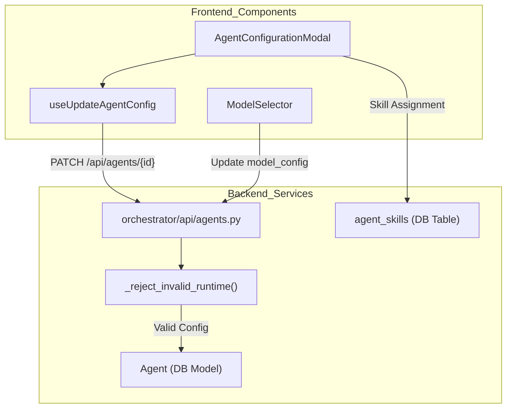
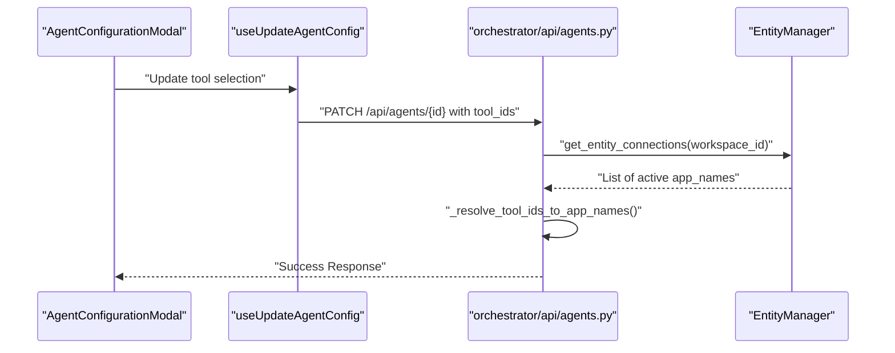

# Agent Configuration

Relevant source files

The following files were used as context for generating this wiki page:

- [frontend/components/agents/agent-configuration-modal.tsx](frontend/components/agents/agent-configuration-modal.tsx)
- [frontend/components/agents/agent-configuration.tsx](frontend/components/agents/agent-configuration.tsx)
- [frontend/components/agents/agent-details-modal.tsx](frontend/components/agents/agent-details-modal.tsx)
- [frontend/components/agents/agent-management.tsx](frontend/components/agents/agent-management.tsx)
- [frontend/components/agents/agent-performance.tsx](frontend/components/agents/agent-performance.tsx)
- [frontend/components/agents/agent-roster.tsx](frontend/components/agents/agent-roster.tsx)
- [frontend/components/agents/agent-skills.tsx](frontend/components/agents/agent-skills.tsx)
- [frontend/components/agents/agent-status-control-modal.tsx](frontend/components/agents/agent-status-control-modal.tsx)
- [frontend/components/agents/create-agent-modal.tsx](frontend/components/agents/create-agent-modal.tsx)
- [frontend/components/agents/create-skill-modal.tsx](frontend/components/agents/create-skill-modal.tsx)
- [frontend/components/agents/skill-configuration-modal.tsx](frontend/components/agents/skill-configuration-modal.tsx)
- [frontend/components/documents/document-management.tsx](frontend/components/documents/document-management.tsx)
- [frontend/components/tools/tools-dashboard.tsx](frontend/components/tools/tools-dashboard.tsx)
- [frontend/components/workflows/active-workflows-panel.tsx](frontend/components/workflows/active-workflows-panel.tsx)
- [frontend/components/workflows/workflow-management.tsx](frontend/components/workflows/workflow-management.tsx)
- [frontend/hooks/use-agent-api.ts](frontend/hooks/use-agent-api.ts)
- [frontend/lib/agent-constants.ts](frontend/lib/agent-constants.ts)
- [orchestrator/alembic/versions/add_job_title_to_agents.py](orchestrator/alembic/versions/add_job_title_to_agents.py)
- [orchestrator/api/agents.py](orchestrator/api/agents.py)

## Purpose and Scope
Agent configuration in Automatos AI encompasses the operational settings, resource allocations, and behavioral parameters that define how an AI agent functions within a workspace. This includes model selection via the **Model Configuration** system, capability management through **Skills** and **Plugins**, runtime validation (such as PRD-234 session mode checks), and autonomous behavior settings like **Heartbeat** intervals. Configuration is primarily managed via `AgentConfigurationModal` in the frontend and persisted in the `agents` table's `configuration` and `model_config` columns in the backend `[orchestrator/alembic/versions/add_job_title_to_agents.py:20-21]`, `[frontend/components/agents/agent-configuration-modal.tsx:98-115]`.

Sources: `[orchestrator/alembic/versions/add_job_title_to_agents.py:20-21]`, `[frontend/components/agents/agent-configuration-modal.tsx:98-115]`

---

## Configuration Architecture & Runtime Validation

Agent configuration bridges high-level user intent with low-level LLM parameters and system resource limits. Before configuration updates are committed to the database via the API router (`/api/agents/{id}`), the backend executes strict runtime validation `[orchestrator/api/agents.py:38-55]`.

### Runtime Validation (`_reject_invalid_runtime`)
When configuration payloads include runtime parameters (such as `runtime: cli` for session mode), `_reject_invalid_runtime` validates the configuration against the server environment (`CLI_RUNTIME_ENABLED`), ensuring session-scoped agents conform to expected provider and model shapes before dispatch `[orchestrator/api/agents.py:38-55]`. Additionally, background re-indexing via `_reindex_agent_embedding` triggers semantic updates asynchronously `[orchestrator/api/agents.py:61-89]`.

### Data Flow and Entity Mapping

The following diagram maps natural language configuration requests to code entities across the stack:

Title: "Agent Configuration Data Flow"

Sources: `[frontend/components/agents/agent-configuration-modal.tsx:111-120]`, `[frontend/hooks/use-agent-api.ts:42-43]`, `[orchestrator/alembic/versions/add_job_title_to_agents.py:20-21]`, `[orchestrator/api/agents.py:38-55]`

---

## Configuration Modal Tabs

`AgentConfigurationModal` is the central hub for modifying an existing agent, organizing settings into logical tabs `[frontend/components/agents/agent-configuration-modal.tsx:105-175]`:

### 1. General Settings
This tab handles basic identity and lifecycle metadata:
- **Name & Description**: Basic identification strings `[orchestrator/alembic/versions/add_job_title_to_agents.py:20-21]`.
- **Agent Type/Category**: Mapped via `CATEGORY_TO_DB_MAP` to internal types like `code_architect` or `data_analyst` `[frontend/lib/agent-constants.ts:48-65]`.
- **Status**: Controls whether the agent is `active`, `idle`, or `maintenance` `[frontend/components/agents/agent-roster.tsx:164-168]`.

### 2. Model Configuration (PRD-15)
Managed via the `ModelSelector` component, this section defines the LLM model profile:
- **Provider**: Selection of LLM service (`openai`, `anthropic`, `openrouter`, etc.) `[frontend/components/agents/agent-roster.tsx:156-157]`.
- **Model ID**: Specific model version identifier `[frontend/components/agents/agent-roster.tsx:174-188]`.
- **Hyperparameters**: Temperature, context window limits, and max output tokens `[frontend/components/agents/create-agent-modal.tsx:82-83]`.

### 3. Resources & Priority
Defines execution constraints within the orchestrator:
- **Priority Level**: Options include `low`, `medium`, `high`, and `critical` `[frontend/components/workflows/workflow-management.tsx:108-112]`.
- **Max Concurrent Tasks**: Limits simultaneous operations `[frontend/components/agents/agent-configuration-modal.tsx:81]`.
- **Resource Limits**: Configures `memory_mb`, `cpu_percent`, and `network_bandwidth` constraints `[frontend/components/agents/agent-configuration-modal.tsx:85-89]`.

### 4. Skills & Plugins (PRD-42/PRD-71)
Agents gain capabilities through:
- **Skills**: Granular technical abilities linked via the `agent_skills` join table containing a per-attachment `priority` field `[orchestrator/core/models/core.py:37-42]()`.
- **Plugins**: Workspace-enabled integrations assigned via `AgentAssignedPlugin` `[frontend/components/agents/agent-configuration-modal.tsx:129-133]`.

Sources: `[frontend/components/agents/agent-configuration-modal.tsx:73-94]`, `[frontend/lib/agent-constants.ts:48-65]`, `[frontend/components/agents/agent-roster.tsx:156-188]`, `[frontend/components/workflows/workflow-management.tsx:108-112]`, `[frontend/components/agents/create-agent-modal.tsx:82-83]`, `[orchestrator/core/models/core.py:37-42]()`

---

## Tools and Integrations

Tools are assigned to agents by linking them to connected workspace applications. The backend resolves incoming tool IDs into app names using `EntityManager` and `_resolve_tool_ids_to_app_names` to ensure only permitted tools are assigned `[orchestrator/api/agents.py:142-176]`.

### Tool Resolution Logic (`_resolve_tool_ids_to_app_names`)
When an agent configuration is saved with `tool_ids`, the backend executes `_resolve_tool_ids_to_app_names`:
1. **Connection Validation**: `EntityManager.get_entity_by_workspace` and `get_entity_connections` verify active application statuses (`active`, `added`, `pending`) `[orchestrator/api/agents.py:152-162]`.
2. **ID Mapping**: Incoming frontend stable hashes (negative integers computed by `_stable_tool_id`) and database IDs (`ComposioAppCache.id`) are mapped to `app_name` strings `[orchestrator/api/agents.py:91-102]`, `[orchestrator/api/agents.py:171-176]`.
3. **Persistence**: Resolved app assignments are stored for the agent execution loop.

Title: "Tool Assignment Sequence"

Sources: `[orchestrator/api/agents.py:91-176]`, `[frontend/hooks/use-agent-api.ts:42-43]`

---

## Heartbeat Configuration (PRD-55)

The Heartbeat system permits agents to perform proactive background checks and autonomous routines, configured via `AgentConfigurationModal` `[frontend/components/agents/agent-configuration-modal.tsx:155-171]`:

| Setting | Type | Description |
|---------|------|-------------|
| `enabled` | boolean | Activates the proactive background execution loop. |
| `interval_minutes` | integer | Frequency of heartbeat execution ticks. |
| `inherit_active_hours` | boolean | Respects workspace-wide operating hours if true. |
| `active_hours_start/end` | string | Defines active scheduling window (e.g., `08:00` - `20:00`). |
| `auto_act` | boolean | Enables autonomous tool execution during heartbeats. |
| `report_to` | string | Destination routing target for results (e.g., `orchestrator`). |

Sources: `[frontend/components/agents/agent-configuration-modal.tsx:155-171]`

---

## Persona, Voice, and Persistence

Agents can be assigned personas and voice profiles to customize behavior and output style:
- **Predefined Personas**: System-seeded templates providing role prompts and suggested temperatures `[frontend/components/agents/create-agent-modal.tsx:44-54]`.
- **Custom Personas**: User-authored system prompts `[frontend/components/agents/agent-configuration-modal.tsx:142-145]`.
- **Voice Profiles**: Text-to-speech parameter bindings `[frontend/components/agents/create-agent-modal.tsx:51-52]`.

### React Query Integration
The frontend relies on TanStack React Query hooks for state synchronization:
- **`useAgentConfig(agentId)`**: Fetched via query key `agentConfig` `[frontend/hooks/use-agent-api.ts:82]`.
- **`useUpdateAgentConfig()`**: Mutation hook triggering cache invalidation `[frontend/hooks/use-agent-api.ts:45]`.
- **`formInitializedRef`**: A `useRef` guard inside `AgentConfigurationModal` preventing background polling intervals from overwriting active user edits `[frontend/components/agents/agent-configuration-modal.tsx:178-182]`.

Sources: `[frontend/hooks/use-agent-api.ts:45-82]`, `[frontend/components/agents/agent-configuration-modal.tsx:140-192]`, `[frontend/components/agents/create-agent-modal.tsx:44-54]`

---