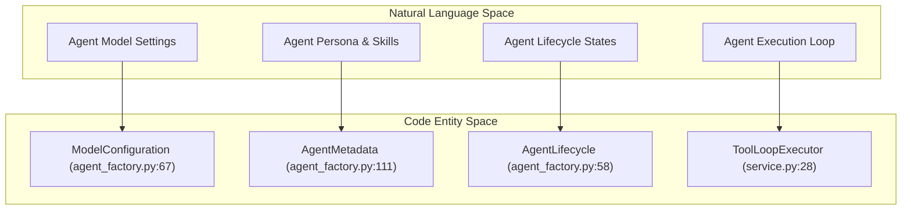
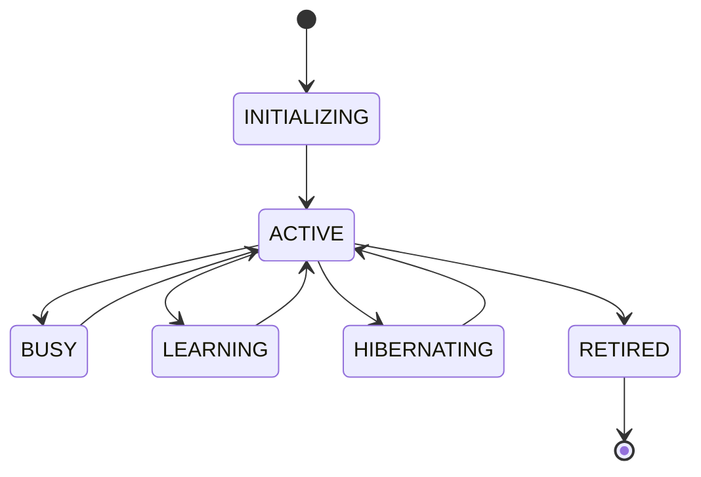
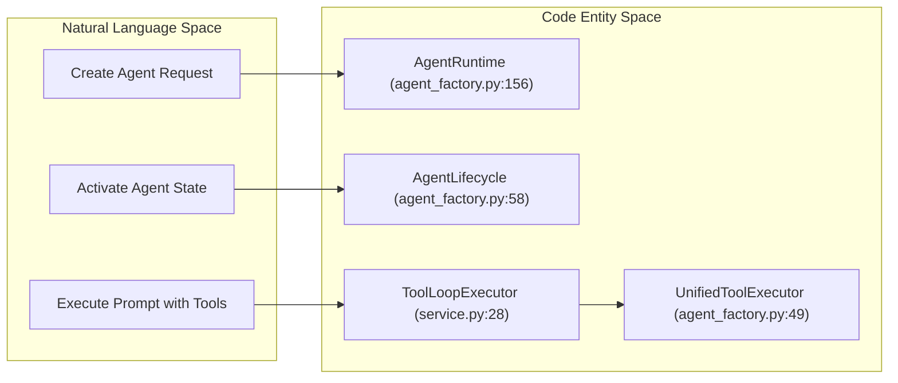

# Agent Factory & Runtime

<details>
<summary>Relevant source files</summary>

The following files were used as context for generating this wiki page:

- [frontend/app/api/chat/route.ts](frontend/app/api/chat/route.ts)
- [frontend/components/__tests__/prd207-live-voice.test.tsx](frontend/components/__tests__/prd207-live-voice.test.tsx)
- [frontend/components/chatbot/__tests__/composer-voice.test.tsx](frontend/components/chatbot/__tests__/composer-voice.test.tsx)
- [frontend/components/chatbot/chat.tsx](frontend/components/chatbot/chat.tsx)
- [frontend/components/chatbot/message.tsx](frontend/components/chatbot/message.tsx)
- [frontend/components/voice/LiveVoiceMode.tsx](frontend/components/voice/LiveVoiceMode.tsx)
- [frontend/components/voice/PresenceOrb.tsx](frontend/components/voice/PresenceOrb.tsx)
- [frontend/components/voice/VoiceErrorBoundary.tsx](frontend/components/voice/VoiceErrorBoundary.tsx)
- [frontend/components/voice/__tests__/voice-button.test.tsx](frontend/components/voice/__tests__/voice-button.test.tsx)
- [frontend/components/voice/voice-button-view.ts](frontend/components/voice/voice-button-view.ts)
- [frontend/components/voice/voice-button.tsx](frontend/components/voice/voice-button.tsx)
- [frontend/components/voice/voice-controls.tsx](frontend/components/voice/voice-controls.tsx)
- [frontend/lib/chat/hooks.ts](frontend/lib/chat/hooks.ts)
- [frontend/types/chat.ts](frontend/types/chat.ts)
- [orchestrator/api/chat.py](orchestrator/api/chat.py)
- [orchestrator/consumers/chatbot/service.py](orchestrator/consumers/chatbot/service.py)
- [orchestrator/modules/agents/factory/agent_factory.py](orchestrator/modules/agents/factory/agent_factory.py)

</details>


## Purpose and Scope

This page documents the agent runtime concepts visible in the source codebase: lifecycle states (`AgentLifecycle`), runtime data structures (`AgentMetadata`, `ModelConfiguration`, `AgentRuntime`), model configuration resolution, the shared tool-loop architecture (`ToolLoopExecutor`), tool-execution deduplication (`ToolExecutionTracker`), and platform agent handlers. 

Sources: [orchestrator/modules/agents/factory/agent_factory.py:1-177](), [orchestrator/consumers/chatbot/service.py:28-32]()

---

## 1. Overview

`orchestrator/modules/agents/factory/agent_factory.py` defines the factory as a pure execution layer where users define agent types and the orchestrator handles prompt engineering through context engineering. It enforces a single tool-schema path via `get_tools_for_agent()` from `tool_router.py`, omitting hardcoded schemas and legacy JSON action formats [orchestrator/modules/agents/factory/agent_factory.py:1-10]().

The runtime representation is encapsulated in `AgentRuntime`, which combines an agent identifier, metadata, lifecycle state, execution counts, token tallies, performance metrics, and a workspace scoping reference [orchestrator/modules/agents/factory/agent_factory.py:156-174]().

| Runtime Component | Code Entity | Role |
|---|---|---|
| Lifecycle States | `AgentLifecycle` | Manages states: `INITIALIZING`, `ACTIVE`, `BUSY`, `LEARNING`, `HIBERNATING`, `RETIRED` [orchestrator/modules/agents/factory/agent_factory.py:58-64]() |
| Model Settings | `ModelConfiguration` | Stores provider, model ID, sampling parameters, token limits, and fallbacks [orchestrator/modules/agents/factory/agent_factory.py:67-89]() |
| Agent Definition | `AgentMetadata` | Encapsulates name, type, description, persona, skills, and custom metadata [orchestrator/modules/agents/factory/agent_factory.py:111-125]() |
| Runtime Instance | `AgentRuntime` | Tracks live execution metrics, token use, tools, and tool executors [orchestrator/modules/agents/factory/agent_factory.py:156-174]() |
| Tool Loop Spine | `ToolLoopExecutor` | Coordinates iterative tool execution and deduplication for chat and agents [orchestrator/consumers/chatbot/service.py:28-32]() |

Sources: [orchestrator/modules/agents/factory/agent_factory.py:1-10](), [orchestrator/modules/agents/factory/agent_factory.py:58-89](), [orchestrator/modules/agents/factory/agent_factory.py:111-174](), [orchestrator/consumers/chatbot/service.py:28-32]()

### Natural-Language to Code Entity Space Mapping

This diagram bridges abstract agent runtime concepts to their exact code symbols in the backend architecture.

**Diagram: Agent System Architecture to Code Entity Space**



Sources: [orchestrator/modules/agents/factory/agent_factory.py:58-125](), [orchestrator/consumers/chatbot/service.py:28-32]()

---

## 2. Agent Lifecycle States

`AgentLifecycle` is an enumeration of runtime states governing agent activity. The six defined states are `INITIALIZING`, `ACTIVE`, `BUSY`, `LEARNING`, `HIBERNATING`, and `RETIRED` [orchestrator/modules/agents/factory/agent_factory.py:58-64]().

**Diagram: Lifecycle State Machine Vocabulary**



Sources: [orchestrator/modules/agents/factory/agent_factory.py:58-64]()

Additionally, `INACTIVE_AGENT_STATUSES` defines the database status strings (`inactive`, `disabled`, `paused`, `archived`, `suspended`) that explicitly signify an owner-disabled agent [orchestrator/modules/agents/factory/agent_factory.py:37-40]().

Sources: [orchestrator/modules/agents/factory/agent_factory.py:37-40]()

---

## 3. Core Data Structures

### `ModelConfiguration`

`ModelConfiguration` holds configuration settings for LLM invocation: `provider`, `model_id`, `temperature`, `max_tokens`, `top_p`, `frequency_penalty`, `presence_penalty`, and `fallback_model_id` [orchestrator/modules/agents/factory/agent_factory.py:67-89](). It includes static serialization (`to_dict`) and deserialization (`from_dict`) methods that resolve missing configurations via `default_route()` [orchestrator/modules/agents/factory/agent_factory.py:91-108]().

Sources: [orchestrator/modules/agents/factory/agent_factory.py:67-108]()

### `AgentMetadata` and `AgentRuntime`

`AgentMetadata` organizes user-supplied attributes such as `name`, `agent_type`, `description`, `persona`, and `skills` [orchestrator/modules/agents/factory/agent_factory.py:111-125](). `AgentRuntime` represents active agent instances in memory, holding execution counters (`execution_count`, `total_tokens_used`), performance metrics, and a reference to its `UnifiedToolExecutor` [orchestrator/modules/agents/factory/agent_factory.py:156-174]().

Sources: [orchestrator/modules/agents/factory/agent_factory.py:111-125](), [orchestrator/modules/agents/factory/agent_factory.py:156-174]()

---

## 4. Factory and Runtime Entry Points

The factory module provides lazy loading helpers for monitoring services and `UnifiedToolExecutor`, decoupling module initialization from database session lifecycles [orchestrator/modules/agents/factory/agent_factory.py:44-51]().

### Natural-Language to Code Entity Space: Execution Flow

**Diagram: Execution Flow Mapping to Factory Classes**



Sources: [orchestrator/modules/agents/factory/agent_factory.py:49-64](), [orchestrator/modules/agents/factory/agent_factory.py:156-174](), [orchestrator/consumers/chatbot/service.py:28-32]()

---

## 5. Shared Tool Loop

`ToolLoopExecutor` provides the converged execution spine shared by both chat sessions and agent prompt execution (`execute_with_prompt`) [orchestrator/consumers/chatbot/service.py:28-32](). It manages iteration caps, round-state validation, tool result post-processing, and fallback handling when output tokens hit truncation limits [orchestrator/consumers/chatbot/service.py:28-32]().

**Diagram: Tool Loop Execution Sequence**

```mermaid
sequenceDiagram
    participant Caller as "Agent / Chat"
    participant Loop as "ToolLoopExecutor"
    participant LLM as "LLM Provider"
    participant Tracker as "ToolExecutionTracker"
    participant Tool as "UnifiedToolExecutor"

    Caller->>Loop: run(prompt, tools, workspace_id)
    Loop->>LLM: Request completion
    LLM-->>Loop: Tool call request
    Loop->>Tracker: Check duplication & retry limits
    alt Allowed
        Loop->>Tool: Execute action
        Tool-->>Loop: Tool result
        Loop->>LLM: Provide tool output
    else Blocked / Duplicate
        Loop->>Loop: Skip or apply nudge
    end
    Loop-->>Caller: ToolLoopResult
```

Sources: [orchestrator/consumers/chatbot/service.py:28-32]()

---

## 6. Tool Deduplication and Retry Limits

`ToolExecutionTracker` prevents infinite tool loops and redundant calls by enforcing exact-match fingerprinting and semantic query similarity via `SequenceMatcher` [orchestrator/consumers/chatbot/service.py:28-32](). Per-tool retry thresholds (e.g., `search_knowledge: 12`, `composio_execute: 5`, default: `5`) cap recurring failures before aborting the turn [orchestrator/consumers/chatbot/service.py:28-32]().

| Deduplication Feature | Implementation Mechanism | Sources |
|---|---|---|
| Exact Fingerprinting | `exact_executions` tracks tool names and hash arguments. | [orchestrator/consumers/chatbot/service.py:28-32]() |
| Query Similarity | Normalizes search queries and compares via `SequenceMatcher` ratio (`0.75`). | [orchestrator/consumers/chatbot/service.py:28-32]() |
| Retry Ceilings | `TOOL_RETRY_LIMITS` dictionary configures maximum attempts per tool. | [orchestrator/consumers/chatbot/service.py:28-32]() |
| Stuck-Loop Capture | `_record_stuck_learning()` records stuck loops or falls back to logger. | [orchestrator/consumers/chatbot/service.py:28-32]() |

Sources: [orchestrator/consumers/chatbot/service.py:28-32]()

---

## 7. Platform Actions and Agent Management Handlers

Platform actions for agent administration are registered via `register_agents_actions` in `platform_actions.py` [orchestrator/modules/tools/discovery/platform_actions.py:12-18](). `PlatformActionExecutor` acts as a dispatcher to domain-specific handlers (`list_agents`, `recommend_agent`, `get_agent`, `create_agent`, `update_agent`, `delete_agent`) ensuring all operations remain strictly workspace-scoped [orchestrator/modules/tools/discovery/platform_executor.py:1-29]().

Sources: [orchestrator/modules/tools/discovery/platform_actions.py:12-18](), [orchestrator/modules/tools/discovery/platform_actions.py:101-105](), [orchestrator/modules/tools/discovery/platform_executor.py:1-29]()

---