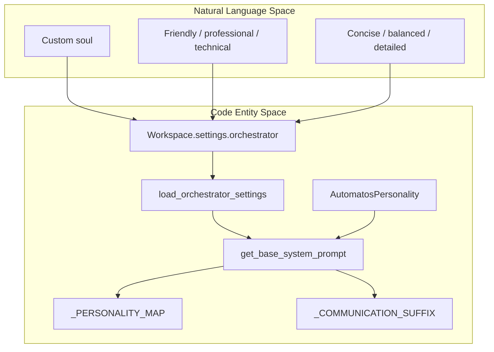
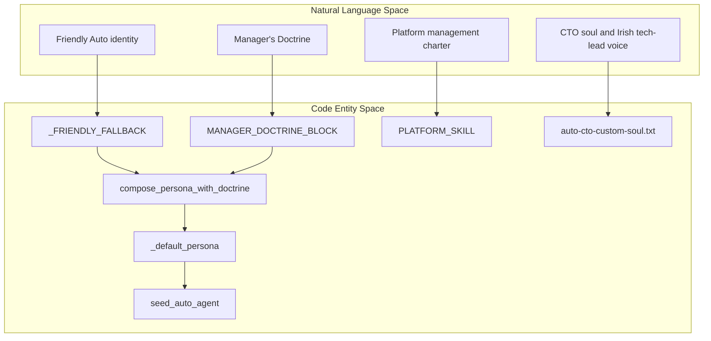

# Agent Personas

Relevant source files

The following files were used as context for generating this wiki page:

- [docs/PRDS/67-CTO-AGENT-PLATFORM-BUILDER.md](docs/PRDS/67-CTO-AGENT-PLATFORM-BUILDER.md)
- [docs/PRDS/PRD-226-AUTO-MANAGER-DOCTRINE.md](docs/PRDS/PRD-226-AUTO-MANAGER-DOCTRINE.md)
- [docs/auto-cto-custom-soul.txt](docs/auto-cto-custom-soul.txt)
- [docs/auto-cto-soul.md](docs/auto-cto-soul.md)
- [frontend/components/assignments/__tests__/mission-team-copy.test.tsx](frontend/components/assignments/__tests__/mission-team-copy.test.tsx)
- [frontend/components/assignments/mission-card-constellation.tsx](frontend/components/assignments/mission-card-constellation.tsx)
- [frontend/components/assignments/studio/entry-grid.tsx](frontend/components/assignments/studio/entry-grid.tsx)
- [orchestrator/alembic/versions/20260224_add_semantic_routing_columns.py](orchestrator/alembic/versions/20260224_add_semantic_routing_columns.py)
- [orchestrator/alembic/versions/20260225_create_marketplace_widgets.py](orchestrator/alembic/versions/20260225_create_marketplace_widgets.py)
- [orchestrator/alembic/versions/20260225_create_sdk_api_keys.py](orchestrator/alembic/versions/20260225_create_sdk_api_keys.py)
- [orchestrator/alembic/versions/20260225_create_widget_installs_reviews.py](orchestrator/alembic/versions/20260225_create_widget_installs_reviews.py)
- [orchestrator/alembic/versions/20260225_create_workspace_shares.py](orchestrator/alembic/versions/20260225_create_workspace_shares.py)
- [orchestrator/alembic/versions/20260226_add_cto_agent_columns.py](orchestrator/alembic/versions/20260226_add_cto_agent_columns.py)
- [orchestrator/alembic/versions/20260226_merge_heads_for_cto_agent.py](orchestrator/alembic/versions/20260226_merge_heads_for_cto_agent.py)
- [orchestrator/consumers/chatbot/cto_prompt_builder.py](orchestrator/consumers/chatbot/cto_prompt_builder.py)
- [orchestrator/consumers/chatbot/personality.py](orchestrator/consumers/chatbot/personality.py)
- [orchestrator/core/routing/semantic_indexer.py](orchestrator/core/routing/semantic_indexer.py)
- [orchestrator/core/seeds/auto-cto-custom-soul.txt](orchestrator/core/seeds/auto-cto-custom-soul.txt)
- [orchestrator/core/seeds/llm_tier_settings.py](orchestrator/core/seeds/llm_tier_settings.py)
- [orchestrator/core/seeds/platform-management-skill.md](orchestrator/core/seeds/platform-management-skill.md)
- [orchestrator/core/seeds/seed_auto_agent.py](orchestrator/core/seeds/seed_auto_agent.py)
- [orchestrator/core/seeds/seed_cto_agent.py](orchestrator/core/seeds/seed_cto_agent.py)
- [orchestrator/core/seeds/seed_packages.py](orchestrator/core/seeds/seed_packages.py)
- [orchestrator/core/seeds/seed_socials_package.py](orchestrator/core/seeds/seed_socials_package.py)
- [orchestrator/core/seeds/utterances/socials.yaml](orchestrator/core/seeds/utterances/socials.yaml)
- [orchestrator/modules/coordination/dispatch_contract.py](orchestrator/modules/coordination/dispatch_contract.py)
- [orchestrator/modules/socials/topics.py](orchestrator/modules/socials/topics.py)
- [orchestrator/modules/tools/discovery/actions_socials.py](orchestrator/modules/tools/discovery/actions_socials.py)
- [orchestrator/modules/tools/discovery/handlers_socials.py](orchestrator/modules/tools/discovery/handlers_socials.py)
- [orchestrator/modules/tools/discovery/question_turns.py](orchestrator/modules/tools/discovery/question_turns.py)
- [orchestrator/modules/tools/discovery/social_post_list.py](orchestrator/modules/tools/discovery/social_post_list.py)
- [orchestrator/services/package_installer.py](orchestrator/services/package_installer.py)
- [orchestrator/tests/test_f379_e_the_posts_are_listed_with_what_they_need.py](orchestrator/tests/test_f379_e_the_posts_are_listed_with_what_they_need.py)
- [orchestrator/tests/test_f381_a_a_how_to_question_changes_nothing.py](orchestrator/tests/test_f381_a_a_how_to_question_changes_nothing.py)
- [orchestrator/tests/test_package_installer_ref_resolution.py](orchestrator/tests/test_package_installer_ref_resolution.py)
- [orchestrator/tests/test_prd226_doctrine.py](orchestrator/tests/test_prd226_doctrine.py)
- [orchestrator/tests/test_prd230_packages_seed.py](orchestrator/tests/test_prd230_packages_seed.py)
- [orchestrator/tests/test_prd251w1_social_post_tools.py](orchestrator/tests/test_prd251w1_social_post_tools.py)
- [orchestrator/tests/test_prd251w1_socials_package.py](orchestrator/tests/test_prd251w1_socials_package.py)
- [orchestrator/tests/test_prd251w3_one_way_out.py](orchestrator/tests/test_prd251w3_one_way_out.py)
- [orchestrator/tests/test_prd263_persona_lift.py](orchestrator/tests/test_prd263_persona_lift.py)
- [orchestrator/tests/test_public_counts_auto_and_tier_tooltips.py](orchestrator/tests/test_public_counts_auto_and_tier_tooltips.py)

## Purpose and Scope

An agent persona is prompt-level identity and behavioral guidance. This page describes the workspace-configurable Automatos chat personality, the per-workspace Auto agent and its Manager’s Doctrine, the global CTO soul seed, and seeded marketplace-agent personas. It distinguishes those prompt mechanisms from voice profiles: the supplied implementation shows communication-style settings, but does not provide enough source to document a separate audio voice-profile system. [orchestrator/consumers/chatbot/personality.py:5-10](), [orchestrator/core/seeds/seed_auto_agent.py:5-15](), [orchestrator/core/seeds/auto-cto-custom-soul.txt:1-27]()

Sources: [orchestrator/consumers/chatbot/personality.py:5-10](), [orchestrator/core/seeds/seed_auto_agent.py:5-15](), [orchestrator/core/seeds/auto-cto-custom-soul.txt:1-27]()

---

## Persona System Architecture

Personas shape an agent through prompt text. In the chatbot personality module, workspace orchestrator settings select a predefined personality or a custom soul, and independently select a communication style. The per-workspace Auto seed composes a friendly base voice with a compact management doctrine. The global CTO’s soul is a separate seed file and is explicitly distinguished from the per-workspace Auto persona. [orchestrator/consumers/chatbot/personality.py:7-10](), [orchestrator/consumers/chatbot/personality.py:76-109](), [orchestrator/core/seeds/seed_auto_agent.py:32-37](), [orchestrator/core/seeds/seed_auto_agent.py:68-120]()

### Persona Modes and System Types

| Mode or persona source | Behavior | Scope and purpose |
|---|---|---|
| `friendly`, `professional`, `technical` | Selects a predefined personality block. An unknown mode falls back to the friendly block. [orchestrator/consumers/chatbot/personality.py:76-103](), [orchestrator/consumers/chatbot/personality.py:147-151]() | Workspace chatbot personality, when selected in orchestrator settings. [orchestrator/consumers/chatbot/personality.py:7-10]() |
| `custom` | Auto's soul is its agent row's `custom_persona_prompt`, the text Settings → Orchestrator edits; the identity section passes it to `get_base_system_prompt` as `soul`, which makes it the personality block, once. With no soul on the row the mode's preset is used, with its friendly fallback. Since 7 Nov 2026 no soul is kept in workspace settings (`custom_soul` there drifted from the row). [orchestrator/consumers/chatbot/personality.py](), [orchestrator/modules/context/sections/identity.py]() | Workspace-configured custom chatbot personality. [orchestrator/consumers/chatbot/personality.py:7-10]() |
| `communication_style` | Adds a concise or detailed instruction; `balanced` adds no suffix. [orchestrator/consumers/chatbot/personality.py:105-109]() | A response-length/style modifier independent of the personality block. [orchestrator/consumers/chatbot/personality.py:139-153]() |
| Auto persona | Seeds a friendly base voice with the Manager’s Doctrine appended. [orchestrator/core/seeds/seed_auto_agent.py:75-85](), [orchestrator/core/seeds/seed_auto_agent.py:96-120]() | One default chat agent per workspace, hidden from the Roster UI and visible to workspace members. [orchestrator/core/seeds/seed_auto_agent.py:5-16]() |
| CTO soul seed | Defines a CTO and Workspace Orchestrator identity, authority boundaries, personality, operating rhythm, and routing principles. [orchestrator/core/seeds/auto-cto-custom-soul.txt:1-27](), [orchestrator/core/seeds/auto-cto-custom-soul.txt:53-79]() | Global, admin-only CTO agent; it is not the per-workspace Auto persona. [orchestrator/core/seeds/seed_auto_agent.py:32-37]() |
| Marketplace agent persona | Seeded persona text is attached to marketplace agents, including the Social Media Director and Brand Designer. [orchestrator/core/seeds/seed_socials_package.py:7-15](), [orchestrator/core/seeds/seed_socials_package.py:102-118]() | Role-specific agents installed from the Socials package. [orchestrator/core/seeds/seed_socials_package.py:7-15]() |

Sources: [orchestrator/consumers/chatbot/personality.py:7-10](), [orchestrator/consumers/chatbot/personality.py:76-109](), [orchestrator/consumers/chatbot/personality.py:139-153](), [orchestrator/core/seeds/seed_auto_agent.py:5-16](), [orchestrator/core/seeds/seed_auto_agent.py:32-37](), [orchestrator/core/seeds/seed_auto_agent.py:68-120](), [orchestrator/core/seeds/auto-cto-custom-soul.txt:1-27](), [orchestrator/core/seeds/auto-cto-custom-soul.txt:53-79](), [orchestrator/core/seeds/seed_socials_package.py:7-15](), [orchestrator/core/seeds/seed_socials_package.py:102-118]()

### Natural Language Space to Code Entity Space: Persona Resolution

This mapping connects persona concepts to the named implementation entities that load settings and build prompt text. `load_orchestrator_settings` reads the workspace’s `settings["orchestrator"]` values with defaults and a 120-second cache; `AutomatosPersonality.get_base_system_prompt` then selects the personality block and communication suffix. [orchestrator/consumers/chatbot/personality.py:25-69](), [orchestrator/consumers/chatbot/personality.py:112-153]()

**Diagram: Workspace personality settings mapped to prompt-building entities**

Sources: [orchestrator/consumers/chatbot/personality.py:25-69](), [orchestrator/consumers/chatbot/personality.py:76-109](), [orchestrator/consumers/chatbot/personality.py:112-153]()

---

## The Per-Workspace Auto Agent & Manager’s Doctrine

Every workspace gets exactly one Auto agent, identified by the `auto-{workspace_id}` slug convention. The seed describes this row as the workspace’s default chat agent and the source of truth for its orchestrator LLM configuration, persona, and configuration. Auto agents are workspace-scoped, visible to workspace members, and hidden from the Roster UI when marked as system agents. [orchestrator/core/seeds/seed_auto_agent.py:5-16]()

### Soul Seed and Doctrine Composition

The Auto seed’s `_FRIENDLY_FALLBACK` supplies the base identity and voice; `MANAGER_DOCTRINE_BLOCK` adds operational guidance. `compose_persona_with_doctrine` strips the base voice and appends the doctrine separated by a blank line. `_default_persona` uses that shared composition path for a fresh workspace’s Auto persona. [orchestrator/core/seeds/seed_auto_agent.py:42-65](), [orchestrator/core/seeds/seed_auto_agent.py:75-85](), [orchestrator/core/seeds/seed_auto_agent.py:96-120]()

The doctrine’s nine principles cover situational awareness, choosing among `RESPOND`, `ASSIGN`, and `MISSION`, delegation, reuse of existing agents, explicit handoff contracts, board tracking, decision-shaped asks, recurring work as Playbooks, and narration of assignments and escalations. Its awareness guidance names `platform_board_summary`, `platform_list_missions`, and `platform_list_agents`. [orchestrator/core/seeds/seed_auto_agent.py:75-85]()

The seed comments describe the doctrine as deliberately compact for recurring chatbot context, and the tests enforce a 1,400-character ceiling (approximately 350 tokens by the test’s estimate). The doctrine tests also assert that the lane names and awareness-tool names remain consistent. [orchestrator/core/seeds/seed_auto_agent.py:68-74](), [orchestrator/tests/test_prd226_doctrine.py:19-31](), [orchestrator/tests/test_prd226_doctrine.py:66-78](), [orchestrator/tests/test_prd226_doctrine.py:106-129]()

The CTO soul file and the platform-management skill are distinct homes for the broader doctrine. The Auto seed comment says the CTO soul file feeds the global, admin-only CTO agent, not the per-workspace Auto agent; the per-workspace Auto persona is built from the friendly base and doctrine. [orchestrator/core/seeds/seed_auto_agent.py:32-37]()

Sources: [orchestrator/core/seeds/seed_auto_agent.py:5-16](), [orchestrator/core/seeds/seed_auto_agent.py:42-65](), [orchestrator/core/seeds/seed_auto_agent.py:68-85](), [orchestrator/core/seeds/seed_auto_agent.py:96-120](), [orchestrator/tests/test_prd226_doctrine.py:19-31](), [orchestrator/tests/test_prd226_doctrine.py:66-78](), [orchestrator/tests/test_prd226_doctrine.py:106-129]()

### Personality Base Voices

The chatbot personality module defines three predefined voices:

- `friendly`: warm and approachable; favors action when asked to do something and direct answers when asked how, where, or whether. [orchestrator/consumers/chatbot/personality.py:76-82]()
- `professional`: polished and enterprise-appropriate, with structured responses and proactive risk/dependency flags. [orchestrator/consumers/chatbot/personality.py:84-90]()
- `technical`: precise and developer-focused, leading with implementation specifics and avoiding small talk. [orchestrator/consumers/chatbot/personality.py:92-97]()

These are mapped by `_PERSONALITY_MAP`. The Auto seed has its own friendly base text in `_FRIENDLY_FALLBACK`; the supplied seed excerpt shows `compose_persona_with_doctrine` and `_default_persona`, but does not include the subsequent preset definitions, so this page does not assume that the Auto seed exposes the same full preset list. [orchestrator/consumers/chatbot/personality.py:99-103](), [orchestrator/core/seeds/seed_auto_agent.py:42-65](), [orchestrator/core/seeds/seed_auto_agent.py:113-120]()

Sources: [orchestrator/consumers/chatbot/personality.py:76-103](), [orchestrator/core/seeds/seed_auto_agent.py:42-65](), [orchestrator/core/seeds/seed_auto_agent.py:113-120]()

### Always-On Platform Management Skill

The Auto seed identifies `platform-management` as its always-on platform-management skill. The skill manifest describes it as a workspace operating charter and declares platform actions for managing agents, skills, plugins, tools, Playbooks, tasks, watches, schedules, and missions. The persona doctrine is identity-level guidance; the skill provides the operational reference and action catalog. [orchestrator/core/seeds/seed_auto_agent.py:32-38](), [orchestrator/core/seeds/platform-management-skill.md:1-7](), [orchestrator/core/seeds/platform-management-skill.md:26-56](), [orchestrator/core/seeds/platform-management-skill.md:88-131]()

Sources: [orchestrator/core/seeds/seed_auto_agent.py:32-38](), [orchestrator/core/seeds/platform-management-skill.md:1-7](), [orchestrator/core/seeds/platform-management-skill.md:26-56](), [orchestrator/core/seeds/platform-management-skill.md:88-131]()

### Natural Language Space to Code Entity Space: Auto Agent Integration

The seed path joins a natural-language base voice to the doctrine and produces the persona used for a fresh workspace’s Auto agent. `seed_auto_agent.py` also explicitly distinguishes this per-workspace composition from the CTO soul file’s global-agent role. [orchestrator/core/seeds/seed_auto_agent.py:32-37](), [orchestrator/core/seeds/seed_auto_agent.py:96-120]()

**Diagram: Auto voice and doctrine mapped to seed entities**

Sources: [orchestrator/core/seeds/seed_auto_agent.py:32-38](), [orchestrator/core/seeds/seed_auto_agent.py:42-65](), [orchestrator/core/seeds/seed_auto_agent.py:75-85](), [orchestrator/core/seeds/seed_auto_agent.py:96-120](), [orchestrator/core/seeds/auto-cto-custom-soul.txt:1-27]()

---

## Specialized Marketplace Personas

Marketplace agents can carry role-specific persona prompts. The Socials package seeds two marketplace agents—the Social Media Director and Brand Designer—and describes their personas and built-in skills as part of the package’s agent inventory. [orchestrator/core/seeds/seed_socials_package.py:7-15](), [orchestrator/core/seeds/seed_socials_package.py:50-57]()

### Specialized Roles and Boundaries

The Social Media Director persona directs the agent to turn existing workspace materials into channel-specific social content, use workspace templates and brand guidance, source factual claims, and draft through the Socials platform actions. It explicitly prohibits publishing, scheduling, or approving posts; the persona says a person approves each post and the platform publishes it. [orchestrator/core/seeds/seed_socials_package.py:83-94](), [orchestrator/core/seeds/seed_socials_package.py:102-116]()

The Socials seed describes marketplace agents as real `Agent` rows with `owner_type='marketplace'`; the package installer clones agents and Playbooks into a workspace as workspace-owned items. Seed documentation also states that each install copies the seeded persona, and that skill links are reconciled against global built-in skills named by the agent. [orchestrator/core/seeds/seed_socials_package.py:7-15](), [orchestrator/core/seeds/seed_socials_package.py:17-28]()

Sources: [orchestrator/core/seeds/seed_socials_package.py:7-28](), [orchestrator/core/seeds/seed_socials_package.py:50-57](), [orchestrator/core/seeds/seed_socials_package.py:83-116]()

---

## Persona Assembly & Plugin Integration

The supplied source excerpts establish persona text composition and seeded marketplace-agent persona behavior. They do not include the implementation of an agent execution-context assembly API, plugin prompt assembly, or an `AssembledContextOut` model; those details therefore are not specified here.

However, the `semantic_indexer.py` module shows how an agent's persona is incorporated into its semantic representation for routing. The `build_agent_semantic_text` function concatenates various agent attributes, including `agent.custom_persona_prompt`, into a single text block for embedding. This embedding is used for Tier 2.5 routing, where incoming queries are matched by cosine similarity to determine the most relevant agent. [orchestrator/core/routing/semantic_indexer.py:34-35](), [orchestrator/core/routing/semantic_indexer.py:67-69]()

Sources: [orchestrator/core/seeds/seed_auto_agent.py:96-120](), [orchestrator/core/seeds/seed_socials_package.py:7-28](), [orchestrator/core/routing/semantic_indexer.py:34-35](), [orchestrator/core/routing/semantic_indexer.py:67-69]()

---

## Voice Profiles & UI Configuration

The supplied personality implementation documents communication style, not an audio voice-profile assignment system. `communication_style` accepts `concise`, `balanced`, or `detailed`; concise and detailed append explicit instructions to the prompt, while balanced adds no suffix. [orchestrator/consumers/chatbot/personality.py:7-10](), [orchestrator/consumers/chatbot/personality.py:105-109](), [orchestrator/consumers/chatbot/personality.py:139-153]()

Workspace personality settings are loaded from `Workspace.settings["orchestrator"]`. `load_orchestrator_settings` starts with defaults, reads recognized keys, and caches successful database loads for 120 seconds. The listed defaults are `personality_mode` and `communication_style`, as well as `proactive_level` and `thinking_level`; `get_base_system_prompt` uses the first two, and takes Auto's soul from its agent row (the `soul` argument), never from these settings. [orchestrator/consumers/chatbot/personality.py:25-34](), [orchestrator/consumers/chatbot/personality.py:37-69](), [orchestrator/consumers/chatbot/personality.py:120-153]()

The provided files do not show a voice-profile model, voice-selection UI, or connection from persona configuration to real-time speech settings. Treat audio voice profiles as outside the documented scope of this page rather than inferring them from the communication-style setting. [orchestrator/consumers/chatbot/personality.py:7-10](), [orchestrator/consumers/chatbot/personality.py:105-109]()

Sources: [orchestrator/consumers/chatbot/personality.py:7-10](), [orchestrator/consumers/chatbot/personality.py:25-69](), [orchestrator/consumers/chatbot/personality.py:105-109](), [orchestrator/consumers/chatbot/personality.py:120-153]()

---