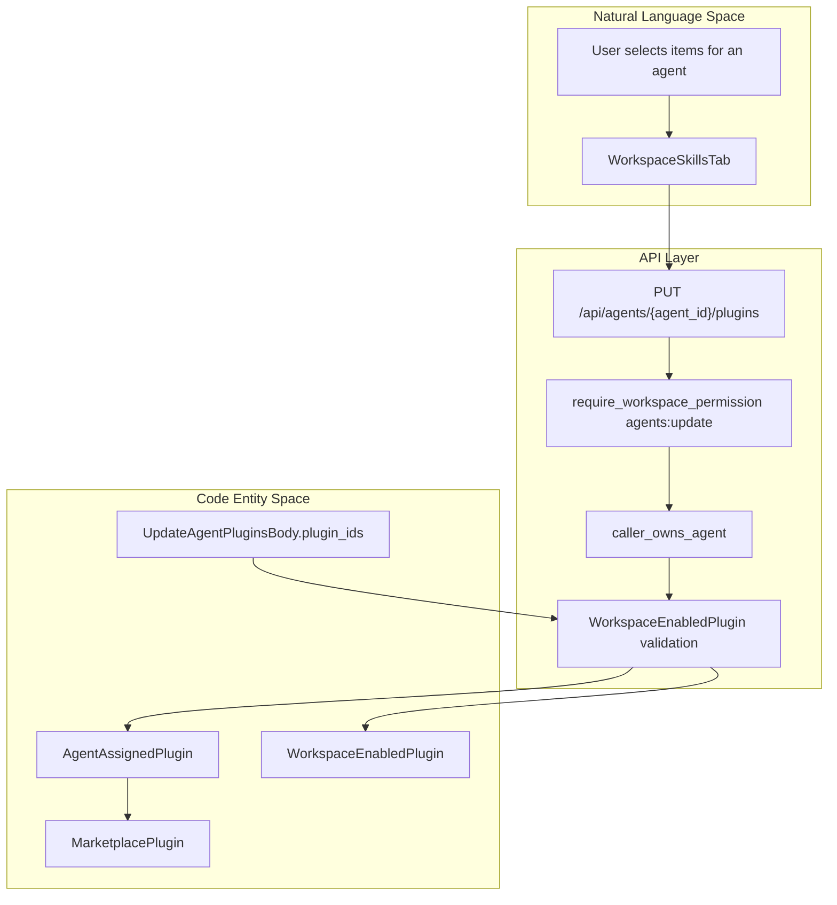
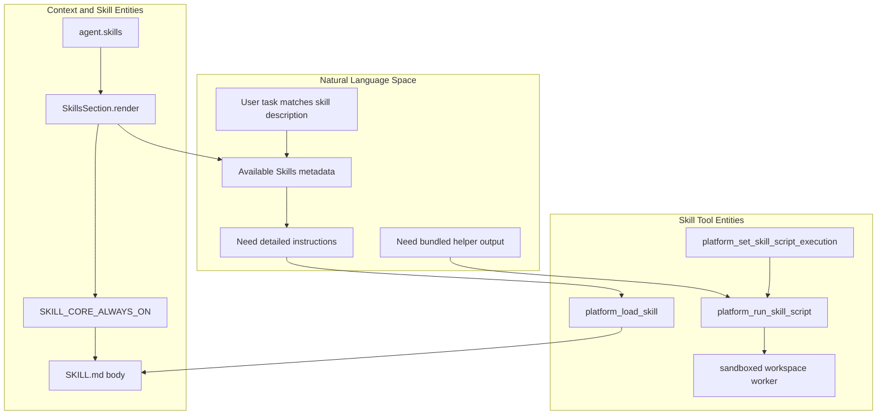
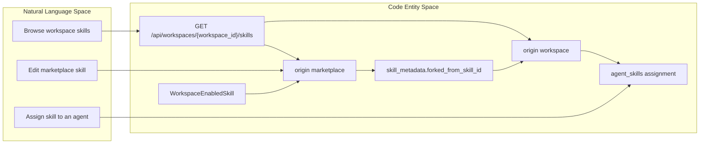

# Agent Plugins & Skills

Relevant source files

The following files were used as context for generating this wiki page:

- [docs/PRDS/128-UNIFIED-NOTIFICATION-SYSTEM.md](docs/PRDS/128-UNIFIED-NOTIFICATION-SYSTEM.md)
- [docs/PRDS/129-WORKSPACE-OUTPUTS-HUB.md](docs/PRDS/129-WORKSPACE-OUTPUTS-HUB.md)
- [frontend/components/agents/skills/skill-editor-modal.tsx](frontend/components/agents/skills/skill-editor-modal.tsx)
- [frontend/components/agents/skills/workspace-skills-tab.tsx](frontend/components/agents/skills/workspace-skills-tab.tsx)
- [frontend/components/knowledge/memory-tab.tsx](frontend/components/knowledge/memory-tab.tsx)
- [frontend/hooks/use-skills-api.ts](frontend/hooks/use-skills-api.ts)
- [orchestrator/alembic/versions/prd128_notifications.py](orchestrator/alembic/versions/prd128_notifications.py)
- [orchestrator/api/admin_plugins.py](orchestrator/api/admin_plugins.py)
- [orchestrator/api/agent_plugins.py](orchestrator/api/agent_plugins.py)
- [orchestrator/api/personas.py](orchestrator/api/personas.py)
- [orchestrator/api/rag_feedback.py](orchestrator/api/rag_feedback.py)
- [orchestrator/api/workspace_plugins.py](orchestrator/api/workspace_plugins.py)
- [orchestrator/api/workspace_skills.py](orchestrator/api/workspace_skills.py)
- [orchestrator/core/auth/workspace_agent.py](orchestrator/core/auth/workspace_agent.py)
- [orchestrator/core/seeds/marketplace_personas.py](orchestrator/core/seeds/marketplace_personas.py)
- [orchestrator/core/seeds/seed_shopify_agents.py](orchestrator/core/seeds/seed_shopify_agents.py)
- [orchestrator/core/services/marketplace_s3.py](orchestrator/core/services/marketplace_s3.py)
- [orchestrator/core/services/plugin_upload_service.py](orchestrator/core/services/plugin_upload_service.py)
- [orchestrator/tests/test_prd251w1_rvw1_persona_tenancy.py](orchestrator/tests/test_prd251w1_rvw1_persona_tenancy.py)

## Purpose & Scope

This page describes how Automatos AI makes plugins and skills available to agents: plugin assignment, workspace-level skill enablement, skill prompt loading, L1/L3 skill execution, security checks, and the boundaries between marketplace items and workspace-owned copies. It focuses on the supplied implementation references for the agent-plugin API, workspace-skills API, workspace plugin enablement, admin plugin management, `WorkspaceSkillsTab`, and backend service wrappers. [orchestrator/api/agent_plugins.py:1-9](), [orchestrator/api/workspace_skills.py:1-16](), [orchestrator/api/admin_plugins.py:1-13](), [frontend/components/agents/skills/workspace-skills-tab.tsx:1-45]()

Sources: [orchestrator/api/agent_plugins.py:1-9](), [orchestrator/api/workspace_skills.py:1-16](), [orchestrator/api/admin_plugins.py:1-13](), [frontend/components/agents/skills/workspace-skills-tab.tsx:1-45]()

---

## Plugin Lifecycle & Management

Plugins and skills have related but distinct assignment paths. The plugin API exposes agent-level plugin assignments; the workspace-skills API exposes skills that a workspace has enabled or owns. The supplied agent-plugin endpoint requires that assigned plugins be enabled for the agent’s workspace. [orchestrator/api/agent_plugins.py:144-192](), [orchestrator/api/workspace_skills.py:132-148]()

### 1. Admin Upload & Security Scanning

The admin plugin router exposes `POST /api/admin/plugins/upload` via `upload_plugin`. It requires admin access, accepts a ZIP upload (`UploadFile`), rejects missing filenames and non-ZIP files, and enforces a 10 MB size limit. [orchestrator/api/admin_plugins.py:43-63](), [orchestrator/api/admin_plugins.py:139-163]()

The handler constructs `MarketplaceS3Service`, `PluginScanService`, and `PluginUploadService`, then delegates the upload to `upload_service.upload_plugin`. A successful response returns a `PluginUploadOut` structure containing plugin and scan identifiers, slug, name, version, security status, approval status, and a `scanning` status. [orchestrator/api/admin_plugins.py:165-192](), [orchestrator/core/services/plugin_upload_service.py:80-125]()

### 2. Workspace Enablement & Agent Assignment

`PUT /api/agents/{agent_id}/plugins` is implemented by `update_agent_plugins`. The route requires the `agents:update` workspace permission and `caller_owns_agent`; the latter delegates workspace ownership validation to `workspace_agent_or_404`. [orchestrator/api/agent_plugins.py:67-80](), [orchestrator/api/agent_plugins.py:144-154]()

The handler checks that the agent exists and that its workspace matches the request context when the agent has a workspace. It derives the effective workspace ID from the agent or request context, removes duplicate plugin IDs while preserving order, and queries `WorkspaceEnabledPlugin` to confirm all requested plugins are enabled for the workspace. [orchestrator/api/agent_plugins.py:164-190]()

`GET /api/agents/{agent_id}/plugins`, implemented by `list_agent_plugins`, joins `AgentAssignedPlugin` to `MarketplacePlugin`, orders the results by assignment priority, and returns plugin metadata including version, skill and command counts, token estimate, priority, and assignment timestamp. [orchestrator/api/agent_plugins.py:86-117](), [orchestrator/api/agent_plugins.py:120-135]()

Sources: [orchestrator/api/admin_plugins.py:43-63](), [orchestrator/api/admin_plugins.py:139-192](), [orchestrator/api/agent_plugins.py:67-80](), [orchestrator/api/agent_plugins.py:86-135](), [orchestrator/api/agent_plugins.py:144-190](), [orchestrator/core/services/plugin_upload_service.py:80-125]()

---

## Skill Architecture & Progressive Disclosure

Skills participate in prompt assembly via progressive disclosure levels designed to optimize token usage while retaining full capability on demand. [orchestrator/modules/context/sections/skills.py:4-19]()

### 1. Progressive Disclosure Levels

- **L1 — Metadata catalog:** Each attached non-core skill contributes metadata (name and description) rather than its full body. The section instructs the agent to load the body when a task matches the skill description. [orchestrator/modules/context/sections/skills.py:6-14](), [orchestrator/modules/context/sections/skills.py:99-112]()
- **L2 — Full skill instructions:** Skills in the core always-on set contribute their full bodies during section rendering. The authoritative configuration is governed by system settings. [orchestrator/modules/context/sections/skills.py:32-39](), [orchestrator/modules/context/sections/skills.py:53-58]()
- **L2 on demand — `platform_load_skill`:** This read-permission platform action retrieves a named skill’s full `SKILL.md` body for the current turn. [orchestrator/modules/tools/discovery/actions_skills.py:26-57]()
- **L3 — Bundled script execution:** `platform_run_skill_script` is a write-permission action for running a skill’s bundled script through a sandboxed workspace worker. Only script output enters context, not the script source. [orchestrator/modules/tools/discovery/actions_skills.py:59-89]()
- **L3 enablement:** `platform_set_skill_script_execution` is an admin-only, confirmation-required write action. Script execution remains inert until explicitly enabled for the workspace, which re-runs the security scanner and refuses skills with critical findings. [orchestrator/modules/tools/discovery/actions_skills.py:91-124]()

### 2. Workspace Skills, Security Scanning & Forking

`GET /api/workspaces/{workspace_id}/skills` lists enabled marketplace skills and active workspace-owned skills. The response distinguishes `origin='marketplace'` (read-only catalog item) from `origin='workspace'` (forked or user-created, editable). The endpoint verifies workspace access prior to execution. [orchestrator/api/workspace_skills.py:49-53](), [orchestrator/api/workspace_skills.py:63-79](), [orchestrator/api/workspace_skills.py:132-148]()

The workspace-skills API invokes `plugin_security_scanner.quick_scan()` on edits: critical findings block saving, while high-severity findings issue warnings requiring explicit acknowledgment via `acknowledge_warnings`. [orchestrator/api/workspace_skills.py:14-15](), [orchestrator/api/workspace_skills.py:94-110]()

Editing a marketplace skill triggers fork-on-edit behavior: an edit creates a workspace-owned copy, records lineage in `skill_metadata.forked_from_skill_id`, migrates agent assignments to the fork, and drops the marketplace junction while leaving the original catalog item untouched. [orchestrator/modules/tools/discovery/actions_skills.py:10-14]()

Sources: [orchestrator/modules/context/sections/skills.py:4-39](), [orchestrator/modules/context/sections/skills.py:53-112](), [orchestrator/modules/tools/discovery/actions_skills.py:10-124](), [orchestrator/api/workspace_skills.py:14-15](), [orchestrator/api/workspace_skills.py:49-79](), [orchestrator/api/workspace_skills.py:94-148]()

---

## Technical Data Flow & Diagrams

### Plugin Assignment: User Intent to Assignment Records

The diagram bridges user-facing interactions in `WorkspaceSkillsTab` and plugin selection to backend route validation and database insertion across `AgentAssignedPlugin` and `WorkspaceEnabledPlugin`.

Title: "Plugin Assignment and Workspace Validation Flow"

Sources: [frontend/components/agents/skills/workspace-skills-tab.tsx:65-105](), [orchestrator/api/agent_plugins.py:36-38](), [orchestrator/api/agent_plugins.py:144-190]()

### Skill Activation: Task Intent to Context Entities

This diagram illustrates how user tasks leverage progressive disclosure and tool invocations to resolve skill bodies or run scripts.

Title: "Skill Activation and Execution Path"

Sources: [orchestrator/modules/context/sections/skills.py:86-139](), [orchestrator/modules/tools/discovery/actions_skills.py:26-124]()

### Workspace Skill Portability: Marketplace Origin to Workspace Copy

This diagram depicts how marketplace items are listed, enabled, and forked into workspace-owned copies when edited.

Title: "Workspace Skill Fork and Assignment Lineage"

Sources: [orchestrator/api/workspace_skills.py:63-79](), [orchestrator/api/workspace_skills.py:132-148](), [orchestrator/modules/tools/discovery/actions_skills.py:10-14]()

---

## Data Model Reference

| Entity or response | Role | Relevant fields |
|---|---|---|
| `UpdateAgentPluginsBody` | Agent-plugin assignment request | `plugin_ids` [orchestrator/api/agent_plugins.py:36-38]() |
| `AgentPluginOut` | Plugin assignment response | `plugin_id`, `slug`, `version`, `priority`, `assigned_at` [orchestrator/api/agent_plugins.py:40-54]() |
| `AgentAssignedPlugin` | Agent-to-plugin assignment record joined by list endpoint | `agent_id`, `plugin_id`, `priority` [orchestrator/api/agent_plugins.py:108-132]() |
| `WorkspaceEnabledPlugin` | Workspace plugin enablement checked during assignment | `workspace_id`, `plugin_id` [orchestrator/api/agent_plugins.py:157-190]() |
| `MarketplacePlugin` | Marketplace plugin details returned by list endpoint | `id`, `slug`, `name`, `version`, counts, token estimate [orchestrator/api/agent_plugins.py:94-132]() |
| `WorkspaceSkillOut` | Skill available to a workspace | `skill_id`, `origin`, `forked_from_skill_id`, `assigned_agent_count` [orchestrator/api/workspace_skills.py:63-79]() |
| `Skill` | Skill records queried for active workspace-owned skills | `workspace_id`, `is_active`, `name`, `prompt_template`, `skill_metadata` [orchestrator/api/workspace_skills.py:169-182]() |

Sources: [orchestrator/api/agent_plugins.py:36-64](), [orchestrator/api/agent_plugins.py:94-132](), [orchestrator/api/agent_plugins.py:157-190](), [orchestrator/api/workspace_skills.py:63-83](), [orchestrator/api/workspace_skills.py:169-182]()

---

## Key Functions & APIs Reference

| Symbol | Responsibility |
|---|---|
| `upload_plugin` | Admin-only plugin ZIP upload; validates file size and structure, delegating to S3 and scanning services. [orchestrator/api/admin_plugins.py:139-192]() |
| `list_agent_plugins` | Lists an agent’s plugin assignments with marketplace metadata, ordered by assignment priority. [orchestrator/api/agent_plugins.py:86-135]() |
| `update_agent_plugins` | Replaces an agent’s plugin assignments after workspace, permission, and enablement validation. [orchestrator/api/agent_plugins.py:144-190]() |
| `list_workspace_skills` | Lists workspace-owned and enabled marketplace skills, including assignment counts. [orchestrator/api/workspace_skills.py:132-182]() |
| `SkillsSection.render` | Renders skill context, skips widget turns, and handles section rendering errors safely. [orchestrator/modules/context/sections/skills.py:67-80]() |
| `platform_load_skill` | On-demand skill body loading action definition. [orchestrator/modules/tools/discovery/actions_skills.py:26-57]() |
| `platform_run_skill_script` | L3 bundled script execution action via sandboxed worker. [orchestrator/modules/tools/discovery/actions_skills.py:59-89]() |
| `platform_set_skill_script_execution` | Admin-only workspace execution gate for L3 script capabilities. [orchestrator/modules/tools/discovery/actions_skills.py:91-124]() |
| `PluginUploadService` | Coordinates ZIP extraction, manifest validation, security scans, and record persistence. [orchestrator/core/services/plugin_upload_service.py:80-125]() |
| `MarketplaceS3Service` | Manages object storage operations for marketplace plugin archives on S3/MinIO. [orchestrator/core/services/marketplace_s3.py:26-92]() |

Sources: [orchestrator/api/admin_plugins.py:139-192](), [orchestrator/api/agent_plugins.py:86-190](), [orchestrator/api/workspace_skills.py:132-182](), [orchestrator/modules/context/sections/skills.py:67-80](), [orchestrator/modules/tools/discovery/actions_skills.py:26-124](), [orchestrator/core/services/plugin_upload_service.py:80-125](), [orchestrator/core/services/marketplace_s3.py:26-92]()

---