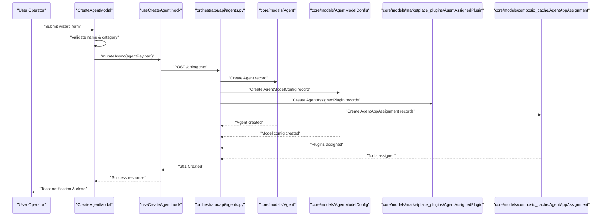
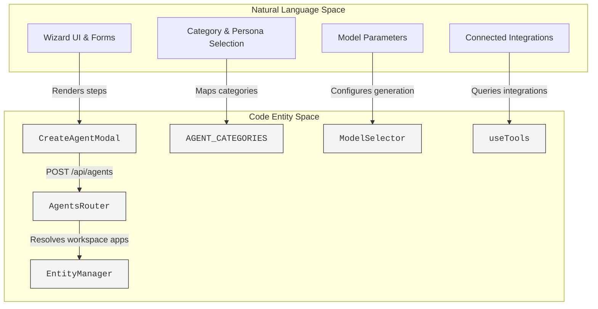
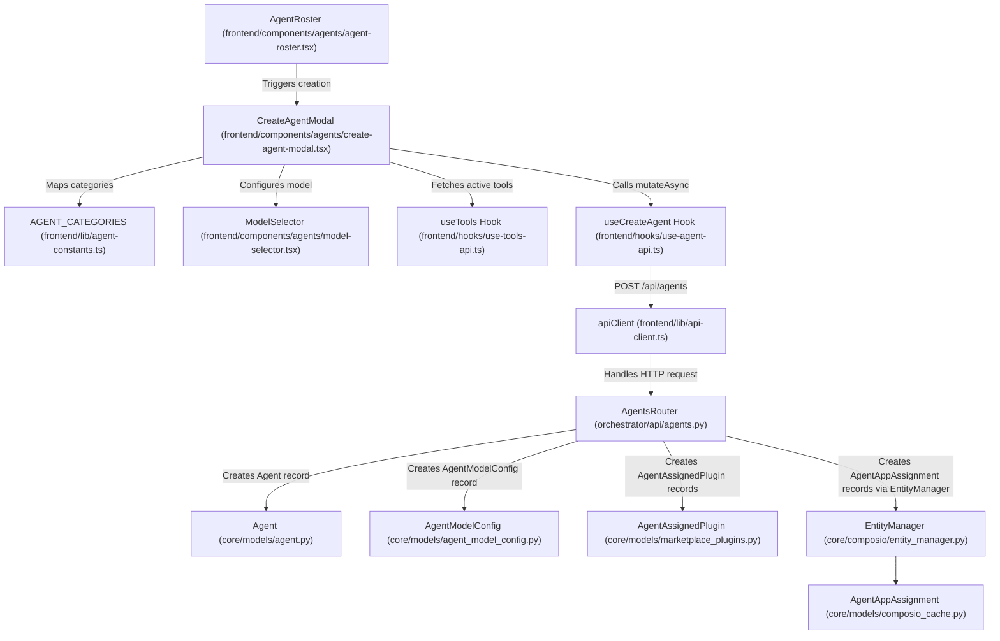

# Creating Agents

<details>
<summary>Relevant source files</summary>

The following files were used as context for generating this wiki page:

- [frontend/components/agents/agent-configuration-modal.tsx](frontend/components/agents/agent-configuration-modal.tsx)
- [frontend/components/agents/agent-configuration.tsx](frontend/components/agents/agent-configuration.tsx)
- [frontend/components/agents/agent-details-modal.tsx](frontend/components/agents/agent-details-modal.tsx)
- [frontend/components/agents/agent-management.tsx](frontend/components/agents/agent-management.tsx)
- [frontend/components/agents/agent-performance.tsx](frontend/components/agents/agent-performance.tsx)
- [frontend/components/agents/agent-roster.tsx](frontend/components/agents/agent-roster.tsx)
- [frontend/components/agents/agent-skills.tsx](frontend/components/agents/agent-skills.tsx)
- [frontend/components/agents/agent-status-control-modal.tsx](frontend/components/agents/agent-status-control-modal.tsx)
- [frontend/components/agents/create-agent-modal.tsx](frontend/components/agents/create-agent-modal.tsx)
- [frontend/components/agents/create-skill-modal.tsx](frontend/components/agents/create-skill-modal.tsx)
- [frontend/components/agents/skill-configuration-modal.tsx](frontend/components/agents/skill-configuration-modal.tsx)
- [frontend/components/documents/document-management.tsx](frontend/components/documents/document-management.tsx)
- [frontend/components/tools/tools-dashboard.tsx](frontend/components/tools/tools-dashboard.tsx)
- [frontend/components/workflows/active-workflows-panel.tsx](frontend/components/workflows/active-workflows-panel.tsx)
- [frontend/components/workflows/workflow-management.tsx](frontend/components/workflows/workflow-management.tsx)
- [frontend/hooks/use-agent-api.ts](frontend/hooks/use-agent-api.ts)
- [frontend/lib/agent-constants.ts](frontend/lib/agent-constants.ts)
- [orchestrator/alembic/versions/add_job_title_to_agents.py](orchestrator/alembic/versions/add_job_title_to_agents.py)
- [orchestrator/api/agents.py](orchestrator/api/agents.py)

</details>


This page details the technical architecture and implementation of the agent creation subsystem in Automatos AI. It covers the multi-step frontend wizard (`CreateAgentModal`), state persistence across backend tables via FastAPI routers, persona integration, LLM configuration, capability assignments (plugins and tools), and the programmatic `AgentFactory` lifecycle.

---

## Overview

Agent creation is implemented as a progressive wizard component (`CreateAgentModal`) that coordinates asynchronous calls to persist metadata, personas, model parameters, and integrations across multiple database tables.

The wizard collects configuration across progressive steps controlled by the `step` state variable:

| Step | Tab ID | Purpose | Primary State Variable |
|------|--------|---------|------------------------|
| 1 | `step-1` | Basic metadata (category, name, description, tags) | `agentData.category`, `agentData.name` [frontend/components/agents/create-agent-modal.tsx:69-79]() |
| 2 | `step-2` | Persona assignment (predefined/custom/none) | `personaMode`, `selectedPersonaId` [frontend/components/agents/create-agent-modal.tsx:87-94]() |
| 3 | `step-3` | LLM configuration (provider, model_id, parameters) | `modelConfig` object [frontend/components/agents/create-agent-modal.tsx:82-82]() |
| 4 | `step-4` | Composio tool assignments (e.g., Slack, GitHub) | `agentData.tools` array [frontend/components/agents/create-agent-modal.tsx:75-75]() |
| 5 | `step-5` | Marketplace plugin and runtime assignments | `agentData.plugins` array, `runtimeFields` [frontend/components/agents/create-agent-modal.tsx:74-85]() |

Sources: [frontend/components/agents/create-agent-modal.tsx:67-85]()

---

## Agent Creation Flow & Architecture

The following sequence details the end-to-end transaction when an operator creates a new agent through the UI wizard, invoking FastAPI endpoints and persisting records to PostgreSQL.

Title: "Agent Creation Sequence Diagram"


Sources: [frontend/components/agents/create-agent-modal.tsx:180-190](), [frontend/hooks/use-agent-api.ts:29-29](), [orchestrator/api/agents.py:280-300]()

### Natural Language to Code Entity Space: Creation Pipeline

The following diagram bridges natural language configuration concepts to their underlying code symbols and entities across the agent creation stack.

Title: "Natural Language to Code Entity Mapping: Agent Creation"


Sources: [frontend/components/agents/create-agent-modal.tsx:67-130](), [frontend/lib/agent-constants.ts:25-42](), [orchestrator/api/agents.py:142-176]()

---

## Component-to-Code Mapping

Title: "Component to Code Mapping"


Sources: [frontend/components/agents/create-agent-modal.tsx:35-43](), [frontend/hooks/use-agent-api.ts:29-29](), [frontend/hooks/use-tools-api.ts:1-10](), [orchestrator/api/agents.py:15-19](), [orchestrator/api/agents.py:21-26]()

---

## The 5-Step Wizard

### Step 1: Basic Information

The initial step captures core identification and categorization parameters:

```typescript
const [agentData, setAgentData] = useState({
  name: '',
  category: '',  // Changed from 'type' to 'category'
  description: '',
  tags: '',
  plugins: [] as string[],
  tools: [] as number[],
  specializations: [] as string[],
  // Marketplace field - just the toggle
  shareToMarketplace: false
})
```
[frontend/components/agents/create-agent-modal.tsx:69-79]()

UI categories map to database `agent_type` values via mapping constants defined in `agent-constants.ts`:

```typescript
const dbAgentType = CATEGORY_TO_DB_MAP[agentData.category] || 'custom'
```
[frontend/components/agents/create-agent-modal.tsx:190-190]()

Sources: [frontend/components/agents/create-agent-modal.tsx:68-80](), [frontend/lib/agent-constants.ts:48-65]()

### Step 2: Persona Selection (US-021)

Operators select or define an agent persona via three distinct operational modes:
- **None**: Applies standard default system prompts.
- **Predefined**: Selects from an indexed catalog fetched via `GET /api/personas` [frontend/components/agents/create-agent-modal.tsx:136-136](). The `personas` state variable stores these fetched personas [frontend/components/agents/create-agent-modal.tsx:91-91]().
- **Custom**: Allows direct prompt authoring stored in `customPersonaPrompt` state [frontend/components/agents/create-agent-modal.tsx:90-90](). If a predefined persona was previously selected, its `system_prompt` is pre-filled into the custom prompt field when switching to custom mode [frontend/components/agents/create-agent-modal.tsx:149-156]().

Sources: [frontend/components/agents/create-agent-modal.tsx:87-95](), [frontend/components/agents/create-agent-modal.tsx:136-136](), [frontend/components/agents/create-agent-modal.tsx:149-156]()

### Step 3: Model Configuration (PRD-15)

LLM provider selection, base model identifiers, and generation parameters (such as `temperature`, `max_output_tokens`) are managed through the `ModelSelector` component backed by `getDefaultModelConfig()` [frontend/components/agents/create-agent-modal.tsx:82-82](). The `modelConfig` state holds these parameters [frontend/components/agents/create-agent-modal.tsx:82-82](), and changes are handled by `handleModelConfigChange` [frontend/components/agents/create-agent-modal.tsx:176-178](). The available models are fetched using the `useModels` hook [frontend/components/agents/create-agent-modal.tsx:104-104]().

Sources: [frontend/components/agents/create-agent-modal.tsx:81-83](), [frontend/components/agents/create-agent-modal.tsx:176-178](), [frontend/components/agents/create-agent-modal.tsx:104-104]()

### Step 4: Tools (Composio Integration)

Tools are retrieved via the `useTools` React Query hook, querying active workspace integrations [frontend/components/agents/create-agent-modal.tsx:102-104](). The `availableTools` array is populated from this response [frontend/components/agents/create-agent-modal.tsx:103-103](). Selected tool IDs populate the `agentData.tools` array via `handleToolToggle` [frontend/components/agents/create-agent-modal.tsx:167-173]() and are resolved into app names by `_resolve_tool_ids_to_app_names` in `orchestrator/api/agents.py` [orchestrator/api/agents.py:142-176]().

Sources: [frontend/components/agents/create-agent-modal.tsx:102-104](), [frontend/components/agents/create-agent-modal.tsx:167-173](), [orchestrator/api/agents.py:142-176]()

### Step 5: Capabilities & Plugins

Workspace-enabled plugins are fetched via `GET /api/workspaces/{workspaceId}/plugins` on modal mount [frontend/components/agents/create-agent-modal.tsx:119-125](). The `workspacePlugins` state stores these plugins [frontend/components/agents/create-agent-modal.tsx:97-97](). Assigned plugin IDs are managed by `handlePluginToggle` [frontend/components/agents/create-agent-modal.tsx:158-164]() and map to `AgentAssignedPlugin` association records in the database.

Sources: [frontend/components/agents/create-agent-modal.tsx:108-130]()

---

## Backend API & Runtime Validation

### Agent Factory & Endpoints

Server-side agent creation is handled by the `/api/agents` endpoint (`orchestrator/api/agents.py`) and specialized endpoints like `/api/agents/create-specialized` (`orchestrator/api/agent_endpoints.py`), which integrate with `AgentFactory` [orchestrator/api/agent_endpoints.py:32-88](). These layers validate incoming fields, associate skills through `_fetch_attachable_skills` [orchestrator/api/agents.py:104-123](), and trigger semantic indexing via `_reindex_agent_embedding` [orchestrator/api/agents.py:61-89]().

Sources: [orchestrator/api/agents.py:38-123](), [orchestrator/api/agent_endpoints.py:41-88]()

### Runtime Configuration Guards

Before persisting updates, runtime parameters are validated against platform constraints via `_reject_invalid_runtime` [orchestrator/api/agents.py:38-55](). If an agent is configured with a `runtime: cli` (session-mode agent), the system checks for the `CLI_RUNTIME_ENABLED` flag and a valid local CLI model shape [orchestrator/api/agents.py:46-52](). If these conditions are not met, an `HTTPException(400)` is raised, preventing the creation of an invalid agent configuration [orchestrator/api/agents.py:53-54]().

Sources: [orchestrator/api/agents.py:38-55]()

---