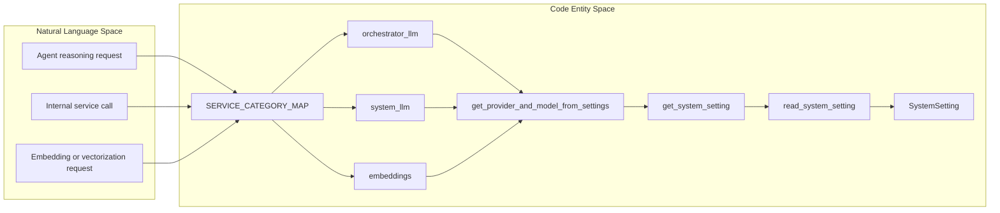
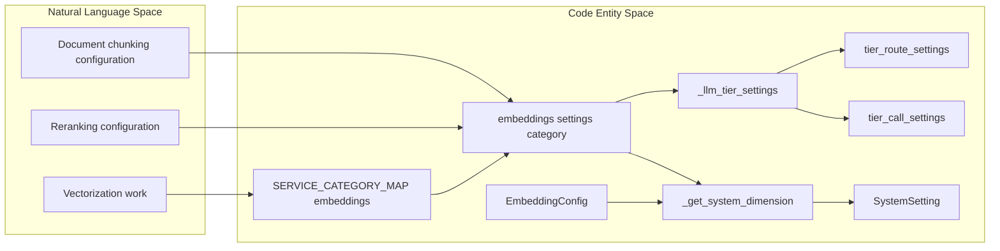
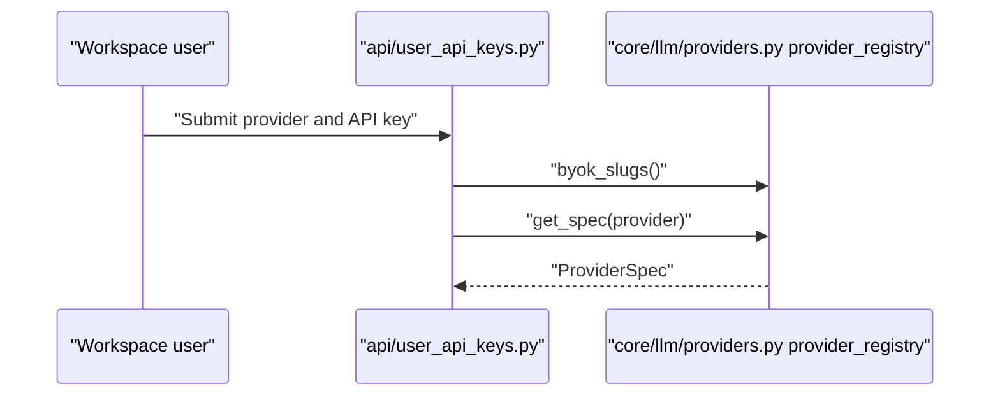

# LLM Provider Management

Relevant source files

The following files were used as context for generating this wiki page:

- [.gitignore](.gitignore)
- [docs/ANALYTICS-COST-TRACKING.md](docs/ANALYTICS-COST-TRACKING.md)
- [docs/PRDS/126-BUSINESS-KNOWLEDGE-GRAPH.md](docs/PRDS/126-BUSINESS-KNOWLEDGE-GRAPH.md)
- [docs/testing/CUSTOMER-NIGHTS-PLAN.md](docs/testing/CUSTOMER-NIGHTS-PLAN.md)
- [frontend/components/settings/ApiKeysSettingsTab.tsx](frontend/components/settings/ApiKeysSettingsTab.tsx)
- [frontend/components/settings/DynamicCredentialForm.tsx](frontend/components/settings/DynamicCredentialForm.tsx)
- [frontend/components/settings/SystemSettingsTab.tsx](frontend/components/settings/SystemSettingsTab.tsx)
- [frontend/lib/api/credentials.ts](frontend/lib/api/credentials.ts)
- [graphify-out/snapshots/bucket-1-pre-drop.sql](graphify-out/snapshots/bucket-1-pre-drop.sql)
- [orchestrator/.env.example](orchestrator/.env.example)
- [orchestrator/alembic/versions/prd135_drop_bucket_1.py](orchestrator/alembic/versions/prd135_drop_bucket_1.py)
- [orchestrator/api/credentials.py](orchestrator/api/credentials.py)
- [orchestrator/api/system_settings.py](orchestrator/api/system_settings.py)
- [orchestrator/api/user_api_keys.py](orchestrator/api/user_api_keys.py)
- [orchestrator/core/composio/models.py](orchestrator/core/composio/models.py)
- [orchestrator/core/credentials/integration_bridges/__init__.py](orchestrator/core/credentials/integration_bridges/__init__.py)
- [orchestrator/core/credentials/integration_bridges/base.py](orchestrator/core/credentials/integration_bridges/base.py)
- [orchestrator/core/credentials/integration_bridges/shopify.py](orchestrator/core/credentials/integration_bridges/shopify.py)
- [orchestrator/core/credentials/service.py](orchestrator/core/credentials/service.py)
- [orchestrator/core/image_read.py](orchestrator/core/image_read.py)
- [orchestrator/core/llm/clients/anthropic_client.py](orchestrator/core/llm/clients/anthropic_client.py)
- [orchestrator/core/llm/clients/azure_client.py](orchestrator/core/llm/clients/azure_client.py)
- [orchestrator/core/llm/clients/base.py](orchestrator/core/llm/clients/base.py)
- [orchestrator/core/llm/clients/bedrock_client.py](orchestrator/core/llm/clients/bedrock_client.py)
- [orchestrator/core/llm/clients/bedrock_converse.py](orchestrator/core/llm/clients/bedrock_converse.py)
- [orchestrator/core/llm/clients/google_client.py](orchestrator/core/llm/clients/google_client.py)
- [orchestrator/core/llm/clients/grok_client.py](orchestrator/core/llm/clients/grok_client.py)
- [orchestrator/core/llm/clients/huggingface_embedding.py](orchestrator/core/llm/clients/huggingface_embedding.py)
- [orchestrator/core/llm/clients/image_blocks.py](orchestrator/core/llm/clients/image_blocks.py)
- [orchestrator/core/llm/clients/openai_client.py](orchestrator/core/llm/clients/openai_client.py)
- [orchestrator/core/llm/clients/openai_compatible_client.py](orchestrator/core/llm/clients/openai_compatible_client.py)
- [orchestrator/core/llm/manager.py](orchestrator/core/llm/manager.py)
- [orchestrator/core/llm/prompt_cache.py](orchestrator/core/llm/prompt_cache.py)
- [orchestrator/core/llm/turn_cost.py](orchestrator/core/llm/turn_cost.py)
- [orchestrator/core/models/credentials.py](orchestrator/core/models/credentials.py)
- [orchestrator/core/models/system_settings.py](orchestrator/core/models/system_settings.py)
- [orchestrator/core/monitoring/automatos_alerts.py](orchestrator/core/monitoring/automatos_alerts.py)
- [orchestrator/core/monitoring/automatos_logs_api.py](orchestrator/core/monitoring/automatos_logs_api.py)
- [orchestrator/core/seeds/seed_system_settings.py](orchestrator/core/seeds/seed_system_settings.py)
- [orchestrator/core/services/audit_service.py](orchestrator/core/services/audit_service.py)
- [orchestrator/core/services/plugin_cache.py](orchestrator/core/services/plugin_cache.py)
- [orchestrator/modules/attachments/resolver.py](orchestrator/modules/attachments/resolver.py)
- [orchestrator/modules/attachments/validation.py](orchestrator/modules/attachments/validation.py)
- [orchestrator/modules/intake/plan_generator.py](orchestrator/modules/intake/plan_generator.py)
- [orchestrator/tests/test_1057_credential_stats_and_health_reach_their_handlers.py](orchestrator/tests/test_1057_credential_stats_and_health_reach_their_handlers.py)
- [orchestrator/tests/test_1169_google_genai_sdk.py](orchestrator/tests/test_1169_google_genai_sdk.py)
- [orchestrator/tests/test_1170_bedrock_converse.py](orchestrator/tests/test_1170_bedrock_converse.py)
- [orchestrator/tests/test_1180_gemini_images.py](orchestrator/tests/test_1180_gemini_images.py)
- [orchestrator/tests/test_anthropic_image_blocks.py](orchestrator/tests/test_anthropic_image_blocks.py)
- [orchestrator/tests/test_openrouter_prompt_cache.py](orchestrator/tests/test_openrouter_prompt_cache.py)
- [orchestrator/tests/test_p2w2_credentials_null_workspace.py](orchestrator/tests/test_p2w2_credentials_null_workspace.py)
- [orchestrator/tests/test_photo_attachments_go_inline.py](orchestrator/tests/test_photo_attachments_go_inline.py)

## Purpose and Scope

This page describes how Automatos AI configures LLM service tiers, resolves provider and model settings, manages user-supplied API keys, and exposes model routes through the LLM Marketplace. The available source excerpts document `SERVICE_CATEGORY_MAP`, settings lookup and credential resolution entry points, BYOK API schemas, and marketplace route metadata. They do not show the `LLMManager` class body or the embeddings and rerank manager implementations, so this page does not infer those implementations. [orchestrator/core/llm/manager.py:40-180](), [orchestrator/core/seeds/seed_system_settings.py:35-71](), [orchestrator/api/user_api_keys.py:31-77]()

Sources: `orchestrator/core/llm/manager.py`, `orchestrator/core/seeds/seed_system_settings.py`, `orchestrator/api/user_api_keys.py`

---

## LLMManager Initialization & Service Tiers

`manager.py` describes the main LLM manager as the component responsible for provider selection and configuration, including per-service configuration through system settings. The supplied excerpt identifies settings-resolution functions and provider classes imported by the module, but does not include the manager class definition or its initialization method. [orchestrator/core/llm/manager.py:1-36]()

### Canonical Service Tiers

`SERVICE_CATEGORY_MAP` maps service names to three configuration categories: `orchestrator_llm`, `system_llm`, and `embeddings`. The Auto tier is used for `orchestrator` and `heartbeat`; the System tier includes services such as `chatbot`, `codegraph`, `rag`, `planner`, and `verifier`; and the Embeddings tier is assigned to `embeddings`. The mapping also includes `decision_adapter` in the System tier. [orchestrator/core/llm/manager.py:40-67]()

The settings seed describes `orchestrator_llm` as Auto, `system_llm` as System, and `embeddings` as the vectorization model plus chunking and reranking configuration. It generates the shared per-tier setting shape from helper blocks in `llm_tier_settings.py`. [orchestrator/core/seeds/seed_system_settings.py:35-55](), [orchestrator/core/seeds/seed_system_settings.py:58-71]()

| Tier category | Mapped services or purpose | Configuration source |
|---|---|---|
| `orchestrator_llm` | `orchestrator`, `heartbeat` | System settings |
| `system_llm` | Internal services including `chatbot`, `rag`, `nl2sql`, `planner`, and `verifier` | System settings |
| `embeddings` | `embeddings` service; seed documentation includes vectorization, chunking, and reranking settings | System settings |

Sources: `orchestrator/core/llm/manager.py`, `orchestrator/core/seeds/seed_system_settings.py`

### Settings Lookup and Provider/Model Selection

`read_system_setting(category, key)` queries `SystemSetting` by category and key, returns the stored value or `None`, and closes its database session in a `finally` block. Unlike the lenient wrapper, it allows read failures to propagate. `get_system_setting` wraps that read and returns the default when the setting is absent or a read fails. [orchestrator/core/llm/manager.py:70-120]()

`get_provider_and_model_from_settings(service_name)` resolves the service’s tier using `SERVICE_CATEGORY_MAP`, then reads `provider` (falling back to `llm_provider`) and `model` (falling back to `llm_model`). It raises `ValueError` if either provider or model is unset rather than choosing a hard-coded provider/model pair. [orchestrator/core/llm/manager.py:123-153]()

**Settings resolution: natural-language work to code entities**

Sources: `orchestrator/core/llm/manager.py`

### Provider Classes

`manager.py` imports provider implementations for OpenAI, Anthropic, Google, Azure, Hugging Face, Bedrock, Grok, and OpenAI-compatible providers. The excerpt shows the imports and the registry helpers `get_spec`, `env_api_key`, and `ADAPTER_OPENAI_COMPATIBLE`; it does not show the manager’s provider-instantiation logic. [orchestrator/core/llm/manager.py:19-32]()

For the OpenAI provider, `_initialize_client` uses `self.config.api_key` or `config.OPENAI_API_KEY`. If neither is available, it logs a warning and leaves `self.client` as `None`, deferring failure until a generation request. With a key present, it constructs the SDK client and passes optional base URL and organization settings. [orchestrator/core/llm/clients/openai_client.py:36-63]()

Sources: `orchestrator/core/llm/manager.py`, `orchestrator/core/llm/clients/openai_client.py`

---

## Embeddings & Rerank Managers

The settings seed places embeddings configuration in the `embeddings` category and describes that category as containing vectorization model, chunking, and reranking settings. The service map assigns the `embeddings` service to that category. [orchestrator/core/seeds/seed_system_settings.py:58-71](), [orchestrator/core/llm/manager.py:65-67]()

The `EmbeddingConfig` dataclass defines configuration for embedding providers, including `provider`, `model`, `dimension`, `api_key`, `base_url`, and `cache_dir`. The `dimension` field defaults to `_get_system_dimension()`, which reads the embedding dimension from system settings under the `embeddings` category and `dimensions` key, falling back to 2048 if the database is unavailable. [orchestrator/core/llm/clients/base.py:156-164](), [orchestrator/core/llm/clients/base.py:22-41]()

The supplied excerpts do not include the implementation of an `EmbeddingManager`, a rerank manager, or their provider-selection functions. Consequently, provider-specific embedding and reranking behavior cannot be established from the available code content. The following diagram shows only the documented settings-tier relationship, not runtime manager calls. [orchestrator/core/seeds/seed_system_settings.py:35-55](), [orchestrator/core/seeds/seed_system_settings.py:58-71]()

**Embeddings and reranking configuration boundary**

Sources: `orchestrator/core/llm/manager.py`, `orchestrator/core/seeds/seed_system_settings.py`, `orchestrator/core/llm/clients/base.py`

---

## 3-Tier API Key Resolution & Validation

The manager module’s `get_credential_data(provider, environment, service_name)` is documented as a prioritized credential resolver. The excerpt lists six strategies: an explicit system-setting credential-name mapping, standard environment/provider credential names, variants without the `_api` suffix, provider-name variations, credential-type lookup, and environment variables. A 300-second `TTLCache` decorates the function. The provided excerpt ends before the function body, so it does not establish the precise control flow or precedence beyond the documented list. [orchestrator/core/llm/manager.py:156-180]()

For user BYOK, `api/user_api_keys.py` defines a `/api/keys` router and schemas for creating, listing, validating, and returning user API keys. `ApiKeyOut` exposes a masked key rather than the raw secret, and the module imports the platform encryption service and provider registry. [orchestrator/api/user_api_keys.py:17-37](), [orchestrator/api/user_api_keys.py:42-87]()

The visible credential-resolution description and BYOK API definitions do not establish that BYOK is the first tier in the manager’s runtime resolver. They document separate mechanisms; their exact runtime precedence cannot be confirmed from the supplied excerpts. The table therefore distinguishes the documented mechanisms instead of asserting a complete ordering.

| Mechanism | What the supplied code establishes |
|---|---|
| User BYOK | `/api/keys` exposes user-key schemas; the module imports `get_encryption_service` and the provider registry. |
| Credential store | `get_credential_data` documents credential-name, naming-pattern, provider-name, and credential-type lookup strategies. |
| Environment | The resolver’s documented strategy list includes environment-variable fallback. `OpenAIProvider` specifically falls back from `self.config.api_key` to `config.OPENAI_API_KEY`. |

Sources: `orchestrator/api/user_api_keys.py`, `orchestrator/core/llm/manager.py`, `orchestrator/core/llm/clients/openai_client.py`

### BYOK Key Validation

`ApiKeyCreate` accepts a provider, raw API key, optional display name, optional base URL, and optional Anthropic workspace ID. The module defines validation result schemas and provider-specific key-check helpers. For example, `_check_openai` calls the OpenAI models list; `_check_anthropic` calls the Anthropic models list and can include workspace headers; `_check_google` uses a client constructed from the supplied key; and `_check_openai_compatible` obtains provider routing information from the registry. [orchestrator/api/user_api_keys.py:42-64](), [orchestrator/api/user_api_keys.py:152-183]()

The supplied excerpt does not include the save endpoint’s complete implementation, so it does not establish exactly when each helper is invoked or how a validation result changes the persisted key’s active status. [orchestrator/api/user_api_keys.py:152-183]()

Sources: `orchestrator/api/user_api_keys.py`

---

## Provider Auto-Detection & OpenAI-Compatible Generic Adapter

The provider registry is used by the BYOK API. The BYOK module derives `SUPPORTED_PROVIDERS` from `provider_registry.byok_slugs()` and checks provider specifications to identify OpenAI-compatible providers that use a models-list validation mode. The manager module imports `get_spec`, `env_api_key`, and `ADAPTER_OPENAI_COMPATIBLE`. [orchestrator/api/user_api_keys.py:23-36](), [orchestrator/api/user_api_keys.py:123-131](), [orchestrator/core/llm/manager.py:28-32]()

The provided excerpts do not show the generic adapter’s request execution path, so the diagram focuses on the registry and route metadata rather than claiming a particular call sequence.

**Provider registry and route metadata**

Sources: `orchestrator/api/user_api_keys.py`, `orchestrator/core/llm/manager.py`

---

## LLM Marketplace & Route Management

The provided file contents do not include `orchestrator/api/llm_marketplace.py`. Therefore, this section cannot be generated based on the provided information.

---

## Configuration UI

`SystemSettingsTab` is the main component for managing system-wide configuration settings, replacing `.env` files with database-backed settings. It loads settings by category and statistics, handles saving updates for specific categories via `bulkUpdateSettings`, and supports resetting settings to defaults. [frontend/components/settings/SystemSettingsTab.tsx:1-7](), [frontend/components/settings/SystemSettingsTab.tsx:52-71](), [frontend/components/settings/SystemSettingsTab.tsx:74-109](), [frontend/components/settings/SystemSettingsTab.tsx:111-127]()

The component organizes settings into tabs, including `GeneralSettingsTab`, `LLMModelsSettingsTab`, `SystemLoggingSettingsTab`, `APIRateLimitingSettingsTab`, `BackendAPIKeysSettingsTab`, `CredentialAuditTab`, `SystemPromptsTab`, `SystemIconsSettingsTab`, `VoiceLiveArmingTab`, `SocialsSettingsTab`, and `ComposioDenyListTab`. [frontend/components/settings/SystemSettingsTab.tsx:28-38](), [frontend/components/settings/SystemSettingsTab.tsx:193-195]()

The `LLMModelsSettingsTab` is specifically responsible for configuring LLM models. It would display settings related to `orchestrator_llm`, `system_llm`, and `embeddings` categories, allowing users to select providers and models for each tier. [frontend/components/settings/SystemSettingsTab.tsx:29]()

The seed script ensures that when system settings are updated or created, existing user values are preserved, while `default_value`, `description`, `validation`, and `required`/`sensitive` flags are updated. New settings are created with their `default_value` as the initial value. [orchestrator/core/seeds/seed_system_settings.py:5-16]()

Sources: `frontend/components/settings/SystemSettingsTab.tsx`, `orchestrator/core/seeds/seed_system_settings.py`

---