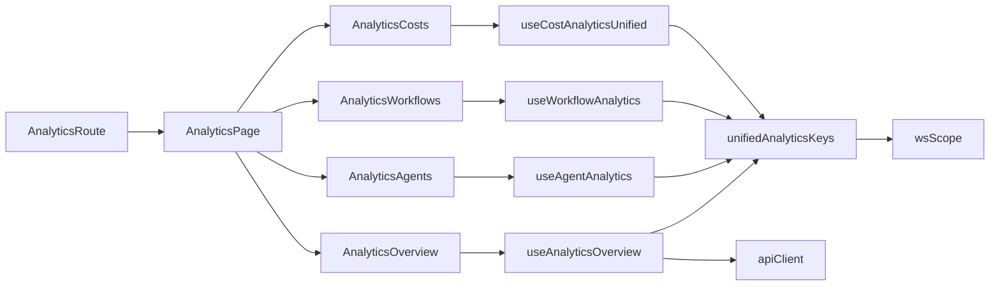
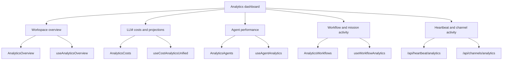

# Analytics, Monitoring & Observability

Relevant source files

The following files were used as context for generating this wiki page:

- [docs/PRDS/52-UNIFIED-ANALYTICS.md](docs/PRDS/52-UNIFIED-ANALYTICS.md)
- [frontend/app/analytics/page.tsx](frontend/app/analytics/page.tsx)
- [frontend/components/analytics/analytics-admin.tsx](frontend/components/analytics/analytics-admin.tsx)
- [frontend/components/analytics/analytics-agents.tsx](frontend/components/analytics/analytics-agents.tsx)
- [frontend/components/analytics/analytics-costs.tsx](frontend/components/analytics/analytics-costs.tsx)
- [frontend/components/analytics/analytics-documents.tsx](frontend/components/analytics/analytics-documents.tsx)
- [frontend/components/analytics/analytics-openrouter-credits.tsx](frontend/components/analytics/analytics-openrouter-credits.tsx)
- [frontend/components/analytics/analytics-overview.tsx](frontend/components/analytics/analytics-overview.tsx)
- [frontend/components/analytics/analytics-page.tsx](frontend/components/analytics/analytics-page.tsx)
- [frontend/components/analytics/analytics-plan-usage.tsx](frontend/components/analytics/analytics-plan-usage.tsx)
- [frontend/components/analytics/analytics-recommendations.tsx](frontend/components/analytics/analytics-recommendations.tsx)
- [frontend/components/analytics/analytics-workflows.tsx](frontend/components/analytics/analytics-workflows.tsx)
- [frontend/components/system/rag-configuration.tsx](frontend/components/system/rag-configuration.tsx)
- [frontend/hooks/use-unified-analytics.ts](frontend/hooks/use-unified-analytics.ts)

## Purpose and Scope

This page introduces the analytics dashboard and the observability topics covered by its child pages. The analytics route renders a workspace-oriented dashboard with overview, agent, mission, document, LLM cost, tools, and—when the user is an admin—admin views [frontend/app/analytics/page.tsx:7-14](), [frontend/components/analytics/analytics-page.tsx:35-60]().

The dashboard brings operational and usage views together; telemetry and OpenTelemetry instrumentation are documented separately. For details, see:

- [Analytics Architecture](#16.1) — `use-unified-analytics` hooks, `wsScope`, React Query integration, and polling patterns.
- [LLM Usage & Cost Analytics](#16.2) — usage records, cost analysis, OpenRouter synchronization and credits, and projections.
- [Agent, Workflow & Admin Analytics](#16.3) — agent and workflow performance, admin dashboards, plan usage, and activity feeds.
- [Telemetry & System Health](#16.4) — tool telemetry, substrate metrics, health endpoints, and related monitoring.
- [OpenTelemetry Instrumentation (PRD-256)](#16.5) — instrumentation, propagation, exporters, and deployment configuration.

Sources: [frontend/app/analytics/page.tsx:7-14](), [frontend/components/analytics/analytics-page.tsx:35-60]()

---

## Analytics Architecture & Data Flow

The analytics route renders `AnalyticsPage`, which selects a dashboard view and passes the selected time range to its components. The unified analytics hooks use React Query and include a workspace scope in query keys; the overview hook combines several requests and normalizes their results for display [frontend/app/analytics/page.tsx:7-14](), [frontend/components/analytics/analytics-page.tsx:35-60](), [frontend/hooks/use-unified-analytics.ts:34-65](), [frontend/hooks/use-unified-analytics.ts:68-125]().

**Diagram: Dashboard route and query flow**

Sources: [frontend/app/analytics/page.tsx:7-14](), [frontend/components/analytics/analytics-page.tsx:35-60](), [frontend/components/analytics/analytics-page.tsx:94-124](), [frontend/hooks/use-unified-analytics.ts:34-65](), [frontend/hooks/use-unified-analytics.ts:68-83](), [frontend/hooks/use-unified-analytics.ts:140-142](), [frontend/components/analytics/analytics-workflows.tsx:25-37](), [frontend/components/analytics/analytics-costs.tsx:45-50]()

The overview combines agent, LLM summary, projection, workflow, document, and mission data. The UI also requests heartbeat and channel analytics separately, while the costs view provides additional model comparison, daily-cost, projection, and OpenRouter-credit views [frontend/hooks/use-unified-analytics.ts:68-125](), [frontend/components/analytics/analytics-overview.tsx:28-65](), [frontend/components/analytics/analytics-costs.tsx:163-173]().

**Diagram: Analytics concepts mapped to frontend entities**

Sources: [frontend/components/analytics/analytics-overview.tsx:23-65](), [frontend/components/analytics/analytics-costs.tsx:163-173](), [frontend/components/analytics/analytics-agents.tsx:25-27](), [frontend/components/analytics/analytics-workflows.tsx:25-37]()

For details on hook organization, workspace scoping, caching, and polling, see [Analytics Architecture](#16.1).

Sources: [frontend/hooks/use-unified-analytics.ts:34-65](), [frontend/hooks/use-unified-analytics.ts:68-125]()

---

## LLM Usage & Cost Analytics

The overview displays LLM cost for the selected period alongside a monthly projection. The costs view adds model comparisons, daily cost-by-model data, projections, and OpenRouter credit information. Cost presentation distinguishes metered charges from usage attributed to a plan or free tier [frontend/hooks/use-unified-analytics.ts:74-89](), [frontend/hooks/use-unified-analytics.ts:113-120](), [frontend/components/analytics/analytics-costs.tsx:163-173](), [frontend/components/analytics/analytics-costs.tsx:104-110]().

For details on usage records, cost attribution, synchronization, and projections, see [LLM Usage & Cost Analytics](#16.2).

Sources: [frontend/hooks/use-unified-analytics.ts:74-89](), [frontend/hooks/use-unified-analytics.ts:113-120](), [frontend/components/analytics/analytics-costs.tsx:163-173](), [frontend/components/analytics/analytics-costs.tsx:104-110]()

---

## Agent, Workflow & Admin Analytics

The dashboard separates agent, workflow, and admin views. The workflow view summarizes executions, success rate, and average duration; the overview also incorporates mission statistics. Admin views are added to the tab set when `isAdmin` is true, and the overview includes plan usage [frontend/components/analytics/analytics-page.tsx:52-60](), [frontend/components/analytics/analytics-page.tsx:94-124](), [frontend/components/analytics/analytics-workflows.tsx:145-150](), [frontend/hooks/use-unified-analytics.ts:74-107](), [frontend/components/analytics/analytics-overview.tsx:23-26]().

For detailed metrics and dashboard behavior, see [Agent, Workflow & Admin Analytics](#16.3).

Sources: [frontend/components/analytics/analytics-page.tsx:52-60](), [frontend/components/analytics/analytics-page.tsx:94-124](), [frontend/components/analytics/analytics-workflows.tsx:145-150](), [frontend/hooks/use-unified-analytics.ts:74-107](), [frontend/components/analytics/analytics-overview.tsx:23-26]()

---

## Telemetry & System Health

The overview requests heartbeat and channel analytics separately from its React Query overview data. It displays heartbeat counts, successes, errors, and tokens, and merges channel activity by source for presentation [frontend/components/analytics/analytics-overview.tsx:28-65](), [frontend/components/analytics/analytics-overview.tsx:142-155]().

For tool telemetry, substrate metrics, health endpoints, and related monitoring, see [Telemetry & System Health](#16.4).

Sources: [frontend/components/analytics/analytics-overview.tsx:28-65](), [frontend/components/analytics/analytics-overview.tsx:142-155]()

---

## OpenTelemetry Instrumentation (PRD-256)

OpenTelemetry instrumentation is a separate observability topic from the analytics dashboard. Its child page covers the instrumentation and deployment areas listed in the page scope, including spans, propagation, exporters, frontend and worker coverage, and collector configuration.

For details, see [OpenTelemetry Instrumentation (PRD-256)](#16.5).

Sources: [frontend/components/analytics/analytics-page.tsx:35-60]()

---