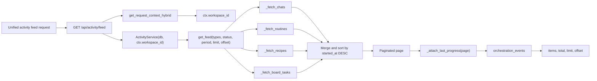

# Agent, Workflow & Admin Analytics

Relevant source files

The following files were used as context for generating this wiki page:

- [docs/PRDS/72-ACTIVITY-COMMAND-CENTRE.md](docs/PRDS/72-ACTIVITY-COMMAND-CENTRE.md)
- [frontend/components/__tests__/calendar-schedule-retry.test.ts](frontend/components/__tests__/calendar-schedule-retry.test.ts)
- [frontend/components/activity/__tests__/feed-progress-followup.test.ts](frontend/components/activity/__tests__/feed-progress-followup.test.ts)
- [frontend/components/activity/activity-feed-item.tsx](frontend/components/activity/activity-feed-item.tsx)
- [frontend/components/activity/activity-feed.tsx](frontend/components/activity/activity-feed.tsx)
- [frontend/components/activity/activity-page.tsx](frontend/components/activity/activity-page.tsx)
- [frontend/components/activity/execution-detail.tsx](frontend/components/activity/execution-detail.tsx)
- [frontend/components/activity/routine-card.tsx](frontend/components/activity/routine-card.tsx)
- [frontend/components/activity/widgets/__tests__/agent-reports-widget.test.tsx](frontend/components/activity/widgets/__tests__/agent-reports-widget.test.tsx)
- [frontend/components/activity/widgets/agent-reports-widget.tsx](frontend/components/activity/widgets/agent-reports-widget.tsx)
- [frontend/components/activity/widgets/schedule-widget.tsx](frontend/components/activity/widgets/schedule-widget.tsx)
- [frontend/components/settings/WebhooksSettingsTab.tsx](frontend/components/settings/WebhooksSettingsTab.tsx)
- [frontend/components/settings/__tests__/webhooks-canonical-terms.test.ts](frontend/components/settings/__tests__/webhooks-canonical-terms.test.ts)
- [frontend/components/shared/item-card.tsx](frontend/components/shared/item-card.tsx)
- [frontend/hooks/use-activity-api.ts](frontend/hooks/use-activity-api.ts)
- [orchestrator/alembic/versions/prd221_digest_feedback.py](orchestrator/alembic/versions/prd221_digest_feedback.py)
- [orchestrator/api/activity.py](orchestrator/api/activity.py)
- [orchestrator/api/analytics.py](orchestrator/api/analytics.py)
- [orchestrator/api/analytics_api.py](orchestrator/api/analytics_api.py)
- [orchestrator/api/analytics_charts.py](orchestrator/api/analytics_charts.py)
- [orchestrator/api/analytics_real.py](orchestrator/api/analytics_real.py)
- [orchestrator/api/database_analytics.py](orchestrator/api/database_analytics.py)
- [orchestrator/api/execution_history.py](orchestrator/api/execution_history.py)
- [orchestrator/api/knowledge_multimodal.py](orchestrator/api/knowledge_multimodal.py)
- [orchestrator/api/system.py](orchestrator/api/system.py)
- [orchestrator/api/workflow_history.py](orchestrator/api/workflow_history.py)
- [orchestrator/api/workflow_templates.py](orchestrator/api/workflow_templates.py)
- [orchestrator/channels/whatsapp_adapter.py](orchestrator/channels/whatsapp_adapter.py)
- [orchestrator/core/auth/workspace_admin.py](orchestrator/core/auth/workspace_admin.py)
- [orchestrator/core/team_access.py](orchestrator/core/team_access.py)
- [orchestrator/modules/tools/execution/exec_multimodal.py](orchestrator/modules/tools/execution/exec_multimodal.py)
- [orchestrator/services/activity_service.py](orchestrator/services/activity_service.py)
- [orchestrator/services/digest_service.py](orchestrator/services/digest_service.py)
- [orchestrator/tests/test_activation_endpoint.py](orchestrator/tests/test_activation_endpoint.py)
- [orchestrator/tests/test_activity_routine_summary.py](orchestrator/tests/test_activity_routine_summary.py)
- [orchestrator/tests/test_auto_personality_block.py](orchestrator/tests/test_auto_personality_block.py)
- [orchestrator/tests/test_errors_by_subsystem_endpoint.py](orchestrator/tests/test_errors_by_subsystem_endpoint.py)
- [orchestrator/tests/test_f074_no_unbindable_casts.py](orchestrator/tests/test_f074_no_unbindable_casts.py)
- [orchestrator/tests/test_p2w0_cockpit_reach.py](orchestrator/tests/test_p2w0_cockpit_reach.py)
- [orchestrator/tests/test_prd143_obs_routers_batch1.py](orchestrator/tests/test_prd143_obs_routers_batch1.py)
- [orchestrator/tests/test_prd221_digest_feedback.py](orchestrator/tests/test_prd221_digest_feedback.py)
- [orchestrator/tests/test_prd221_digest_service.py](orchestrator/tests/test_prd221_digest_service.py)
- [orchestrator/tests/test_primitive_health_endpoint.py](orchestrator/tests/test_primitive_health_endpoint.py)
- [orchestrator/tests/test_widget_engagement_endpoint.py](orchestrator/tests/test_widget_engagement_endpoint.py)

## Purpose and scope

This page documents the analytics paths visible in the provided code: the workspace-scoped activity feed and its frontend, combined workflow-and-mission success metrics, and the access boundaries for analytics endpoints. It focuses on `ActivityService`, `/api/activity`, `/api/analytics`, and the Activity Command Centre UI. [orchestrator/services/activity_service.py:74-81](), [orchestrator/api/activity.py:34-71](), [orchestrator/api/analytics_real.py:38-56]()

Sources: [orchestrator/services/activity_service.py:74-81](), [orchestrator/api/activity.py:34-71](), [orchestrator/api/analytics_real.py:38-56]()

---

## Overview

The analytics paths shown here cover two related concerns: a workspace-scoped activity feed that merges several kinds of operational records, and dashboard metrics that aggregate workflow executions with mission runs. The activity service takes a SQLAlchemy session and workspace ID; analytics routes distinguish workspace-admin health endpoints from platform analytics routes requiring super-admin access. [orchestrator/services/activity_service.py:74-81](), [orchestrator/api/analytics_real.py:38-56]()

| Concern | Code entity | Behavior |
|---|---|---|
| Activity feed | `ActivityService.get_feed()` | Fetches selected activity types, applies filters, sorts the merged items, paginates, then enriches the page with latest orchestration progress. [orchestrator/services/activity_service.py:84-138]() |
| Activity API | `GET /api/activity/feed` | Parses the optional comma-separated `type` query and delegates to `ActivityService` using the request workspace. [orchestrator/api/activity.py:37-71]() |
| Success-rate dashboard | `GET /api/analytics/dashboard/success-rate` | Combines counts from `WorkflowExecution` and `OrchestrationRun` for a workspace and computes a seven-day comparison. [orchestrator/api/analytics_real.py:77-129]() |
| Workspace SLOs | `GET /api/analytics/slos` | Calls `compute_slos` with the request workspace and a parsed time window. [orchestrator/api/analytics_real.py:136-159]() |

Sources: [orchestrator/services/activity_service.py:84-138](), [orchestrator/api/activity.py:37-71](), [orchestrator/api/analytics_real.py:77-159]()

### Natural-language concepts mapped to code entities: unified activity feed

This diagram maps the user-facing concept of a unified activity stream to its route, service methods, source records, progress enrichment, and response shape. [orchestrator/api/activity.py:37-71](), [orchestrator/services/activity_service.py:84-188]()

Title: Unified activity feed generation: concept to code entities

Sources: [orchestrator/api/activity.py:37-71](), [orchestrator/services/activity_service.py:84-188]()

### Natural-language concepts mapped to code entities: workflow and mission success rate

The success-rate route combines legacy workflow execution counts and orchestration run counts, then compares the overall rate with a seven-day rate. [orchestrator/api/analytics_real.py:77-129]()

Title: Workspace success rate: concept to query execution

```mermaid
flowchart LR
    Request["Dashboard success-rate request"] --> Endpoint["GET /api/analytics/dashboard/success-rate"]
    Endpoint --> Context["get_request_context_hybrid"]
    Context --> Workspace["ctx.workspace_id"]
    Workspace --> WorkflowExecution["WorkflowExecution"]
    Workspace --> OrchestrationRun["OrchestrationRun"]
    WorkflowExecution --> WorkflowCounts["Total and status == completed"]
    OrchestrationRun --> MissionCounts["Total and state == RunState.COMPLETED.value"]
    WorkflowCounts --> Combined["Combined totals and successes"]
    MissionCounts --> Combined
    Combined --> Rate["Overall success_rate"]
    Rate --> Trend["Compare with seven-day success rate"]
    Trend --> Response["value, trend, total_executions, successful_executions, sources"]
```

Sources: [orchestrator/api/analytics_real.py:77-129]()

---

## Unified Activity Service & Feed

`ActivityService` is a request-scoped service initialized with a SQLAlchemy `Session` and a `workspace_id`. It retains the workspace UUID and its string representation for service operations. [orchestrator/services/activity_service.py:74-81]()

### Feed Retrieval & Merging

`get_feed()` accepts optional activity `types`, a mapped `status`, a `period`, and pagination controls. When no types are selected, it fetches chats, routines, recipes, and board tasks; otherwise it fetches only the requested sources. It applies the status filter after merging, sorts by `started_at` descending, and slices the requested page. [orchestrator/services/activity_service.py:84-138]()

The service enriches the resulting page with the latest orchestration event for run-linked items. `_attach_last_progress()` collects the relevant run IDs and issues one query using `DISTINCT ON (run_id)` rather than querying once per item. It attaches a `last_progress` object with a summary, timestamp, and attention indicator when a matching event exists. [orchestrator/services/activity_service.py:140-188]()

The API endpoint parses a comma-separated `type` query parameter, constructs `ActivityService` with `ctx.workspace_id`, and forwards the filters and pagination arguments. Errors in the route are logged and returned as an HTTP 500 response. [orchestrator/api/activity.py:37-71]()

### Hero Stats & Activity Endpoints

`ActivityService.get_stats()` is documented as providing Activity Command Centre hero-card statistics, including `working_now`, `channels_live`, `completed_today`, and `needs_attention`. The provided excerpt shows its signature and documented return metrics, but not its implementation details. [orchestrator/services/activity_service.py:189-192]()

The activity API exposes the following routes in the provided source:

- `GET /api/activity/feed` delegates to `ActivityService.get_feed()`. [orchestrator/api/activity.py:37-71]()
- `GET /api/activity/digest` calls `generate_digest()` for the request workspace and requested period. [orchestrator/api/activity.py:74-91]()
- `GET /api/activity/schedule` delegates to `ActivityService.get_schedule()` with a range converted to days. [orchestrator/api/activity.py:141-159]()
- `GET /api/activity/scheduler-health` delegates to `ActivityService.get_scheduler_health()` and returns an indeterminate fallback if the service raises an exception. [orchestrator/api/activity.py:162-177]()

Sources: [orchestrator/services/activity_service.py:74-81](), [orchestrator/services/activity_service.py:84-192](), [orchestrator/api/activity.py:37-91](), [orchestrator/api/activity.py:141-177]()

---

## Workflow & Mission Analytics

The provided success-rate endpoint in `orchestrator/api/analytics_real.py` aggregates `WorkflowExecution` and `OrchestrationRun` records for the current workspace. [orchestrator/api/analytics_real.py:77-129]()

### Success Rate & Trend Calculation

`get_agent_success_rate()` counts all workspace workflow executions and those whose status is `completed`. It separately counts workspace orchestration runs and runs whose state equals `RunState.COMPLETED.value`. The endpoint sums those counts to calculate the combined success rate, returning zero when there are no executions. [orchestrator/api/analytics_real.py:77-99]()

For the trend, the endpoint repeats the workflow and mission counts for records started or created within the previous seven days. It calculates the seven-day success rate and returns the difference between the overall rate and that rate as `trend`. The response includes the combined totals and source counts for workflows and missions. [orchestrator/api/analytics_real.py:100-129]()

If an exception occurs during calculation, the route logs the error and returns a zero-valued result with an `error` field. [orchestrator/api/analytics_real.py:131-134]()

### Execution History Boundaries

The provided file contents do not include the implementation of workflow execution history or stage tracking. This page therefore limits workflow analytics details to the success-rate aggregation shown in `analytics_real.py`. [orchestrator/api/analytics_real.py:77-134]()

Sources: [orchestrator/api/analytics_real.py:77-134]()

---

## Admin & Platform-Wide Dashboards

`analytics_real.py` declares two routers with the same `/api/analytics` prefix but different access dependencies. The `router` is protected by `require_super_admin`; the `ws_router` is protected by `require_workspace_admin`. The source comments describe the first as the platform/cross-workspace analytics surface and the second as workspace-scoped health endpoints filtered by `ctx.workspace_id`. [orchestrator/api/analytics_real.py:38-56]()

| Router | Prefix | Dependency gate | Scope described in source |
|---|---|---|---|
| `router` | `/api/analytics` | `require_super_admin` | Platform and cross-workspace analytics. [orchestrator/api/analytics_real.py:38-46]() |
| `ws_router` | `/api/analytics` | `require_workspace_admin` | Workspace health endpoints scoped to the request workspace. [orchestrator/api/analytics_real.py:48-56]() |

### Workspace SLOs

`GET /api/analytics/slos` is registered on `ws_router`. It parses the requested window, converts it to seconds, and passes that duration and `ctx.workspace_id` to `services.slo_metrics.compute_slos`. The endpoint documentation identifies tool-call success rate, board-dispatch p95 latency, and board-event freshness as the tracked SLOs, and states that missing data is represented as `null` rather than a fabricated value. [orchestrator/api/analytics_real.py:136-159]()

### Dashboard Composition and Limits

The `analytics_real.py` module imports models and helpers used by analytics endpoints, including `AgentStatistics`, `SystemMetrics`, `LLMUsage`, `ErrorEvent`, `OrchestrationRun`, `OrchestrationTask`, and dashboard-efficiency functions. The provided excerpt does not show the corresponding endpoint implementations, so their outputs and calculations are not specified here. [orchestrator/api/analytics_real.py:16-36]()

Sources: [orchestrator/api/analytics_real.py:16-56](), [orchestrator/api/analytics_real.py:136-159]()

---

## Frontend Activity & Analytics Surfaces

The Activity Command Centre frontend uses React Query hooks for activity feed and stats data. `useActivityFeed()` builds query parameters from the supplied filters and requests `/api/activity/feed`; it polls every 60 seconds and uses a 30-second stale time. `useActivityStats()` requests `/api/activity/stats` for the selected period with the same polling and stale-time values. [frontend/hooks/use-activity-api.ts:165-211]()

`ActivityPage` presents period options and tabs for summary, board, calendar, feed, history, watchlist, questions, and governance. It uses `useActivityStats(period)` for hero metrics and invokes analytics hooks for activation metrics, mission success rate, subsystem errors, and widget engagement. [frontend/components/activity/activity-page.tsx:92-109](), [frontend/components/activity/activity-page.tsx:111-170]()

`ActivityFeed` maintains type and status filters, requests the feed through `useActivityFeed()`, supports loading more items by increasing the limit, and routes selected items to their associated detail surfaces. Recipe items can open the lazily loaded `ExecutionKitchen`. [frontend/components/activity/activity-feed.tsx:131-205]()

`AgentReportsWidget` uses `useAgentReports()` and stores pinned agent IDs in local storage under a key derived from the workspace ID. It limits pins to 12 and filters stored pins against the current workspace’s available agent IDs. [frontend/components/activity/widgets/agent-reports-widget.tsx:23-61](), [frontend/components/activity/widgets/agent-reports-widget.tsx:142-173]()

Sources: [frontend/hooks/use-activity-api.ts:165-211](), [frontend/components/activity/activity-page.tsx:92-170](), [frontend/components/activity/activity-feed.tsx:131-205](), [frontend/components/activity/widgets/agent-reports-widget.tsx:23-61](), [frontend/components/activity/widgets/agent-reports-widget.tsx:142-173]()

---

## Analytics API Reference

| Endpoint | Method | Access information visible in source | Description |
|---|---:|---|---|
| `/api/activity/feed` | GET | Hybrid request context; service receives `ctx.workspace_id`. [orchestrator/api/activity.py:37-67]() | Returns the paginated activity feed from `ActivityService.get_feed()`. [orchestrator/api/activity.py:56-68]() |
| `/api/activity/digest` | GET | Hybrid request context. [orchestrator/api/activity.py:74-87]() | Returns the workspace digest generated by `generate_digest()`. [orchestrator/api/activity.py:80-87]() |
| `/api/activity/schedule` | GET | Hybrid request context; service receives `ctx.workspace_id`. [orchestrator/api/activity.py:141-156]() | Returns the schedule from `ActivityService.get_schedule()`. [orchestrator/api/activity.py:150-156]() |
| `/api/activity/scheduler-health` | GET | Hybrid request context; service receives `ctx.workspace_id`. [orchestrator/api/activity.py:162-174]() | Returns scheduler health, with an indeterminate fallback on errors. [orchestrator/api/activity.py:167-177]() |
| `/api/analytics/dashboard/success-rate` | GET | `ws_router`, protected by `require_workspace_admin`. [orchestrator/api/analytics_real.py:48-56](), [orchestrator/api/analytics_real.py:77-78]() | Returns combined workflow and mission success rate, seven-day trend, and source counts. [orchestrator/api/analytics_real.py:77-129]() |
| `/api/analytics/slos` | GET | `ws_router`, protected by `require_workspace_admin`. [orchestrator/api/analytics_real.py:48-56](), [orchestrator/api/analytics_real.py:136-140]() | Computes workspace SLO metrics over the requested window. [orchestrator/api/analytics_real.py:142-159]() |

Sources: [orchestrator/api/activity.py:37-177](), [orchestrator/api/analytics_real.py:38-56](), [orchestrator/api/analytics_real.py:77-159]()

---