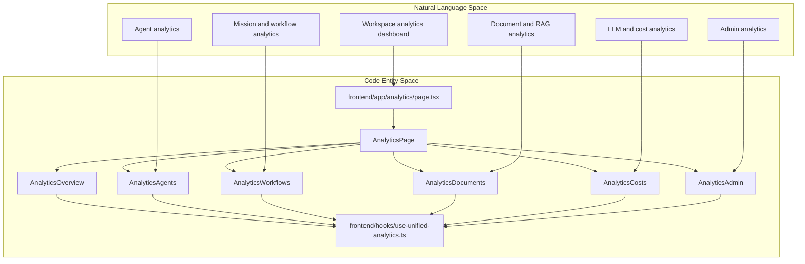
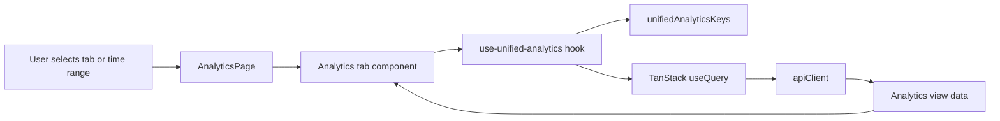
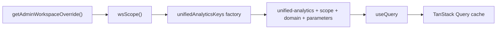
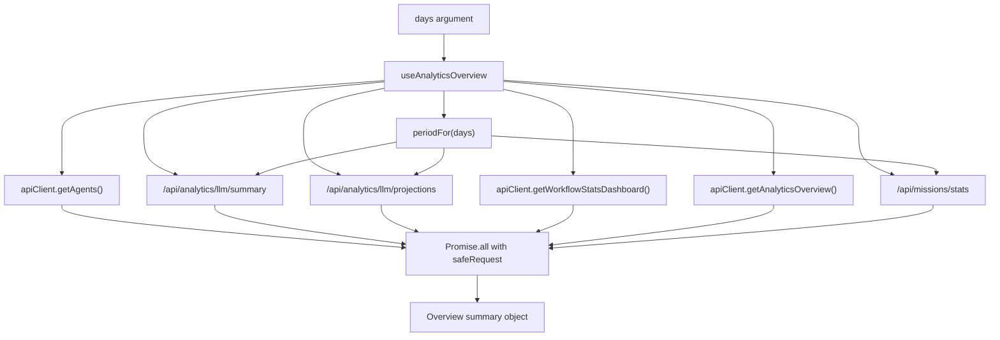

# Analytics Architecture

Relevant source files

The following files were used as context for generating this wiki page:

- [docs/PRDS/52-UNIFIED-ANALYTICS.md](docs/PRDS/52-UNIFIED-ANALYTICS.md)
- [frontend/app/analytics/page.tsx](frontend/app/analytics/page.tsx)
- [frontend/components/analytics/analytics-admin.tsx](frontend/components/analytics/analytics-admin.tsx)
- [frontend/components/analytics/analytics-agents.tsx](frontend/components/analytics/analytics-agents.tsx)
- [frontend/components/analytics/analytics-costs.tsx](frontend/components/analytics/analytics-costs.tsx)
- [frontend/components/analytics/analytics-documents.tsx](frontend/components/analytics/analytics-documents.tsx)
- [frontend/components/analytics/analytics-openrouter-credits.tsx](frontend/components/analytics/analytics-openrouter-credits.tsx)
- [frontend/components/analytics/analytics-overview.tsx](frontend/components/analytics/analytics-overview.tsx)
- [frontend/components/analytics/analytics-page.tsx](frontend/components/analytics/analytics-page.tsx)
- [frontend/components/analytics/analytics-plan-usage.tsx](frontend/components/analytics/analytics-plan-usage.tsx)
- [frontend/components/analytics/analytics-recommendations.tsx](frontend/components/analytics/analytics-recommendations.tsx)
- [frontend/components/analytics/analytics-workflows.tsx](frontend/components/analytics/analytics-workflows.tsx)
- [frontend/components/system/rag-configuration.tsx](frontend/components/system/rag-configuration.tsx)
- [frontend/hooks/use-unified-analytics.ts](frontend/hooks/use-unified-analytics.ts)

## Purpose and Scope

This page describes the frontend analytics architecture: the `/analytics` route, its tabbed dashboard, React Query integration, workspace-scoped cache keys, overview data aggregation, and refresh behavior. The supplied source excerpts establish some details about individual analytics views, but do not include the complete hook implementations or backend analytics routes; this page limits behavioral claims to the provided code. [frontend/app/analytics/page.tsx:7-15](), [frontend/components/analytics/analytics-page.tsx:35-129](), [frontend/hooks/use-unified-analytics.ts:1-125]()

Sources: [frontend/app/analytics/page.tsx:7-15](), [frontend/components/analytics/analytics-page.tsx:35-129](), [frontend/hooks/use-unified-analytics.ts:1-125]()

---

## System Overview & Architecture

The `/analytics` route renders `AnalyticsPage` inside `MainLayout` and calls `usePageAPI('analytics')`. `AnalyticsPage` owns the selected time range and active tab, then passes the selected day count to the relevant analytics view. The Admin tab is included only when `useSystemRole()` reports the user as an admin. [frontend/app/analytics/page.tsx:7-15](), [frontend/components/analytics/analytics-page.tsx:35-60](), [frontend/components/analytics/analytics-page.tsx:94-124]()

The overview view uses `useAnalyticsOverview`, `usePlanUsage`, and `useRecommendations`. The overview hook requests agent, LLM summary, LLM projections, workflow, document, and mission data concurrently, then maps those results into a summary object for the UI. [frontend/components/analytics/analytics-overview.tsx:15-26](), [frontend/hooks/use-unified-analytics.ts:68-125]()

### Diagram: Analytics Concepts Mapped to Frontend Entities

Sources: [frontend/app/analytics/page.tsx:7-15](), [frontend/components/analytics/analytics-page.tsx:20-27](), [frontend/components/analytics/analytics-page.tsx:35-60](), [frontend/components/analytics/analytics-overview.tsx:15-26](), [frontend/components/analytics/analytics-agents.tsx:25-27](), [frontend/components/analytics/analytics-workflows.tsx:25-37](), [frontend/components/analytics/analytics-documents.tsx:19-37](), [frontend/components/analytics/analytics-costs.tsx:45-53](), [frontend/components/analytics/analytics-admin.tsx:37-42]()

### Time Range and Period Mapping

The page offers 7-, 30-, and 90-day selections and converts the selected value to a number passed to its analytics views. In `use-unified-analytics.ts`, `periodFor(days)` maps day counts to backend period strings: up to one day becomes `24h`, up to seven becomes `7d`, up to thirty becomes `30d`, and larger values become `90d`. [frontend/components/analytics/analytics-page.tsx:29-42](), [frontend/hooks/use-unified-analytics.ts:22-25]()

Sources: [frontend/components/analytics/analytics-page.tsx:29-42](), [frontend/hooks/use-unified-analytics.ts:22-25]()

### Diagram: Dashboard State and Analytics Data Flow

Sources: [frontend/components/analytics/analytics-page.tsx:35-60](), [frontend/components/analytics/analytics-page.tsx:94-124](), [frontend/hooks/use-unified-analytics.ts:7-8](), [frontend/hooks/use-unified-analytics.ts:40-65](), [frontend/hooks/use-unified-analytics.ts:68-82]()

---

## Frontend State Management & React Query

### React Query Integration & Query Keys

`frontend/hooks/use-unified-analytics.ts` imports `useQuery`, `useMutation`, and `useQueryClient` from TanStack Query and uses `apiClient` for requests. The exported `unifiedAnalyticsKeys` object groups cache keys under the `unified-analytics` prefix. Its key factories include the workspace scope, a data-domain name, and applicable parameters such as `days` or `period`. [frontend/hooks/use-unified-analytics.ts:7-8](), [frontend/hooks/use-unified-analytics.ts:40-65]()

The keys shown cover overview, agents, workflows, documents, costs, recommendations, plan usage, admin workspace analytics, OpenRouter information, Composio data, model comparisons, cost projections, daily model costs, and the admin dashboard. Because `wsScope()` is called from the key factories, scope is evaluated when a key is created rather than captured once at module load. [frontend/hooks/use-unified-analytics.ts:34-65]()

#### Workspace Scoping Mechanism (`wsScope`)

`wsScope()` returns `getAdminWorkspaceOverride()` when that value is present and otherwise returns `'own'`. The hook comments identify the purpose: preventing cached results for one workspace from being reused as results for another when an administrator switches workspaces. [frontend/hooks/use-unified-analytics.ts:34-38]()

### Diagram: Workspace Selection to Query Cache Identity

Sources: [frontend/hooks/use-unified-analytics.ts:7-8](), [frontend/hooks/use-unified-analytics.ts:34-65](), [frontend/hooks/use-unified-analytics.ts:68-71]()

### Safe Request Pattern

`safeRequest(fn, fallback)` schedules the supplied request function through a resolved promise, catches failures, logs a warning, and returns the supplied fallback. The overview query uses this wrapper for each request in its `Promise.all`, so a rejected request resolves to its fallback rather than rejecting the aggregate promise. [frontend/hooks/use-unified-analytics.ts:27-32](), [frontend/hooks/use-unified-analytics.ts:71-82]()

Sources: [frontend/hooks/use-unified-analytics.ts:27-32](), [frontend/hooks/use-unified-analytics.ts:71-82]()

### Overview Aggregation

`useAnalyticsOverview(days)` derives the backend period with `periodFor(days)` and concurrently fetches agents, an LLM summary, cost projections, workflow statistics, document statistics, and mission statistics. It normalizes the agent result to an array and constructs overview fields for agents, workflows, missions, documents, and costs. [frontend/hooks/use-unified-analytics.ts:68-123]()

The cost summary uses `llmSummary.total_cost` for the selected period, includes provider usage when present, and derives request count and projected monthly cost from the LLM responses. The hook sets a 60-second `staleTime` for this query. [frontend/hooks/use-unified-analytics.ts:86-125]()

Sources: [frontend/hooks/use-unified-analytics.ts:68-125]()

### Diagram: `useAnalyticsOverview` Aggregation

Sources: [frontend/hooks/use-unified-analytics.ts:22-32](), [frontend/hooks/use-unified-analytics.ts:68-123]()

---

## Analytics Domains & Component Implementation

### 1. Overview & Recommendations

`AnalyticsOverview` consumes the overview, plan-usage, and recommendation hooks. It displays summary cards, plan usage, recommendations, and heartbeat activity. It separately requests heartbeat analytics and channel analytics in an effect keyed by `days`; channel counts are normalized to lowercase and combined with channel totals when a channel has no routing-decision count for the day. [frontend/components/analytics/analytics-overview.tsx:15-26](), [frontend/components/analytics/analytics-overview.tsx:28-65](), [frontend/components/analytics/analytics-overview.tsx:67-140]()

Sources: [frontend/components/analytics/analytics-overview.tsx:15-26](), [frontend/components/analytics/analytics-overview.tsx:28-65](), [frontend/components/analytics/analytics-overview.tsx:67-140]()

### 2. Agent & Memory Performance

`AnalyticsAgents` calls `useAgentAnalytics(days)`. Its expanded agent panel presents memory counts, average importance, memory-type and memory-level breakdowns, usage details, and activity-related information from the agent data. The visible hook excerpt defines the `AgentMemoryStats` interface and begins `useAgentAnalytics`; it does not include the complete hook implementation. [frontend/components/analytics/analytics-agents.tsx:25-27](), [frontend/components/analytics/analytics-agents.tsx:56-162](), [frontend/hooks/use-unified-analytics.ts:128-142]()

Sources: [frontend/components/analytics/analytics-agents.tsx:25-27](), [frontend/components/analytics/analytics-agents.tsx:56-162](), [frontend/hooks/use-unified-analytics.ts:128-142]()

### 3. Workflow & Mission Analytics

`AnalyticsWorkflows` consumes `useWorkflowAnalytics(days)`. The component sorts workflow and recipe data in the browser and converts duration strings with `parseDuration` when sorting by average duration. It displays summary statistics and, when recent executions are present, an execution trend chart. [frontend/components/analytics/analytics-workflows.tsx:27-63](), [frontend/components/analytics/analytics-workflows.tsx:65-107](), [frontend/components/analytics/analytics-workflows.tsx:129-165]()

Sources: [frontend/components/analytics/analytics-workflows.tsx:27-63](), [frontend/components/analytics/analytics-workflows.tsx:65-107](), [frontend/components/analytics/analytics-workflows.tsx:129-165]()

### 4. LLM Cost & OpenRouter Integration

`AnalyticsCosts` consumes unified cost analytics, daily cost-by-model data, model comparisons, and projections. It also obtains installed workspace models through `useWorkspaceModels()`, merging them with models that have usage data for the comparison selector. [frontend/components/analytics/analytics-costs.tsx:45-53](), [frontend/components/analytics/analytics-costs.tsx:163-195]()

`AnalyticsOpenRouterCredits` uses hooks for credits, key information, and a sync mutation. When credits are loaded as `null`, it renders no card; otherwise it displays available credit and usage data and offers a “Sync Activity” action through the mutation. [frontend/components/analytics/analytics-openrouter-credits.tsx:14-14](), [frontend/components/analytics/analytics-openrouter-credits.tsx:33-42](), [frontend/components/analytics/analytics-openrouter-credits.tsx:65-89]()

Sources: [frontend/components/analytics/analytics-costs.tsx:45-53](), [frontend/components/analytics/analytics-costs.tsx:163-195](), [frontend/components/analytics/analytics-openrouter-credits.tsx:14-14](), [frontend/components/analytics/analytics-openrouter-credits.tsx:33-42](), [frontend/components/analytics/analytics-openrouter-credits.tsx:65-89]()

### 5. Document & RAG Analytics

`AnalyticsDocuments` calls `useDocumentAnalyticsUnified(days)`. The view displays document totals, storage usage, RAG query counts, and documents that have not been accessed. It also displays available RAG usage statistics and sorts documents by selected fields, with special handling for documents lacking a last-accessed timestamp. [frontend/components/analytics/analytics-documents.tsx:19-39](), [frontend/components/analytics/analytics-documents.tsx:46-63](), [frontend/components/analytics/analytics-documents.tsx:84-153]()

Sources: [frontend/components/analytics/analytics-documents.tsx:19-39](), [frontend/components/analytics/analytics-documents.tsx:46-63](), [frontend/components/analytics/analytics-documents.tsx:84-153]()

### 6. Admin & Multi-Workspace Analytics

When the current role is admin, `AnalyticsPage` exposes the Admin tab and renders `AnalyticsAdmin`. That component calls `useAdminDashboard(period)`, `useAdminWorkspaceAnalytics(days)`, and `useAdminCostAnalytics(period)`. It chooses workspace rows from dashboard data when available and otherwise maps legacy workspace results. [frontend/components/analytics/analytics-page.tsx:39-60](), [frontend/components/analytics/analytics-page.tsx:120-124](), [frontend/components/analytics/analytics-admin.tsx:167-173](), [frontend/components/analytics/analytics-admin.tsx:183-191]()

Sources: [frontend/components/analytics/analytics-page.tsx:39-60](), [frontend/components/analytics/analytics-page.tsx:120-124](), [frontend/components/analytics/analytics-admin.tsx:167-173](), [frontend/components/analytics/analytics-admin.tsx:183-191]()

---

## Polling, Caching, and Lifecycle

### Staleness and Manual Invalidation

The visible implementation of `useAnalyticsOverview` sets `staleTime` to 60,000 milliseconds. The provided hook excerpt does not establish polling intervals for the analytics queries; it therefore supports describing cache staleness for this query, but not a periodic polling schedule. [frontend/hooks/use-unified-analytics.ts:68-71](), [frontend/hooks/use-unified-analytics.ts:124-125]()

The dashboard’s Refresh action invalidates and refetches queries under the `['unified-analytics']` prefix. Since the analytics query keys share that prefix, this action targets the unified analytics query family. [frontend/components/analytics/analytics-page.tsx:43-46](), [frontend/hooks/use-unified-analytics.ts:40-65]()

Sources: [frontend/components/analytics/analytics-page.tsx:43-46](), [frontend/hooks/use-unified-analytics.ts:40-65](), [frontend/hooks/use-unified-analytics.ts:68-71](), [frontend/hooks/use-unified-analytics.ts:124-125]()

### Refresh and Workspace Changes

The page’s `handleWorkspaceChange` updates the displayed workspace label; the workspace switcher is rendered for administrators. The query-key scope itself is obtained through `getAdminWorkspaceOverride()` inside `wsScope()`, so correct workspace-specific cache identity depends on that override being updated by the workspace-selection flow. The provided excerpt does not show the switcher’s implementation or any explicit query invalidation in `handleWorkspaceChange`. [frontend/components/analytics/analytics-page.tsx:27-28](), [frontend/components/analytics/analytics-page.tsx:39-50](), [frontend/hooks/use-unified-analytics.ts:34-38]()

Sources: [frontend/components/analytics/analytics-page.tsx:27-28](), [frontend/components/analytics/analytics-page.tsx:39-50](), [frontend/hooks/use-unified-analytics.ts:34-38]()

---