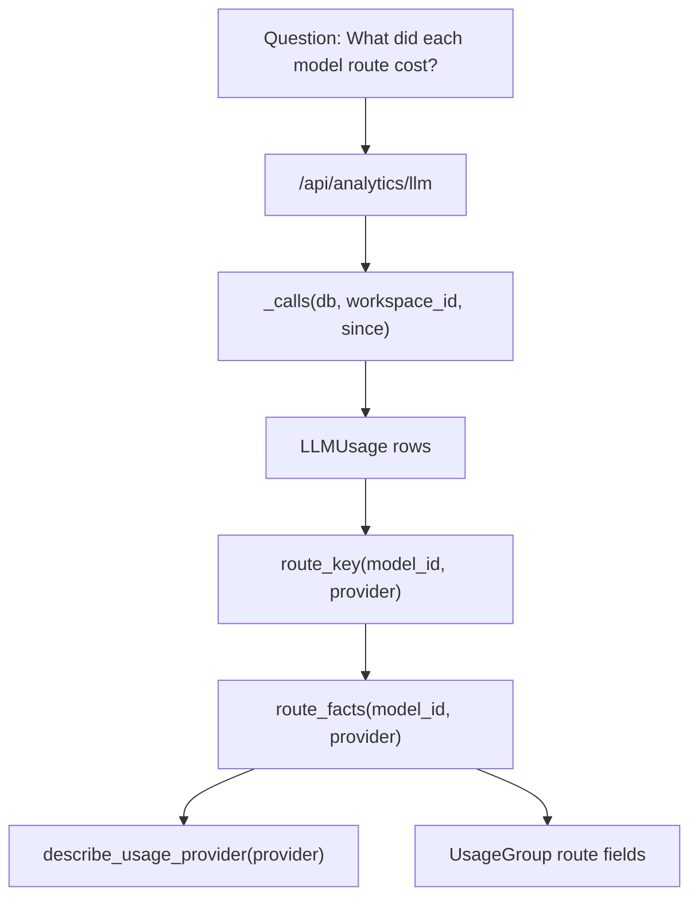
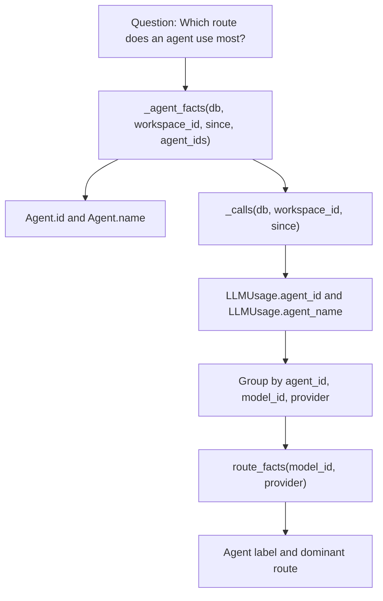
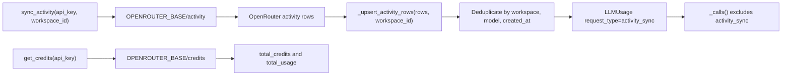

# LLM Usage & Cost Analytics

Relevant source files

The following files were used as context for generating this wiki page:

- [frontend/components/agents/model-selector.tsx](frontend/components/agents/model-selector.tsx)
- [frontend/components/marketplace/llm-model-card.tsx](frontend/components/marketplace/llm-model-card.tsx)
- [frontend/components/marketplace/llm-model-detail-modal.tsx](frontend/components/marketplace/llm-model-detail-modal.tsx)
- [frontend/components/marketplace/marketplace-llms-tab.tsx](frontend/components/marketplace/marketplace-llms-tab.tsx)
- [frontend/hooks/use-model-api.ts](frontend/hooks/use-model-api.ts)
- [frontend/hooks/use-openrouter-api.ts](frontend/hooks/use-openrouter-api.ts)
- [frontend/lib/__tests__/socials-media-lane.test.ts](frontend/lib/__tests__/socials-media-lane.test.ts)
- [orchestrator/api/agent_endpoints.py](orchestrator/api/agent_endpoints.py)
- [orchestrator/api/llm_analytics.py](orchestrator/api/llm_analytics.py)
- [orchestrator/api/llm_marketplace.py](orchestrator/api/llm_marketplace.py)
- [orchestrator/api/openrouter_marketplace.py](orchestrator/api/openrouter_marketplace.py)
- [orchestrator/core/database/migrations/042_openrouter_models_cache.sql](orchestrator/core/database/migrations/042_openrouter_models_cache.sql)
- [orchestrator/core/llm/anthropic_ids.py](orchestrator/core/llm/anthropic_ids.py)
- [orchestrator/core/llm/openrouter_analytics.py](orchestrator/core/llm/openrouter_analytics.py)
- [orchestrator/core/llm/usage_tracker.py](orchestrator/core/llm/usage_tracker.py)
- [orchestrator/core/services/anthropic_catalog_sync.py](orchestrator/core/services/anthropic_catalog_sync.py)
- [orchestrator/core/services/provider_catalog_sync.py](orchestrator/core/services/provider_catalog_sync.py)
- [orchestrator/scripts/seed_llm_marketplace.py](orchestrator/scripts/seed_llm_marketplace.py)
- [orchestrator/tests/test_829_anthropic_models_refresh_from_the_owners_key.py](orchestrator/tests/test_829_anthropic_models_refresh_from_the_owners_key.py)
- [orchestrator/tests/test_f208_a_the_credit_balance_is_read.py](orchestrator/tests/test_f208_a_the_credit_balance_is_read.py)
- [orchestrator/tests/test_llm_catalog_a_list_of_capabilities_is_no_500.py](orchestrator/tests/test_llm_catalog_a_list_of_capabilities_is_no_500.py)
- [orchestrator/tests/test_prd143_obs_routers_batch2.py](orchestrator/tests/test_prd143_obs_routers_batch2.py)
- [orchestrator/tests/test_prd251w1_media_lane.py](orchestrator/tests/test_prd251w1_media_lane.py)

## Purpose and Scope

Section 16.2 describes how Automatos AI records LLM-related usage, resolves prices, and exposes workspace-scoped analytics and OpenRouter reconciliation. It covers the `LLMUsage` records queried by the analytics API, attribution by route and agent, the OpenRouter activity and credits service, authorization boundaries, and the frontend model cost-estimation surfaces visible in the provided files. [orchestrator/core/llm/usage_tracker.py:1-21](), [orchestrator/api/llm_analytics.py:1-7](), [orchestrator/core/llm/openrouter_analytics.py:1-10](), [frontend/hooks/use-model-api.ts:65-79]()

Sources: [orchestrator/core/llm/usage_tracker.py:1-21](), [orchestrator/api/llm_analytics.py:1-7](), [orchestrator/core/llm/openrouter_analytics.py:1-10](), [frontend/hooks/use-model-api.ts:65-79]()

---

## Data Model and Usage Tracker (`LLMUsage`)

`LLMUsage` is the persistence and query surface used by the analytics API. The tracker describes recording LLM, embedding, rerank, media, and Claude Code session calls, including metered, free, and subscription usage. It is designed to resolve workspace context and a serving route’s price rather than silently assigning zero cost to a metered route. [orchestrator/core/llm/usage_tracker.py:1-21]()

The analytics API imports `LLMUsage` alongside `LLMModel`, `UserApiKey`, `Agent`, and `RecipeExecution`. Its per-call query helper `_calls()` filters rows by workspace and time range and excludes OpenRouter reconciliation rows. [orchestrator/api/llm_analytics.py:18-25](), [orchestrator/api/llm_analytics.py:105-111]()

Sources: [orchestrator/core/llm/usage_tracker.py:1-21](), [orchestrator/api/llm_analytics.py:18-25](), [orchestrator/api/llm_analytics.py:105-111]()

### Usage Tracker Implementation and Pricing Resolution

The tracker resolves workspace scope in this order: an explicit `workspace_id`, the request’s `workspace_id_var` context value, and—when running in the local edition—the configured `DEFAULT_WORKSPACE_ID`. If none is available, `resolve_workspace_id()` returns `None`. [orchestrator/core/llm/usage_tracker.py:61-80]()

Price lookup has multiple sources. `_rate_from_static_map()` checks `list_rates(model_id)` before consulting `MODEL_COST_MAP`; `_rate_from_openrouter_cache()` reads the OpenRouter cache and converts its per-token prompt and completion costs to per-1,000-token rates. `resolve_price()` combines `_route_price()`’s route pricing information with the model ID used by `price_call`. [orchestrator/core/llm/usage_tracker.py:92-121](), [orchestrator/core/llm/usage_tracker.py:143-146]()

The tracker’s documented pricing rules prioritize a provider-reported cost over estimates and distinguish a genuinely free route from an unpriced route. `_has_price()` treats explicit zero prices as priced, but treats a row with both prices absent as unpriced; `_cache_row()` can also look up OpenRouter twin IDs for a direct Anthropic model. [orchestrator/core/llm/usage_tracker.py:9-18](), [orchestrator/core/llm/usage_tracker.py:123-140]()

Sources: [orchestrator/core/llm/usage_tracker.py:9-18](), [orchestrator/core/llm/usage_tracker.py:61-80](), [orchestrator/core/llm/usage_tracker.py:92-121](), [orchestrator/core/llm/usage_tracker.py:123-146]()

### Analytics Fields and Schemas

The analytics API defines response schemas for grouped usage, cost breakdowns, and provider usage. `UsageGroup` includes request count, input/output/total tokens, total cost, cache read/write tokens, error count, optional average latency, and optional route facts. `CostBreakdown` separates input cost, output cost, total cost, and request count. [orchestrator/api/llm_analytics.py:147-183]()

| Dimension | Analytics representation | Role |
|---|---|---|
| Workspace and time | `LLMUsage.workspace_id`, `LLMUsage.created_at` | `_calls()` restricts per-call queries to the requested workspace and period. [orchestrator/api/llm_analytics.py:105-111]() |
| Route | `model_id`, `provider`, `route_key()` | Identifies the serving route, not only the model vendor. [orchestrator/api/llm_analytics.py:40-55]() |
| Agent | `agent_id`, `agent_name` | `_agent_facts()` resolves an agent label and its dominant route for the period. [orchestrator/api/llm_analytics.py:58-102]() |
| Usage and cost | `UsageGroup`, `CostBreakdown`, `ProviderUsage` | Represents token counts, costs, request counts, cache metrics, errors, latency, and provider identity. [orchestrator/api/llm_analytics.py:149-183]() |
| Reconciliation type | `request_type` | Marks OpenRouter activity copies so they can be excluded from per-call totals. [orchestrator/api/llm_analytics.py:33-37](), [orchestrator/api/llm_analytics.py:105-118]() |

Sources: [orchestrator/api/llm_analytics.py:33-55](), [orchestrator/api/llm_analytics.py:58-111](), [orchestrator/api/llm_analytics.py:147-183]()

### Reconciliation Rows and Activity Sync

`ACTIVITY_SYNC_REQUEST_TYPE` is `"activity_sync"`. The analytics module treats those rows as reconciliation data copied from OpenRouter’s daily report, not as individual calls. `_calls()` and `_platform_calls()` exclude them, preventing them from being added to per-call cost totals. [orchestrator/api/llm_analytics.py:33-37](), [orchestrator/api/llm_analytics.py:105-118]()

The OpenRouter service creates these rows with `request_type="activity_sync"`, sets `provider="openrouter"` and `tier="aggregator"`, stores the reported usage as `total_cost`, and sets `input_cost` and `output_cost` to zero. It checks for an existing row by workspace, model, and timestamp before inserting. [orchestrator/core/llm/openrouter_analytics.py:77-80](), [orchestrator/core/llm/openrouter_analytics.py:97-138]()

Sources: [orchestrator/api/llm_analytics.py:33-37](), [orchestrator/api/llm_analytics.py:105-118](), [orchestrator/core/llm/openrouter_analytics.py:77-80](), [orchestrator/core/llm/openrouter_analytics.py:97-138]()

---

## Analytics API Routing and Access Boundaries

The analytics module separates workspace reads, cross-workspace administration, and mutating synchronization into three routers. Workspace analytics use `require_workspace_admin`; the cross-workspace `admin_router` and the OpenRouter `sync_router` use `require_super_admin`. [orchestrator/api/llm_analytics.py:120-144]()

| Router | Prefix | Dependency | Scope |
|---|---|---|---|
| `router` | `/api/analytics/llm` | `require_workspace_admin` | Workspace-scoped analytics reads. [orchestrator/api/llm_analytics.py:120-130]() |
| `admin_router` | `/api/admin/analytics` | `require_super_admin` | Cross-workspace platform analytics. [orchestrator/api/llm_analytics.py:131-135]() |
| `sync_router` | `/api/analytics/llm` | `require_super_admin` | Mutating OpenRouter sync operations. [orchestrator/api/llm_analytics.py:136-144]() |

The module’s comments explain the boundary: workspace analytics are permitted to workspace owners and admins because the endpoints filter by `ctx.workspace_id`; the cross-workspace aggregate surface remains super-admin-only, and the mutating sync route remains separately super-admin-protected. [orchestrator/api/llm_analytics.py:120-144]()

Sources: [orchestrator/api/llm_analytics.py:120-144]()

---

## Route, Provider, and Agent Attribution

### Route Identity and Keying

Analytics distinguishes a route by both model ID and serving provider. `route_key(model_id, provider)` joins the values with `@`, so the same vendor model served by different providers remains distinct. `route_facts()` adds provider label and billing facts from `describe_usage_provider()`. [orchestrator/api/llm_analytics.py:40-55]()

The marketplace uses a separate route key convention: `route_key(serving_provider, model_id)` joins those values with `:`. The marketplace API describes a route as a row keyed by `(serving_provider, model_id)`, with pricing and installation associated with that route. [orchestrator/api/llm_marketplace.py:5-10](), [orchestrator/api/llm_marketplace.py:137-139]()

Sources: [orchestrator/api/llm_analytics.py:40-55](), [orchestrator/api/llm_marketplace.py:5-10](), [orchestrator/api/llm_marketplace.py:137-139]()

### Diagram: Natural-Language Cost Questions to Analytics Route Entities

Sources: [orchestrator/api/llm_analytics.py:27-55](), [orchestrator/api/llm_analytics.py:105-111](), [orchestrator/api/llm_analytics.py:149-165]()

### Agent Attribution and Dominant Routes

`_agent_facts()` builds agent labels from the `Agent` table and falls back to a name stamped on usage rows for deleted agents. It groups calls by `agent_id`, `model_id`, and `provider`, then selects each agent’s dominant route by request count and token volume. [orchestrator/api/llm_analytics.py:58-102]()

A separate agent endpoint, `GET /api/agents/{agent_id}/performance`, reads an agent within the request workspace and returns performance and model-usage fields. Its response includes task counts, success rate, response time, average tokens per task, total tokens, total cost, and total requests from `Agent.performance_metrics` and `Agent.model_usage_stats`. [orchestrator/api/agent_endpoints.py:118-180]()

Sources: [orchestrator/api/llm_analytics.py:58-102](), [orchestrator/api/agent_endpoints.py:118-180]()

### Diagram: Natural-Language Agent Cost Attribution to Code Entities

Sources: [orchestrator/api/llm_analytics.py:58-102](), [orchestrator/api/llm_analytics.py:105-111]()

---

## OpenRouter Activity, Credits, and Key Analytics

`OpenRouterAnalyticsService` calls OpenRouter management endpoints using an authorization bearer token and the configured `OPENROUTER_SITE_URL` and product title headers. Its documented remote surfaces include `/activity`, `/credits`, and `/key`. [orchestrator/core/llm/openrouter_analytics.py:1-10](), [orchestrator/core/llm/openrouter_analytics.py:24-38]()

`sync_activity(api_key, workspace_id)` fetches `/activity`, handles HTTP and other fetch errors by returning an error summary, and passes returned data rows to `_upsert_activity_rows()`. That method deduplicates by workspace, model, and `created_at`, then writes reconciliation records to `LLMUsage`. [orchestrator/core/llm/openrouter_analytics.py:44-75](), [orchestrator/core/llm/openrouter_analytics.py:77-148]()

`get_credits(api_key)` fetches `/credits` and reads the figures from the nested `data` object when present, returning `total_credits` and `total_usage`. The method returns `None` on request failure. [orchestrator/core/llm/openrouter_analytics.py:150-180]()

**Diagram: OpenRouter Reconciliation Data Flow**

Sources: [orchestrator/core/llm/openrouter_analytics.py:24-38](), [orchestrator/core/llm/openrouter_analytics.py:44-75](), [orchestrator/core/llm/openrouter_analytics.py:77-148](), [orchestrator/core/llm/openrouter_analytics.py:150-180](), [orchestrator/api/llm_analytics.py:105-118]()

---

## Frontend Cost Estimation

The provided frontend model API hook defines a `CostEstimate` response containing model ID, input/output token counts, input/output costs, total cost, currency, and model pricing details. `useEstimateCost()` posts the requested model and token counts to `/api/models/estimate-cost`. [frontend/hooks/use-model-api.ts:65-79](), [frontend/hooks/use-model-api.ts:180-193]()

The marketplace detail modal also has a local monthly cost calculator: it multiplies entered input and output token quantities, expressed in thousands, by the model’s corresponding per-1,000-token prices and adds the results. This is a frontend estimate based on the selected model’s displayed rates. [frontend/components/marketplace/llm-model-detail-modal.tsx:103-112]()

The provided files establish these estimation surfaces, but do not show the implementation of analytics projection endpoints or a forecasting algorithm. No projection formula or projection response schema is documented here. [frontend/hooks/use-model-api.ts:180-193](), [frontend/components/marketplace/llm-model-detail-modal.tsx:103-112]()

Sources: [frontend/hooks/use-model-api.ts:65-79](), [frontend/hooks/use-model-api.ts:180-193](), [frontend/components/marketplace/llm-model-detail-modal.tsx:103-112]()

---