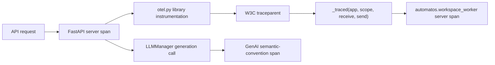
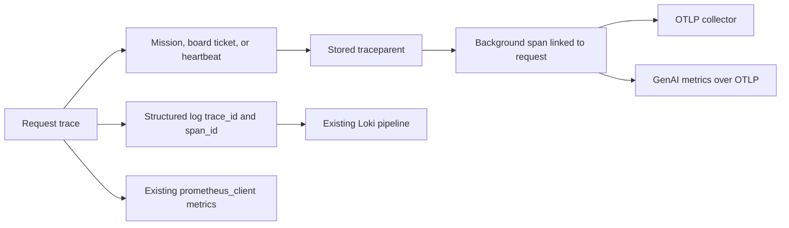
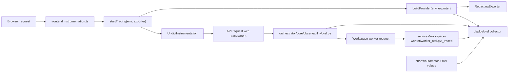

# OpenTelemetry Instrumentation (PRD-256)

<details>
<summary>Relevant source files</summary>

The following files were used as context for generating this wiki page:

- [charts/automatos/templates/frontend.yaml](charts/automatos/templates/frontend.yaml)
- [charts/automatos/tests/otel_test.yaml](charts/automatos/tests/otel_test.yaml)
- [docs/PRDS/PRD-256-OPENTELEMETRY.md](docs/PRDS/PRD-256-OPENTELEMETRY.md)
- [frontend/app/__tests__/studio-element-rules-contract.test.ts](frontend/app/__tests__/studio-element-rules-contract.test.ts)
- [frontend/components/admin/themes/signature-panel.tsx](frontend/components/admin/themes/signature-panel.tsx)
- [frontend/components/marketplace/themes/__tests__/listing-fixtures.ts](frontend/components/marketplace/themes/__tests__/listing-fixtures.ts)
- [frontend/components/theme-host/__tests__/asleep-slot.test.tsx](frontend/components/theme-host/__tests__/asleep-slot.test.tsx)
- [frontend/components/theme-host/__tests__/theme-frame-below-min-width.test.tsx](frontend/components/theme-host/__tests__/theme-frame-below-min-width.test.tsx)
- [frontend/instrumentation.ts](frontend/instrumentation.ts)
- [frontend/lib/__tests__/prd256-o6b-otel-fetch.test.ts](frontend/lib/__tests__/prd256-o6b-otel-fetch.test.ts)
- [frontend/lib/__tests__/prd256-o6b-otel.test.ts](frontend/lib/__tests__/prd256-o6b-otel.test.ts)
- [frontend/lib/otel/node.ts](frontend/lib/otel/node.ts)
- [frontend/lib/otel/settings.ts](frontend/lib/otel/settings.ts)
- [frontend/package-lock.json](frontend/package-lock.json)
- [frontend/package.json](frontend/package.json)
- [orchestrator/core/observability/genai.py](orchestrator/core/observability/genai.py)
- [orchestrator/core/observability/metrics.py](orchestrator/core/observability/metrics.py)
- [orchestrator/core/observability/otel.py](orchestrator/core/observability/otel.py)
- [orchestrator/tests/helpers_otel.py](orchestrator/tests/helpers_otel.py)
- [orchestrator/tests/test_1107_exception_text_never_leaves.py](orchestrator/tests/test_1107_exception_text_never_leaves.py)
- [orchestrator/tests/test_1306_fastapi_native_telemetry_off.py](orchestrator/tests/test_1306_fastapi_native_telemetry_off.py)
- [orchestrator/tests/test_prd203_cs8_worker_auth.py](orchestrator/tests/test_prd203_cs8_worker_auth.py)
- [orchestrator/tests/test_prd256_o1_otel_foundation.py](orchestrator/tests/test_prd256_o1_otel_foundation.py)
- [orchestrator/tests/test_prd256_o2a_otel_libraries.py](orchestrator/tests/test_prd256_o2a_otel_libraries.py)
- [orchestrator/tests/test_prd256_o2b_worker_routes_moved.py](orchestrator/tests/test_prd256_o2b_worker_routes_moved.py)
- [orchestrator/tests/test_prd256_o2b_worker_span.py](orchestrator/tests/test_prd256_o2b_worker_span.py)
- [orchestrator/tests/test_prd256_o3_genai_spans.py](orchestrator/tests/test_prd256_o3_genai_spans.py)
- [orchestrator/tests/test_prd256_o4_work_links.py](orchestrator/tests/test_prd256_o4_work_links.py)
- [orchestrator/tests/test_prd256_o5_logs_metrics.py](orchestrator/tests/test_prd256_o5_logs_metrics.py)
- [services/workspace-worker/worker_config.py](services/workspace-worker/worker_config.py)
- [services/workspace-worker/worker_http.py](services/workspace-worker/worker_http.py)
- [services/workspace-worker/worker_otel.py](services/workspace-worker/worker_otel.py)
- [services/workspace-worker/worker_routes_canvas.py](services/workspace-worker/worker_routes_canvas.py)
- [services/workspace-worker/worker_routes_files.py](services/workspace-worker/worker_routes_files.py)
- [services/workspace-worker/worker_routes_tools.py](services/workspace-worker/worker_routes_tools.py)

</details>


## 1. Purpose and Scope

PRD-256 adds vendor-neutral distributed tracing over OTLP to Automatos AI’s existing observability stack. It extends the Prometheus metrics, structured logs with correlation IDs, and Loki pipeline established by PRD-73; it does not replace them. The goal is to follow work across the API, workspace worker, and LLM calls, and to connect asynchronous work to the request that initiated it. [docs/PRDS/PRD-256-OPENTELEMETRY.md:4-18]()

The scope includes API tracing bootstrap and library instrumentation, GenAI semantic-convention spans, asynchronous work links, log and metric correlation, workspace-worker spans, Next.js Node-runtime tracing, and reference collector and Helm configuration. [docs/PRDS/PRD-256-OPENTELEMETRY.md:29-39]()

Sources: [docs/PRDS/PRD-256-OPENTELEMETRY.md:4-18](), [docs/PRDS/PRD-256-OPENTELEMETRY.md:29-39]()

---

## 2. Core Bootstrap & Foundation (O1)

The API foundation is implemented in `orchestrator/core/observability/otel.py`. Its design provides a tracer provider per process, starts tracing around the FastAPI lifespan, creates a server span per HTTP request, and flushes tracing during shutdown. Health probes and the metrics scrape are excluded from request tracing. [orchestrator/core/observability/otel.py:1-16]()

Tracing is off by default. When `OTEL_ENABLED` is false, the module’s intended off path does not load the OpenTelemetry SDK, exporters, or instrumentation; `tracing_enabled()` reads the setting, and the PRD specifies that tracing faults must not fail the caller or application boot. [orchestrator/core/observability/otel.py:23-32](), [orchestrator/core/observability/otel.py:80-82]()

### Configuration and Settings

`tracing_enabled()` reads `config.OTEL_ENABLED`. `otlp_headers()` parses comma-separated `key=value` pairs and URL-decodes values; malformed pairs are skipped. `sampler_ratio()` clamps a valid ratio into `[0, 1]` and falls back to keeping every trace if parsing fails. [orchestrator/core/observability/otel.py:80-106]()

| Setting | Default / behavior | Purpose |
|---|---|---|
| `OTEL_ENABLED` | `false` | Enables tracing for the process. [docs/PRDS/PRD-256-OPENTELEMETRY.md:41-49]() |
| `OTEL_SERVICE_NAME` | `automatos-api` | Sets `service.name` on spans. [docs/PRDS/PRD-256-OPENTELEMETRY.md:41-51]() |
| `OTEL_EXPORTER_OTLP_ENDPOINT` | `http://localhost:4318` | OTLP/HTTP collector base address; the trace path is `/v1/traces`. [docs/PRDS/PRD-256-OPENTELEMETRY.md:41-49](), [orchestrator/core/observability/otel.py:51-52]() |
| `OTEL_EXPORTER_OTLP_HEADERS` | Empty | Optional comma-separated exporter headers; values use the OTLP environment-variable format and are URL-decoded. [docs/PRDS/PRD-256-OPENTELEMETRY.md:41-49](), [orchestrator/core/observability/otel.py:85-95]() |
| `OTEL_TRACES_SAMPLER_RATIO` | `1.0` | Ratio for new traces; sampling is parent-based. [docs/PRDS/PRD-256-OPENTELEMETRY.md:41-51](), [orchestrator/core/observability/otel.py:98-106]() |

The API span attributes include `automatos.request_id` and `automatos.workspace_id`, carrying the existing request and workspace identifiers into trace search. The resource also includes `service.name`, deployment environment, and Automatos edition; standard `OTEL_RESOURCE_ATTRIBUTES` are merged by the SDK. [orchestrator/core/observability/otel.py:51-55](), [docs/PRDS/PRD-256-OPENTELEMETRY.md:25-27](), [docs/PRDS/PRD-256-OPENTELEMETRY.md:51-51]()

### Privacy and URL Scrubbing

The API URL-scrubbing path replaces query values with `REDACTED` while retaining query keys. `_scrub_url_attributes()` applies this to URL attributes and also removes file-digest path segments. Exception data is restricted to type-oriented attributes rather than exception text or stack traces. [orchestrator/core/observability/otel.py:53-64](), [orchestrator/core/observability/otel.py:109-141]()

**Diagram 1: API Bootstrap and Request Span Flow**

```mermaid
flowchart TD
    Request["Incoming HTTP request"] --> Enabled["tracing_enabled()"]
    Enabled -->| "OTEL_ENABLED false" | NoTrace["No tracing SDK or exporter"]
    Enabled -->| "OTEL_ENABLED true" | Lifespan["with_tracing(lifespan)"]
    Lifespan --> Provider["Per-process tracer provider"]
    Provider --> ServerSpan["FastAPI server span"]
    ServerSpan --> IDs["annotate_request: request and workspace IDs"]
    ServerSpan --> Scrub["_scrub_url_attributes"]
    Scrub --> Export["OTLP/HTTP: /v1/traces"]
    Health["/health and /metrics"] --> Excluded["Excluded from request spans"]
```

Sources: [orchestrator/core/observability/otel.py:1-16](), [orchestrator/core/observability/otel.py:46-64](), [orchestrator/core/observability/otel.py:80-141](), [orchestrator/tests/test_1306_fastapi_native_telemetry_off.py:1-8]()

---

## 3. Library & Worker Instrumentation (O2a & O2b)

### Library Instrumentation (O2a)

With tracing enabled, the API instruments SQLAlchemy, HTTPX, Redis, and Botocore calls as client spans beneath the active request context. The implementation is designed to avoid recording SQL bound values, Redis command arguments, and URL query values; outbound HTTP requests propagate W3C `traceparent`. [docs/PRDS/PRD-256-OPENTELEMETRY.md:33-35](), [orchestrator/core/observability/otel.py:18-21]()

| Instrumented library | Span role | Privacy / propagation behavior |
|---|---|---|
| SQLAlchemy | Client span for SQL statements. [docs/PRDS/PRD-256-OPENTELEMETRY.md:33-35]() | SQL text is recorded without bound values. [docs/PRDS/PRD-256-OPENTELEMETRY.md:61-61]() |
| HTTPX | Client span for outbound HTTP. [docs/PRDS/PRD-256-OPENTELEMETRY.md:33-35]() | Propagates `traceparent`; URL query values are scrubbed. [docs/PRDS/PRD-256-OPENTELEMETRY.md:34-34](), [orchestrator/core/observability/otel.py:127-145]() |
| Redis | Client span for Redis commands. [docs/PRDS/PRD-256-OPENTELEMETRY.md:33-35]() | Commands are generalized to avoid recording keys or values. [docs/PRDS/PRD-256-OPENTELEMETRY.md:61-61]() |
| Botocore | Client span for AWS calls. [docs/PRDS/PRD-256-OPENTELEMETRY.md:33-35]() | Records service and operation rather than request payloads. [docs/PRDS/PRD-256-OPENTELEMETRY.md:61-61]() |

### Workspace Worker Integration (O2b)

The workspace worker has its own tracing implementation because its image cannot import the orchestrator package. `worker_otel.py` defines the worker provider lifecycle, route and span attributes, status recording, and `_traced()` request wrapper. [services/workspace-worker/worker_otel.py:1-15](), [services/workspace-worker/worker_otel.py:34-37](), [services/workspace-worker/worker_otel.py:115-167]()

When enabled, the worker extracts the incoming trace context and creates a server span for the request, allowing an API-originated trace to continue at the worker. The worker excludes `/health` and `/metrics`; its span attributes are limited to method, route, workspace, and status rather than URL, query, body, or internal token. [services/workspace-worker/worker_otel.py:3-15](), [services/workspace-worker/worker_otel.py:27-29](), [services/workspace-worker/worker_otel.py:130-167]()

**Diagram 2: Trace Propagation from API Code to Worker Code**



Sources: [docs/PRDS/PRD-256-OPENTELEMETRY.md:33-36](), [orchestrator/core/observability/otel.py:18-21](), [services/workspace-worker/worker_otel.py:27-31](), [services/workspace-worker/worker_otel.py:159-167]()

---

## 4. GenAI Semantic-Convention Spans (O3)

PRD-256 adds GenAI spans at the `LLMManager` chokepoint, including `generate_response` and the synchronous generation path through a shared helper or an explicitly documented gap. The spans follow GenAI semantic conventions and retain tool-dispatch, RAG retrieval-score, and context-assembly metadata from the prior tracing seam. Prompt and completion content are not recorded on spans. [docs/PRDS/PRD-256-OPENTELEMETRY.md:25-27](), [docs/PRDS/PRD-256-OPENTELEMETRY.md:36-36]()

The GenAI implementation is located in `orchestrator/core/observability/genai.py`; the PRD identifies it as the OTEL tracer behind the PRD-185 `Tracer` seam. The previous `LangfuseTracer` implementation is removed, with Langfuse treated as an OTLP destination behind a collector rather than an in-process backend SDK. [docs/PRDS/PRD-256-OPENTELEMETRY.md:36-36](), [docs/PRDS/PRD-256-OPENTELEMETRY.md:51-53]()

Sources: [docs/PRDS/PRD-256-OPENTELEMETRY.md:25-27](), [docs/PRDS/PRD-256-OPENTELEMETRY.md:36-36](), [docs/PRDS/PRD-256-OPENTELEMETRY.md:51-53]()

---

## 5. Asynchronous Boundaries & Log/Metric Integration (O4 & O5)

Missions, board tickets, and heartbeats are asynchronous boundaries. PRD-256 stores `traceparent` on work items and joins the resulting spans to the originating trace using span links, so background execution can be inspected in relation to the request that started it. [docs/PRDS/PRD-256-OPENTELEMETRY.md:15-17](), [docs/PRDS/PRD-256-OPENTELEMETRY.md:37-38]()

The logging integration adds `trace_id` and `span_id` to structured log context. Existing `prometheus_client` metrics and PRD-73 dashboards remain in place; new GenAI metrics are sent over OTLP. This keeps trace/log correlation and existing Prometheus monitoring alongside the new OTLP telemetry. [docs/PRDS/PRD-256-OPENTELEMETRY.md:25-27](), [docs/PRDS/PRD-256-OPENTELEMETRY.md:38-38]()

**Diagram 3: Asynchronous Work Links and Telemetry Correlation**



Sources: [docs/PRDS/PRD-256-OPENTELEMETRY.md:15-17](), [docs/PRDS/PRD-256-OPENTELEMETRY.md:25-27](), [docs/PRDS/PRD-256-OPENTELEMETRY.md:37-38]()

---

## 6. Frontend Instrumentation & Deployment (O6)

### Next.js Node Runtime

The frontend’s Node-runtime tracing implementation is in `frontend/lib/otel/node.ts`; settings and redaction helpers are in `frontend/lib/otel/settings.ts`. `buildProvider()` configures the web resource, parent-based ratio sampling, batch processing, and a `RedactingExporter`. `startTracing()` registers the provider and enables Undici instrumentation so Node `fetch` requests can carry `traceparent` to the API. [frontend/lib/otel/node.ts:94-122](), [frontend/lib/otel/settings.ts:7-20]()

The web service name defaults to `automatos-web`, can be overridden with `OTEL_SERVICE_NAME`, and merges detected environment resource attributes. The redacting exporter sanitizes URL query values and removes exception text and stack traces before exporting; a span that cannot be redacted is dropped. [frontend/lib/otel/node.ts:35-74](), [frontend/lib/otel/node.ts:94-103](), [frontend/lib/otel/settings.ts:11-14]()

The Node SDK does not cover Edge-runtime routes; the implementation documentation specifically identifies the chat and workflow-stream proxies as Edge-runtime routes outside this SDK’s scope. [frontend/lib/otel/node.ts:2-8]()

### Collector and Helm Configuration

PRD-256 O6 includes a reference collector configuration under `deploy/otel/` and OTel values for the Helm chart. The collector is the operator-controlled routing point: Automatos exports OTLP and does not bundle a backend-specific tracing SDK. [docs/PRDS/PRD-256-OPENTELEMETRY.md:14-17](), [docs/PRDS/PRD-256-OPENTELEMETRY.md:39-39]()

The frontend package declares the OTLP trace exporter, Undici instrumentation, OpenTelemetry resources, and Node trace SDK dependencies. [frontend/package.json:45-54]()

**Diagram 4: Frontend, API, Worker, and Collector Code Entities**



Sources: [frontend/lib/otel/node.ts:1-15](), [frontend/lib/otel/node.ts:35-74](), [frontend/lib/otel/node.ts:94-122](), [services/workspace-worker/worker_otel.py:159-167](), [docs/PRDS/PRD-256-OPENTELEMETRY.md:39-39]()

Sources: [frontend/lib/otel/node.ts:1-15](), [frontend/lib/otel/node.ts:35-74](), [frontend/lib/otel/node.ts:94-129](), [frontend/lib/otel/settings.ts:7-57](), [frontend/package.json:45-54](), [docs/PRDS/PRD-256-OPENTELEMETRY.md:39-39]()

---