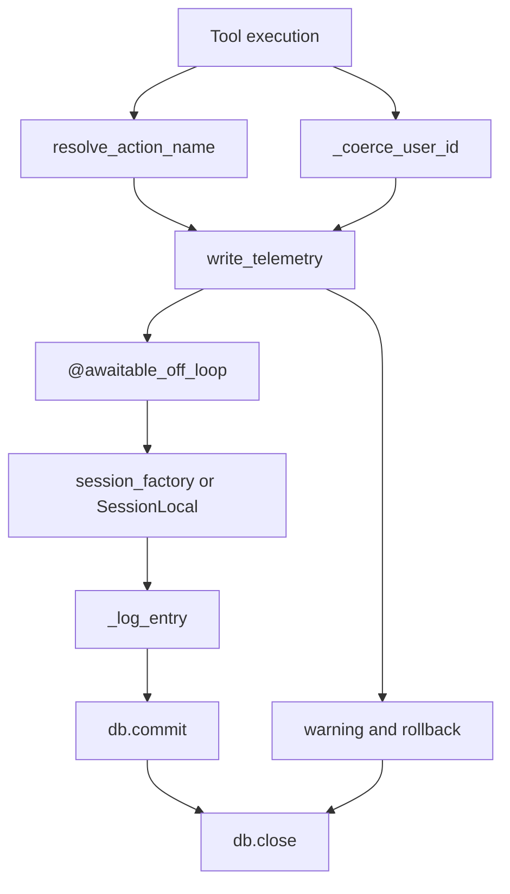
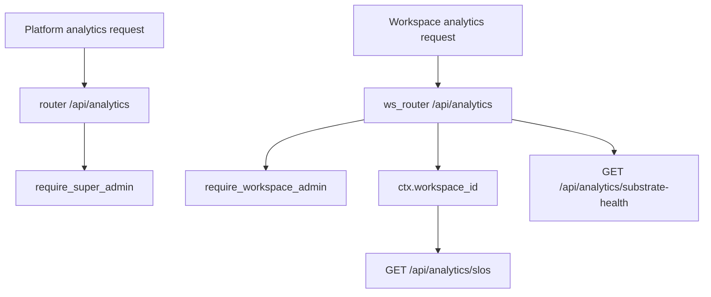
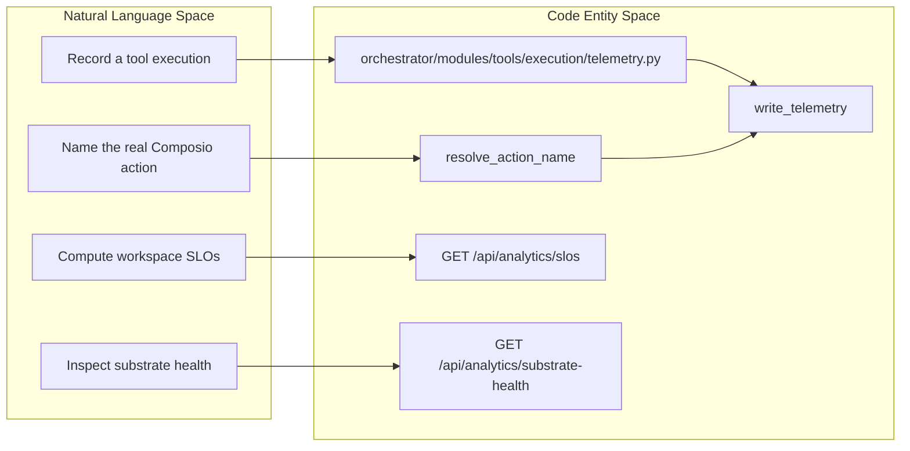
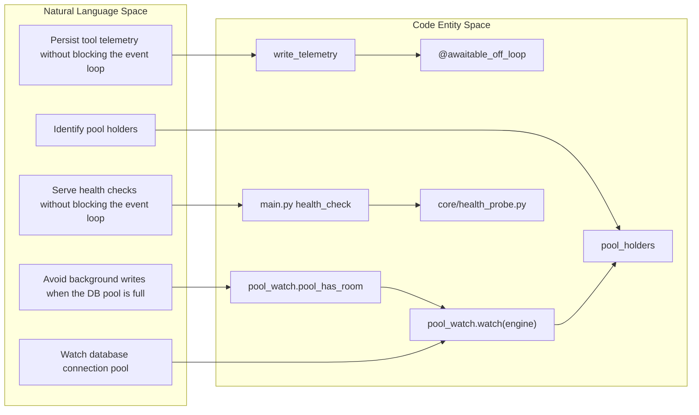

# Telemetry & System Health

Relevant source files

The following files were used as context for generating this wiki page:

- [orchestrator/alembic/versions/f156_harness_task_ledger.py](orchestrator/alembic/versions/f156_harness_task_ledger.py)
- [orchestrator/alembic/versions/prd185_s1b_toollog_user_nullable.py](orchestrator/alembic/versions/prd185_s1b_toollog_user_nullable.py)
- [orchestrator/core/best_effort.py](orchestrator/core/best_effort.py)
- [orchestrator/core/database/database.py](orchestrator/core/database/database.py)
- [orchestrator/core/database/pool_watch.py](orchestrator/core/database/pool_watch.py)
- [orchestrator/core/health_probe.py](orchestrator/core/health_probe.py)
- [orchestrator/core/seeds/utterances/notifications.yaml](orchestrator/core/seeds/utterances/notifications.yaml)
- [orchestrator/modules/tools/discovery/workspace_actions.py](orchestrator/modules/tools/discovery/workspace_actions.py)
- [orchestrator/modules/tools/execution/exec_file_ops.py](orchestrator/modules/tools/execution/exec_file_ops.py)
- [orchestrator/modules/tools/execution/exec_workspace.py](orchestrator/modules/tools/execution/exec_workspace.py)
- [orchestrator/modules/tools/execution/telemetry.py](orchestrator/modules/tools/execution/telemetry.py)
- [orchestrator/modules/tools/execution/tool_grants.py](orchestrator/modules/tools/execution/tool_grants.py)
- [orchestrator/tests/test_board_run_file_is_its_cards_deliverable.py](orchestrator/tests/test_board_run_file_is_its_cards_deliverable.py)
- [orchestrator/tests/test_f179a_only_an_image_is_made_public.py](orchestrator/tests/test_f179a_only_an_image_is_made_public.py)
- [orchestrator/tests/test_f179b_one_approval_is_one_publish.py](orchestrator/tests/test_f179b_one_approval_is_one_publish.py)
- [orchestrator/tests/test_f179b_publishing_an_image_asks_first.py](orchestrator/tests/test_f179b_publishing_an_image_asks_first.py)
- [orchestrator/tests/test_f193_a_destructive_yes_that_did_nothing_is_given_back.py](orchestrator/tests/test_f193_a_destructive_yes_that_did_nothing_is_given_back.py)
- [orchestrator/tests/test_f229_health_off_the_loop.py](orchestrator/tests/test_f229_health_off_the_loop.py)
- [orchestrator/tests/test_f458_full_pool_names_its_holders.py](orchestrator/tests/test_f458_full_pool_names_its_holders.py)
- [orchestrator/tests/test_f458_health_never_waits_on_a_full_pool.py](orchestrator/tests/test_f458_health_never_waits_on_a_full_pool.py)
- [orchestrator/tests/test_p2w0_telemetry_user_id.py](orchestrator/tests/test_p2w0_telemetry_user_id.py)
- [orchestrator/tests/test_p2w2_tool_grant_consume.py](orchestrator/tests/test_p2w2_tool_grant_consume.py)
- [orchestrator/tests/test_p2w2_tool_grant_issue.py](orchestrator/tests/test_p2w2_tool_grant_issue.py)
- [orchestrator/tests/test_prd139_telemetry.py](orchestrator/tests/test_prd139_telemetry.py)
- [orchestrator/tests/test_prd143_full_surface_positive.py](orchestrator/tests/test_prd143_full_surface_positive.py)
- [orchestrator/tests/test_prd143_selection_metric.py](orchestrator/tests/test_prd143_selection_metric.py)
- [orchestrator/tests/test_prd177_composio_telemetry.py](orchestrator/tests/test_prd177_composio_telemetry.py)
- [orchestrator/tests/test_prd251w1_render_quota.py](orchestrator/tests/test_prd251w1_render_quota.py)
- [orchestrator/tests/test_prd251w1_voice.py](orchestrator/tests/test_prd251w1_voice.py)
- [orchestrator/tests/test_telemetry_session_ownership.py](orchestrator/tests/test_telemetry_session_ownership.py)

## Purpose and Scope

This page documents Automatos AI’s tool-execution telemetry, substrate and health monitoring, database-pool watch, and health-probe behavior. It also describes the boundary between platform-wide and workspace-scoped analytics. Telemetry and health checks are designed to fail safely: telemetry failures should not fail tool execution, and synchronous probes should not block the event loop. [orchestrator/modules/tools/execution/telemetry.py:1-6](), [orchestrator/core/best_effort.py:1-21](), [orchestrator/tests/test_f229_health_off_the_loop.py:1-11]()

Sources: [orchestrator/modules/tools/execution/telemetry.py:1-6](), [orchestrator/core/best_effort.py:1-21](), [orchestrator/tests/test_f229_health_off_the_loop.py:1-11]()

---

## Tool Execution Telemetry

`orchestrator/modules/tools/execution/telemetry.py` provides a universal logging seam for tool executions across platform, workspace, Composio, and MCP dispatch paths. The stated contract is that telemetry-write failures must not fail the tool call. [orchestrator/modules/tools/execution/telemetry.py:1-6]()

### Action names, user identity, and statuses

- **Effective action name:** `resolve_action_name` leaves ordinary tool names unchanged. For the `composio_execute` meta-tool, it reads `action` or `action_name`, then uppercases and trims that action identifier. Missing or malformed values fall back to `composio_execute`. The resolver uses the action identifier, not secret parameter values. [orchestrator/modules/tools/execution/telemetry.py:22-47]()
- **User ID coercion:** `_coerce_user_id` accepts integer IDs and digit-only strings. It resolves other strings as Clerk IDs by querying `User.clerk_user_id`, caching successful mappings up to `_CLERK_ID_CACHE_MAX`. If it cannot resolve an ID, it returns `None` so a telemetry row can still be written without a user ID. [orchestrator/modules/tools/execution/telemetry.py:49-51](), [orchestrator/modules/tools/execution/telemetry.py:68-101]()
- **Execution status:** The module defines `success` and `error` status constants, plus `asked` for calls that request confirmation rather than executing or failing. [orchestrator/modules/tools/execution/telemetry.py:54-65]()
- **Error-code bound:** `ERROR_CODE_MAX_CHARS` sets the documented maximum length for an error code stored in the log model. [orchestrator/modules/tools/execution/telemetry.py:63-65]()

### Write behavior and session ownership

`write_telemetry` is decorated with `@awaitable_off_loop`, so its synchronous database work runs on the best-effort writer threads rather than blocking the event loop. It lazily obtains `SessionLocal` when no test `session_factory` is supplied, creates and commits a telemetry row, and owns the session it opens. On failure it logs a warning, attempts rollback, and closes its session; it does not take ownership of a caller’s live request session. [orchestrator/modules/tools/execution/telemetry.py:104-167]()

The row-construction path is delegated to `_log_entry`. The writer passes it the tool name, parameters, agent and workspace identifiers, result, execution time, and caller context. [orchestrator/modules/tools/execution/telemetry.py:138-152]()

### Execution telemetry flow

Sources: [orchestrator/modules/tools/execution/telemetry.py:22-47](), [orchestrator/modules/tools/execution/telemetry.py:68-101](), [orchestrator/modules/tools/execution/telemetry.py:104-167]()

### Telemetry and the tracer seam

The available telemetry implementation records tool-level execution data and routing context; it does not, in the shown lines, define OpenTelemetry spans or a tracer provider. Caller context is passed into `_log_entry`, while `trace_id` is separately used by the workspace executor’s deliverable-registration diagnostics. Treat these as distinct correlation seams: a log’s routing/caller metadata and a trace identifier in a diagnostic log are not evidence of a complete distributed tracing pipeline. [orchestrator/modules/tools/execution/telemetry.py:104-152](), [orchestrator/modules/tools/execution/exec_workspace.py:50-63](), [orchestrator/modules/tools/execution/exec_workspace.py:99-125]()

Sources: [orchestrator/modules/tools/execution/telemetry.py:104-152](), [orchestrator/modules/tools/execution/exec_workspace.py:50-63](), [orchestrator/modules/tools/execution/exec_workspace.py:99-125]()

---

## Best-Effort Writers and Pool Pressure

The `core.best_effort` helpers move synchronous writes away from the event loop. A synchronous writer decorated with `off_loop` runs inline when there is no running loop; when called on an event loop it is submitted to the writer pool and returns immediately. An asynchronous writer decorated with `awaitable_off_loop` awaits its submitted work without holding the loop. [orchestrator/core/best_effort.py:81-107]()

Before a submitted write runs, `_within_pool_bound` polls `pool_watch.pool_has_room()` until room becomes available or `BEST_EFFORT_POOL_WAIT_S` expires. If the deadline expires, the write is dropped with a warning rather than waiting behind request work for the database pool. The room check and connection checkout are not atomic, so a race can still make the write wait up to the pool’s own bound, but on a worker thread. [orchestrator/core/best_effort.py:10-21](), [orchestrator/core/best_effort.py:49-57]()

`drain()` is available to wait for writes already handed to the writer pool, including their completion callbacks and failure log lines. It is intended for tests and shutdown coordination. [orchestrator/core/best_effort.py:41-47](), [orchestrator/core/best_effort.py:109-120]()

| Mechanism | Role |
|---|---|
| `off_loop` | Runs synchronous writers inline off-loop, or hands them to the best-effort pool when called from a running event loop. [orchestrator/core/best_effort.py:89-99]() |
| `awaitable_off_loop` | Submits an async writer’s synchronous body to the best-effort pool and awaits its future. [orchestrator/core/best_effort.py:101-107]() |
| `_within_pool_bound` | Checks `pool_watch.pool_has_room()` and drops a write if its configured wait deadline expires. [orchestrator/core/best_effort.py:49-58]() |
| `drain` | Waits for writes handed over so far, up to a caller-supplied timeout. [orchestrator/core/best_effort.py:109-120]() |

Sources: [orchestrator/core/best_effort.py:10-21](), [orchestrator/core/best_effort.py:41-58](), [orchestrator/core/best_effort.py:81-120]()

---

## Substrate Metrics & SLOs

The existing analytics implementation exposes platform and workspace analytics routers under the `/api/analytics` prefix. The platform router is guarded by `require_super_admin`; the workspace router is guarded by `require_workspace_admin`. [orchestrator/api/analytics_real.py:38-56]()

The workspace analytics surface includes `GET /api/analytics/slos` and `GET /api/analytics/substrate-health`. The SLO handler parses a requested time window, scopes its computation to `ctx.workspace_id`, and reports missing measurements as `null` rather than inventing fallback values. Its described SLOs include tool-call success rate, board-dispatch p95 latency, and board-event freshness. [orchestrator/api/analytics_real.py:136-164]()

| Endpoint / helper | Purpose |
|---|---|
| `GET /api/analytics/slos` | Computes workspace-scoped SLO values for a requested time window. [orchestrator/api/analytics_real.py:136-159]() |
| `GET /api/analytics/substrate-health` | Returns substrate-health information for the workspace analytics surface. [orchestrator/api/analytics_real.py:161-164]() |
| `component_health`, `host_metrics`, `overall_status` | System-health helpers imported by the system API. [orchestrator/api/system.py:28-32]() |

Sources: [orchestrator/api/analytics_real.py:38-56](), [orchestrator/api/analytics_real.py:136-164](), [orchestrator/api/system.py:28-32]()

---

## DB Pool Watch & Health Probe

### SQLAlchemy engine and pool watch

`core.database.database` creates the SQLAlchemy engine with a pool size of 10, up to 20 overflow connections, pre-ping enabled, a one-hour connection recycle interval, and a 30-second pool timeout. It imports `core.database.pool_watch`, attaches the watcher to the engine with `pool_watch.watch(engine)`, and exposes the returned `pool_holders` value. [orchestrator/core/database/database.py:82-105]()

The pool watcher is also used by the best-effort writer path: `pool_has_room()` is checked before a background write is allowed to proceed, and `core.best_effort` drops the write if room does not become available within the configured best-effort wait. [orchestrator/core/best_effort.py:34-57]()

### Database session lifecycle

`get_db` yields a `SessionLocal` session and, in its `finally` block, rolls back any transaction left open before closing the session. `get_db_session` is a context manager that commits on success, rolls back and logs on error, and always closes the session. `end_open_transaction` commits immediately when a caller needs to release a transaction before a long `await`. [orchestrator/core/database/database.py:115-157]()

### Health route and probe constraints

The health-route regression tests require `health_check` in `main.py` to be a plain `def` with no `await`, so FastAPI runs the synchronous route in its thread pool. The tests also require `database_status`, `_select_one`, and `host_metrics` in `core/health_probe.py` to be plain functions. [orchestrator/tests/test_f229_health_off_the_loop.py:8-10](), [orchestrator/tests/test_f229_health_off_the_loop.py:29-40]()

The CPU probe uses `psutil.cpu_percent(interval=None)`. The regression test specifically rejects an interval that sleeps, preventing the health route’s CPU measurement from pausing the thread that handles the probe. [orchestrator/tests/test_f229_health_off_the_loop.py:42-53]()

| Component | Operational constraint |
|---|---|
| `engine` | Bounded SQLAlchemy connection pool with pre-ping, recycling, and checkout timeout. [orchestrator/core/database/database.py:82-91]() |
| `pool_watch.watch(engine)` | Attaches pool monitoring when the database module initializes. [orchestrator/core/database/database.py:100-105]() |
| `pool_has_room()` | Used by best-effort writers to avoid taking a connection when the pool has no room. [orchestrator/core/best_effort.py:49-57]() |
| `health_check` | Must remain synchronous and contain no `await`. [orchestrator/tests/test_f229_health_off_the_loop.py:29-33]() |
| `host_metrics` | Must remain synchronous and read CPU with `interval=None`. [orchestrator/tests/test_f229_health_off_the_loop.py:42-53]() |

Sources: [orchestrator/core/database/database.py:82-105](), [orchestrator/core/database/database.py:115-157](), [orchestrator/core/best_effort.py:34-57](), [orchestrator/tests/test_f229_health_off_the_loop.py:8-10](), [orchestrator/tests/test_f229_health_off_the_loop.py:29-53]()

---

## Boundary Sweeps & Security Telemetry

The analytics API separates platform-wide access from workspace-scoped access. The platform router uses `require_super_admin`; the workspace router uses `require_workspace_admin`. Workspace SLO calculations use the request context’s `ctx.workspace_id`. [orchestrator/api/analytics_real.py:38-56](), [orchestrator/api/analytics_real.py:136-159]()

| Boundary | Guard | Scope |
|---|---|---|
| Platform analytics `router` | `require_super_admin` | Platform-wide analytics surface. [orchestrator/api/analytics_real.py:38-46]() |
| Workspace analytics `ws_router` | `require_workspace_admin` | Workspace analytics surface; SLO computation is scoped to `ctx.workspace_id`. [orchestrator/api/analytics_real.py:48-56](), [orchestrator/api/analytics_real.py:136-159]() |

**Analytics access boundaries**

Sources: [orchestrator/api/analytics_real.py:38-56](), [orchestrator/api/analytics_real.py:136-164]()

---

## Primitive Health Endpoints

The primitive-health endpoint behavior is described by its regression tests as a closed set of eight primitives: `chat`, `memory`, `rag`, `nl2sql`, `graph`, `missions`, `playbooks`, and `channels`. The tests specify that a primitive’s status comes from its latest `primitive_check` finding, ordered by `created_at DESC`. [orchestrator/tests/test_primitive_health_endpoint.py:53-59](), [orchestrator/tests/test_primitive_health_endpoint.py:9-12]()

The endpoint’s defaults are intentionally conservative: a primitive with no findings is reported as `unknown` with `last_checked: null`. Health queries are workspace-scoped by `workspace_id = :ws_id`. [orchestrator/tests/test_primitive_health_endpoint.py:11-17]()

| Behavior | Result |
|---|---|
| Known primitive | Included in the fixed primitive set. [orchestrator/tests/test_primitive_health_endpoint.py:53-59]() |
| Latest finding | The newest `primitive_check` determines the current status. [orchestrator/tests/test_primitive_health_endpoint.py:9-12]() |
| No recorded findings | Returns `unknown` and `last_checked: null`. [orchestrator/tests/test_primitive_health_endpoint.py:11-14]() |
| Workspace isolation | Health queries filter by the workspace ID. [orchestrator/tests/test_primitive_health_endpoint.py:14-17]() |

Sources: [orchestrator/tests/test_primitive_health_endpoint.py:1-17](), [orchestrator/tests/test_primitive_health_endpoint.py:53-59]()

---

## Natural Language to Code Entity Mappings

### Diagram 1: Tool telemetry and health requests to code entities

Sources: [orchestrator/modules/tools/execution/telemetry.py:22-47](), [orchestrator/modules/tools/execution/telemetry.py:104-152](), [orchestrator/api/analytics_real.py:136-164]()

### Diagram 2: Pool pressure, telemetry writes, and health probes to code entities

Sources: [orchestrator/modules/tools/execution/telemetry.py:104-167](), [orchestrator/core/best_effort.py:49-57](), [orchestrator/core/database/database.py:100-105](), [orchestrator/tests/test_f229_health_off_the_loop.py:8-10](), [orchestrator/tests/test_f229_health_off_the_loop.py:29-53]()

---