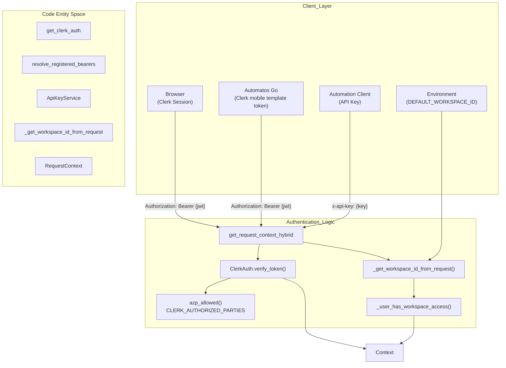
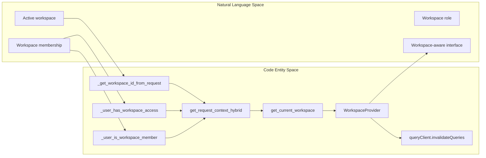

# Authentication & Multi-Tenancy

Relevant source files

The following files were used as context for generating this wiki page:

- [frontend/components/__tests__/prd264-voice-ai-label.test.tsx](frontend/components/__tests__/prd264-voice-ai-label.test.tsx)
- [frontend/components/settings/SettingsPanel.tsx](frontend/components/settings/SettingsPanel.tsx)
- [frontend/components/settings/SystemLLMSettingsTab.tsx](frontend/components/settings/SystemLLMSettingsTab.tsx)
- [frontend/components/settings/WorkspaceVoiceLiveCard.tsx](frontend/components/settings/WorkspaceVoiceLiveCard.tsx)
- [frontend/components/settings/__tests__/settings-panel-edition.test.tsx](frontend/components/settings/__tests__/settings-panel-edition.test.tsx)
- [frontend/components/settings/__tests__/settings-panel-tab-param.test.tsx](frontend/components/settings/__tests__/settings-panel-tab-param.test.tsx)
- [frontend/components/settings/__tests__/workspace-voice-live-card.test.tsx](frontend/components/settings/__tests__/workspace-voice-live-card.test.tsx)
- [frontend/components/workspace-provider.tsx](frontend/components/workspace-provider.tsx)
- [orchestrator/alembic/versions/prd_workspace_models_backfill.py](orchestrator/alembic/versions/prd_workspace_models_backfill.py)
- [orchestrator/core/auth/clerk.py](orchestrator/core/auth/clerk.py)
- [orchestrator/core/auth/clerk_azp.py](orchestrator/core/auth/clerk_azp.py)
- [orchestrator/core/auth/clerk_mobile_template.py](orchestrator/core/auth/clerk_mobile_template.py)
- [orchestrator/core/auth/hybrid.py](orchestrator/core/auth/hybrid.py)
- [orchestrator/modules/context/sections/product_facts.py](orchestrator/modules/context/sections/product_facts.py)
- [orchestrator/modules/voice/mint.py](orchestrator/modules/voice/mint.py)
- [orchestrator/tests/test_f232_auto_knows_what_automatos_is.py](orchestrator/tests/test_f232_auto_knows_what_automatos_is.py)
- [orchestrator/tests/test_invitation_routing.py](orchestrator/tests/test_invitation_routing.py)
- [orchestrator/tests/test_prd266_ai_providers_route.py](orchestrator/tests/test_prd266_ai_providers_route.py)

## Purpose and Scope

This page gives a high-level map of how authentication, workspace context, authorization, credentials, and billing relate in Automatos AI. The hybrid authentication module provides request-scoped workspace context, while the workspace endpoint exposes the active workspace and its role, plan, and settings to the frontend. Detailed implementation guides are linked in the child pages below. [orchestrator/core/auth/hybrid.py:29-43](), [orchestrator/api/workspaces.py:70-83](), [orchestrator/api/workspaces.py:118-154](), [frontend/components/workspace-provider.tsx:58-82]()

For deep technical details, see the child pages:

- [Authentication Flow](#17.1) — Clerk JWT vs API key, auth editions, request context, sign-in and invitations, and mobile device lane tokens.
- [Workspace & Team Management](#17.2) — Workspace provisioning, switching, team management, admin workspaces console, and purge.
- [Data Isolation](#17.3) — Workspace-scoped data, query keys, memory namespacing, caches, and isolation tests.
- [Admin Access Control & Plan Tiers](#17.4) — System roles, workspace permission gates, plan tiers, trial ledger enforcement, and bootstrap mode.
- [Credentials & API Keys](#17.5) — Encrypted credentials, integration bridges, SDK API keys, and user BYOK keys.
- [Billing, Credits & Metering](#17.6) — Credit balances, usage metering, billing integrations, and out-of-credit pauses.

Sources: [orchestrator/core/auth/hybrid.py:29-43](), [orchestrator/api/workspaces.py:70-83](), [orchestrator/api/workspaces.py:118-154](), [frontend/components/workspace-provider.tsx:58-82]()

---

## Overview & Architecture

Authentication and tenant context meet at `get_request_context_hybrid`: the module imports bearer-token resolution, Clerk auth, `RequestContext`, workspace provisioning helpers, and `ApiKeyService`. It also resolves workspace identifiers from request state, headers, query parameters, or configured defaults, and includes checks for workspace existence and membership. [orchestrator/core/auth/hybrid.py:14-24](), [orchestrator/core/auth/hybrid.py:55-94](), [orchestrator/core/auth/hybrid.py:97-112](), [orchestrator/core/auth/hybrid.py:134-190]()

The `/api/workspaces/current` endpoint uses that request context to load the active workspace and return workspace metadata, including plan, role, plan limits, onboarding snapshot, settings, and other workspace-level state. In the frontend, `WorkspaceProvider` represents this workspace context; when its remembered workspace changes, it invalidates React Query data so workspace-scoped views refetch. [orchestrator/api/workspaces.py:70-83](), [orchestrator/api/workspaces.py:118-154](), [frontend/components/workspace-provider.tsx:58-82](), [frontend/components/workspace-provider.tsx:159-167]()

Sources: [orchestrator/core/auth/hybrid.py:14-24](), [orchestrator/core/auth/hybrid.py:55-94](), [orchestrator/core/auth/hybrid.py:97-112](), [orchestrator/core/auth/hybrid.py:134-190](), [orchestrator/api/workspaces.py:70-83](), [orchestrator/api/workspaces.py:118-154](), [frontend/components/workspace-provider.tsx:58-82](), [frontend/components/workspace-provider.tsx:159-167]()

### Authentication and Request-Context Mapping

**Natural Language to Code Entity Mapping — Authentication and Request Context**

The `ClerkAuth` class handles JWT verification using JWKS (JSON Web Key Set) [orchestrator/core/auth/clerk.py:26-32](). It normalizes user claims, including the `system_role` which is extracted from Clerk session token metadata [orchestrator/core/auth/clerk.py:131-143]().

After the signature and expiry checks, `verify_token` also checks the token's `azp` (authorized party) claim against the allowed frontend origins, `CLERK_AUTHORIZED_PARTIES` plus `FRONTEND_URL`'s origin, and refuses a token minted on any other origin [orchestrator/core/auth/clerk.py:103-106](). The Automatos Go app's token has no `azp`, and passes on a marker claim from the Clerk `mobile` JWT template. See [Clerk Authorized Parties (azp)](clerk-authorized-parties.md).

Title: Hybrid Authentication & Context Resolution

**Sources:** [orchestrator/core/auth/hybrid.py:49-88](), [orchestrator/core/auth/hybrid.py:146-165](), [orchestrator/core/auth/clerk.py:69-106](), [orchestrator/core/auth/clerk_azp.py:112-121]()

### Workspace Authorization and Frontend Context

**Natural Language to Code Entity Mapping — Workspace Access and UI Context**

Sources: [orchestrator/core/auth/hybrid.py:55-94](), [orchestrator/core/auth/hybrid.py:134-190](), [orchestrator/api/workspaces.py:70-83](), [frontend/components/workspace-provider.tsx:159-167](), [frontend/components/workspace-provider.tsx:169-190]()

---

## 17.1 Authentication Flow

The hybrid auth module brings together Clerk auth, bearer resolution, API-key service, and request-context types. It also contains workspace resolution and access-check helpers. For the supported authentication lanes, edition-specific behavior, sign-in and invitation flows, and mobile device lane tokens, see [Authentication Flow](#17.1). [orchestrator/core/auth/hybrid.py:14-24](), [orchestrator/core/auth/hybrid.py:55-94](), [orchestrator/core/auth/hybrid.py:134-190]()

Sources: [orchestrator/core/auth/hybrid.py:14-24](), [orchestrator/core/auth/hybrid.py:55-94](), [orchestrator/core/auth/hybrid.py:134-190]()

---

## 17.2 Workspace & Team Management

`GET /api/workspaces/current` returns the active workspace using `ctx.workspace_id`; its response includes the workspace’s plan, role, plan limits, settings, and onboarding snapshot. The frontend `WorkspaceProvider` consumes workspace state and invalidates cached queries when the remembered workspace changes. For provisioning, switching, team administration, and purge details, see [Workspace & Team Management](#17.2). [orchestrator/api/workspaces.py:70-83](), [orchestrator/api/workspaces.py:118-154](), [frontend/components/workspace-provider.tsx:159-167]()

Sources: [orchestrator/api/workspaces.py:70-83](), [orchestrator/api/workspaces.py:118-154](), [frontend/components/workspace-provider.tsx:159-167]()

---

## 17.3 Data Isolation

The auth module checks workspace access and active membership, while workspace endpoints operate on the request context’s workspace identifier. On the client, a workspace change triggers query invalidation, helping prevent cached workspace views from remaining in use after a switch. For database scoping, memory namespaces, cache isolation, and tenant-isolation tests, see [Data Isolation](#17.3). [orchestrator/core/auth/hybrid.py:134-190](), [orchestrator/api/workspaces.py:70-87](), [frontend/components/workspace-provider.tsx:159-167]()

Sources: [orchestrator/core/auth/hybrid.py:134-190](), [orchestrator/api/workspaces.py:70-87](), [frontend/components/workspace-provider.tsx:159-167]()

---

## 17.4 Admin Access Control & Plan Tiers

The workspace response distinguishes a per-workspace role from the user’s system role: the endpoint returns `role`, resolving it through `resolve_workspace_role` for the applicable request context. It also returns the workspace plan and plan-derived exposure information, with local-edition exposure handled separately. For role gates, plan enforcement, trial ledger behavior, and bootstrap mode, see [Admin Access Control & Plan Tiers](#17.4). [orchestrator/api/workspaces.py:101-114](), [orchestrator/api/workspaces.py:118-141]()

The settings UI also uses system-role state to gate the System Settings tab, and applies an explicit local-edition tab allowlist. See the child page for the full authorization model and its backend gates. [frontend/components/settings/SettingsPanel.tsx:59-73](), [frontend/components/settings/SettingsPanel.tsx:75-99]()

Sources: [orchestrator/api/workspaces.py:101-114](), [orchestrator/api/workspaces.py:118-141](), [frontend/components/settings/SettingsPanel.tsx:59-73](), [frontend/components/settings/SettingsPanel.tsx:75-99]()

---

## 17.5 Credentials & API Keys

The hybrid auth module imports `ApiKeyService` as part of its authentication dependencies. The workspace endpoint returns settings through `masked_settings`, indicating that sensitive integration values are masked in the workspace response. For credential encryption, credential types, integration bridges, credential testing, SDK keys, and user BYOK keys, see [Credentials & API Keys](#17.5). [orchestrator/core/auth/hybrid.py:14-24](), [orchestrator/api/workspaces.py:20-23](), [orchestrator/api/workspaces.py:98-100]()

Sources: [orchestrator/core/auth/hybrid.py:14-24](), [orchestrator/api/workspaces.py:20-23](), [orchestrator/api/workspaces.py:98-100]()

---

## 17.6 Billing, Credits & Metering

The workspace endpoint exposes plan information and computes an exposure profile based on the edition and workspace plan. The settings panel includes Billing among the hosted-edition tabs, while its local-edition tab allowlist omits Billing. A voice-call mint path also checks plan eligibility and credits before proceeding. For the billing service, credit ledger, metering, alerts, and out-of-credit behavior, see [Billing, Credits & Metering](#17.6). [orchestrator/api/workspaces.py:118-141](), [frontend/components/settings/SettingsPanel.tsx:53-73](), [frontend/components/settings/SettingsPanel.tsx:79-99](), [orchestrator/modules/voice/mint.py:105-128]()

Sources: [orchestrator/api/workspaces.py:118-141](), [frontend/components/settings/SettingsPanel.tsx:53-73](), [frontend/components/settings/SettingsPanel.tsx:79-99](), [orchestrator/modules/voice/mint.py:105-128]()

---

## Child Pages Reference

- [Authentication Flow](#17.1)
- [Workspace & Team Management](#17.2)
- [Data Isolation](#17.3)
- [Admin Access Control & Plan Tiers](#17.4)
- [Credentials & API Keys](#17.5)
- [Billing, Credits & Metering](#17.6)

## Child Pages
- [Authentication Flow](#17.1) — Clerk JWT vs API key, get_request_context_hybrid, AUTH_EDITION saas vs local, sign-in/sign-up pages, Edge proxy security
- [Clerk Authorized Parties (azp)](clerk-authorized-parties.md) — the azp check in verify_token, CLERK_AUTHORIZED_PARTIES and CLERK_AZP_REQUIRED, Automatos Go's mobile JWT template marker, log lines, 401 diagnosis
- [Workspace Management](#17.2) — Workspace model, workspace_id context injection, workspace switching, model seeding, workspace purge, provisioning
- [Data Isolation](#17.3) — Database foreign keys, tenancy matrix tests, query key scoping, memory namespacing, cache isolation, team access
- [Admin Access Control](#17.4) — system_role field, admin gates, workspace_admin/workspace_permission dependencies, bootstrap mode, authz boundary sweeps
- [Credentials Management](#17.5) — User API keys, BYOK overrides, credential store and types seed, integration bridges, encryption service, SDK API keys
- [Teams, Members & Invitations](#17.6) — Teams table and team-scoped documents, workspace members, invitations, invite modal, workspace audit log
- [Trials, Plan Tiers & Session Modes](#17.7) — trial_ledger metering and enforcement, plan_tiers, subscription/session mode runtime, CLI host service and services/cli-host allowlist

---