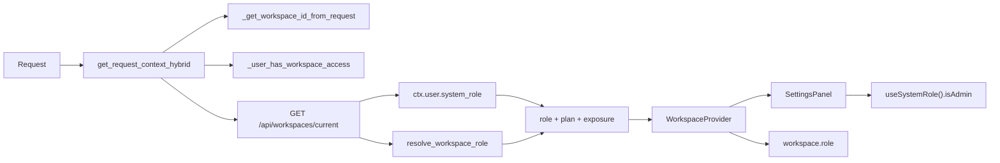
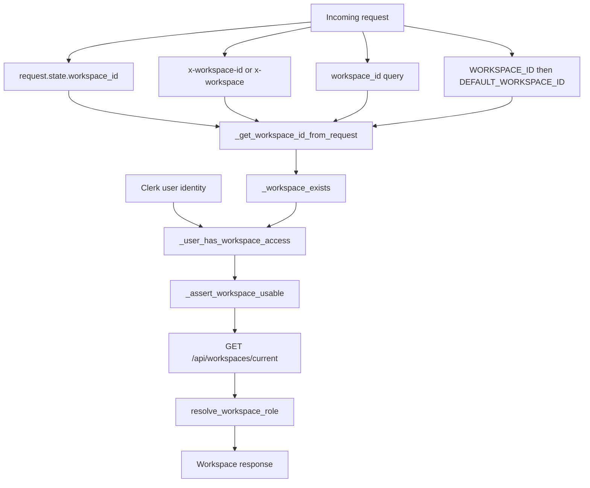
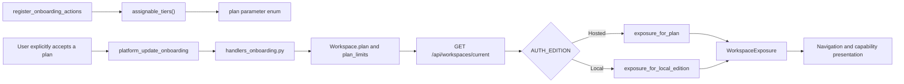
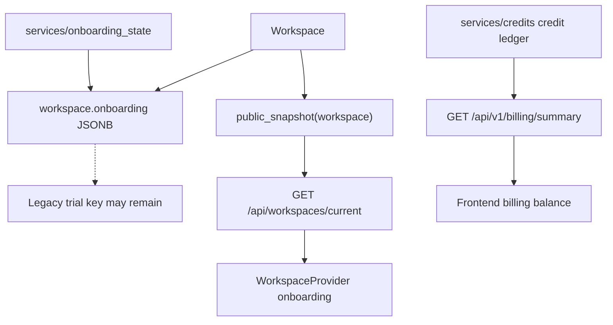

# Admin Access Control & Plan Tiers

Relevant source files

The following files were used as context for generating this wiki page:

- [frontend/components/__tests__/prd264-voice-ai-label.test.tsx](frontend/components/__tests__/prd264-voice-ai-label.test.tsx)
- [frontend/components/admin/workspace-plan-select.tsx](frontend/components/admin/workspace-plan-select.tsx)
- [frontend/components/settings/SettingsPanel.tsx](frontend/components/settings/SettingsPanel.tsx)
- [frontend/components/settings/SystemLLMSettingsTab.tsx](frontend/components/settings/SystemLLMSettingsTab.tsx)
- [frontend/components/settings/WorkspaceVoiceLiveCard.tsx](frontend/components/settings/WorkspaceVoiceLiveCard.tsx)
- [frontend/components/settings/__tests__/settings-panel-edition.test.tsx](frontend/components/settings/__tests__/settings-panel-edition.test.tsx)
- [frontend/components/settings/__tests__/settings-panel-tab-param.test.tsx](frontend/components/settings/__tests__/settings-panel-tab-param.test.tsx)
- [frontend/components/settings/__tests__/workspace-voice-live-card.test.tsx](frontend/components/settings/__tests__/workspace-voice-live-card.test.tsx)
- [frontend/components/workspace-provider.tsx](frontend/components/workspace-provider.tsx)
- [frontend/hooks/use-voice-live-settings.ts](frontend/hooks/use-voice-live-settings.ts)
- [frontend/lib/voice/live/refusal.ts](frontend/lib/voice/live/refusal.ts)
- [orchestrator/alembic/versions/users_last_sign_in_column.py](orchestrator/alembic/versions/users_last_sign_in_column.py)
- [orchestrator/api/workspaces.py](orchestrator/api/workspaces.py)
- [orchestrator/core/auth/hybrid.py](orchestrator/core/auth/hybrid.py)
- [orchestrator/modules/context/sections/onboarding.py](orchestrator/modules/context/sections/onboarding.py)
- [orchestrator/modules/context/sections/product_facts.py](orchestrator/modules/context/sections/product_facts.py)
- [orchestrator/modules/tools/discovery/actions_onboarding.py](orchestrator/modules/tools/discovery/actions_onboarding.py)
- [orchestrator/modules/tools/discovery/handlers_onboarding.py](orchestrator/modules/tools/discovery/handlers_onboarding.py)
- [orchestrator/modules/voice/mint.py](orchestrator/modules/voice/mint.py)
- [orchestrator/services/onboarding_content.py](orchestrator/services/onboarding_content.py)
- [orchestrator/services/onboarding_state.py](orchestrator/services/onboarding_state.py)
- [orchestrator/services/plan_tiers.py](orchestrator/services/plan_tiers.py)
- [orchestrator/tests/test_admin_plan_console.py](orchestrator/tests/test_admin_plan_console.py)
- [orchestrator/tests/test_f132_onboarding_sets_the_businesss_zone.py](orchestrator/tests/test_f132_onboarding_sets_the_businesss_zone.py)
- [orchestrator/tests/test_f188_b_stage_ids_stay_internal.py](orchestrator/tests/test_f188_b_stage_ids_stay_internal.py)
- [orchestrator/tests/test_f188_the_last_steps_fit_the_edition_and_the_apps.py](orchestrator/tests/test_f188_the_last_steps_fit_the_edition_and_the_apps.py)
- [orchestrator/tests/test_f232_auto_knows_what_automatos_is.py](orchestrator/tests/test_f232_auto_knows_what_automatos_is.py)
- [orchestrator/tests/test_f314_b_no_onboarding_quiz_in_a_workspace_in_use.py](orchestrator/tests/test_f314_b_no_onboarding_quiz_in_a_workspace_in_use.py)
- [orchestrator/tests/test_f314_d_answers_alone_never_start_onboarding_in_a_workspace_in_use.py](orchestrator/tests/test_f314_d_answers_alone_never_start_onboarding_in_a_workspace_in_use.py)
- [orchestrator/tests/test_f337_d_no_quiz_in_a_working_workspace.py](orchestrator/tests/test_f337_d_no_quiz_in_a_working_workspace.py)
- [orchestrator/tests/test_invitation_routing.py](orchestrator/tests/test_invitation_routing.py)
- [orchestrator/tests/test_prd222_onboarding_state.py](orchestrator/tests/test_prd222_onboarding_state.py)
- [orchestrator/tests/test_prd222_onboarding_tool.py](orchestrator/tests/test_prd222_onboarding_tool.py)
- [orchestrator/tests/test_prd222_onboarding_tool_arg_shapes.py](orchestrator/tests/test_prd222_onboarding_tool_arg_shapes.py)
- [orchestrator/tests/test_prd222_onboarding_tool_prior.py](orchestrator/tests/test_prd222_onboarding_tool_prior.py)
- [orchestrator/tests/test_prd222_segment_implied_advance.py](orchestrator/tests/test_prd222_segment_implied_advance.py)
- [orchestrator/tests/test_prd266_ai_providers_route.py](orchestrator/tests/test_prd266_ai_providers_route.py)

## Purpose and Scope

This page describes the visible authorization boundaries between platform roles and workspace roles, how workspace context and plan exposure reach the frontend, and what the supplied code establishes about assignable plan tiers and trial-ledger ownership. It also explains the distinction between local-edition behavior and hosted plan gating. The supplied excerpts do not include the route-sweep contract, the full workspace-admin gate, the plan-tier service implementation, or router bootstrap code, so those implementation details are not inferred here. [orchestrator/core/auth/hybrid.py:55-94](), [orchestrator/api/workspaces.py:70-154](), [orchestrator/services/onboarding_state.py:1-8](), [frontend/components/settings/SettingsPanel.tsx:28-58]()

Sources: [orchestrator/core/auth/hybrid.py:55-94](), [orchestrator/api/workspaces.py:70-154](), [orchestrator/services/onboarding_state.py:1-8](), [frontend/components/settings/SettingsPanel.tsx:28-58]()

---

## Overview

The backend resolves a request-scoped workspace and user context through `get_request_context_hybrid`; the auth module documents workspace identifiers from request state, headers, query parameters, and environment configuration. For a Clerk user, workspace access is checked against workspace ownership or active membership, preventing workspace-header spoofing from granting access by itself. [orchestrator/core/auth/hybrid.py:55-94](), [orchestrator/core/auth/hybrid.py:134-190]()

`GET /api/workspaces/current` uses that context to load the active workspace and returns its plan, workspace role, plan limits, and plan-derived exposure. The endpoint resolves the workspace role separately from system role: anonymous callers and users whose `system_role` is `super_admin` are represented as workspace `owner`; other callers use `resolve_workspace_role`, falling back to `viewer`. [orchestrator/api/workspaces.py:70-87](), [orchestrator/api/workspaces.py:101-135]()

The frontend uses `useSystemRole()` to conditionally show the `System Settings` tab, while workspace role and plan data are supplied through `WorkspaceProvider`. These are separate UI concerns: platform system-role visibility does not replace backend workspace authorization. [frontend/components/settings/SettingsPanel.tsx:75-100](), [frontend/components/workspace-provider.tsx:58-82]()

Sources: [orchestrator/core/auth/hybrid.py:55-94](), [orchestrator/core/auth/hybrid.py:134-190](), [orchestrator/api/workspaces.py:70-87](), [orchestrator/api/workspaces.py:101-135](), [frontend/components/settings/SettingsPanel.tsx:75-100](), [frontend/components/workspace-provider.tsx:58-82]()

### Natural Language to Code Entity: Platform and Workspace Roles

“Platform administrator” maps to the `system_role` value `super_admin` in the workspace response logic and to the frontend `useSystemRole()` / `isAdmin` check for the `System Settings` tab. “Workspace owner or member” maps to database ownership and active `workspace_members` records in the hybrid auth checks; the returned workspace `role` comes from `resolve_workspace_role`. [orchestrator/api/workspaces.py:101-114](), [orchestrator/core/auth/hybrid.py:134-190](), [frontend/components/settings/SettingsPanel.tsx:75-100]()

**Diagram: Request Identity to UI Role Surfaces**

Sources: [orchestrator/core/auth/hybrid.py:55-94](), [orchestrator/core/auth/hybrid.py:171-190](), [orchestrator/api/workspaces.py:70-87](), [orchestrator/api/workspaces.py:101-135](), [frontend/components/workspace-provider.tsx:140-156](), [frontend/components/settings/SettingsPanel.tsx:75-100]()

---

## System Role Architecture

### Platform Role and Workspace Role Are Different

The backend response logic explicitly avoids returning the system role as though it were a workspace role. For `GET /api/workspaces/current`, anonymous callers and `super_admin` users receive the workspace-facing role `"owner"`; other callers receive the result of `resolve_workspace_role(db, ctx)` or `"viewer"` if no role resolves. [orchestrator/api/workspaces.py:101-114]()

The frontend settings panel uses `isAdmin` from `useSystemRole()` to include the `system-settings` tab. In contrast, workspace data has its own `role` field, typed as `owner`, `admin`, `editor`, `viewer`, or `member`; the workspace provider documents `canEdit` as false for workspace viewers. [frontend/components/settings/SettingsPanel.tsx:75-100](), [frontend/components/workspace-provider.tsx:58-70](), [frontend/components/workspace-provider.tsx:84-96]()

The supplied code shows a dev-only onboarding-reset gate beginning at `_require_admin` in `orchestrator/api/workspaces.py`, but the excerpt ends before its implementation. The exact checks performed by that gate are therefore not specified here. [orchestrator/api/workspaces.py:157-163]()

Sources: [orchestrator/api/workspaces.py:101-114](), [orchestrator/api/workspaces.py:157-163](), [frontend/components/settings/SettingsPanel.tsx:75-100](), [frontend/components/workspace-provider.tsx:58-70](), [frontend/components/workspace-provider.tsx:84-96]()

### Workspace Access Resolution

`_get_workspace_id_from_request` checks request state first, followed by `x-workspace-id`, `x-workspace`, the `workspace_id` query parameter, `WORKSPACE_ID`, and `DEFAULT_WORKSPACE_ID`. Values are parsed as UUIDs; missing or invalid candidates do not resolve a workspace. [orchestrator/core/auth/hybrid.py:46-94]()

The hybrid auth module distinguishes workspace existence from workspace usability. `_workspace_exists` excludes deleted workspaces; a paused workspace still exists. `_assert_workspace_usable` allows admins through and otherwise raises HTTP 403 when the workspace has a non-null `paused_at`. [orchestrator/core/auth/hybrid.py:97-132]()

For Clerk identities, `_user_has_workspace_access` grants access when the user owns the workspace or has an active membership row. This check is specifically documented as protection against spoofing `X-Workspace-ID`. [orchestrator/core/auth/hybrid.py:171-190]()

Sources: [orchestrator/core/auth/hybrid.py:46-94](), [orchestrator/core/auth/hybrid.py:97-132](), [orchestrator/core/auth/hybrid.py:171-190]()

### Natural Language to Code Entity: Workspace Selection and Membership

“Choose a workspace” maps to `_get_workspace_id_from_request`; “verify the workspace belongs to this caller” maps to `_user_has_workspace_access`; “deny use of a paused workspace unless the caller is admin” maps to `_assert_workspace_usable`. The workspace endpoint then reads the selected workspace and derives its returned role. [orchestrator/core/auth/hybrid.py:55-94](), [orchestrator/core/auth/hybrid.py:115-132](), [orchestrator/core/auth/hybrid.py:171-190](), [orchestrator/api/workspaces.py:70-87](), [orchestrator/api/workspaces.py:101-114]()

**Diagram: Workspace Context Resolution**

Sources: [orchestrator/core/auth/hybrid.py:55-94](), [orchestrator/core/auth/hybrid.py:97-112](), [orchestrator/core/auth/hybrid.py:115-132](), [orchestrator/core/auth/hybrid.py:171-190](), [orchestrator/api/workspaces.py:70-87](), [orchestrator/api/workspaces.py:101-114]()

---

## Admin Workspace Management

The visible workspace endpoint is `GET /api/workspaces/current`, mounted under the `/api/workspaces` router. It loads the workspace identified by `ctx.workspace_id` and returns 404 if the workspace row is absent. [orchestrator/api/workspaces.py:48-48](), [orchestrator/api/workspaces.py:70-87]()

The endpoint derives the response role from workspace membership resolution rather than treating `ctx.user.role` as the workspace role. The code comments state that this aligns the frontend’s workspace role with the write gates, with non-members rendered as read-only. [orchestrator/api/workspaces.py:101-114]()

The supplied excerpt imports `require_workspace_permission` and `workspace_permission_granted`, and begins a private `_require_admin` function for a temporary onboarding reset. It does not include the endpoint declarations or the rest of `_require_admin`, so this page does not enumerate workspace-admin routes or assert the complete policy of that gate. [orchestrator/api/workspaces.py:31-34](), [orchestrator/api/workspaces.py:157-163]()

Sources: [orchestrator/api/workspaces.py:31-34](), [orchestrator/api/workspaces.py:48-48](), [orchestrator/api/workspaces.py:70-87](), [orchestrator/api/workspaces.py:101-114](), [orchestrator/api/workspaces.py:157-163]()

---

## Plan Tiers and Exposure

The workspace response includes `plan`, `plan_limits`, and `exposure`. In hosted mode, exposure is computed with `exposure_for_plan(workspace.plan or "basic")`; in local mode, the endpoint uses `exposure_for_local_edition()`. The response code describes exposure as plan-derived navigation visibility, capability-family availability, marketplace depth, and tier display information. [orchestrator/api/workspaces.py:115-135]()

The frontend models plan values as `basic`, `pro`, `business`, or `enterprise`. `WorkspaceExposure` carries a plan name, optional display fields, capability-family flags, marketplace depth, and per-navigation visibility. The frontend comments specify that hiding a navigation item is presentation-only and does not delete routes or data. [frontend/components/workspace-provider.tsx:41-56](), [frontend/components/workspace-provider.tsx:58-70]()

The onboarding action derives its `plan` parameter enum from `assignable_tiers()`. Its description identifies `basic`, `pro`, and `business` as assignable and says `enterprise` is coming soon and rejected. The parameter is intended for a plan explicitly accepted by the user, and the action description says the handler writes `plan` and `plan_limits`. [orchestrator/modules/tools/discovery/actions_onboarding.py:44-52](), [orchestrator/modules/tools/discovery/actions_onboarding.py:54-69](), [orchestrator/modules/tools/discovery/actions_onboarding.py:127-135]()

The supplied files do not include `services/plan_tiers.py` or the handler implementation that performs the plan write, so tier limit values and the detailed assignment algorithm cannot be specified from these excerpts. [orchestrator/modules/tools/discovery/actions_onboarding.py:44-52](), [orchestrator/modules/tools/discovery/actions_onboarding.py:127-135]()

Sources: [orchestrator/api/workspaces.py:115-135](), [frontend/components/workspace-provider.tsx:41-70](), [orchestrator/modules/tools/discovery/actions_onboarding.py:44-52](), [orchestrator/modules/tools/discovery/actions_onboarding.py:54-69](), [orchestrator/modules/tools/discovery/actions_onboarding.py:127-135]()

### Natural Language to Code Entity: Plan Choice and Exposure

“Offer only assignable plans” maps to `register_onboarding_actions` calling `assignable_tiers()` to construct the `platform_update_onboarding` plan enum. “Show capabilities and navigation for the workspace plan” maps to `GET /api/workspaces/current` calling `exposure_for_plan` or `exposure_for_local_edition`, followed by the frontend’s `WorkspaceExposure` representation. [orchestrator/modules/tools/discovery/actions_onboarding.py:44-52](), [orchestrator/modules/tools/discovery/actions_onboarding.py:127-135](), [orchestrator/api/workspaces.py:115-135](), [frontend/components/workspace-provider.tsx:41-56]()

**Diagram: Assignable Plan to Workspace Exposure**

Sources: [orchestrator/modules/tools/discovery/actions_onboarding.py:44-52](), [orchestrator/modules/tools/discovery/actions_onboarding.py:54-69](), [orchestrator/modules/tools/discovery/actions_onboarding.py:127-135](), [orchestrator/api/workspaces.py:115-135](), [frontend/components/workspace-provider.tsx:41-56]()

---

## Trial Ledger and Onboarding Enforcement

The onboarding-state service describes `workspace.onboarding` as a JSONB document whose stage machine it alone writes. It records that the `trial` key was part of the document in an earlier version, but that PRD-265 moved the trial to the credit ledger (`services/credits`); a legacy `trial` key may remain in older documents and nothing reads it. [orchestrator/services/onboarding_state.py:1-8]()

The workspace endpoint returns `public_snapshot(workspace)` as its `onboarding` field. The frontend workspace-provider documentation states that the trial is no longer part of this snapshot and that the balance comes from `GET /api/v1/billing/summary`. [orchestrator/api/workspaces.py:136-142](), [frontend/components/workspace-provider.tsx:17-23]()

The onboarding action and handler documentation still refer to a client-safe `{stage, trial}` result. This response description should not be interpreted as evidence that current trial enforcement is stored in the onboarding JSONB: the state-service and frontend comments explicitly place current trial/balance data outside that document. [orchestrator/modules/tools/discovery/actions_onboarding.py:54-69](), [orchestrator/modules/tools/discovery/handlers_onboarding.py:1-5](), [orchestrator/services/onboarding_state.py:1-8](), [frontend/components/workspace-provider.tsx:17-23]()

Detailed credit-ledger enforcement rules—such as balance checks, trial grants, debit behavior, and exhaustion actions—are not present in the supplied file excerpts and are not specified here. [orchestrator/services/onboarding_state.py:1-8](), [frontend/components/workspace-provider.tsx:17-23]()

**Diagram: Onboarding Snapshot and Trial Balance Sources**

Sources: [orchestrator/services/onboarding_state.py:1-8](), [orchestrator/api/workspaces.py:136-142](), [frontend/components/workspace-provider.tsx:17-23](), [orchestrator/modules/tools/discovery/handlers_onboarding.py:1-5]()

---

## Local Edition and Bootstrap Boundaries

The supplied code describes local-edition settings as an explicit allowlist, not as an admin-role filter. `SettingsPanel` uses `isLocal` to include local-only tabs and filters the local tab set; comments state that `System Settings` is still gated by `isAdmin`, and the local operator is `super_admin` by design. [frontend/components/settings/SettingsPanel.tsx:28-58](), [frontend/components/settings/SettingsPanel.tsx:59-100]()

In the backend workspace response, local edition selects `exposure_for_local_edition()` rather than applying the workspace plan’s exposure profile. This is a distinct plan-exposure path; it does not establish that local edition disables authentication or all authorization checks. [orchestrator/api/workspaces.py:125-135]()

The supplied excerpts do not include router-manifest bootstrap handling or degraded-boot configuration. Therefore, no behavior for bootstrap mode, missing-router startup, or an environment-controlled degraded boot is asserted here. [orchestrator/api/workspaces.py:115-135](), [frontend/components/settings/SettingsPanel.tsx:28-58]()

Sources: [frontend/components/settings/SettingsPanel.tsx:28-58](), [frontend/components/settings/SettingsPanel.tsx:59-100](), [orchestrator/api/workspaces.py:125-135]()

---

## Implementation Notes

- Treat `ctx.user.system_role` and the workspace response’s `role` as distinct role concepts; the workspace endpoint resolves the latter through `resolve_workspace_role` except for its documented anonymous and `super_admin` cases. [orchestrator/api/workspaces.py:101-114]()
- Do not treat a workspace header as authorization by itself. The hybrid auth module checks ownership or active workspace membership for Clerk users. [orchestrator/core/auth/hybrid.py:171-190]()
- Distinguish deleted workspace filtering from paused-workspace usability: `_workspace_exists` excludes deleted rows, while `_assert_workspace_usable` applies a separate paused-workspace check and admin exception. [orchestrator/core/auth/hybrid.py:97-132]()
- Use `assignable_tiers()` as the onboarding action’s plan-enum source; the action describes `basic`, `pro`, and `business` as assignable and rejects `enterprise`. [orchestrator/modules/tools/discovery/actions_onboarding.py:44-52](), [orchestrator/modules/tools/discovery/actions_onboarding.py:127-135]()
- Treat `workspace.onboarding.trial` as legacy. The onboarding-state module says current trial handling moved to `services/credits`, and the frontend identifies the billing summary endpoint as the source of balance. [orchestrator/services/onboarding_state.py:1-8](), [frontend/components/workspace-provider.tsx:17-23]()
- Interpret plan exposure as a presentation profile, not route or data removal; the frontend exposure contract explicitly says hidden navigation does not delete routes or data. [frontend/components/workspace-provider.tsx:41-56]()

Sources: [orchestrator/api/workspaces.py:101-114](), [orchestrator/core/auth/hybrid.py:97-132](), [orchestrator/core/auth/hybrid.py:171-190](), [orchestrator/modules/tools/discovery/actions_onboarding.py:44-52](), [orchestrator/modules/tools/discovery/actions_onboarding.py:127-135](), [orchestrator/services/onboarding_state.py:1-8](), [frontend/components/workspace-provider.tsx:17-23](), [frontend/components/workspace-provider.tsx:41-56]()

---