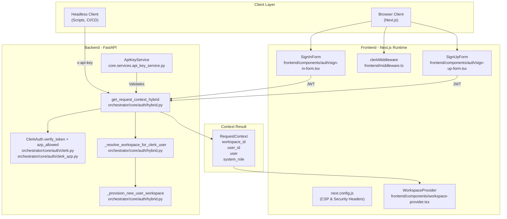
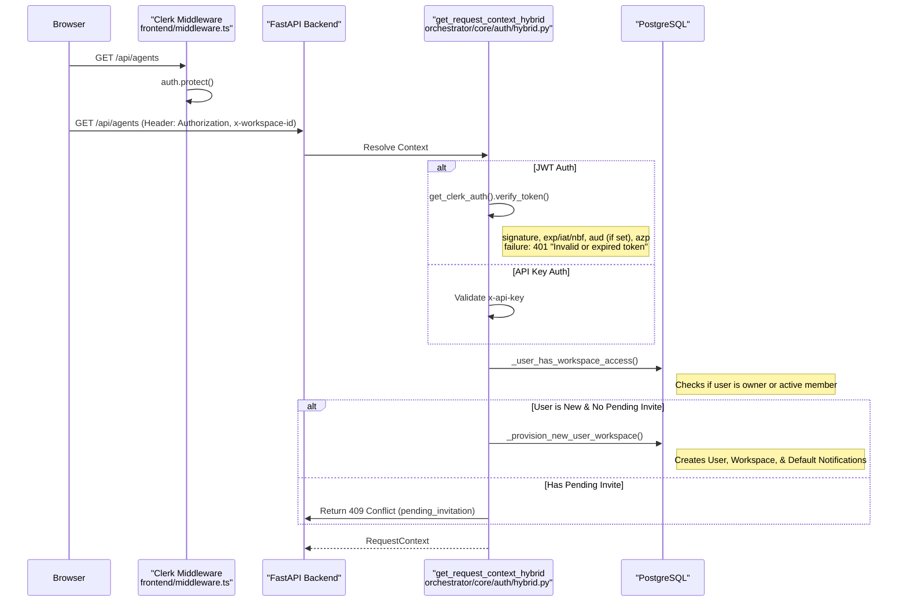
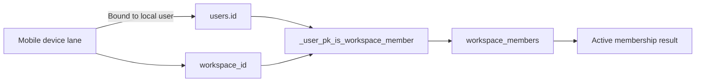

# Authentication Flow

Relevant source files

The following files were used as context for generating this wiki page:

- [docs/compliance/DETECTION.md](docs/compliance/DETECTION.md)
- [frontend/app/__tests__/verify-page.test.tsx](frontend/app/__tests__/verify-page.test.tsx)
- [frontend/app/accept-invitation/page.tsx](frontend/app/accept-invitation/page.tsx)
- [frontend/app/reset-password/page.tsx](frontend/app/reset-password/page.tsx)
- [frontend/app/verify/page.tsx](frontend/app/verify/page.tsx)
- [frontend/components/__tests__/prd264-voice-ai-label.test.tsx](frontend/components/__tests__/prd264-voice-ai-label.test.tsx)
- [frontend/components/auth/sign-in-form.tsx](frontend/components/auth/sign-in-form.tsx)
- [frontend/components/settings/SettingsPanel.tsx](frontend/components/settings/SettingsPanel.tsx)
- [frontend/components/settings/SystemLLMSettingsTab.tsx](frontend/components/settings/SystemLLMSettingsTab.tsx)
- [frontend/components/settings/WorkspaceVoiceLiveCard.tsx](frontend/components/settings/WorkspaceVoiceLiveCard.tsx)
- [frontend/components/settings/__tests__/settings-panel-edition.test.tsx](frontend/components/settings/__tests__/settings-panel-edition.test.tsx)
- [frontend/components/settings/__tests__/settings-panel-tab-param.test.tsx](frontend/components/settings/__tests__/settings-panel-tab-param.test.tsx)
- [frontend/components/settings/__tests__/workspace-voice-live-card.test.tsx](frontend/components/settings/__tests__/workspace-voice-live-card.test.tsx)
- [frontend/components/verify/provenance-check.tsx](frontend/components/verify/provenance-check.tsx)
- [frontend/components/workflows/json-schema-editor.tsx](frontend/components/workflows/json-schema-editor.tsx)
- [frontend/components/workflows/playbook-step-progress.tsx](frontend/components/workflows/playbook-step-progress.tsx)
- [frontend/components/workflows/theater/theater-step-execution.tsx](frontend/components/workflows/theater/theater-step-execution.tsx)
- [frontend/components/workspace-provider.tsx](frontend/components/workspace-provider.tsx)
- [frontend/hooks/use-voice-live-settings.ts](frontend/hooks/use-voice-live-settings.ts)
- [frontend/lib/__tests__/provenance.test.ts](frontend/lib/__tests__/provenance.test.ts)
- [frontend/lib/provenance.ts](frontend/lib/provenance.ts)
- [frontend/lib/voice/live/refusal.ts](frontend/lib/voice/live/refusal.ts)
- [frontend/middleware.ts](frontend/middleware.ts)
- [orchestrator/alembic/versions/add_clerk_invitation_id.py](orchestrator/alembic/versions/add_clerk_invitation_id.py)
- [orchestrator/alembic/versions/prd_workspace_models_backfill.py](orchestrator/alembic/versions/prd_workspace_models_backfill.py)
- [orchestrator/api/heartbeat.py](orchestrator/api/heartbeat.py)
- [orchestrator/channels/discord_adapter.py](orchestrator/channels/discord_adapter.py)
- [orchestrator/channels/slack_adapter.py](orchestrator/channels/slack_adapter.py)
- [orchestrator/config.py](orchestrator/config.py)
- [orchestrator/core/auth/clerk.py](orchestrator/core/auth/clerk.py)
- [orchestrator/core/auth/clerk_azp.py](orchestrator/core/auth/clerk_azp.py)
- [orchestrator/core/auth/clerk_mobile_template.py](orchestrator/core/auth/clerk_mobile_template.py)
- [orchestrator/core/auth/hybrid.py](orchestrator/core/auth/hybrid.py)
- [orchestrator/core/composio/entity_manager.py](orchestrator/core/composio/entity_manager.py)
- [orchestrator/core/models/workspaces.py](orchestrator/core/models/workspaces.py)
- [orchestrator/services/trial_ledger.py](orchestrator/services/trial_ledger.py)
- [orchestrator/services/workspace_model_seeding.py](orchestrator/services/workspace_model_seeding.py)
- [orchestrator/tests/test_clerk_azp_check.py](orchestrator/tests/test_clerk_azp_check.py)
- [orchestrator/tests/test_invitation_routing.py](orchestrator/tests/test_invitation_routing.py)
- [orchestrator/tests/test_prd264_content_provenance.py](orchestrator/tests/test_prd264_content_provenance.py)
- [orchestrator/tests/test_prd266_ai_providers_route.py](orchestrator/tests/test_prd266_ai_providers_route.py)

## Purpose & Scope

This page describes the authentication boundaries visible in the supplied code: SaaS browser route protection, local-edition pass-through, Clerk sign-in, backend hybrid-auth dependencies and workspace checks, invitation routing, and the internal-user membership check used for non-Clerk lanes such as mobile devices. It distinguishes authentication context from workspace access checks; the available source excerpt does not show the complete `get_request_context_hybrid` implementation or the API-key validation flow. [frontend/middleware.ts:1-49]()[frontend/components/auth/sign-in-form.tsx:17-131]()[orchestrator/core/auth/hybrid.py:13-25]()[orchestrator/core/auth/hybrid.py:97-190]()

Sources: [frontend/middleware.ts:1-49]()[frontend/components/auth/sign-in-form.tsx:17-131]()[orchestrator/core/auth/hybrid.py:13-25]()[orchestrator/core/auth/hybrid.py:97-190]()

---

## 1. Authentication Architecture Overview

Automatos AI implements a dual-mode authentication system that accepts both **Clerk JWT tokens** (for browser-based users, and for the Automatos Go app on the hosted edition) and **API keys** (for headless clients, automation scripts, and external integrations).

### Code Entity Space: Authentication Components

This diagram maps browser and workspace concepts to the code entities shown in the supplied sources. It does not imply that every credential lane shown is implemented inside `get_request_context_hybrid`: widget rate limiting, for example, is a separate middleware concern. [frontend/middleware.ts:3-9]()[frontend/components/auth/sign-in-form.tsx:17-38]()[frontend/components/workspace-provider.tsx:169-188]()[orchestrator/core/auth/hybrid.py:13-25]()[orchestrator/core/auth/hybrid.py:55-94]()

**Diagram: Browser authentication concepts mapped to code entities**

**Sources:** [frontend/middleware.ts:1-33](), [orchestrator/core/auth/hybrid.py:200-230](), [orchestrator/core/auth/clerk.py:69-106](), [frontend/components/auth/sign-in-form.tsx:41-81](), [frontend/next.config.js:4-112](), [frontend/components/workspace-provider.tsx:91-204](), [frontend/components/auth/sign-up-form.tsx:17-81]()

---

## 2. Dual Authentication Modes: Clerk JWT vs API Key

### Clerk JWT (Interactive Users)

`SignInForm` uses Clerk’s `useSignIn()` hook. Email/password submission calls `signIn.create()`; a completed result activates the returned session with `setActive()` and navigates to `/`. The form also supports Google and GitHub OAuth redirects and a second-factor attempt flow. [frontend/components/auth/sign-in-form.tsx:17-38]()[frontend/components/auth/sign-in-form.tsx:40-80]()[frontend/components/auth/sign-in-form.tsx:83-109]()

The backend hybrid module imports `get_clerk_auth`, bearer-token helpers, and the `RequestContext` and `UserContext` types. These imports identify relevant auth entities, but the supplied excerpt does not show how `get_request_context_hybrid` branches among credentials or validates Clerk tokens. [orchestrator/core/auth/hybrid.py:13-25]()

### API Key and Bearer Access

The hybrid module imports `api_key`, `bearer_token`, and `resolve_registered_bearers` from `core.auth.bearer_registry`, along with `ApiKeyService`. The available excerpt establishes that these are dependencies of the module, but does not show their invocation or the API-key validation sequence; those details cannot be specified from the provided lines. [orchestrator/core/auth/hybrid.py:13-25]()

A separate, documented widget rate limiter uses a SHA-256 digest of a presented bearer key as its per-key bucket identifier; without a key it uses the client IP. This describes rate-limit bucket selection, not the platform’s general API-key authentication contract. [orchestrator/api/widgets/rate_limit.py:11-20]()

Sources: [frontend/components/auth/sign-in-form.tsx:17-109]()[orchestrator/core/auth/hybrid.py:13-25]()[orchestrator/api/widgets/rate_limit.py:11-20]()

---

On the hosted edition, the Automatos Go app also signs in with Clerk. It sends a token from the Clerk `mobile` JWT template rather than a session token, so every claim `clerk.py` reads must also come from that template or be listed as left out of it [orchestrator/core/auth/clerk.py:7-10](), [orchestrator/core/auth/clerk_mobile_template.py:26-39]().

### Clerk Token Verification

`ClerkAuth.verify_token` checks a bearer token in this order and returns its claims, or `None` [orchestrator/core/auth/clerk.py:69-116]():

1. **JWKS configured.** Without `CLERK_JWKS_URL` it logs an error and returns `None` [orchestrator/core/auth/clerk.py:79-81]().
2. **Signature and time claims.** `jwt.decode` checks the RS256 signature against the key from the Clerk JWKS (cached for 5 minutes), and `exp`, `iat` and `nbf` [orchestrator/core/auth/clerk.py:58-67](), [orchestrator/core/auth/clerk.py:83-101]().
3. **Audience.** When `CLERK_AUDIENCE` is set, the token's `aud` must match it [orchestrator/core/auth/clerk.py:87-96]().
4. **Authorized party.** `azp_allowed` checks the token's `azp` claim against the origins in `CLERK_AUTHORIZED_PARTIES` plus `FRONTEND_URL`'s origin. A token with no `azp` is accepted when it carries Automatos Go's marker (`client: "automatos-go"`); otherwise `CLERK_AZP_REQUIRED` decides [orchestrator/core/auth/clerk.py:103-106](), [orchestrator/core/auth/clerk_azp.py:112-121]().

When `verify_token` returns `None`, `get_request_context_hybrid` answers 401 `Invalid or expired token` [orchestrator/core/auth/hybrid.py:886-888](), and `POST /api/team/accept-invitation` answers 401 `Invalid token` [orchestrator/api/team.py:439-453](). The settings, the Automatos Go template, the log lines and how to diagnose a refusal are in [Clerk Authorized Parties (azp)](clerk-authorized-parties.md).

**Sources:** [orchestrator/core/auth/clerk.py:69-116](), [orchestrator/core/auth/clerk_azp.py:1-34](), [orchestrator/config.py:578-586](), [orchestrator/tests/test_clerk_azp_check.py:113-255]()

### API Key (Headless & External)

The frontend chooses the middleware implementation using `isSaaS`. In SaaS, `clerkMiddleware` calls `auth.protect()` for routes outside the public-route matcher. In local mode, `localMiddleware` passes the request through without Clerk middleware or `auth.protect()`. [frontend/middleware.ts:3-9]()[frontend/middleware.ts:38-49]()

| Edition | Frontend behavior | Consequence |
|---|---|---|
| `saas` | `clerkMiddleware` protects non-public routes with `auth.protect()`. [frontend/middleware.ts:40-44]() | The frontend route boundary requires Clerk protection for matched routes that are not public. [frontend/middleware.ts:11-16]()[frontend/middleware.ts:40-44]() |
| `local` | `localMiddleware` returns `NextResponse.next()`. [frontend/middleware.ts:46-49]() | Frontend middleware does not enforce a Clerk session. The local settings UI also explicitly includes a local-only profile surface. [frontend/middleware.ts:46-49]()[frontend/components/settings/SettingsPanel.tsx:28-33]()[frontend/components/settings/SettingsPanel.tsx:59-73]() |

The middleware’s public matcher includes sign-in, sign-up, password reset, SSO callback, invitation acceptance, and webhook routes. It also explicitly lists selected public verification, mobile pairing, app-association, and marketplace paths. [frontend/middleware.ts:11-38]()

Sources: [frontend/middleware.ts:3-49]()[frontend/components/settings/SettingsPanel.tsx:28-73]()

---

## 4. Hybrid Request Context Resolution (`get_request_context_hybrid`)

`orchestrator/api/workspaces.py` imports `get_request_context_hybrid` and `RequestContext`, then injects the dependency into `get_current_workspace`. The hybrid module imports Clerk, bearer-registry, provisioning, user-link, database-session, and API-key-service components. The shown excerpt does not contain the complete `get_request_context_hybrid` body, so the sequence below is limited to helpers whose implementations are present. [orchestrator/api/workspaces.py:31-33]()[orchestrator/api/workspaces.py:70-73]()[orchestrator/core/auth/hybrid.py:13-25]()

### Workspace Identification Hierarchy

`_get_workspace_id_from_request` resolves a workspace UUID in this order: a valid `request.state.workspace_id` override; `x-workspace-id`; `x-workspace`; the `workspace_id` query parameter; `WORKSPACE_ID`; and `DEFAULT_WORKSPACE_ID`. Invalid UUID candidates are ignored, and the helper returns `None` if no candidate parses. [orchestrator/core/auth/hybrid.py:46-94]()

### Workspace Existence, Usability, and Membership

| Helper | Behavior shown in source |
|---|---|
| `_workspace_exists` | Queries for a workspace row whose `deleted_at` is null. A paused workspace still counts as existing; the separate usability check handles its disabled state. [orchestrator/core/auth/hybrid.py:97-113]() |
| `_assert_workspace_usable` | Raises HTTP 403 for a paused workspace when the caller is not an admin; admins bypass this check. [orchestrator/core/auth/hybrid.py:115-132]() |
| `_user_is_workspace_member` | Checks for an active workspace membership joined to a user with the specified Clerk user ID. [orchestrator/core/auth/hybrid.py:134-150]() |
| `_user_pk_is_workspace_member` | Checks for an active workspace membership by internal user primary key. The source identifies device-lane auth as a use case without a Clerk identity. [orchestrator/core/auth/hybrid.py:152-168]() |
| `_user_has_workspace_access` | Checks whether the Clerk user owns the requested workspace or has an active membership. Its docstring identifies protection against spoofing `X-Workspace-ID`. [orchestrator/core/auth/hybrid.py:171-190]() |

### Request Resolution: Concept-to-Code Map

**Diagram: Workspace context and access-check entities**

Sources: [orchestrator/api/workspaces.py:70-73]()[orchestrator/core/auth/hybrid.py:55-94]()[orchestrator/core/auth/hybrid.py:97-190]()

### Logging Context

`_enrich_log_context` copies the resolved workspace UUID into workspace and tenant logging ContextVars and copies the internal user ID into the user ContextVar when available. Exceptions during this enrichment are swallowed so logging context does not break authentication. [orchestrator/core/auth/hybrid.py:29-44]()

Sources: [orchestrator/core/auth/hybrid.py:29-44]()

---

## 5. Sign-in, Sign-up & Password Reset Pages

`SignInForm` handles email/password sign-in with `signIn.create()`. On a complete result it calls `setActive()` and routes to `/`; it also handles first-factor and second-factor status responses. OAuth sign-in calls `signIn.authenticateWithRedirect()` with `/sso-callback` as the redirect URL and `/` as the completion URL. [frontend/components/auth/sign-in-form.tsx:17-38]()[frontend/components/auth/sign-in-form.tsx:40-80]()

The form’s second-factor handler calls `signIn.attemptSecondFactor()` and activates the session when complete. The forgot-password handler starts Clerk’s `reset_password_email_code` strategy and routes to `/reset-password`. [frontend/components/auth/sign-in-form.tsx:83-109]()[frontend/components/auth/sign-in-form.tsx:111-131]()

The middleware marks `/sign-in`, `/sign-up`, `/reset-password`, and `/sso-callback` as public routes. The supplied files do not show the sign-up page implementation, so this section makes no claims about its form behavior. [frontend/middleware.ts:11-17]()

Sources: [frontend/components/auth/sign-in-form.tsx:17-131]()[frontend/middleware.ts:11-17]()

---

## 6. Invitations & Provisioning Workflow

The frontend workspace provider recognizes the `/accept-invitation` route and has a `followPendingInvitation` helper for a `409` response whose detail has code `pending_invitation`. It takes the invitation token from the server response first, then from the current URL, and navigates to `/accept-invitation` with the token when one is available. [frontend/components/workspace-provider.tsx:9-10]()[frontend/components/workspace-provider.tsx:119-137]()

`WorkspaceProvider.fetchWorkspace` does not fetch a workspace when `isSignedIn` is false. The current-workspace endpoint’s documentation says the auth dependency auto-provisions a personal workspace for new Clerk users; the available excerpt does not show the provisioning implementation or the invitation-acceptance endpoint itself. [frontend/components/workspace-provider.tsx:169-188]()[orchestrator/api/workspaces.py:70-83]()

The backend hybrid module includes `_has_pending_invitations`, whose docstring says it gates auto-provisioning so an invitee is not silently placed in a personal workspace before the explicit invitation-acceptance flow. Only the beginning of that helper is present in the supplied excerpt, so its query and callers are not described here. [orchestrator/core/auth/hybrid.py:193-197]()

Sources: [frontend/components/workspace-provider.tsx:9-10]()[frontend/components/workspace-provider.tsx:119-137]()[frontend/components/workspace-provider.tsx:169-188]()[orchestrator/api/workspaces.py:70-83]()[orchestrator/core/auth/hybrid.py:193-197]()

---

## 7. Mobile Device Lane Tokens

The hybrid-auth module documents `_user_pk_is_workspace_member` as supporting lanes bound to a local `users.id` rather than a Clerk identity, with the device lane identified as the first such case. The helper checks whether that user has an active membership in the selected workspace. [orchestrator/core/auth/hybrid.py:152-168]()

The supplied sources do not show the mobile token issuer, token format, pairing flow, or how a device token is resolved into a `RequestContext`. Therefore, this page does not assert an `amd_` prefix or describe token-minting behavior. The visible implementation evidence supports the internal-user membership check only. [orchestrator/core/auth/hybrid.py:152-168]()

**Diagram: Mobile-lane concept mapped to the visible membership check**

Sources: [orchestrator/core/auth/hybrid.py:152-168]()

---

## 8. Authentication Boundaries and Non-Hybrid Routes

The supplied sources show distinct boundaries, but do not include the authZ boundary-sweep test referenced in the previous page version. The following points are limited to behavior established by the available code:

- The frontend middleware makes `/api/webhooks` public to Clerk middleware. This is a route-matcher exception; it does not itself describe how webhook requests are authenticated. [frontend/middleware.ts:11-17]()
- Widget rate limiting is implemented as ASGI middleware. It chooses a per-key bucket from a SHA-256 digest of the bearer key, or falls back to the client IP when no key is presented. This file documents rate limiting, not the widget authentication handler. [orchestrator/api/widgets/rate_limit.py:11-20]()[orchestrator/api/widgets/rate_limit.py:35-46]()
- The backend hybrid module imports bearer-registry helpers and `ApiKeyService`, but the supplied excerpt does not show their use or the authentication behavior of CLI-host or webhook routes. [orchestrator/core/auth/hybrid.py:13-25]()

Sources: [frontend/middleware.ts:11-17]()[orchestrator/api/widgets/rate_limit.py:11-20]()[orchestrator/api/widgets/rate_limit.py:35-46]()[orchestrator/core/auth/hybrid.py:13-25]()

---

## 9. Frontend Route Protection

The middleware matcher applies to application routes while excluding static assets and `_next` paths, and separately includes root and API/TRPC paths. SaaS requests outside the public-route list call `auth.protect()`; local requests use the pass-through middleware. [frontend/middleware.ts:40-53]()

The public-route list includes sign-in, sign-up, reset-password, SSO callback, invitation acceptance, webhooks, and selected exact public surfaces. The matcher’s public status is limited to this frontend Clerk middleware boundary; it should not be interpreted as proof that a backend endpoint has no authentication or authorization checks of its own. [frontend/middleware.ts:11-38]()

Sources: [frontend/middleware.ts:11-53]()

---