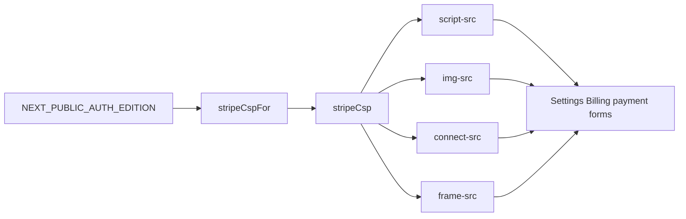
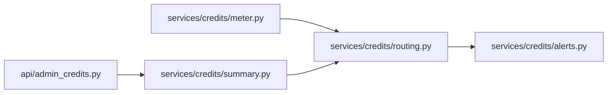
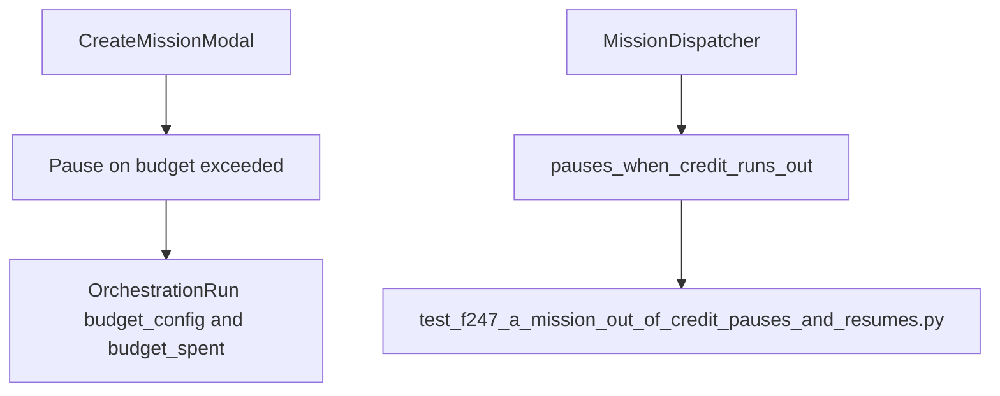
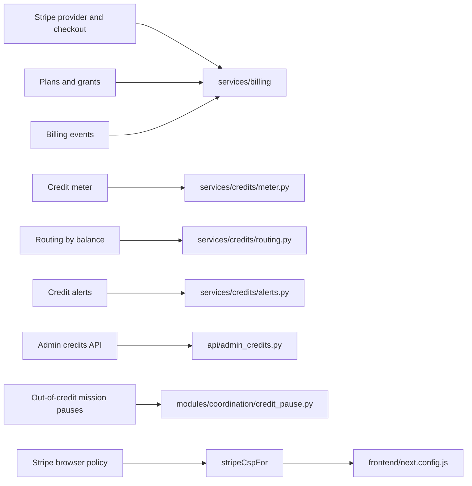

# Billing, Credits & Metering

Relevant source files

The following files were used as context for generating this wiki page:

- [frontend/app/sso-callback/page.tsx](frontend/app/sso-callback/page.tsx)
- [frontend/components/missions/__tests__/approve-body.test.ts](frontend/components/missions/__tests__/approve-body.test.ts)
- [frontend/components/missions/__tests__/mission-retry.test.tsx](frontend/components/missions/__tests__/mission-retry.test.tsx)
- [frontend/components/missions/__tests__/mission-stats.test.ts](frontend/components/missions/__tests__/mission-stats.test.ts)
- [frontend/components/missions/approve-body.ts](frontend/components/missions/approve-body.ts)
- [frontend/components/missions/create-mission-modal.tsx](frontend/components/missions/create-mission-modal.tsx)
- [frontend/components/missions/index.ts](frontend/components/missions/index.ts)
- [frontend/components/missions/mission-budget-bar.tsx](frontend/components/missions/mission-budget-bar.tsx)
- [frontend/components/missions/mission-card.tsx](frontend/components/missions/mission-card.tsx)
- [frontend/components/missions/mission-detail-page.tsx](frontend/components/missions/mission-detail-page.tsx)
- [frontend/components/missions/mission-field-inspector.tsx](frontend/components/missions/mission-field-inspector.tsx)
- [frontend/components/missions/mission-field-panel.tsx](frontend/components/missions/mission-field-panel.tsx)
- [frontend/components/missions/mission-field-viz.tsx](frontend/components/missions/mission-field-viz.tsx)
- [frontend/components/tools/tool-actions-modal.tsx](frontend/components/tools/tool-actions-modal.tsx)
- [frontend/components/tools/tool-details-modal.tsx](frontend/components/tools/tool-details-modal.tsx)
- [frontend/components/workflows/templates-tab.tsx](frontend/components/workflows/templates-tab.tsx)
- [frontend/csp-sources.js](frontend/csp-sources.js)
- [frontend/hooks/use-missions-api.ts](frontend/hooks/use-missions-api.ts)
- [frontend/lib/__tests__/clerk-production-csp.test.ts](frontend/lib/__tests__/clerk-production-csp.test.ts)
- [frontend/lib/__tests__/f352-pdf-preview-frame.test.ts](frontend/lib/__tests__/f352-pdf-preview-frame.test.ts)
- [frontend/lib/__tests__/stripe-csp.test.ts](frontend/lib/__tests__/stripe-csp.test.ts)
- [frontend/next.config.js](frontend/next.config.js)
- [frontend/stores/mission-store.ts](frontend/stores/mission-store.ts)
- [frontend/types/missions.ts](frontend/types/missions.ts)
- [orchestrator/alembic/versions/prd123_checkpoint_count.py](orchestrator/alembic/versions/prd123_checkpoint_count.py)
- [orchestrator/api/admin_credits.py](orchestrator/api/admin_credits.py)
- [orchestrator/api/mission_retry.py](orchestrator/api/mission_retry.py)
- [orchestrator/api/missions.py](orchestrator/api/missions.py)
- [orchestrator/core/models/orchestration.py](orchestrator/core/models/orchestration.py)
- [orchestrator/core/models/orchestration_enums.py](orchestrator/core/models/orchestration_enums.py)
- [orchestrator/modules/coordination/credit_pause.py](orchestrator/modules/coordination/credit_pause.py)
- [orchestrator/modules/coordination/dispatcher.py](orchestrator/modules/coordination/dispatcher.py)
- [orchestrator/modules/coordination/one_step_at_a_time.py](orchestrator/modules/coordination/one_step_at_a_time.py)
- [orchestrator/modules/coordination/planner.py](orchestrator/modules/coordination/planner.py)
- [orchestrator/modules/coordination/reconciler.py](orchestrator/modules/coordination/reconciler.py)
- [orchestrator/modules/coordination/verification.py](orchestrator/modules/coordination/verification.py)
- [orchestrator/services/coordinator_service.py](orchestrator/services/coordinator_service.py)
- [orchestrator/services/credits/alerts.py](orchestrator/services/credits/alerts.py)
- [orchestrator/services/credits/meter.py](orchestrator/services/credits/meter.py)
- [orchestrator/services/credits/routing.py](orchestrator/services/credits/routing.py)
- [orchestrator/services/credits/summary.py](orchestrator/services/credits/summary.py)
- [orchestrator/tests/test_f247_a_mission_out_of_credit_pauses_and_resumes.py](orchestrator/tests/test_f247_a_mission_out_of_credit_pauses_and_resumes.py)
- [orchestrator/tests/test_f267_b_no_step_starts_while_another_is_redone.py](orchestrator/tests/test_f267_b_no_step_starts_while_another_is_redone.py)
- [orchestrator/tests/test_prd265_billing_api.py](orchestrator/tests/test_prd265_billing_api.py)
- [orchestrator/tests/test_prd265_w2_admin_business_invite.py](orchestrator/tests/test_prd265_w2_admin_business_invite.py)
- [orchestrator/tests/test_w1s1_hotpath_telemetry.py](orchestrator/tests/test_w1s1_hotpath_telemetry.py)

## Purpose and scope

Section 17.6 documents the billing and credit-metering boundary: Stripe-related frontend policy, credit services, balance-aware routing and alerts, administrative credit operations, and execution pauses when credits are exhausted. The available source excerpts establish the Stripe CSP integration and the mission credit-pause integration points; the billing and credits service files are listed but their implementations are not included in the excerpts. [frontend/next.config.js:24-25](); [orchestrator/modules/coordination/dispatcher.py:45-49]()

Sources: `frontend/next.config.js`; `orchestrator/modules/coordination/dispatcher.py`

---

## 1. Stripe CSP Wiring

The frontend derives Stripe-specific CSP sources from `NEXT_PUBLIC_AUTH_EDITION` using `stripeCspFor`. The resulting values are inserted into the page’s `script-src`, `img-src`, `connect-src`, and `frame-src` directives. The CSP comments identify the intended use: payment forms in Settings → Billing, including Stripe.js, card fields, 3-D Secure, and Link. [frontend/next.config.js:24-25](); [frontend/next.config.js:63-69](); [frontend/next.config.js:73-114]()

The provided excerpt does not include the implementation of `stripeCspFor` or establish the exact Stripe host list or edition-specific return values. Those details belong to `frontend/csp-sources.js`, which `next.config.js` imports. [frontend/next.config.js:3-10]()

### Diagram: Stripe CSP Code Path

Sources: `frontend/next.config.js`

---

## 2. Billing and Credits Service Boundaries

The supplied source inventory identifies `services/billing` as the home of the Stripe provider, checkout, plans, grants, and billing events. It also identifies `services/credits` modules for balance metering, balance-based routing, alerts, and billing summaries. The corresponding implementation excerpts are not included, so this page does not infer database schemas, endpoint behavior, grant rules, or Stripe webhook handling beyond what the available code establishes.

The named credits modules are:

| Concern | Code entity identified in the source inventory |
|---|---|
| Credit summary | `orchestrator/services/credits/summary.py` |
| Credit balance meter | `orchestrator/services/credits/meter.py` |
| Routing by balance | `orchestrator/services/credits/routing.py` |
| Credit alerts | `orchestrator/services/credits/alerts.py` |
| Administrative credits API | `orchestrator/api/admin_credits.py` |

The source inventory also identifies `orchestrator/tests/test_prd265_billing_api.py` as a billing API test and `orchestrator/tests/test_prd265_w2_admin_business_invite.py` as an administrative/business-invite test. Their contents are not present in the provided excerpts, so no test assertions are summarized here.

Sources: `orchestrator/services/credits/summary.py`; `orchestrator/services/credits/meter.py`; `orchestrator/services/credits/routing.py`; `orchestrator/services/credits/alerts.py`; `orchestrator/api/admin_credits.py`; `orchestrator/tests/test_prd265_billing_api.py`; `orchestrator/tests/test_prd265_w2_admin_business_invite.py`

---

## 3. Credit Metering and Balance-Aware Routing

The source inventory names `services/credits/meter.py` and `services/credits/routing.py` as the credit meter and routing-by-balance modules. The available file excerpts do not show their function definitions or call sites, so the exact metering units, balance calculation, routing thresholds, and failure behavior cannot be specified from the evidence provided.

At the code-entity level, the intended module relationship is:

### Diagram: Credit Meter and Routing Code Map

Sources: `orchestrator/services/credits/meter.py`; `orchestrator/services/credits/routing.py`; `orchestrator/services/credits/alerts.py`; `orchestrator/services/credits/summary.py`; `orchestrator/api/admin_credits.py`

---

## 4. Credit Alerts and Administrative Credits API

The source inventory identifies `services/credits/alerts.py` and `api/admin_credits.py` as the alerting and administrative API components. Their route definitions, authorization rules, request and response models, and alert delivery behavior are not included in the supplied file excerpts. Those details should therefore be verified against the module implementations before relying on specific API paths or operational semantics.

The mission dispatcher imports `pauses_when_credit_runs_out` from `modules.coordination.credit_pause`, establishing that the mission execution path has a dedicated credit-pause integration point. The excerpt does not show the helper’s implementation or the point at which it is invoked. [orchestrator/modules/coordination/dispatcher.py:45-49]()

Sources: `orchestrator/services/credits/alerts.py`; `orchestrator/api/admin_credits.py`; `orchestrator/modules/coordination/dispatcher.py`

---

## 5. Out-of-Credit Mission Pauses

Mission execution has an explicit credit-pause helper: `dispatcher.py` imports `pauses_when_credit_runs_out` from `modules.coordination.credit_pause`. A regression test is listed as `orchestrator/tests/test_f247_a_mission_out_of_credit_pauses_and_resumes.py`, indicating test coverage for mission pause and resume behavior; its assertions are not included in the provided excerpts. [orchestrator/modules/coordination/dispatcher.py:45-49]()

Mission budget controls are represented separately on `OrchestrationRun`: `budget_config` stores governance budget configuration, while `budget_spent` stores spend and usage data. These fields describe mission-level budget tracking; they do not, by themselves, establish the credit balance or provider billing rules. [orchestrator/core/models/orchestration.py:95-113]()

The mission creation UI exposes a “Pause on budget exceeded” option. Its hint describes pausing when token usage exceeds the estimated budget, which is distinct from the dispatcher’s imported out-of-credit pause helper. [frontend/components/missions/create-mission-modal.tsx:109-116]()

### Diagram: Mission Budget and Credit Pause Code Map

Sources: `frontend/components/missions/create-mission-modal.tsx`; `orchestrator/core/models/orchestration.py`; `orchestrator/modules/coordination/dispatcher.py`; `orchestrator/tests/test_f247_a_mission_out_of_credit_pauses_and_resumes.py`

---

## 6. Natural-Language-to-Code Entity Map

This map connects the billing concepts in this page to the code symbols and files identified by the supplied source inventory. For Stripe CSP behavior, the available `next.config.js` excerpt shows `stripeCspFor` feeding CSP directives. The billing and credit service implementations are named in the inventory but are not shown in detail. [frontend/next.config.js:24-25](); [frontend/next.config.js:73-114]()

### Diagram: Billing Concepts and Code Entities

Sources: `frontend/next.config.js`; `orchestrator/modules/coordination/dispatcher.py`; `orchestrator/modules/coordination/credit_pause.py`; `orchestrator/services/credits/meter.py`; `orchestrator/services/credits/routing.py`; `orchestrator/services/credits/alerts.py`; `orchestrator/api/admin_credits.py`

---

## 7. Source Map and Evidence Boundaries

| Area | Code pointer | What the available evidence establishes |
|---|---|---|
| Stripe CSP wiring | `frontend/next.config.js` | `stripeCspFor` is selected using `NEXT_PUBLIC_AUTH_EDITION`; its returned CSP fragments are included in script, image, connection, and frame directives. [frontend/next.config.js:24-25](); [frontend/next.config.js:73-114]() |
| Credit service module inventory | `orchestrator/services/credits/` | The supplied inventory names `summary.py`, `meter.py`, `routing.py`, and `alerts.py`; implementation details are not included. |
| Administrative credits API | `orchestrator/api/admin_credits.py` | The supplied inventory identifies the module; its routes and authorization behavior are not included. |
| Mission credit-pause integration | `orchestrator/modules/coordination/dispatcher.py` | `MissionDispatcher` imports `pauses_when_credit_runs_out` from `modules.coordination.credit_pause`. [orchestrator/modules/coordination/dispatcher.py:45-49]() |
| Mission budget fields | `orchestrator/core/models/orchestration.py` | `OrchestrationRun` has `budget_config` and `budget_spent` JSON fields. [orchestrator/core/models/orchestration.py:111-113]() |
| Mission budget pause UI | `frontend/components/missions/create-mission-modal.tsx` | The mission creation form exposes a “Pause on budget exceeded” option with a token-usage hint. [frontend/components/missions/create-mission-modal.tsx:109-116]() |
| Out-of-credit pause regression test | `orchestrator/tests/test_f247_a_mission_out_of_credit_pauses_and_resumes.py` | The test is listed in the supplied inventory; its assertions are not included. |

Sources: `frontend/next.config.js`; `orchestrator/services/credits/summary.py`; `orchestrator/services/credits/meter.py`; `orchestrator/services/credits/routing.py`; `orchestrator/services/credits/alerts.py`; `orchestrator/api/admin_credits.py`; `orchestrator/modules/coordination/dispatcher.py`; `orchestrator/modules/coordination/credit_pause.py`; `orchestrator/core/models/orchestration.py`; `frontend/components/missions/create-mission-modal.tsx`; `orchestrator/tests/test_f247_a_mission_out_of_credit_pauses_and_resumes.py`

---