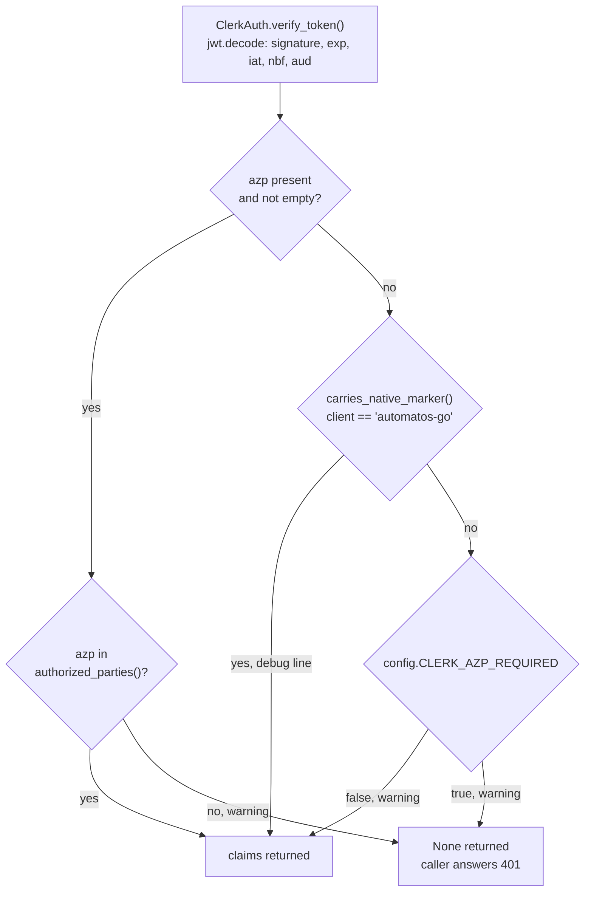

# Clerk Authorized Parties (azp)

<details>
<summary>Relevant source files</summary>

The following files were used as context for generating this wiki page:

- [orchestrator/api/team.py](../../orchestrator/api/team.py)
- [orchestrator/config.py](../../orchestrator/config.py)
- [orchestrator/core/auth/bearer_registry.py](../../orchestrator/core/auth/bearer_registry.py)
- [orchestrator/core/auth/clerk.py](../../orchestrator/core/auth/clerk.py)
- [orchestrator/core/auth/clerk_azp.py](../../orchestrator/core/auth/clerk_azp.py)
- [orchestrator/core/auth/clerk_mobile_template.py](../../orchestrator/core/auth/clerk_mobile_template.py)
- [orchestrator/core/auth/hybrid.py](../../orchestrator/core/auth/hybrid.py)
- [orchestrator/core/auth/step_up.py](../../orchestrator/core/auth/step_up.py)
- [orchestrator/tests/test_clerk_azp_check.py](../../orchestrator/tests/test_clerk_azp_check.py)

</details>


This page covers the check the API runs on the `azp` (authorized party) claim of every Clerk token it verifies: the two settings that control it, `CLERK_AUTHORIZED_PARTIES` and `CLERK_AZP_REQUIRED`; how the Automatos Go app's token passes it without a browser origin; and how to diagnose a refusal. It is written for operators setting up a hosted (`AUTH_EDITION=saas`) deployment and for engineers changing the Clerk code.

For where this check sits in the wider request flow, see [Authentication Flow](authentication-flow.md).

---

## What the Check Does

Clerk sets a session token's `azp` claim to the `Origin` of the request that minted it: for a browser sign-in, the URL of the app the user signed in on. When several sites share one Clerk instance, a token minted on any of them carries a valid signature for this API. The check accepts a token only when its `azp` names one of the frontend origins that are meant to call the API [orchestrator/core/auth/clerk_azp.py:1-34]().

The API verifies Clerk JWTs itself with PyJWT rather than through a Clerk SDK, so there is no SDK `authorizedParties` option to switch on. `ClerkAuth.verify_token` calls `azp_allowed` right after `jwt.decode` has checked the RS256 signature, `exp`, `iat`, `nbf` and, when `CLERK_AUDIENCE` is set, `aud`. When `azp_allowed` returns false, `verify_token` returns `None`, the same result as an expired or badly signed token [orchestrator/core/auth/clerk.py:89-106]().

`verify_token` has two callers. Both answer 401 when it returns `None`:

| Caller | Used by | Status | `detail` |
|--------|---------|--------|----------|
| `get_request_context_hybrid` | Every route that depends on the shared request context | 401 | `Invalid or expired token` |
| `_verify_clerk_user_only` | `POST /api/team/accept-invitation` | 401 | `Invalid token` |

What never reaches the check:

- **No Clerk configured.** Without `CLERK_JWKS_URL`, `verify_token` returns `None` before decoding anything [orchestrator/core/auth/clerk.py:79-81](). The local edition has no Clerk, so it never runs the check.
- **Paired device tokens.** A bearer token that starts with `amd_` (a paired phone's or browser's device token) is resolved by `resolve_registered_bearers` before the Clerk path runs [orchestrator/core/auth/bearer_registry.py:54-62](), [orchestrator/core/auth/bearer_registry.py:112-125]().
- **API keys.** `x-api-key` and `Authorization: ApiKey ...` are not Clerk tokens.

**Sources:** [orchestrator/core/auth/clerk.py:69-116](), [orchestrator/core/auth/clerk_azp.py:112-121](), [orchestrator/core/auth/hybrid.py:792-795](), [orchestrator/core/auth/hybrid.py:886-888](), [orchestrator/api/team.py:439-453](), [orchestrator/api/team.py:508-520]()

---

## Settings

Both settings are read once, when `orchestrator/config.py` is loaded. A change takes effect when the API process restarts.

| Variable | Default | What it does | Location |
|----------|---------|--------------|----------|
| `CLERK_AUTHORIZED_PARTIES` | `https://ui.automatos.app,http://localhost:3000` | Comma-separated origins whose Clerk tokens the API accepts. `FRONTEND_URL`'s origin is always added. | [orchestrator/config.py:33-36](), [orchestrator/config.py:579-582]() |
| `CLERK_AZP_REQUIRED` | `false` | What happens to a token with no `azp` that does not carry the Automatos Go marker: `false` logs a warning and accepts it; `true` refuses it. | [orchestrator/config.py:583-586]() |
| `FRONTEND_URL` | `http://localhost:3000` | Its origin is added to the allow-list. | [orchestrator/config.py:611]() |

### `CLERK_AUTHORIZED_PARTIES`

How the value is parsed [orchestrator/core/auth/clerk_azp.py:48-86]():

- The value is split on commas, and `FRONTEND_URL` is appended as one more entry. Empty entries (`a,,b`, a trailing comma) are skipped.
- Each entry is trimmed and reduced to `scheme://host[:port]`, lower-cased. A path or a trailing slash is dropped, so `https://App.Example.com/` and `https://app.example.com` are the same entry.
- An entry without both a scheme and a host (`app.example.com`, `localhost:3000`), or one that Python's `urlsplit` cannot parse (`http://[bad`), can never match a token's `azp`. It is dropped, the other entries still apply, and this warning is logged:

  ```
  Clerk azp allow-list: ignoring 'app.example.com' (not a scheme://host origin)
  ```

- Set to an empty string, the variable allows only `FRONTEND_URL`'s origin.

The parsed list is cached for each value [orchestrator/core/auth/clerk_azp.py:63-64](), and it is first built when a token that has an `azp` is checked. The "ignoring" warning therefore appears once per API process, on the first such request, not at startup.

How a token's `azp` is compared [orchestrator/core/auth/clerk_azp.py:114-121](): it is trimmed, trailing `/` characters are removed, it is lower-cased, and then it must equal one entry exactly. There is no wildcard or suffix matching: `https://app.example.com.other.example` does not match `https://app.example.com`, and a bare host (`app.example.com`) never matches. An `azp` that is not a string is refused.

Setting it for a deployment:

- Set `FRONTEND_URL` to the frontend's public URL. Its origin is then allowed without anything else.
- Add every other origin whose pages call the API with a Clerk token.
- The shipped default includes `http://localhost:3000` for saas-mode local development, and so does `FRONTEND_URL`'s default. On a production deployment, set both variables explicitly so that the local development origin is not allowed.

```bash
FRONTEND_URL=https://app.example.com
CLERK_AUTHORIZED_PARTIES=https://app.example.com
CLERK_AZP_REQUIRED=false
```

### `CLERK_AZP_REQUIRED`

- Default `false`. `1`, `true`, `yes` and `on` (any case, surrounding spaces ignored) mean true. Any other value means false [orchestrator/config.py:586]().
- It decides only tokens with no `azp` (the claim absent, `null`, or `""`) that do not carry the Automatos Go marker. A token with a wrong `azp` is refused under either setting, and a marked token with no `azp` is accepted under either setting.
- Why tokens without `azp` exist: Clerk omits `azp` when the request that minted the token carried no `Origin`. That covers native apps and tokens minted through Clerk's Backend API [orchestrator/core/auth/clerk_azp.py:16-28]().

**Sources:** [orchestrator/config.py:33-36](), [orchestrator/config.py:578-586](), [orchestrator/core/auth/clerk_azp.py:48-86](), [orchestrator/tests/test_clerk_azp_check.py:373-430]()

---

## How Each Token Is Judged

| Token | `CLERK_AZP_REQUIRED=false` (default) | `CLERK_AZP_REQUIRED=true` | Logged |
|-------|--------------------------------------|---------------------------|--------|
| `azp` present and in the allow-list | Accepted | Accepted | Nothing |
| `azp` present and not in the allow-list, marker or not | Refused | Refused | Warning: `Clerk token refused: azp ... is not in CLERK_AUTHORIZED_PARTIES` |
| No `azp`; `client` claim is exactly `automatos-go` | Accepted | Accepted | Debug: `Clerk token accepted as Automatos Go ...` |
| No `azp`; no `client` claim, or any other value | Accepted | Refused | Warning: `Clerk token has no azp claim; accepted ...` or `Clerk token refused: no azp claim ...` |

Title: azp_allowed Decision


**Sources:** [orchestrator/core/auth/clerk_azp.py:89-121](), [orchestrator/tests/test_clerk_azp_check.py:113-235]()

---

## Automatos Go: the `mobile` JWT Template

A native app's requests carry no `Origin`, so Clerk mints the Automatos Go app's token without `azp`. The app asks Clerk for its token with `getToken({template: "mobile"})`. The `mobile` JWT template, created by hand in the Clerk dashboard, adds the static claim `client: "automatos-go"`. That claim is the native marker [orchestrator/core/auth/clerk_mobile_template.py:1-10](), [orchestrator/core/auth/clerk_mobile_template.py:53-58]().

What the code checks [orchestrator/core/auth/clerk_azp.py:89-117]():

- `carries_native_marker` compares the `client` claim with the string `automatos-go` exactly. `Automatos-Go`, `automatos-go ` (trailing space), `["automatos-go"]`, `true` and `null` all count as no marker [orchestrator/tests/test_clerk_azp_check.py:218-234]().
- The marker is consulted only when `azp` is missing or empty. A marked token that has an `azp` is judged by the allow-list alone, so a browser page on another origin that asks Clerk for the `mobile` template is still refused.
- A marked token with no `azp` is accepted under either `CLERK_AZP_REQUIRED` setting and logged at debug level only, so the `no azp claim` warning keeps meaning "an unknown client".

The marker is not a credential. Its name and value are public, and any signed-in user can ask Clerk for a `mobile` token. What it changes [orchestrator/core/auth/clerk_mobile_template.py:12-24]():

- A page in a browser sends its `Origin` to Clerk, so its `mobile` token has an `azp` and is judged by the allow-list.
- A client outside a browser that holds a live session gets a marked token with no `azp`. It could equally send an allowed `Origin` and get an allowed `azp`, so the `azp` check never bound such clients.
- Under `CLERK_AZP_REQUIRED=true`, the marker lets through one case that would otherwise be refused: a browser request that reaches Clerk with an empty or `null` `Origin` (a sandboxed frame, for example), from a context that still holds the user's Clerk session, asking for the `mobile` template.

### Creating the Template

`MOBILE_JWT_TEMPLATE_CLAIMS` holds the template's claims: the JSON to enter in the Clerk dashboard for a JWT template named `mobile` [orchestrator/core/auth/clerk_mobile_template.py:60-72]().

```json
{
  "client": "automatos-go",
  "email": "{{user.primary_email_address}}",
  "metadata": "{{user.public_metadata}}",
  "name": "{{user.full_name}}",
  "first_name": "{{user.first_name}}",
  "last_name": "{{user.last_name}}",
  "image_url": "{{user.image_url}}",
  "org_id": "{{org.id}}",
  "org_slug": "{{org.slug}}"
}
```

- `client` must be exactly `automatos-go`.
- When the API sets `CLERK_AUDIENCE`, `verify_token` requires a matching `aud` claim, so the template must also emit `"aud"` with that value. A constant cannot hold it, so it is not in the JSON above [orchestrator/core/auth/clerk_mobile_template.py:41-44](). Without it, every phone token fails decoding and gets the 401.
- Nothing compares the dashboard's template with the code copy. When they differ, change the dashboard to match `MOBILE_JWT_TEMPLATE_CLAIMS`.
- `test_mobile_template_accounts_for_every_claim_the_api_reads` parses `clerk.py` and `clerk_azp.py` for every claim they read. It fails when a claim is in neither the template, Clerk's default claims (`CLERK_TEMPLATE_DEFAULT_CLAIMS`) nor `CLAIMS_NOT_IN_TEMPLATE`, and also when a listed claim is no longer read [orchestrator/tests/test_clerk_azp_check.py:289-304](). A new claim read in `clerk.py` therefore needs a decision in `clerk_mobile_template.py`, and a change to the dashboard's template if it is added there.

### What a Template Token Lacks

A template token is not a session token. Clerk adds only `azp`, `exp`, `iat`, `iss`, `jti`, `nbf` and `sub` to it, and cannot add the session-bound claims `sid`, `v`, `pla` and `fea` [orchestrator/core/auth/clerk_mobile_template.py:26-30](), [orchestrator/core/auth/clerk_mobile_template.py:74-75](). Three consequences:

- **No `sid`: keep the template's token lifetime short.** This API does not check Clerk session state for any token: `verify_token` checks the signature and the time claims and returns the claims [orchestrator/core/auth/clerk.py:69-106](). A verified token is accepted until its `exp`. A template token also carries no `sid`, so nothing ties it to the Clerk session it came from, and ending that session does not end a token already issued. The change that added the marker therefore says to keep the `mobile` template's token lifetime short. Neither the code nor that change sets a number.
- **No `fva`: step-up routes refuse a phone on SaaS.** `require_step_up` passes a Clerk context only when its token's `fva` claim shows a recent sign-in. Clerk documents no template shortcode for `fva`, so a phone's token gets a 403 on every route guarded by `require_step_up`, with the detail `Confirm it's you to continue: this action needs a sign-in from the last N minutes.`, and the API logs `step-up refused: the Clerk session token has no fva claim` [orchestrator/core/auth/clerk_mobile_template.py:45-46](), [orchestrator/core/auth/step_up.py:108-117](), [orchestrator/core/auth/step_up.py:175-189]().
- **No `org_role`, on purpose.** `extract_user_info` falls back to `org_role` for the system role when `metadata` has no role. The template leaves it out, so a phone's system role comes from `metadata` alone [orchestrator/core/auth/clerk_mobile_template.py:77-92](), [orchestrator/core/auth/clerk.py:131-143]().

**Sources:** [orchestrator/core/auth/clerk_mobile_template.py:1-92](), [orchestrator/core/auth/clerk_azp.py:89-109](), [orchestrator/tests/test_clerk_azp_check.py:167-235](), [orchestrator/tests/test_clerk_azp_check.py:289-370]()

---

## Log Lines

The check logs through the logger `core.auth.clerk_azp`. In each line, `sub` is the Clerk user id and `client` is the token's `client` claim in Python `repr` form (`None` when the claim is absent).

| Level | Message (format string) | When | Location |
|-------|-------------------------|------|----------|
| WARNING | `Clerk token refused: azp %r is not in CLERK_AUTHORIZED_PARTIES, sub=%s` | `azp` present and not allowed | [orchestrator/core/auth/clerk_azp.py:120]() |
| WARNING | `Clerk token has no azp claim; accepted (CLERK_AZP_REQUIRED=false), sub=%s, client=%r` | No `azp`, no marker, flag `false` | [orchestrator/core/auth/clerk_azp.py:106-108]() |
| WARNING | `Clerk token refused: no azp claim (CLERK_AZP_REQUIRED=true), sub=%s, client=%r` | No `azp`, no marker, flag `true` | [orchestrator/core/auth/clerk_azp.py:102-104]() |
| DEBUG | `Clerk token accepted as Automatos Go: no azp, native marker present, sub=%s` | No `azp`, marker present | [orchestrator/core/auth/clerk_azp.py:98]() |
| WARNING | `Clerk azp allow-list: ignoring %r (not a scheme://host origin)` | A `CLERK_AUTHORIZED_PARTIES` or `FRONTEND_URL` entry was dropped | [orchestrator/core/auth/clerk_azp.py:80]() |

After a refusal, `get_request_context_hybrid` also logs `Auth failed: Invalid or expired Clerk token` (logger `core.auth.hybrid`, WARNING) [orchestrator/core/auth/hybrid.py:887]().

---

## Failure Modes and Diagnosis

### What the Caller Gets

- A route that uses the shared request context answers `401` with `{"detail": "Invalid or expired token"}` [orchestrator/core/auth/hybrid.py:886-888]().
- `POST /api/team/accept-invitation` answers `401` with `{"detail": "Invalid token"}` [orchestrator/api/team.py:450-452]().

The response is the same as for an expired or badly signed token. Only the API log says that the `azp` check refused it.

### Diagnosing a 401

1. **Find the request's `core.auth.clerk_azp` line.** If there is none, the token failed before the check. `core.auth.clerk` logs `Token expired` and `Invalid token: ...` (a bad signature or a wrong `aud`, for example) at debug level, and `JWKS client not initialized. Cannot verify token.` at error level [orchestrator/core/auth/clerk.py:79-116]().
2. **`azp '<origin>' is not in CLERK_AUTHORIZED_PARTIES`.** The token was minted on `<origin>`. If that origin is a frontend that should call the API, add it to `CLERK_AUTHORIZED_PARTIES` as `scheme://host[:port]` and restart the API. If `<origin>` is your own frontend's internal or proxy host rather than its public URL, the token was probably refreshed by the Next.js server, which gives it the origin that server believes it serves (behind a proxy, taken from `x-forwarded-host`). Fix the forwarded host, or add that origin.
3. **`no azp claim (CLERK_AZP_REQUIRED=true)`.**
   - `client=None`: the client sent a token without the Automatos Go marker, for example a native client that does not use the `mobile` template, or a token minted through Clerk's Backend API. Either have the client use the `mobile` template, or set `CLERK_AZP_REQUIRED=false` until it does.
   - `client='<other value>'`: the template's marker is wrong. Set `client` to exactly `automatos-go` in the Clerk dashboard.
4. **Every phone gets a 401 on a deployment that sets `CLERK_AUDIENCE`.** The `mobile` template does not emit a matching `aud`. Add it to the template (see [Creating the Template](#creating-the-template)).
5. **`Clerk azp allow-list: ignoring ...`.** An entry in `CLERK_AUTHORIZED_PARTIES` or `FRONTEND_URL` is not a `scheme://host` origin. Fix it and restart the API.
6. **To read a token's claims,** decode its payload (the middle, base64url-encoded part of the JWT) on your own machine. Do not paste a live token into a third-party site.

A phone that is accepted but logs `Clerk token has no azp claim; accepted (CLERK_AZP_REQUIRED=false) ... client=None` is sending a token that is not from the `mobile` template, or a template without the marker. Its requests will be refused once `CLERK_AZP_REQUIRED` is `true`.

**Sources:** [orchestrator/core/auth/clerk.py:79-116](), [orchestrator/core/auth/clerk_azp.py:80-121](), [orchestrator/core/auth/hybrid.py:886-888](), [orchestrator/api/team.py:439-453](), [orchestrator/tests/test_clerk_azp_check.py:238-255]()

---

## Turning On `CLERK_AZP_REQUIRED`

The operating procedure from the change that added the check (#1216):

1. Deploy with `CLERK_AZP_REQUIRED=false`, the default.
2. Watch the API logs for `Clerk token has no azp claim`. Each such line is a client that would be refused with the flag on; its `sub` and `client` values identify it. Automatos Go's marked tokens do not log this line.
3. Once none appear, set `CLERK_AZP_REQUIRED=true` and restart the API.
4. From then on, an azp-less client without the marker logs `Clerk token refused: no azp claim (CLERK_AZP_REQUIRED=true)` and gets the 401. Setting the flag back to `false` and restarting reverses this.

---
