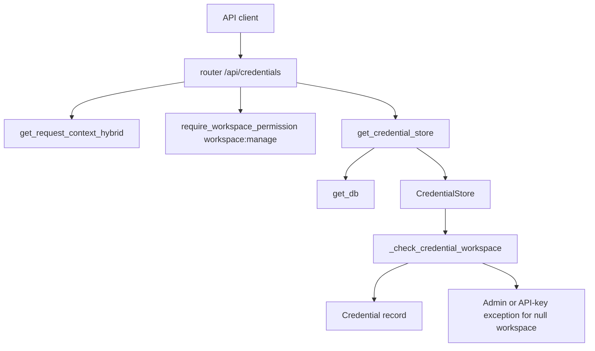
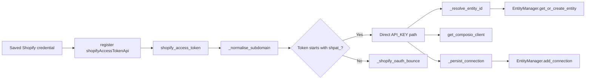
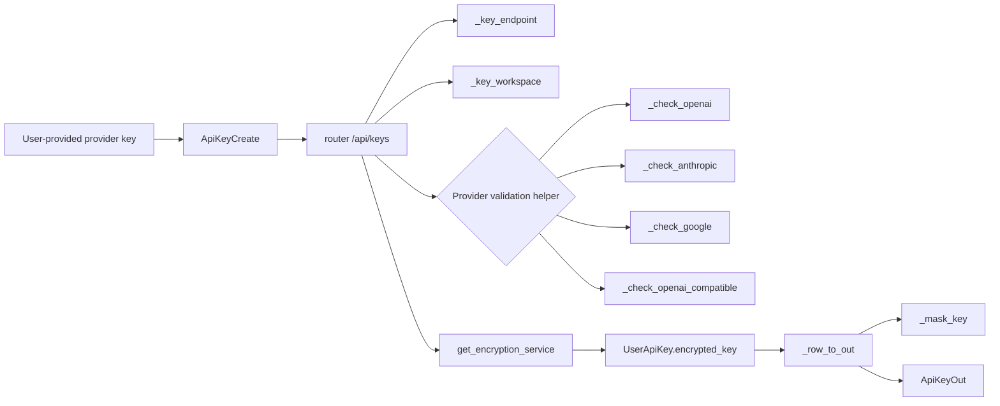
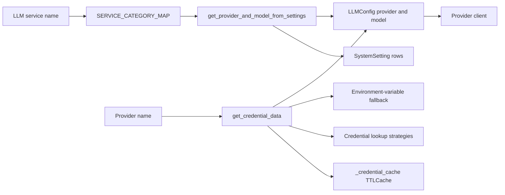

# Credentials & API Keys

Relevant source files

The following files were used as context for generating this wiki page:

- [.gitignore](.gitignore)
- [docs/ANALYTICS-COST-TRACKING.md](docs/ANALYTICS-COST-TRACKING.md)
- [docs/PRDS/126-BUSINESS-KNOWLEDGE-GRAPH.md](docs/PRDS/126-BUSINESS-KNOWLEDGE-GRAPH.md)
- [docs/testing/CUSTOMER-NIGHTS-PLAN.md](docs/testing/CUSTOMER-NIGHTS-PLAN.md)
- [frontend/components/settings/ApiKeysSettingsTab.tsx](frontend/components/settings/ApiKeysSettingsTab.tsx)
- [frontend/components/settings/DynamicCredentialForm.tsx](frontend/components/settings/DynamicCredentialForm.tsx)
- [frontend/components/settings/SystemSettingsTab.tsx](frontend/components/settings/SystemSettingsTab.tsx)
- [frontend/lib/api/credentials.ts](frontend/lib/api/credentials.ts)
- [graphify-out/snapshots/bucket-1-pre-drop.sql](graphify-out/snapshots/bucket-1-pre-drop.sql)
- [orchestrator/.env.example](orchestrator/.env.example)
- [orchestrator/alembic/versions/prd135_drop_bucket_1.py](orchestrator/alembic/versions/prd135_drop_bucket_1.py)
- [orchestrator/api/credentials.py](orchestrator/api/credentials.py)
- [orchestrator/api/system_settings.py](orchestrator/api/system_settings.py)
- [orchestrator/api/user_api_keys.py](orchestrator/api/user_api_keys.py)
- [orchestrator/core/composio/models.py](orchestrator/core/composio/models.py)
- [orchestrator/core/credentials/integration_bridges/__init__.py](orchestrator/core/credentials/integration_bridges/__init__.py)
- [orchestrator/core/credentials/integration_bridges/base.py](orchestrator/core/credentials/integration_bridges/base.py)
- [orchestrator/core/credentials/integration_bridges/shopify.py](orchestrator/core/credentials/integration_bridges/shopify.py)
- [orchestrator/core/credentials/service.py](orchestrator/core/credentials/service.py)
- [orchestrator/core/image_read.py](orchestrator/core/image_read.py)
- [orchestrator/core/llm/clients/anthropic_client.py](orchestrator/core/llm/clients/anthropic_client.py)
- [orchestrator/core/llm/clients/azure_client.py](orchestrator/core/llm/clients/azure_client.py)
- [orchestrator/core/llm/clients/base.py](orchestrator/core/llm/clients/base.py)
- [orchestrator/core/llm/clients/bedrock_client.py](orchestrator/core/llm/clients/bedrock_client.py)
- [orchestrator/core/llm/clients/bedrock_converse.py](orchestrator/core/llm/clients/bedrock_converse.py)
- [orchestrator/core/llm/clients/google_client.py](orchestrator/core/llm/clients/google_client.py)
- [orchestrator/core/llm/clients/grok_client.py](orchestrator/core/llm/clients/grok_client.py)
- [orchestrator/core/llm/clients/huggingface_embedding.py](orchestrator/core/llm/clients/huggingface_embedding.py)
- [orchestrator/core/llm/clients/image_blocks.py](orchestrator/core/llm/clients/image_blocks.py)
- [orchestrator/core/llm/clients/openai_client.py](orchestrator/core/llm/clients/openai_client.py)
- [orchestrator/core/llm/clients/openai_compatible_client.py](orchestrator/core/llm/clients/openai_compatible_client.py)
- [orchestrator/core/llm/manager.py](orchestrator/core/llm/manager.py)
- [orchestrator/core/llm/prompt_cache.py](orchestrator/core/llm/prompt_cache.py)
- [orchestrator/core/llm/turn_cost.py](orchestrator/core/llm/turn_cost.py)
- [orchestrator/core/models/credentials.py](orchestrator/core/models/credentials.py)
- [orchestrator/core/models/system_settings.py](orchestrator/core/models/system_settings.py)
- [orchestrator/core/monitoring/automatos_alerts.py](orchestrator/core/monitoring/automatos_alerts.py)
- [orchestrator/core/monitoring/automatos_logs_api.py](orchestrator/core/monitoring/automatos_logs_api.py)
- [orchestrator/core/seeds/seed_system_settings.py](orchestrator/core/seeds/seed_system_settings.py)
- [orchestrator/core/services/audit_service.py](orchestrator/core/services/audit_service.py)
- [orchestrator/core/services/plugin_cache.py](orchestrator/core/services/plugin_cache.py)
- [orchestrator/modules/attachments/resolver.py](orchestrator/modules/attachments/resolver.py)
- [orchestrator/modules/attachments/validation.py](orchestrator/modules/attachments/validation.py)
- [orchestrator/modules/intake/plan_generator.py](orchestrator/modules/intake/plan_generator.py)
- [orchestrator/tests/test_1057_credential_stats_and_health_reach_their_handlers.py](orchestrator/tests/test_1057_credential_stats_and_health_reach_their_handlers.py)
- [orchestrator/tests/test_1169_google_genai_sdk.py](orchestrator/tests/test_1169_google_genai_sdk.py)
- [orchestrator/tests/test_1170_bedrock_converse.py](orchestrator/tests/test_1170_bedrock_converse.py)
- [orchestrator/tests/test_1180_gemini_images.py](orchestrator/tests/test_1180_gemini_images.py)
- [orchestrator/tests/test_anthropic_image_blocks.py](orchestrator/tests/test_anthropic_image_blocks.py)
- [orchestrator/tests/test_openrouter_prompt_cache.py](orchestrator/tests/test_openrouter_prompt_cache.py)
- [orchestrator/tests/test_p2w2_credentials_null_workspace.py](orchestrator/tests/test_p2w2_credentials_null_workspace.py)
- [orchestrator/tests/test_photo_attachments_go_inline.py](orchestrator/tests/test_photo_attachments_go_inline.py)

## Purpose and Scope

This page describes the credential and API-key surfaces represented in the provided code: workspace credential management through `/api/credentials`, encrypted user-supplied LLM keys through `/api/keys`, provider-key resolution in the LLM manager, and the Shopify integration bridge. The available excerpts do not show the implementation of the Fernet encryption service, credential-type seed data, SDK API-key routes, or the credential tester’s full execution path; those details are therefore not inferred here. [orchestrator/api/credentials.py:17-55](), [orchestrator/api/user_api_keys.py:1-7](), [orchestrator/core/llm/manager.py:156-179](), [orchestrator/core/credentials/integration_bridges/shopify.py:1-17]()

Sources: [orchestrator/api/credentials.py:17-55](), [orchestrator/api/user_api_keys.py:1-7](), [orchestrator/core/llm/manager.py:156-179](), [orchestrator/core/credentials/integration_bridges/shopify.py:1-17]()

---

## Credential Store & Encryption Architecture

The general credential API is mounted at `/api/credentials`. Its `get_credential_store` dependency constructs a `CredentialStore` using the request’s database session from `get_db`. The router imports credential and credential-type models, request/response schemas, and credential-store exceptions from the corresponding model and service modules. [orchestrator/api/credentials.py:17-55]()

The API applies workspace checks to credential records using `_check_credential_workspace`:

- A credential with `workspace_id IS NULL` is denied to ordinary callers. The API-key auth lane and system administrators are allowed to read such globally seeded rows. [orchestrator/api/credentials.py:66-81]()
- A credential whose workspace differs from the caller’s workspace is reported as `404 Not Found`, rather than `403`, to hide whether the record exists. [orchestrator/api/credentials.py:82-84]()
- Credential creation is declared with the `workspace:manage` permission dependency. [orchestrator/api/credentials.py:175-182]()

The BYOK API explicitly documents that user-provided keys are encrypted at rest using the platform’s `EncryptionService`; it obtains that service through `get_encryption_service`. The provided excerpt does not include the encryption implementation, key derivation or storage behavior, so it does not establish the precise Fernet operations or key lifecycle. [orchestrator/api/user_api_keys.py:1-7](), [orchestrator/api/user_api_keys.py:17-23]()

### Credential request and workspace boundary

Sources: [orchestrator/api/credentials.py:17-55](), [orchestrator/api/credentials.py:66-84](), [orchestrator/api/credentials.py:175-182]()

---

## Credential Types & Integration Bridges

### Credential types API

`GET /api/credentials/types` accepts an optional `category` filter and an `active_only` flag, then delegates to `CredentialStore.list_credential_types`. Its response is validated as a list of `CredentialTypeResponse` objects. The endpoint’s docstring describes the type definitions as inputs to dynamic form generation. [orchestrator/api/credentials.py:86-109]()

The API also exposes category listing and lookup by type ID or type name. Category listing delegates to `get_all_categories`; type lookup delegates to `CredentialStore.get_credential_type` or `get_credential_type_by_name`, returning `404` when the requested type is absent. [orchestrator/api/credentials.py:112-172]()

The provided excerpts do not include the credential-type seed implementation or the complete `CredentialStore` implementation. Consequently, the exact seed catalog and schema-validation rules cannot be documented from this source set.

### Shopify integration bridge

The Shopify bridge converts a saved credential into a Composio connection for a workspace. Its module documents three credential-type names: `shopifyAccessTokenApi`, `shopifyOAuth2Api`, and legacy `shopifyApi`. The registered handler shown in the excerpt is `shopify_access_token`, registered for `shopifyAccessTokenApi`. [orchestrator/core/credentials/integration_bridges/shopify.py:1-17](), [orchestrator/core/credentials/integration_bridges/shopify.py:115-120]()

| Credential type or path | Behavior shown in the bridge |
|---|---|
| `shopifyAccessTokenApi` with a `shpat_` token | Treats the value as a Shopify Admin API token and follows the direct API-key path. [orchestrator/core/credentials/integration_bridges/shopify.py:119-120](), [orchestrator/core/credentials/integration_bridges/shopify.py:126-134](), [orchestrator/core/credentials/integration_bridges/shopify.py:146-175]() |
| `shopifyAccessTokenApi` with non-`shpat_` credentials | Treats the first and second credential fields as Partner App client ID and client secret, then calls `_shopify_oauth_bounce`. [orchestrator/core/credentials/integration_bridges/shopify.py:126-134](), [orchestrator/core/credentials/integration_bridges/shopify.py:146-162]() |
| `shopifyOAuth2Api` | Identified in the module documentation as a Partner App credential type. The provided excerpt does not show a separate handler for it. [orchestrator/core/credentials/integration_bridges/shopify.py:5-10]() |
| `shopifyApi` | Identified as a legacy private-app type that the module reports as unsupported by Composio. [orchestrator/core/credentials/integration_bridges/shopify.py:11-12]() |

Before connecting, the bridge normalizes the store subdomain and requires both a subdomain and the first credential field. The direct token path resolves a Composio entity for the workspace, obtains the Composio client, and reports a bridge error if either is unavailable. [orchestrator/core/credentials/integration_bridges/shopify.py:66-72](), [orchestrator/core/credentials/integration_bridges/shopify.py:135-175]()

`_resolve_entity_id` uses `EntityManager.get_or_create_entity` to obtain the workspace’s Composio entity ID. `_persist_connection` records the bridge result through `EntityManager.add_connection`; its metadata includes `auth_config_id`, `auth_scheme`, `credential_id`, and `source: "credential_bridge"`. [orchestrator/core/credentials/integration_bridges/shopify.py:74-82](), [orchestrator/core/credentials/integration_bridges/shopify.py:85-112]()

### Shopify bridge flow

Sources: [orchestrator/core/credentials/integration_bridges/shopify.py:24-30](), [orchestrator/core/credentials/integration_bridges/shopify.py:66-112](), [orchestrator/core/credentials/integration_bridges/shopify.py:115-175]()

---

## BYOK API Keys & Live Validation Engine

The BYOK API is mounted at `/api/keys`. The module describes these routes as CRUD endpoints for user-provided API keys and states that saved keys are encrypted at rest using the platform’s `EncryptionService`. `ApiKeyCreate` accepts a provider, a raw key with a minimum length of eight characters, an optional display name, an optional base URL, and an optional workspace ID. [orchestrator/api/user_api_keys.py:1-7](), [orchestrator/api/user_api_keys.py:31-53]()

The API’s response schemas distinguish key storage from key presentation:

- `ApiKeyOut` exposes a `masked_key`, status, usage metadata, and optional validation information. [orchestrator/api/user_api_keys.py:67-80]()
- `_mask_key` returns a shortened representation rather than the full key. `_row_to_out` attempts to decrypt the stored value for masking; if decryption fails, it uses a masked placeholder. [orchestrator/api/user_api_keys.py:96-120]()
- `ApiKeyValidation` carries a `valid` result, message, and optional test timestamp. Its schema documentation says a key is only trusted as active/BYOK-enabled when validation is true. [orchestrator/api/user_api_keys.py:55-65]()

### Provider validation helpers

The shown validation helpers check a key by making a provider SDK request:

- `_check_openai` creates an OpenAI client with the submitted key and calls `models.list()`. [orchestrator/api/user_api_keys.py:152-155]()
- `_check_anthropic` creates an Anthropic client with the submitted key, applies workspace headers, and calls `models.list()`. [orchestrator/api/user_api_keys.py:158-162]()
- `_check_google` creates a key-specific client using `gemini_client(raw_key)` and calls `models.list()`. The helper’s comment explicitly distinguishes this from using a process-wide client. [orchestrator/api/user_api_keys.py:165-171]()
- `_check_openai_compatible` looks up provider metadata in the provider registry and prepares an OpenAI SDK client using the registry’s provider-specific base URL and headers. The excerpt ends before the validation call itself. [orchestrator/api/user_api_keys.py:174-183]()

The API also defines `_key_endpoint` and `_key_workspace` helpers to normalize or reject provider endpoint and Anthropic workspace inputs. `_key_endpoint` returns `400` if an endpoint is invalid or required but missing. [orchestrator/api/user_api_keys.py:133-150]()

### BYOK save and validation concepts

Sources: [orchestrator/api/user_api_keys.py:17-53](), [orchestrator/api/user_api_keys.py:55-80](), [orchestrator/api/user_api_keys.py:96-120](), [orchestrator/api/user_api_keys.py:133-183]()

---

## LLM Provider Key Resolution & Fallback Strategies

`get_credential_data` in `orchestrator/core/llm/manager.py` is decorated with a TTL cache configured for up to 32 entries and a 300-second lifetime. Its docstring describes the intended provider credential lookup order: explicit system-setting mapping, environment/provider naming patterns, provider-name variants, credential-type lookup, and finally environment-variable fallback. The provided excerpt shows the strategy description and the start of the function, but not the implementation of those lookup steps. [orchestrator/core/llm/manager.py:156-180]()

The LLM manager maps service names into three configuration categories: `orchestrator_llm`, `system_llm`, and `embeddings`. `get_provider_and_model_from_settings` looks up the service’s category, reads provider and model settings, and raises `ValueError` if either is not configured. [orchestrator/core/llm/manager.py:40-67](), [orchestrator/core/llm/manager.py:123-153]()

`read_system_setting` reads `SystemSetting` rows from the database and propagates read failures; `get_system_setting` is the lenient wrapper that returns the supplied default if the read fails. [orchestrator/core/llm/manager.py:70-120]()

The `SystemSetting` model stores configuration values in the `system_settings` table and includes an `is_sensitive` flag for password-like fields. The seed module states that reseeding preserves existing user values while updating metadata such as defaults and descriptions. [orchestrator/core/models/system_settings.py:68-91](), [orchestrator/core/seeds/seed_system_settings.py:1-16]()

Provider clients can defer missing-key failure until use. `OpenAIProvider._initialize_client` checks `self.config.api_key` and `config.OPENAI_API_KEY`; if neither is available, it initializes with `self.client = None` and raises a configuration error when a response is requested. [orchestrator/core/llm/clients/openai_client.py:36-63](), [orchestrator/core/llm/clients/openai_client.py:71-78]()

`GoogleProvider` likewise checks its configured key and `config.GOOGLE_API_KEY`. The excerpt shows the bootstrap warning for a missing key, but not the rest of the initialization or request path. [orchestrator/core/llm/clients/google_client.py:141-155]()

### From system setting to provider configuration

Sources: [orchestrator/core/llm/manager.py:40-67](), [orchestrator/core/llm/manager.py:70-153](), [orchestrator/core/llm/manager.py:156-180](), [orchestrator/core/llm/clients/base.py:71-89]()

---

## Frontend Settings & Credential Management UI

`SystemSettingsTab` loads system settings by category and statistics using `getSettingsByCategory` and `getSettingsStats`. It saves a category through `bulkUpdateSettings`, preserving existing values for settings not explicitly changed in the submitted updates, and can reset settings through `resetSettingsToDefaults`. [frontend/components/settings/SystemSettingsTab.tsx:18-25](), [frontend/components/settings/SystemSettingsTab.tsx:52-72](), [frontend/components/settings/SystemSettingsTab.tsx:74-109](), [frontend/components/settings/SystemSettingsTab.tsx:111-127]()

The component imports `BackendAPIKeysSettingsTab` and `CredentialAuditTab`, indicating these components are part of the system-settings surface. The provided excerpt does not show their rendered tab configuration or their API behavior, so it does not establish the full UI flows for SDK keys, credential auditing, or BYOK management. [frontend/components/settings/SystemSettingsTab.tsx:27-38]()

The system-settings interface describes its settings as database-backed configuration that replaces environment-variable-based management. Sensitive-setting counts are surfaced in the settings overview. [frontend/components/settings/SystemSettingsTab.tsx:161-187]()

Sources: [frontend/components/settings/SystemSettingsTab.tsx:18-38](), [frontend/components/settings/SystemSettingsTab.tsx:52-127](), [frontend/components/settings/SystemSettingsTab.tsx:161-187]()

---