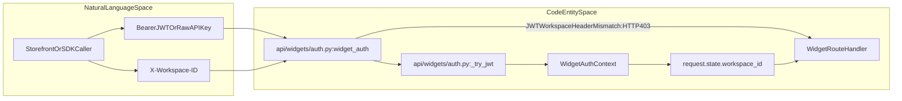
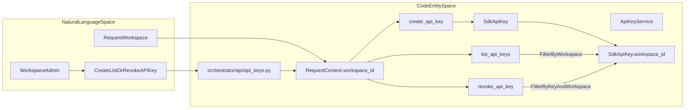
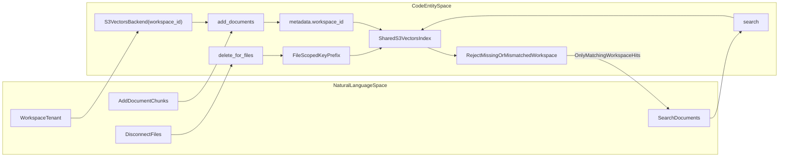

# Data Isolation

Relevant source files

The following files were used as context for generating this wiki page:

- [docs/workspace-execution/security-sandboxing.md](docs/workspace-execution/security-sandboxing.md)
- [orchestrator/api/api_keys.py](orchestrator/api/api_keys.py)
- [orchestrator/api/widgets/auth.py](orchestrator/api/widgets/auth.py)
- [orchestrator/api/widgets/config.py](orchestrator/api/widgets/config.py)
- [orchestrator/api/widgets/cors.py](orchestrator/api/widgets/cors.py)
- [orchestrator/api/widgets/session.py](orchestrator/api/widgets/session.py)
- [orchestrator/core/database/migrations/043_team_based_document_scoping.sql](orchestrator/core/database/migrations/043_team_based_document_scoping.sql)
- [orchestrator/core/models/sdk_api_keys.py](orchestrator/core/models/sdk_api_keys.py)
- [orchestrator/core/services/api_key_service.py](orchestrator/core/services/api_key_service.py)
- [orchestrator/tests/security/test_prd172_tenant_isolation.py](orchestrator/tests/security/test_prd172_tenant_isolation.py)
- [orchestrator/tests/test_f155_widget_key_limits.py](orchestrator/tests/test_f155_widget_key_limits.py)
- [orchestrator/tests/test_p2w2_cors_boot_guard.py](orchestrator/tests/test_p2w2_cors_boot_guard.py)
- [orchestrator/tests/test_p2w2_widget_fail_closed.py](orchestrator/tests/test_p2w2_widget_fail_closed.py)
- [orchestrator/tests/test_prd008a_cors_coverage.py](orchestrator/tests/test_prd008a_cors_coverage.py)
- [orchestrator/tests/test_prd008a_widget_config_resolver.py](orchestrator/tests/test_prd008a_widget_config_resolver.py)
- [orchestrator/tests/test_prd186_s3_hardening.py](orchestrator/tests/test_prd186_s3_hardening.py)

## Purpose and Scope

This page describes the isolation mechanisms evidenced by the provided code: workspace ownership on SDK API keys, workspace-scoped key-management operations, workspace identity in widget authentication, shared S3 vector filtering, and tenant-isolation tests. The available files do not establish general memory namespacing or query-key scoping behavior, so those mechanisms are not inferred here. [orchestrator/core/models/sdk_api_keys.py:29-73](), [orchestrator/core/services/api_key_service.py:48-62](), [orchestrator/api/widgets/auth.py:46-56](), [orchestrator/tests/test_prd186_s3_hardening.py:80-133](), [orchestrator/tests/security/test_prd172_tenant_isolation.py:1-17]()

Sources: [orchestrator/core/models/sdk_api_keys.py:29-73](), [orchestrator/core/services/api_key_service.py:48-62](), [orchestrator/api/widgets/auth.py:46-56](), [orchestrator/tests/test_prd186_s3_hardening.py:80-133](), [orchestrator/tests/security/test_prd172_tenant_isolation.py:1-17]()

---

## Workspace Identity and Isolation Boundary

`WidgetAuthContext` carries a `workspace_id` UUID together with the API-key ID, permissions, optional default agent, and optional team lock. The `widget_auth` dependency accepts a Bearer token, attempts JWT decoding, and then uses raw API-key validation as a fallback. [orchestrator/api/widgets/auth.py:46-56](), [orchestrator/api/widgets/auth.py:62-93](), [orchestrator/api/widgets/auth.py:100-116]()

For a decoded JWT, `widget_auth` reads the workspace and key IDs from the payload. If the request also supplies `X-Workspace-ID`, the header must match the JWT workspace; a mismatch raises HTTP 403. On success, the dependency sets workspace, key, and permission values on `request.state` and returns the populated context. [orchestrator/api/widgets/auth.py:134-171]()

### Widget Request Identity: Natural Language to Code Entities

**Figure 1: Widget request identity and workspace binding**

Sources: [orchestrator/api/widgets/auth.py:46-56](), [orchestrator/api/widgets/auth.py:62-93](), [orchestrator/api/widgets/auth.py:100-116](), [orchestrator/api/widgets/auth.py:134-171]()

---

## Database and Query Scoping

### Workspace Foreign Keys

`SdkApiKey.workspace_id` is a non-null PostgreSQL UUID foreign key to `workspaces.id` with `ON DELETE CASCADE`. The model also defines an index on `workspace_id`, making workspace ownership explicit on each SDK key row. [orchestrator/core/models/sdk_api_keys.py:29-43]()

The model associates the key with its `Workspace` through an ORM relationship. Other key attributes include the hashed key, permissions, allowed domains and IPs, active status, and optional default-agent and team locks. [orchestrator/core/models/sdk_api_keys.py:44-73]()

### Query Key Scoping

`ApiKeyService.list_api_keys` filters records by the supplied `workspace_id` before ordering them by creation time. `revoke_api_key` filters by both key ID and workspace ID, returning `False` when no matching row exists. These predicates prevent those operations from listing or revoking a key belonging to another workspace. [orchestrator/core/services/api_key_service.py:143-170](), [orchestrator/core/services/api_key_service.py:175-190]()

The API-key creation route requires workspace context, passes `ctx.workspace_id` into `ApiKeyService.create_api_key`, and checks that a requested `default_agent_id` belongs to that workspace before creating the key. The service persists the workspace ID on the new `SdkApiKey` record. [orchestrator/api/api_keys.py:138-175](), [orchestrator/core/services/api_key_service.py:48-93]()

| Boundary | Implementation | Isolation effect |
|---|---|---|
| Key ownership | `SdkApiKey.workspace_id` references `workspaces.id` and is non-null. [orchestrator/core/models/sdk_api_keys.py:29-43]() | Every SDK key row is associated with a workspace. |
| Key listing | `ApiKeyService.list_api_keys(db, workspace_id)` filters on `SdkApiKey.workspace_id`. [orchestrator/core/services/api_key_service.py:175-190]() | The returned key list is limited to the requested workspace. |
| Key revocation | `ApiKeyService.revoke_api_key(db, key_id, workspace_id)` filters on both values. [orchestrator/core/services/api_key_service.py:143-170]() | A key in another workspace does not match the revocation query. |
| Key creation | The route passes the request workspace ID to `create_api_key`; the service stores it on the record. [orchestrator/api/api_keys.py:138-175](), [orchestrator/core/services/api_key_service.py:48-93]() | New keys are attached to the request workspace. |
| Default-agent lock | The route calls `agent_in_workspace` before accepting a default agent ID. [orchestrator/api/api_keys.py:155-160]() | A key cannot be created with a default agent outside the request workspace. |

Sources: [orchestrator/core/models/sdk_api_keys.py:29-73](), [orchestrator/core/services/api_key_service.py:48-93](), [orchestrator/core/services/api_key_service.py:143-190](), [orchestrator/api/api_keys.py:138-175]()

### API-Key Flow: Natural Language to Code Entities

**Figure 2: Workspace-scoped SDK API-key operations**

Sources: [orchestrator/api/api_keys.py:132-175](), [orchestrator/core/services/api_key_service.py:48-105](), [orchestrator/core/services/api_key_service.py:143-190](), [orchestrator/core/models/sdk_api_keys.py:29-43]()

---

## Memory and Cache Isolation

### Memory Namespacing

The tenant-isolation test module identifies memory among the domains in its stated cross-tenant acceptance scope. The provided excerpt does not show memory-specific test cases or implementation details, so it is not sufficient to document memory key formats, namespace construction, or retrieval predicates. [orchestrator/tests/security/test_prd172_tenant_isolation.py:1-17]()

### Cache Isolation

`api/widgets/cors.py` maintains `_dynamic_origin_cache`, mapping origins to an allow/deny verdict and expiry time. The cache is bounded, uses a 60-second TTL, and stores successful and denied lookup verdicts; exceptions during the lookup fail closed and are not cached. This is an origin-verdict cache, not evidence of tenant-scoped application-data caching. [orchestrator/api/widgets/cors.py:75-89](), [orchestrator/api/widgets/cors.py:105-132]()

Sources: [orchestrator/tests/security/test_prd172_tenant_isolation.py:1-17](), [orchestrator/api/widgets/cors.py:75-89](), [orchestrator/api/widgets/cors.py:105-132]()

---

## Shared Vector-Store Isolation

The S3 Vectors hardening tests describe a shared-bucket isolation rule: writes stamp each vector’s metadata with the backend workspace ID, while search results with a missing, `None`, or mismatched `workspace_id` must be excluded. The tests instantiate `S3VectorsBackend` for `ws-a` and mock the client boundary. [orchestrator/tests/test_prd186_s3_hardening.py:52-72](), [orchestrator/tests/test_prd186_s3_hardening.py:80-116]()

The tests also require disconnect cleanup to be scoped to the caller’s files: `delete_for_files` lists vectors using file-specific key prefixes rather than sweeping the shared index. The test asserts that the old connection-wide deletion method is absent from both the real and mock backends. [orchestrator/tests/test_prd186_s3_hardening.py:119-139]()

**Figure 3: Shared S3 Vectors tenant boundary**

Sources: [orchestrator/tests/test_prd186_s3_hardening.py:52-72](), [orchestrator/tests/test_prd186_s3_hardening.py:80-139]()

---

## Widget and CORS Isolation

`WidgetCORSMiddleware` covers `/api/widgets` and `/api/sites`. Platform origins are derived from `config.CORS_ALLOW_ORIGINS`; merchant origins are authorized for `/api/widgets` through the `allowed_domains` of active public API keys. `/api/sites` is treated as first-party dashboard CRUD and does not consult merchant keys. [orchestrator/api/widgets/cors.py:9-37](), [orchestrator/api/widgets/cors.py:49-67](), [orchestrator/api/widgets/cors.py:105-116]()

For dynamic checks, `_origin_allowed_dynamic` first accepts platform origins, rejects non-platform origins on paths outside the widget key-scoped prefix, and otherwise performs a cached lookup. The lookup runs in a threadpool through `_origin_allowed_by_key_sync`, which calls `ApiKeyService.origin_allowed_by_any_key`; lookup exceptions fail closed. [orchestrator/api/widgets/cors.py:92-132]()

The CORS check is not the authentication boundary for `/api/sites`: the middleware documentation identifies cookie JWT authentication as that surface’s security boundary. Widget requests separately pass through `widget_auth`, which resolves the workspace from a JWT or API key and checks a supplied workspace header against the JWT workspace. [orchestrator/api/widgets/cors.py:22-37](), [orchestrator/api/widgets/auth.py:100-116](), [orchestrator/api/widgets/auth.py:134-171]()

**Figure 4: CORS origin decision path**

```mermaid
flowchart LR
    subgraph "NaturalLanguageSpace"
        Browser["BrowserPreflight"]
        Storefront["MerchantStorefrontOrigin"]
        Dashboard["FirstPartyDashboardOrigin"]
    end

    subgraph "CodeEntitySpace"
        Middleware["api/widgets/cors.py:WidgetCORSMiddleware"]
        Covered["COVERED_PATH_PREFIXES"]
        Dynamic["api/widgets/cors.py:_origin_allowed_dynamic"]
        Platform["api/widgets/cors.py:_origin_is_platform"]
        Cache["_dynamic_origin_cache"]
        Sync["_origin_allowed_by_key_sync"]
        Service["ApiKeyService.origin_allowed_by_any_key"]
        Decision["CORSAllowOrDeny"]
    end

    Browser --> Middleware
    Middleware --> Covered
    Covered --> Dynamic
    Storefront --> Dynamic
    Dashboard --> Dynamic
    Dynamic --> Platform
    Platform -->|"PlatformOrigin"| Decision
    Platform -->|"NonPlatformOrigin"| Cache
    Cache -->|"CacheMissOnWidgetsPath"| Sync
    Sync --> Service
    Service --> Decision
    Dynamic -->|"NonWidgetPath"| Decision
```

Sources: [orchestrator/api/widgets/cors.py:49-67](), [orchestrator/api/widgets/cors.py:75-132](), [orchestrator/api/widgets/cors.py:139-161]()

---

## Tenant Isolation Tests and Verification

`test_prd172_tenant_isolation.py` defines a cross-tenant acceptance matrix in which workspace A must not read, write, or delete workspace B’s data across the stated domains, including skills, documents/vectors, workflows, memory, and context. The module describes its tests as pure or behavioral, with mocked database query chains and injected authentication contexts; it notes that the end-to-end DB matrix runs in CI. [orchestrator/tests/security/test_prd172_tenant_isolation.py:1-17]()

The visible skills tests verify that a private skill belonging to workspace B is not visible to workspace A, while a global skill and a workspace A skill are visible. They also test that attaching a skill to another workspace’s agent raises HTTP 404, and that super-admin recognition accepts either the `admin_all_workspaces` sentinel or the literal super-admin role. [orchestrator/tests/security/test_prd172_tenant_isolation.py:76-124]()

The S3 hardening tests verify vector writes, search filtering for unlabeled and mismatched hits, and file-scoped deletion. The CORS coverage tests lock the covered prefixes and assert that merchant key lookup is not used for `/api/sites`. [orchestrator/tests/test_prd186_s3_hardening.py:80-139](), [orchestrator/tests/test_prd008a_cors_coverage.py:24-58](), [orchestrator/tests/test_prd008a_cors_coverage.py:130-148]()

| Test suite or case | Focus | Verification |
|---|---|---|
| `TestF002SkillsIsolation` | Skill visibility and agent attachment across workspaces | Exercises `_skill_visible_to` and `_assert_agent_in_workspace` with workspace A and B fixtures. [orchestrator/tests/security/test_prd172_tenant_isolation.py:76-117]() |
| `TestF002SkillsIsolation` super-admin checks | Global visibility and admin recognition | Tests the super-admin flag and role paths. [orchestrator/tests/security/test_prd172_tenant_isolation.py:100-124]() |
| S3 vector search tests | Workspace labels on shared-bucket results | Confirms unlabeled, `None`, and other-workspace hits are excluded. [orchestrator/tests/test_prd186_s3_hardening.py:83-106]() |
| S3 vector write test | Tenant label on stored vectors | Confirms `add_documents` writes `workspace_id` metadata. [orchestrator/tests/test_prd186_s3_hardening.py:108-117]() |
| S3 disconnect deletion test | File-scoped cleanup | Confirms vector listing uses file key prefixes rather than an index-wide sweep. [orchestrator/tests/test_prd186_s3_hardening.py:119-139]() |
| CORS path coverage tests | Middleware route coverage | Locks `/api/widgets` and `/api/sites` prefixes and excludes unrelated paths. [orchestrator/tests/test_prd008a_cors_coverage.py:24-58]() |
| CORS merchant-origin tests | Merchant-origin and Sites separation | Confirms merchant key lookup applies to widget paths and not `/api/sites`. [orchestrator/tests/test_prd008a_cors_coverage.py:98-148]() |

Sources: [orchestrator/tests/security/test_prd172_tenant_isolation.py:1-124](), [orchestrator/tests/test_prd186_s3_hardening.py:80-139](), [orchestrator/tests/test_prd008a_cors_coverage.py:24-58](), [orchestrator/tests/test_prd008a_cors_coverage.py:98-148]()

---