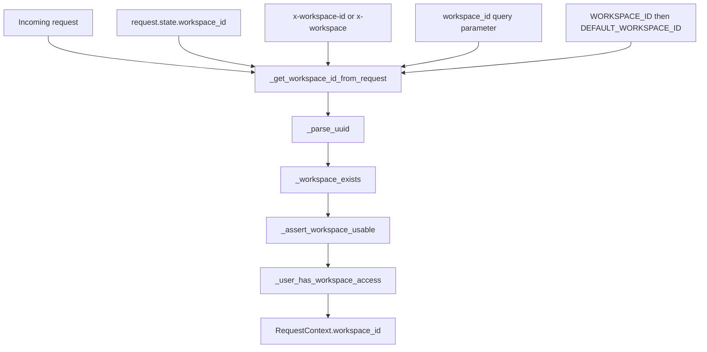
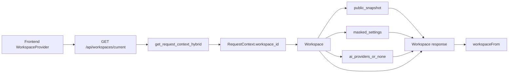
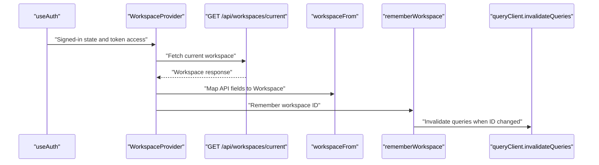

# Workspace & Team Management

Relevant source files

The following files were used as context for generating this wiki page:

- [frontend/components/__tests__/prd264-voice-ai-label.test.tsx](frontend/components/__tests__/prd264-voice-ai-label.test.tsx)
- [frontend/components/settings/SettingsPanel.tsx](frontend/components/settings/SettingsPanel.tsx)
- [frontend/components/settings/SystemLLMSettingsTab.tsx](frontend/components/settings/SystemLLMSettingsTab.tsx)
- [frontend/components/settings/WorkspaceVoiceLiveCard.tsx](frontend/components/settings/WorkspaceVoiceLiveCard.tsx)
- [frontend/components/settings/__tests__/settings-panel-edition.test.tsx](frontend/components/settings/__tests__/settings-panel-edition.test.tsx)
- [frontend/components/settings/__tests__/settings-panel-tab-param.test.tsx](frontend/components/settings/__tests__/settings-panel-tab-param.test.tsx)
- [frontend/components/settings/__tests__/workspace-voice-live-card.test.tsx](frontend/components/settings/__tests__/workspace-voice-live-card.test.tsx)
- [frontend/components/workspace-provider.tsx](frontend/components/workspace-provider.tsx)
- [frontend/hooks/use-voice-live-settings.ts](frontend/hooks/use-voice-live-settings.ts)
- [frontend/lib/voice/live/refusal.ts](frontend/lib/voice/live/refusal.ts)
- [orchestrator/api/workspaces.py](orchestrator/api/workspaces.py)
- [orchestrator/core/auth/hybrid.py](orchestrator/core/auth/hybrid.py)
- [orchestrator/modules/context/sections/product_facts.py](orchestrator/modules/context/sections/product_facts.py)
- [orchestrator/modules/voice/mint.py](orchestrator/modules/voice/mint.py)
- [orchestrator/tests/test_f232_auto_knows_what_automatos_is.py](orchestrator/tests/test_f232_auto_knows_what_automatos_is.py)
- [orchestrator/tests/test_invitation_routing.py](orchestrator/tests/test_invitation_routing.py)
- [orchestrator/tests/test_prd266_ai_providers_route.py](orchestrator/tests/test_prd266_ai_providers_route.py)

## Purpose and Scope

This page describes workspace identity and request-time workspace resolution, the current-workspace API, frontend workspace context and switching behavior, and the membership and administrative lifecycle controls visible in the provided implementation. Workspace provisioning helpers are imported by the hybrid auth module, but their implementations and the admin console or purge code are not included in the available source excerpts; those behaviors are identified as limits of this page rather than inferred. [orchestrator/core/auth/hybrid.py:21-23]()

Sources: [orchestrator/core/auth/hybrid.py:21-23]()

---

## Workspace Model, Resolution & Provisioning

A workspace is the tenant context carried by a request as `RequestContext.workspace_id`. The workspace API loads the corresponding `Workspace` row, while the hybrid-auth module resolves candidate workspace IDs and checks workspace existence, usability, and membership. [orchestrator/api/workspaces.py:18-20]()[orchestrator/api/workspaces.py:31-33]()[orchestrator/core/auth/hybrid.py:55-65]()

### Workspace Resolution Pipeline

`_get_workspace_id_from_request()` checks candidate workspace identifiers in this order:

1. An upstream value in `request.state.workspace_id`. [orchestrator/core/auth/hybrid.py:67-71]()
2. The `x-workspace-id` header, then `x-workspace`. [orchestrator/core/auth/hybrid.py:73-80]()
3. The `workspace_id` query parameter. [orchestrator/core/auth/hybrid.py:82-84]()
4. The configured `WORKSPACE_ID`, then `DEFAULT_WORKSPACE_ID`. [orchestrator/core/auth/hybrid.py:86-92]()

Candidates are parsed as UUIDs; invalid or missing values do not resolve to a workspace. [orchestrator/core/auth/hybrid.py:46-53]()[orchestrator/core/auth/hybrid.py:73-94]()

Resolution is followed by separate checks. `_workspace_exists()` treats a workspace as existing only when its row has `deleted_at IS NULL`; a paused workspace still exists. `_assert_workspace_usable()` rejects non-admin access to a paused workspace with HTTP 403, while allowing admins through so they can manage disabled workspaces. [orchestrator/core/auth/hybrid.py:97-132]()

For Clerk identities, `_user_has_workspace_access()` accepts ownership or active membership and is explicitly intended to prevent access by spoofing `X-Workspace-ID`. The module also has membership checks for Clerk IDs and internal user primary keys. [orchestrator/core/auth/hybrid.py:134-190]()[orchestrator/core/auth/hybrid.py:152-168]()

**Diagram: Request Workspace Resolution Mapped to Code Entities**

Sources: [orchestrator/core/auth/hybrid.py:46-94]()[orchestrator/core/auth/hybrid.py:97-190]()

### Provisioning Seeds & Current-Workspace Endpoint

`core.auth.hybrid` imports `insert_personal_workspace` and `seed_new_workspace` from `core.auth.personal_workspace`. The available excerpt does not show where or under what conditions those helpers are called, or their seed contents; therefore it does not establish a complete provisioning sequence. [orchestrator/core/auth/hybrid.py:19-23]()

`GET /api/workspaces/current` uses `get_request_context_hybrid` to obtain the request context and queries `Workspace` by `ctx.workspace_id`. It returns 404 if that row is not found. If the row has no `webhook_key`, the endpoint generates one with `uuid4().hex` and commits it before building the response. [orchestrator/api/workspaces.py:70-92]()

The response includes workspace identity, plan and limits, the resolved workspace role, an edition- or plan-derived exposure profile, an onboarding snapshot, Socials and Voice Live state, webhook details, masked settings, and AI provider information. Integration settings are masked before being returned. [orchestrator/api/workspaces.py:98-100]()[orchestrator/api/workspaces.py:108-154]()

| Response field | Source or purpose |
|---|---|
| `id`, `name`, `slug` | Workspace identity. [orchestrator/api/workspaces.py:118-122]() |
| `plan`, `plan_limits` | Workspace plan and configured limits. [orchestrator/api/workspaces.py:123-124]() |
| `role` | Workspace role resolved for the request, with special handling for anonymous users and super-admins. [orchestrator/api/workspaces.py:101-114]() |
| `exposure` | Local-edition exposure or exposure derived from the workspace plan. [orchestrator/api/workspaces.py:115-135]() |
| `onboarding` | Server-side snapshot produced by `public_snapshot(workspace)`. [orchestrator/api/workspaces.py:136-141]() |
| `socials`, `voice_live` | Workspace-related feature state. [orchestrator/api/workspaces.py:142-147]() |
| `webhook_url`, `webhook_key` | URL and key associated with the workspace webhook. [orchestrator/api/workspaces.py:89-96]()[orchestrator/api/workspaces.py:148-150]() |
| `settings` | Workspace settings passed through `masked_settings()`. [orchestrator/api/workspaces.py:98-100]()[orchestrator/api/workspaces.py:150]() |
| `ai_providers` | Provider information read for the workspace; the route comments specify that a failed read may yield `null`. [orchestrator/api/workspaces.py:151-154]() |

**Diagram: Current Workspace Response Data Flow**

Sources: [orchestrator/api/workspaces.py:18-33]()[orchestrator/api/workspaces.py:70-154]()[frontend/components/workspace-provider.tsx:140-157]()

---

## Workspace Switching & Client Integration

`WorkspaceProvider` provides workspace state through React context. It uses `useAuth()` and `useOrganization()` and, when signed in, fetches the current workspace. The supplied excerpt shows the start of `fetchWorkspace()` but not its full request implementation or the complete switching trigger behavior, so it does not establish that a particular organization-control interaction performs the switch. [frontend/components/workspace-provider.tsx:169-190]()

The response mapper `workspaceFrom()` converts the API’s snake_case fields into the frontend `Workspace` shape, including `planLimits`, `voiceLive`, `webhookUrl`, and `webhookKey`. [frontend/components/workspace-provider.tsx:58-82]()[frontend/components/workspace-provider.tsx:140-157]()

`rememberWorkspace()` stores the received ID in `localStorage` as `last_active_workspace`. When a previously stored ID differs from the new one, it invalidates the React Query cache so data loaded for the old workspace is refetched. [frontend/components/workspace-provider.tsx:159-167]()

A 409 response with `detail.code === 'pending_invitation'` is handled by `followPendingInvitation()`: it chooses a token from the response or URL and redirects to `/accept-invitation`, including the token when available. [frontend/components/workspace-provider.tsx:119-138]()

**Diagram: Client Workspace State and Cache Refresh**

Sources: [frontend/components/workspace-provider.tsx:140-167]()[frontend/components/workspace-provider.tsx:169-190]()

---

## Team Management & Role-Based Permissions

The available implementation exposes membership checks in hybrid auth and workspace-role resolution in the current-workspace endpoint. `_user_is_workspace_member()` checks for an active `workspace_members` row joined to a user with the supplied Clerk ID. `_user_pk_is_workspace_member()` performs the active-membership check directly by internal user primary key. [orchestrator/core/auth/hybrid.py:134-168]()

`_user_has_workspace_access()` checks whether the Clerk user owns the requested workspace or has an active membership row. This is the access check documented in the source as protection against workspace-ID spoofing. [orchestrator/core/auth/hybrid.py:171-190]()

For the current-workspace response, anonymous users and users whose `system_role` is `super_admin` receive the workspace role `"owner"`. Other callers use `resolve_workspace_role(db, ctx)`, falling back to `"viewer"` if no workspace role is resolved. [orchestrator/api/workspaces.py:101-114]()

The frontend `WorkspaceContextType` includes `canEdit`, documented as false for viewers so write affordances can be disabled. The supplied excerpt defines the context type but does not show the code that computes or supplies the value. [frontend/components/workspace-provider.tsx:84-96]()

The provided files do not include team-member CRUD routes, invitation creation or acceptance implementation, or the workspace permission resolver definition. Those operations cannot be specified from these excerpts.

Sources: [orchestrator/core/auth/hybrid.py:134-190]()[orchestrator/api/workspaces.py:101-114]()[frontend/components/workspace-provider.tsx:84-96]()

---

## Admin Workspaces Console & Lifecycle Controls

The supplied excerpts establish two lifecycle checks in hybrid auth:

- `_workspace_exists()` excludes rows with `deleted_at IS NOT NULL`. [orchestrator/core/auth/hybrid.py:97-112]()
- `_assert_workspace_usable()` treats `paused_at IS NOT NULL` as disabled for non-admin callers and raises HTTP 403. Admin callers bypass this check. [orchestrator/core/auth/hybrid.py:115-132]()

The excerpt explains that allowing admins through the paused-state check supports management from an admin console, but it does not include the console routes, UI, or the admin workspace listing and update operations. Those details are outside the available source material. [orchestrator/core/auth/hybrid.py:115-122]()

Sources: [orchestrator/core/auth/hybrid.py:97-132]()

---

## Workspace Purge & Hard-Delete

The available source shows that normal workspace existence checks filter out soft-deleted rows using `deleted_at IS NULL`. It does not show the workspace model definition, purge endpoint or job, database cascade rules, or hard-delete behavior. Consequently, this page cannot document what data a purge removes or whether removal is implemented as a cascade. [orchestrator/core/auth/hybrid.py:97-112]()

Sources: [orchestrator/core/auth/hybrid.py:97-112]()

---

## Summary of Key Entities

| Code entity | Responsibility |
|---|---|
| `get_request_context_hybrid` | Hybrid auth dependency imported by the workspace route and used to provide `RequestContext`. [orchestrator/api/workspaces.py:31-33]() |
| `_parse_uuid` | Parses candidate workspace IDs as UUIDs. [orchestrator/core/auth/hybrid.py:46-53]() |
| `_get_workspace_id_from_request` | Resolves a workspace UUID from request state, headers, query parameters, or environment configuration. [orchestrator/core/auth/hybrid.py:55-94]() |
| `_workspace_exists` | Checks for a workspace row that is not soft-deleted. [orchestrator/core/auth/hybrid.py:97-112]() |
| `_assert_workspace_usable` | Rejects non-admin requests for paused workspaces. [orchestrator/core/auth/hybrid.py:115-132]() |
| `_user_is_workspace_member` | Checks active membership by Clerk user ID. [orchestrator/core/auth/hybrid.py:134-150]() |
| `_user_pk_is_workspace_member` | Checks active membership by internal user primary key. [orchestrator/core/auth/hybrid.py:152-168]() |
| `_user_has_workspace_access` | Checks workspace ownership or active membership for a Clerk user. [orchestrator/core/auth/hybrid.py:171-190]() |
| `insert_personal_workspace`, `seed_new_workspace` | Personal-workspace and new-workspace helpers imported by hybrid auth; their implementations are not included in the provided excerpt. [orchestrator/core/auth/hybrid.py:19-23]() |
| `get_current_workspace` | Returns current workspace metadata and related settings, snapshots, and provider state. [orchestrator/api/workspaces.py:70-154]() |
| `WorkspaceProvider` | Frontend React context provider for workspace state. [frontend/components/workspace-provider.tsx:169-190]() |
| `workspaceFrom` | Maps the current-workspace API response to the frontend `Workspace` object. [frontend/components/workspace-provider.tsx:140-157]() |
| `rememberWorkspace` | Persists the last active workspace ID and invalidates queries when it changes. [frontend/components/workspace-provider.tsx:159-167]() |
| `followPendingInvitation` | Redirects a pending-invitation response to the invitation-acceptance route. [frontend/components/workspace-provider.tsx:119-138]() |

Sources: [orchestrator/core/auth/hybrid.py:19-23]()[orchestrator/core/auth/hybrid.py:46-190]()[orchestrator/api/workspaces.py:70-154]()[frontend/components/workspace-provider.tsx:119-190]()

---