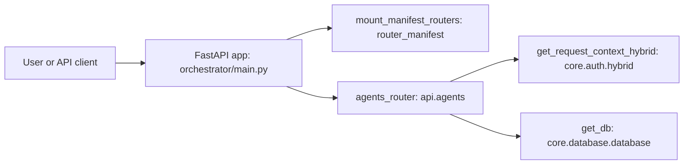
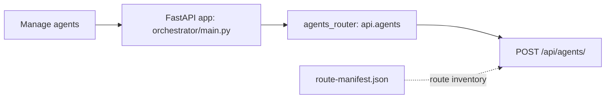
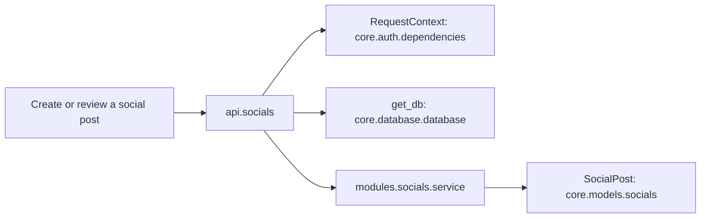

# Backend Architecture

Relevant source files

The following files were used as context for generating this wiki page:

- [frontend/lib/api-client.ts](frontend/lib/api-client.ts)
- [orchestrator/alembic/versions/prd263_harness_ledger_grants.py](orchestrator/alembic/versions/prd263_harness_ledger_grants.py)
- [orchestrator/alembic/versions/prd266_merge_heads.py](orchestrator/alembic/versions/prd266_merge_heads.py)
- [orchestrator/alembic/versions/prd266_mobile_devices.py](orchestrator/alembic/versions/prd266_mobile_devices.py)
- [orchestrator/api/socials.py](orchestrator/api/socials.py)
- [orchestrator/config.py](orchestrator/config.py)
- [orchestrator/core/auth/device.py](orchestrator/core/auth/device.py)
- [orchestrator/core/models/__init__.py](orchestrator/core/models/__init__.py)
- [orchestrator/core/models/core.py](orchestrator/core/models/core.py)
- [orchestrator/core/models/harness.py](orchestrator/core/models/harness.py)
- [orchestrator/core/services/auto_cadence.py](orchestrator/core/services/auto_cadence.py)
- [orchestrator/main.py](orchestrator/main.py)
- [orchestrator/modules/socials/__init__.py](orchestrator/modules/socials/__init__.py)
- [orchestrator/modules/socials/render.py](orchestrator/modules/socials/render.py)
- [orchestrator/modules/socials/service.py](orchestrator/modules/socials/service.py)
- [orchestrator/reports/config-surface.json](orchestrator/reports/config-surface.json)
- [orchestrator/reports/route-manifest.json](orchestrator/reports/route-manifest.json)
- [orchestrator/router_manifest.py](orchestrator/router_manifest.py)
- [orchestrator/scripts/harness_backfill_runs.py](orchestrator/scripts/harness_backfill_runs.py)
- [orchestrator/services/themes/data/core-pages.json](orchestrator/services/themes/data/core-pages.json)
- [orchestrator/tests/test_prd209_alembic_single_head.py](orchestrator/tests/test_prd209_alembic_single_head.py)
- [orchestrator/tests/test_prd236_w1_routes.py](orchestrator/tests/test_prd236_w1_routes.py)
- [orchestrator/tests/test_prd251_api.py](orchestrator/tests/test_prd251_api.py)
- [orchestrator/tests/test_prd263_harness_backfill_runs.py](orchestrator/tests/test_prd263_harness_backfill_runs.py)
- [orchestrator/tests/test_prd263_harness_history_runs.py](orchestrator/tests/test_prd263_harness_history_runs.py)
- [orchestrator/tests/test_prd263_harness_ledger_migration.py](orchestrator/tests/test_prd263_harness_ledger_migration.py)
- [orchestrator/tests/test_prd263_harness_review_cadence.py](orchestrator/tests/test_prd263_harness_review_cadence.py)
- [orchestrator/tests/test_prd266_device_lane.py](orchestrator/tests/test_prd266_device_lane.py)
- [orchestrator/tests/test_prd266_mobile_devices_model.py](orchestrator/tests/test_prd266_mobile_devices_model.py)
- [orchestrator/tests/test_prd266_mobile_devices_routes.py](orchestrator/tests/test_prd266_mobile_devices_routes.py)

## Purpose and scope

This page provides a high-level map of the Automatos AI backend: the FastAPI application, API routers, database models, service boundaries, background work, real-time updates, and self-management harness. The backend’s application entry point is `orchestrator/main.py`; centralized configuration is defined in `orchestrator/config.py`. [orchestrator/main.py:1-6](), [orchestrator/config.py:1-7]()

Sources: [orchestrator/main.py:1-6](), [orchestrator/config.py:1-7]()

## Backend request path at a glance

The diagram maps the general request path to code entities visible in the application entry point: FastAPI, the router manifest, an API router, hybrid request context, and database access. [orchestrator/main.py:16-20](), [orchestrator/main.py:35-41](), [orchestrator/main.py:45-70]()

### Request-to-code map

Sources: [orchestrator/main.py:16-20](), [orchestrator/main.py:35-41](), [orchestrator/main.py:45-48]()

---

## 18.1 FastAPI Application & Boot Phases

`orchestrator/main.py` is the FastAPI application entry point. Its visible imports establish the application’s integration points with centralized configuration, database initialization, health checks, authentication context, and API routers. [orchestrator/main.py:16-20](), [orchestrator/main.py:35-45]()

For details on the lifespan, boot phases, and middleware stack, see [FastAPI Application & Boot Phases](#18.1).

Sources: [orchestrator/main.py:16-20](), [orchestrator/main.py:35-45]()

---

## 18.2 API Router Organization

The application imports API routers by domain, including agents, workflows, documents, tools, routing, billing, and notifications. The route manifest is a generated inventory of HTTP methods and paths; it records 1,016 routes. [orchestrator/main.py:45-96](), [orchestrator/reports/route-manifest.json:1-3]()

### Natural language to code entity space: Agent routes

Sources: [orchestrator/main.py:43-48](), [orchestrator/reports/route-manifest.json:1-3](), [orchestrator/reports/route-manifest.json:245-251]()

For router prefixes, `router_manifest`, route-manifest generation, and import contracts, see [API Router Organization](#18.2).

Sources: [orchestrator/main.py:35-38](), [orchestrator/reports/route-manifest.json:1-3]()

---

## 18.3 Database Models & Migrations

SQLAlchemy models are organized under `core.models`; the package initializer imports the core models and additional model modules. The shown `LLMModel` definition includes a nullable `workspace_id` foreign key, while `WorkspaceModel` uses a non-null workspace foreign key. A test guards the Alembic single-head invariant and the fresh-database initialization path. [orchestrator/core/models/core.py:9-18](), [orchestrator/core/models/core.py:55-64](), [orchestrator/core/models/core.py:120-133](), [orchestrator/core/models/__init__.py:1-16](), [orchestrator/tests/test_prd209_alembic_single_head.py:1-29]()

For model relationships, workspace scoping, JSONB fields, and migration policy, see [Database Models & Migrations](#18.3).

Sources: [orchestrator/core/models/core.py:9-18](), [orchestrator/core/models/core.py:55-64](), [orchestrator/core/models/core.py:120-133](), [orchestrator/core/models/__init__.py:1-16](), [orchestrator/tests/test_prd209_alembic_single_head.py:1-29]()

---

## 18.4 Service Layer Patterns

The codebase separates HTTP-facing API modules from domain modules. For example, `api/socials.py` describes the HTTP lifecycle and delegates lifecycle operations to `modules/socials/service.py`; it also uses `get_db` and request-context dependencies. [orchestrator/api/socials.py:13-18](), [orchestrator/api/socials.py:96-124]()

### Natural language to code entity space: Social post lifecycle

Sources: [orchestrator/api/socials.py:13-18](), [orchestrator/api/socials.py:96-124]()

For dependency injection, database-session lifecycle, and service composition patterns, see [Service Layer Patterns](#18.4).

Sources: [orchestrator/api/socials.py:96-124]()

---

## 18.5 Background Services & Schedulers

Background execution and scheduling are part of the backend’s configuration surface: the configuration-surface inventory includes scheduler, board-dispatch, and boot-reaper settings. Their implementation and coordination are covered in the child page. [orchestrator/reports/config-surface.json:45-54]()

For scheduler leadership, job stores, dispatch, background tasks, and boot reaping, see [Background Services & Schedulers](#18.5).

Sources: [orchestrator/reports/config-surface.json:45-54]()

---

## 18.6 Real-Time Updates

The application describes itself as an API server with WebSocket support. The route inventory also includes activity and scheduler-health endpoints; details of the real-time event and streaming mechanisms are covered in the child page. [orchestrator/main.py:1-5](), [orchestrator/reports/route-manifest.json:21-58]()

For Redis Pub/Sub, Postgres notifications, SSE, and the AI SDK Data Stream protocol, see [Real-Time Updates](#18.6).

Sources: [orchestrator/main.py:1-5](), [orchestrator/reports/route-manifest.json:21-58]()

---

## 18.7 Self-Management Harness

The model package imports `HarnessRun` and `HarnessTaskLedger`, establishing harness-related persistence entities in the shared model registry. The harness service, API, governance rules, and run history are covered in the child page. [orchestrator/core/models/__init__.py:111-113]()

For `HarnessService`, harness API behavior, power modes, routing rules, and the runs ledger, see [Self-Management Harness](#18.7).

Sources: [orchestrator/core/models/__init__.py:111-113]()

---