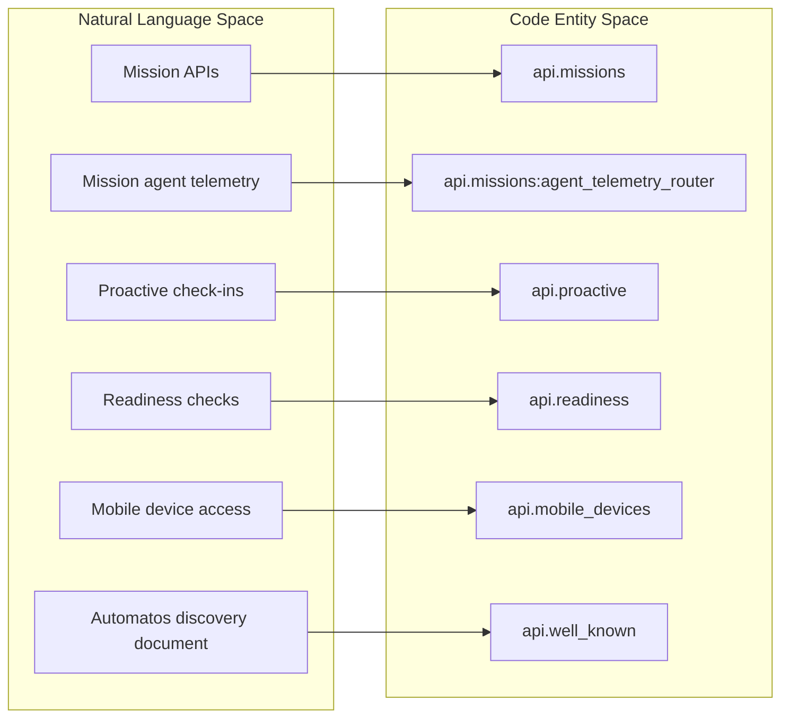
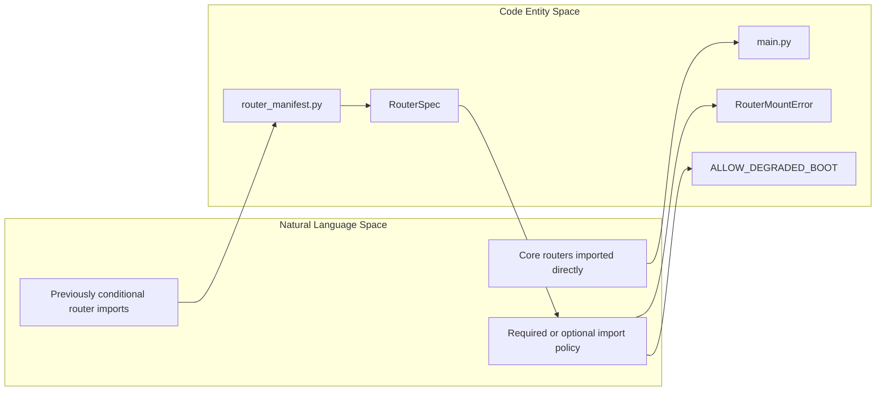

# API Router Organization

Relevant source files

The following files were used as context for generating this wiki page:

- [orchestrator/alembic/versions/prd263_harness_ledger_grants.py](orchestrator/alembic/versions/prd263_harness_ledger_grants.py)
- [orchestrator/alembic/versions/prd266_merge_heads.py](orchestrator/alembic/versions/prd266_merge_heads.py)
- [orchestrator/alembic/versions/prd266_mobile_devices.py](orchestrator/alembic/versions/prd266_mobile_devices.py)
- [orchestrator/core/auth/device.py](orchestrator/core/auth/device.py)
- [orchestrator/core/models/__init__.py](orchestrator/core/models/__init__.py)
- [orchestrator/core/models/core.py](orchestrator/core/models/core.py)
- [orchestrator/core/models/harness.py](orchestrator/core/models/harness.py)
- [orchestrator/core/services/auto_cadence.py](orchestrator/core/services/auto_cadence.py)
- [orchestrator/router_manifest.py](orchestrator/router_manifest.py)
- [orchestrator/scripts/harness_backfill_runs.py](orchestrator/scripts/harness_backfill_runs.py)
- [orchestrator/services/themes/data/core-pages.json](orchestrator/services/themes/data/core-pages.json)
- [orchestrator/tests/test_prd209_alembic_single_head.py](orchestrator/tests/test_prd209_alembic_single_head.py)
- [orchestrator/tests/test_prd236_w1_routes.py](orchestrator/tests/test_prd236_w1_routes.py)
- [orchestrator/tests/test_prd263_harness_backfill_runs.py](orchestrator/tests/test_prd263_harness_backfill_runs.py)
- [orchestrator/tests/test_prd263_harness_history_runs.py](orchestrator/tests/test_prd263_harness_history_runs.py)
- [orchestrator/tests/test_prd263_harness_ledger_migration.py](orchestrator/tests/test_prd263_harness_ledger_migration.py)
- [orchestrator/tests/test_prd263_harness_review_cadence.py](orchestrator/tests/test_prd263_harness_review_cadence.py)
- [orchestrator/tests/test_prd266_device_lane.py](orchestrator/tests/test_prd266_device_lane.py)
- [orchestrator/tests/test_prd266_mobile_devices_model.py](orchestrator/tests/test_prd266_mobile_devices_model.py)
- [orchestrator/tests/test_prd266_mobile_devices_routes.py](orchestrator/tests/test_prd266_mobile_devices_routes.py)

## Purpose and Scope

This page documents the router organization evidenced by `orchestrator/router_manifest.py`: how conditional router imports are declared, how required and optional imports are distinguished, and how the manifest relates to the core routers imported directly in `main.py`. The supplied source excerpt does not include `main.py`, the manifest loader implementation, `route-manifest.json`, or import-linter configuration, so their detailed behavior and contracts cannot be established here. [orchestrator/router_manifest.py:1-17]()

Sources: [orchestrator/router_manifest.py:1-17]()

---

## Router Organization Overview

The manifest covers routers that were historically imported inside `try/except ImportError` blocks in `main.py`. The file distinguishes these conditional mounts from core routers—such as agents, workflows, and documents—which it says remain plain imports in `main.py`. [orchestrator/router_manifest.py:3-5,15-17]()

Each manifest entry is a `RouterSpec`. It records a module path, an attribute name that defaults to `router`, and an `optional` flag that defaults to `False`. Its `name` property formats the module and attribute as `module:attribute`. [orchestrator/router_manifest.py:31-42]()

| Router group | Manifest module or symbol | Prefix information shown in the supplied source |
|---|---|---|
| Commerce and vertical integrations | `api.shopify`, `api.verticals` | No prefix shown. [orchestrator/router_manifest.py:51-54]() |
| Sites and integrations | `api.sites`, `api.composio`, `api.cloud_documents` | No prefix shown. Composio and cloud documents are marked optional. [orchestrator/router_manifest.py:54-56]() |
| Widgets and workspace access | `api.widgets.router`, `api.widget_marketplace`, `api.workspace_github`, `api.workspaces` | No prefix shown. [orchestrator/router_manifest.py:61-64]() |
| Operations and collaboration | `api.activity`, `api.heartbeat`, `api.channels`, `api.reports`, `api.deliverables`, `api.board_tasks` | No prefix shown. [orchestrator/router_manifest.py:65-75]() |
| Mission surfaces | `api.missions`, `api.missions:agent_telemetry_router`, `api.mission_settings` | The manifest includes two router attributes from `api.missions`. No prefix shown. [orchestrator/router_manifest.py:78-80]() |
| Governance and monitoring | `api.approval_grants`, `api.gdpr`, `api.governance`, `api.watches`, `api.fleet` | The comments identify some endpoint paths, but do not establish the routers’ full prefixes. [orchestrator/router_manifest.py:83-92]() |
| Runtime and session tools | `api.cli_hosts`, `api.session_tools` | Comments identify runtime gates; they do not establish router prefixes. [orchestrator/router_manifest.py:93-98]() |
| Proactive and readiness surfaces | `api.proactive`, `api.proactive_brief`, `api.proactive_follow_ups`, `api.readiness` | Comments give example paths for these surfaces, including `/api/proactive/*` and `/api/readiness`. [orchestrator/router_manifest.py:115-126]() |
| Public and mobile surfaces | `api.mobile_devices`, `api.mobile_push`, `api.well_known`, `api.marketplace_catalog`, `api.public_marketplace` | Comments identify paths such as `/api/v1/mobile/*`, `/.well-known/automatos.json`, and `/api/marketplace/catalog`. [orchestrator/router_manifest.py:107-114,133-138]() |

Sources: [orchestrator/router_manifest.py:31-42,48-138]()

### Natural-language domains mapped to manifest entities

The manifest associates product-facing surfaces with importable module paths and, where needed, a non-default router attribute. The endpoint examples in comments are useful search anchors, but the excerpt does not provide the router definitions or their `prefix` declarations. [orchestrator/router_manifest.py:31-42,78-80,91-98,115-138]()

Title: "API Surfaces and Router Manifest Entities"

Sources: [orchestrator/router_manifest.py:78-80,107-117,124-126]()

---

## Router Manifest and Mounting

`router_manifest.py` describes a fail-loud loading policy for routers that were previously conditionally imported in `main.py`. A required entry (`optional=False`, the default) is expected to exist: if import fails, startup raises `RouterMountError`, unless `ALLOW_DEGRADED_BOOT=true` is set, in which case the failure is logged and skipped. An optional entry represents an optional integration; its absence is logged and skipped rather than treated as fatal. [orchestrator/router_manifest.py:1-17]()

`RouterMountError` is the exception identified for a required router import failure. The supplied excerpt defines it but does not show the loader function that imports entries, applies the policy, or mounts the resulting routers. [orchestrator/router_manifest.py:21-29,44-46]()

### Startup integration at a glance

The source documents the intended relationship between core imports and conditional manifest entries, but the actual startup call site is not included in the supplied excerpt. The diagram therefore represents the documented roles—not a claim about an unseen function call sequence. [orchestrator/router_manifest.py:1-17,48-51]()

Title: "Core Imports and Conditional Router Manifest"

Sources: [orchestrator/router_manifest.py:1-17,31-46,48-51]()

### Manifest entries and import policy

The manifest is an ordered tuple named `MANIFEST_ROUTERS`. Its comment says the order is the mount order and that the listed routers have distinct path prefixes. The entries include required routers such as `api.shopify` and `api.sites`, and optional routers such as `api.composio`, `api.cloud_documents`, and `api.bug_reports`. [orchestrator/router_manifest.py:48-60]()

A module may appear more than once when the application needs a different router attribute: `api.missions` appears once for its default `router` and once with `attr="agent_telemetry_router"`. [orchestrator/router_manifest.py:78-80]()

| `RouterSpec` field | Definition and documented role |
|---|---|
| `module` | Module path to import. [orchestrator/router_manifest.py:31-37]() |
| `attr` | Router attribute to retrieve; defaults to `router`. [orchestrator/router_manifest.py:31-37]() |
| `optional` | Whether the router is an optional integration; defaults to `False`. [orchestrator/router_manifest.py:31-37]() |
| `name` | Read-only formatted identifier, `module:attr`. [orchestrator/router_manifest.py:39-42]() |

Sources: [orchestrator/router_manifest.py:31-42,48-80]()

---

## Route Inventory (`route-manifest.json`)

The supplied files do not include `orchestrator/reports/route-manifest.json` or a generator or validation test for it. Consequently, this page cannot verify the inventory’s schema, recorded route count, method and path fields, generation procedure, or relationship to the routers in `MANIFEST_ROUTERS`. [orchestrator/router_manifest.py:1-17,48-51]()

The manifest source does include endpoint examples in comments—for instance, `GET /api/v1/fleet`, `GET /.well-known/automatos.json`, and `/api/proactive/*`—but those examples do not establish the contents or completeness of a separate route inventory. [orchestrator/router_manifest.py:91-92,113-126]()

Sources: [orchestrator/router_manifest.py:91-92,113-126]()

---

## Import-Linter Architectural Contracts

No import-linter configuration or contract tests are included in the supplied files. The available router manifest documents conditional router loading, but it does not define package import boundaries or establish import-linter rules. Those contracts cannot be described or verified from this source excerpt. [orchestrator/router_manifest.py:1-17]()

Sources: [orchestrator/router_manifest.py:1-17]()

---

## Authorization Boundary Sweep

The supplied files do not include an authorization boundary sweep or a route-manifest consumer that checks authorization. Although the manifest comments identify routes and describe some as public, authenticated, rate-limited, or edition-gated, they do not establish a general policy for authorization checks across mutating HTTP methods. [orchestrator/router_manifest.py:101-106,133-138]()

Sources: [orchestrator/router_manifest.py:101-106,133-138]()

---

## Socials API Routing

The supplied files do not include `orchestrator/api/socials.py` or its sub-router modules. The router manifest excerpt does not list a socials router, so this page cannot document socials router composition, route-level dependencies, or prefixes from the available source. [orchestrator/router_manifest.py:48-138]()

Sources: [orchestrator/router_manifest.py:48-138]

---