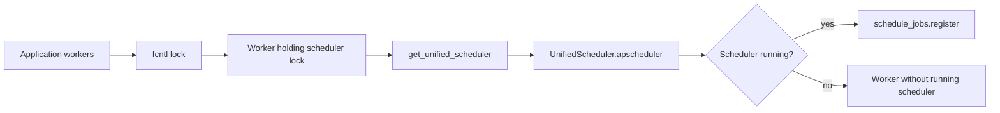
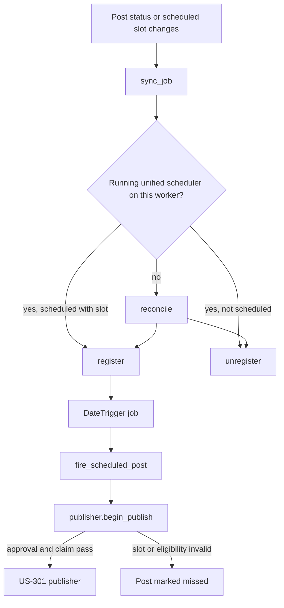
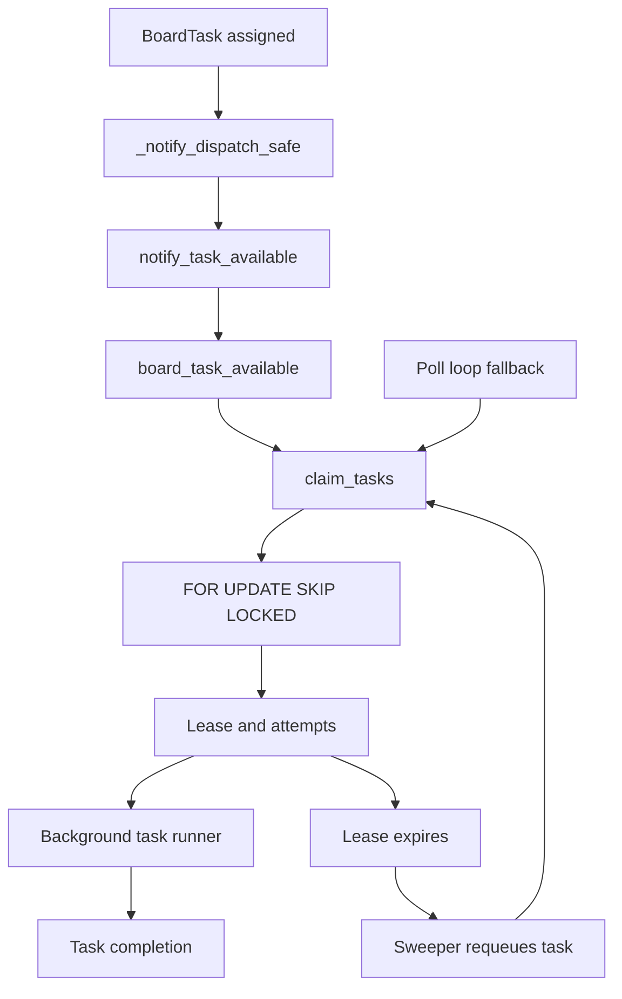
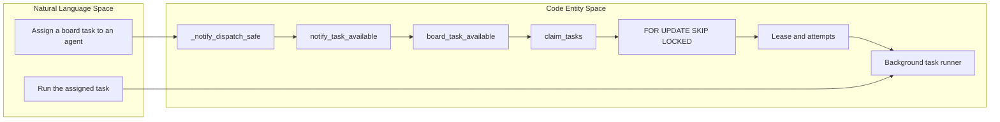
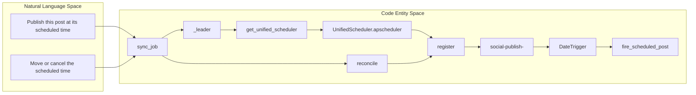

# Background Services & Schedulers

Relevant source files

The following files were used as context for generating this wiki page:

- [docs/PRDS/PRD-235-LOCAL-AI-OS-MANAGER.md](docs/PRDS/PRD-235-LOCAL-AI-OS-MANAGER.md)
- [docs/PRDS/PRD-239-SESSION-AGENTS-PARITY.md](docs/PRDS/PRD-239-SESSION-AGENTS-PARITY.md)
- [orchestrator/api/board_tasks.py](orchestrator/api/board_tasks.py)
- [orchestrator/api/socials_media_tools.py](orchestrator/api/socials_media_tools.py)
- [orchestrator/api/socials_publish.py](orchestrator/api/socials_publish.py)
- [orchestrator/consumers/chatbot/named_template.py](orchestrator/consumers/chatbot/named_template.py)
- [orchestrator/consumers/chatbot/named_template_note.py](orchestrator/consumers/chatbot/named_template_note.py)
- [orchestrator/core/boot/reaper.py](orchestrator/core/boot/reaper.py)
- [orchestrator/core/composio/tool_executor.py](orchestrator/core/composio/tool_executor.py)
- [orchestrator/core/composio/upload_spec.py](orchestrator/core/composio/upload_spec.py)
- [orchestrator/modules/socials/ai_options.py](orchestrator/modules/socials/ai_options.py)
- [orchestrator/modules/socials/media_tools.py](orchestrator/modules/socials/media_tools.py)
- [orchestrator/modules/socials/notify.py](orchestrator/modules/socials/notify.py)
- [orchestrator/modules/socials/plan_visuals.py](orchestrator/modules/socials/plan_visuals.py)
- [orchestrator/modules/socials/publish_lifecycle.py](orchestrator/modules/socials/publish_lifecycle.py)
- [orchestrator/modules/socials/publish_records.py](orchestrator/modules/socials/publish_records.py)
- [orchestrator/modules/socials/publisher.py](orchestrator/modules/socials/publisher.py)
- [orchestrator/modules/socials/publishing.py](orchestrator/modules/socials/publishing.py)
- [orchestrator/modules/socials/schedule_jobs.py](orchestrator/modules/socials/schedule_jobs.py)
- [orchestrator/modules/tools/discovery/handlers_board_tasks.py](orchestrator/modules/tools/discovery/handlers_board_tasks.py)
- [orchestrator/modules/tools/discovery/mission_refs.py](orchestrator/modules/tools/discovery/mission_refs.py)
- [orchestrator/services/board_dispatcher.py](orchestrator/services/board_dispatcher.py)
- [orchestrator/services/ticket_cards.py](orchestrator/services/ticket_cards.py)
- [orchestrator/services/ticket_numbers.py](orchestrator/services/ticket_numbers.py)
- [orchestrator/services/ticket_refs.py](orchestrator/services/ticket_refs.py)
- [orchestrator/tests/test_1115_run_now_says_why_a_ticket_cannot_start.py](orchestrator/tests/test_1115_run_now_says_why_a_ticket_cannot_start.py)
- [orchestrator/tests/test_a_restart_orphan_is_failed_not_done.py](orchestrator/tests/test_a_restart_orphan_is_failed_not_done.py)
- [orchestrator/tests/test_board_task_handlers.py](orchestrator/tests/test_board_task_handlers.py)
- [orchestrator/tests/test_composio_upload_takes_the_canonical_tool_slug.py](orchestrator/tests/test_composio_upload_takes_the_canonical_tool_slug.py)
- [orchestrator/tests/test_f155_a_widget_turn_sees_tasks_and_playbooks_as_their_status.py](orchestrator/tests/test_f155_a_widget_turn_sees_tasks_and_playbooks_as_their_status.py)
- [orchestrator/tests/test_f176_run_now_asks_whether_a_run_holds_the_ticket.py](orchestrator/tests/test_f176_run_now_asks_whether_a_run_holds_the_ticket.py)
- [orchestrator/tests/test_f241_auto_acts_on_the_ticket_it_is_given.py](orchestrator/tests/test_f241_auto_acts_on_the_ticket_it_is_given.py)
- [orchestrator/tests/test_f351_c_a_named_template_gets_the_studio_prompt.py](orchestrator/tests/test_f351_c_a_named_template_gets_the_studio_prompt.py)
- [orchestrator/tests/test_f369_a_no_questions_means_defaults_not_questions.py](orchestrator/tests/test_f369_a_no_questions_means_defaults_not_questions.py)
- [orchestrator/tests/test_f369_b_a_ticket_number_in_autos_chat_is_its_number.py](orchestrator/tests/test_f369_b_a_ticket_number_in_autos_chat_is_its_number.py)
- [orchestrator/tests/test_playbook_restart_durability.py](orchestrator/tests/test_playbook_restart_durability.py)
- [orchestrator/tests/test_prd234_lane_consent.py](orchestrator/tests/test_prd234_lane_consent.py)
- [orchestrator/tests/test_prd234_s1a_cli_runtime.py](orchestrator/tests/test_prd234_s1a_cli_runtime.py)
- [orchestrator/tests/test_prd234_s3_cli_ticket_lane.py](orchestrator/tests/test_prd234_s3_cli_ticket_lane.py)
- [orchestrator/tests/test_prd238_w3_follow_through.py](orchestrator/tests/test_prd238_w3_follow_through.py)
- [orchestrator/tests/test_prd251_service.py](orchestrator/tests/test_prd251_service.py)
- [orchestrator/tests/test_prd251bw3_brand_style.py](orchestrator/tests/test_prd251bw3_brand_style.py)
- [orchestrator/tests/test_prd251bw3_media_tools.py](orchestrator/tests/test_prd251bw3_media_tools.py)
- [orchestrator/tests/test_prd251w2_approval_notify.py](orchestrator/tests/test_prd251w2_approval_notify.py)
- [orchestrator/tests/test_prd251w3_publisher.py](orchestrator/tests/test_prd251w3_publisher.py)
- [orchestrator/tests/test_prd251w3_recovery.py](orchestrator/tests/test_prd251w3_recovery.py)
- [orchestrator/tests/test_prd251w3_schedule.py](orchestrator/tests/test_prd251w3_schedule.py)
- [orchestrator/tests/test_prd251w3_send_once.py](orchestrator/tests/test_prd251w3_send_once.py)
- [orchestrator/tests/test_prd252_ticket_numbers.py](orchestrator/tests/test_prd252_ticket_numbers.py)
- [orchestrator/tests/test_run_now_leaves_a_missions_steps_to_the_mission.py](orchestrator/tests/test_run_now_leaves_a_missions_steps_to_the_mission.py)
- [orchestrator/tests/test_w1s6_boot_reaper.py](orchestrator/tests/test_w1s6_boot_reaper.py)
- [orchestrator/tests/test_w2s6_restart_recovery_realdb.py](orchestrator/tests/test_w2s6_restart_recovery_realdb.py)

## Purpose and Scope

This page describes scheduler ownership and scheduled jobs, PostgreSQL-backed board-task dispatch, and boot-time recovery for work orphaned by a process restart. The scheduler’s single-worker ownership is enforced by an `fcntl` lock; the board dispatch spine coordinates worker claims using PostgreSQL row locking and leases. [orchestrator/modules/socials/schedule_jobs.py:1-7]() [orchestrator/services/board_dispatcher.py:1-17]()

Sources: `[orchestrator/modules/socials/schedule_jobs.py:1-7]()` `[orchestrator/services/board_dispatcher.py:1-17]()`

---

## Unified Scheduler Architecture

### Scheduler Ownership

The socials scheduling module uses `get_unified_scheduler()` to access the unified scheduler. Its `_leader()` helper returns the APScheduler instance only when it exists and is running; otherwise it returns `None`. Scheduled social-post jobs are registered on that instance. The scheduler module’s documented ownership model is a worker holding the `fcntl` lock. [orchestrator/modules/socials/schedule_jobs.py:3-7]() [orchestrator/modules/socials/schedule_jobs.py:113-118]()

**Scheduler ownership and scheduled-job access**

Sources: `[orchestrator/modules/socials/schedule_jobs.py:3-7]()` `[orchestrator/modules/socials/schedule_jobs.py:87-99]()` `[orchestrator/modules/socials/schedule_jobs.py:113-118]()`

### APScheduler Jobs and Persistence

Social posts use one APScheduler `DateTrigger` job per post, identified by `social-publish-<post_id>`. `register()` targets the module-level `fire_scheduled_post` function and supplies the post and workspace IDs as strings. It replaces an existing job with the same ID, limits it to one instance, and allows a late job to fire so the handler can decide whether to publish or mark the post missed. [orchestrator/modules/socials/schedule_jobs.py:1-7]() [orchestrator/modules/socials/schedule_jobs.py:76-99]()

The module documents that the scheduler uses a `RedisJobStore`, which pickles job targets; consequently, the target is a module-level function with plain string arguments rather than a closure. [orchestrator/modules/socials/schedule_jobs.py:3-7]()

| Entity | Role |
|---|---|
| `get_unified_scheduler()` | Provides the unified scheduler used by the socials job integration. [orchestrator/modules/socials/schedule_jobs.py:113-118]() |
| `fire_scheduled_post` | Module-level target for a scheduled post job. [orchestrator/modules/socials/schedule_jobs.py:3-7]() |
| `job_id()` | Builds the stable `social-publish-<post_id>` job ID. [orchestrator/modules/socials/schedule_jobs.py:52-77]() |
| `register()` | Adds or replaces a one-shot `DateTrigger` job. [orchestrator/modules/socials/schedule_jobs.py:87-99]() |
| `sync_job()` | Registers or removes a post’s job when this worker hosts the scheduler. [orchestrator/modules/socials/schedule_jobs.py:132-144]() |
| `reconcile()` | Reconciles database posts and scheduler jobs; the module documents this as a leader pass. [orchestrator/modules/socials/schedule_jobs.py:9-15]() |

Sources: `[orchestrator/modules/socials/schedule_jobs.py:1-15]()` `[orchestrator/modules/socials/schedule_jobs.py:52-99]()` `[orchestrator/modules/socials/schedule_jobs.py:113-144]()`

### Keeping Scheduled Jobs in Sync

A request may be handled by a worker that does not host the scheduler. In that case, `sync_job()` has no running scheduler on which to register or remove a job; the documented reconcile pass catches up by registering missing jobs, moving jobs whose slots changed, and removing jobs for posts no longer scheduled. [orchestrator/modules/socials/schedule_jobs.py:9-15]() [orchestrator/modules/socials/schedule_jobs.py:132-144]()

The reconcile pass also ends stale publishes that exceeded the configured run limit plus a margin. The boot reaper separately handles orphaned social posts still in `rendering` after restart. [orchestrator/modules/socials/schedule_jobs.py:26-30]() [orchestrator/core/boot/reaper.py:15-20]()

**Scheduled social-post lifecycle**

Sources: `[orchestrator/modules/socials/schedule_jobs.py:9-25]()` `[orchestrator/modules/socials/schedule_jobs.py:87-144]()` `[orchestrator/modules/socials/schedule_jobs.py:26-30]()`

---

## Board Dispatch Spine and `SKIP LOCKED`

The board dispatcher is the PostgreSQL-native claim, notification, and lease-recovery layer for `BoardTask`. Its documented claim strategy uses `FOR UPDATE SKIP LOCKED`: concurrent workers lock disjoint rows, while workers encountering a row already locked by another claimant skip it rather than double-claiming it. [orchestrator/services/board_dispatcher.py:1-17]()

A claimed task carries a lease. If a worker crashes or hangs, the lease expires and the sweeper can requeue the task; the dispatcher documentation notes that `attempts` is incremented on claim. [orchestrator/services/board_dispatcher.py:10-12]()

`notify_task_available()` issues `pg_notify` on the `board_task_available` channel with a workspace-and-task payload. Notification failure is logged and swallowed, leaving the poll loop as a latency fallback rather than a correctness dependency. [orchestrator/services/board_dispatcher.py:47-50]() [orchestrator/services/board_dispatcher.py:127-139]()

`claim_tasks()` is the dispatch primitive for claiming a bounded set of tasks. Its signature accepts worker identity, claim limit, lease duration, runtime, workspace, and optional agent-slot and provider constraints. The dispatcher also defines SQL helpers for runtime, recipe, mission-mirror, and provider eligibility. [orchestrator/services/board_dispatcher.py:68-124]() [orchestrator/services/board_dispatcher.py:142-156]()

Board-task handler code provides a fail-soft notification path for chat-side assigned writes. `_notify_dispatch_safe()` calls `notify_task_available()`, while `_is_dispatch_claimable()` defines the relevant state as `assigned`, with an assigned agent, and not a recipe mirror. [orchestrator/modules/tools/discovery/handlers_board_tasks.py:55-74]() [orchestrator/modules/tools/discovery/handlers_board_tasks.py:120-130]()

| Mechanism | Role |
|---|---|
| `claim_tasks()` | Claims a bounded set of assigned tasks for a worker. [orchestrator/services/board_dispatcher.py:142-156]() |
| `FOR UPDATE SKIP LOCKED` | Prevents competing claimants from taking the same locked row. [orchestrator/services/board_dispatcher.py:7-9]() |
| Lease and `attempts` | Enable expiry-based recovery after a worker crash or hang. [orchestrator/services/board_dispatcher.py:10-12]() |
| `NOTIFY_CHANNEL` | Defines the `board_task_available` PostgreSQL notification channel. [orchestrator/services/board_dispatcher.py:47-50]() |
| `notify_task_available()` | Sends a best-effort wake-up notification; polling remains the fallback. [orchestrator/services/board_dispatcher.py:127-139]() |
| `_is_dispatch_claimable()` | Identifies assigned, agent-owned tasks that are not recipe mirrors. [orchestrator/modules/tools/discovery/handlers_board_tasks.py:120-130]() |

**Board dispatch data flow**

Sources: `[orchestrator/services/board_dispatcher.py:1-17]()` `[orchestrator/services/board_dispatcher.py:47-50]()` `[orchestrator/services/board_dispatcher.py:127-156]()` `[orchestrator/modules/tools/discovery/handlers_board_tasks.py:55-74]()`

---

## Registered Background Services

### Heartbeat and Other Scheduled Services

This page’s provided implementation excerpts do not include the heartbeat service or the application’s scheduler startup wiring. The scheduler integration described here is therefore limited to the unified scheduler access and scheduled social-post jobs shown in `schedule_jobs.py`. [orchestrator/modules/socials/schedule_jobs.py:113-118]()

Sources: `[orchestrator/modules/socials/schedule_jobs.py:113-118]()`

### Socials Schedule Jobs (`schedule_jobs.py`)

`register()` creates a one-shot `DateTrigger` job named `social-publish-<post_id>`, targeting `fire_scheduled_post` with string post and workspace IDs. `sync_job()` registers a job for a scheduled post with a slot, and removes it for posts that are not scheduled or have no slot. Both functions are fail-soft: registration or removal errors are logged so the write can stand and the reconcile pass can catch up. [orchestrator/modules/socials/schedule_jobs.py:76-99]() [orchestrator/modules/socials/schedule_jobs.py:132-144]()

The job’s fire path uses `publisher.begin_publish` to guard approval and claim the post before the publisher runs. A late job evaluates whether the post is still eligible; a missed slot, disabled Socials, stale approval, or mismatched AI-generated video label can result in `missed` rather than publishing stale content. [orchestrator/modules/socials/schedule_jobs.py:16-25]()

The reconcile pass aligns stored posts and APScheduler jobs, and the same module documents recovery of publishes left in progress beyond their run limit. [orchestrator/modules/socials/schedule_jobs.py:9-15]() [orchestrator/modules/socials/schedule_jobs.py:26-30]()

Sources: `[orchestrator/modules/socials/schedule_jobs.py:9-30]()` `[orchestrator/modules/socials/schedule_jobs.py:76-99]()` `[orchestrator/modules/socials/schedule_jobs.py:132-144]()`

### Boot Reaper (`reaper.py`)

The boot reaper’s `reap_orphaned_runs` sweep addresses durable-launch surfaces left in flight after the previous process dies. It uses `BOOT_REAPER_STALE_MINUTES` to avoid treating legitimately running work as orphaned, and records each reaped surface through `record_error` with operation `boot_reap`. [orchestrator/core/boot/reaper.py:1-28]()

The documented surfaces are:

- **Board tasks:** stale `in_progress` tasks are closed through `finalize_board_task_run` with an `orphaned_on_restart` error, so they follow the normal failed-run completion path. [orchestrator/core/boot/reaper.py:89-118]()
- **Business profiles:** stale `scraping` or `scanning` profiles become `failed`, with the orphan reason appended to `quality_findings.errors`. [orchestrator/core/boot/reaper.py:121-144]()
- **Workflow executions:** the reaper includes pending or running workflow executions among its targets. [orchestrator/core/boot/reaper.py:11-14]() [orchestrator/core/boot/reaper.py:147-149]()
- **Social posts and render reservations:** stale `rendering` posts are failed, and expired render reservations are deleted. [orchestrator/core/boot/reaper.py:15-20]()

Missions are deliberately excluded because their state is owned by the coordinator’s reconcile loop; reaping them here could race that state machine. [orchestrator/core/boot/reaper.py:30-32]()

Sources: `[orchestrator/core/boot/reaper.py:1-32]()` `[orchestrator/core/boot/reaper.py:89-149]()`

---

## Code-to-System Mapping

### Assigned Board Work to Dispatch Claim

This mapping connects the user-visible action of assigning a board task with the dispatcher’s code entities. The handler’s best-effort notification wakes the PostgreSQL dispatch path; the claim primitive coordinates worker claims. [orchestrator/modules/tools/discovery/handlers_board_tasks.py:55-74]() [orchestrator/services/board_dispatcher.py:127-156]()

Sources: `[orchestrator/modules/tools/discovery/handlers_board_tasks.py:55-74]()` `[orchestrator/services/board_dispatcher.py:47-50]()` `[orchestrator/services/board_dispatcher.py:127-156]()`

### Schedule a Social Post to a One-Shot Job

A scheduled post’s persisted status and slot are reflected in the scheduler through `sync_job()` or the leader’s reconcile pass. `register()` translates the slot into an APScheduler `DateTrigger` job that invokes `fire_scheduled_post`. [orchestrator/modules/socials/schedule_jobs.py:9-15]() [orchestrator/modules/socials/schedule_jobs.py:87-99]() [orchestrator/modules/socials/schedule_jobs.py:132-144]()

Sources: `[orchestrator/modules/socials/schedule_jobs.py:9-15]()` `[orchestrator/modules/socials/schedule_jobs.py:76-99]()` `[orchestrator/modules/socials/schedule_jobs.py:113-144]()`

---

## Service Lifecycle and Error Handling

Scheduler ownership determines whether a request-handling worker can update jobs immediately. `sync_job()` uses `_leader()` and returns without changing jobs when this worker has no running scheduler; the reconcile pass is documented as the mechanism that catches up. [orchestrator/modules/socials/schedule_jobs.py:9-15]() [orchestrator/modules/socials/schedule_jobs.py:113-144]()

Board notification is best-effort: `notify_task_available()` catches failures and logs them, while the polling loop remains the fallback. Chat-side `_notify_dispatch_safe()` also catches failures so a notification problem does not fail the tool call. [orchestrator/services/board_dispatcher.py:127-139]() [orchestrator/modules/tools/discovery/handlers_board_tasks.py:55-74]()

The boot reaper isolates board-task close failures so one task does not stop the rest of that sweep. For a board task, it calls `finalize_board_task_run` with a timeout; if closing raises, it rolls back and checks whether the task was nevertheless persisted as failed. [orchestrator/core/boot/reaper.py:89-118]()

Sources: `[orchestrator/modules/socials/schedule_jobs.py:9-15]()` `[orchestrator/modules/socials/schedule_jobs.py:113-144]()` `[orchestrator/services/board_dispatcher.py:127-139]()` `[orchestrator/modules/tools/discovery/handlers_board_tasks.py:55-74]()` `[orchestrator/core/boot/reaper.py:89-118]()`

---