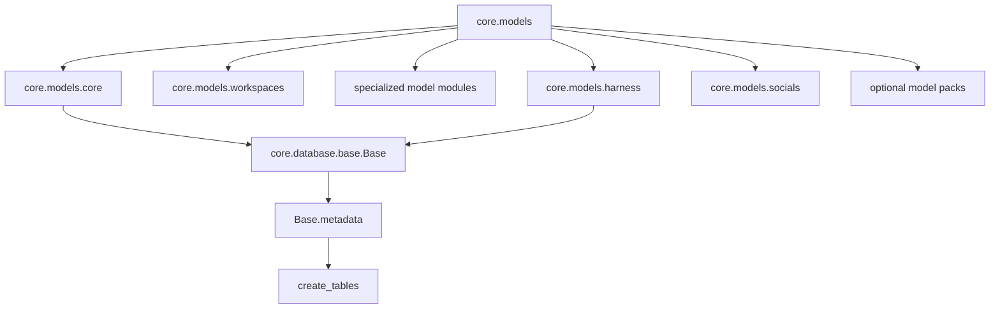
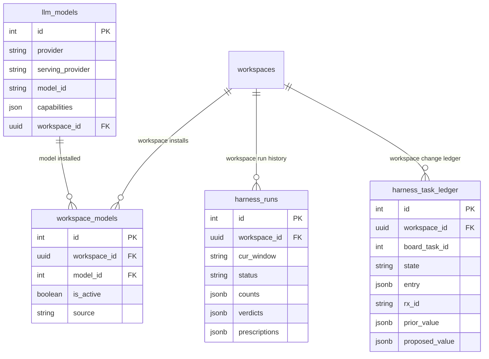
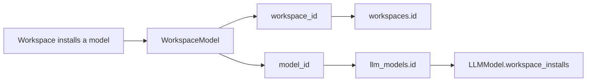
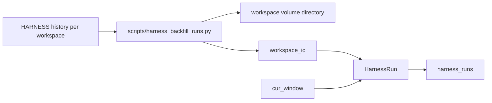
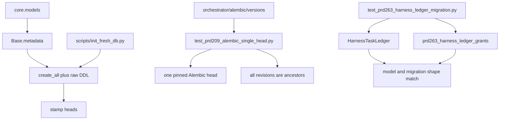

# Database Models & Migrations

Relevant source files

The following files were used as context for generating this wiki page:

- [orchestrator/alembic/versions/prd263_harness_ledger_grants.py](orchestrator/alembic/versions/prd263_harness_ledger_grants.py)
- [orchestrator/alembic/versions/prd266_merge_heads.py](orchestrator/alembic/versions/prd266_merge_heads.py)
- [orchestrator/alembic/versions/prd266_mobile_devices.py](orchestrator/alembic/versions/prd266_mobile_devices.py)
- [orchestrator/core/auth/device.py](orchestrator/core/auth/device.py)
- [orchestrator/core/best_effort.py](orchestrator/core/best_effort.py)
- [orchestrator/core/database/database.py](orchestrator/core/database/database.py)
- [orchestrator/core/database/pool_watch.py](orchestrator/core/database/pool_watch.py)
- [orchestrator/core/health_probe.py](orchestrator/core/health_probe.py)
- [orchestrator/core/models/__init__.py](orchestrator/core/models/__init__.py)
- [orchestrator/core/models/core.py](orchestrator/core/models/core.py)
- [orchestrator/core/models/harness.py](orchestrator/core/models/harness.py)
- [orchestrator/core/services/auto_cadence.py](orchestrator/core/services/auto_cadence.py)
- [orchestrator/router_manifest.py](orchestrator/router_manifest.py)
- [orchestrator/scripts/harness_backfill_runs.py](orchestrator/scripts/harness_backfill_runs.py)
- [orchestrator/services/themes/data/core-pages.json](orchestrator/services/themes/data/core-pages.json)
- [orchestrator/tests/test_f229_health_off_the_loop.py](orchestrator/tests/test_f229_health_off_the_loop.py)
- [orchestrator/tests/test_f458_full_pool_names_its_holders.py](orchestrator/tests/test_f458_full_pool_names_its_holders.py)
- [orchestrator/tests/test_f458_health_never_waits_on_a_full_pool.py](orchestrator/tests/test_f458_health_never_waits_on_a_full_pool.py)
- [orchestrator/tests/test_prd209_alembic_single_head.py](orchestrator/tests/test_prd209_alembic_single_head.py)
- [orchestrator/tests/test_prd236_w1_routes.py](orchestrator/tests/test_prd236_w1_routes.py)
- [orchestrator/tests/test_prd251w1_render_quota.py](orchestrator/tests/test_prd251w1_render_quota.py)
- [orchestrator/tests/test_prd251w1_voice.py](orchestrator/tests/test_prd251w1_voice.py)
- [orchestrator/tests/test_prd263_harness_backfill_runs.py](orchestrator/tests/test_prd263_harness_backfill_runs.py)
- [orchestrator/tests/test_prd263_harness_history_runs.py](orchestrator/tests/test_prd263_harness_history_runs.py)
- [orchestrator/tests/test_prd263_harness_ledger_migration.py](orchestrator/tests/test_prd263_harness_ledger_migration.py)
- [orchestrator/tests/test_prd263_harness_review_cadence.py](orchestrator/tests/test_prd263_harness_review_cadence.py)
- [orchestrator/tests/test_prd266_device_lane.py](orchestrator/tests/test_prd266_device_lane.py)
- [orchestrator/tests/test_prd266_mobile_devices_model.py](orchestrator/tests/test_prd266_mobile_devices_model.py)
- [orchestrator/tests/test_prd266_mobile_devices_routes.py](orchestrator/tests/test_prd266_mobile_devices_routes.py)

## Purpose and Scope

This page explains how SQLAlchemy model definitions are collected and registered, how the shown models express relationships and workspace ownership, and how model schema choices relate to Alembic migrations. It covers the visible `LLMModel` and `WorkspaceModel` definitions, JSON/JSONB examples, the `HarnessRun` and `HarnessTaskLedger` tables, database session setup, and the tested single-head migration policy. [orchestrator/core/models/__init__.py:1-23](), [orchestrator/core/models/core.py:36-49](), [orchestrator/core/models/core.py:55-143](), [orchestrator/core/models/harness.py:61-131](), [orchestrator/tests/test_prd209_alembic_single_head.py:16-28]()

Sources: `orchestrator/core/models/__init__.py`, `orchestrator/core/models/core.py`, `orchestrator/core/models/harness.py`, `orchestrator/core/database/database.py`, `orchestrator/tests/test_prd209_alembic_single_head.py`

---

## 1. Model Organization & Architecture

`core.models` is the model aggregation package. It imports the main definitions from `core.py`, then workspace models and specialized model modules; this makes model symbols available through the package and registers their mappings for SQLAlchemy. Import order is intentional: `tools.py` is imported after `core.py` because it may extend `ToolUsageLog`. [orchestrator/core/models/__init__.py:1-17]()

The aggregation module also imports orchestration, watches, socials, harness, content provenance, ticket counters, credits, billing, proactive, and other model groups. Some optional model packs use `try`/`except ImportError`, so their absence does not prevent the package import from succeeding. [orchestrator/core/models/__init__.py:58-80](), [orchestrator/core/models/__init__.py:82-120](), [orchestrator/core/models/__init__.py:122-148]()

`core.py` imports the shared declarative `Base` from `core.database.base`, and defines association tables alongside model classes. This makes the shared metadata the registration point used by `Base.metadata.create_all`. [orchestrator/core/models/core.py:9-18](), [orchestrator/core/database/database.py:17-18](), [orchestrator/core/database/database.py:106-113]()

### Module Layout

Sources: `orchestrator/core/models/__init__.py:1-23`, `orchestrator/core/models/__init__.py:58-80`, `orchestrator/core/models/__init__.py:101-149`, `orchestrator/core/models/core.py:9-18`, `orchestrator/core/models/harness.py:20-35`, `orchestrator/core/database/database.py:106-113`

---

## 2. Core Entity Models & JSONB Handling

### LLM Registry and Workspace Installs

`LLMModel` maps to `llm_models`. Its columns describe model identity and serving provider, capabilities, token limits, supported features, costs, status, marketplace metadata, and timestamps. `capabilities` and `recommended_for` use SQLAlchemy `JSON`; these declarations are not PostgreSQL `JSONB` columns in the shown model excerpt. The model also declares a uniqueness constraint on `(serving_provider, model_id)`. [orchestrator/core/models/core.py:55-65](), [orchestrator/core/models/core.py:67-119]()

`LLMModel.workspace_id` is a nullable UUID foreign key to `workspaces.id`, allowing the model row to be workspace-scoped or system-wide. Its `workspace_installs` relationship points to `WorkspaceModel` through `back_populates="model"` and uses `cascade="all, delete-orphan"`. [orchestrator/core/models/core.py:120-124]()

`WorkspaceModel` maps to `workspace_models`. It records a required workspace foreign key and a required model foreign key, both configured with `ON DELETE CASCADE`, plus installation time, active state, and source. [orchestrator/core/models/core.py:127-136]()

The central model module defines two association tables. `agent_skills` links agents and skills, stores a required attachment priority, and enforces uniqueness for `(agent_id, skill_id)`. `workflow_agents` links workflows to agents. [orchestrator/core/models/core.py:36-49]()

### JSON and JSONB Storage

The shown `LLMModel` registry fields use SQLAlchemy `JSON` for values such as `capabilities` and `recommended_for`. The `HarnessRun` model uses PostgreSQL `JSONB` for its `counts`, `verdicts`, and `prescriptions` fields. `HarnessTaskLedger` uses `JSONB` for its entry and proposal/apply value fields, including `prior_value`, `proposed_value`, and `value_at_apply`. [orchestrator/core/models/core.py:78-95](), [orchestrator/core/models/harness.py:20-35](), [orchestrator/core/models/harness.py:64-83](), [orchestrator/core/models/harness.py:109-120]()

A migration guard documents a JSONB-specific change to `workflows.tags`: the column was changed to JSONB so PostgreSQL could build the `ix_workflows_tags_gin` GIN index, because PostgreSQL does not provide a GIN operator class for `json`. [orchestrator/tests/test_prd209_alembic_single_head.py:94-100]()

### Harness Tables: Relational Keys, Constraints, and JSONB

`HarnessTaskLedger` stores workspace-scoped HARNESS proposal and apply-rail records. It has a required cascading `workspace_id` foreign key, a unique constraint on `(workspace_id, board_task_id)`, and a unique index on `(workspace_id, rx_id)`. Its named check constraint restricts `state` to the declared ledger states. The JSONB columns hold proposal and application data. [orchestrator/core/models/harness.py:61-94]()

`HarnessRun` stores a workspace’s run for a judged ISO-week window. It has a required cascading workspace foreign key, an index on `(workspace_id, cur_window)`, and a status check constraint. Counts, verdicts, and prescriptions are JSONB columns; report text and timestamps are stored separately. [orchestrator/core/models/harness.py:97-131]()

The migration test verifies that the `HarnessTaskLedger` ORM model and its Alembic revision declare the same added columns, check constraint, and unique index. It also exercises the upgrade against both an older F156-shaped table and a `create_all`-built table, and verifies a second upgrade leaves the schema unchanged. [orchestrator/tests/test_prd263_harness_ledger_migration.py:1-14](), [orchestrator/tests/test_prd263_harness_ledger_migration.py:95-121](), [orchestrator/tests/test_prd263_harness_ledger_migration.py:124-138]()

Sources: `orchestrator/core/models/core.py:55-95`, `orchestrator/core/models/core.py:120-136`, `orchestrator/core/models/harness.py:61-94`, `orchestrator/core/models/harness.py:97-131`

---

## 3. Session Lifecycle & Multi-Tenancy

### Workspace Foreign Keys and Ownership

The shown models use `workspace_id` foreign keys to express tenant ownership. `LLMModel.workspace_id` is nullable; `WorkspaceModel.workspace_id`, `HarnessRun.workspace_id`, and `HarnessTaskLedger.workspace_id` are required and configured to cascade when the referenced workspace is deleted. [orchestrator/core/models/core.py:120-133](), [orchestrator/core/models/harness.py:61-66](), [orchestrator/core/models/harness.py:107-110]()

`WorkspaceModel.model_id` references `llm_models.id` with `ON DELETE CASCADE`. The `LLMModel.workspace_installs` ORM relationship connects the model row to its install rows using the `model` back-reference. [orchestrator/core/models/core.py:120-124](), [orchestrator/core/models/core.py:127-136]()

The HARNESS backfill implementation illustrates a workspace-scoped data migration: it imports records per workspace and ISO week, leaves an existing `(workspace, week)` run alone, and scopes its operations to a selected workspace when requested. Its tests verify that a second apply does not duplicate imported weeks. [orchestrator/scripts/harness_backfill_runs.py:8-23](), [orchestrator/scripts/harness_backfill_runs.py:35-46](), [orchestrator/tests/test_prd263_harness_backfill_runs.py:94-110]()

**Natural Language Space to Code Entity Mapping: workspace installs a model**

Sources: `orchestrator/core/models/core.py:120-136`

**Natural Language Space to Code Entity Mapping: HARNESS history is stored per workspace**

Sources: `orchestrator/scripts/harness_backfill_runs.py:5-23`, `orchestrator/scripts/harness_backfill_runs.py:35-46`, `orchestrator/core/models/harness.py:97-120`

### Database URL, Engine, and Session Boundaries

`get_database_url()` first attempts to obtain PostgreSQL connection parameters from the credential resolver. If that fails, it falls back to `DATABASE_URL` or the individual PostgreSQL configuration values; it raises an error if the required values are missing. [orchestrator/core/database/database.py:22-69]()

The module creates a SQLAlchemy engine with connection-pool settings and a `SessionLocal` factory. `get_db()` yields a session and rolls back any open transaction before closing it; `get_db_session()` commits on normal completion, rolls back and re-raises on failure, then closes the session. [orchestrator/core/database/database.py:82-95](), [orchestrator/core/database/database.py:115-140]()

`create_tables()` calls `Base.metadata.create_all(bind=engine)`. This is a schema-creation path, distinct from Alembic’s revision history; the single-head test describes the fresh-database bootstrap path as `create_all` plus raw DDL followed by stamping at `heads`. [orchestrator/core/database/database.py:106-113](), [orchestrator/tests/test_prd209_alembic_single_head.py:7-14]()

Sources: `orchestrator/core/database/database.py:22-69`, `orchestrator/core/database/database.py:82-95`, `orchestrator/core/database/database.py:106-140`, `orchestrator/tests/test_prd209_alembic_single_head.py:7-14`

---

## 4. Alembic Migrations & Single-Head Policy

The Alembic guard enforces a single-head invariant: there must be exactly one head, and the expected head is pinned in the test. It also checks that every other revision is an ancestor of that head, so databases stamped at historical revisions retain a forward upgrade path. The guard is structural and reads the revision files rather than requiring a database or Docker. [orchestrator/tests/test_prd209_alembic_single_head.py:16-28]()

The guard’s documented fresh-database path uses `scripts/init_fresh_db.py`, which builds the schema through `create_all` plus raw DDL and stamps the database at `heads`. The test also documents that the stale `init_complete_schema.sql` snapshot was removed and that revision files must not be deleted: deployed databases may have stamped those revisions, and removing an ancestor can strand them. [orchestrator/tests/test_prd209_alembic_single_head.py:7-14](), [orchestrator/tests/test_prd209_alembic_single_head.py:25-28]()

The test’s history notes show that the terminal revision changes as new migration work lands, sometimes with merge revisions joining branches. The correct invariant is the tested single head and ancestry chain, not a permanently fixed revision name in documentation. [orchestrator/tests/test_prd209_alembic_single_head.py:42-50]()

### Migration Shape and Idempotency

The HARNESS ledger migration test treats model/migration agreement as a schema contract. It checks that the migration adds the expected columns, relaxes `board_task_id` nullability, replaces the state check constraint, rewrites legacy `held` rows to `expired`, and creates the unique index. It also checks that the downgrade removes the introduced index, constraint, and columns. [orchestrator/tests/test_prd263_harness_ledger_migration.py:95-121]()

The same test applies the migration to an older F156 table and verifies that the result matches the ORM model’s schema shape. Applying the migration a second time leaves that shape unchanged. [orchestrator/tests/test_prd263_harness_ledger_migration.py:124-138]()

The single-head guard additionally requires the fresh path to be wired and the revision chain to remain intact. It describes fresh databases as being built through the initialization script rather than replaying the historical revision forest from an empty database. [orchestrator/tests/test_prd209_alembic_single_head.py:7-14](), [orchestrator/tests/test_prd209_alembic_single_head.py:25-28]()

### Migration Verification Data Flow

Sources: `orchestrator/core/models/__init__.py:1-23`, `orchestrator/core/models/core.py:9-18`, `orchestrator/tests/test_prd209_alembic_single_head.py:7-28`, `orchestrator/tests/test_prd263_harness_ledger_migration.py:95-138`

---

## 5. Workspace Purge & Maintenance

The shown foreign keys establish database-level cascade behavior for selected workspace-owned rows: deleting a workspace cascades to `WorkspaceModel` installs, `HarnessRun` rows, and `HarnessTaskLedger` rows. The supplied excerpts do not show a complete workspace-purge routine or its operational sequence, so those model-level cascades should not be read as a description of all purge behavior. [orchestrator/core/models/core.py:127-133](), [orchestrator/core/models/harness.py:61-66](), [orchestrator/core/models/harness.py:107-110]()

The HARNESS backfill script provides a separate maintenance example. It defaults to dry-run behavior; with `--apply`, it imports missing workspace/week records, and it only removes files when `--remove-files` is also requested and the import has been verified for that workspace. [orchestrator/scripts/harness_backfill_runs.py:20-46]()

Sources: `orchestrator/core/models/core.py:127-133`, `orchestrator/core/models/harness.py:61-66`, `orchestrator/core/models/harness.py:107-110`, `orchestrator/scripts/harness_backfill_runs.py:20-46`

---