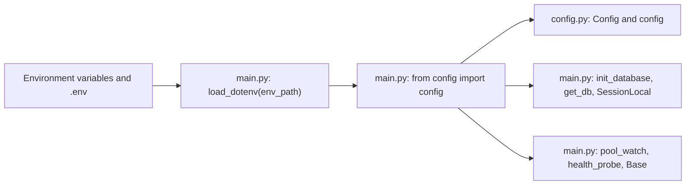
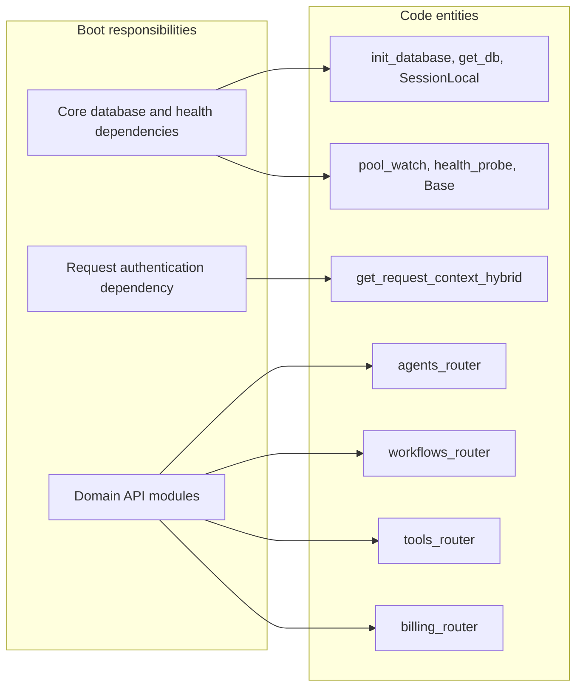
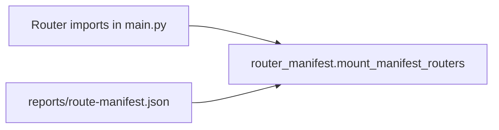
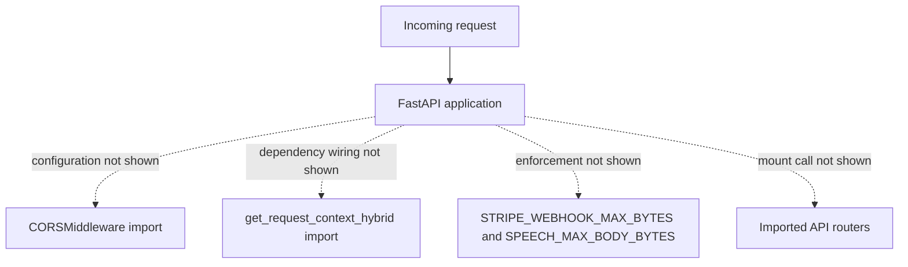
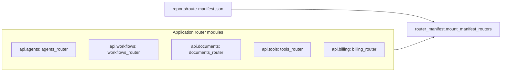

# FastAPI Application & Boot Phases

Relevant source files

The following files were used as context for generating this wiki page:

- [frontend/lib/api-client.ts](frontend/lib/api-client.ts)
- [orchestrator/api/socials.py](orchestrator/api/socials.py)
- [orchestrator/config.py](orchestrator/config.py)
- [orchestrator/main.py](orchestrator/main.py)
- [orchestrator/modules/socials/__init__.py](orchestrator/modules/socials/__init__.py)
- [orchestrator/modules/socials/render.py](orchestrator/modules/socials/render.py)
- [orchestrator/modules/socials/service.py](orchestrator/modules/socials/service.py)
- [orchestrator/reports/config-surface.json](orchestrator/reports/config-surface.json)
- [orchestrator/reports/route-manifest.json](orchestrator/reports/route-manifest.json)
- [orchestrator/tests/test_prd251_api.py](orchestrator/tests/test_prd251_api.py)

## Purpose & Scope

This page describes the application bootstrap and request-entry points visible in `orchestrator/main.py`: environment and configuration imports, database and health-related imports, authentication dependency wiring, router imports, and the available evidence about middleware. The supplied file excerpt does not include the lifespan implementation or the later app-construction and middleware-registration code, so this page does not infer their exact startup order or runtime behavior. [orchestrator/main.py:1-117]()

Sources: [orchestrator/main.py:1-117]()

---

## 1. Application Initialization & Lifespan Management

`orchestrator/main.py` is identified as the main FastAPI application module. It imports `asynccontextmanager` and FastAPI’s `FastAPI`, `Request`, and `WebSocket` types, but the supplied excerpt does not show the lifespan function or the code that constructs the application. The precise lifespan startup and shutdown sequence therefore cannot be established from the available lines. [orchestrator/main.py:1-18]()

Before importing centralized configuration, the module loads an `.env` file located relative to `main.py`. It then imports `config` and `mount_manifest_routers`, followed by database initialization/session symbols, pool-watch support, health probes, and ORM `Base`. These are imports and initialization dependencies; the excerpt does not show when or how each is invoked. [orchestrator/main.py:31-43]()

`orchestrator/config.py` documents the centralized configuration policy: it is the designated location for configuration reads through `os.getenv()`. It loads the repository-level `.env` file and defines `Config`; the shown database settings include `DATABASE_URL` and individual PostgreSQL parameters, while Redis settings include host, port, password, and database fields. [orchestrator/config.py:1-7](), [orchestrator/config.py:38-57](), [orchestrator/config.py:74-93]()

### Environment-to-Code Mapping

**Diagram: Environment setup and imported boot dependencies**

Sources: [orchestrator/main.py:31-43](), [orchestrator/config.py:1-7](), [orchestrator/config.py:38-57]()

### Lifespan Evidence and Limits

The imports show that `asynccontextmanager` is available to the module, and `FastAPI` is imported as the application framework. The excerpt does not include a decorated lifespan function, `FastAPI(...)` construction, or startup/shutdown handlers; no specific lifespan behavior should be inferred from these imports alone. [orchestrator/main.py:8-18]()

Sources: [orchestrator/main.py:8-18]()

---

## 2. Boot Phases: Core, Trust Gate, & Extensions

The available source supports identifying three groups of boot-related responsibilities, but not an exact execution sequence called “Phase 1,” “Trust Gate,” or “Phase 2.” The database, health, and model modules are imported together; `get_request_context_hybrid` is imported as an authentication dependency; and numerous API routers are imported for later application wiring. The shown lines do not establish when those routers are mounted or whether startup is divided into named phases. [orchestrator/main.py:20](), [orchestrator/main.py:35-43](), [orchestrator/main.py:45-117]()

### Core Imports, Authentication Dependency, and Router Modules

- **Core infrastructure dependencies:** `main.py` imports `init_database`, `get_db`, and `SessionLocal` from `core.database.database`, plus `pool_watch`, `health_probe`, and `Base`. The excerpt shows these imports, not calls to initialize the database or start monitoring. [orchestrator/main.py:39-43]()
- **Authentication dependency:** `get_request_context_hybrid` is imported from `core.auth.hybrid`. Its import establishes a dependency available to the module; the excerpt does not show endpoint dependency declarations or global authentication middleware. [orchestrator/main.py:20]()
- **Domain router modules:** The module imports routers for agents, workflows, documents, tools, routing, billing, notifications, themes, and other domains. The excerpt does not show the corresponding `include_router` or manifest-mount call sites. [orchestrator/main.py:45-117]()

**Diagram: Natural-language boot responsibilities mapped to code symbols**

Sources: [orchestrator/main.py:20](), [orchestrator/main.py:39-43](), [orchestrator/main.py:47-53](), [orchestrator/main.py:69-85]()

### Router Mounting Boundary

`main.py` imports `mount_manifest_routers` from `router_manifest` and labels the import as a fail-loud router-mount mechanism. The provided excerpt does not show its invocation or the arguments passed to it, so the mount sequence and failure conditions are not documented here. [orchestrator/main.py:35-38]()

**Diagram: Router-mount concept mapped to manifest symbols**

Sources: [orchestrator/main.py:35-38](), [orchestrator/reports/route-manifest.json:1-3]()

---

## 3. Middleware Stack & Request Pipeline

The supplied `main.py` excerpt imports `CORSMiddleware` and several FastAPI request/response types. An import does not prove that middleware is installed or reveal its options or ordering. The excerpt therefore does not support a definitive middleware stack or request-pipeline ordering. [orchestrator/main.py:16-19]()

The module also imports constants for Stripe webhook and voice-speech body limits: `STRIPE_WEBHOOK_MAX_BYTES` and `SPEECH_MAX_BODY_BYTES`, along with their route symbols. These imports indicate that the application references route-specific body-limit definitions, but the available lines do not show how those limits are enforced. [orchestrator/main.py:84-86]()

`get_request_context_hybrid` is imported from `core.auth.hybrid`; this is an authentication dependency symbol, not evidence of a middleware layer. The supplied lines do not show it being attached globally or applied to individual routes. [orchestrator/main.py:20]()

### Middleware and Request-Handling Evidence

| Concern | Evidence in the supplied excerpt | What is not shown |
|---|---|---|
| CORS | `CORSMiddleware` is imported. [orchestrator/main.py:16-18]() | Whether it is added to the app, its configuration, and its position in the stack. |
| Authentication context | `get_request_context_hybrid` is imported. [orchestrator/main.py:20]() | Whether it is used as a dependency, middleware, or both. |
| Route body limits | Stripe and speech body-limit constants and route symbols are imported. [orchestrator/main.py:84-86]() | The enforcement code and the response behavior for oversized requests. |
| Exception/response handling | `JSONResponse` is imported. [orchestrator/main.py:16-19]() | Any exception handlers or response-wrapping behavior. |

Sources: [orchestrator/main.py:16-20](), [orchestrator/main.py:84-86]()

**Diagram: Request-related symbols visible in `main.py`**

Sources: [orchestrator/main.py:16-20](), [orchestrator/main.py:45-117]()

---

## 4. Router Organization & Manifest Integration

`main.py` imports a broad set of API router objects, including `agents_router`, `workflows_router`, `documents_router`, `tools_router`, `billing_router`, and notification and theme routers. The import list identifies the route modules available to the application, but the supplied excerpt does not show how they are registered with the FastAPI instance. [orchestrator/main.py:45-117]()

The module imports `mount_manifest_routers` from `router_manifest`, with a comment describing it as a fail-loud router-mount mechanism. Separately, `orchestrator/reports/route-manifest.json` begins with a `route_count` of `1016` and a `routes` array. Those lines establish the presence and reported count in that inventory file, but do not establish how the manifest is generated, validated, or consumed at runtime. [orchestrator/main.py:35-38](), [orchestrator/reports/route-manifest.json:1-4]()

**Diagram: Router inventory and mount integration symbols**

Sources: [orchestrator/main.py:35-38](), [orchestrator/main.py:47-53](), [orchestrator/main.py:69-85](), [orchestrator/reports/route-manifest.json:1-4]()

---