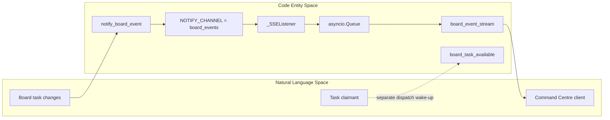
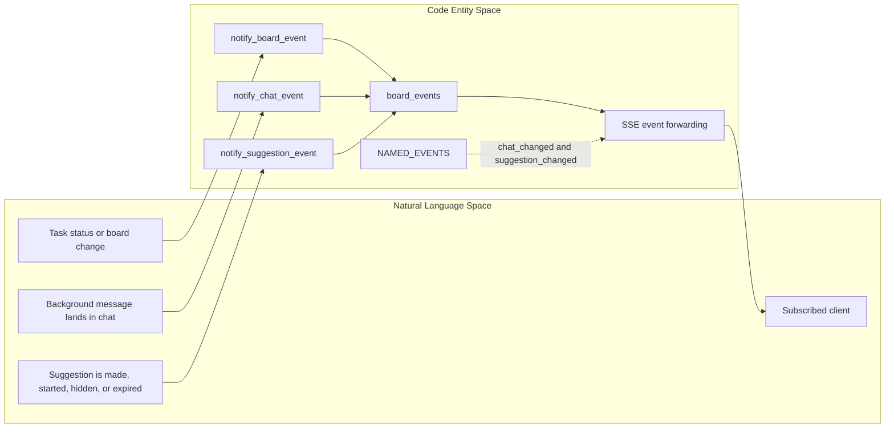
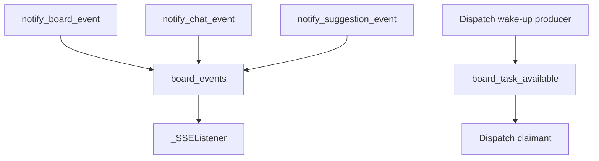
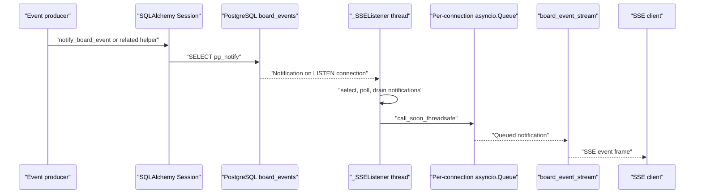

# Real-Time Updates

Relevant source files

The following files were used as context for generating this wiki page:

- [docs/PRDS/PRD-228-FLEET-STATE.md](docs/PRDS/PRD-228-FLEET-STATE.md)
- [frontend/components/agents/__tests__/use-fleet-state.test.tsx](frontend/components/agents/__tests__/use-fleet-state.test.tsx)
- [frontend/components/command-center/__tests__/board-event-stream.test.tsx](frontend/components/command-center/__tests__/board-event-stream.test.tsx)
- [frontend/hooks/use-board-event-stream.ts](frontend/hooks/use-board-event-stream.ts)
- [frontend/lib/chat/api.ts](frontend/lib/chat/api.ts)
- [orchestrator/alembic/versions/prd206_chat_summary.py](orchestrator/alembic/versions/prd206_chat_summary.py)
- [orchestrator/api/fleet.py](orchestrator/api/fleet.py)
- [orchestrator/services/audit_retention.py](orchestrator/services/audit_retention.py)
- [orchestrator/services/board_events.py](orchestrator/services/board_events.py)
- [orchestrator/services/escalation_service.py](orchestrator/services/escalation_service.py)
- [orchestrator/services/memory_archival_job.py](orchestrator/services/memory_archival_job.py)
- [orchestrator/services/memory_jobs.py](orchestrator/services/memory_jobs.py)
- [orchestrator/services/watch_actions.py](orchestrator/services/watch_actions.py)
- [orchestrator/services/watch_rerun.py](orchestrator/services/watch_rerun.py)
- [orchestrator/tests/test_board_dispatch.py](orchestrator/tests/test_board_dispatch.py)
- [orchestrator/tests/test_board_sse_listen_notify.py](orchestrator/tests/test_board_sse_listen_notify.py)
- [orchestrator/tests/test_p2w2_audit_retention.py](orchestrator/tests/test_p2w2_audit_retention.py)
- [orchestrator/tests/test_p2w2_governance_audit.py](orchestrator/tests/test_p2w2_governance_audit.py)
- [orchestrator/tests/test_p2w2_governance_policy_budget.py](orchestrator/tests/test_p2w2_governance_policy_budget.py)
- [orchestrator/tests/test_prd197_substrate.py](orchestrator/tests/test_prd197_substrate.py)
- [orchestrator/tests/test_prd204_rerun.py](orchestrator/tests/test_prd204_rerun.py)
- [orchestrator/tests/test_prd204_run_verdict.py](orchestrator/tests/test_prd204_run_verdict.py)
- [orchestrator/tests/test_prd204_silent_holes.py](orchestrator/tests/test_prd204_silent_holes.py)
- [orchestrator/tests/test_prd204_watch_actions.py](orchestrator/tests/test_prd204_watch_actions.py)
- [orchestrator/tests/test_prd206_thread_checkpoint.py](orchestrator/tests/test_prd206_thread_checkpoint.py)
- [orchestrator/tests/test_prd224_ticket_watch_actions.py](orchestrator/tests/test_prd224_ticket_watch_actions.py)

## Purpose and scope

This page documents the real-time mechanisms supported by the supplied source: PostgreSQL `LISTEN`/`NOTIFY` board and related events, their bridge to an asynchronous SSE listener, and the separate board-dispatch wake-up channel. The supplied files do not show a Redis Pub/Sub implementation or an AI SDK Data Stream implementation, so those protocols cannot be described here as established codebase behavior. [orchestrator/services/board_events.py:1-20](), [orchestrator/tests/test_board_sse_listen_notify.py:1-15]()

Sources: [orchestrator/services/board_events.py:1-20](), [orchestrator/tests/test_board_sse_listen_notify.py:1-15]()

## 1. Overview

The board’s real-time update path uses the PostgreSQL `board_events` channel. A producer calls a notification helper, which issues `pg_notify`; a listener uses a dedicated raw PostgreSQL connection and a worker thread to receive notifications and pass them to an asynchronous queue. The module documents that the SSE generator drains that queue for subscribed clients. [orchestrator/services/board_events.py:1-14](), [orchestrator/services/board_events.py:147-179]()

Board dispatch has a separate purpose and channel: `board_task_available` wakes the dispatch loop, while `board_events` carries UI-facing changes. They are not interchangeable signals. [orchestrator/services/board_events.py:16-20](), [orchestrator/services/board_events.py:36-42]()

**Diagram: Natural-language board update mapped to code entities**

Sources: [orchestrator/services/board_events.py:1-20](), [orchestrator/services/board_events.py:36-57](), [orchestrator/services/board_events.py:147-179]()

**Diagram: Natural-language event types mapped to notification helpers**

Sources: [orchestrator/services/board_events.py:19-20](), [orchestrator/services/board_events.py:36-42](), [orchestrator/services/board_events.py:45-57](), [orchestrator/services/board_events.py:78-109](), [orchestrator/services/board_events.py:111-145]()

## 2. PostgreSQL notification channels

### `board_events`: UI event fan-out

`NOTIFY_CHANNEL` is `board_events`. The module defines `notify_board_event`, `notify_chat_event`, and `notify_suggestion_event` as producers on that channel. Board-task payloads include `workspace_id`, `task_id`, `status`, and `event`; chat payloads include `workspace_id`, `chat_id`, `user_id`, and `event`; suggestion payloads include `workspace_id`, `suggestion_id`, `user_id`, `status`, and the `suggestion_changed` event name. [orchestrator/services/board_events.py:36-42](), [orchestrator/services/board_events.py:45-75](), [orchestrator/services/board_events.py:78-109](), [orchestrator/services/board_events.py:111-145]()

The helper functions treat `NOTIFY` as best-effort: notification failures are caught rather than propagated into the caller’s request path. The suggestion helper wraps its database operation in a nested transaction. [orchestrator/services/board_events.py:53-75](), [orchestrator/services/board_events.py:119-145]()

### `board_task_available`: dispatch wake-up

`board_task_available` is explicitly described as a claimant wake-up, not a UI refresh signal. Keep it conceptually separate from `board_events`, which the event-stream module identifies as the client-facing notification channel. [orchestrator/services/board_events.py:16-20](), [orchestrator/services/board_events.py:36-42]()

**Diagram: Event producers and channel separation**

Sources: [orchestrator/services/board_events.py:16-20](), [orchestrator/services/board_events.py:36-42](), [orchestrator/services/board_events.py:45-57](), [orchestrator/services/board_events.py:78-109](), [orchestrator/services/board_events.py:111-145]()

## 3. SSE listener and event handling

### Listener thread and asynchronous queue

`_SSEListener` is a daemon `threading.Thread` intended to hold one raw PostgreSQL `LISTEN` connection. Its `run` method obtains a raw connection from the database engine, enables autocommit, and executes `LISTEN` for `NOTIFY_CHANNEL`. It waits for connection readability with `select.select`, calls `poll()`, and bridges notifications to the event loop using `call_soon_threadsafe` and the per-connection `asyncio.Queue`. [orchestrator/services/board_events.py:147-179]()

This thread-to-async boundary keeps the blocking PostgreSQL listener outside the async SSE generator’s event loop. The module describes one queue per SSE connection, so a notification can be delivered to that connection’s stream. [orchestrator/services/board_events.py:9-14](), [orchestrator/services/board_events.py:147-153]()

### Event names and workspace filtering

The module declares `chat_changed` and `suggestion_changed` in `NAMED_EVENTS`, to forward those event types under their own names; other events are treated as board refresh events. The tests establish that the stream sends an initial `board_changed` frame, yields a `board_changed` frame after a matching workspace notification, and does not deliver another workspace’s notification to the stream. [orchestrator/services/board_events.py:36-42](), [orchestrator/tests/test_board_sse_listen_notify.py:109-145](), [orchestrator/tests/test_board_sse_listen_notify.py:148-164]()

### Delivery semantics

`NOTIFY` is an optimization, not the durable source of correctness: the service documentation says a dropped notification means the client waits for a later event or heartbeat to refresh. The SSE tests also distinguish a heartbeat comment from an event frame and use the heartbeat as the fallback when an event belongs to another workspace. [orchestrator/services/board_events.py:9-14](), [orchestrator/tests/test_board_sse_listen_notify.py:12-15]()

**Diagram: PostgreSQL notification to an SSE client**

Sources: [orchestrator/services/board_events.py:45-75](), [orchestrator/services/board_events.py:78-109](), [orchestrator/services/board_events.py:111-145](), [orchestrator/services/board_events.py:147-179]()

## 4. Testing and operational guarantees

The board-event tests exercise both PostgreSQL delivery and stream behavior. The database-backed tests verify that `notify_board_event` publishes a JSON payload on `board_events` and that the stream yields a `board_changed` frame after a matching notification. The tests skip the database-backed cases when PostgreSQL is unavailable. [orchestrator/tests/test_board_sse_listen_notify.py:1-15](), [orchestrator/tests/test_board_sse_listen_notify.py:44-60](), [orchestrator/tests/test_board_sse_listen_notify.py:63-95](), [orchestrator/tests/test_board_sse_listen_notify.py:109-145]()

The tests also verify tenant isolation by sending a notification for a different workspace and asserting it does not reach the subscribed stream. [orchestrator/tests/test_board_sse_listen_notify.py:148-164]()

Sources: [orchestrator/tests/test_board_sse_listen_notify.py:1-15](), [orchestrator/tests/test_board_sse_listen_notify.py:44-60](), [orchestrator/tests/test_board_sse_listen_notify.py:63-95](), [orchestrator/tests/test_board_sse_listen_notify.py:109-164]()

## 5. Redis Pub/Sub and AI SDK Data Stream protocol

The supplied source excerpts establish PostgreSQL `LISTEN`/`NOTIFY` for board-related real-time events. They do not establish Redis Pub/Sub participation in that path, nor do they include the chat streaming endpoint or implementation details needed to document the AI SDK Data Stream protocol. Those mechanisms are therefore outside the implementation claims of this page. [orchestrator/services/board_events.py:1-20](), [orchestrator/tests/test_board_sse_listen_notify.py:1-15]()

Sources: [orchestrator/services/board_events.py:1-20](), [orchestrator/tests/test_board_sse_listen_notify.py:1-15]()

---