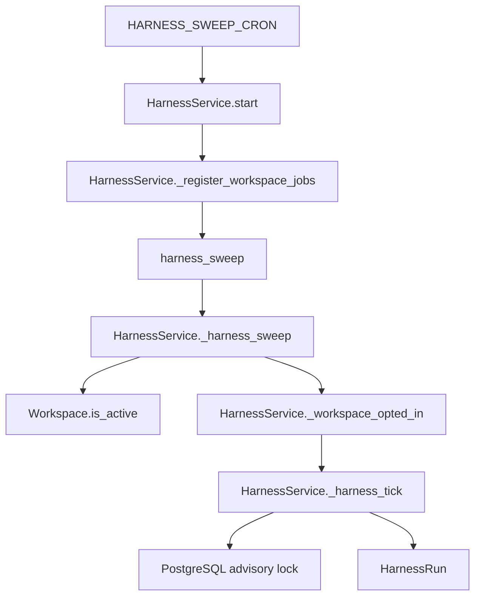
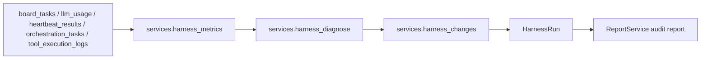
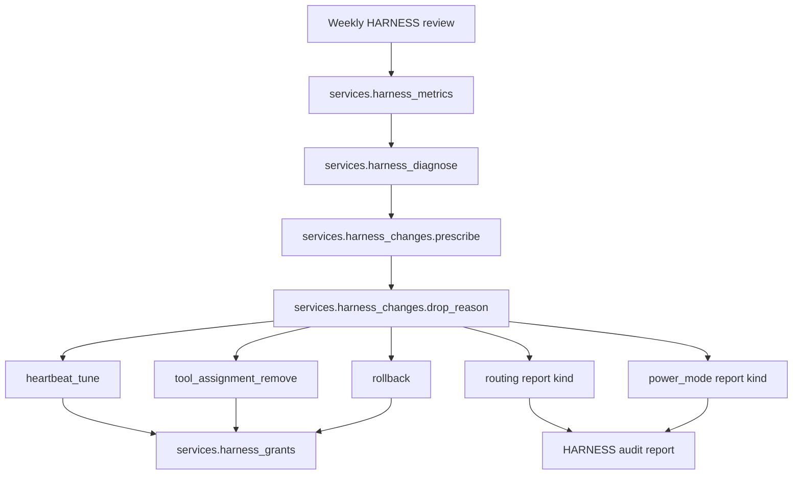
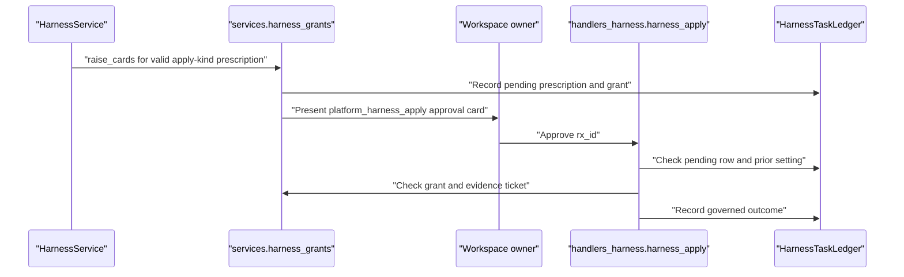
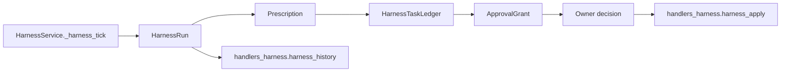
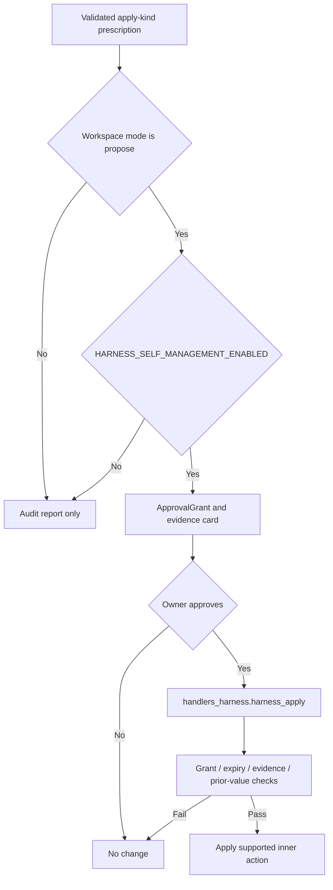

# Self-Management Harness

Relevant source files

The following files were used as context for generating this wiki page:

- [docs/platform-actions/self-management-harness.md](docs/platform-actions/self-management-harness.md)
- [frontend/components/activity/widgets/__tests__/self-learning-health-widget.test.tsx](frontend/components/activity/widgets/__tests__/self-learning-health-widget.test.tsx)
- [frontend/components/activity/widgets/command-centre-dashboard.tsx](frontend/components/activity/widgets/command-centre-dashboard.tsx)
- [frontend/components/activity/widgets/self-learning-health-widget.tsx](frontend/components/activity/widgets/self-learning-health-widget.tsx)
- [frontend/hooks/use-learning-api.ts](frontend/hooks/use-learning-api.ts)
- [orchestrator/api/harness.py](orchestrator/api/harness.py)
- [orchestrator/modules/tools/discovery/actions_harness.py](orchestrator/modules/tools/discovery/actions_harness.py)
- [orchestrator/modules/tools/discovery/handlers_harness.py](orchestrator/modules/tools/discovery/handlers_harness.py)
- [orchestrator/modules/tools/discovery/signal_recorder.py](orchestrator/modules/tools/discovery/signal_recorder.py)
- [orchestrator/scripts/check_hierarchy_gate.py](orchestrator/scripts/check_hierarchy_gate.py)
- [orchestrator/services/harness_cards.py](orchestrator/services/harness_cards.py)
- [orchestrator/services/harness_changes.py](orchestrator/services/harness_changes.py)
- [orchestrator/services/harness_grants.py](orchestrator/services/harness_grants.py)
- [orchestrator/services/harness_metrics.py](orchestrator/services/harness_metrics.py)
- [orchestrator/services/harness_service.py](orchestrator/services/harness_service.py)
- [orchestrator/tests/helpers_harness_changes.py](orchestrator/tests/helpers_harness_changes.py)
- [orchestrator/tests/helpers_harness_grants.py](orchestrator/tests/helpers_harness_grants.py)
- [orchestrator/tests/test_harness_api.py](orchestrator/tests/test_harness_api.py)
- [orchestrator/tests/test_harness_power_mode.py](orchestrator/tests/test_harness_power_mode.py)
- [orchestrator/tests/test_harness_routing_rule.py](orchestrator/tests/test_harness_routing_rule.py)
- [orchestrator/tests/test_prd263_harness_apply_action.py](orchestrator/tests/test_prd263_harness_apply_action.py)
- [orchestrator/tests/test_prd263_harness_changes_registry.py](orchestrator/tests/test_prd263_harness_changes_registry.py)
- [orchestrator/tests/test_prd263_harness_grep_gate.py](orchestrator/tests/test_prd263_harness_grep_gate.py)
- [orchestrator/tests/test_prd263_harness_report_only.py](orchestrator/tests/test_prd263_harness_report_only.py)
- [orchestrator/tests/test_prd263_harness_tool_failure_window.py](orchestrator/tests/test_prd263_harness_tool_failure_window.py)
- [orchestrator/tests/test_prd263_self_learning_endpoint.py](orchestrator/tests/test_prd263_self_learning_endpoint.py)
- [orchestrator/tests/test_tool_routing_hardening.py](orchestrator/tests/test_tool_routing_hardening.py)
- [orchestrator/tests/test_w1s9_idle_in_tx.py](orchestrator/tests/test_w1s9_idle_in_tx.py)

## Purpose and Scope

HARNESS reviews a workspace’s agent activity weekly, compares observed performance with a reference period, records suggested configuration changes, and files an audit report attributed to Auto. In `report_only` mode it changes nothing. In `propose` mode, eligible apply-kind suggestions can become owner approval cards; a supported change is applied only after owner approval. [docs/platform-actions/self-management-harness.md:25-25]()

This page describes `HarnessService`, its scheduling and status surfaces, workspace modes, the diagnosis and prescription flow, the approval and ledger governance path, and the available harness API and platform-tool entry points. Routing and power-mode suggestions are report-only change kinds, not executable HARNESS changes. [orchestrator/tests/test_prd263_harness_changes_registry.py:1-15]()

Sources: [docs/platform-actions/self-management-harness.md:25-25](), [orchestrator/tests/test_prd263_harness_changes_registry.py:1-15]()

---

## 1. HarnessService Core Architecture & Lifecycle

`HarnessService` owns the weekly review lifecycle. `start()` uses a supplied `AsyncIOScheduler`, or creates and starts one with a `MemoryJobStore`. It registers the workspace sweep and schedules the daily approval-grant sweep through `harness_grants.schedule_sweep()`. [orchestrator/services/harness_service.py:63-91]()

The workspace sweep is registered as a single cron job named `harness_sweep` with `max_instances=1`. That job queries active workspaces, filters them through `_workspace_opted_in()`, then sequentially calls `_harness_tick(workspace_id=..., sweep=True)` for eligible workspaces. [orchestrator/services/harness_service.py:93-133]()

The run policy uses a workspace advisory lock and skips a judged ISO week that already has a completed or dormant run. Manual triggering can bypass the once-per-week skip. [docs/platform-actions/self-management-harness.md:43-47]()

Sources: [orchestrator/services/harness_service.py:63-133](), [docs/platform-actions/self-management-harness.md:43-47]()

### Status and Observability

`get_status()` supports the states `running`, `disabled`, `failed`, `dormant_insufficient_agents`, `scheduled_not_run_yet`, and `completed`. Completed status includes coverage, convergence, and verdict counts. The service’s status documentation says run history comes from `harness_runs`, while running status is determined from PostgreSQL locks. [orchestrator/services/harness_service.py:139-160]()

The `harness_status` platform-tool handler calls `get_harness_service().get_status()` and returns its result in a success response. If status retrieval raises an exception, the handler logs it and returns a stable unavailable message. [orchestrator/modules/tools/discovery/handlers_harness.py:62-73]()

#### Diagram: Scheduler and Sweep Mapped to Code Entities

Sources: [orchestrator/services/harness_service.py:74-133](), [docs/platform-actions/self-management-harness.md:43-47]()

### Run Lifecycle and Collection

A run judges the last complete ISO week, identified by `cur_window`. A workspace with fewer than three active agents is marked `dormant_insufficient_agents`; otherwise, HARNESS collects weekly counts, diagnoses agents and metrics, prepares suggestions, and files an audit report titled `HARNESS Weekly Org Review — Run #n`. [docs/platform-actions/self-management-harness.md:47-58]()

`harness_metrics` is a read-only SQL read model. It returns raw counts for each agent and week, including zero-count rows for roster agents with no activity; it does not calculate rates or percentages, write data, call a model, or invoke a platform action. Its inputs include board tasks, `llm_usage`, heartbeat results, orchestration tasks, and production tool-execution logs. [orchestrator/services/harness_metrics.py:1-49]()

#### Diagram: Operational Records to Audit Report

Sources: [orchestrator/services/harness_metrics.py:1-49](), [docs/platform-actions/self-management-harness.md:54-58]()

Sources: [orchestrator/services/harness_service.py:42-59](), [orchestrator/services/harness_service.py:112-160](), [orchestrator/services/harness_metrics.py:1-49](), [docs/platform-actions/self-management-harness.md:47-58]()

---

## 2. Modes, Diagnosis, and Prescription Lifecycle

### Workspace Modes

The per-workspace setting is `orchestrator.harness.mode`. The supported values are `report_only`, `propose`, and `disabled`. Legacy values are interpreted compatibly: `full_auto` and `manual` read as report-only, while retired disabled/enabled booleans read as disabled where applicable. [docs/platform-actions/self-management-harness.md:31-41]()

| Mode | Effect |
|---|---|
| `report_only` | Runs the weekly review and files an audit report without changing configuration or raising approval cards. |
| `disabled` | Does not run for the workspace; a manual trigger reports that HARNESS is disabled. |
| `propose` | Eligible apply-kind suggestions may produce owner approval cards when the installation-level self-management setting is enabled. No change occurs until approval. |

[docs/platform-actions/self-management-harness.md:33-41]()

`HARNESS_SWEEP_CRON` is an installation setting evaluated in UTC, not a workspace schedule. Its documented default is `0 10 * * 1` (Monday at 10:00 UTC). [docs/platform-actions/self-management-harness.md:43-47]()

Sources: [docs/platform-actions/self-management-harness.md:31-47]()

### Diagnosis and Verdicts

Diagnosis compares the judged week with a clean reference period, excluding weeks already flagged and weeks after a change. Thresholds are `HARNESS_*` settings, with Benjamini–Hochberg correction across the run. [docs/platform-actions/self-management-harness.md:54-57]()

| Verdict | Meaning |
|---|---|
| `INSUFFICIENT_DATA` | Too few current or reference samples to judge; this is not treated as stable. |
| `STABLE` | No metric worsened beyond the configured thresholds. |
| `WATCH` | A first flag for a worsened metric. |
| `REGRESSION` | A flag in two consecutive ISO weeks, or a sufficiently strong single-week result. |

[docs/platform-actions/self-management-harness.md:60-67]()

Coverage is the number of agents judged divided by active agents, excluding Auto. Convergence is `insufficient_data` when coverage is below the configured minimum; otherwise it is `regression` if any agent has that verdict, `watching` if any agent is in `WATCH`, and `steady` if not. [docs/platform-actions/self-management-harness.md:69-71]()

Sources: [docs/platform-actions/self-management-harness.md:54-71]()

### Change-Kind Registry and Routing/Power Suggestions

`services.harness_changes` defines the change kinds used by PRESCRIBE. Apply kinds include `heartbeat_tune`, `tool_assignment_remove`, and `rollback`; report kinds include `reconnect_app`, `model`, `description`, `temperature`, `tags`, `routing`, and `power_mode`. Routing and power-mode suggestions are report lines only. [orchestrator/tests/test_prd263_harness_changes_registry.py:1-15](), [orchestrator/tests/test_prd263_harness_changes_registry.py:33-43](), [orchestrator/tests/test_prd263_harness_changes_registry.py:62-68]()

The registry tests establish that apply kinds carry detector, inner-action, parameter-builder, risk, predicted-metric, guard-metric, prior-value-reader, and rollback-builder metadata. Invalid suggestions and suggestions targeting the workspace’s Auto are dropped; the dropped reason is retained with the prescription record. [orchestrator/tests/test_prd263_harness_changes_registry.py:5-11](), [orchestrator/tests/test_prd263_harness_changes_registry.py:47-57](), [orchestrator/tests/test_prd263_harness_changes_registry.py:78-91]()

#### Diagram: Review and Prescription Mapped to Code Entities

Sources: [orchestrator/tests/test_prd263_harness_changes_registry.py:1-15](), [orchestrator/tests/test_prd263_harness_changes_registry.py:33-68](), [docs/platform-actions/self-management-harness.md:54-58]()

Sources: [docs/platform-actions/self-management-harness.md:31-71](), [orchestrator/tests/test_prd263_harness_changes_registry.py:1-15](), [orchestrator/tests/test_prd263_harness_changes_registry.py:33-91]()

---

## 3. Platform Actions and Tool Handlers

HARNESS platform-tool handlers expose status, manual triggering, history, and an owner-approved apply path. `harness_status` delegates to `HarnessService.get_status()`. `harness_trigger` checks whether the workspace is enabled before calling `trigger_now()`; its response states that the review judges the last complete ISO week, files an audit report, and changes nothing. `harness_history` reads recent rows from `harness_runs`, with a default limit of 10 and maximum of 52. [orchestrator/modules/tools/discovery/handlers_harness.py:27-37](), [orchestrator/modules/tools/discovery/handlers_harness.py:62-107]()

The `harness_apply` handler is documented as the only HARNESS path that changes an agent setting. It checks the prescription’s ledger row and associated approval, evidence-ticket state, and whether the setting still has its prior value. [orchestrator/modules/tools/discovery/handlers_harness.py:150-156]()

| Handler | Role |
|---|---|
| `harness_status` | Returns current HARNESS status from `HarnessService.get_status()`. |
| `harness_trigger` | Checks workspace mode and requests an immediate review. |
| `harness_history` | Lists recent workspace runs from `harness_runs`. |
| `harness_apply` | Applies a change after validating the associated approval and ledger state. |

[orchestrator/modules/tools/discovery/handlers_harness.py:62-107](), [orchestrator/modules/tools/discovery/handlers_harness.py:150-156]()

Sources: [orchestrator/modules/tools/discovery/handlers_harness.py:27-37](), [orchestrator/modules/tools/discovery/handlers_harness.py:62-107](), [orchestrator/modules/tools/discovery/handlers_harness.py:150-156]()

### Approval Cards and Apply Governance

In a `propose` workspace, while `HARNESS_SELF_MANAGEMENT_ENABLED` is enabled, `harness_grants.raise_cards()` raises one tool-call approval grant per valid apply-kind prescription and links it to the run’s evidence ticket. The approved action is `platform_harness_apply`, parameterized by `rx_id`. [orchestrator/services/harness_grants.py:1-13](), [orchestrator/services/harness_grants.py:45-75]()

The task ledger is moved through `harness_grants.move()`; final states cannot be moved back to open states. Reconciliation closes open ledger rows according to their grants, at the start of a HARNESS tick and in the daily sweep. The grant service is documented as making no platform-action call, invoking no tool executor, and making no model call. [orchestrator/services/harness_grants.py:1-13]()

The apply handler’s documented outcomes include expired approval, drifted setting, missing approval, blocked evidence, already-decided change, and failed or unavailable application. [orchestrator/modules/tools/discovery/handlers_harness.py:39-56]()

#### Diagram: Owner Approval to Governed Apply

Sources: [orchestrator/services/harness_grants.py:1-13](), [orchestrator/services/harness_grants.py:45-75](), [orchestrator/modules/tools/discovery/handlers_harness.py:150-156]()

Sources: [orchestrator/modules/tools/discovery/handlers_harness.py:27-56](), [orchestrator/modules/tools/discovery/handlers_harness.py:62-107](), [orchestrator/modules/tools/discovery/handlers_harness.py:150-156](), [orchestrator/services/harness_grants.py:1-13]()

---

## 4. Harness Runs Ledger and Backfill

### `harness_runs` Run History

A run is persisted as a `harness_runs` row containing the judged week, start and finish times, status, iteration, coverage, verdict counts, suggestions, audit-report information, and report-filed state. The history handler returns recent runs newest first. Its summaries include the judged window, status, timestamps, iteration, coverage and verdict fields, prescription count, and report outcome. [docs/platform-actions/self-management-harness.md:77-80](), [orchestrator/modules/tools/discovery/handlers_harness.py:95-107](), [orchestrator/modules/tools/discovery/handlers_harness.py:121-143]()

The weekly sweep uses run history to avoid repeating a completed or dormant review for the same judged week. Manual triggering is exempt from that skip; a rerun of a week already judged keeps that week’s verdicts. [docs/platform-actions/self-management-harness.md:43-47]()

Sources: [docs/platform-actions/self-management-harness.md:43-47](), [docs/platform-actions/self-management-harness.md:77-80](), [orchestrator/modules/tools/discovery/handlers_harness.py:95-107](), [orchestrator/modules/tools/discovery/handlers_harness.py:121-143]()

### `HarnessTaskLedger` and `harness_grants`

The apply rail uses `HarnessTaskLedger` to track proposed changes and their state in connection with approval grants. A grant is bound to a `platform_harness_apply` tool-call subject for the row’s `rx_id`, and grant lookup is workspace-scoped. [orchestrator/services/harness_grants.py:1-13](), [orchestrator/services/harness_grants.py:45-55](), [orchestrator/services/harness_grants.py:121-151]()

`harness_grants.reconcile()` handles open ledger rows according to grant outcomes, and `HarnessService.start()` registers the daily grant sweep. A revoked grant does not undo a change already recorded as applied. [orchestrator/services/harness_grants.py:1-13](), [orchestrator/services/harness_service.py:74-91]()

#### Diagram: Run, Prescription, Ledger, and Grant Entities

Sources: [orchestrator/services/harness_service.py:74-91](), [orchestrator/services/harness_grants.py:1-13](), [orchestrator/services/harness_grants.py:45-75](), [orchestrator/modules/tools/discovery/handlers_harness.py:95-107]()

### Backfill

The repository documents a `harness_backfill_runs.py` script, but the supplied content includes only its path in a source-file list, not its implementation. Therefore, this page does not specify the script’s arguments, selection criteria, or write behavior. [docs/platform-actions/self-management-harness.md:3-23]()

Sources: [docs/platform-actions/self-management-harness.md:3-23]()

---

## 5. Governance Gate for Self-Operation

HARNESS’s reading and judging modules are constrained from initiating model calls or tool execution. The test gate lists `harness_metrics`, `harness_mode`, `harness_verdicts`, `harness_service`, `harness_changes`, `harness_grants`, `harness_cards`, and `harness_post_change` as gated modules. It rejects executor references and LLM-client imports in those modules. [orchestrator/tests/test_prd263_harness_grep_gate.py:1-57](), [orchestrator/tests/test_prd263_harness_grep_gate.py:91-110]()

The action-registration hierarchy gate requires mutating `ActionDefinition` registrations to be hierarchy-gated, admin/super-admin-flag-gated, or explicitly allow-listed with justification. `platform_harness_trigger` and `platform_harness_apply` appear on the allow-list. The documented rationale for `platform_harness_apply` is that it is constrained by the owner’s granted, unexpired approval and handler checks. [orchestrator/scripts/check_hierarchy_gate.py:1-24](), [orchestrator/scripts/check_hierarchy_gate.py:51-81]()

#### Diagram: Governance Checks for a HARNESS Change

Sources: [orchestrator/services/harness_grants.py:1-13](), [orchestrator/services/harness_grants.py:45-75](), [orchestrator/modules/tools/discovery/handlers_harness.py:150-156](), [orchestrator/scripts/check_hierarchy_gate.py:51-81]()

Sources: [orchestrator/tests/test_prd263_harness_grep_gate.py:1-57](), [orchestrator/tests/test_prd263_harness_grep_gate.py:91-110](), [orchestrator/scripts/check_hierarchy_gate.py:1-24](), [orchestrator/scripts/check_hierarchy_gate.py:51-81]()

---

## 6. Transaction Handling and Performance

The harness tick is one of the asynchronous surfaces covered by transaction-lifecycle tests. Those tests describe the general risk: a database session can remain idle in a transaction across a long `await`; `end_open_transaction(db)` commits before the await to end that transaction. [orchestrator/tests/test_w1s9_idle_in_tx.py:1-22]()

The supplied test excerpt does not show the harness-specific ordering assertion. This page therefore does not specify the transaction boundary for individual HARNESS operations. [orchestrator/tests/test_w1s9_idle_in_tx.py:1-22]()

Sources: [orchestrator/tests/test_w1s9_idle_in_tx.py:1-22]()

---

## 7. Testing and Observability

The supplied HARNESS test material verifies change-kind registry membership, required apply-kind metadata, report-only routing and power-mode kinds, and rejection of prescriptions targeting Auto. The provided source inventory also lists tests for report-only behavior, API behavior, and other HARNESS flows, but does not include their full implementations. [orchestrator/tests/test_prd263_harness_changes_registry.py:1-15](), [orchestrator/tests/test_prd263_harness_changes_registry.py:33-90](), [docs/platform-actions/self-management-harness.md:3-23]()

The hierarchy gate and HARNESS grep gate serve different checks: one audits mutating platform-action registrations; the other checks that gated HARNESS modules do not reference executors or import LLM clients. [orchestrator/scripts/check_hierarchy_gate.py:1-24](), [orchestrator/tests/test_prd263_harness_grep_gate.py:1-10](), [orchestrator/tests/test_prd263_harness_grep_gate.py:91-110]()

The HTTP API test specifies that the harness router serves only `GET /api/harness/self-learning`. It also verifies that the self-learning health response combines HARNESS status, run information, signal count, mode, and ledger counts, and degrades failed sections to unavailable values rather than exposing internal exception details. [orchestrator/tests/test_harness_api.py:61-73](), [orchestrator/tests/test_harness_api.py:90-118](), [orchestrator/tests/test_harness_api.py:121-138]()

Sources: [orchestrator/tests/test_prd263_harness_changes_registry.py:1-15](), [orchestrator/tests/test_prd263_harness_changes_registry.py:33-90](), [docs/platform-actions/self-management-harness.md:3-23](), [orchestrator/scripts/check_hierarchy_gate.py:1-24](), [orchestrator/tests/test_prd263_harness_grep_gate.py:1-10](), [orchestrator/tests/test_prd263_harness_grep_gate.py:91-110](), [orchestrator/tests/test_harness_api.py:61-73](), [orchestrator/tests/test_harness_api.py:90-138]()

---