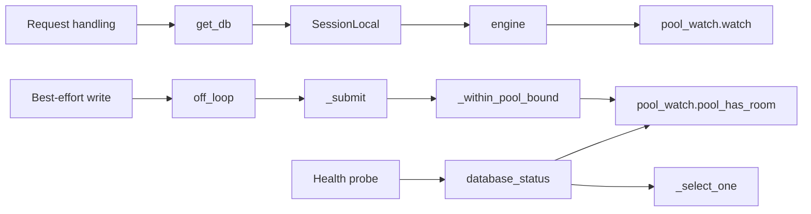
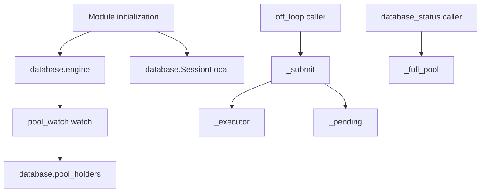
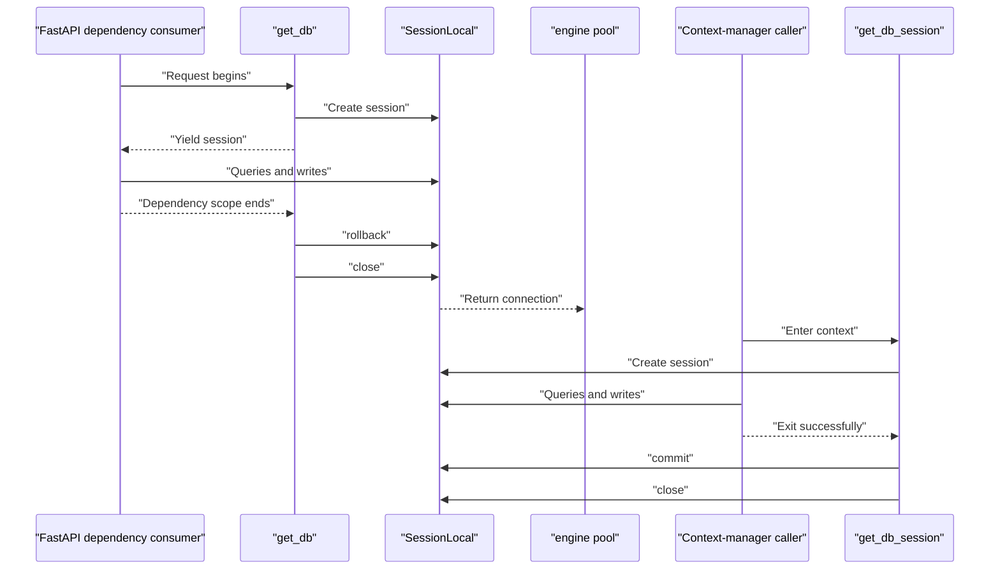
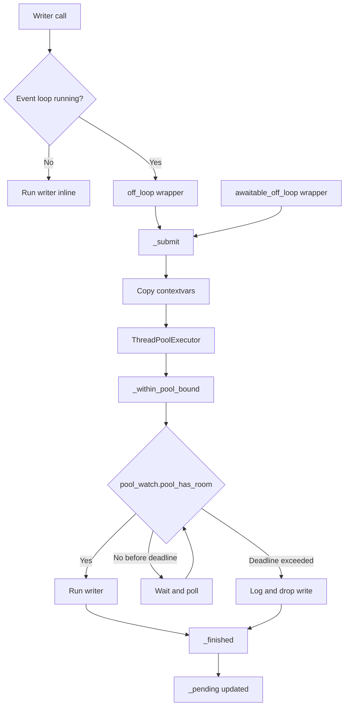
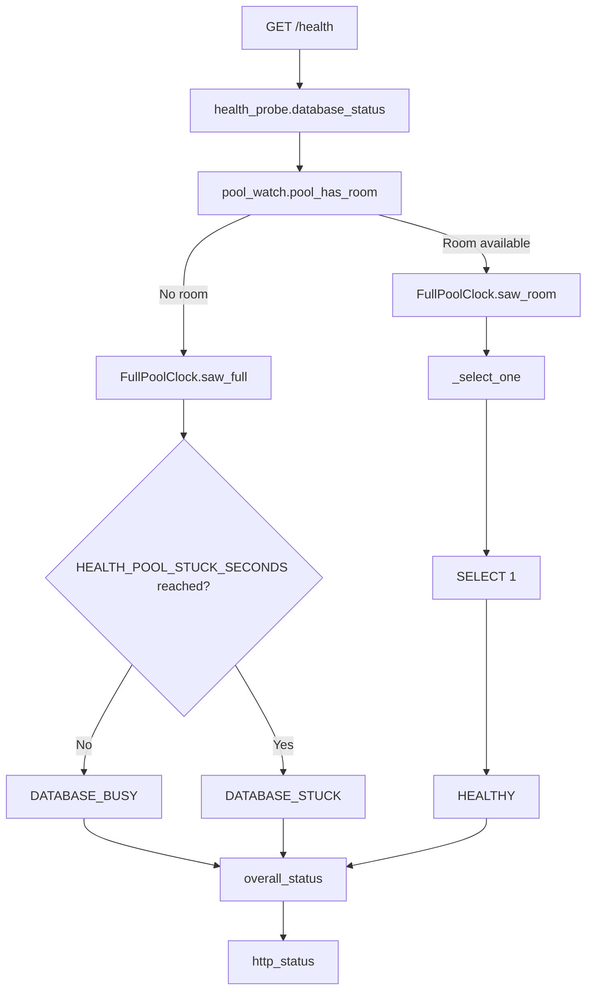
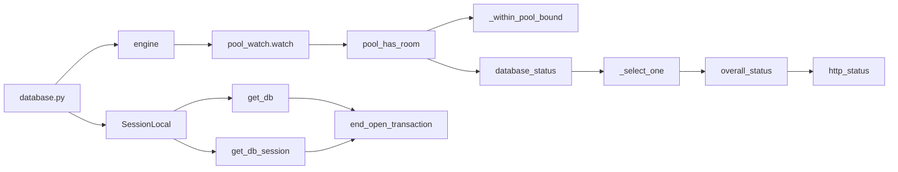

# Service Layer Patterns

Relevant source files

The following files were used as context for generating this wiki page:

- [orchestrator/core/best_effort.py](orchestrator/core/best_effort.py)
- [orchestrator/core/database/database.py](orchestrator/core/database/database.py)
- [orchestrator/core/database/pool_watch.py](orchestrator/core/database/pool_watch.py)
- [orchestrator/core/health_probe.py](orchestrator/core/health_probe.py)
- [orchestrator/tests/test_f229_health_off_the_loop.py](orchestrator/tests/test_f229_health_off_the_loop.py)
- [orchestrator/tests/test_f458_full_pool_names_its_holders.py](orchestrator/tests/test_f458_full_pool_names_its_holders.py)
- [orchestrator/tests/test_f458_health_never_waits_on_a_full_pool.py](orchestrator/tests/test_f458_health_never_waits_on_a_full_pool.py)
- [orchestrator/tests/test_prd251w1_render_quota.py](orchestrator/tests/test_prd251w1_render_quota.py)
- [orchestrator/tests/test_prd251w1_voice.py](orchestrator/tests/test_prd251w1_voice.py)

## Purpose and Scope

This page documents the service-layer patterns supported by the available implementation: module-level database and helper state, FastAPI-compatible database session lifecycles, transaction boundaries before long awaits, best-effort writes, connection-pool observation, and health-probe composition. The supplied files do not establish a general singleton-service registry or a universal dependency-injection framework, so this page describes the concrete mechanisms shown in the code instead. [orchestrator/core/database/database.py:82-104](), [orchestrator/core/database/database.py:115-158](), [orchestrator/core/best_effort.py:41-46](), [orchestrator/core/health_probe.py:47-76]()

Sources: [orchestrator/core/database/database.py:82-104](), [orchestrator/core/database/database.py:115-158](), [orchestrator/core/best_effort.py:41-46](), [orchestrator/core/health_probe.py:47-76]()

## Service Layer Architecture

The shown service-layer mechanisms are organized around shared database infrastructure and focused helpers. `database.py` creates the SQLAlchemy engine and `SessionLocal` factory; callers obtain sessions through `get_db()` or `get_db_session()`. Best-effort writers use a module-level executor and consult `pool_watch` before writing, while health checks use pool counters before deciding whether a database probe should attempt a query. [orchestrator/core/database/database.py:82-104](), [orchestrator/core/database/database.py:115-140](), [orchestrator/core/best_effort.py:41-70](), [orchestrator/core/health_probe.py:69-93]()

**Diagram: Service Responsibilities Mapped to Code Entities**

Sources: [orchestrator/core/database/database.py:82-104](), [orchestrator/core/database/database.py:115-140](), [orchestrator/core/best_effort.py:49-70](), [orchestrator/core/best_effort.py:89-106](), [orchestrator/core/health_probe.py:69-93](), [orchestrator/core/database/pool_watch.py:54-70]()

## Shared Infrastructure and Instance Patterns

The database module constructs a module-level `engine` and `SessionLocal` factory. It also installs pool-watch instrumentation on that engine and stores the resulting watcher in `pool_holders`. These are shared module-level infrastructure objects; the available files do not show a general-purpose singleton pattern for domain-service classes. [orchestrator/core/database/database.py:82-104]()

`best_effort.py` similarly keeps module-level executor and pending-write state. `_submit()` creates the executor lazily on the first submission, then reuses it for subsequent writes. `health_probe.py` keeps a module-level `FullPoolClock` to track how long the pool has continuously appeared full. [orchestrator/core/best_effort.py:41-46](), [orchestrator/core/best_effort.py:60-70](), [orchestrator/core/health_probe.py:47-66]()

**Diagram: Module-Level Shared State and Its Callers**

Sources: [orchestrator/core/database/database.py:82-104](), [orchestrator/core/best_effort.py:41-46](), [orchestrator/core/best_effort.py:60-70](), [orchestrator/core/health_probe.py:47-76]()

## Database Dependency Injection and Session Lifecycle

`get_db()` is a generator dependency that creates a `SessionLocal()` session, yields it to its consumer, and in `finally` rolls back any transaction left open before closing the session. The rollback is a no-op after a successful commit; otherwise it prevents an unfinished transaction from being returned to the pool. [orchestrator/core/database/database.py:115-127]()

`get_db_session()` provides a context-manager alternative for non-dependency call sites. It commits after a successful body, rolls back and logs if an exception occurs, re-raises the exception, and closes the session in `finally`. The two patterns therefore have distinct commit semantics: `get_db()` guarantees cleanup but does not commit on success, while `get_db_session()` commits on successful exit. [orchestrator/core/database/database.py:115-140]()

`end_open_transaction(db)` is an explicit boundary for long-running work. It commits before a long await so a session that has already queried the database does not retain an open transaction and checked-out connection throughout an LLM call or concurrent coroutine work. The helper also commits pending writes at that boundary, so callers should treat the resulting transaction boundary as deliberate rather than assuming one atomic commit at the end of the overall operation. [orchestrator/core/database/database.py:142-158]()

**Diagram: Session Ownership and Cleanup Paths**

Sources: [orchestrator/core/database/database.py:93-94](), [orchestrator/core/database/database.py:115-140](), [orchestrator/core/database/database.py:142-158]()

## Non-Blocking Best-Effort Helpers

`off_loop(fn)` is intended for synchronous writers that may be called from an event loop. If a loop is running, it submits the writer to the best-effort executor and returns `None` immediately; without a running loop, it calls the writer inline. `awaitable_off_loop(fn)` exposes an async wrapper that submits the synchronous function and awaits the submitted future. [orchestrator/core/best_effort.py:81-106]()

`_submit()` copies the current `contextvars` context, lazily creates a `ThreadPoolExecutor` sized from `BEST_EFFORT_WRITE_THREADS`, submits the function through `_within_pool_bound`, and tracks the future in `_pending`. The completion callback logs failures and removes the future from the pending set. This preserves caller context for the worker and keeps write failures from propagating through the request wrapper. [orchestrator/core/best_effort.py:60-78]()

Before executing a handed-off write, `_within_pool_bound()` polls `pool_watch.pool_has_room()` until a connection is available or `BEST_EFFORT_POOL_WAIT_S` expires. If the deadline passes, it logs a warning and drops the write. The room check and subsequent checkout are not atomic, so a concurrent request can still take the last connection after the check; in that case the write may wait on the pool’s own timeout, but on its worker thread rather than on the event loop. [orchestrator/core/best_effort.py:10-21](), [orchestrator/core/best_effort.py:49-58]()

`drain(timeout)` waits for writes that had already been handed off when it began, including completion callbacks and their failure logs. It is described for tests and shutdown coordination; callers should not assume a best-effort write has completed merely because `off_loop()` returned. [orchestrator/core/best_effort.py:42-44](), [orchestrator/core/best_effort.py:109-120]()

**Diagram: Best-Effort Write Dispatch and Pool Guard**

Sources: [orchestrator/core/best_effort.py:10-21](), [orchestrator/core/best_effort.py:41-78](), [orchestrator/core/best_effort.py:81-120](), [orchestrator/core/database/pool_watch.py:54-70]()

## Connection Pool Observation and Health Probes

`pool_watch.pool_has_room()` checks whether the engine pool has an idle connection or can open another connection within its overflow limit. `pool_numbers()` reports the checked-out count and configured limit when those values can be read. If pool inspection fails, `pool_has_room()` returns `True` so an unreadable or foreign pool does not prevent a caller from proceeding. [orchestrator/core/database/pool_watch.py:48-70]()

`PoolWatch` records connection holders at checkout. When a checkout leaves the pool full and a report is due, it emits a diagnostic report; the watcher’s recorded holder data includes thread and asyncio-task information, and report generation can show the corresponding stack or await chain. The database module attaches this monitoring to the shared engine and exposes the watcher as `pool_holders`. [orchestrator/core/database/pool_watch.py:73-82](), [orchestrator/core/database/pool_watch.py:148-167](), [orchestrator/core/database/database.py:100-104]()

`health_probe.database_status()` checks pool capacity before trying to execute `SELECT 1`. A full pool returns `busy` at first; if it remains full through the configured `HEALTH_POOL_STUCK_SECONDS` interval, it returns `stuck`. When room is available, the probe resets the full-pool clock and calls `_select_one()`, which opens a session, executes the query, and closes the session. [orchestrator/core/health_probe.py:47-76](), [orchestrator/core/health_probe.py:79-93]()

The health helpers map `busy` to degraded status and `stuck` to unhealthy status. `http_status()` returns 503 only when the database is stuck; other states return 200. The supplied tests also pin the intended full-pool behavior: a busy pool is detected without checking out another connection, while a free pool still runs the query. [orchestrator/core/health_probe.py:35-45](), [orchestrator/core/health_probe.py:96-109](), [orchestrator/tests/test_f458_health_never_waits_on_a_full_pool.py:55-70]()

**Diagram: Health Probe Decision Flow Mapped to Functions**

Sources: [orchestrator/core/health_probe.py:35-45](), [orchestrator/core/health_probe.py:47-76](), [orchestrator/core/health_probe.py:79-109](), [orchestrator/core/database/pool_watch.py:54-70]()

## Service Composition and Transaction Boundaries

The supplied service-layer examples compose database resources and helper functions rather than relying on a single service container. `database.py` composes engine creation, session construction, read-release listener registration, and pool-watch setup at module initialization. Runtime consumers then use session factories or dependencies, while `pool_watch` and `health_probe` inspect the shared engine’s capacity. [orchestrator/core/database/database.py:82-104](), [orchestrator/core/database/pool_watch.py:48-70](), [orchestrator/core/health_probe.py:69-93]()

For operations that combine database access with long asynchronous work, `end_open_transaction()` provides the explicit database boundary before the await. That avoids keeping a transaction open across remote or concurrent work, at the cost of committing any pending writes at that point. The available files document this pattern but do not include a concrete service call site using the helper. [orchestrator/core/database/database.py:142-158]()

Best-effort writes compose context propagation, a bounded pool-capacity check, a thread executor, failure logging, and optional draining. Health checks compose pool observation with a query only when capacity is available, then translate component state into an overall status and HTTP status. [orchestrator/core/best_effort.py:49-78](), [orchestrator/core/best_effort.py:109-120](), [orchestrator/core/health_probe.py:69-109]()

**Diagram: Shared Database Infrastructure Composed with Operational Helpers**

Sources: [orchestrator/core/database/database.py:82-104](), [orchestrator/core/database/database.py:115-158](), [orchestrator/core/database/pool_watch.py:48-70](), [orchestrator/core/best_effort.py:49-58](), [orchestrator/core/health_probe.py:69-109]()

## Design Implications

| Pattern | Implementation | Operational implication |
|---|---|---|
| Shared database infrastructure | Module-level `engine`, `SessionLocal`, and `pool_holders` are initialized in `database.py`. [orchestrator/core/database/database.py:82-104]() | Database connection and pool instrumentation are shared through the database module. |
| Explicit session ownership | `get_db()` rolls back and closes; `get_db_session()` commits on success, rolls back on error, and closes. [orchestrator/core/database/database.py:115-140]() | Callers should select the lifecycle matching their commit requirements. |
| Long-await transaction boundary | `end_open_transaction()` commits before a potentially long await. [orchestrator/core/database/database.py:142-158]() | Prevents retaining an open transaction across long-running work, while making the commit incremental. |
| Best-effort write isolation | `off_loop()` and `awaitable_off_loop()` hand writes to a bounded thread pool; pool pressure can cause a write to be dropped. [orchestrator/core/best_effort.py:49-58](), [orchestrator/core/best_effort.py:89-106]() | Non-critical writes do not synchronously block an event-loop caller, but are not guaranteed to complete. |
| Pool visibility | `PoolWatch` records holders and `pool_numbers()` exposes capacity information. [orchestrator/core/database/pool_watch.py:54-82](), [orchestrator/core/database/pool_watch.py:148-167]() | Pool exhaustion can be investigated through holder diagnostics. |
| Non-blocking health decision | `database_status()` checks capacity before `_select_one()`, and `http_status()` distinguishes a stuck pool from other states. [orchestrator/core/health_probe.py:69-109]() | A full pool is classified without immediately waiting for another connection. |

Sources: [orchestrator/core/database/database.py:82-158](), [orchestrator/core/best_effort.py:49-120](), [orchestrator/core/database/pool_watch.py:48-82](), [orchestrator/core/database/pool_watch.py:148-167](), [orchestrator/core/health_probe.py:69-109]()

---