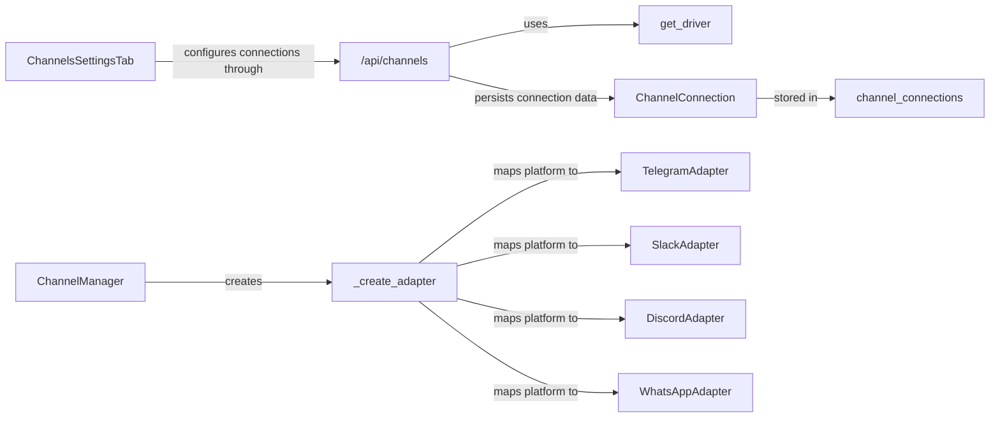
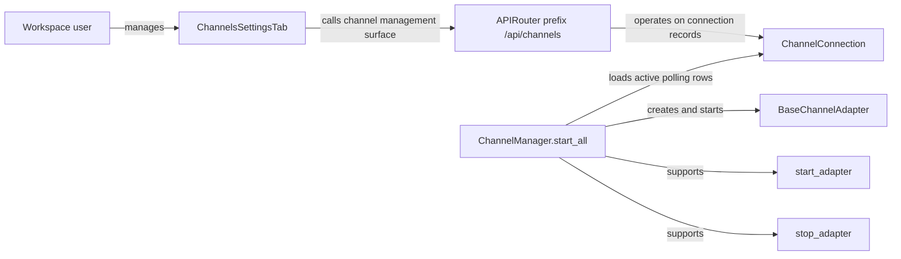

# Channel Integrations

Relevant source files

The following files were used as context for generating this wiki page:

- [docs/PRDS/55-AUTONOMOUS-ASSISTANT-PLATFORM.md](docs/PRDS/55-AUTONOMOUS-ASSISTANT-PLATFORM.md)
- [frontend/components/settings/ChannelsSettingsTab.tsx](frontend/components/settings/ChannelsSettingsTab.tsx)
- [frontend/components/settings/__tests__/channels-settings-local.test.ts](frontend/components/settings/__tests__/channels-settings-local.test.ts)
- [orchestrator/alembic/versions/20260215_add_heartbeat_and_channels.py](orchestrator/alembic/versions/20260215_add_heartbeat_and_channels.py)
- [orchestrator/api/channels.py](orchestrator/api/channels.py)
- [orchestrator/api/heartbeat.py](orchestrator/api/heartbeat.py)
- [orchestrator/channels/manager.py](orchestrator/channels/manager.py)
- [orchestrator/channels/telegram_adapter.py](orchestrator/channels/telegram_adapter.py)
- [orchestrator/core/models/channels.py](orchestrator/core/models/channels.py)
- [orchestrator/tests/test_prd225_polling_answer_bridge.py](orchestrator/tests/test_prd225_polling_answer_bridge.py)

## Purpose and Scope

Channel integrations provide workspace connections for handling messages across external platforms. This page gives a high-level map of the channel records, runtime lifecycle, platform configuration, and settings surface. For details, see [Channel Architecture](#12.1), [Message Pipeline & Trust Gate](#12.2), [Platform Adapters](#12.3), and [Channel API Reference](#12.4). [orchestrator/core/models/channels.py:19-45](), [orchestrator/channels/manager.py:22-26](), [orchestrator/api/channels.py:29-46](), [frontend/components/settings/ChannelsSettingsTab.tsx:14-25]()

Sources: [orchestrator/core/models/channels.py:19-45](), [orchestrator/channels/manager.py:22-26](), [orchestrator/api/channels.py:29-46](), [frontend/components/settings/ChannelsSettingsTab.tsx:14-25]()

---

## Channel Architecture

`ChannelConnection` stores a workspace’s platform configuration, status, connectivity mode, and activity metadata. `ChannelManager` controls adapter lifecycle: at startup it loads active polling-mode connections, while webhook-mode rows are skipped. Its adapter factory maps Telegram, Slack, Discord, and WhatsApp to their adapter classes. [orchestrator/core/models/channels.py:19-45](), [orchestrator/channels/manager.py:32-68](), [orchestrator/channels/manager.py:126-156]()

The channel API uses a driver registry for platform-specific operations, while the settings UI exposes configuration and connectivity-mode choices. Telegram is the platform with both webhook and polling choices in the provided UI configuration. [orchestrator/api/channels.py:5-10](), [orchestrator/api/channels.py:29-46](), [frontend/components/settings/ChannelsSettingsTab.tsx:138-168]()

**Diagram: Channel components mapped to code entities**

Sources: [frontend/components/settings/ChannelsSettingsTab.tsx:176-181](), [orchestrator/api/channels.py:29-46](), [orchestrator/core/models/channels.py:19-45](), [orchestrator/channels/manager.py:126-156]()

**Diagram: Connection lifecycle mapped to code entities**

Sources: [frontend/components/settings/ChannelsSettingsTab.tsx:176-181](), [orchestrator/api/channels.py:46](), [orchestrator/core/models/channels.py:19-45](), [orchestrator/channels/manager.py:32-68](), [orchestrator/channels/manager.py:88-120]()

For details, see [Channel Architecture](#12.1).

---

## Message Pipeline & Trust Gate

The channel API imports helpers for normalizing and reading per-channel `trigger_mode` settings. The `ChannelConnection` model documents that this setting is read by the ingress trust gate; the setting is kept in the connection configuration rather than defined as a separate model column. [orchestrator/api/channels.py:37-42](), [orchestrator/core/models/channels.py:26-29]()

Message normalization, routing, agent execution, conversation storage, and webhook deduplication are covered in the child page. For details, see [Message Pipeline & Trust Gate](#12.2). [orchestrator/api/channels.py:37-42]()

Sources: [orchestrator/api/channels.py:37-42](), [orchestrator/core/models/channels.py:26-29]()

---

## Platform Adapters

The legacy adapter factory maps Telegram, Slack, Discord, and WhatsApp to platform-specific adapter classes. The settings UI includes configuration fields for these platforms; Telegram has webhook and polling mode options. [orchestrator/channels/manager.py:139-156](), [frontend/components/settings/ChannelsSettingsTab.tsx:27-63](), [frontend/components/settings/ChannelsSettingsTab.tsx:138-168]()

The channel API’s supported-platform set also includes `webhook`. Telegram’s adapter uses `python-telegram-bot`, starts a polling updater, and registers handlers for text, photos, and documents. See [Platform Adapters](#12.3) for transport-specific behavior and the `channels` AI disclosure. [orchestrator/api/channels.py:53-60](), [orchestrator/channels/telegram_adapter.py:24-55]()

| Platform | High-level code or configuration reference |
|---|---|
| Telegram | `TelegramAdapter`; bot-token configuration and webhook/polling UI options. [orchestrator/channels/telegram_adapter.py:24-39](), [frontend/components/settings/ChannelsSettingsTab.tsx:39-45](), [frontend/components/settings/ChannelsSettingsTab.tsx:138-168]() |
| Slack | `SlackAdapter` in the factory map; UI fields include bot token and signing secret. [orchestrator/channels/manager.py:139-145](), [frontend/components/settings/ChannelsSettingsTab.tsx:47-55]() |
| Discord | `DiscordAdapter` in the factory map; UI includes bot-token configuration. [orchestrator/channels/manager.py:139-145](), [frontend/components/settings/ChannelsSettingsTab.tsx:57-62]() |
| WhatsApp | `WhatsAppAdapter` in the factory map; UI includes phone-number ID and access-token configuration. [orchestrator/channels/manager.py:139-145](), [frontend/components/settings/ChannelsSettingsTab.tsx:27-37]() |
| Webhook | Listed in the channel API’s supported-platform set. [orchestrator/api/channels.py:53-60]() |

Sources: [orchestrator/channels/manager.py:139-156](), [orchestrator/channels/telegram_adapter.py:24-55](), [frontend/components/settings/ChannelsSettingsTab.tsx:27-63](), [frontend/components/settings/ChannelsSettingsTab.tsx:138-168](), [orchestrator/api/channels.py:53-60]()

For details, see [Platform Adapters](#12.3).

---

## Channel API Reference

Channel-management routes are mounted under `/api/channels`. The API imports driver-registry functions and trigger-mode helpers; the provided route excerpt shows the workspace-scoped list handler beginning at `list_channels`. [orchestrator/api/channels.py:29-46](), [orchestrator/api/channels.py:177-188]()

The Channels settings tab models connection status, mode, verification information, activity, and configuration. For details about channel CRUD, testing, lifecycle endpoints, analytics, and the settings tab, see [Channel API Reference](#12.4). [frontend/components/settings/ChannelsSettingsTab.tsx:14-25]()

| Surface | Role |
|---|---|
| `/api/channels` | Channel management router; the provided excerpt includes the start of `list_channels`. [orchestrator/api/channels.py:46](), [orchestrator/api/channels.py:177-188]() |
| Driver registry | API imports `get_driver` and `list_platforms` for platform operations. [orchestrator/api/channels.py:29-36]() |
| `ChannelsSettingsTab` | Frontend connection settings surface with fields for status, mode, and configuration. [frontend/components/settings/ChannelsSettingsTab.tsx:14-25](), [frontend/components/settings/ChannelsSettingsTab.tsx:176-181]() |

Sources: [orchestrator/api/channels.py:29-46](), [orchestrator/api/channels.py:177-188](), [frontend/components/settings/ChannelsSettingsTab.tsx:14-25](), [frontend/components/settings/ChannelsSettingsTab.tsx:176-181]()

For details, see [Channel API Reference](#12.4).

---