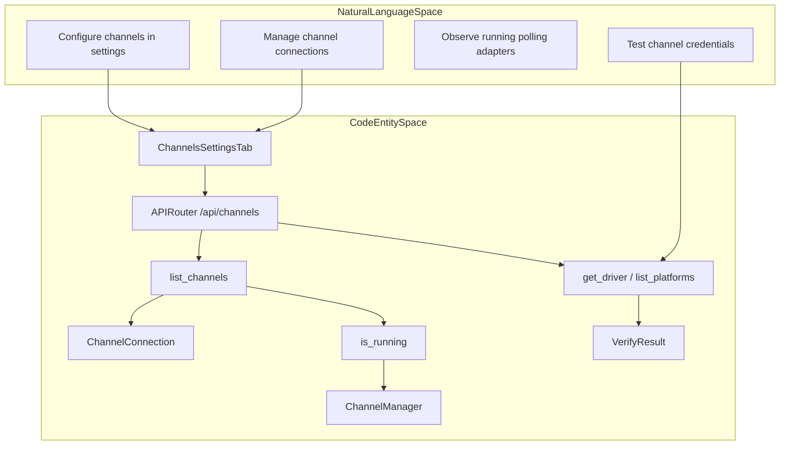
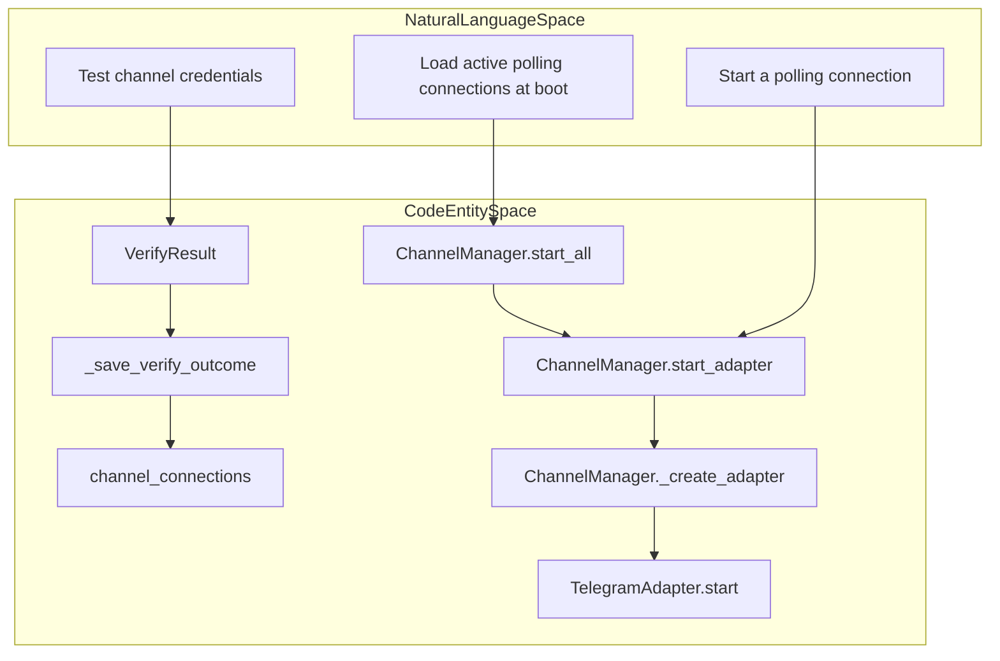

# Channel API Reference

Relevant source files

The following files were used as context for generating this wiki page:

- [docs/PRDS/55-AUTONOMOUS-ASSISTANT-PLATFORM.md](docs/PRDS/55-AUTONOMOUS-ASSISTANT-PLATFORM.md)
- [frontend/components/settings/ChannelsSettingsTab.tsx](frontend/components/settings/ChannelsSettingsTab.tsx)
- [frontend/components/settings/__tests__/channels-settings-local.test.ts](frontend/components/settings/__tests__/channels-settings-local.test.ts)
- [orchestrator/alembic/versions/20260215_add_heartbeat_and_channels.py](orchestrator/alembic/versions/20260215_add_heartbeat_and_channels.py)
- [orchestrator/api/channels.py](orchestrator/api/channels.py)
- [orchestrator/api/heartbeat.py](orchestrator/api/heartbeat.py)
- [orchestrator/channels/manager.py](orchestrator/channels/manager.py)
- [orchestrator/channels/telegram_adapter.py](orchestrator/channels/telegram_adapter.py)
- [orchestrator/core/models/channels.py](orchestrator/core/models/channels.py)
- [orchestrator/tests/test_prd225_polling_answer_bridge.py](orchestrator/tests/test_prd225_polling_answer_bridge.py)

## Purpose and scope

This page documents the channel-management API surface visible in the provided implementation, the `ChannelConnection` record, driver and adapter lifecycle boundaries, and the Channels settings tab. The API module describes itself as platform-agnostic: per-platform behavior belongs to `channels/drivers/`, while channel records and runtime adapter state are handled separately [orchestrator/api/channels.py:1-10](), [orchestrator/core/models/channels.py:19-45](), [orchestrator/channels/manager.py:22-26]().

Sources: [orchestrator/api/channels.py:1-10](), [orchestrator/core/models/channels.py:19-45](), [orchestrator/channels/manager.py:22-26]()

---

## 1. Overview

The API router is declared with the `/api/channels` prefix and the `channels` tag. It imports hybrid request context, database-session, and workspace-permission dependencies, along with the channel driver registry and trigger-mode helpers [orchestrator/api/channels.py:19-46]().

The driver boundary is intended to describe required configuration and supported connectivity modes, and to provide operations for verification, sending, webhook installation and removal, and polling lifecycle [orchestrator/api/channels.py:5-10](). The `ChannelConnection` model stores workspace and platform identifiers, configuration, status, mode, webhook URL, verification fields, metadata, optional default-agent routing, and activity counters [orchestrator/core/models/channels.py:19-45]().

The provided API excerpt shows `GET /api/channels` and its workspace context/database dependencies. Its documentation says the response reconciles stored status with `ChannelManager` runtime state, so an adapter that is running can be represented as active even when the database row says inactive [orchestrator/api/channels.py:177-188](). `ChannelManager.is_running()` checks loaded adapter state and is documented as supporting this read-time reconciliation [orchestrator/channels/manager.py:176-187]().

Sources: [orchestrator/api/channels.py:5-10](), [orchestrator/api/channels.py:19-46](), [orchestrator/api/channels.py:177-188](), [orchestrator/core/models/channels.py:19-45](), [orchestrator/channels/manager.py:176-187]()

---

## 2. API route mapping

**Diagram: Channel-management concepts mapped to code entities**

The diagram maps the UI component and the API router to the specific handler and runtime/model entities named in the provided files. The driver registry imports include `get_driver`, `list_platforms`, and `VerifyResult`; the provided excerpt does not show the remaining route handlers or their call sites [frontend/components/settings/ChannelsSettingsTab.tsx:176-181](), [orchestrator/api/channels.py:29-46](), [orchestrator/api/channels.py:177-188](), [orchestrator/channels/manager.py:176-187](), [orchestrator/core/models/channels.py:19-45]().

Sources: [frontend/components/settings/ChannelsSettingsTab.tsx:176-181](), [orchestrator/api/channels.py:29-46](), [orchestrator/api/channels.py:177-188](), [orchestrator/channels/manager.py:176-187](), [orchestrator/core/models/channels.py:19-45]()

---

## 3. Endpoint reference

### `GET /api/channels`

- **Handler:** `list_channels` [orchestrator/api/channels.py:177-181]().
- **Dependencies:** `get_request_context_hybrid` supplies `RequestContext`; `get_db` supplies the SQLAlchemy session [orchestrator/api/channels.py:177-181]().
- **Purpose:** Lists channel connections for the current workspace. The handler documentation states that status is reconciled against `ChannelManager` at read time [orchestrator/api/channels.py:182-188]().
- **Runtime check:** `ChannelManager.is_running()` checks whether an adapter is loaded and running; its documentation identifies it as a source used by `GET /api/channels` status reconciliation [orchestrator/channels/manager.py:176-187]().

Sources: [orchestrator/api/channels.py:177-188](), [orchestrator/channels/manager.py:176-187]()

### Other channel operations

The API module’s documentation describes CRUD endpoints and says drivers mediate verification, sending, webhook installation/removal, and polling start/stop behavior [orchestrator/api/channels.py:5-10](). The provided API excerpt does not show the definitions of the create, update, delete, test, start, stop, or analytics routes; therefore, their paths, payloads, response schemas, and authorization details cannot be specified from the supplied lines [orchestrator/api/channels.py:1-10](), [orchestrator/api/channels.py:177-188]().

`ChannelManager` exposes bulk and per-adapter lifecycle methods: `start_all()`, `stop_all()`, `start_adapter()`, `stop_adapter()`, and `is_running()` [orchestrator/channels/manager.py:32-41](), [orchestrator/channels/manager.py:74-82](), [orchestrator/channels/manager.py:88-121](), [orchestrator/channels/manager.py:176-187]().

Sources: [orchestrator/api/channels.py:1-10](), [orchestrator/api/channels.py:177-188](), [orchestrator/channels/manager.py:32-41](), [orchestrator/channels/manager.py:74-82](), [orchestrator/channels/manager.py:88-121](), [orchestrator/channels/manager.py:176-187]()

---

## 4. Connection data and driver configuration

### Stored connection fields

`ChannelConnection` maps to the `channel_connections` table. The UUID primary key and indexed workspace identifier scope each record; platform, JSON configuration, status, mode, webhook URL, verification outcome, metadata, routing, and activity fields describe its configuration and state [orchestrator/core/models/channels.py:19-45]().

| Field | Model meaning |
|---|---|
| `id` | UUID primary key [orchestrator/core/models/channels.py:23]() |
| `workspace_id` | Non-null, indexed workspace UUID [orchestrator/core/models/channels.py:24]() |
| `platform` | Platform name [orchestrator/core/models/channels.py:25]() |
| `config` | JSON configuration [orchestrator/core/models/channels.py:26-29]() |
| `status` | Connection status; server default is `inactive` [orchestrator/core/models/channels.py:30]() |
| `mode` | Connectivity mode, documented as `webhook` or `polling` [orchestrator/core/models/channels.py:31-36]() |
| `webhook_url` | Optional URL used for webhook-mode inbound traffic [orchestrator/core/models/channels.py:32-37]() |
| `last_verified` | Timestamp updated when driver verification succeeds [orchestrator/core/models/channels.py:32-38]() |
| `last_error` | Most recent verification failure reason [orchestrator/core/models/channels.py:33-39]() |
| `metadata_` | Python attribute mapped to the database column `metadata` [orchestrator/core/models/channels.py:40]() |
| `default_agent_id` | Optional default-routing agent identifier [orchestrator/core/models/channels.py:41]() |
| `message_count` / `last_activity_at` | Message activity count and latest activity timestamp [orchestrator/core/models/channels.py:42-43]() |
| `created_at` / `updated_at` | Creation and update timestamps [orchestrator/core/models/channels.py:44-45]() |

Sources: [orchestrator/core/models/channels.py:19-45]()

### Required configuration and settings fields

The API’s `_REQUIRED_CONFIG` dictionary lists required fields for the platforms shown below. The settings tab defines user-facing fields for its listed platforms; labels and names are not always identical to the backend keys, so the table distinguishes the two [orchestrator/api/channels.py:162-174](), [frontend/components/settings/ChannelsSettingsTab.tsx:27-136]().

| Platform | Backend required keys | Settings-tab fields |
|---|---|---|
| Telegram | `bot_token` [orchestrator/api/channels.py:162-164]() | `bot_token` [frontend/components/settings/ChannelsSettingsTab.tsx:39-45]() |
| Slack | `bot_token`, `signing_secret` [orchestrator/api/channels.py:164-166]() | `bot_token`, `signing_secret`, `app_token` [frontend/components/settings/ChannelsSettingsTab.tsx:47-55]() |
| Discord | `bot_token` [orchestrator/api/channels.py:165-167]() | `bot_token` [frontend/components/settings/ChannelsSettingsTab.tsx:58-62]() |
| WhatsApp | `phone_number_id`, `access_token` [orchestrator/api/channels.py:171-174]() | `phone_number_id`, `access_token`, optional `verify_token` [frontend/components/settings/ChannelsSettingsTab.tsx:27-37]() |
| Teams | `app_id`, `app_password` [orchestrator/api/channels.py:166-168]() | `app_id`, `app_password` [frontend/components/settings/ChannelsSettingsTab.tsx:65-72]() |
| Google Chat | `service_account_key` [orchestrator/api/channels.py:168-170]() | `service_account_json` [frontend/components/settings/ChannelsSettingsTab.tsx:75-81]() |
| Signal | `phone_number` [orchestrator/api/channels.py:169-171]() | `phone_number`, `api_url` [frontend/components/settings/ChannelsSettingsTab.tsx:84-91]() |
| iMessage | `apple_id` [orchestrator/api/channels.py:170-172]() | `server_url`, `password` [frontend/components/settings/ChannelsSettingsTab.tsx:93-101]() |
| IRC | `server`, `channel`, `nickname` [orchestrator/api/channels.py:170-172]() | `server`, `port`, `nickname`, `channels` [frontend/components/settings/ChannelsSettingsTab.tsx:103-113]() |
| Matrix | `homeserver_url`, `access_token` [orchestrator/api/channels.py:171-173]() | `homeserver`, `user_id`, `access_token` [frontend/components/settings/ChannelsSettingsTab.tsx:115-124]() |
| LINE | `channel_access_token`, `channel_secret` [orchestrator/api/channels.py:172-174]() | `channel_access_token`, `channel_secret` [frontend/components/settings/ChannelsSettingsTab.tsx:126-134]() |

Sources: [orchestrator/api/channels.py:162-174](), [frontend/components/settings/ChannelsSettingsTab.tsx:27-136]()

---

## 5. Channel lifecycle and verification

`ChannelManager` stores loaded adapters in `_adapters`, keyed by connection ID [orchestrator/channels/manager.py:22-26](). At startup, `start_all()` queries `ChannelConnection` records whose status is `active` and mode is `polling`, then invokes `start_adapter()` for each. Webhook-mode rows are intentionally skipped because inbound requests go directly to the workspace webhook URL rather than requiring an in-process polling adapter [orchestrator/channels/manager.py:32-63]().

`start_adapter()` stops an existing adapter for the same connection ID before creating and starting a replacement. `_create_adapter()` selects a platform adapter through a mapping and lazy imports; the shown mapping includes Telegram, Slack, Discord, and WhatsApp [orchestrator/channels/manager.py:88-114](), [orchestrator/channels/manager.py:126-170](). `stop_adapter()` removes the adapter from the in-memory mapping and stops it when present [orchestrator/channels/manager.py:116-120]().

The API helper `_save_verify_outcome()` is documented as best-effort. It sets status to `active` on successful verification or `error` on failure, updates `last_verified` only on success, writes `last_error`, merges returned and extra metadata, and commits; on exception it logs and rolls back [orchestrator/api/channels.py:95-148]().

**Diagram: Verification and polling lifecycle code flow**

The API helper persists the verification outcome, while the manager loads active polling rows and starts adapters through its factory; `TelegramAdapter.start()` initializes and starts the Telegram application and polling task [orchestrator/api/channels.py:95-148](), [orchestrator/channels/manager.py:32-63](), [orchestrator/channels/manager.py:88-170](), [orchestrator/channels/telegram_adapter.py:32-63]().

Sources: [orchestrator/api/channels.py:95-148](), [orchestrator/channels/manager.py:32-63](), [orchestrator/channels/manager.py:88-170](), [orchestrator/channels/telegram_adapter.py:32-63]()

---

## 6. Channels settings tab

`ChannelsSettingsTab` is the React settings component. Its visible state includes channel connections, loading state, a connection-in-progress marker, a test-in-progress marker, and per-platform new-configuration values [frontend/components/settings/ChannelsSettingsTab.tsx:176-181](). The component defines platform forms and their input fields in `PLATFORMS` [frontend/components/settings/ChannelsSettingsTab.tsx:27-136]().

The UI defines Telegram as a multi-mode platform with webhook and polling choices. `POLLING_CAPABLE_PLATFORMS` contains Telegram; `defaultModeFor()` selects polling for a polling-capable mode in a local edition and otherwise selects the first configured mode. `needsPublicUrlLocally()` returns whether the local edition needs a public URL for a platform that is not polling-capable [frontend/components/settings/ChannelsSettingsTab.tsx:138-174]().

The supplied frontend excerpt establishes these state and mode-selection rules, but does not include the component’s request handlers or rendering logic for the API operations [frontend/components/settings/ChannelsSettingsTab.tsx:176-181]().

Sources: [frontend/components/settings/ChannelsSettingsTab.tsx:27-136](), [frontend/components/settings/ChannelsSettingsTab.tsx:138-181]()

---

## 7. Supporting implementation details

### Webhook URL construction

`_webhook_url_for()` queries `workspaces.webhook_key`; if a key exists, it constructs an inbound URL using `_PUBLIC_API_HOST` and the `/api/webhooks/ws/{webhook_key}` path. If the key is absent, it returns `None` [orchestrator/api/channels.py:67-79]().

Sources: [orchestrator/api/channels.py:67-79]()

### Telegram adapter

`TelegramAdapter.start()` requires `bot_token`, builds the Telegram application, registers command and message handlers, initializes and starts the application, and starts polling in an asynchronous task. `stop()` stops the updater and application and cancels the task when present [orchestrator/channels/telegram_adapter.py:24-77]().

`send_message()` splits text into chunks of at most 4096 characters and sends each chunk to the Telegram chat. `test_connection()` calls Telegram’s `getMe` endpoint and returns a connected result with the bot username on HTTP 200, otherwise an error result [orchestrator/channels/telegram_adapter.py:79-105]().

On `/start` or `/help`, the adapter persists the chat ID as the workspace’s default Telegram chat ID only if it is not already set; it does not retarget the stored destination from later inbound messages [orchestrator/channels/telegram_adapter.py:106-122](), [orchestrator/channels/telegram_adapter.py:136-167]().

Sources: [orchestrator/channels/telegram_adapter.py:24-105](), [orchestrator/channels/telegram_adapter.py:106-122](), [orchestrator/channels/telegram_adapter.py:136-167]()

---