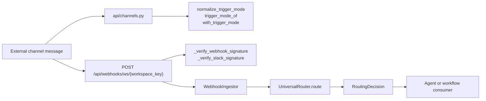
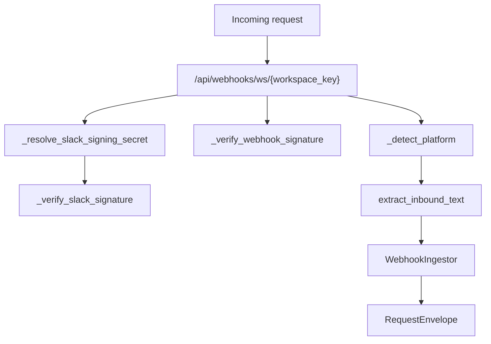
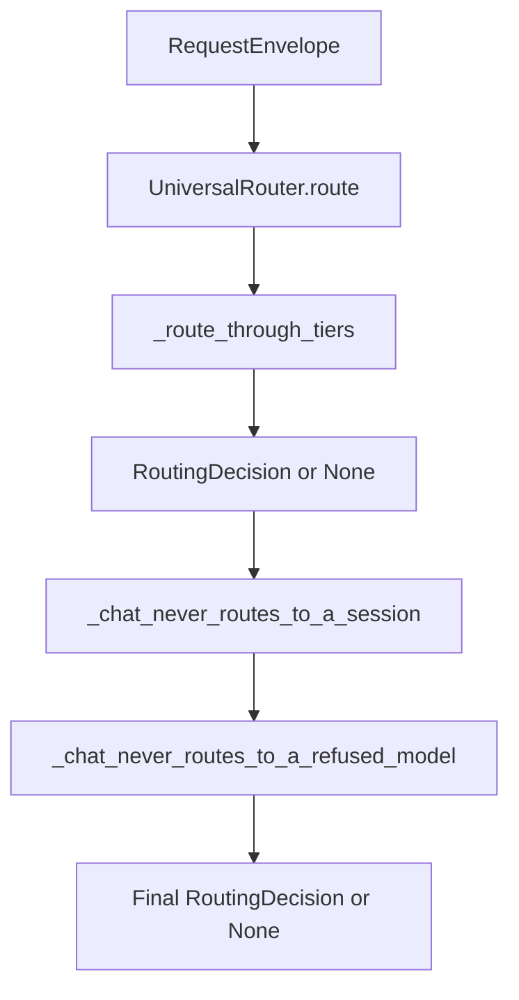

# Message Pipeline & Trust Gate

Relevant source files

The following files were used as context for generating this wiki page:

- [frontend/components/workflows/execution-kitchen.tsx](frontend/components/workflows/execution-kitchen.tsx)
- [orchestrator/alembic/versions/dedupe_skills_unique_workspace_name.py](orchestrator/alembic/versions/dedupe_skills_unique_workspace_name.py)
- [orchestrator/api/composio.py](orchestrator/api/composio.py)
- [orchestrator/api/patterns.py](orchestrator/api/patterns.py)
- [orchestrator/api/recipe_executor.py](orchestrator/api/recipe_executor.py)
- [orchestrator/api/routing.py](orchestrator/api/routing.py)
- [orchestrator/api/skills.py](orchestrator/api/skills.py)
- [orchestrator/api/templates.py](orchestrator/api/templates.py)
- [orchestrator/api/tools.py](orchestrator/api/tools.py)
- [orchestrator/api/webhooks.py](orchestrator/api/webhooks.py)
- [orchestrator/api/workflow_recipes.py](orchestrator/api/workflow_recipes.py)
- [orchestrator/channels/base.py](orchestrator/channels/base.py)
- [orchestrator/channels/primitive_heartbeat.py](orchestrator/channels/primitive_heartbeat.py)
- [orchestrator/core/composio/client.py](orchestrator/core/composio/client.py)
- [orchestrator/core/composio/linkedin_image_workaround.py](orchestrator/core/composio/linkedin_image_workaround.py)
- [orchestrator/core/credentials/tester.py](orchestrator/core/credentials/tester.py)
- [orchestrator/core/credentials/types.py](orchestrator/core/credentials/types.py)
- [orchestrator/core/database/credential_types_seed.json](orchestrator/core/database/credential_types_seed.json)
- [orchestrator/core/routing/engine.py](orchestrator/core/routing/engine.py)
- [orchestrator/core/routing/ingestors/webhook.py](orchestrator/core/routing/ingestors/webhook.py)
- [orchestrator/core/security/workspace_scope.py](orchestrator/core/security/workspace_scope.py)
- [orchestrator/core/services/skill_materializer.py](orchestrator/core/services/skill_materializer.py)
- [orchestrator/modules/agents/services/skill_loader.py](orchestrator/modules/agents/services/skill_loader.py)
- [orchestrator/scripts/setup_jira_trigger.py](orchestrator/scripts/setup_jira_trigger.py)
- [orchestrator/services/metadata_sync_service.py](orchestrator/services/metadata_sync_service.py)
- [orchestrator/services/webhook_dedup.py](orchestrator/services/webhook_dedup.py)
- [orchestrator/tests/test_channel_adapter_contract.py](orchestrator/tests/test_channel_adapter_contract.py)
- [orchestrator/tests/test_f149_a_message_runs_only_its_own_workspaces_agents.py](orchestrator/tests/test_f149_a_message_runs_only_its_own_workspaces_agents.py)
- [orchestrator/tests/test_p2w2_webhook_dedup.py](orchestrator/tests/test_p2w2_webhook_dedup.py)
- [orchestrator/tests/test_p2w2_webhook_signature_reject.py](orchestrator/tests/test_p2w2_webhook_signature_reject.py)
- [orchestrator/tests/test_prd251_linkedin_scope.py](orchestrator/tests/test_prd251_linkedin_scope.py)

## Purpose and Scope

This page describes the channel-message path and the adjacent workspace-webhook path: how inbound data reaches routing, where per-channel `trigger_mode` is exposed, and which webhook signature and deduplication components are visible in the supplied sources. The sources establish `UniversalRouter.route` and webhook-verification behavior, but do not expose the complete channel-adapter execution path, conversation-message persistence implementation, or the deduplication algorithm. [orchestrator/core/routing/engine.py:1-15](), [orchestrator/api/webhooks.py:1-14](), [orchestrator/api/channels.py:37-43]()

Sources: [orchestrator/core/routing/engine.py:1-15](), [orchestrator/api/webhooks.py:1-14](), [orchestrator/api/channels.py:37-43]()

---

## Message Pipeline Architecture & Data Flow

The visible code separates channel management, webhook ingress, normalization, and routing into named components. The general workspace webhook is documented as routing incoming requests through `UniversalRouter`; the channel API imports helpers for reading and normalizing `trigger_mode` in channel configuration. The supplied excerpts do not establish the full runtime call order between channel adapters, the trust gate, routing, agent execution, and persistence. [orchestrator/api/webhooks.py:5-14](), [orchestrator/api/webhooks.py:30-36](), [orchestrator/api/channels.py:29-43]()

### Pipeline & Trust Gate Flow

This diagram maps external-message concepts to code entities. The webhook branch represents the documented workspace-webhook route and its imported components; the channel branch identifies the channel API’s trigger-mode helpers. The diagram does not assert an unshown call sequence between the branches. [orchestrator/api/webhooks.py:5-14](), [orchestrator/api/webhooks.py:30-36](), [orchestrator/api/channels.py:29-43](), [orchestrator/core/routing/engine.py:59-95]()

**Diagram: Message ingress and routing entities**

Sources: [orchestrator/api/channels.py:29-43](), [orchestrator/api/webhooks.py:5-14](), [orchestrator/api/webhooks.py:30-36](), [orchestrator/api/webhooks.py:50-91](), [orchestrator/core/routing/engine.py:59-95]()

### Natural-Language-to-Code Entity Map

| Pipeline concept | Code entity | Role established by the source |
|---|---|---|
| Workspace webhook endpoint | `/api/webhooks/ws/{workspace_key}` | The general workspace webhook route is described in the module documentation. [orchestrator/api/webhooks.py:5-10]() |
| Webhook ingress normalization | `WebhookIngestor`, `extract_inbound_text` | These webhook-ingress components are imported by the webhook API. Their implementations are not included in the supplied excerpt. [orchestrator/api/webhooks.py:30-36]() |
| Routing request | `RequestEnvelope` | The router’s input type. [orchestrator/core/routing/engine.py:36-43](), [orchestrator/core/routing/engine.py:80-95]() |
| Routing result | `RoutingDecision` | The router can return a decision or `None` if it cannot resolve the request. [orchestrator/core/routing/engine.py:80-95]() |
| Per-channel trust configuration | `TRIGGER_MODES`, `normalize_trigger_mode`, `trigger_mode_of`, `with_trigger_mode` | Helpers imported by the channel API from `services.ingress_gate`. Their definitions and enforcement semantics are not shown. [orchestrator/api/channels.py:37-43]() |
| Webhook deduplication | `webhook_dedup` | A service imported by the general webhook and Composio APIs. The supplied excerpts do not show its algorithm or invocation sites. [orchestrator/api/webhooks.py:30-36](), [orchestrator/api/composio.py:32-39]() |

Sources: [orchestrator/api/webhooks.py:5-10](), [orchestrator/api/webhooks.py:30-36](), [orchestrator/api/channels.py:37-43](), [orchestrator/core/routing/engine.py:36-43](), [orchestrator/core/routing/engine.py:80-95]()

---

## Envelope Normalization & Ingress

The general workspace webhook path is documented at `/api/webhooks/ws/{workspace_key}`. The URL’s workspace key is described as the credential floor; if a webhook secret or Slack signing secret is configured, a valid signature is additionally required. The API imports `WebhookIngestor` and `extract_inbound_text` as webhook-ingress components. The supplied excerpts do not include the full endpoint body or the complete `RequestEnvelope` construction call site. [orchestrator/api/webhooks.py:5-14](), [orchestrator/api/webhooks.py:30-36]()

### Signature Verification

`_verify_webhook_signature` checks common signature headers: `X-Hub-Signature-256`, `X-Composio-Signature`, and `X-Webhook-Signature`. When a secret is configured, it computes an HMAC-SHA256 digest over the raw request body and compares the expected and computed signatures using `hmac.compare_digest`. A missing signature or mismatch raises HTTP 401. If no secret is configured, this verifier skips signature checking. [orchestrator/api/webhooks.py:50-91]()

For Slack, `_resolve_slack_signing_secret` reads Slack `ChannelConnection` rows for the workspace, preferring a secret on an active row and otherwise retaining a secret from an available row. `_verify_slack_signature` checks the timestamp, rejects timestamps more than five minutes from the current time, and validates Slack’s `v0:{timestamp}:{raw_body}` signature format. [orchestrator/api/webhooks.py:94-124](), [orchestrator/api/webhooks.py:127-152]()

### Platform Detection and Normalization Components

`_detect_platform` recognizes Telegram, Slack, WhatsApp, and Twilio payload shapes. The webhook module also defines `_extract_reply_context` after platform detection and imports `WebhookIngestor` and `extract_inbound_text` from `core.routing.ingestors.webhook`. The supplied lines do not show the implementation of those imported normalization components or how their output is assembled into an envelope. [orchestrator/api/webhooks.py:30-36](), [orchestrator/api/webhooks.py:159-188]()

**Diagram: Webhook ingress code map**

Sources: [orchestrator/api/webhooks.py:5-14](), [orchestrator/api/webhooks.py:30-36](), [orchestrator/api/webhooks.py:50-91](), [orchestrator/api/webhooks.py:94-152](), [orchestrator/api/webhooks.py:159-188]()

---

## Per-Channel Trigger Mode Trust Gate

The channel API imports `TRIGGER_MODES`, `normalize_trigger_mode`, `trigger_mode_of`, and `with_trigger_mode` from `services.ingress_gate`. This identifies `services.ingress_gate` as the channel API’s trigger-mode integration point. The supplied excerpt does not include those helper implementations or the message-processing call site that applies the mode, so it does not establish the available mode values, default behavior, or specific enforcement outcomes. [orchestrator/api/channels.py:37-43]()

The channel API describes itself as platform-agnostic and delegates platform-specific behavior to drivers. It imports `get_driver`, `list_platforms`, and driver-related types from `channels.drivers`; the supported-platform set includes Telegram, Slack, Discord, WhatsApp, and webhook, among other platforms. [orchestrator/api/channels.py:5-10](), [orchestrator/api/channels.py:29-41](), [orchestrator/api/channels.py:53-60]()

| Trust-gate entity | Source-supported responsibility |
|---|---|
| `TRIGGER_MODES` | Imported by the channel API from `services.ingress_gate`; the values are not shown. [orchestrator/api/channels.py:37-43]() |
| `normalize_trigger_mode` | Imported helper for trigger-mode normalization; implementation is not shown. [orchestrator/api/channels.py:37-43]() |
| `trigger_mode_of` | Imported helper for reading a trigger mode; implementation is not shown. [orchestrator/api/channels.py:37-43]() |
| `with_trigger_mode` | Imported helper for applying trigger-mode configuration; implementation is not shown. [orchestrator/api/channels.py:37-43]() |
| `get_driver` | Driver-registry lookup imported by the platform-agnostic channel API. [orchestrator/api/channels.py:29-41]() |

Sources: [orchestrator/api/channels.py:5-10](), [orchestrator/api/channels.py:29-43](), [orchestrator/api/channels.py:53-60]()

---

## Webhook Deduplication

The general webhook API imports `services.webhook_dedup`, and the Composio API imports the same service. The supplied excerpts do not show its implementation, key format, storage backend, TTL, failure policy, or exact invocation point. Those details cannot be established from the available code excerpts. [orchestrator/api/webhooks.py:30-36](), [orchestrator/api/composio.py:32-39]()

The webhook API also imports `UnroutedEvent`, `get_routing_cache`, and `UniversalRouter`, connecting the webhook module to routing-related components. The supplied lines do not show how an unrouted event is persisted or how deduplication interacts with routing. [orchestrator/api/webhooks.py:30-36]()

Sources: [orchestrator/api/webhooks.py:30-36](), [orchestrator/api/composio.py:32-39]()

---

## UniversalRouter & Agent Execution

`UniversalRouter` resolves a `RequestEnvelope` into an optional `RoutingDecision`. Its documented tier sequence is:

1. Tier 0: explicit user override, such as `agent_id` or `workflow_id`.
2. Tier 1: `RoutingCache` lookup.
3. Tier 2a: workspace and explicit-source-pattern rules.
4. Tier 2b: `TriggerSubscription` for `jira_trigger`.
5. Tier 2.5: semantic similarity on agent embeddings.
6. Tier 2c: `IntentClassifier` keyword matching against routing rules.
7. Tier 3: LLM classification fallback, using semantic candidates when available.

The router returns `None` only when the tiers fail to resolve a route. [orchestrator/core/routing/engine.py:1-15]()

The public `route` method calls `_route_through_tiers`, then applies `_chat_never_routes_to_a_session` and `_chat_never_routes_to_a_refused_model`. The guards shown in the source apply to chatbot-source requests: chat turns are not routed to CLI-session agents or agents whose model is unavailable. The source notes that other consumers, including webhook, trigger, and channel consumers, may legitimately route to a session agent. [orchestrator/core/routing/engine.py:80-95](), [orchestrator/core/routing/engine.py:97-133](), [orchestrator/core/routing/engine.py:135-161]()

`UniversalRouter.route` returns a routing decision; the supplied excerpt does not show it executing the selected agent. Nor do the supplied files expose the channel message handler’s agent-runtime call site or the code that stores channel conversation messages. These downstream steps cannot be documented at function-level detail from the available sources. [orchestrator/core/routing/engine.py:80-95]()

**Diagram: Router decision path and post-routing guards**

Sources: [orchestrator/core/routing/engine.py:80-95](), [orchestrator/core/routing/engine.py:97-133](), [orchestrator/core/routing/engine.py:135-161]()

---

## Conversation Storage & Activity Tracking

The supplied excerpts do not show channel conversation models, message-persistence functions, or a channel execution call site that commits inbound messages and replies. They also do not establish that every channel exchange is indexed into memory. Conversation-storage behavior and channel activity counters are therefore outside the verifiable scope of these excerpts. [orchestrator/api/channels.py:177-188](), [orchestrator/core/routing/engine.py:80-95]()

The channel API excerpt does include connection verification and status helpers: `_save_verify_outcome` updates a channel connection’s status, verification timestamp, error, metadata, and `updated_at`, then commits; `_mark_active` updates the row’s status and commits. These are connection verification/status operations, not evidence of message or conversation persistence. [orchestrator/api/channels.py:95-160]()

Sources: [orchestrator/api/channels.py:95-160](), [orchestrator/api/channels.py:177-188](), [orchestrator/core/routing/engine.py:80-95]()

---