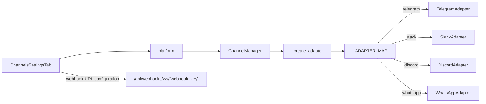
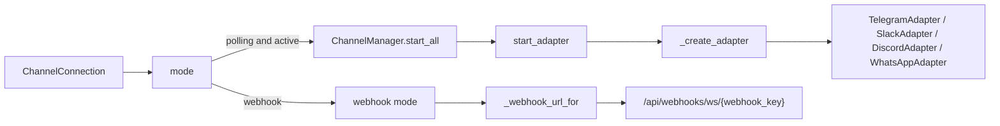
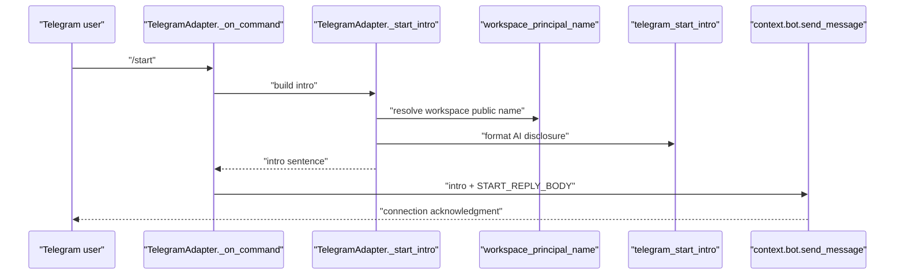

# Platform Adapters

Relevant source files

The following files were used as context for generating this wiki page:

- [docs/PRDS/55-AUTONOMOUS-ASSISTANT-PLATFORM.md](docs/PRDS/55-AUTONOMOUS-ASSISTANT-PLATFORM.md)
- [frontend/components/settings/ChannelsSettingsTab.tsx](frontend/components/settings/ChannelsSettingsTab.tsx)
- [frontend/components/settings/__tests__/channels-settings-local.test.ts](frontend/components/settings/__tests__/channels-settings-local.test.ts)
- [orchestrator/alembic/versions/20260215_add_heartbeat_and_channels.py](orchestrator/alembic/versions/20260215_add_heartbeat_and_channels.py)
- [orchestrator/api/channels.py](orchestrator/api/channels.py)
- [orchestrator/api/heartbeat.py](orchestrator/api/heartbeat.py)
- [orchestrator/channels/manager.py](orchestrator/channels/manager.py)
- [orchestrator/channels/telegram_adapter.py](orchestrator/channels/telegram_adapter.py)
- [orchestrator/core/models/channels.py](orchestrator/core/models/channels.py)
- [orchestrator/tests/test_prd225_polling_answer_bridge.py](orchestrator/tests/test_prd225_polling_answer_bridge.py)

## Purpose and scope

This page covers the available implementation details for Telegram, Slack, Discord, WhatsApp, and workspace webhook transports. It focuses on adapter creation and lifecycle, configuration and connectivity modes, the Telegram polling path, the workspace webhook URL, and the AI disclosure evidenced for Telegram’s `/start` reply. Platform-specific behavior not shown in the supplied code is identified as unspecified rather than inferred.

Sources: [orchestrator/channels/manager.py:32-41](), [orchestrator/channels/manager.py:126-163](), [orchestrator/api/channels.py:67-78](), [orchestrator/channels/telegram_adapter.py:106-134]()

---

## Adapter overview

`ChannelManager._create_adapter` maps `telegram`, `slack`, `discord`, and `whatsapp` to adapter classes and loads them with lazy imports. Its mapping is the implementation evidence for these runtime adapters; the supplied files do not show the implementations of Slack, Discord, or WhatsApp adapters. [orchestrator/channels/manager.py:126-163]()

For startup, `ChannelManager.start_all()` selects active database connections whose `mode` is `polling`. It deliberately skips webhook-mode rows: the platform posts to the workspace webhook URL, so no in-process polling adapter is needed for those connections. [orchestrator/channels/manager.py:32-63]()

The channel settings UI exposes Telegram, Slack, Discord, and WhatsApp configuration fields. `ChannelConnection` stores the platform, JSON configuration, status, connectivity mode, webhook URL, verification state, and message activity fields. [frontend/components/settings/ChannelsSettingsTab.tsx:14-25](), [frontend/components/settings/ChannelsSettingsTab.tsx:27-63](), [orchestrator/core/models/channels.py:19-45]()

| Platform | Runtime or transport evidence | Configuration fields shown |
|---|---|---|
| Telegram | `ChannelManager._create_adapter` maps to `TelegramAdapter`. The adapter starts `python-telegram-bot` polling. The UI offers webhook and polling modes. [orchestrator/channels/manager.py:139-145](), [orchestrator/channels/telegram_adapter.py:24-55](), [frontend/components/settings/ChannelsSettingsTab.tsx:141-154]() | `bot_token` is required by the API config map and shown in the UI. [orchestrator/api/channels.py:162-174](), [frontend/components/settings/ChannelsSettingsTab.tsx:39-45]() |
| Slack | `ChannelManager._create_adapter` maps to `SlackAdapter`. The supplied files show configuration fields, but not the adapter’s transport implementation. [orchestrator/channels/manager.py:139-145](), [frontend/components/settings/ChannelsSettingsTab.tsx:47-55]() | `bot_token`, `signing_secret`, and `app_token` in the UI; the API required-config map lists `bot_token` and `signing_secret`. [frontend/components/settings/ChannelsSettingsTab.tsx:47-55](), [orchestrator/api/channels.py:162-174]() |
| Discord | `ChannelManager._create_adapter` maps to `DiscordAdapter`. The supplied files show the bot-token configuration but not gateway or message-handling details. [orchestrator/channels/manager.py:139-145](), [frontend/components/settings/ChannelsSettingsTab.tsx:57-63]() | `bot_token`. [orchestrator/api/channels.py:162-174](), [frontend/components/settings/ChannelsSettingsTab.tsx:57-63]() |
| WhatsApp | `ChannelManager._create_adapter` maps to `WhatsAppAdapter`. The supplied files show configuration fields but not the adapter’s transport implementation. [orchestrator/channels/manager.py:139-145](), [frontend/components/settings/ChannelsSettingsTab.tsx:27-37]() | UI fields: `phone_number_id`, `access_token`, and optional `verify_token`; API required-config map lists `phone_number_id` and `access_token`. [frontend/components/settings/ChannelsSettingsTab.tsx:27-37](), [orchestrator/api/channels.py:162-174]() |
| Workspace webhook | The API helper builds `/api/webhooks/ws/{webhook_key}` using the configured public API host and a workspace key. This is distinct from the four adapter classes in `ChannelManager`’s mapping. [orchestrator/api/channels.py:67-78](), [orchestrator/channels/manager.py:139-145]() | Workspace `webhook_key`; the URL itself is described as authenticating the inbound request. [orchestrator/api/channels.py:67-78]() |

Sources: [orchestrator/channels/manager.py:32-63](), [orchestrator/channels/manager.py:126-163](), [orchestrator/api/channels.py:67-78](), [orchestrator/api/channels.py:162-174](), [orchestrator/core/models/channels.py:19-45](), [frontend/components/settings/ChannelsSettingsTab.tsx:14-25](), [frontend/components/settings/ChannelsSettingsTab.tsx:27-63](), [frontend/components/settings/ChannelsSettingsTab.tsx:138-174]()

---

## Adapter factory and lifecycle

`ChannelManager` holds adapters by connection ID. `start_adapter()` stops an existing adapter for that ID before creating and starting its replacement; on success it stores the new adapter. `stop_adapter()` removes and stops one adapter. `stop_all()` attempts to stop each loaded adapter and then clears the map. [orchestrator/channels/manager.py:22-26](), [orchestrator/channels/manager.py:74-82](), [orchestrator/channels/manager.py:88-120]()

`_create_adapter()` uses a platform-to-module/class mapping for Telegram, Slack, Discord, and WhatsApp. It imports the selected module lazily, looks up the named class, and constructs it with the connection ID, workspace ID, and config. Unknown platform names and import or construction errors return `None`. [orchestrator/channels/manager.py:126-170]()

### Diagram: Platform names mapped to runtime entities

Sources: [frontend/components/settings/ChannelsSettingsTab.tsx:27-63](), [orchestrator/channels/manager.py:126-163](), [orchestrator/api/channels.py:67-78]()

### Diagram: Connection record to polling lifecycle or webhook transport

Sources: [orchestrator/core/models/channels.py:19-45](), [orchestrator/channels/manager.py:32-63](), [orchestrator/channels/manager.py:126-163](), [orchestrator/api/channels.py:67-78]()

Sources: [orchestrator/channels/manager.py:22-26](), [orchestrator/channels/manager.py:32-63](), [orchestrator/channels/manager.py:74-120](), [orchestrator/channels/manager.py:126-170](), [orchestrator/core/models/channels.py:19-45]()

---

## Telegram adapter

### Polling transport

`TelegramAdapter.start()` imports `python-telegram-bot` components, requires `bot_token`, builds an application, and registers handlers for `/start` and `/help`. Its message handler accepts text, photos, and documents while excluding commands. It initializes and starts the application, then launches `updater.start_polling()` as an asynchronous task and marks the adapter running. [orchestrator/channels/telegram_adapter.py:24-59]()

At orchestrator startup, `ChannelManager.start_all()` loads only active connections with `mode == "polling"` and starts an adapter for each. Webhook-mode connections are intentionally skipped; the manager notes that starting a polling adapter for a webhook-mode Telegram bot would conflict on `getUpdates`. [orchestrator/channels/manager.py:32-63]()

The frontend’s mode picker currently defines Telegram as the multi-mode platform: webhook is labeled recommended, while polling is described as long-polling `getUpdates` from the orchestrator and requiring `python-telegram-bot`. [frontend/components/settings/ChannelsSettingsTab.tsx:138-154]()

### Sending, verification, and `/start`

`TelegramAdapter.send_message()` returns false when no bot is available. Otherwise, it splits text into chunks of at most 4,096 characters, sends each chunk to the integer chat ID, and returns true if sending completes. `test_connection()` calls Telegram’s `getMe` endpoint with the configured token and returns a connected or error result. [orchestrator/channels/telegram_adapter.py:79-104]()

The `/start` and `/help` handler persists the effective chat ID using `_persist_default_chat_id()` and sends an introductory message. The persistence method seeds `telegram_default_chat_id` in workspace integration settings only if it is not already set; later inbound traffic does not retarget that stored destination. [orchestrator/channels/telegram_adapter.py:106-122](), [orchestrator/channels/telegram_adapter.py:136-167]()

### Polling answer bridge

The supplied polling-path tests show that the adapter checks whether an inbound Telegram message answers a delivered question before forwarding it to ordinary message handling. When the shared check reports the message was consumed as an answer, the adapter routes nothing further; when it reports false, ordinary chat continues through `handle_message`. [orchestrator/tests/test_prd225_polling_answer_bridge.py:134-171]()

The tests also exercise reply-to-message and `/answer` forms, including checks that a message from the wrong chat is not accepted as an answer. The tests call `api.webhooks.maybe_answer_polled_telegram_message`; its implementation is not included in the supplied files, so this page does not describe its internal matching logic. [orchestrator/tests/test_prd225_polling_answer_bridge.py:46-103]()

Sources: [orchestrator/channels/telegram_adapter.py:24-59](), [orchestrator/channels/telegram_adapter.py:79-104](), [orchestrator/channels/telegram_adapter.py:106-167](), [orchestrator/channels/manager.py:32-63](), [frontend/components/settings/ChannelsSettingsTab.tsx:138-154](), [orchestrator/tests/test_prd225_polling_answer_bridge.py:46-103](), [orchestrator/tests/test_prd225_polling_answer_bridge.py:134-171]()

---

## AI notice disclosure (PRD-264)

The supplied disclosure implementation is specific to Telegram’s `/start` reply. `_start_intro()` obtains the workspace’s public principal name and passes it to `telegram_start_intro()`. The `/start` handler prefixes that generated intro to `START_REPLY_BODY`, which confirms the chat connection and invites the user to send messages to agents. [orchestrator/channels/telegram_adapter.py:18-21](), [orchestrator/channels/telegram_adapter.py:106-134]()

The adapter’s docstrings state that the first sentence identifies the bot as an AI assistant for the named principal. The provided files do not show equivalent disclosure implementations for Slack, Discord, WhatsApp, or workspace webhooks; no cross-platform disclosure behavior is asserted here. [orchestrator/channels/telegram_adapter.py:106-134]()

### Diagram: Telegram `/start` disclosure path

Sources: [orchestrator/channels/telegram_adapter.py:18-21](), [orchestrator/channels/telegram_adapter.py:106-134]()

Sources: [orchestrator/channels/telegram_adapter.py:18-21](), [orchestrator/channels/telegram_adapter.py:106-134]()

---

## Slack, Discord, and WhatsApp adapters

`ChannelManager._create_adapter()` contains mappings for `SlackAdapter`, `DiscordAdapter`, and `WhatsAppAdapter`, but the supplied file contents do not include those adapter implementations. Consequently, this section documents only the registration and configuration evidence, not SDK behavior, event normalization, response formatting, or transport-specific retry and verification details. [orchestrator/channels/manager.py:139-163]()

- **Slack:** The settings UI exposes `bot_token`, `signing_secret`, and `app_token`, with the app token labeled for Socket Mode. The API’s required-config map lists `bot_token` and `signing_secret`. The supplied sources do not establish how the adapter uses these fields. [frontend/components/settings/ChannelsSettingsTab.tsx:47-55](), [orchestrator/api/channels.py:162-174]()
- **Discord:** The settings UI and API required-config map show `bot_token`. The supplied sources do not establish the adapter’s gateway, event, or message-send behavior. [frontend/components/settings/ChannelsSettingsTab.tsx:57-63](), [orchestrator/api/channels.py:162-174]()
- **WhatsApp:** The settings UI exposes `phone_number_id`, `access_token`, and an optional `verify_token`; the API required-config map lists `phone_number_id` and `access_token`. The supplied sources do not establish the adapter’s webhook verification or Cloud API implementation. [frontend/components/settings/ChannelsSettingsTab.tsx:27-37](), [orchestrator/api/channels.py:162-174]()

Sources: [orchestrator/channels/manager.py:139-163](), [orchestrator/api/channels.py:162-174](), [frontend/components/settings/ChannelsSettingsTab.tsx:27-63]()

---

## Workspace webhook transport

`_webhook_url_for()` queries `workspaces.webhook_key`. If no key is provisioned, it returns `None`; otherwise it builds an HTTPS URL using `PUBLIC_API_HOST` and the `/api/webhooks/ws/{webhook_key}` path. The helper documents the URL as a secret used to authenticate inbound requests. [orchestrator/api/channels.py:48-51](), [orchestrator/api/channels.py:67-78]()

Webhook-mode rows are not started as in-process polling adapters by `ChannelManager.start_all()`. The manager describes the platform as posting directly to the workspace webhook endpoint. [orchestrator/channels/manager.py:32-41]()

Sources: [orchestrator/api/channels.py:48-51](), [orchestrator/api/channels.py:67-78](), [orchestrator/channels/manager.py:32-41]()

---

## Local versus hosted connectivity mode

The frontend declares Telegram as the only `POLLING_CAPABLE_PLATFORMS` entry in the supplied code. `defaultModeFor()` selects polling for a local installation when the platform has a polling option; otherwise it selects the first configured mode. For Telegram, the UI’s first mode is webhook, so the default is polling locally and webhook in hosted mode. [frontend/components/settings/ChannelsSettingsTab.tsx:141-169]()

`needsPublicUrlLocally()` returns true for a local platform that is not in `POLLING_CAPABLE_PLATFORMS`. The UI comment describes this as a public URL requirement for inbound traffic to webhook-only platforms; outbound messaging is not subject to that stated requirement. [frontend/components/settings/ChannelsSettingsTab.tsx:156-174]()

The tests verify the expected defaults for Telegram, confirm that Slack and WhatsApp have no mode-picker default, and check that local Slack and WhatsApp require a public URL while Telegram does not. [frontend/components/settings/__tests__/channels-settings-local.test.ts:9-27]()

Sources: [frontend/components/settings/ChannelsSettingsTab.tsx:138-174](), [frontend/components/settings/__tests__/channels-settings-local.test.ts:9-27](), [orchestrator/channels/manager.py:32-41]()

---