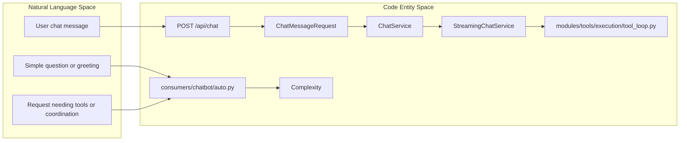
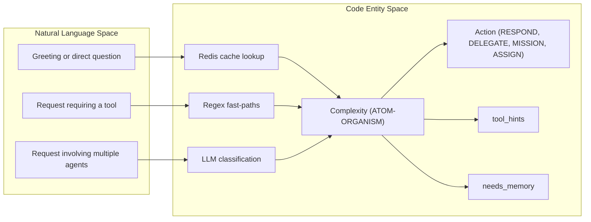

# Chat Interface

Relevant source files

The following files were used as context for generating this wiki page:

- [frontend/app/api/chat/route.ts](frontend/app/api/chat/route.ts)
- [frontend/components/__tests__/prd207-live-voice.test.tsx](frontend/components/__tests__/prd207-live-voice.test.tsx)
- [frontend/components/chatbot/__tests__/composer-voice.test.tsx](frontend/components/chatbot/__tests__/composer-voice.test.tsx)
- [frontend/components/chatbot/chat.tsx](frontend/components/chatbot/chat.tsx)
- [frontend/components/chatbot/message.tsx](frontend/components/chatbot/message.tsx)
- [frontend/components/voice/LiveVoiceMode.tsx](frontend/components/voice/LiveVoiceMode.tsx)
- [frontend/components/voice/PresenceOrb.tsx](frontend/components/voice/PresenceOrb.tsx)
- [frontend/components/voice/VoiceErrorBoundary.tsx](frontend/components/voice/VoiceErrorBoundary.tsx)
- [frontend/components/voice/__tests__/voice-button.test.tsx](frontend/components/voice/__tests__/voice-button.test.tsx)
- [frontend/components/voice/voice-button-view.ts](frontend/components/voice/voice-button-view.ts)
- [frontend/components/voice/voice-button.tsx](frontend/components/voice/voice-button.tsx)
- [frontend/components/voice/voice-controls.tsx](frontend/components/voice/voice-controls.tsx)
- [frontend/lib/chat/hooks.ts](frontend/lib/chat/hooks.ts)
- [frontend/types/chat.ts](frontend/types/chat.ts)
- [orchestrator/api/chat.py](orchestrator/api/chat.py)
- [orchestrator/consumers/chatbot/service.py](orchestrator/consumers/chatbot/service.py)
- [orchestrator/modules/agents/factory/agent_factory.py](orchestrator/modules/agents/factory/agent_factory.py)

## Purpose and scope

The Chat Interface is the user-facing conversation path. The backend exposes chat routes and uses `ChatService` and `StreamingChatService`; the chatbot consumer also draws on LLM providers, memory, and tool execution. `AutoBrain` assesses message complexity to guide downstream behavior. [orchestrator/api/chat.py:1-5](), [orchestrator/consumers/chatbot/service.py:1-13]()

This parent page summarizes how those pieces fit together. For detailed implementation guidance, see the child pages linked below. Broader context is covered in [Agents](#5), [Universal Router](#10), and [Memory System](#3).

Sources: [orchestrator/api/chat.py:1-5](), [orchestrator/consumers/chatbot/service.py:1-13]()

---

## Natural Language to Code Architecture

A user message enters through `/api/chat`; the chat consumer coordinates the conversation path, with `AutoBrain` assessing complexity and the tool loop providing a shared execution component. This diagram shows the high-level association between user intent and named code entities, not every runtime call. [orchestrator/api/chat.py:14-25](), [orchestrator/api/chat.py:44-45](), [orchestrator/consumers/chatbot/service.py:27-36]()

**Diagram: Chat request concepts mapped to code entities**

Sources: [orchestrator/api/chat.py:14-26](), [orchestrator/api/chat.py:44-45](), [orchestrator/consumers/chatbot/service.py:27-36]()

---

## Complexity Assessment to Execution Mapping

`AutoBrain` defines complexity levels from `ATOM` through `ORGANISM` and describes a three-tier assessment: Redis cache, regex fast paths, and LLM classification. Its module documentation identifies `needs_memory` and `tool_hints` as outputs that guide downstream behavior.

**Diagram: Complexity concepts mapped to assessment entities**

Sources: [orchestrator/consumers/chatbot/atom_prompt.py:44-47]()

---

## 9.1 Chat API & Streaming

The API router is mounted at `/api/chat` [orchestrator/api/chat.py:44](). Its module imports `StreamingResponse` and the chatbot’s `ChatService` and `StreamingChatService` [orchestrator/api/chat.py:15-16,21-22](); it also uses hybrid request-context authentication and workspace-permission dependencies [orchestrator/api/chat.py:28-30](). The route and stream protocol details belong in the child page.

For details, see [Chat API & Streaming](#9.1).

Sources: [orchestrator/api/chat.py:14-30](), [orchestrator/api/chat.py:44-45]()

---

## 9.2 Complexity Assessment (AutoBrain)

`AutoBrain` documents progressive complexity assessment from `ATOM` to `ORGANISM`, using cache lookup, regex fast paths, and LLM classification. The resulting `ComplexityAssessment` informs later behavior through fields including `needs_memory` and `tool_hints`.

For details, see [Complexity Assessment (AutoBrain)](#9.2).

Sources: [orchestrator/consumers/chatbot/atom_prompt.py:44-47]()

---

## 9.3 Streaming Chat Service

The chatbot consumer identifies `StreamingChatService` as its SSE streaming orchestrator [orchestrator/consumers/chatbot/service.py:12](). It imports the streaming handler [orchestrator/consumers/chatbot/service.py:51](), empty-completion helpers [orchestrator/consumers/chatbot/service.py:65](), and shared tool-loop components [orchestrator/consumers/chatbot/service.py:27-36](), placing streaming, fallback handling, and tool execution within the chat service boundary.

For details, see [Streaming Chat Service](#9.3).

Sources: [orchestrator/consumers/chatbot/service.py:1-13](), [orchestrator/consumers/chatbot/service.py:27-36](), [orchestrator/consumers/chatbot/service.py:51-65]()

---

## 9.4 Tool Loop Prevention

Chat imports the shared `ToolLoopExecutor` and related loop-state types from `modules/tools/execution/tool_loop.py` [orchestrator/consumers/chatbot/service.py:27-36](). The service also imports nudge handling [orchestrator/consumers/chatbot/service.py:34]() and tool-result support [orchestrator/consumers/chatbot/service.py:53](), connecting conversational turns to the shared tool-execution loop. Specific deduplication and iteration-limit behavior is covered in the child page.

For details, see [Tool Loop Prevention](#9.4).

Sources: [orchestrator/consumers/chatbot/service.py:27-36](), [orchestrator/consumers/chatbot/service.py:51-54]()

---

## 9.5 Chat Memory Integration

The chat consumer describes memory injection and storage as part of its dependencies [orchestrator/consumers/chatbot/service.py:7]() and imports `atom_memory_block` [orchestrator/consumers/chatbot/service.py:44](). The complexity assessor documents `needs_memory` as a downstream signal. The retrieval, storage, and context-assembly details are covered in the child page.

For details, see [Chat Memory Integration](#9.5).

Sources: [orchestrator/consumers/chatbot/service.py:5-8](), [orchestrator/consumers/chatbot/service.py:44-47]()

---

## 9.6 Chat UI Components

The supplied backend code establishes the chat API and its request models [orchestrator/api/chat.py:14-26](). Frontend components like `Chat` [frontend/components/chatbot/chat.tsx:87-98](), `Message` [frontend/components/chatbot/message.tsx:50-62](), `MultimodalInput` [frontend/components/chatbot/chat.tsx:13](), `ChatModeBar` [frontend/components/chatbot/chat.tsx:49](), `PinAgentPicker` [frontend/components/chatbot/chat.tsx:50](), and `ArtifactViewer` [frontend/components/chatbot/chat.tsx:14]() handle the user interface, message rendering, and input.

For details, see [Chat UI Components](#9.6).

Sources: [orchestrator/api/chat.py:14-26](), [frontend/components/chatbot/chat.tsx:13-14,49-50,87-98](), [frontend/components/chatbot/message.tsx:50-62]()

---

## 9.7 Suggestions & Widgets in Chat

Chat tool execution can expose platform operations: the platform executor dispatches actions to domain-specific handlers, and the action registry assembles the platform action set. Frontend components like `ToolSuggestionBar` [frontend/components/chatbot/chat.tsx:40]() and the `Canvas` [frontend/components/chatbot/chat.tsx:25]() for widgets integrate these capabilities into the chat experience.

For details, see [Suggestions & Widgets in Chat](#9.7).

Sources: [frontend/components/chatbot/chat.tsx:25,40]()

---