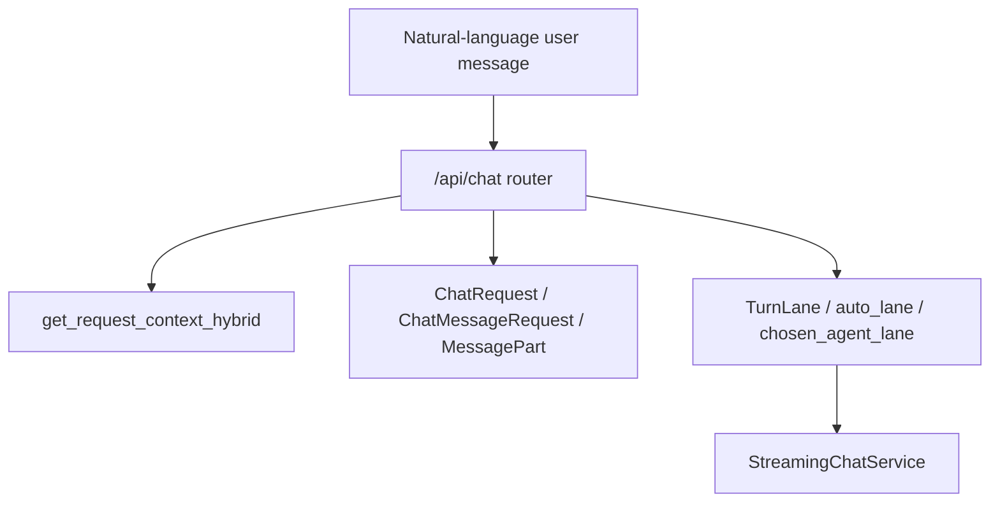
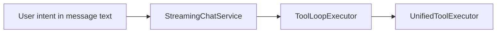

# Chat API & Streaming

Relevant source files

The following files were used as context for generating this wiki page:

- [frontend/app/api/chat/route.ts](frontend/app/api/chat/route.ts)
- [frontend/components/__tests__/prd207-live-voice.test.tsx](frontend/components/__tests__/prd207-live-voice.test.tsx)
- [frontend/components/chatbot/__tests__/composer-voice.test.tsx](frontend/components/chatbot/__tests__/composer-voice.test.tsx)
- [frontend/components/chatbot/chat.tsx](frontend/components/chatbot/chat.tsx)
- [frontend/components/chatbot/message.tsx](frontend/components/chatbot/message.tsx)
- [frontend/components/voice/LiveVoiceMode.tsx](frontend/components/voice/LiveVoiceMode.tsx)
- [frontend/components/voice/PresenceOrb.tsx](frontend/components/voice/PresenceOrb.tsx)
- [frontend/components/voice/VoiceErrorBoundary.tsx](frontend/components/voice/VoiceErrorBoundary.tsx)
- [frontend/components/voice/__tests__/voice-button.test.tsx](frontend/components/voice/__tests__/voice-button.test.tsx)
- [frontend/components/voice/voice-button-view.ts](frontend/components/voice/voice-button-view.ts)
- [frontend/components/voice/voice-button.tsx](frontend/components/voice/voice-button.tsx)
- [frontend/components/voice/voice-controls.tsx](frontend/components/voice/voice-controls.tsx)
- [frontend/lib/chat/hooks.ts](frontend/lib/chat/hooks.ts)
- [frontend/types/chat.ts](frontend/types/chat.ts)
- [orchestrator/api/chat.py](orchestrator/api/chat.py)
- [orchestrator/consumers/chatbot/service.py](orchestrator/consumers/chatbot/service.py)
- [orchestrator/modules/agents/factory/agent_factory.py](orchestrator/modules/agents/factory/agent_factory.py)

## Purpose and Scope

This page documents the chat API and the backend components visible in the supplied source: the `/api/chat` router, its request/authentication dependencies, the routing helper imports, the chatbot service boundary, and Auto’s progressive complexity model. The supplied excerpts do not include the `POST` handler body, the implementations of the routing helpers, or the streaming serializer, so exact request fields, response frames, and routing-header values cannot be verified here. [orchestrator/api/chat.py:1-44](), [orchestrator/consumers/chatbot/service.py:1-13]()

Sources: [orchestrator/api/chat.py:1-44](), [orchestrator/consumers/chatbot/service.py:1-13]()

---

## API Boundary and Request Handling

The FastAPI router is declared with the `/api/chat` prefix and the `💬 Chat` tag. The API module imports `StreamingResponse`, `ChatRequest`, `ChatMessageRequest`, `MessagePart`, hybrid authentication, workspace permission enforcement, and `RequestContext`; these imports identify the main API boundary and dependencies, but the supplied excerpt does not show the `POST` route’s decorator or handler body. [orchestrator/api/chat.py:14-29](), [orchestrator/api/chat.py:44-47]()

The API resolves an authenticated principal to an integer user primary key through `get_user_id`, which calls `resolve_user_pk`. If no principal can be resolved, it falls back to an existing user row and raises HTTP 500 if the database has no users. [orchestrator/api/chat.py:79-104]()

The API also defines `_explicitly_chosen_agent`, which checks the requested agent against the workspace using `agent_in_workspace` and returns HTTP 404 for an agent outside that scope. `get_default_agent_id` looks up the workspace’s system agent by the `auto-{workspace_id}` slug, attempts lazy seeding if absent, and then falls back to the first agent in that workspace. [orchestrator/api/chat.py:106-155]()

Sources: [orchestrator/api/chat.py:14-29](), [orchestrator/api/chat.py:44-47](), [orchestrator/api/chat.py:79-155]()

---

## Request-to-Code Flow

The supplied API excerpt establishes the `/api/chat` router and its imports, while the service module identifies `StreamingChatService` as the SSE streaming orchestrator. The excerpts do not show the route call site or the service’s stream implementation, so the diagram represents the documented component relationship rather than a fully verified function-call trace. [orchestrator/api/chat.py:20-29](), [orchestrator/api/chat.py:44](), [orchestrator/consumers/chatbot/service.py:5-13]()

**Diagram: Natural-language chat request and backend entities**

Sources: [orchestrator/api/chat.py:14-29](), [orchestrator/api/chat.py:44-47](), [orchestrator/api/chat.py:20-27](), [orchestrator/consumers/chatbot/service.py:5-13]()

**Diagram: Natural-language intent to routing and execution entities**

Sources: [orchestrator/consumers/chatbot/service.py:27-36](), [orchestrator/modules/agents/factory/agent_factory.py:49-51]()

---

## Streaming Service and Tool Execution Boundary

`orchestrator/consumers/chatbot/service.py` describes `ChatService` as responsible for chat/message database operations and `StreamingChatService` as the SSE streaming orchestrator. The module imports the shared tool-loop types `RoundState`, `ToolLoopExecutor`, `ToolLoopResult`, and `ToolPostResult`, showing that the chatbot consumer uses the converged tool-loop spine. The supplied excerpt does not include the methods that produce stream frames or invoke the loop. [orchestrator/consumers/chatbot/service.py:5-13](), [orchestrator/consumers/chatbot/service.py:27-36]()

The service also imports `get_streaming_handler`, `get_tool_router`, and `get_tools_for_agent_async`. Their presence indicates dependencies for stream handling and tool resolution, but the provided lines do not establish the invocation order or emitted protocol. [orchestrator/consumers/chatbot/service.py:44-60]()

The agent factory exposes `get_unified_tool_executor`, which constructs `UnifiedToolExecutor` for a database session. This provides a code pointer for the agent-side executor boundary; the supplied excerpt does not prove that this function is called by the chat stream path. [orchestrator/modules/agents/factory/agent_factory.py:49-51]()

Sources: [orchestrator/consumers/chatbot/service.py:5-13](), [orchestrator/consumers/chatbot/service.py:27-60](), [orchestrator/modules/agents/factory/agent_factory.py:49-51]()

---

## Routing Headers and AI SDK Data Stream

The API imports `response_headers` from `api.chat_dispatch` alongside `TurnLane`, `auto_lane`, and `chosen_agent_lane`. This establishes that the chat API has a routing-header helper available at the API boundary. The supplied excerpt does not show where `response_headers` is called, which header names it sets, or what values it returns. [orchestrator/api/chat.py:25-26]()

The frontend `app/api/chat/route.ts` acts as a proxy, forwarding requests to the backend. It explicitly sets the `x-vercel-ai-data-stream: v1` header in the response, indicating adherence to the AI SDK Data Stream format. It also forwards specific routing headers from the backend to the frontend: `x-routing-agent-id`, `x-routing-confidence`, `x-routing-type`, `x-routing-reasoning`, and `x-routing-request-id`. [frontend/app/api/chat/route.ts:83-88]()

The `StreamingResponse` import in the backend API confirms that the API module uses FastAPI’s streaming response type. [orchestrator/api/chat.py:14-15]()

Sources: [orchestrator/api/chat.py:14-15](), [orchestrator/api/chat.py:25-26](), [frontend/app/api/chat/route.ts:83-88]()

---

## Tool-Loop Caller Context

The chatbot service defines `build_tool_caller_context`, which assembles context intended to accompany chat tool execution. Its parameters include the user query, conversation and turn identifiers, driving clerk, prior action, optional model ID, estimated input/output tokens, lane assignment, driving user ID, and system role. Its docstring describes threading this context into chat tool execution and identifies intent telemetry as one consumer. [orchestrator/consumers/chatbot/service.py:122-143]()

The function’s implementation continues beyond the supplied excerpt, so the exact returned structure and downstream call sites are not documented here. The service imports `ToolLoopExecutor` and `RoundState`, establishing the relevant shared tool-loop entities without exposing the complete chat loop. [orchestrator/consumers/chatbot/service.py:27-36](), [orchestrator/consumers/chatbot/service.py:122-143]()

Sources: [orchestrator/consumers/chatbot/service.py:27-36](), [orchestrator/consumers/chatbot/service.py:122-143]()

---

## Implementation Boundaries

The supplied excerpts support the following implementation map:

| Concern | Code entity | What the supplied source establishes |
|---|---|---|
| HTTP API | `api.chat.router` | Router prefix is `/api/chat`; API module imports `StreamingResponse` and chat request models. [orchestrator/api/chat.py:14-18](), [orchestrator/api/chat.py:44-47]() |
| Authenticated principal | `get_user_id` | Resolves the request principal to a database user ID, with a fallback for principal-less paths. [orchestrator/api/chat.py:79-104]() |
| Workspace-safe agent selection | `_explicitly_chosen_agent`, `get_default_agent_id` | Explicit selection is workspace-checked; default lookup is workspace-scoped and can lazy-seed Auto. [orchestrator/api/chat.py:106-155]() |
| Routing helpers | `TurnLane`, `auto_lane`, `chosen_agent_lane`, `response_headers` | Imported by the API; their definitions and route call sites are not included. [orchestrator/api/chat.py:25-26]() |
| Streaming orchestration | `StreamingChatService` | Identified in the service module as the SSE streaming orchestrator. [orchestrator/consumers/chatbot/service.py:5-13]() |
| Tool-loop integration | `ToolLoopExecutor`, `RoundState` | Imported by the chatbot service as part of the converged tool-loop spine. [orchestrator/consumers/chatbot/service.py:27-36]() |
| AI SDK Data Stream | `frontend/app/api/chat/route.ts` | Sets `x-vercel-ai-data-stream: v1` and forwards routing headers. [frontend/app/api/chat/route.ts:83-88]()

Sources: [orchestrator/api/chat.py:14-47](), [orchestrator/api/chat.py:79-155](), [orchestrator/consumers/chatbot/service.py:5-13](), [orchestrator/consumers/chatbot/service.py:27-36](), [frontend/app/api/chat/route.ts:83-88]()

---