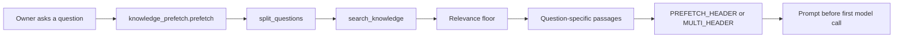
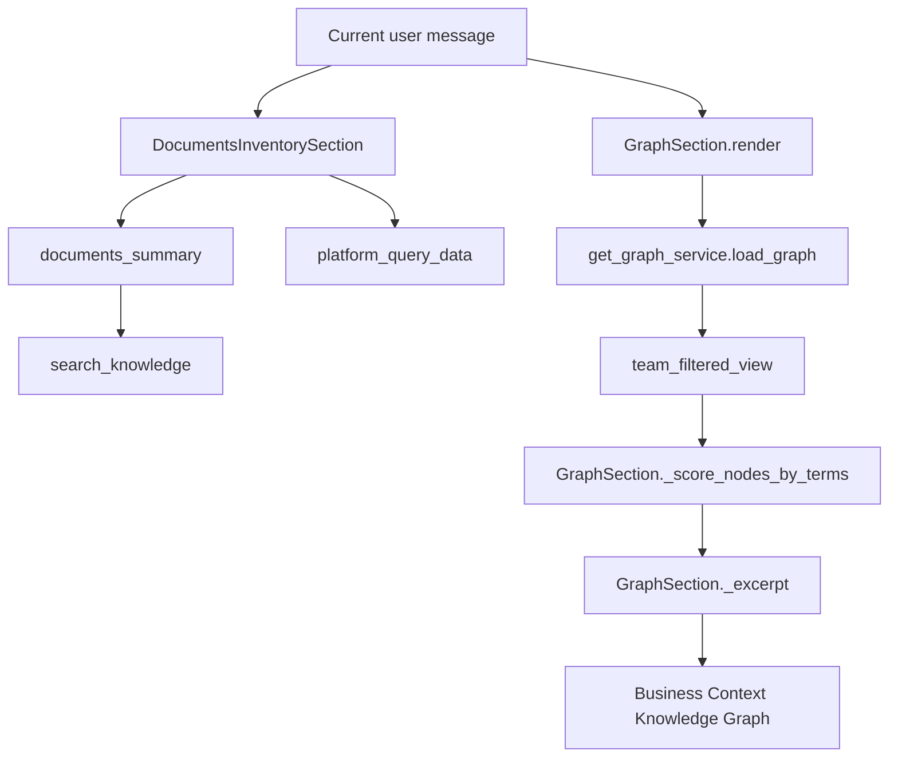
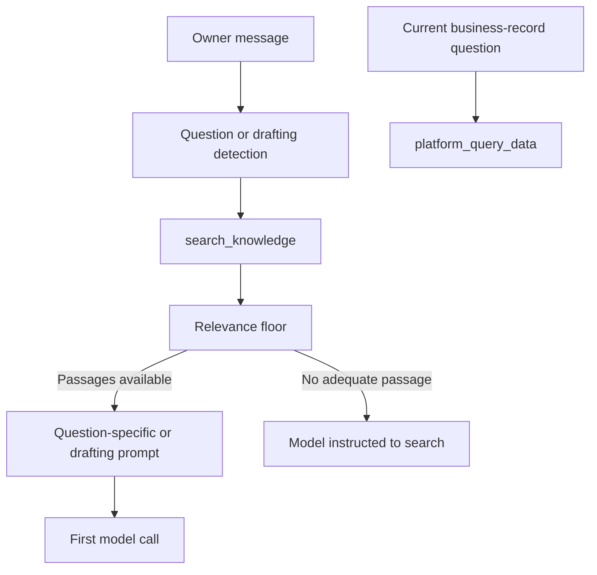

# Chat Memory Integration

Relevant source files

The following files were used as context for generating this wiki page:

- [orchestrator/consumers/chatbot/knowledge_prefetch.py](orchestrator/consumers/chatbot/knowledge_prefetch.py)
- [orchestrator/core/seeds/utterances/graph.yaml](orchestrator/core/seeds/utterances/graph.yaml)
- [orchestrator/modules/context/sections/documents_inventory.py](orchestrator/modules/context/sections/documents_inventory.py)
- [orchestrator/modules/context/sections/graph_context.py](orchestrator/modules/context/sections/graph_context.py)
- [orchestrator/modules/tools/data_routes.py](orchestrator/modules/tools/data_routes.py)
- [orchestrator/modules/tools/discovery/actions_analytics.py](orchestrator/modules/tools/discovery/actions_analytics.py)
- [orchestrator/modules/tools/discovery/actions_data_routes.py](orchestrator/modules/tools/discovery/actions_data_routes.py)
- [orchestrator/modules/tools/discovery/actions_field.py](orchestrator/modules/tools/discovery/actions_field.py)
- [orchestrator/modules/tools/discovery/actions_graph.py](orchestrator/modules/tools/discovery/actions_graph.py)
- [orchestrator/tests/test_f077c_a_number_question_goes_to_the_database.py](orchestrator/tests/test_f077c_a_number_question_goes_to_the_database.py)
- [orchestrator/tests/test_f078_the_prompt_names_the_connected_database.py](orchestrator/tests/test_f078_the_prompt_names_the_connected_database.py)
- [orchestrator/tests/test_f155_a_widget_turns_prompt_carries_only_what_its_key_may_read.py](orchestrator/tests/test_f155_a_widget_turns_prompt_carries_only_what_its_key_may_read.py)
- [orchestrator/tests/test_f227_each_question_is_searched_on_its_own.py](orchestrator/tests/test_f227_each_question_is_searched_on_its_own.py)
- [orchestrator/tests/test_f302_b_a_shop_question_always_reaches_the_database.py](orchestrator/tests/test_f302_b_a_shop_question_always_reaches_the_database.py)
- [orchestrator/tests/test_f312_a_auto_reaches_for_the_knowledge_graph.py](orchestrator/tests/test_f312_a_auto_reaches_for_the_knowledge_graph.py)
- [orchestrator/tests/test_f312_b_the_graph_tools_name_the_graphs_own_relations.py](orchestrator/tests/test_f312_b_the_graph_tools_name_the_graphs_own_relations.py)
- [orchestrator/tests/test_f330_b_a_question_turn_holds_no_connection_while_the_documents_are_searched.py](orchestrator/tests/test_f330_b_a_question_turn_holds_no_connection_while_the_documents_are_searched.py)

## Purpose and Scope

This page describes the chat-facing memory and knowledge-context behavior visible in the supplied implementation excerpts: the `MemorySection` and `ContextRouter` integration described by the existing page, workspace document prefetch, document and database context, and graph context. The current file excerpts provide implementation detail for knowledge prefetch, `DocumentsInventorySection`, and `GraphSection`, but do not include the definitions or chat call sites for `retrieve_memories`, `store_exchange`, or daily-summary generation. Those memory APIs and persistence steps therefore cannot be specified here beyond what the supplied material establishes.

Sources: [orchestrator/consumers/chatbot/knowledge_prefetch.py:1-31](), [orchestrator/modules/context/sections/documents_inventory.py:1-31](), [orchestrator/modules/context/sections/graph_context.py:1-17]()

---

## Overview of Chat Memory Flows

Chat context has distinct paths for recalling stored conversational memory and retrieving workspace knowledge. The knowledge-prefetch module describes searching workspace documents before the first model call on eligible turns; it does not describe that search as `retrieve_memories` or as a replacement for conversational-memory retrieval. [orchestrator/consumers/chatbot/knowledge_prefetch.py:1-17]()

| Context path | What the supplied code establishes | Relevant entities |
|---|---|---|
| Conversational-memory section | The existing page describes `MemorySection` as a prompt section that tries `ContextRouter` and falls back to `SmartMemoryManager`; the underlying implementation files are not included in the current excerpts. | `MemorySection`, `ContextRouter`, `SmartMemoryManager` |
| Document prefetch | For eligible messages, workspace documents are searched before the first model call, and passages clearing a relevance floor are included in the prompt. | `prefetch`, `search_knowledge`, `PREFETCH_HEADER`, `MULTI_HEADER` [orchestrator/consumers/chatbot/knowledge_prefetch.py:1-17](), [orchestrator/consumers/chatbot/knowledge_prefetch.py:47-83]() |
| Document inventory | Prompt context can state which workspace documents are available and direct document questions to `search_knowledge`. | `documents_summary`, `DocumentsInventorySection` [orchestrator/modules/context/sections/documents_inventory.py:90-100]() |
| Graph context | The graph section loads a workspace graph, applies team visibility, scores graph nodes against the current message, and can render a relevant excerpt. | `GraphSection.render`, `_build`, `_visible_and_scored`, `_excerpt` [orchestrator/modules/context/sections/graph_context.py:47-63](), [orchestrator/modules/context/sections/graph_context.py:65-105](), [orchestrator/modules/context/sections/graph_context.py:118-137]() |
| Database context | The inventory section names active workspace databases and directs business-record questions to `platform_query_data`. | `connected_databases`, `databases_sentence`, `documents_summary` [orchestrator/modules/context/sections/documents_inventory.py:64-100]() |

Sources: [orchestrator/consumers/chatbot/knowledge_prefetch.py:1-17](), [orchestrator/consumers/chatbot/knowledge_prefetch.py:47-83](), [orchestrator/modules/context/sections/documents_inventory.py:64-100](), [orchestrator/modules/context/sections/graph_context.py:47-63](), [orchestrator/modules/context/sections/graph_context.py:65-105](), [orchestrator/modules/context/sections/graph_context.py:118-137]()

---

## Prompt Context and Knowledge Sources

The available excerpts describe several kinds of context that may be surfaced to chat, with separate retrieval mechanisms and responsibilities.

- **Conversational memory:** The existing page identifies `MemorySection`, `ContextRouter`, and `SmartMemoryManager` as the chat memory path, but their definitions and call sites are not present in the current file contents. This page therefore does not assert the implementation details of `retrieve_memories` or its exact relation to a chat request.
- **Workspace documents:** `DocumentsInventorySection` builds a prompt summary of documents the current surface may read and instructs the model to search those documents with `search_knowledge`. [orchestrator/modules/context/sections/documents_inventory.py:90-100]()
- **Business records:** When active databases are connected, the inventory text directs questions about records such as counts, orders, members, sales, and rankings to `platform_query_data`. [orchestrator/modules/context/sections/documents_inventory.py:54-57](), [orchestrator/modules/context/sections/documents_inventory.py:77-87]()
- **Knowledge graph:** For eligible non-widget `CHATBOT` contexts, `GraphSection` can add a route line describing when to use graph queries. It may also attach a relevant graph excerpt when scored nodes meet the relevance threshold. [orchestrator/modules/context/sections/graph_context.py:32-43](), [orchestrator/modules/context/sections/graph_context.py:101-116]()
- **Page context priors:** The supplied files do not define page-context-prior generation, selection, or injection. A page-specific prior should not be inferred from the document, database, or graph context mechanisms described here.

Sources: [orchestrator/modules/context/sections/documents_inventory.py:54-57](), [orchestrator/modules/context/sections/documents_inventory.py:77-100](), [orchestrator/modules/context/sections/graph_context.py:32-43](), [orchestrator/modules/context/sections/graph_context.py:101-116]()

---

## Natural-Language Requests to Code Entities

These diagrams map user-facing requests to the code entities named by the supplied excerpts. They show the document-prefetch and workspace-context paths; they do not claim that those paths invoke conversational-memory APIs.

**Diagram: Document question to prefetch entities**

For multiple questions, the module defines `MAX_QUESTIONS`, question-splitting rules, per-question search limits, and a separate prompt header that keeps passages associated with their question. [orchestrator/consumers/chatbot/knowledge_prefetch.py:74-83](), [orchestrator/consumers/chatbot/knowledge_prefetch.py:98-118]()

Sources: [orchestrator/consumers/chatbot/knowledge_prefetch.py:47-61](), [orchestrator/consumers/chatbot/knowledge_prefetch.py:74-83](), [orchestrator/consumers/chatbot/knowledge_prefetch.py:98-118]()

**Diagram: Business question to prompt-context entities**

`documents_summary` chooses document and database context based on workspace data and surface scopes; `GraphSection` loads and filters graph data before scoring and optionally creating an excerpt. [orchestrator/modules/context/sections/documents_inventory.py:90-107](), [orchestrator/modules/context/sections/graph_context.py:65-105](), [orchestrator/modules/context/sections/graph_context.py:118-137]()

Sources: [orchestrator/modules/context/sections/documents_inventory.py:90-107](), [orchestrator/modules/context/sections/graph_context.py:65-105](), [orchestrator/modules/context/sections/graph_context.py:118-137]()

---

## Knowledge Prefetch

### Eligibility and search behavior

The module describes retrieval-first behavior for eligible owner messages in workspaces with documents: run `search_knowledge` before the model’s first call, then add passages that clear a relevance floor to the prompt. The model may search again when the prefetched passages do not cover a question. [orchestrator/consumers/chatbot/knowledge_prefetch.py:1-17]()

The module defines `PREFETCH_TOOL` as `search_knowledge` and caps query length at `MAX_QUERY_CHARS = 1000`. It also defines an `ABSENCE_RULE`: a model must search for a specific term and its synonyms before claiming that the documents do not contain something. [orchestrator/consumers/chatbot/knowledge_prefetch.py:47-61]()

The provided excerpt documents several prompt headers:

| Header | Purpose |
|---|---|
| `PREFETCH_HEADER` | Introduces passages retrieved for a single question and allows another `search_knowledge` call if the passages do not cover it. [orchestrator/consumers/chatbot/knowledge_prefetch.py:58-62]() |
| `MULTI_HEADER` | Requires each question to be answered from its own passages and directs another search for a question whose passages are missing or insufficient. [orchestrator/consumers/chatbot/knowledge_prefetch.py:78-83]() |
| `DRAFTING_HEADER` | Frames passages retrieved for document-based writing and directs the model to use applicable facts from the newest document. [orchestrator/consumers/chatbot/knowledge_prefetch.py:84-90]() |

The module defines `MAX_QUESTIONS = 8`, `MIN_QUESTION_CHARS = 8`, and `PER_QUESTION_MIN = 2` for its multi-question behavior. [orchestrator/consumers/chatbot/knowledge_prefetch.py:74-77]() The available implementation excerpt includes the patterns and constants used to identify instructions and question-like messages, but does not show the full `prefetch` implementation body. [orchestrator/consumers/chatbot/knowledge_prefetch.py:91-118]()

### Multiple questions and document drafting

For multi-question messages, the documented behavior is one search per question, in order, with a separate heading and passage set per question. If no passage clears the relevance floor for a question, the generated content tells the model to search for that question itself rather than borrowing another question’s passages. [orchestrator/consumers/chatbot/knowledge_prefetch.py:19-24](), [orchestrator/consumers/chatbot/knowledge_prefetch.py:74-83](), [orchestrator/consumers/chatbot/knowledge_prefetch.py:98-100]()

The module also classifies some writing requests as document-based drafting. Its constants identify price or terms language near writing-related terms, as well as newsletter requests, and provide a dedicated drafting header. [orchestrator/consumers/chatbot/knowledge_prefetch.py:84-97]()

### Database handoff

Prefetched documents are not treated as authoritative for current business records. When a workspace has a connected database, `PREFETCH_DATABASE_NOTE` directs current counts, totals, stock, orders, or rankings to `platform_query_data`, noting that document figures may be out of date. [orchestrator/consumers/chatbot/knowledge_prefetch.py:63-72]()

**Diagram: Prefetch and evidence routing**

The module defines the prefetch headers, relevance-oriented behavior, and separate database handoff for current business-record questions. [orchestrator/consumers/chatbot/knowledge_prefetch.py:1-17](), [orchestrator/consumers/chatbot/knowledge_prefetch.py:53-90]()

Sources: [orchestrator/consumers/chatbot/knowledge_prefetch.py:1-24](), [orchestrator/consumers/chatbot/knowledge_prefetch.py:47-97](), [orchestrator/consumers/chatbot/knowledge_prefetch.py:98-118]()

---

## Document Inventory and Surface Scoping

`connected_databases(db, workspace_id)` queries active rows in `database_knowledge_sources` for the given workspace, ordered newest first. `databases_sentence` formats the connected database names and tells the model how to route business-record questions. [orchestrator/modules/context/sections/documents_inventory.py:64-87]()

`documents_summary` composes the section text from workspace documents and active databases. It returns `None` when neither is available to the current surface; otherwise it emits a documents-only heading or a documents-and-data heading. When documents are present, it tells the model to search them with `search_knowledge` and name the file used. [orchestrator/modules/context/sections/documents_inventory.py:90-100]()

Widget turns are scope-gated. `_key_may(scope)` allows the requested scope on non-widget turns and checks `widget_scopes()` on widget turns. The inventory uses `documents:read` for documents and `data:query` for connected databases. [orchestrator/modules/context/sections/documents_inventory.py:90-107]()

For document access, `_documents_held` also applies a team filter when a widget key has a team lock, using `widget_team()` and `TEAM_FILTER_CLAUSE`. The supplied excerpt shows the start of this query-building logic; it does not include the remainder of `_documents_held`. [orchestrator/modules/context/sections/documents_inventory.py:110-123]()

Sources: [orchestrator/modules/context/sections/documents_inventory.py:64-87](), [orchestrator/modules/context/sections/documents_inventory.py:90-107](), [orchestrator/modules/context/sections/documents_inventory.py:110-123]()

---

## Graph Context and Query Routing

`GraphSection` is a `BaseSection` named `business_graph`, with priority `45` and an 800-token budget. Its `render` method delegates to `_build` and catches exceptions, logging the failure and returning an empty string so graph-context errors do not escape the section renderer. [orchestrator/modules/context/sections/graph_context.py:32-63]()

The `_build` path:

1. Returns an empty section for widget turns without `documents:read`. [orchestrator/modules/context/sections/graph_context.py:65-70]()
2. Extracts the latest user message, falling back to `task_description`. [orchestrator/modules/context/sections/graph_context.py:140-148]()
3. Loads the workspace graph through `get_graph_service().load_graph(...)` and returns empty when there is no graph or no nodes. [orchestrator/modules/context/sections/graph_context.py:77-84]()
4. Filters the graph using `retrieval_team(agent_team)` and scores visible nodes against message terms in a worker thread. [orchestrator/modules/context/sections/graph_context.py:85-99](), [orchestrator/modules/context/sections/graph_context.py:150-157]()
5. Adds a graph route line for `CHATBOT` contexts that are not widget turns; if the top score meets `_RELEVANCE_THRESHOLD`, it also builds an excerpt. [orchestrator/modules/context/sections/graph_context.py:101-116]()

The excerpt uses the top three scored nodes, traverses their neighborhoods with `service.bfs` to depth two, then formats the resulting subgraph within the graph section’s token budget. [orchestrator/modules/context/sections/graph_context.py:32-35](), [orchestrator/modules/context/sections/graph_context.py:118-137]()

Sources: [orchestrator/modules/context/sections/graph_context.py:32-63](), [orchestrator/modules/context/sections/graph_context.py:65-105](), [orchestrator/modules/context/sections/graph_context.py:107-116](), [orchestrator/modules/context/sections/graph_context.py:118-157]()

---

## Memory Retrieval, Exchange Storage, and Daily Summaries

The existing page identifies `MemorySection`, `ContextRouter`, and `SmartMemoryManager` as the conversational-memory components, and refers to `retrieve_memories` as the durable-recall API. However, the current supplied files do not include the definitions or call sites for those components and functions. Their parameters, scope rules, fallback behavior, cache policy, and contribution to the final prompt cannot be verified from the current excerpts.

Likewise, the supplied files do not show a `store_exchange` definition or call site. They do not establish when an exchange is persisted, whether persistence is synchronous or background, or how daily summaries are generated or updated. No details about those behaviors are asserted here.

The chat knowledge path that *is* visible is document prefetch through `search_knowledge`; the document inventory directs the model to search workspace documents, and the graph and database sections expose separate knowledge routes. These mechanisms should not be conflated with conversational-memory storage or daily-summary maintenance. [orchestrator/consumers/chatbot/knowledge_prefetch.py:1-17](), [orchestrator/modules/context/sections/documents_inventory.py:90-100](), [orchestrator/modules/context/sections/graph_context.py:101-116]()

Sources: [orchestrator/consumers/chatbot/knowledge_prefetch.py:1-17](), [orchestrator/modules/context/sections/documents_inventory.py:90-100](), [orchestrator/modules/context/sections/graph_context.py:101-116]()

---

## Page Context Priors

The supplied excerpts do not define page context priors or a mechanism that converts the current frontend page into prior memories, ranking signals, or prompt text. The presence of document, database, or graph context does not demonstrate that such context is a page prior. Accordingly, page-prior selection and injection are outside the documented behavior in this page.

Sources: [orchestrator/consumers/chatbot/knowledge_prefetch.py:1-17](), [orchestrator/modules/context/sections/documents_inventory.py:90-100](), [orchestrator/modules/context/sections/graph_context.py:47-63]()

---