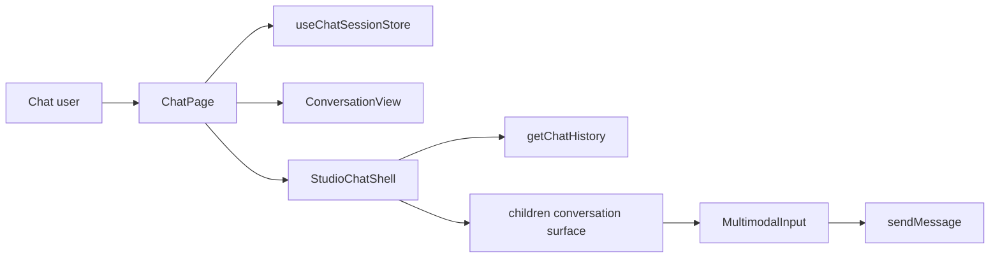
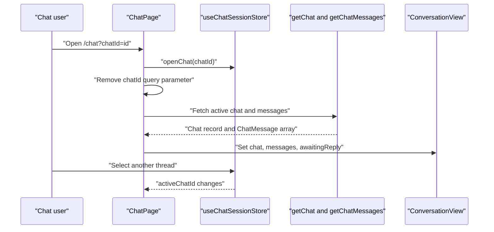
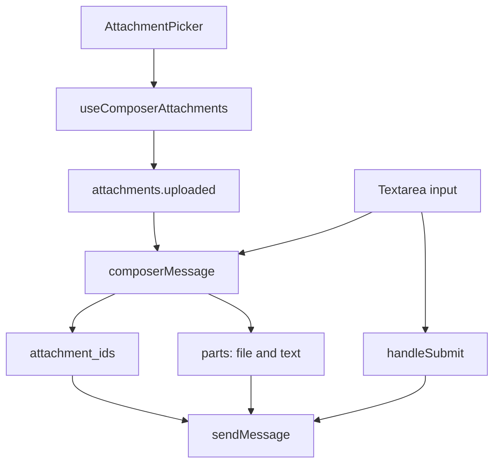
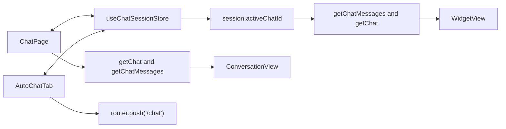
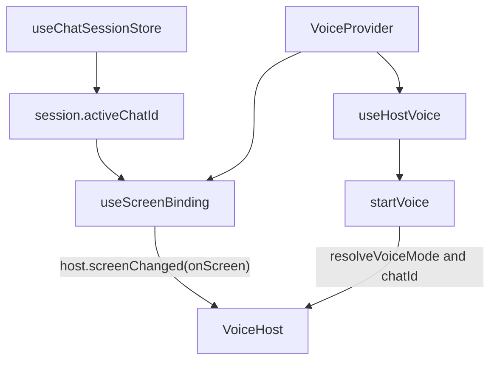

# Chat UI Components

Relevant source files

The following files were used as context for generating this wiki page:

- [docs/compliance/ARTICLE-50-GAP-ANALYSIS.md](docs/compliance/ARTICLE-50-GAP-ANALYSIS.md)
- [docs/compliance/ARTICLE-50.md](docs/compliance/ARTICLE-50.md)
- [docs/compliance/README.md](docs/compliance/README.md)
- [docs/theme-host/placement-reach.md](docs/theme-host/placement-reach.md)
- [frontend/app/assignments/__tests__/assignments-route.test.tsx](frontend/app/assignments/__tests__/assignments-route.test.tsx)
- [frontend/app/assignments/page.tsx](frontend/app/assignments/page.tsx)
- [frontend/app/chat/__tests__/chat-page-cold-start.test.tsx](frontend/app/chat/__tests__/chat-page-cold-start.test.tsx)
- [frontend/app/chat/__tests__/chat-page-resume.test.tsx](frontend/app/chat/__tests__/chat-page-resume.test.tsx)
- [frontend/app/chat/page.tsx](frontend/app/chat/page.tsx)
- [frontend/app/missions/__tests__/missions-redirect.test.tsx](frontend/app/missions/__tests__/missions-redirect.test.tsx)
- [frontend/app/missions/page.tsx](frontend/app/missions/page.tsx)
- [frontend/app/playbooks/__tests__/playbooks-route.test.tsx](frontend/app/playbooks/__tests__/playbooks-route.test.tsx)
- [frontend/app/playbooks/page.tsx](frontend/app/playbooks/page.tsx)
- [frontend/components/chatbot/__tests__/auto-now-mounts.test.ts](frontend/components/chatbot/__tests__/auto-now-mounts.test.ts)
- [frontend/components/chatbot/__tests__/studio-chat-compact.test.tsx](frontend/components/chatbot/__tests__/studio-chat-compact.test.tsx)
- [frontend/components/chatbot/__tests__/studio-surfaces-scope.test.ts](frontend/components/chatbot/__tests__/studio-surfaces-scope.test.ts)
- [frontend/components/chatbot/__tests__/widget-message.test.tsx](frontend/components/chatbot/__tests__/widget-message.test.tsx)
- [frontend/components/chatbot/__tests__/widget-quick-prompts.test.ts](frontend/components/chatbot/__tests__/widget-quick-prompts.test.ts)
- [frontend/components/chatbot/auto-now-pill.tsx](frontend/components/chatbot/auto-now-pill.tsx)
- [frontend/components/chatbot/auto-now-rail.tsx](frontend/components/chatbot/auto-now-rail.tsx)
- [frontend/components/chatbot/chat-widget.tsx](frontend/components/chatbot/chat-widget.tsx)
- [frontend/components/chatbot/multimodal-input.tsx](frontend/components/chatbot/multimodal-input.tsx)
- [frontend/components/chatbot/studio-chat-shell.tsx](frontend/components/chatbot/studio-chat-shell.tsx)
- [frontend/components/chatbot/widget-message.tsx](frontend/components/chatbot/widget-message.tsx)
- [frontend/components/command-center/__tests__/cc-compact.test.tsx](frontend/components/command-center/__tests__/cc-compact.test.tsx)
- [frontend/components/layout/main-layout.tsx](frontend/components/layout/main-layout.tsx)
- [frontend/components/voice/__tests__/voice-provider.test.tsx](frontend/components/voice/__tests__/voice-provider.test.tsx)
- [frontend/components/voice/voice-provider.tsx](frontend/components/voice/voice-provider.tsx)
- [frontend/lib/chat-controller/conversation.ts](frontend/lib/chat-controller/conversation.ts)
- [frontend/lib/chat/__tests__/use-studio-chat.test.tsx](frontend/lib/chat/__tests__/use-studio-chat.test.tsx)
- [frontend/lib/chat/chat-session.test.ts](frontend/lib/chat/chat-session.test.ts)
- [frontend/lib/chat/chat-session.ts](frontend/lib/chat/chat-session.ts)
- [frontend/lib/chat/use-studio-chat.ts](frontend/lib/chat/use-studio-chat.ts)
- [frontend/stores/chat-session-store.ts](frontend/stores/chat-session-store.ts)
- [orchestrator/tests/test_prd264_article50_docs.py](orchestrator/tests/test_prd264_article50_docs.py)

## Purpose and scope

This page documents the frontend chat surfaces visible in the supplied code: the `/chat` page’s conversation-session setup, the Studio chat shell, the multimodal composer, and the floating Auto widget’s conversation synchronization. It also covers the shared host-voice interface used by chat surfaces. The supplied files do not include the implementation of the main `Chat` component, message renderer, chat-mode bar, agent selector, artifact viewer, or image gallery; this page therefore does not infer their internal behavior. [frontend/app/chat/page.tsx:55-103](), [frontend/components/chatbot/studio-chat-shell.tsx:3-24](), [frontend/components/chatbot/multimodal-input.tsx:3-16](), [frontend/components/chatbot/chat-widget.tsx:75-103](), [frontend/components/voice/voice-provider.tsx:39-52]()

Sources: [frontend/app/chat/page.tsx:55-103](), [frontend/components/chatbot/studio-chat-shell.tsx:3-24](), [frontend/components/chatbot/multimodal-input.tsx:3-16](), [frontend/components/chatbot/chat-widget.tsx:75-103](), [frontend/components/voice/voice-provider.tsx:39-52]()

---

## 1. Chat Surface and Component Boundaries

The `/chat` route renders as a client page. It reads the current layout style and URL parameters, hydrates the chat-session store, and maintains a local `ConversationView` containing the selected chat, messages, and whether a reply is in flight. The page imports `Chat`, `ChatTabs`, `AppSidebar`, and `StudioChatShell`; the supplied excerpt shows those imports and the page’s session setup, but not the later JSX that connects them. [frontend/app/chat/page.tsx:1-15](), [frontend/app/chat/page.tsx:38-46](), [frontend/app/chat/page.tsx:55-103]()

`StudioChatShell` is the Studio-oriented wrapper for a conversation. Its documented layout is a thread list, conversation area, and mission rail; on compact screens, its side panels move into sheets. It receives the selected chat, message-selection callbacks, open-tab IDs, unread-tab IDs, titles, and an optional close-tab callback. [frontend/components/chatbot/studio-chat-shell.tsx:3-24](), [frontend/components/chatbot/studio-chat-shell.tsx:51-77]()

`MainLayout` provides the outer application shell. In Studio desktop mode, `fullBleed` renders the main content without the usual padding and width cap; the classic shell has a corresponding compact full-bleed layout. This supports the chat page’s use of a full-canvas surface without establishing the internals of the chat component itself. [frontend/components/layout/main-layout.tsx:19-35](), [frontend/components/layout/main-layout.tsx:80-109](), [frontend/components/layout/main-layout.tsx:166-175]()

| Surface or entity | Responsibility supported by the supplied files |
|---|---|
| `ChatPage` | Hydrates session state, handles selected URL parameters, and loads the active conversation into `ConversationView`. [frontend/app/chat/page.tsx:38-46](), [frontend/app/chat/page.tsx:55-103]() |
| `StudioChatShell` | Wraps the conversation with thread and mission-rail panels and exposes selection callbacks. [frontend/components/chatbot/studio-chat-shell.tsx:3-24](), [frontend/components/chatbot/studio-chat-shell.tsx:51-77]() |
| `MultimodalInput` | Collects text and uploaded attachment metadata, then calls its `sendMessage` prop. [frontend/components/chatbot/multimodal-input.tsx:27-39](), [frontend/components/chatbot/multimodal-input.tsx:79-115]() |
| `AutoChatTab` | Connects the floating widget to the shared chat-session store and fetches active-conversation data. [frontend/components/chatbot/chat-widget.tsx:75-103](), [frontend/components/chatbot/chat-widget.tsx:120-148]() |
| `VoiceProvider` | Makes a shared `VoiceHost` available to voice-enabled chat surfaces. [frontend/components/voice/voice-provider.tsx:72-85](), [frontend/components/voice/voice-provider.tsx:112-129]() |

Sources: [frontend/app/chat/page.tsx:38-46](), [frontend/app/chat/page.tsx:55-103](), [frontend/components/chatbot/studio-chat-shell.tsx:3-24](), [frontend/components/chatbot/studio-chat-shell.tsx:51-77](), [frontend/components/chatbot/multimodal-input.tsx:27-39](), [frontend/components/chatbot/multimodal-input.tsx:79-115](), [frontend/components/chatbot/chat-widget.tsx:75-103](), [frontend/components/chatbot/voice-provider.tsx:72-85]()

### User concepts mapped to code entities

This diagram maps chat concepts—conversation selection, thread lists, and message composition—to the implementation symbols present in the supplied files. [frontend/app/chat/page.tsx:38-46](), [frontend/app/chat/page.tsx:85-103](), [frontend/components/chatbot/studio-chat-shell.tsx:51-77](), [frontend/components/chatbot/multimodal-input.tsx:27-39]()

Title: Chat Concepts to Frontend Entities

Sources: [frontend/app/chat/page.tsx:38-46](), [frontend/app/chat/page.tsx:85-103](), [frontend/components/chatbot/studio-chat-shell.tsx:51-77](), [frontend/components/chatbot/multimodal-input.tsx:27-39]()

---

## 2. Conversation Session and Loading

### Chat page initialization

`ChatPage` calls `usePageAPI('chat')`, reads mobile and Studio layout state, and obtains URL parameters including `mode`, `from`, `chatId`, `repo`, `ticket`, and `runtime`. The shown excerpt uses `mode=plan` to enable plan mode and handles `chatId` as a deep link. [frontend/app/chat/page.tsx:55-83]()

The page hydrates the shared chat-session store through `useChatSessionHydration`. It reads the session and its `openChat`, `newDraft`, `closeTab`, `closeDraft`, and `setTitles` actions, then keeps a local `view` for the conversation being displayed. [frontend/app/chat/page.tsx:85-97]()

A chat deep link takes precedence over the stored active pointer once hydration completes: the page calls `openChat(chatId)` and removes the `chatId` parameter from the URL. On a cold start with no open chat or draft, it fetches one recent history row, opens that conversation if present, or creates a draft if none exists or the request fails. [frontend/app/chat/page.tsx:106-134]()

When the active chat ID changes, the page fetches both the chat record and its messages. A monotonically increasing `loadSeqRef` and cancellation flag prevent an obsolete fetch from replacing the current view. The resulting view records the chat, messages, and `Boolean(chat.turnInFlight)`, and updates the stored title. [frontend/app/chat/page.tsx:101-104](), [frontend/app/chat/page.tsx:136-153]()

### Studio thread selection

`StudioChatShell` fetches up to 20 recent chats when `selectedChatId` changes. It tracks loading state, handles fetch failure by showing an empty list, and ignores late state updates after cleanup. [frontend/components/chatbot/studio-chat-shell.tsx:78-89](), [frontend/components/chatbot/studio-chat-shell.tsx:139-155]()

Selecting a recent thread fetches its messages and invokes `onSelectChat`. Selecting an open tab not present among the recent rows fetches the chat and messages together before invoking the same callback. Both selection paths prevent concurrent selection work with `openingThreadId` and report failures through a toast. [frontend/components/chatbot/studio-chat-shell.tsx:157-169](), [frontend/components/chatbot/studio-chat-shell.tsx:171-189]()

### Session loading flow

The following diagram maps the user’s conversation-selection actions to `ChatPage`, `useChatSessionStore`, and the API functions used in the supplied code. [frontend/app/chat/page.tsx:85-97](), [frontend/app/chat/page.tsx:106-153](), [frontend/components/chatbot/studio-chat-shell.tsx:139-189]()

Title: Conversation Selection and Loading

Sources: [frontend/app/chat/page.tsx:85-97](), [frontend/app/chat/page.tsx:106-153](), [frontend/components/chatbot/studio-chat-shell.tsx:157-189]()

---

## 3. Multimodal Input and Composer Behavior

### Component contract and local state

`MultimodalInput` receives `chatId`, `status`, `stop`, and `sendMessage`, plus optional message-state, agent-selection, usage, and tool-icon props. The component keeps local text input and active-agent state, obtains attachment handling from `useComposerAttachments`, and uses a textarea ref for sizing and focus. [frontend/components/chatbot/multimodal-input.tsx:27-39](), [frontend/components/chatbot/multimodal-input.tsx:79-97]()

The composer renders `AttachmentPicker` and `AttachmentStrip`, a textarea, and `ComposerActions`. It passes the current streaming state, upload state, attach callback, selected-agent props, active-agent data callback, tool-icon callback, send eligibility, and `stop` into `ComposerActions`. [frontend/components/chatbot/multimodal-input.tsx:130-162]()

### Message construction and submission

The `composerMessage` helper creates a user message with `content`, `attachment_ids`, and `parts`. Each uploaded attachment becomes a `file` part carrying its filename, display media type, and `attachment_id`; a final `text` part carries the message text. Image attachments are represented with `image/*`; other attachments use `application/octet-stream`. [frontend/components/chatbot/multimodal-input.tsx:41-60]()

On submit, the composer prevents the browser’s default form action, trims the text, and returns without sending if the text is empty or the status is `streaming`. Otherwise it calls `sendMessage(composerMessage(...))`, clears the text and attachment state, and resets and refocuses the textarea. [frontend/components/chatbot/multimodal-input.tsx:99-115]()

Enter without Shift submits the form; Shift+Enter is not intercepted by that handler. While typing in a chat without an assigned ID, a nonempty change calls `draftStarted()` on `useChatSessionStore`, marking the new conversation as a user-started draft. [frontend/components/chatbot/multimodal-input.tsx:117-128]()

### Resizing and focus

`useTextareaFit` resets the textarea height to `auto`, then sets it to the smaller of its scroll height and `MAX_TEXTAREA_HEIGHT_PX` (200 pixels). A separate effect focuses the textarea whenever the status is not `streaming`. [frontend/components/chatbot/multimodal-input.tsx:17-18](), [frontend/components/chatbot/multimodal-input.tsx:62-77]()

### Attachment-to-message data flow

This diagram connects the composer’s attachment state to the message structure that is passed to `sendMessage`. The supplied excerpt defines the attachment hook usage and payload mapping, but does not show the implementation of the attachment upload hook itself. [frontend/components/chatbot/multimodal-input.tsx:14-15](), [frontend/components/chatbot/multimodal-input.tsx:41-60](), [frontend/components/chatbot/multimodal-input.tsx:90-115]()

Title: Composer Payload Construction

Sources: [frontend/components/chatbot/multimodal-input.tsx:14-15](), [frontend/components/chatbot/multimodal-input.tsx:41-60](), [frontend/components/chatbot/multimodal-input.tsx:90-115]()

---

## 4. Studio Chat Shell and Mission Rail

`StudioChatShell` accepts conversation selection and new-chat callbacks, along with the selected chat, tab IDs, unread IDs, title map, and optional tab-closing callback. It maintains recent-thread data and UI state for thread and rail collapse, compact-screen sheets, and an in-progress thread opening. [frontend/components/chatbot/studio-chat-shell.tsx:51-88]()

The shell obtains the active planning mission ID from `useMissionStore` and requests its data with `useMission`. Its comments specify that mission statistics come from `computeMissionStats` and that the pipeline is based on the mission task list sorted by sequence; the shown excerpt does not include the rendering code for those details. [frontend/components/chatbot/studio-chat-shell.tsx:9-15](), [frontend/components/chatbot/studio-chat-shell.tsx:104-105]()

Thread and rail collapse preferences are stored in `localStorage` under `studioChatThreadsCollapsed` and `studioChatRailCollapsed`. The shell checks viewport width against `AUTO_NOW_RAIL_MIN_WIDTH` to determine whether the rail belongs in a sheet; compact mode uses sheets for side panels rather than applying the desktop collapse state. [frontend/components/chatbot/studio-chat-shell.tsx:64-66](), [frontend/components/chatbot/studio-chat-shell.tsx:81-101](), [frontend/components/chatbot/studio-chat-shell.tsx:107-137]()

**Responsive shell behavior**

| Concern | Implementation detail |
|---|---|
| Recent threads | Fetches `getChatHistory(20)` when the selected chat changes. [frontend/components/chatbot/studio-chat-shell.tsx:139-155]() |
| Recent-thread selection | Fetches messages with `getChatMessages` and calls `onSelectChat`. [frontend/components/chatbot/studio-chat-shell.tsx:157-169]() |
| Open-tab selection | Uses the recent row when available; otherwise fetches `getChat` and `getChatMessages`. [frontend/components/chatbot/studio-chat-shell.tsx:171-189]() |
| Collapse persistence | Stores the thread and rail collapse choices in local storage. [frontend/components/chatbot/studio-chat-shell.tsx:107-137]() |
| Compact layout | Uses sheets for thread and rail panels; the desktop preference does not automatically open a compact sheet. [frontend/components/chatbot/studio-chat-shell.tsx:20-24](), [frontend/components/chatbot/studio-chat-shell.tsx:81-89]() |

Sources: [frontend/components/chatbot/studio-chat-shell.tsx:9-24](), [frontend/components/chatbot/studio-chat-shell.tsx:51-105](), [frontend/components/chatbot/studio-chat-shell.tsx:107-189]()

---

## 5. Floating Auto Widget and Shared Conversations

`MainLayout` creates an `AutoWidget` node for the application shell. The widget’s `AutoChatTab` uses the same `useChatSessionStore` as the chat page, so the widget and page share the active conversation and open tabs. [frontend/components/layout/main-layout.tsx:30-35](), [frontend/components/layout/main-layout.tsx:66-73](), [frontend/components/chatbot/chat-widget.tsx:89-103]()

After session hydration, `AutoChatTab` fetches recent chat history for row metadata and updates stored titles. It then observes `session.activeChatId`: if there is no active chat, it displays the draft view; if the active ID differs from the widget’s current view, it fetches messages and the chat record together. A sequence counter and cancellation flag prevent stale fetches from replacing a newer selection. [frontend/components/chatbot/chat-widget.tsx:92-108](), [frontend/components/chatbot/chat-widget.tsx:110-148]()

The widget can switch threads by calling `openChat`, start a new draft by calling `newDraft`, and open the full chat page by navigating to `/chat`. Closing a tab calls `closeTab`; the code comment clarifies that this closes the tab everywhere while retaining the conversation in history. [frontend/components/chatbot/chat-widget.tsx:150-180](), [frontend/components/chatbot/chat-widget.tsx:166-173]()

### Widget and page session bridge

This diagram associates the shared-conversation experience with the store and loading functions used by both frontend surfaces. [frontend/components/chatbot/chat-widget.tsx:89-103](), [frontend/components/chatbot/chat-widget.tsx:120-148](), [frontend/components/chatbot/chat-widget.tsx:150-180](), [frontend/app/chat/page.tsx:85-97]()

Title: Shared Chat Session Across Page and Widget

Sources: [frontend/components/chatbot/chat-widget.tsx:89-103](), [frontend/components/chatbot/chat-widget.tsx:120-148](), [frontend/components/chatbot/chat-widget.tsx:150-180](), [frontend/app/chat/page.tsx:85-97]()

---

## 6. Chat Mode Bar and Agent Selection: Supplied-Code Boundary

The supplied source files do not include the implementation of the chat mode bar or agent selector, nor the full `Chat` component that would show their placement and behavior. The composer’s props do establish an agent-selection interface—`selectedAgentId` and `onAgentChange`—and its `ComposerActions` call receives those props plus an `activeAgent` value and `onAgentData` callback. [frontend/components/chatbot/multimodal-input.tsx:27-39](), [frontend/components/chatbot/multimodal-input.tsx:89-97](), [frontend/components/chatbot/multimodal-input.tsx:149-161]()

The provided excerpts do not establish the available chat modes, mode-transition logic, agent-list loading behavior, or selection persistence. Those details should be documented from the relevant component and hook implementations rather than inferred from the composer’s prop contract. [frontend/components/chatbot/multimodal-input.tsx:27-39](), [frontend/components/chatbot/multimodal-input.tsx:149-161]()

Sources: [frontend/components/chatbot/multimodal-input.tsx:27-39](), [frontend/components/chatbot/multimodal-input.tsx:89-97](), [frontend/components/chatbot/multimodal-input.tsx:149-161]()

---

## 7. Message Rendering, Artifacts, and Image Galleries: Supplied-Code Boundary

The supplied files do not show a message-rendering component or the implementation of artifact and image-gallery UI. The composer’s payload includes file parts with filenames, media types, and attachment IDs, but that payload shape alone does not establish how message history renders those parts. [frontend/components/chatbot/multimodal-input.tsx:41-60]()

Likewise, the supplied excerpts do not define artifact types, artifact selection callbacks, Markdown processing, image extraction, or gallery presentation. These behaviors are outside the implementation evidence available for this page. [frontend/components/chatbot/multimodal-input.tsx:27-39](), [frontend/components/chatbot/multimodal-input.tsx:41-60]()

Sources: [frontend/components/chatbot/multimodal-input.tsx:27-60]()

---

## 8. Voice Surface and Conversation Binding

`VoiceProvider` obtains a supplied `VoiceHost` or the shared host, holds it while mounted, binds it to the active chat-session ID, and exposes it through React context. Its `useOptionalHostVoice` hook returns `null` outside the provider; `useHostVoice` throws when called without a provider. [frontend/components/voice/voice-provider.tsx:72-85](), [frontend/components/voice/voice-provider.tsx:64-70](), [frontend/components/voice/voice-provider.tsx:112-129]()

The exposed `HostVoice` interface includes a snapshot, availability information, level-reading function, start/release/stop methods, and live-call controls. `startVoice` resolves the requested voice mode against availability and associates the session with the requested chat ID; when no chat ID is specified, it marks the blank chat as a draft before starting. [frontend/components/voice/voice-provider.tsx:39-52](), [frontend/components/voice/voice-provider.tsx:87-105]()

The `VoiceProvider` comments describe the session as following the conversation on screen: `useScreenBinding` calls `host.screenChanged(onScreen)` when the active chat changes. This binds voice-session lifecycle to the same shared chat-session pointer used by the page and widget. [frontend/components/voice/voice-provider.tsx:64-70](), [frontend/components/voice/voice-provider.tsx:87-95]()

### Voice-to-chat binding

Title: Voice Host and Active Conversation

Sources: [frontend/components/voice/voice-provider.tsx:39-52](), [frontend/components/voice/voice-provider.tsx:64-70](), [frontend/components/voice/voice-provider.tsx:72-85](), [frontend/components/voice/voice-provider.tsx:87-105]()

---

## 9. Integration Notes

The supported frontend flow is split across distinct responsibilities: `ChatPage` and `StudioChatShell` select and load conversations; `MultimodalInput` builds the outgoing user-message payload; `AutoChatTab` shares the active session with the floating widget; and `VoiceProvider` binds voice to the active conversation. [frontend/app/chat/page.tsx:85-153](), [frontend/components/chatbot/studio-chat-shell.tsx:139-189](), [frontend/components/chatbot/multimodal-input.tsx:41-60](), [frontend/components/chatbot/chat-widget.tsx:89-148](), [frontend/components/voice/voice-provider.tsx:64-85]()

| Integration point | Contract established by the supplied files |
|---|---|
| Conversation selection | Session-store actions update the active conversation; the page and widget load its chat record and messages. [frontend/app/chat/page.tsx:85-97](), [frontend/components/chatbot/chat-widget.tsx:124-148]() |
| Composer submission | `MultimodalInput` passes a user message object to its `sendMessage` prop. [frontend/components/chatbot/multimodal-input.tsx:41-60](), [frontend/components/chatbot/multimodal-input.tsx:99-115]() |
| Studio shell selection | `StudioChatShell` hands a selected chat and its messages to `onSelectChat`. [frontend/components/chatbot/studio-chat-shell.tsx:51-62](), [frontend/components/chatbot/studio-chat-shell.tsx:157-169]() |
| Widget promotion | `AutoChatTab` navigates to `/chat` to open the full chat surface. [frontend/components/chatbot/chat-widget.tsx:175-180]() |
| Voice binding | The voice host is notified when the active chat changes. [frontend/components/voice/voice-provider.tsx:64-70]() |
| Message display details | Message rendering, artifact UI, and image galleries are not shown in the supplied files. [frontend/components/chatbot/multimodal-input.tsx:41-60]() |

Sources: [frontend/app/chat/page.tsx:85-153](), [frontend/components/chatbot/studio-chat-shell.tsx:139-189](), [frontend/components/chatbot/multimodal-input.tsx:41-60](), [frontend/components/chatbot/chat-widget.tsx:89-148](), [frontend/components/voice/voice-provider.tsx:64-85]()

---