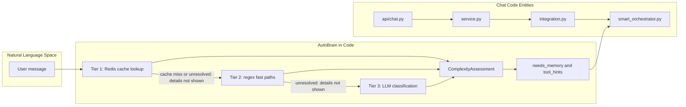
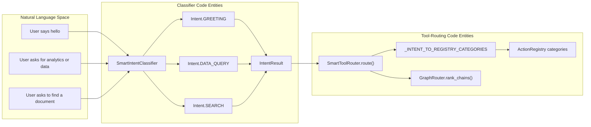
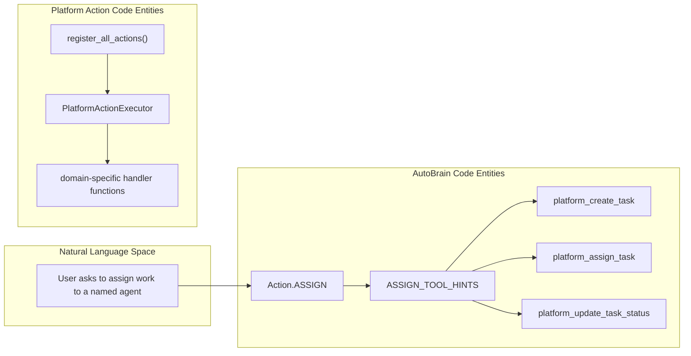
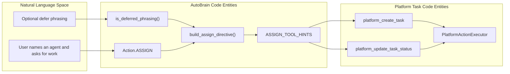

# Complexity Assessment (AutoBrain)

Relevant source files

The following files were used as context for generating this wiki page:

- [orchestrator/consumers/chatbot/auto.py](orchestrator/consumers/chatbot/auto.py)
- [orchestrator/consumers/chatbot/intent_classifier.py](orchestrator/consumers/chatbot/intent_classifier.py)
- [orchestrator/consumers/chatbot/smart_tool_router.py](orchestrator/consumers/chatbot/smart_tool_router.py)
- [orchestrator/core/security/driving_user.py](orchestrator/core/security/driving_user.py)
- [orchestrator/core/services/auto_autonomy.py](orchestrator/core/services/auto_autonomy.py)
- [orchestrator/modules/tools/discovery/actions_autonomy.py](orchestrator/modules/tools/discovery/actions_autonomy.py)
- [orchestrator/modules/tools/discovery/handlers_autonomy.py](orchestrator/modules/tools/discovery/handlers_autonomy.py)
- [orchestrator/modules/tools/discovery/platform_actions.py](orchestrator/modules/tools/discovery/platform_actions.py)
- [orchestrator/modules/tools/discovery/platform_executor.py](orchestrator/modules/tools/discovery/platform_executor.py)
- [orchestrator/tests/security/test_nl2sql_tenancy.py](orchestrator/tests/security/test_nl2sql_tenancy.py)
- [orchestrator/tests/security/test_w3_full_autonomy_gate.py](orchestrator/tests/security/test_w3_full_autonomy_gate.py)
- [orchestrator/tests/test_prd232_us001_dispatcher_survives_route.py](orchestrator/tests/test_prd232_us001_dispatcher_survives_route.py)
- [orchestrator/tests/test_prd232_us002_flag_split.py](orchestrator/tests/test_prd232_us002_flag_split.py)
- [orchestrator/tests/test_us014_graph_router_delegation.py](orchestrator/tests/test_us014_graph_router_delegation.py)
- [orchestrator/tests/test_us015_registry_intent_filter.py](orchestrator/tests/test_us015_registry_intent_filter.py)
- [orchestrator/tests/test_w3_auto_autonomy_service.py](orchestrator/tests/test_w3_auto_autonomy_service.py)

## Purpose & Scope

AutoBrain is the progressive complexity assessor described by PRD-68. It classifies chat requests on an ATOM-to-ORGANISM scale and supplies routing-related information—including `needs_memory` and `tool_hints`—to downstream chat orchestration. Its documented integration path is `api/chat.py → service.py → integration.py → smart_orchestrator.py`; the supplied excerpts do not include the implementation of each hop. [orchestrator/consumers/chatbot/auto.py:1-22]()

Sources: [orchestrator/consumers/chatbot/auto.py:1-22]()

---

## Complexity Levels (ATOM → ORGANISM)

The `Complexity` enum defines five task-complexity levels. The descriptions and token estimates below are documented beside the enum members; the estimates are not described as enforced budgets. [orchestrator/consumers/chatbot/auto.py:66-73]()

| Level | Meaning documented in the code | Approximate tokens |
|---|---|---:|
| `ATOM` | Simple requests, such as greetings, factual questions, or chitchat | `<200` |
| `MOLECULE` | A tool or specific agent skill is needed | `~1K` |
| `CELL` | Memory, a tool, and reasoning are needed | `~3K` |
| `ORGAN` | Multi-agent coordination is needed | `~6K` |
| `ORGANISM` | Enterprise pipeline work, including learning and feedback | `~12K` |

`Complexity` describes task depth. The separate `Action` enum describes what Auto should do with a request; the two enums represent different dimensions of assessment and routing. [orchestrator/consumers/chatbot/auto.py:66-82]()

Sources: [orchestrator/consumers/chatbot/auto.py:66-82]()

---

## Three-Tier Assessment Cascade

Auto’s module documentation describes three assessment tiers: a Redis cache lookup, regex fast paths, and LLM classification. It documents indicative latency and cost for each tier. The supplied excerpt does not show the tier implementations, cache key, regex rules, tier fall-through conditions, or `ComplexityAssessment` definition, so those implementation details cannot be established here. [orchestrator/consumers/chatbot/auto.py:14-21]()

| Tier | Documented mechanism | Documented latency / cost |
|---|---|---|
| 1 | Redis cache lookup | `<5ms`, free |
| 2 | Regex fast paths | `<5ms`, free |
| 3 | LLM classification | `~200ms`, `~$0.001` |

The documented ordering places cache lookup and regex matching before LLM classification. The source excerpt does not establish whether all requests visit each tier or how a cache hit or fast-path result terminates the assessment. [orchestrator/consumers/chatbot/auto.py:14-18]()

### Assessment Tiers and Chat Integration

The module documentation names `ComplexityAssessment` as the assessment output and identifies `needs_memory` and `tool_hints` as values that drive downstream behavior. It describes the integration path through `api/chat.py`, `service.py`, `integration.py`, and `smart_orchestrator.py`; it does not show the output fields’ definitions or the code that consumes them. [orchestrator/consumers/chatbot/auto.py:19-22]()

**Diagram: Assessment Tiers and Chat Integration**

The diagram links the natural-language request to the documented assessment tiers, output names, and integration-path code entities. The possible tier outcomes are illustrative: the excerpt documents the tier order but not the exact branching or termination behavior. [orchestrator/consumers/chatbot/auto.py:14-22]()

Sources: [orchestrator/consumers/chatbot/auto.py:14-22]()

---

## Intent Classification and Tool Routing

AutoBrain’s documented `ComplexityAssessment` path is distinct from the separately defined `SmartIntentClassifier` and `SmartToolRouter`. The classifier defines intent categories and returns an `IntentResult` containing `requires_tools`, `requires_memory`, suggested tools, and other classification fields. [orchestrator/consumers/chatbot/intent_classifier.py:23-46]()

`SmartToolRouter` is documented as deciding whether tools should be used, which tools to expose, and how to prioritize them. It consumes the intent classifier and, when configured, delegates semantic ranking to `GraphRouter`; its documented fallback is keyword/category matching. The supplied excerpts do not establish that `ComplexityAssessment` is passed directly to either component. [orchestrator/consumers/chatbot/smart_tool_router.py:1-18](), [orchestrator/consumers/chatbot/smart_tool_router.py:65-78]()

The router maps tool-requiring intents to `ActionRegistry` categories. For example, `DATA_QUERY` maps to analytics, database, graph, field, and reports categories; `SEARCH` maps to discovery, documents, graph, memory, and workspace-files categories. [orchestrator/consumers/chatbot/smart_tool_router.py:31-52]()

**Diagram: Natural-Language Intent to Tool-Routing Code Entities**

The diagram associates example natural-language requests with `Intent` members and the tool-routing entities named in the code. It does not assert that AutoBrain’s `ComplexityAssessment` invokes `SmartIntentClassifier` or `SmartToolRouter` directly. [orchestrator/consumers/chatbot/intent_classifier.py:23-46](), [orchestrator/consumers/chatbot/smart_tool_router.py:31-52](), [orchestrator/consumers/chatbot/smart_tool_router.py:65-78]()

Sources: [orchestrator/consumers/chatbot/intent_classifier.py:23-46](), [orchestrator/consumers/chatbot/smart_tool_router.py:31-52](), [orchestrator/consumers/chatbot/smart_tool_router.py:65-78]()

---

## Action Types & Routing Integration

The `Action` enum lists five action values: `RESPOND`, `DELEGATE`, `WORKFLOW`, `MISSION`, and `ASSIGN`. The source labels `WORKFLOW` as deprecated but retained for backward-compatible parsing. `DELEGATE` is described as a legacy verdict; `MISSION` represents suggesting a mission for complex multi-step work; and `ASSIGN` represents filing a board ticket for a named single agent. [orchestrator/consumers/chatbot/auto.py:75-82]()

| Action | Documented role |
|---|---|
| `RESPOND` | Auto responds directly without delegation |
| `DELEGATE` | Legacy verdict; Auto answers or a named agent gets a ticket |
| `WORKFLOW` | Deprecated; retained for backward-compatible parsing |
| `MISSION` | Suggest a mission for complex multi-step work |
| `ASSIGN` | File an off-thread board ticket for a named single agent |

Sources: [orchestrator/consumers/chatbot/auto.py:75-82]()

---

## Tool Hints & Platform Action Resolution

AutoBrain defines `ASSIGN_TOOL_HINTS` as `platform_create_task`, `platform_assign_task`, and `platform_update_task_status`. These names associate the `ASSIGN` lane with task-related platform actions. [orchestrator/consumers/chatbot/auto.py:75-89]()

The platform action definitions module provides `register_all_actions()` as the entry point for registering domain-specific action definitions. [orchestrator/modules/tools/discovery/platform_actions.py:1-9](), [orchestrator/modules/tools/discovery/platform_actions.py:117-128]() `PlatformActionExecutor` is documented as a dispatcher to domain-specific handler functions, and its module documentation states that queries are workspace-scoped. [orchestrator/modules/tools/discovery/platform_executor.py:1-9]() The provided excerpts do not show the registry mapping from each `tool_hint` to an executor handler.

**Diagram: Natural-Language Task Request to Platform Action Entities**

The diagram associates the natural-language request with the documented `ASSIGN` lane and its tool-hint names. It shows the registry and executor as platform-action infrastructure but does not assert a runtime call chain from each hint to a particular handler. [orchestrator/consumers/chatbot/auto.py:75-89](), [orchestrator/modules/tools/discovery/platform_actions.py:117-128](), [orchestrator/modules/tools/discovery/platform_executor.py:1-9]()

Sources: [orchestrator/consumers/chatbot/auto.py:75-89](), [orchestrator/modules/tools/discovery/platform_actions.py:117-128](), [orchestrator/modules/tools/discovery/platform_executor.py:1-9]()

---

## ASSIGN Lane and Ticket Dispatch Flow

`is_deferred_phrasing()` checks whether a message contains one of the configured defer phrases. `build_assign_directive()` builds a manager directive using the resolved target agent and deferred status. [orchestrator/consumers/chatbot/auto.py:91-120]()

When a target agent resolves, the directive instructs Auto to create a board ticket for that agent and either leave it queued or start it immediately. When no agent resolves, the documented behavior is to ask in-thread rather than select an agent automatically. The directive also instructs Auto to report supervision using the `platform_create_task` result’s `supervision` field rather than claim supervision unconditionally. [orchestrator/consumers/chatbot/auto.py:106-120](), [orchestrator/consumers/chatbot/auto.py:121-146]()

| Condition | Directive behavior |
|---|---|
| Target agent resolved; request is deferred | Create the task with status `assigned` and leave it queued |
| Target agent resolved; request is not deferred | Create the task, then move it to `in_progress` |
| No target agent resolved | Ask in-thread; do not choose an agent automatically |
| Reporting task supervision | Echo the task result’s `supervision` field rather than assert supervision |

The defer phrases include expressions such as “queue it,” “later,” “no rush,” and “hold off.” `is_deferred_phrasing()` lowercases the message and checks whether any configured phrase appears within it. [orchestrator/consumers/chatbot/auto.py:91-104]()

**Diagram: ASSIGN Lane from User Request to Task Tools**

The helper and directive behavior are documented in AutoBrain’s source. The executor is shown as the separately documented platform-action dispatcher; the provided excerpts do not show a runtime call from `build_assign_directive()` to `PlatformActionExecutor`. [orchestrator/consumers/chatbot/auto.py:75-89](), [orchestrator/consumers/chatbot/auto.py:91-146](), [orchestrator/modules/tools/discovery/platform_executor.py:1-9]()

Sources: [orchestrator/consumers/chatbot/auto.py:75-89](), [orchestrator/consumers/chatbot/auto.py:91-146](), [orchestrator/modules/tools/discovery/platform_executor.py:1-9]()

---