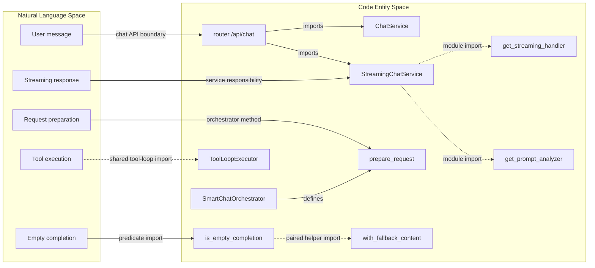
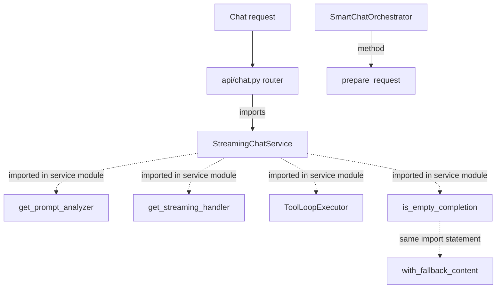

# Streaming Chat Service

Relevant source files

The following files were used as context for generating this wiki page:

- [frontend/app/api/chat/route.ts](frontend/app/api/chat/route.ts)
- [frontend/components/__tests__/prd207-live-voice.test.tsx](frontend/components/__tests__/prd207-live-voice.test.tsx)
- [frontend/components/chatbot/__tests__/composer-voice.test.tsx](frontend/components/chatbot/__tests__/composer-voice.test.tsx)
- [frontend/components/chatbot/chat.tsx](frontend/components/chatbot/chat.tsx)
- [frontend/components/chatbot/message.tsx](frontend/components/chatbot/message.tsx)
- [frontend/components/voice/LiveVoiceMode.tsx](frontend/components/voice/LiveVoiceMode.tsx)
- [frontend/components/voice/PresenceOrb.tsx](frontend/components/voice/PresenceOrb.tsx)
- [frontend/components/voice/VoiceErrorBoundary.tsx](frontend/components/voice/VoiceErrorBoundary.tsx)
- [frontend/components/voice/__tests__/voice-button.test.tsx](frontend/components/voice/__tests__/voice-button.test.tsx)
- [frontend/components/voice/voice-button-view.ts](frontend/components/voice/voice-button-view.ts)
- [frontend/components/voice/voice-button.tsx](frontend/components/voice/voice-button.tsx)
- [frontend/components/voice/voice-controls.tsx](frontend/components/voice/voice-controls.tsx)
- [frontend/lib/chat/hooks.ts](frontend/lib/chat/hooks.ts)
- [frontend/types/chat.ts](frontend/types/chat.ts)
- [orchestrator/api/chat.py](orchestrator/api/chat.py)
- [orchestrator/consumers/chatbot/integration.py](orchestrator/consumers/chatbot/integration.py)
- [orchestrator/consumers/chatbot/prompt_analyzer.py](orchestrator/consumers/chatbot/prompt_analyzer.py)
- [orchestrator/consumers/chatbot/service.py](orchestrator/consumers/chatbot/service.py)
- [orchestrator/consumers/chatbot/smart_memory.py](orchestrator/consumers/chatbot/smart_memory.py)
- [orchestrator/consumers/chatbot/smart_orchestrator.py](orchestrator/consumers/chatbot/smart_orchestrator.py)
- [orchestrator/modules/agents/factory/agent_factory.py](orchestrator/modules/agents/factory/agent_factory.py)
- [orchestrator/modules/context/sections/memory.py](orchestrator/modules/context/sections/memory.py)
- [orchestrator/modules/memory/context_router.py](orchestrator/modules/memory/context_router.py)
- [orchestrator/modules/memory/unified_memory_service.py](orchestrator/modules/memory/unified_memory_service.py)
- [orchestrator/tests/test_f155_a_widget_turn_recalls_only_its_agents_memories.py](orchestrator/tests/test_f155_a_widget_turn_recalls_only_its_agents_memories.py)
- [orchestrator/tests/test_l3_distill_input.py](orchestrator/tests/test_l3_distill_input.py)
- [orchestrator/tests/test_memory_restart_and_isolation.py](orchestrator/tests/test_memory_restart_and_isolation.py)
- [orchestrator/tests/test_memory_single_write_path.py](orchestrator/tests/test_memory_single_write_path.py)
- [orchestrator/tests/test_memory_stored_sse.py](orchestrator/tests/test_memory_stored_sse.py)
- [orchestrator/tests/test_p2w1_semantic_l2_recall.py](orchestrator/tests/test_p2w1_semantic_l2_recall.py)
- [orchestrator/tests/test_recall_relevance_floor.py](orchestrator/tests/test_recall_relevance_floor.py)
- [orchestrator/tests/test_smart_orchestrator_store_exchange.py](orchestrator/tests/test_smart_orchestrator_store_exchange.py)
- [orchestrator/tests/test_unified_memory.py](orchestrator/tests/test_unified_memory.py)
- [orchestrator/tests/test_us011_context_budgets.py](orchestrator/tests/test_us011_context_budgets.py)

## Purpose and Scope

This page documents the chat-streaming components visible in the supplied source: the `/api/chat` router boundary, `StreamingChatService`’s documented role and imports, `SmartChatOrchestrator` request preparation, and the empty-completion utilities imported by the chat service. The provided `service.py` excerpt ends at line 142, before the `StreamingChatService` implementation; the `smart_orchestrator.py` excerpt ends at line 188, before the body of `prepare_request()`. Accordingly, implementation details not present in those excerpts are not inferred here. [orchestrator/api/chat.py:14-22](), [orchestrator/api/chat.py:44-45](), [orchestrator/consumers/chatbot/service.py:1-13](), [orchestrator/consumers/chatbot/service.py:65-66](), [orchestrator/consumers/chatbot/smart_orchestrator.py:167-188]()

Sources: [orchestrator/api/chat.py:14-22](), [orchestrator/api/chat.py:44-45](), [orchestrator/consumers/chatbot/service.py:1-13](), [orchestrator/consumers/chatbot/service.py:65-66](), [orchestrator/consumers/chatbot/smart_orchestrator.py:167-188]()

---

## Architecture Overview

The API module defines an `APIRouter` with prefix `/api/chat` and imports `ChatService` and `StreamingChatService` from the chatbot consumer package. The consumer module describes `StreamingChatService` as its SSE streaming orchestrator. It imports the shared tool-loop implementation, prompt analyzer, streaming handler, and empty-completion helpers; those imports identify integration points, but the supplied excerpt does not show their runtime call sequence. [orchestrator/api/chat.py:20-22](), [orchestrator/api/chat.py:44-45](), [orchestrator/consumers/chatbot/service.py:5-13](), [orchestrator/consumers/chatbot/service.py:27-36](), [orchestrator/consumers/chatbot/service.py:49-66]()

### System Entity Map: Natural Language to Code Space

The diagram maps chat concepts to identifiers present in the source. Lines from `StreamingChatService` to its imported collaborators indicate module-level dependencies, not a verified runtime invocation order. [orchestrator/api/chat.py:20-22](), [orchestrator/api/chat.py:44-45](), [orchestrator/consumers/chatbot/service.py:27-36](), [orchestrator/consumers/chatbot/service.py:49-66]()

Sources: [orchestrator/api/chat.py:20-22](), [orchestrator/api/chat.py:44-45](), [orchestrator/consumers/chatbot/service.py:5-13](), [orchestrator/consumers/chatbot/service.py:27-36](), [orchestrator/consumers/chatbot/service.py:49-66](), [orchestrator/consumers/chatbot/smart_orchestrator.py:114-121](), [orchestrator/consumers/chatbot/smart_orchestrator.py:167-188]()

### Request and Dependency Map

`service.py` imports `get_streaming_handler()` and `get_prompt_analyzer()`, the shared `ToolLoopExecutor` types, and the empty-completion helpers. These imports show that the chat service module is connected to streaming, prompt-analysis, tool-loop, and completion-handling components. The excerpt does not show the code that calls these symbols. [orchestrator/consumers/chatbot/service.py:27-36](), [orchestrator/consumers/chatbot/service.py:49-66]()

Sources: [orchestrator/api/chat.py:20-22](), [orchestrator/consumers/chatbot/service.py:27-36](), [orchestrator/consumers/chatbot/service.py:49-66](), [orchestrator/consumers/chatbot/smart_orchestrator.py:167-188]()

---

## SmartChatOrchestrator and Request Preparation

`SmartChatOrchestrator` is described as the central coordinator for chat processing. Its documented responsibilities include intent classification, unified context building through `ContextService`, and conversation-state tracking. The class retains workspace, agent, widget-mode, and optional database-session values; it initializes an intent classifier, a `SmartMemoryManager`, and the shared `UnifiedMemoryService`. [orchestrator/consumers/chatbot/smart_orchestrator.py:114-165]()

The orchestrator constructor accepts `workspace_id`, optional `agent_id`, optional `agent_name`, `widget_mode`, and `db_session`. The default agent name is `"Automatos"`. The instance also creates a `ConversationState`, whose fields include the previous intent, prior tool calls, messages since memory retrieval, user name, and memory-fetch timestamp. [orchestrator/consumers/chatbot/smart_orchestrator.py:100-112](), [orchestrator/consumers/chatbot/smart_orchestrator.py:126-165]()

### `prepare_request()`

`prepare_request()` is an asynchronous method on `SmartChatOrchestrator`. The visible signature accepts conversation `messages`, `available_tools`, optional `chat_id`, `complexity_assessment`, `attachment_ids`, `model_id`, and `viewer_subject_id`. Its docstring says it prepares a chat request for the LLM using `ContextService` for unified prompt building, memory retrieval, and tool loading, while intent classification remains separate for tool-choice and response-routing decisions. The method body is not included in the supplied excerpt, so its internal sequence and specific transformations are not described here. [orchestrator/consumers/chatbot/smart_orchestrator.py:167-188]()

The docstring further specifies that `available_tools` is the tool surface already assembled by the chat entry point, with `is_super_admin` and page actions threaded in. A non-empty tool list is described as being shipped to `ContextService` as-is. [orchestrator/consumers/chatbot/smart_orchestrator.py:184-188]()

### `OrchestratedRequest`

`OrchestratedRequest` is the result type documented for orchestration. Its visible fields include the system prompt and messages; tools and `tool_choice`; optional memory context and user name; intent and confidence; `requires_tools` and `requires_memory`; and preparation timing. It also carries optional `context_trace`, attachment-failure details, and a cacheable prompt prefix. The class comments describe `context_trace` as per-turn context-assembly information and `cacheable_prefix` as a stable prefix separated from volatile prompt content. [orchestrator/consumers/chatbot/smart_orchestrator.py:54-98]()

| Field | Documented purpose |
|---|---|
| `system_prompt`, `messages` | Model-facing prompt and conversation messages. [orchestrator/consumers/chatbot/smart_orchestrator.py:54-64]() |
| `tools`, `tool_choice` | Tool configuration; `tool_choice` is described as `"auto"`, `"required"`, or `"none"`. [orchestrator/consumers/chatbot/smart_orchestrator.py:65-68]() |
| `memory_context`, `user_name` | Context injected into the request. [orchestrator/consumers/chatbot/smart_orchestrator.py:69-71]() |
| `intent`, `intent_confidence` | Classification results. [orchestrator/consumers/chatbot/smart_orchestrator.py:73-78]() |
| `requires_tools`, `requires_memory` | Boolean signals associated with the classified request. [orchestrator/consumers/chatbot/smart_orchestrator.py:73-78]() |
| `preparation_time_ms` | Preparation timing. [orchestrator/consumers/chatbot/smart_orchestrator.py:79-80]() |
| `context_trace` | Optional trace of context assembly. [orchestrator/consumers/chatbot/smart_orchestrator.py:82-86]() |
| `attachment_failures` | Optional attachment failure records, documented with `attachment_id`, `filename`, and `reason`. [orchestrator/consumers/chatbot/smart_orchestrator.py:88-92]() |
| `cacheable_prefix` | Optional stable prompt prefix intended for a cache-control breakpoint. [orchestrator/consumers/chatbot/smart_orchestrator.py:93-98]() |

Sources: [orchestrator/consumers/chatbot/smart_orchestrator.py:54-98](), [orchestrator/consumers/chatbot/smart_orchestrator.py:100-112](), [orchestrator/consumers/chatbot/smart_orchestrator.py:114-165](), [orchestrator/consumers/chatbot/smart_orchestrator.py:167-188]()

### Memory and Background Work

`SmartChatOrchestrator` obtains the shared `SmartMemoryManager` and `UnifiedMemoryService` during initialization. The module also defines `_spawn_background()`, which schedules a coroutine with `asyncio.create_task()`, retains a strong reference to the task, and removes the reference when the task completes. Its docstring describes memory writes—including fact extraction, daily summaries, and L1/L2 persistence—as work that must not block the streaming response. The supplied excerpt documents this helper and policy, but does not show which orchestration call sites use it. [orchestrator/consumers/chatbot/smart_orchestrator.py:30-52](), [orchestrator/consumers/chatbot/smart_orchestrator.py:150-160]()

Sources: [orchestrator/consumers/chatbot/smart_orchestrator.py:30-52](), [orchestrator/consumers/chatbot/smart_orchestrator.py:150-160]()

---

## StreamingChatService and `stream_response_with_agent()`

The `service.py` module header identifies `StreamingChatService` as the SSE streaming orchestrator. The supplied excerpt does not include the class definition or `stream_response_with_agent()` implementation. It therefore does not establish the method signature, LLM-provider call sequence, emitted event format, persistence timing, or stream termination behavior. [orchestrator/consumers/chatbot/service.py:1-13]()

The service module imports `RoundState`, `ToolLoopExecutor`, `ToolLoopResult`, and `ToolPostResult` from the shared tool-loop module. The source comment characterizes this as a converged tool-loop spine shared by chat and agent execution. The module also imports `get_streaming_handler()` and the empty-completion helpers, but their call sites are outside the provided excerpt. [orchestrator/consumers/chatbot/service.py:27-36](), [orchestrator/consumers/chatbot/service.py:49-53](), [orchestrator/consumers/chatbot/service.py:65-66]()

The API module imports FastAPI’s `StreamingResponse` and `StreamingChatService`. The endpoint implementation is not included in the provided API excerpt, so the exact route handler that constructs or returns the streaming response is not documented here. [orchestrator/api/chat.py:14-22]()

Sources: [orchestrator/consumers/chatbot/service.py:1-13](), [orchestrator/consumers/chatbot/service.py:27-36](), [orchestrator/consumers/chatbot/service.py:49-53](), [orchestrator/consumers/chatbot/service.py:65-66](), [orchestrator/api/chat.py:14-22]()

---

## Empty-Completion Handling

The chat service imports `NOTHING_SAID`, `is_empty_completion()`, and `with_fallback_content()` from `consumers.chatbot.empty_completion`. This establishes that the service module has named dependencies for detecting empty completions and supplying fallback content. The implementations and call sites are not present in the supplied excerpt, so exact detection rules, fallback wording, and application timing cannot be stated. [orchestrator/consumers/chatbot/service.py:65-66]()

| Symbol | What the available source establishes |
|---|---|
| `NOTHING_SAID` | A named constant imported by the chat service. [orchestrator/consumers/chatbot/service.py:65-66]() |
| `is_empty_completion()` | A predicate imported from the empty-completion module. [orchestrator/consumers/chatbot/service.py:65-66]() |
| `with_fallback_content()` | A fallback-content helper imported from the same module. [orchestrator/consumers/chatbot/service.py:65-66]() |

Sources: [orchestrator/consumers/chatbot/service.py:65-66]()

---

## Tool-Loop Integration

The chat service imports the shared `RoundState`, `ToolLoopExecutor`, `ToolLoopResult`, and `ToolPostResult` types. Its import comment states that chat and agent execution share this tool-loop spine. The service also imports `is_nudge()` and `a_bare_pointer_goes_through_the_loop()`; their adjacent comments describe nudges as the user’s turn and bare pointers as going through the loop. The excerpt does not show the service’s tool-loop call sites or the tool-loop implementation, so iteration limits, deduplication rules, and failure transitions are not specified here. [orchestrator/consumers/chatbot/service.py:27-36]()

Sources: [orchestrator/consumers/chatbot/service.py:27-36]()

---

## Request Context and Service Dependencies

The service module imports `merge_into_trace()` and `page_actions_from_context()` from `services.page_context`, and `get_tools_for_agent_async()` as the async-native tool-schema source. The nearby comment says the chat hot path must not bridge the narrowing embed through a helper thread. These are documented dependencies and a stated constraint; the excerpt does not show their call sequence during request preparation. [orchestrator/consumers/chatbot/service.py:56-64]()

The API module imports `ChatRequest`, `ChatMessageRequest`, and `MessagePart` from `api.chat_models`, along with hybrid request-context authentication and workspace-permission dependencies. The router is defined with the `/api/chat` prefix. The supplied lines establish the request-model and routing boundaries but do not include the streaming endpoint body. [orchestrator/api/chat.py:14-29](), [orchestrator/api/chat.py:44-45]()

Sources: [orchestrator/consumers/chatbot/service.py:56-64](), [orchestrator/api/chat.py:14-29](), [orchestrator/api/chat.py:44-45]()

---