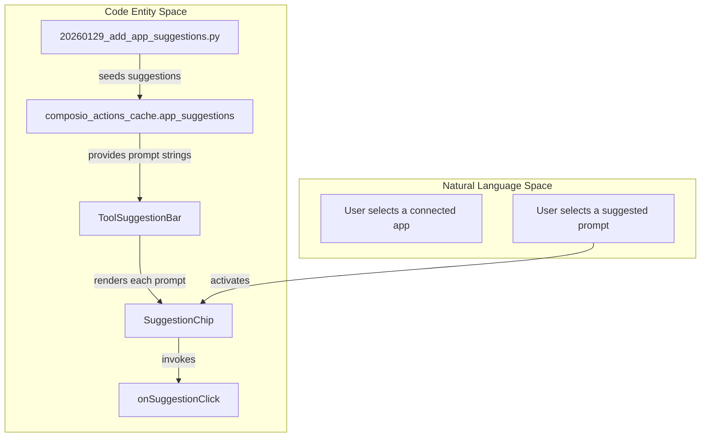
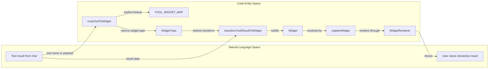
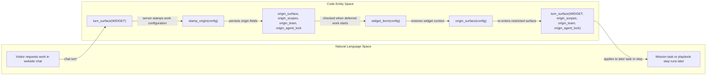
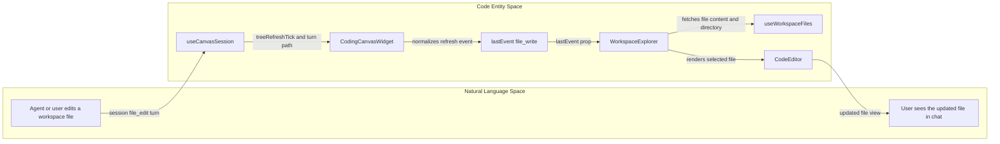
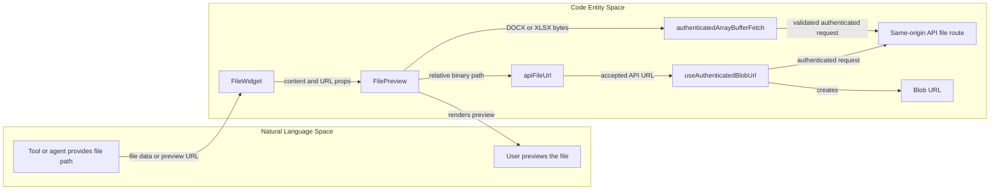
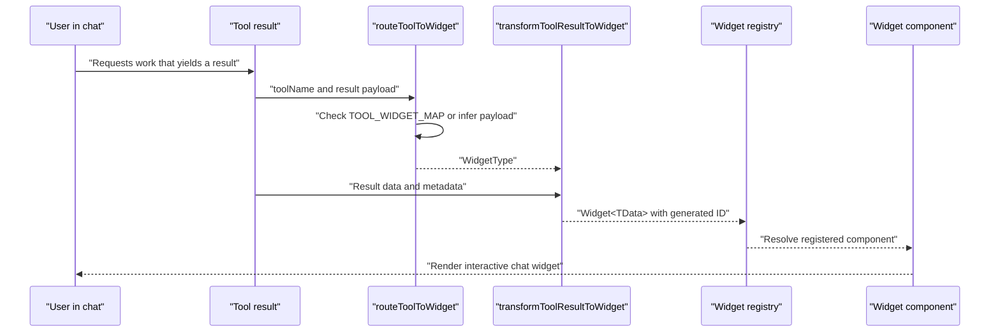

# Suggestions & Widgets in Chat

Relevant source files

The following files were used as context for generating this wiki page:

- [orchestrator/api/widgets/chat.py](orchestrator/api/widgets/chat.py)
- [orchestrator/core/security/surface.py](orchestrator/core/security/surface.py)
- [orchestrator/core/security/widget_scopes.py](orchestrator/core/security/widget_scopes.py)
- [orchestrator/modules/context/sections/composio.py](orchestrator/modules/context/sections/composio.py)
- [orchestrator/modules/context/sections/plugins.py](orchestrator/modules/context/sections/plugins.py)
- [orchestrator/modules/tools/discovery/actions_mission_resume.py](orchestrator/modules/tools/discovery/actions_mission_resume.py)
- [orchestrator/modules/tools/discovery/actions_missions.py](orchestrator/modules/tools/discovery/actions_missions.py)
- [orchestrator/modules/tools/discovery/handlers_missions.py](orchestrator/modules/tools/discovery/handlers_missions.py)
- [orchestrator/modules/tools/discovery/plan_edits.py](orchestrator/modules/tools/discovery/plan_edits.py)
- [orchestrator/modules/tools/discovery/step_brief_edits.py](orchestrator/modules/tools/discovery/step_brief_edits.py)
- [orchestrator/tests/test_f155_a_widget_turn_gets_no_skills_and_only_its_locked_agents_plugins.py](orchestrator/tests/test_f155_a_widget_turn_gets_no_skills_and_only_its_locked_agents_plugins.py)
- [orchestrator/tests/test_f155_the_public_widget_surface.py](orchestrator/tests/test_f155_the_public_widget_surface.py)
- [orchestrator/tests/test_f155_widget_born_work_carries_its_origin.py](orchestrator/tests/test_f155_widget_born_work_carries_its_origin.py)
- [orchestrator/tests/test_f155_widget_scopes.py](orchestrator/tests/test_f155_widget_scopes.py)
- [orchestrator/tests/test_f282_c_plan_edits_land_on_the_missions_steps.py](orchestrator/tests/test_f282_c_plan_edits_land_on_the_missions_steps.py)
- [orchestrator/tests/test_f308_c_a_brief_edit_reaches_the_steps_card.py](orchestrator/tests/test_f308_c_a_brief_edit_reaches_the_steps_card.py)
- [orchestrator/tests/test_f308_d_a_reply_never_says_steps_pause_when_they_dont.py](orchestrator/tests/test_f308_d_a_reply_never_says_steps_pause_when_they_dont.py)
- [orchestrator/tests/test_widget_proactive_prd007.py](orchestrator/tests/test_widget_proactive_prd007.py)

## Purpose and Scope

This page describes chat suggestions and in-chat widgets: `ToolSuggestionBar` and `SuggestionChip`, tool-result routing, and the `CodingCanvasWidget`, `FileWidget`, and `ToolApprovalWidget`. It also documents the public widget-chat API and the security context that applies to widget turns. [frontend/components/chatbot/chat-widget.tsx:44](), [frontend/components/layout/main-layout.tsx:12](), [frontend/components/widgets/router.ts:1-171](), [orchestrator/api/widgets/chat.py:1-15](), [orchestrator/core/security/surface.py:1-19]()

Sources: [frontend/components/chatbot/chat-widget.tsx:44](), [frontend/components/layout/main-layout.tsx:12](), [frontend/components/widgets/router.ts:1-171](), [orchestrator/api/widgets/chat.py:1-15](), [orchestrator/core/security/surface.py:1-19]()

---

## Dynamic Tool Suggestions (`ToolSuggestionBar` & `SuggestionChip`)

`ToolSuggestionBar` displays contextual prompt suggestions as a 2×2 grid and supports keyboard interaction, including Escape to close. `SuggestionChip` is the reusable button for an individual prompt; it handles the chip’s visual states and truncates long text. [frontend/components/chatbot/chat-widget.tsx:44](), [frontend/components/layout/main-layout.tsx:12]()

### Data Architecture & Migration

App-level suggestions are stored in the `app_suggestions` JSONB column on `composio_actions_cache`. The `20260129_app_suggestions` Alembic migration adds and populates that column with curated suggestions for apps including Gmail, Slack, GitHub, Google Calendar, and Notion. [orchestrator/alembic/versions/prd181_s2_approval_grants.py:1]()

**Diagram: Suggestion prompts mapped from user interaction to code entities**

Sources: [frontend/components/chatbot/chat-widget.tsx:44](), [frontend/components/layout/main-layout.tsx:12](), [orchestrator/alembic/versions/prd181_s2_approval_grants.py:1]()

---

## In-Chat Widget Router (`routeToolToWidget`)

The widget router maps tool results to frontend widget types. `routeToolToWidget` first checks `TOOL_WIDGET_MAP` by tool name; if no explicit mapping exists, it inspects the result object for known structures, such as `database_results`, `documents`, `code_snippets`, or `images`. If neither mapping nor inference succeeds, it logs a warning and returns `null` rather than silently choosing a default. [frontend/components/widgets/router.ts:35-48](), [frontend/components/widgets/router.ts:99-118](), [frontend/components/widgets/router.ts:126-171]()

The router module also exports `transformToolResultToWidget` and `createWidgetFromToolResult`. Its widget ID helper uses `crypto.randomUUID()` when available and falls back to generated random bytes. The common `Widget<TData>` structure carries the widget’s type, title, data, metadata, state, and optional layout fields. [frontend/components/widgets/index.ts:24-32](), [frontend/components/widgets/router.ts:174-192](), [frontend/components/widgets/types.ts:155-170]()

### Routing Mapping Table

| Tool name or result pattern | Target widget type | Evidence |
|---|---|---|
| `search_knowledge`, `semantic_search`, `search_documents` | `document` | [frontend/components/widgets/router.ts:35-43]() |
| `smart_query_database`, `query_database`, `execute_sql`, `nl2sql` | `data` | [frontend/components/widgets/router.ts:44-48]() |
| `search_codebase`, `get_code_context`, `analyze_code` | `code` | [frontend/components/widgets/router.ts:50-56]() |
| `GMAIL_*`, `OUTLOOK_*`, `send_email`, `list_emails` | `email` | [frontend/components/widgets/router.ts:64-75]() |
| `read_file`, `write_file`, `list_files` | `file` | [frontend/components/widgets/router.ts:99-106]() |
| `workspace_file_read`, `workspace_file_write`, `workspace_bash` | `coding_canvas` | [frontend/components/widgets/router.ts:108-118]() |
| Nonempty `database_results` or `sql`/`columns` result fields | `data` | [frontend/components/widgets/router.ts:135-145](), [frontend/components/widgets/router.ts:156-159]() |
| Nonempty `documents`, or content accompanied by `chunks`/`similarity` | `document` | [frontend/components/widgets/router.ts:146-148](), [frontend/components/widgets/router.ts:157-159]() |
| Nonempty `code_snippets`, or `code`/`language` result fields | `code` | [frontend/components/widgets/router.ts:149-150](), [frontend/components/widgets/router.ts:158-159]() |

**Diagram: Tool results mapped from user-visible intent to widget code entities**

Sources: [frontend/components/widgets/router.ts:35-48](), [frontend/components/widgets/router.ts:126-171](), [frontend/components/widgets/index.ts:11-36](), [frontend/components/widgets/types.ts:15-35](), [frontend/components/widgets/types.ts:155-170]()

### Widget contracts and registration

`WidgetType` enumerates supported widget identifiers, including `file`, `coding_canvas`, and `tool_approval`. The shared `Widget` and `WidgetBaseProps` contracts define widget identity, data, metadata, state, optional layout, and callbacks. `WidgetDefinition` associates a type with its component, capabilities, sizing, and optional data validation. [frontend/components/widgets/types.ts:15-35](), [frontend/components/widgets/types.ts:155-202](), [frontend/components/widgets/types.ts:205-232]()

The widgets entry point re-exports router functions, registry functions, shared components, and widget implementations. Importing widget components is documented as registering default widgets; the entry point exports `FileWidget`, `ToolApprovalWidget`, and `CodingCanvasWidget` among them. [frontend/components/widgets/index.ts:11-22](), [frontend/components/widgets/index.ts:24-58]()

Sources: [frontend/components/widgets/types.ts:15-35](), [frontend/components/widgets/types.ts:155-232](), [frontend/components/widgets/index.ts:11-58]()

---

## Public Widget Chat API and Turn Security

`WidgetChatRequest` accepts a message and optional `conversation_id`, `agent_id`, `model_id`, `page_context`, and `trigger_reason`. The API defines `proactive_opener` and `cart_idle` as trigger reasons that switch the turn into opener-generation mode; other values are treated as ordinary user messages. The route is protected by `widget_auth` and `require_permission("chat")`, and the stream is implemented separately in `api/widgets/chat_stream.py`. [orchestrator/api/widgets/chat.py:5-15](), [orchestrator/api/widgets/chat.py:32-33](), [orchestrator/api/widgets/chat.py:55-73]()

For a widget conversation, `_get_widget_user_id` chooses user row `id=1` when available, otherwise the first user row, and returns HTTP 500 if the database has no users. `_key_started` validates that a conversation ID is a UUID and checks the `chats` row against the authenticated workspace and widget API key; this is the ownership check for reading or resuming a widget-started conversation. [orchestrator/api/widgets/chat.py:104-119](), [orchestrator/api/widgets/chat.py:122-135]()

`_retrieval_team` resolves the team used to scope document retrieval. It reads the answering agent’s team and passes it with the key’s team to `effective_team`, allowing the key’s team lock to take precedence. The workspace’s `settings.vertical` is resolved separately for plugin dispatch, with `generic` as the fallback. [orchestrator/api/widgets/chat.py:87-101](), [orchestrator/api/widgets/chat.py:137-151]()

### Widget turn surface

`turn_surface` marks a turn through a `ContextVar`, so the widget status, scopes, team lock, and optional agent lock are context-local rather than process-wide. The security helpers expose those values to tools and gates. A widget turn is not treated as an owner or administrator turn, and connected-app context is suppressed by `ComposioSection`. [orchestrator/core/security/surface.py:1-19](), [orchestrator/core/security/surface.py:35-89](), [orchestrator/modules/context/sections/composio.py:35-46]()

`allowed_tools` combines the widget’s base tool set with the tools granted by its scopes. `widget_tool_surface` filters the offered schemas to that allowed set and narrows the `platform_execute` dispatcher’s action enum. The executor independently checks the resolved tool/action and returns `WIDGET_REFUSAL` when the scope does not allow it. [orchestrator/core/security/widget_scopes.py:32-45](), [orchestrator/core/security/widget_scopes.py:47-90](), [orchestrator/core/security/widget_scopes.py:93-124](), [orchestrator/tests/test_f155_widget_scopes.py:24-55]()

**Diagram: Widget request to scoped tool execution**

```mermaid
flowchart LR
    subgraph "Natural Language Space"
        Visitor["Website visitor sends a chat message"]
        Agent["Agent answers or requests a tool"]
    end

    subgraph "Code Entity Space"
        Request["WidgetChatRequest"]
        Route["api/widgets/chat.py"]
        Auth["widget_auth + require_permission('chat')"]
        Turn["turn_surface(WIDGET, scopes, team, agent_lock)"]
        Surface["core.security.surface"]
        Tools["widget_tool_surface"]
        Allowed["allowed_tools"]
        Executor["UnifiedToolExecutor"]
        Result["Widget chat response"]
    end

    Visitor -->|"message, page_context, trigger_reason"| Request
    Request -->|"POST /chat"| Route
    Route -->|"authorize"| Auth
    Auth -->|"establish widget turn context"| Turn
    Turn -->|"ContextVar-backed turn mark"| Surface
    Surface -->|"scopes constrain offered schemas"| Tools
    Tools -->|"base tools plus scope tools"| Allowed
    Allowed -->|"permitted tool call"| Executor
    Executor -->|"response or WIDGET_REFUSAL"| Result
    Result -->|"assistant reply"| Agent
```

Sources: [orchestrator/api/widgets/chat.py:32-33](), [orchestrator/api/widgets/chat.py:55-73](), [orchestrator/core/security/surface.py:35-89](), [orchestrator/core/security/widget_scopes.py:32-45](), [orchestrator/core/security/widget_scopes.py:79-108](), [orchestrator/tests/test_f155_widget_scopes.py:24-55]()

Widget keys always receive the base lookup tools. Additional tool families are granted by scopes such as `documents:read`, `documents:write`, `data:query`, `agents:read`, `missions:read`, `playbooks:read`, and `tasks:read`. The tests verify that a chat-only key cannot access owner data or writes, connected apps, workspace files, shell, or network tools. [orchestrator/core/security/widget_scopes.py:1-25](), [orchestrator/core/security/widget_scopes.py:34-76](), [orchestrator/tests/test_f155_widget_scopes.py:43-75](), [orchestrator/tests/test_f155_widget_scopes.py:122-129]()

### Deferred work and origin propagation

A widget turn’s restrictions also apply to work that continues after the request. `stamp_origin` writes server-controlled origin metadata for widget-started work; `origin_surface` restores the recorded surface, scopes, team, and agent lock when that work runs later. This allows downstream mission or playbook work to retain the originating widget restrictions. [orchestrator/core/security/surface.py:92-127](), [orchestrator/tests/test_f155_widget_born_work_carries_its_origin.py:33-40](), [orchestrator/tests/test_f155_widget_born_work_carries_its_origin.py:98-112]()

Widget turns do not gain permission to start missions or playbooks merely by having execution scopes. In addition, a public widget call does not count as owner approval: mission handling explicitly holds `auto_approve` on widget turns, and a newly created mission may remain `awaiting_approval`. [orchestrator/core/security/widget_scopes.py:21-25](), [orchestrator/tests/test_f155_widget_scopes.py:101-110](), [orchestrator/modules/tools/discovery/handlers_missions.py:90-121](), [orchestrator/modules/tools/discovery/handlers_missions.py:124-138]()

**Diagram: Widget-origin restrictions carried into deferred work**

Sources: [orchestrator/core/security/surface.py:27-42](), [orchestrator/core/security/surface.py:70-89](), [orchestrator/core/security/surface.py:92-127](), [orchestrator/tests/test_f155_widget_born_work_carries-its-origin.py:3-13]()

---

## Specialized In-Chat Widgets

The widget system includes specialized components for workspace code, file viewing, and gated tool approvals. These use the shared widget types and are exported through the widget entry point. [frontend/components/widgets/index.ts:44-58](), [frontend/components/widgets/types.ts:15-35]()

### 1. Coding Canvas Widget (`CodingCanvasWidget`)

`CodingCanvasWidget` is a workspace-file browser and editor with a right-side session or terminal area. It reads `workspaceId` and optional `rootPath` from `CodingCanvasWidgetData`, defaulting the root to `WORKSPACE_ROOT`, and initializes `useWorkspaceFiles` and `useCanvasSession`. Its `RootPicker` changes the widget’s stored `rootPath` and title. [frontend/components/widgets/CodeWidget/index.tsx:1]()

The main layout embeds `WorkspaceExplorer` beside the session/terminal panel. On phones the split is vertical; otherwise it is horizontal. The widget can expose the SDK session view when applicable, and it chooses an initial right-side tab based on session and SDK availability. [frontend/components/widgets/CodeWidget/index.tsx:1]()

Session file edits are bridged to `WorkspaceExplorer` as a `lastEvent` with type `file_write` and a changing timestamp. `WorkspaceExplorer` watches that event, opens or reloads the changed file, invalidates its cache, and fetches the root directory again. [frontend/components/widgets/CodeWidget/index.tsx:1]()

`WorkspaceExplorer` maintains open editor tabs and fetches file content when a file is selected. `CodeEditor` loads Monaco dynamically without SSR, handles content changes, and registers Ctrl/Cmd+S to call its save callback with the active file path and editor contents. [frontend/components/widgets/CodeWidget/index.tsx:1]()

**Diagram: Coding Canvas file-edit and refresh flow**

Sources: [frontend/components/widgets/CodeWidget/index.tsx:1]()

### 2. File Previewer (`FileWidget` & `FilePreview`)

`FileWidget` selects its display mode from `data.mode`, falling back to list mode when `data.files` is present and single mode otherwise. In list mode it renders `FileList`; single and preview modes render file information and `FilePreview` when preview content or a URL is available. It offers path-copy and download actions, and uses `onAction` for the download callback when supplied. [frontend/components/widgets/FileWidget/index.tsx:27-72](), [frontend/components/widgets/FileWidget/index.tsx:84-92](), [frontend/components/widgets/FileWidget/index.tsx:94-183]()

`FilePreview` supports text-based previews such as HTML, Markdown, code, JSON, CSV/TSV, and plain text, as well as binary formats including PDF, images, video, audio, DOCX, and XLSX. The component accepts content or a URL and can take an explicit preview type; its documented type set includes these formats. [frontend/components/widgets/FileWidget/FilePreview.tsx:1-30](), [frontend/components/widgets/FileWidget/FilePreview.tsx:128-153]()

For authenticated relative URLs, `apiFileUrl` only permits rooted paths that stay on the API’s origin. `useAuthenticatedBlobUrl` fetches an accepted path with API auth headers and creates a blob URL; cleanup revokes that URL. When a forced type is provided, the blob is created with that type. The PDF path uses `application/pdf`, preventing a response served as HTML from being treated as executable app-origin HTML. [frontend/lib/api-file-url.ts:1-31](), [frontend/components/widgets/FileWidget/FilePreview.tsx:73-126]()

`authenticatedArrayBufferFetch` applies the same API-path validation for authenticated binary fetches and returns an `ArrayBuffer`. Tests verify that a PDF blob is typed as `application/pdf` and that paths which would leave the API are rejected without sending the token. [frontend/components/widgets/FileWidget/FilePreview.tsx:54-67](), [frontend/components/widgets/FileWidget/__tests__/f352-pdf-blob-is-a-pdf.test.tsx:39-64](), [frontend/components/widgets/FileWidget/__tests__/f352-pdf-blob-is-a-pdf.test.tsx:66-79]()

**Diagram: Authenticated file preview path**

Sources: [frontend/components/widgets/FileWidget/index.tsx:27-39](), [frontend/components/widgets/FileWidget/index.tsx:126-183](), [frontend/components/widgets/FileWidget/FilePreview.tsx:54-126](), [frontend/lib/api-file-url.ts:17-31]()

### 3. Tool Approval Widget (`ToolApprovalWidget`)

`ToolApprovalWidgetData` defines the data contract for a confirmation-gated tool call awaiting approval. It includes `grant_id`, `action`, optional message and `question_md`, permission level, a human-readable `params` record, and oversight fields such as `risk_tier`, `risk_class`, `oversight_rationale`, and `requires_approval`. The type comment distinguishes this approval-grant behavior from the mission approval card, despite their shared presentation. [frontend/components/widgets/types.ts:66-85]()

`tool_approval` is a supported `WidgetType`, and `ToolApprovalWidget` is exported from the widget entry point. The available files establish its data contract and export, but do not show the component’s action handlers or approval API calls. [frontend/components/widgets/types.ts:31-35](), [frontend/components/widgets/index.ts:51-56]()

The backend API for approval grants is handled by `orchestrator/api/approval_grants.py`. This API allows listing grants, granting them, denying them, answering questions, and revoking grants. The `ApprovalGrant` model [orchestrator/core/models/approval_grants.py:30]() defines the structure of an approval grant, including its status (`PENDING`, `GRANTED`, `DENIED`, `REVOKED`, `EXPIRED`), subject type, subject ID, and risk tier. The `create_grant` function in `orchestrator/core/services/approval_grants.py` stages a new pending grant. [orchestrator/api/approval_grants.py:1-806](), [orchestrator/core/models/approval_grants.py:30](), [orchestrator/core/services/approval_grants.py:43-99]()

Sources: [frontend/components/widgets/types.ts:31-35](), [frontend/components/widgets/types.ts:66-85](), [frontend/components/widgets/index.ts:51-56](), [orchestrator/api/approval_grants.py:1-806](), [orchestrator/core/models/approval_grants.py:30](), [orchestrator/core/services/approval_grants.py:43-99]()

### 4. Mission Approval Widget (`MissionApprovalWidget`)

`MissionApprovalWidgetData` describes an in-chat mission plan approval card, including mission ID, goal, task count and tasks, optional cost estimate and ceiling, deadline, and risk/oversight fields. The widget type is `mission_approval`; the widget entry point exports `MissionApprovalWidget` and its definition. [frontend/components/widgets/types.ts:31-35](), [frontend/components/widgets/types.ts:37-64](), [frontend/components/widgets/index.ts:51-52]()

Mission creation can return an honest status indicating that the mission is `awaiting_approval`, with instructions to review and approve the plan. For a public widget turn, `auto_approve` is explicitly held because a public-widget call does not constitute owner approval. [orchestrator/modules/tools/discovery/handlers_missions.py:102-121](), [orchestrator/modules/tools/discovery/handlers_missions.py:124-138]()

Sources: [frontend/components/widgets/types.ts:31-64](), [frontend/components/widgets/index.ts:51-52](), [orchestrator/modules/tools/discovery/handlers_missions.py:102-138]()

---

## Widget Data Flow Summary

Tool names and result shapes determine a widget type; the router transforms the result into widget-compatible data, and the widget registry exposes components to the rendering layer. The widget contract carries origin metadata—including source type/name, provider, conversation ID, tool-call ID, and workspace ID—alongside its type-specific data. [frontend/components/widgets/router.ts:35-48](), [frontend/components/widgets/router.ts:126-171](), [frontend/components/widgets/types.ts:109-130](), [frontend/components/widgets/types.ts:155-170](), [frontend/components/widgets/index.ts:11-36]()

**Diagram: Natural language tool outcome to registered widget component**

Sources: [frontend/components/widgets/router.ts:35-48](), [frontend/components/widgets/router.ts:126-171](), [frontend/components/widgets/router.ts:174-192](), [frontend/components/widgets/types.ts:155-170](), [frontend/components/widgets/index.ts:11-36]()

---