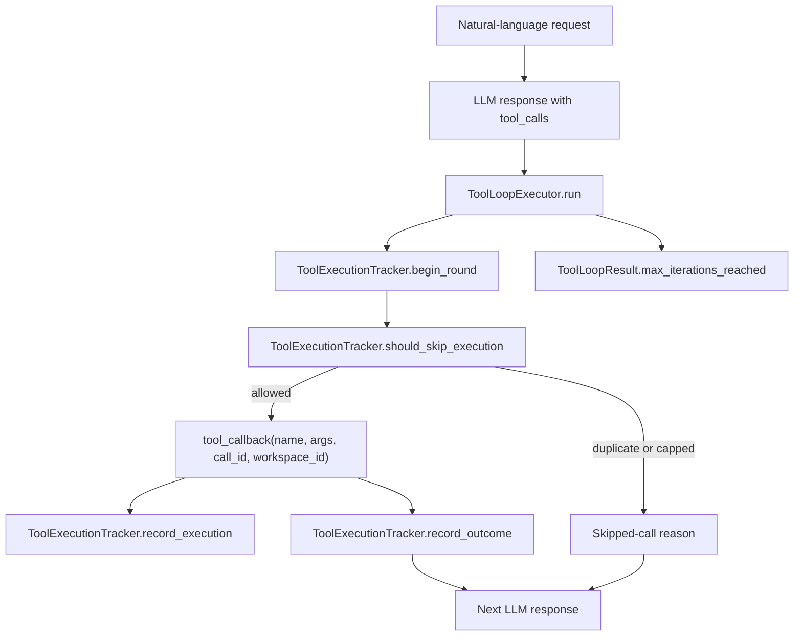
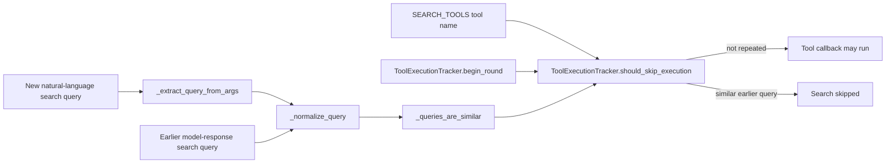
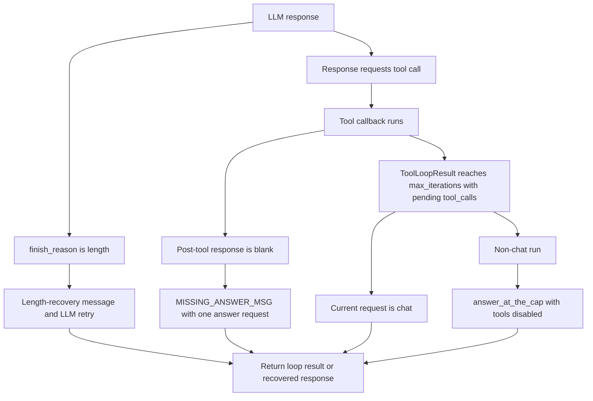
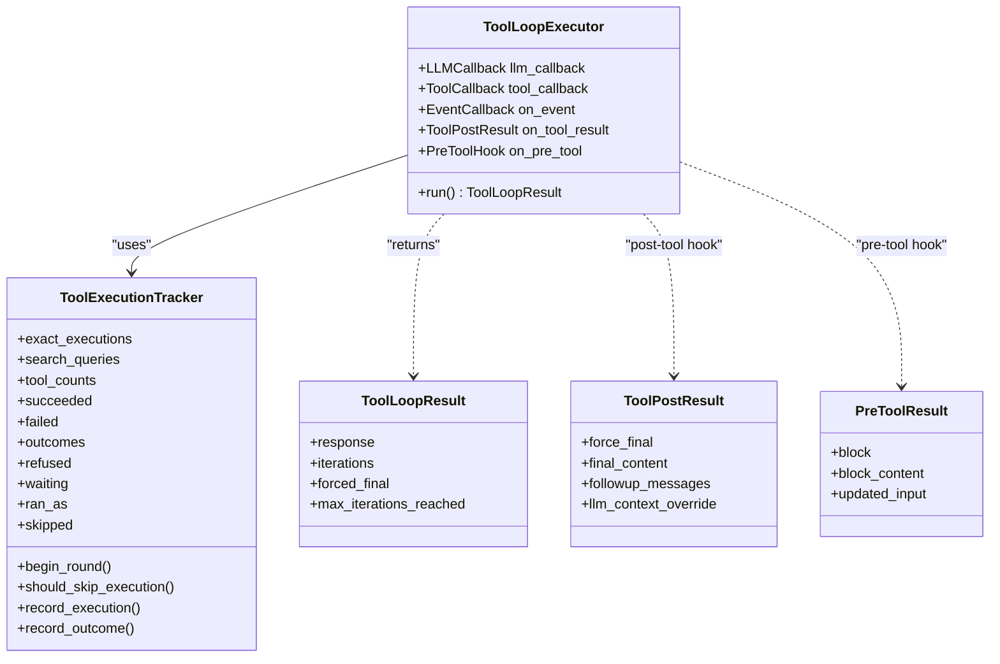

# Tool Loop Prevention

Relevant source files

The following files were used as context for generating this wiki page:

- [orchestrator/consumers/chatbot/narration.py](orchestrator/consumers/chatbot/narration.py)
- [orchestrator/modules/tools/execution/cap_answer.py](orchestrator/modules/tools/execution/cap_answer.py)
- [orchestrator/modules/tools/execution/nudges.py](orchestrator/modules/tools/execution/nudges.py)
- [orchestrator/modules/tools/execution/tool_loop.py](orchestrator/modules/tools/execution/tool_loop.py)
- [orchestrator/tests/test_f099_a_cited_source_that_did_not_run.py](orchestrator/tests/test_f099_a_cited_source_that_did_not_run.py)
- [orchestrator/tests/test_f108_b_a_claimed_action_is_nudged_once.py](orchestrator/tests/test_f108_b_a_claimed_action_is_nudged_once.py)
- [orchestrator/tests/test_f108_claimed_actions_need_a_result.py](orchestrator/tests/test_f108_claimed_actions_need_a_result.py)
- [orchestrator/tests/test_f186_a_the_reply_is_the_answer.py](orchestrator/tests/test_f186_a_the_reply_is_the_answer.py)
- [orchestrator/tests/test_f187_b_a_claim_needs_the_action_that_does_it.py](orchestrator/tests/test_f187_b_a_claim_needs_the_action_that_does_it.py)
- [orchestrator/tests/test_f295_a_a_nudge_is_the_users_turn_so_the_retry_answers_it.py](orchestrator/tests/test_f295_a_a_nudge_is_the_users_turn_so_the_retry_answers_it.py)
- [orchestrator/tests/test_f295_b_an_empty_retry_keeps_the_reply_it_was_about.py](orchestrator/tests/test_f295_b_an_empty_retry_keeps_the_reply_it_was_about.py)
- [orchestrator/tests/test_f295_d_a_nudge_says_it_is_the_platform_and_no_apology_is_kept.py](orchestrator/tests/test_f295_d_a_nudge_says_it_is_the_platform_and_no_apology_is_kept.py)
- [orchestrator/tests/test_f297_b_a_run_that_wrote_no_answer_says_so_plainly.py](orchestrator/tests/test_f297_b_a_run_that_wrote_no_answer_says_so_plainly.py)
- [orchestrator/tests/test_f297_c_a_mission_step_with_no_answer_is_a_failed_attempt.py](orchestrator/tests/test_f297_c_a_mission_step_with_no_answer_is_a_failed_attempt.py)
- [orchestrator/tests/test_f297_d_an_empty_reply_after_tool_calls_is_asked_for_its_answer.py](orchestrator/tests/test_f297_d_an_empty_reply_after_tool_calls_is_asked_for_its_answer.py)
- [orchestrator/tests/test_f328_a_a_run_stopped_by_its_round_cap_ends_on_its_answer.py](orchestrator/tests/test_f328_a_a_run_stopped_by_its_round_cap_ends_on_its_answer.py)
- [orchestrator/tests/test_tool_loop_narrated_actions.py](orchestrator/tests/test_tool_loop_narrated_actions.py)

## Purpose and Scope

Tool loop prevention bounds repeated tool execution and preserves a usable answer when a model gets stuck, narrates an action instead of calling a tool, or reaches its allowed number of tool rounds. The shared `ToolLoopExecutor` is designed for both the chat tool loop and the agent `execute_with_prompt` loop; its `ToolExecutionTracker` handles deduplication and per-tool limits. [orchestrator/modules/tools/execution/tool_loop.py:1-18](), [orchestrator/modules/tools/execution/tool_execution_tracker.py:1-8]()

This page covers loop control, tracker state, recovery nudges, and the answer-at-cap behavior. It does not describe tool authorization or the implementations behind individual tools. The loop provides pre-tool and post-tool hooks and forwards `workspace_id` to tool callbacks. [orchestrator/modules/tools/execution/tool_loop.py:11-18](), [orchestrator/modules/tools/execution/tool_loop.py:95-137]()

Sources: [orchestrator/modules/tools/execution/tool_loop.py:1-18](), [orchestrator/modules/tools/execution/tool_execution_tracker.py:1-8]()

---

## System Overview & Architecture

The shared executor is intended to serve chat’s `_stream_tool_loop` and the agent `execute_with_prompt` inner loop. Centralizing the loop applies the same iteration cap and tracker-based deduplication across those callers. [orchestrator/modules/tools/execution/tool_loop.py:1-8](), [orchestrator/modules/tools/execution/tool_execution_tracker.py:1-8]()

`ToolLoopExecutor` receives an LLM callback and tool callback, and optionally accepts streaming, pre-tool, and post-tool hooks. It returns a `ToolLoopResult` containing the response, iteration count, and flags for forced completion and reaching the cap. The tracker holds per-run execution and outcome state. [orchestrator/modules/tools/execution/tool_loop.py:86-150](), [orchestrator/modules/tools/execution/tool_execution_tracker.py:69-129]()

The prevention and recovery layers include:

1. **Iteration cap:** limits the number of tool rounds. [orchestrator/modules/tools/execution/tool_loop.py:5-8]()
2. **Exact-call deduplication:** identifies repeated tool calls with matching canonical arguments. [orchestrator/modules/tools/execution/tool_execution_tracker.py:69-76]()
3. **Search-query deduplication:** detects repeated or similar queries from earlier model responses. [orchestrator/modules/tools/execution/tool_execution_tracker.py:42-58](), [orchestrator/modules/tools/execution/tool_execution_tracker.py:78-82]()
4. **Per-tool limits:** bounds repeated execution, with prefix-aware defaults and dispatcher-aware counting described by the tracker. [orchestrator/modules/tools/execution/tool_execution_tracker.py:69-100]()
5. **Reply correctness checks:** handles cases such as citing an offered tool that did not run or narrating an action without making a tool call. A completed-action claim without a successful matching action is handled by replacing the claim in the reply, not by retrying the model. [orchestrator/modules/tools/execution/nudges.py:43-59](), [orchestrator/tests/test_f099_a_cited_source_that_did_not_run.py:70-82](), [orchestrator/tests/test_tool_loop_narrated_actions.py:111-139](), [orchestrator/tests/test_f108_b_a_claimed_action_is_nudged_once.py:8-11]()
6. **Bounded recovery:** retries a truncated tool call or requests a missing answer once; non-chat runs can also get one tools-disabled answer attempt after reaching the cap. [orchestrator/modules/tools/execution/tool_loop.py:7-11](), [orchestrator/modules/tools/execution/nudges.py:66-79](), [orchestrator/modules/tools/execution/cap_answer.py:63-77]()

Sources: [orchestrator/modules/tools/execution/tool_loop.py:1-18](), [orchestrator/modules/tools/execution/tool_execution_tracker.py:42-100](), [orchestrator/modules/tools/execution/nudges.py:43-79](), [orchestrator/modules/tools/execution/cap_answer.py:63-77]()

### Tool Execution Tracking and Loop Architecture

A model’s tool calls enter the shared loop as a round. The tracker evaluates calls before execution; allowed calls reach the callback, while skipped calls are recorded and represented in the loop’s continued conversation. The executor’s result reports the final response and cap status. [orchestrator/modules/tools/execution/tool_loop.py:86-150](), [orchestrator/modules/tools/execution/tool_execution_tracker.py:103-136]()

**Diagram: Request and Tool-Call Flow from Natural Language Space to Code Entities**

Sources: [orchestrator/modules/tools/execution/tool_loop.py:86-150](), [orchestrator/modules/tools/execution/tool_execution_tracker.py:103-136]()

The next diagram connects a natural-language request to search-query comparison. The tracker extracts and normalizes query text, then compares it with queries recorded for earlier rounds. The comparison described by the tracker uses normalized strings and `SequenceMatcher`; it is not embedding-based semantic search. [orchestrator/modules/tools/execution/tool_execution_tracker.py:42-58](), [orchestrator/modules/tools/execution/tool_execution_tracker.py:78-82]()

**Diagram: Search-Spiral Detection from Natural Language Space to Code Entities**

Sources: [orchestrator/modules/tools/execution/tool_execution_tracker.py:42-66](), [orchestrator/modules/tools/execution/tool_execution_tracker.py:78-82](), [orchestrator/modules/tools/execution/tool_execution_tracker.py:131-135]()

### Key Data and Callback Contracts

| Entity | Role |
|---|---|
| `ToolExecutionTracker` | Maintains per-run deduplication, call counts, outcomes, and skipped-call state. [orchestrator/modules/tools/execution/tool_execution_tracker.py:69-129]() |
| `ToolLoopExecutor` | Coordinates the LLM and tool callbacks; supports iteration caps, streaming, and pre-/post-tool hooks. [orchestrator/modules/tools/execution/tool_loop.py:1-18](), [orchestrator/modules/tools/execution/tool_loop.py:134-150]() |
| `ToolPostResult` | Lets a post-tool hook force a final response, append follow-up messages, or override tool content sent to the LLM. [orchestrator/modules/tools/execution/tool_loop.py:95-111]() |
| `PreToolResult` | Lets a pre-tool hook block execution with explanatory content or replace the input arguments. [orchestrator/modules/tools/execution/tool_loop.py:113-137]() |
| `ToolLoopResult` | Carries the response, iteration count, and flags for forced completion and reaching the maximum. [orchestrator/modules/tools/execution/tool_loop.py:139-150]() |
| `TRACKERS_MADE` | A `ContextVar` through which trackers can be collected during a chat turn. [orchestrator/modules/tools/execution/tool_execution_tracker.py:36-40](), [orchestrator/modules/tools/execution/tool_execution_tracker.py:127-129]() |

Sources: [orchestrator/modules/tools/execution/tool_loop.py:95-150](), [orchestrator/modules/tools/execution/tool_execution_tracker.py:36-40](), [orchestrator/modules/tools/execution/tool_execution_tracker.py:69-129]()

---

## Deduplication Strategies

### 1. Exact Deduplication (Parameter Hash)

The tracker stores exact-call identity as `(tool_name, argument_hash)`. `_hash_args` serializes arguments with sorted JSON keys before hashing, so dictionary key order does not by itself distinguish otherwise equivalent arguments. [orchestrator/modules/tools/execution/tool_execution_tracker.py:103-105](), [orchestrator/modules/tools/execution/tool_execution_tracker.py:137-138]()

The tracker also records outcomes to distinguish a successful call from a failed or approval-pending call. A repeated call can therefore be described accurately rather than being presented as newly completed. [orchestrator/modules/tools/execution/tool_execution_tracker.py:22-38](), [orchestrator/modules/tools/execution/tool_execution_tracker.py:112-123]()

| Repeat case | Tracker response |
|---|---|
| Previous call failed | `REFUSED_AGAIN` reports that the exact call already failed and includes the refusal text. [orchestrator/modules/tools/execution/tool_execution_tracker.py:22-26]() |
| Previous call succeeded | `RAN_ONCE` reports that the identical call already ran. [orchestrator/modules/tools/execution/tool_execution_tracker.py:27-28]() |
| Previous call is waiting for approval | `WAITING_AGAIN` reports that the call remains pending and was not requested again. [orchestrator/modules/tools/execution/tool_execution_tracker.py:30-32]() |

Tests cover repeated refused and successful calls and the case where changed arguments remain eligible for execution. [orchestrator/tests/test_f309_d_a_repeat_of_a_refused_call_says_it_was_refused.py:28-45]()

Sources: [orchestrator/modules/tools/execution/tool_execution_tracker.py:22-38](), [orchestrator/modules/tools/execution/tool_execution_tracker.py:103-123](), [orchestrator/modules/tools/execution/tool_execution_tracker.py:137-138](), [orchestrator/tests/test_f309_d_a_repeat_of_a_refused_call_says_it_was_refused.py:28-45]()

### 2. Similar-Query Deduplication

The tracker defines search-oriented tools in `SEARCH_TOOLS`, including `search_knowledge`, `semantic_search`, `search_codebase`, `search_tables`, and `query_database`. `_normalize_query` lowercases text, removes punctuation, and collapses whitespace. `_queries_are_similar` accepts normalized equality or a `SequenceMatcher` ratio meeting its configured threshold. [orchestrator/modules/tools/execution/tool_execution_tracker.py:42-58](), [orchestrator/modules/tools/execution/tool_execution_tracker.py:78-82]()

`_extract_query_from_args` looks for query text under keys including `query`, `search_query`, `q`, `text`, `question`, and `prompt`. `begin_round()` snapshots the per-tool query count at the start of a round; this lets multiple distinct searches in one response be treated as a batch rather than automatically treating each as a retry of another. Similar searches from earlier rounds can still be detected. [orchestrator/modules/tools/execution/tool_execution_tracker.py:61-66](), [orchestrator/modules/tools/execution/tool_execution_tracker.py:131-135]()

Tests cover distinct searches in a batch, an identical query repeated within a batch, and a rephrased query in a later response. [orchestrator/tests/test_f120_a_batch_of_questions_is_searched.py:41-57](), [orchestrator/tests/test_f120_a_batch_of_questions_is_searched.py:83-96]()

Sources: [orchestrator/modules/tools/execution/tool_execution_tracker.py:42-66](), [orchestrator/modules/tools/execution/tool_execution_tracker.py:78-82](), [orchestrator/modules/tools/execution/tool_execution_tracker.py:131-135](), [orchestrator/tests/test_f120_a_batch_of_questions_is_searched.py:41-57](), [orchestrator/tests/test_f120_a_batch_of_questions_is_searched.py:83-96]()

### 3. Per-Tool Limits and Dispatcher-Aware Counting

The tracker defines default limits for tool categories and specific tool names. Its documentation describes prefix-aware limits and dispatcher-aware counting for `platform_execute`. [orchestrator/modules/tools/execution/tool_execution_tracker.py:69-100]()

| Tool or limit key | Limit |
|---|---:|
| `composio_execute` | 5 |
| `search_knowledge` | 12 |
| `semantic_search` | 5 |
| `search_codebase` | 5 |
| `smart_query_database` | 5 |
| `query_database` | 5 |
| `list_directory` | 5 |
| `read_file` | 8 |
| `write_file` | 5 |
| `platform_default` | 25 |
| `workspace_default` | 8 |
| `default` | 5 |

The `search_knowledge` limit accommodates multiple distinct questions in a single user request; the tests verify that twelve distinct searches can run and a thirteenth is skipped. [orchestrator/modules/tools/execution/tool_execution_tracker.py:84-100](), [orchestrator/tests/test_f120_a_batch_of_questions_is_searched.py:59-66]()

Sources: [orchestrator/modules/tools/execution/tool_execution_tracker.py:69-100](), [orchestrator/tests/test_f120_a_batch_of_questions_is_searched.py:59-66]()

---

## Nudges, Unrun Sources, and Claim Validation

Recovery checks address mismatches between the response and the actions or evidence in the current turn. They are separate from call deduplication: deduplication controls whether a tool call runs again, while the reply checks determine whether a response needs correction or a bounded retry. [orchestrator/modules/tools/execution/nudges.py:43-79](), [orchestrator/tests/test_f099_a_cited_source_that_did_not_run.py:70-82]()

- **Unrun source citation:** `cited_tool_not_run` checks whether a reply names an offered tool as a source even though that tool did not run. The recovery message asks the model either to run that tool or say the answer came from an earlier conversation. [orchestrator/modules/tools/execution/nudges.py:51-59](), [orchestrator/tests/test_f099_a_cited_source_that_did_not_run.py:32-40](), [orchestrator/tests/test_f099_a_cited_source_that_did_not_run.py:70-82]()
- **Narrated action without a tool call:** `NARRATION_RECOVERY_MSG` tells the model that describing an action did not execute it. Tests verify that the loop nudges once, that a retry can make a real tool call, and that another narrated reply does not prompt a second nudge. [orchestrator/modules/tools/execution/nudges.py:43-49](), [orchestrator/tests/test_tool_loop_narrated_actions.py:111-139]()
- **Unsupported completed-action claim:** An unbacked claim is handled by taking the claim sentence out of the reply and inserting a not-done line; the model is not called again. A refused action does not back the claim, while a successful matching action does. [orchestrator/tests/test_f108_b_a_claimed_action_is_nudged_once.py:61-90](), [orchestrator/tests/test_f108_claimed_actions_need_a_result.py:62-70]()
- **Platform-check framing:** Nudge messages are framed as an automatic platform check rather than a message from the owner. The nudge utilities also remove an opening apology from a reply when the remaining content can be retained. [orchestrator/modules/tools/execution/nudges.py:119-127](), [orchestrator/tests/test_f295_d_a_nudge_says_it_is_the_platform_and_no_apology_is_kept.py:23-50]()

Sources: [orchestrator/modules/tools/execution/nudges.py:43-59](), [orchestrator/modules/tools/execution/nudges.py:119-127](), [orchestrator/tests/test_f099_a_cited_source_that_did_not_run.py:32-40](), [orchestrator/tests/test_tool_loop_narrated_actions.py:111-139](), [orchestrator/tests/test_f108_b_a_claimed_action_is_nudged_once.py:61-90]()

---

## Error Recovery, Truncation, Cap Answers, and Stuck-Loop Learning

### 1. Truncated Tool-Call Recovery

If the model response ends with `finish_reason == "length"` while writing a tool call, the executor’s documented recovery is to add a shorter-content instruction and call the LLM again rather than repeatedly retrying malformed JSON. `LENGTH_RECOVERY_MSG` explains that the arguments were truncated and asks for concise content. [orchestrator/modules/tools/execution/tool_loop.py:7-11](), [orchestrator/modules/tools/execution/nudges.py:66-74]()

Sources: [orchestrator/modules/tools/execution/tool_loop.py:7-11](), [orchestrator/modules/tools/execution/nudges.py:66-74]()

### 2. Answering at the Iteration Cap

`ran_out_of_rounds` identifies a result that reached the configured cap while the pending response still requests tool calls. The `answers_at_the_cap` wrapper applies to non-chat runs: it makes one additional LLM call with tools disabled. [orchestrator/modules/tools/execution/cap_answer.py:46-60](), [orchestrator/modules/tools/execution/cap_answer.py:80-92]()

`answer_at_the_cap` retains the pending response’s text in conversation history, adds `CAP_ANSWER_MSG`, and asks for an answer using results already available. It returns no replacement if the reply is blank or still asks for tools. On failure or no usable answer, the wrapper returns the original loop result. Chat is excluded because its caller handles the cap answer itself. [orchestrator/modules/tools/execution/cap_answer.py:37-44](), [orchestrator/modules/tools/execution/cap_answer.py:63-77](), [orchestrator/modules/tools/execution/cap_answer.py:85-100]()

Sources: [orchestrator/modules/tools/execution/cap_answer.py:37-60](), [orchestrator/modules/tools/execution/cap_answer.py:63-77](), [orchestrator/modules/tools/execution/cap_answer.py:80-100]()

### 3. Empty Answer After Tool Calls

`MISSING_ANSWER_MSG` asks for the completed work itself when the response after tool execution is empty. The test verifies that the request follows the tool result, that a non-empty answer is not requested again, and that a second empty response does not trigger another retry. [orchestrator/modules/tools/execution/nudges.py:75-79](), [orchestrator/tests/test_f297_d_an_empty_reply_after_tool_calls_is_asked_for_its_answer.py:46-60]()

Sources: [orchestrator/modules/tools/execution/nudges.py:75-79](), [orchestrator/tests/test_f297_d_an_empty_reply_after_tool_calls_is_asked_for_its_answer.py:46-60]()

### 4. Stuck-Loop Learning

`_round_signature` fingerprints a round’s tool calls using their action names and arguments. `_record_stuck_learning` attempts to save a stuck-loop failure through `capture_tool_outcome`, scoped to the workspace. Capture errors are caught so that learning does not raise into the tool loop; the fallback is a log message. [orchestrator/modules/tools/execution/tool_loop.py:46-57](), [orchestrator/modules/tools/execution/tool_loop.py:60-84]()

Sources: [orchestrator/modules/tools/execution/tool_loop.py:46-84]()

### 5. End-to-End Recovery Flow

Recovery remains bounded: truncation recovery retries the LLM, empty post-tool answers get one request, and non-chat cap handling makes at most one tools-disabled answer call. Narration recovery is also limited to one nudge. [orchestrator/modules/tools/execution/tool_loop.py:7-11](), [orchestrator/modules/tools/execution/cap_answer.py:63-77](), [orchestrator/tests/test_f297_d_an_empty_reply_after_tool_calls_is_asked_for_its_answer.py:46-60](), [orchestrator/tests/test_tool_loop_narrated_actions.py:130-139]()

**Diagram: Bounded Recovery Paths**

Sources: [orchestrator/modules/tools/execution/tool_loop.py:7-11](), [orchestrator/modules/tools/execution/cap_answer.py:46-77](), [orchestrator/tests/test_f297_d_an_empty_reply_after_tool_calls_is_asked_for_its_answer.py:46-60]()

### Tool Loop Types and Tracker State

`ToolLoopExecutor` exposes the loop callbacks and result hooks. `ToolExecutionTracker` holds the deduplication and per-run outcome state, while `ToolLoopResult` represents the final response and cap status. [orchestrator/modules/tools/execution/tool_loop.py:86-150](), [orchestrator/modules/tools/execution/tool_execution_tracker.py:69-129]()

**Diagram: Core Tool Loop Types**

Sources: [orchestrator/modules/tools/execution/tool_loop.py:86-150](), [orchestrator/modules/tools/execution/tool_execution_tracker.py:69-129]()

---