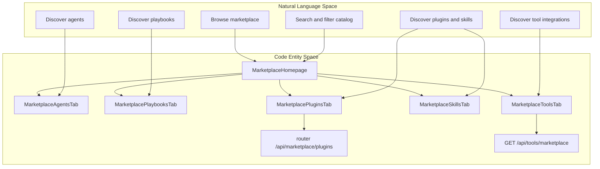
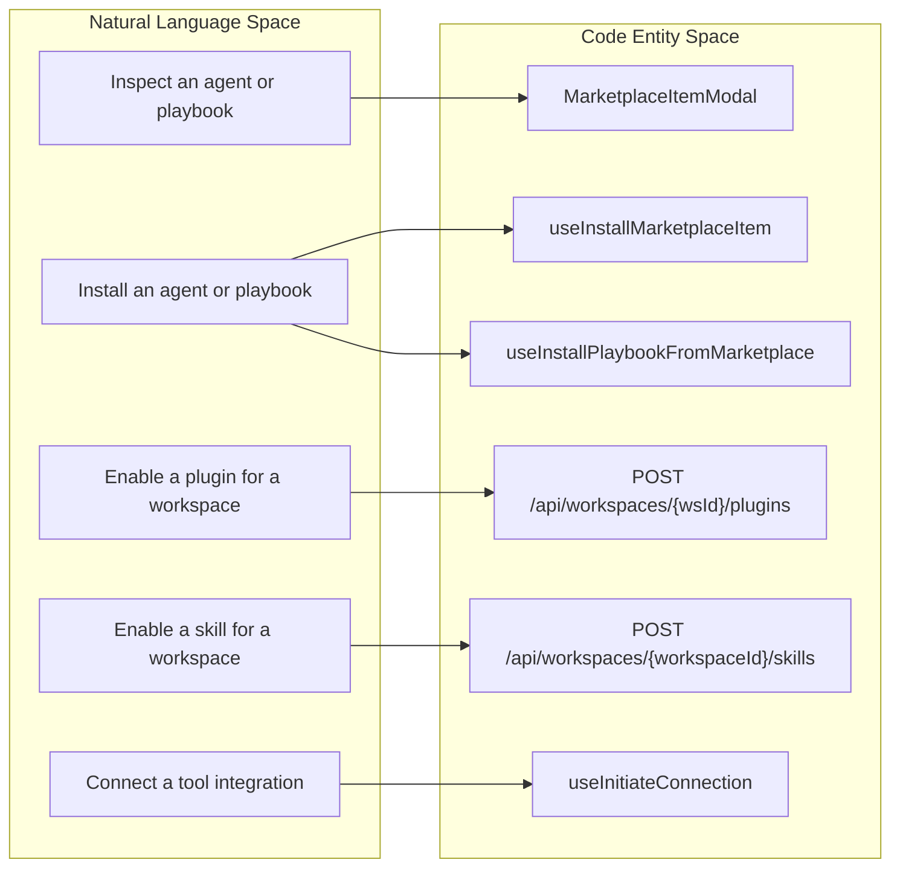

# Community Marketplace

Relevant source files

The following files were used as context for generating this wiki page:

- [docs/PRDS/42-PLUGIN-SKILLS-MARKETPLACE.md](docs/PRDS/42-PLUGIN-SKILLS-MARKETPLACE.md)
- [frontend/components/agents/agent-plugins-tab.tsx](frontend/components/agents/agent-plugins-tab.tsx)
- [frontend/components/marketplace/__tests__/marketplace-item-modal.type.test.tsx](frontend/components/marketplace/__tests__/marketplace-item-modal.type.test.tsx)
- [frontend/components/marketplace/featured-showcase-card.tsx](frontend/components/marketplace/featured-showcase-card.tsx)
- [frontend/components/marketplace/github-import-modal.tsx](frontend/components/marketplace/github-import-modal.tsx)
- [frontend/components/marketplace/marketplace-agent-cards.tsx](frontend/components/marketplace/marketplace-agent-cards.tsx)
- [frontend/components/marketplace/marketplace-agents-tab.tsx](frontend/components/marketplace/marketplace-agents-tab.tsx)
- [frontend/components/marketplace/marketplace-card.tsx](frontend/components/marketplace/marketplace-card.tsx)
- [frontend/components/marketplace/marketplace-grid.tsx](frontend/components/marketplace/marketplace-grid.tsx)
- [frontend/components/marketplace/marketplace-homepage.tsx](frontend/components/marketplace/marketplace-homepage.tsx)
- [frontend/components/marketplace/marketplace-item-modal.tsx](frontend/components/marketplace/marketplace-item-modal.tsx)
- [frontend/components/marketplace/marketplace-item-ref.ts](frontend/components/marketplace/marketplace-item-ref.ts)
- [frontend/components/marketplace/marketplace-item-sections.tsx](frontend/components/marketplace/marketplace-item-sections.tsx)
- [frontend/components/marketplace/marketplace-playbooks-tab.tsx](frontend/components/marketplace/marketplace-playbooks-tab.tsx)
- [frontend/components/marketplace/marketplace-plugin-detail-modal.tsx](frontend/components/marketplace/marketplace-plugin-detail-modal.tsx)
- [frontend/components/marketplace/marketplace-plugins-tab.tsx](frontend/components/marketplace/marketplace-plugins-tab.tsx)
- [frontend/components/marketplace/marketplace-skills-tab.tsx](frontend/components/marketplace/marketplace-skills-tab.tsx)
- [frontend/components/marketplace/marketplace-tools-tab.tsx](frontend/components/marketplace/marketplace-tools-tab.tsx)
- [orchestrator/api/marketplace_plugins.py](orchestrator/api/marketplace_plugins.py)

## Purpose and scope

The Community Marketplace is the discovery and installation surface for reusable agents, playbooks, tools, plugins, skills, and themes, alongside catalog areas such as LLMs. `MarketplaceHomepage` composes marketplace tabs and shared UI; individual tabs connect to catalog and workspace APIs. This parent page summarizes how the areas fit together and links to child pages for implementation details. [frontend/components/marketplace/marketplace-homepage.tsx:16-25](), [frontend/components/marketplace/marketplace-agents-tab.tsx:83-107](), [frontend/components/marketplace/marketplace-playbooks-tab.tsx:25-45]()

Sources: [frontend/components/marketplace/marketplace-homepage.tsx:16-25](), [frontend/components/marketplace/marketplace-agents-tab.tsx:83-107](), [frontend/components/marketplace/marketplace-playbooks-tab.tsx:25-45]()

---

## Architecture & System Overview

Marketplace discovery is organized through `MarketplaceHomepage` and its item-specific tabs. Agents and playbooks use marketplace item hooks and detail views; plugins and skills have distinct catalog and workspace-enable flows; tools use the tools marketplace endpoint and Composio app data. Administrative capabilities are role-gated in the frontend, while the plugin API lists approved, active entries. [frontend/components/marketplace/marketplace-homepage.tsx:16-25](), [frontend/components/marketplace/marketplace-agents-tab.tsx:88-105](), [frontend/components/marketplace/marketplace-plugins-tab.tsx:128-148](), [frontend/components/marketplace/marketplace-tools-tab.tsx:103-139](), [orchestrator/api/marketplace_plugins.py:171-189]()

### Natural Language Space to Code Entity Map: Discovery

Sources: [frontend/components/marketplace/marketplace-homepage.tsx:16-25](), [frontend/components/marketplace/marketplace-agents-tab.tsx:83-105](), [frontend/components/marketplace/marketplace-playbooks-tab.tsx:25-45](), [frontend/components/marketplace/marketplace-plugins-tab.tsx:128-148](), [frontend/components/marketplace/marketplace-skills-tab.tsx:64-107](), [frontend/components/marketplace/marketplace-tools-tab.tsx:103-139](), [orchestrator/api/marketplace_plugins.py:36-36]()

### Natural Language Space to Code Entity Map: Install and enable

Sources: [frontend/components/marketplace/marketplace-item-modal.tsx:21-39](), [frontend/components/marketplace/marketplace-agents-tab.tsx:67-80](), [frontend/components/marketplace/marketplace-playbooks-tab.tsx:53-75](), [frontend/components/marketplace/marketplace-plugins-tab.tsx:109-126](), [frontend/components/marketplace/marketplace-skills-tab.tsx:109-151](), [frontend/components/marketplace/marketplace-tools-tab.tsx:35-45]()

---

## 14.1 Marketplace Overview

`MarketplaceHomepage` composes marketplace tabs, shared search and category navigation, featured content, and item detail views. The available catalogs include agents and playbooks, plugin and skill capabilities, tools, and themes; the homepage also imports category and tab configuration rather than embedding all tab behavior in one component. [frontend/components/marketplace/marketplace-homepage.tsx:11-35](), [frontend/components/marketplace/marketplace-homepage.tsx:62-81]()

For details, see [Marketplace Overview](#14.1).

Sources: [frontend/components/marketplace/marketplace-homepage.tsx:11-35](), [frontend/components/marketplace/marketplace-homepage.tsx:62-81]()

---

## 14.2 Browsing & Installing Items

Users browse cards and open item-specific detail views. Agent installation and playbook installation use separate flows; plugins and skills are enabled for a workspace through workspace-scoped endpoints, while tools are presented as integrations that can be connected. Sign-in checks are present on agent and playbook install actions. [frontend/components/marketplace/marketplace-agents-tab.tsx:67-80](), [frontend/components/marketplace/marketplace-item-modal.tsx:36-39](), [frontend/components/marketplace/marketplace-playbooks-tab.tsx:53-75](), [frontend/components/marketplace/marketplace-skills-tab.tsx:109-151](), [frontend/components/marketplace/marketplace-tools-tab.tsx:154-168]()

For details, see [Browsing & Installing Items](#14.2).

Sources: [frontend/components/marketplace/marketplace-agents-tab.tsx:67-80](), [frontend/components/marketplace/marketplace-item-modal.tsx:36-39](), [frontend/components/marketplace/marketplace-playbooks-tab.tsx:53-75](), [frontend/components/marketplace/marketplace-skills-tab.tsx:109-151](), [frontend/components/marketplace/marketplace-tools-tab.tsx:154-168]()

---

## 14.3 Publishing & Plugin Uploads

Marketplace publishing and import surfaces include `GitHubImportModal`, which submits a repository URL to the admin plugin-import API and displays per-item results, including security and approval status. Plugin detail and approval controls are separate from ordinary workspace enablement. The plugin-and-skills marketplace requirements describe a curated catalog and storage approach; see the child page for the repository import, upload, and dependency workflow. [frontend/components/marketplace/github-import-modal.tsx:21-64](), [frontend/components/marketplace/marketplace-plugin-detail-modal.tsx:159-187](), [docs/PRDS/42-PLUGIN-SKILLS-MARKETPLACE.md:12-21](), [docs/PRDS/42-PLUGIN-SKILLS-MARKETPLACE.md:100-117]()

For details, see [Publishing & Plugin Uploads](#14.3).

Sources: [frontend/components/marketplace/github-import-modal.tsx:21-64](), [frontend/components/marketplace/marketplace-plugin-detail-modal.tsx:159-187](), [docs/PRDS/42-PLUGIN-SKILLS-MARKETPLACE.md:12-21](), [docs/PRDS/42-PLUGIN-SKILLS-MARKETPLACE.md:100-117]()

---

## Detailed Documentation
- [Marketplace Overview](#14.1) — MarketplaceHomepage, tabs (Applications, Agents, Playbooks, LLMs, Plugins, Skills, Widgets), search
- [Browsing & Installing Items](#14.2) — Item cards, detail modals, install flow, cascade installer for dependencies, install_count tracking
- [Publishing to Marketplace](#14.3) — Clone-to-workspace pattern, owner_type, dependency cloning, marketplace S3 asset storage, publish/developer pages
- [Marketplace Backend & LLM Catalog](#14.4) — marketplace.py, marketplace_plugins.py, llm_marketplace.py, user_api_keys, usage tracker, workspace isolation and cloning logic
- [Marketplace › Themes](themes-tab.md) — the Themes tab, the Marketplace's first tab: the storefront (web and phone screenshots per look), Official and signed themes, Add to my workspace, updates and pins, Publish theme
- [The open Marketplace](open-marketplace.md) — for users: browsing `/marketplace` signed out on the hosted edition (one page for everyone; Add, sign in, back to the item), and Sync with Automatos Cloud on a local install (what it brings, adding a Cloud theme or item, updates after a Sync)
- [Sync with Automatos Cloud](sync-with-automatos-cloud.md) — technical: a local install pulls Automatos Cloud's signed themes and its reviewed agents, Playbooks, packages and plugins (what leaves the install, the checks, updates, the review before an add, the settings, the routes); the hosted edition's catalogue, its files, bundles and plugin packages, the public reads and their rate limit

---