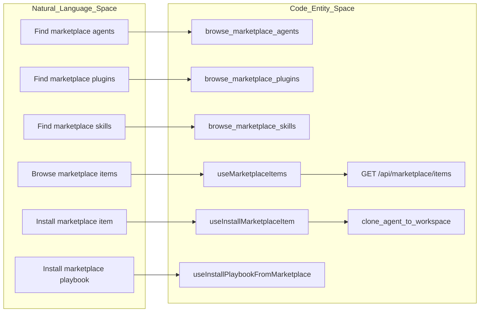
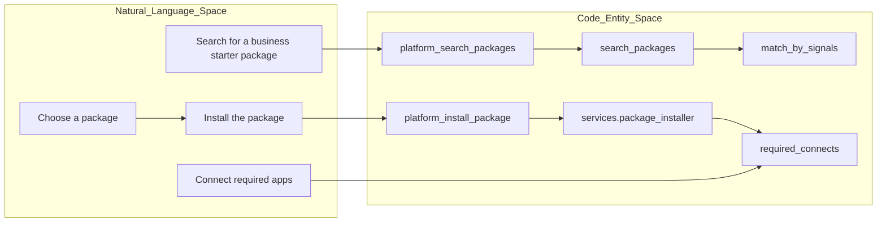

# Browsing & Installing Items

Relevant source files

The following files were used as context for generating this wiki page:

- [frontend/hooks/use-marketplace-api.ts](frontend/hooks/use-marketplace-api.ts)
- [frontend/hooks/use-playbook-api.ts](frontend/hooks/use-playbook-api.ts)
- [orchestrator/alembic/versions/agents_public_id_default.py](orchestrator/alembic/versions/agents_public_id_default.py)
- [orchestrator/api/marketplace.py](orchestrator/api/marketplace.py)
- [orchestrator/modules/tools/discovery/actions_packages.py](orchestrator/modules/tools/discovery/actions_packages.py)
- [orchestrator/modules/tools/discovery/cascade_installer.py](orchestrator/modules/tools/discovery/cascade_installer.py)
- [orchestrator/modules/tools/discovery/handlers_assignments.py](orchestrator/modules/tools/discovery/handlers_assignments.py)
- [orchestrator/modules/tools/discovery/handlers_marketplace.py](orchestrator/modules/tools/discovery/handlers_marketplace.py)
- [orchestrator/modules/tools/discovery/handlers_packages.py](orchestrator/modules/tools/discovery/handlers_packages.py)
- [orchestrator/modules/tools/discovery/not_found_candidates.py](orchestrator/modules/tools/discovery/not_found_candidates.py)
- [orchestrator/tests/test_f184_a_catalogue_miss_names_what_there_is.py](orchestrator/tests/test_f184_a_catalogue_miss_names_what_there_is.py)
- [orchestrator/tests/test_f200_a_package_name_installs_the_package.py](orchestrator/tests/test_f200_a_package_name_installs_the_package.py)
- [orchestrator/tests/test_f223_an_installed_playbook_names_no_helper_it_lacks.py](orchestrator/tests/test_f223_an_installed_playbook_names_no_helper_it_lacks.py)
- [orchestrator/tests/test_marketplace_pending_items_route.py](orchestrator/tests/test_marketplace_pending_items_route.py)
- [orchestrator/tests/test_prd222_not_found_names_candidates.py](orchestrator/tests/test_prd222_not_found_names_candidates.py)

## Purpose and Scope

This page describes the marketplace browsing and installation paths visible in the supplied code: the `/api/marketplace/items` listing contract, marketplace discovery handlers, frontend query and install hooks, agent cloning, and package-install tool definitions and handler behavior. The supplied excerpts do not include marketplace card or detail-modal components, nor the implementation body of the package installer; those UI and installer internals are therefore not specified here. [orchestrator/api/marketplace.py:32-33]() [orchestrator/modules/tools/discovery/handlers_marketplace.py:12-20]() [frontend/hooks/use-marketplace-api.ts:93-150]() [orchestrator/modules/tools/discovery/cascade_installer.py:118-177]() [orchestrator/modules/tools/discovery/actions_packages.py:1-8]() [orchestrator/modules/tools/discovery/handlers_packages.py:1-21]()

Sources: [orchestrator/api/marketplace.py:32-33]() [orchestrator/modules/tools/discovery/handlers_marketplace.py:12-20]() [frontend/hooks/use-marketplace-api.ts:93-150]() [orchestrator/modules/tools/discovery/cascade_installer.py:118-177]() [orchestrator/modules/tools/discovery/actions_packages.py:1-8]() [orchestrator/modules/tools/discovery/handlers_packages.py:1-21]()

---

## 1. Browsing and Installation at a Glance

The provided code exposes two related browsing paths. The REST marketplace router defines `/api/marketplace/items`, returning marketplace items with filters for type, category, search text, featured status, and pagination. Separately, platform-action handlers browse marketplace agents, plugins, and skills for a workspace. [orchestrator/api/marketplace.py:32-33]() [orchestrator/api/marketplace.py:149-164]() [orchestrator/modules/tools/discovery/handlers_marketplace.py:12-20]() [orchestrator/modules/tools/discovery/handlers_marketplace.py:82-105]() [orchestrator/modules/tools/discovery/handlers_marketplace.py:158-180]()

Frontend hooks wrap marketplace reads and installs with React Query. `useMarketplaceItems` delegates through the marketplace access `source`; `useInstallMarketplaceItem` calls the API client and invalidates agent, tool, and workspace-model queries after success. A separate playbook hook calls the recipe-install API and invalidates playbook, agent, tool, and model caches. [frontend/hooks/use-marketplace-api.ts:93-110]() [frontend/hooks/use-marketplace-api.ts:127-147]() [frontend/hooks/use-playbook-api.ts:150-165]()

The marketplace REST router’s visible item-type mapping covers `agent` and `recipe` (the wire label for a playbook). The response schema also allows other type labels, but the shown listing implementation says it returns approved items from the agents and recipes tables. [orchestrator/api/marketplace.py:54-60]() [orchestrator/api/marketplace.py:79-105]() [orchestrator/api/marketplace.py:149-164]()

Sources: [orchestrator/api/marketplace.py:54-60]() [orchestrator/api/marketplace.py:79-105]() [orchestrator/api/marketplace.py:149-164]() [orchestrator/modules/tools/discovery/handlers_marketplace.py:12-20]() [orchestrator/modules/tools/discovery/handlers_marketplace.py:82-105]() [orchestrator/modules/tools/discovery/handlers_marketplace.py:158-180]() [frontend/hooks/use-marketplace-api.ts:93-147]() [frontend/hooks/use-playbook-api.ts:150-165]()

### Natural Language Space to Code Entity Space: Browse and Install

This diagram maps browsing and install concepts to the named handlers, hooks, and clone helper present in the supplied code. [orchestrator/modules/tools/discovery/handlers_marketplace.py:12-20]() [orchestrator/modules/tools/discovery/handlers_marketplace.py:82-105]() [frontend/hooks/use-marketplace-api.ts:93-109]() [frontend/hooks/use-marketplace-api.ts:127-147]() [orchestrator/modules/tools/discovery/cascade_installer.py:118-177]() [frontend/hooks/use-playbook-api.ts:150-165]()

**Diagram: Browse and install entry points**

Sources: [orchestrator/api/marketplace.py:149-164]() [orchestrator/modules/tools/discovery/handlers_marketplace.py:12-20]() [orchestrator/modules/tools/discovery/handlers_marketplace.py:82-105]() [orchestrator/modules/tools/discovery/handlers_marketplace.py:158-180]() [frontend/hooks/use-marketplace-api.ts:93-109]() [frontend/hooks/use-marketplace-api.ts:127-147]() [orchestrator/modules/tools/discovery/cascade_installer.py:118-177]() [frontend/hooks/use-playbook-api.ts:150-165]()

### Natural Language Space to Code Entity Space: Package Discovery and Installation

The package tool definitions expose `platform_search_packages` for searching curated packages using business signals and `platform_install_package` for installing a package closure. The handler constructs search signals and calls `match_by_signals`; the supplied handler excerpt documents package-install policies but does not show the complete install handler implementation. [orchestrator/modules/tools/discovery/actions_packages.py:12-58]() [orchestrator/modules/tools/discovery/actions_packages.py:60-92]() [orchestrator/modules/tools/discovery/handlers_packages.py:126-147]() [orchestrator/modules/tools/discovery/handlers_packages.py:1-21]()

**Diagram: Package search and installation entities**

Sources: [orchestrator/modules/tools/discovery/actions_packages.py:12-92]() [orchestrator/modules/tools/discovery/handlers_packages.py:126-147]() [orchestrator/modules/tools/discovery/handlers_packages.py:77-92]()

---

## 2. Browsing and Search Results

### Marketplace REST Listing

`list_items` is registered at `GET /api/marketplace/items`. Its parameters include `type`, `category`, `search`, `featured`, `limit`, and `offset`; pagination defaults to 50 items and offset 0, with the limit constrained to 1–100. The endpoint uses `get_request_context_hybrid` and `get_db` dependencies. [orchestrator/api/marketplace.py:32-33]() [orchestrator/api/marketplace.py:149-159]()

The route’s docstring specifies that it returns approved items from the agents and recipes tables. It determines whether to include agents, recipes, or both from the requested type. For agent rows, the shown query filters `Agent.owner_type == 'marketplace'`; non-admin visibility handling follows in code beyond the supplied excerpt, so its precise behavior is not described here. [orchestrator/api/marketplace.py:160-183]()

`MarketplaceItemOut` defines the listing fields, including `type`, `name`, `description`, `creator_name`, tags, `install_count`, featured/approval flags, version, metadata, and timestamps. It also includes recipe-oriented fields such as steps, inputs, outputs, and execution configuration. `MarketplaceItemDetail` extends that output with a `dependencies` mapping. [orchestrator/api/marketplace.py:79-112]()

Sources: [orchestrator/api/marketplace.py:32-33]() [orchestrator/api/marketplace.py:79-112]() [orchestrator/api/marketplace.py:149-183]()

### Marketplace Agents

`browse_marketplace_agents` queries active agents whose `owner_type` is `"marketplace"`. It optionally searches name, description, and marketplace category; category filtering is also supported. Results are ordered by descending `install_count`, with the requested limit capped at 50. [orchestrator/modules/tools/discovery/handlers_marketplace.py:82-105]()

The handler checks the workspace’s agent rows for non-null `cloned_from_id` values and uses those IDs to produce `is_installed` for each marketplace result. The response includes the agent ID, name, truncated description, category, model ID when available, skill names, tags, install count, featured state, and installed state. [orchestrator/modules/tools/discovery/handlers_marketplace.py:107-155]()

Sources: [orchestrator/modules/tools/discovery/handlers_marketplace.py:82-155]()

### Plugins and Skills

`browse_marketplace_plugins` filters to plugins with `approval_status == "approved"` and `is_active == True`. It supports search over plugin name, description, and slug, optional category filtering, and a result limit capped at 50. It cross-references `WorkspaceEnabledPlugin` to return each plugin’s `is_enabled` state for the workspace. [orchestrator/modules/tools/discovery/handlers_marketplace.py:12-53]() [orchestrator/modules/tools/discovery/handlers_marketplace.py:55-79]()

`browse_marketplace_skills` queries active skills with `workspace_id IS NULL`, and supports name/description search and category filtering. It cross-references `WorkspaceEnabledSkill` for workspace enablement. Its response includes skill type and an estimated token count calculated as the prompt-template length divided by four. [orchestrator/modules/tools/discovery/handlers_marketplace.py:158-205]()

Sources: [orchestrator/modules/tools/discovery/handlers_marketplace.py:12-79]() [orchestrator/modules/tools/discovery/handlers_marketplace.py:158-205]()

### Package Search Results

`search_packages` builds a signal mapping from `platforms`, `urls`, `text` (or the fallback `query`), and `vertical_tags`; it passes those signals and `list_packages(db)` to `match_by_signals`. If matches exist, it records the top package as an onboarding offer through `_record_offer_if_onboarding`. The response includes summaries of the matches and a count; when there are no matches, it adds a `next` instruction pointing callers to marketplace-agent search. [orchestrator/modules/tools/discovery/handlers_packages.py:95-115]() [orchestrator/modules/tools/discovery/handlers_packages.py:118-147]()

`_match_summary` formats each package’s slug, name, description, score, match reasons, member counts, required app connections, setup questions, guide steps, and showcase state. The package search action schema describes the same user-facing purpose and accepts business text, platform names, URLs, and vertical tags. [orchestrator/modules/tools/discovery/handlers_packages.py:68-92]() [orchestrator/modules/tools/discovery/actions_packages.py:12-58]()

Sources: [orchestrator/modules/tools/discovery/handlers_packages.py:68-92]() [orchestrator/modules/tools/discovery/handlers_packages.py:95-147]() [orchestrator/modules/tools/discovery/actions_packages.py:12-58]()

---

## 3. Frontend Data Hooks and Install Mutations

### Marketplace Item Queries and Mutations

`useMarketplaceItems` accepts optional filters for type, category, search, featured state, limit, and offset. It obtains `source` from `useMarketplaceAccess`, includes `source.kind` in its React Query key, fetches through `source.items(filters)`, and uses a five-minute stale time. [frontend/hooks/use-marketplace-api.ts:93-111]()

`useFeaturedItems` similarly delegates to the access source and caches results for ten minutes. `marketplaceQueryKeys` defines keys for item lists, featured items, and updates. [frontend/hooks/use-marketplace-api.ts:14-19]() [frontend/hooks/use-marketplace-api.ts:114-124]()

`useInstallMarketplaceItem` calls `apiClient.installMarketplaceItem(itemId)`. On success, it invalidates the agent, tool, and workspace-model queries and requests a cloud-update refresh; it then shows a success toast. On failure, it shows an error toast and logs the installation error. [frontend/hooks/use-marketplace-api.ts:127-155]()

Sources: [frontend/hooks/use-marketplace-api.ts:14-19]() [frontend/hooks/use-marketplace-api.ts:93-155]()

### Playbook Queries and Install Mutation

`useWorkflowPlaybooks` lists recipes through `apiClient.listWorkflowRecipes`, using the list parameters as part of its query key and a five-minute stale time. The hook family also defines queries for individual and featured playbooks. [frontend/hooks/use-playbook-api.ts:5-53]()

`useInstallPlaybookFromMarketplace` calls `apiClient.installRecipeFromMarketplace(playbookId)`. When the mutation succeeds, it invalidates workspace playbook lists, agents, tools, and workspace models, and refreshes cloud-update state. [frontend/hooks/use-playbook-api.ts:150-165]()

Sources: [frontend/hooks/use-playbook-api.ts:5-53]() [frontend/hooks/use-playbook-api.ts:150-165]()

---

## 4. Agent Clone Semantics and Workspace Ownership

`clone_agent_to_workspace` creates a workspace-owned copy of a marketplace agent. Before constructing the clone, it calls `require_agent_room`; it checks for a same-name workspace-owned agent and appends `-copy` if a collision exists. The clone receives a new public ID, `owner_type='workspace'`, the workspace ID as both `owner_id` and `workspace_id`, and `cloned_from_id` pointing to the marketplace agent. [orchestrator/modules/tools/discovery/cascade_installer.py:118-159]()

The clone copies selected source fields, normalizes its runtime configuration with `_configuration_with_runtime`, sets approval true and featured false, and initializes the clone’s `install_count` to zero. It preserves the source version and original creator ID. Skills are copied by assigning the marketplace agent’s skills to the clone after it is added and flushed. [orchestrator/modules/tools/discovery/cascade_installer.py:78-92]() [orchestrator/modules/tools/discovery/cascade_installer.py:145-177]()

| Clone behavior | Implementation |
|---|---|
| Quota check | `require_agent_room(db, workspace_id)` runs before clone creation. [orchestrator/modules/tools/discovery/cascade_installer.py:129-133]() |
| Name collision | A workspace-owned name collision adds the `-copy` suffix. [orchestrator/modules/tools/discovery/cascade_installer.py:134-142]() |
| Workspace ownership | The clone sets `owner_type='workspace'`, `owner_id`, and `workspace_id`. [orchestrator/modules/tools/discovery/cascade_installer.py:145-157]() |
| Marketplace lineage | `cloned_from_id` stores the source marketplace agent ID. [orchestrator/modules/tools/discovery/cascade_installer.py:155-159]() |
| Runtime normalization | `_configuration_with_runtime` keeps a recognized runtime or defaults to the API runtime. [orchestrator/modules/tools/discovery/cascade_installer.py:78-92]() |
| Skill relationship | The clone receives the source agent’s skills when present. [orchestrator/modules/tools/discovery/cascade_installer.py:173-177]() |

Sources: [orchestrator/modules/tools/discovery/cascade_installer.py:78-92]() [orchestrator/modules/tools/discovery/cascade_installer.py:118-177]()

---

## 5. Cascading Dependencies and OAuth Requirements

`CascadeResult` collects three outputs from cascade operations: `cloned_items`, `installed_dependencies`, and `warnings`. Its `merge` method appends each corresponding list from another result. The supplied excerpt establishes this result structure but does not include the full dependency-cascade implementation. [orchestrator/modules/tools/discovery/cascade_installer.py:23-33]()

`check_oauth_requirements` accepts Composio app names and looks up each app in `ComposioAppCache`, matching either the uppercase app name or lowercase slug. If cached authentication schemes include `OAUTH2`, `OAUTH1`, or `OAUTH`, it marks OAuth as required. If no usable cache entry exists, it conservatively marks OAuth as required. [orchestrator/modules/tools/discovery/cascade_installer.py:40-71]()

The package install action describes a full dependency closure that can include agents, tools, skills, playbooks, and an LLM. It states that connected apps are returned as guided connection steps rather than being auto-connected. The supplied `handlers_packages.py` excerpt documents one-package-during-onboarding and over-quota policies, but does not show the full package-install execution path. [orchestrator/modules/tools/discovery/actions_packages.py:60-92]() [orchestrator/modules/tools/discovery/handlers_packages.py:12-21]()

Sources: [orchestrator/modules/tools/discovery/cascade_installer.py:23-33]() [orchestrator/modules/tools/discovery/cascade_installer.py:40-71]() [orchestrator/modules/tools/discovery/actions_packages.py:60-92]() [orchestrator/modules/tools/discovery/handlers_packages.py:12-21]()

---

## 6. Package Installation Policies and Tool Contracts

`register_package_actions` registers three package-related actions: `platform_search_packages`, `platform_install_package`, and `platform_install_marketplace_agent`. The search action is read-level; package installation is write-level and marked admin-only in its action definition; agent installation is write-level. [orchestrator/modules/tools/discovery/actions_packages.py:12-23]() [orchestrator/modules/tools/discovery/actions_packages.py:49-58]() [orchestrator/modules/tools/discovery/actions_packages.py:60-128]()

The package-install action requires a `slug`. Its description says installation is idempotent, produces workspace-owned editable items, returns a manifest of registered items and apps that still need connecting, and does not partially install when the package exceeds the plan’s agent limit. The agent-install action accepts an `agent_id` or `agent_name` and describes installing the agent with its dependency closure. [orchestrator/modules/tools/discovery/actions_packages.py:60-92]() [orchestrator/modules/tools/discovery/actions_packages.py:94-128]()

In the package handler, `_package_agent_refs` derives a set of distinct package agent references, and `_member_counts` counts members by type. `_over_quota_response` begins constructing a plan recommendation using `recommend_plan`; the supplied excerpt does not include the rest of that function or the complete package installation handler, so further response details are not stated here. [orchestrator/modules/tools/discovery/handlers_packages.py:50-60]() [orchestrator/modules/tools/discovery/handlers_packages.py:68-74]() [orchestrator/modules/tools/discovery/handlers_packages.py:150-166]()

Sources: [orchestrator/modules/tools/discovery/actions_packages.py:12-128]() [orchestrator/modules/tools/discovery/handlers_packages.py:50-74]() [orchestrator/modules/tools/discovery/handlers_packages.py:150-166]()

---

## 7. Install Counts and Installed-State Tracking

Marketplace-agent discovery sorts results by descending `Agent.install_count` and includes that value in each result, defaulting to zero if it is null. The same response computes `is_installed` by checking whether the marketplace agent ID appears in the workspace’s set of `cloned_from_id` values. [orchestrator/modules/tools/discovery/handlers_marketplace.py:104-105]() [orchestrator/modules/tools/discovery/handlers_marketplace.py:107-148]()

Agent cloning initializes the new workspace clone’s `install_count` to zero; the provided clone excerpt does not show an increment to the marketplace source’s count. The marketplace REST response schema also exposes `install_count`, but the supplied route excerpt does not show the later code that populates or updates it. [orchestrator/modules/tools/discovery/cascade_installer.py:145-163]() [orchestrator/api/marketplace.py:79-93]() [orchestrator/api/marketplace.py:149-183]()

Sources: [orchestrator/modules/tools/discovery/handlers_marketplace.py:104-148]() [orchestrator/modules/tools/discovery/cascade_installer.py:145-163]() [orchestrator/api/marketplace.py:79-93]() [orchestrator/api/marketplace.py:149-183]()

---