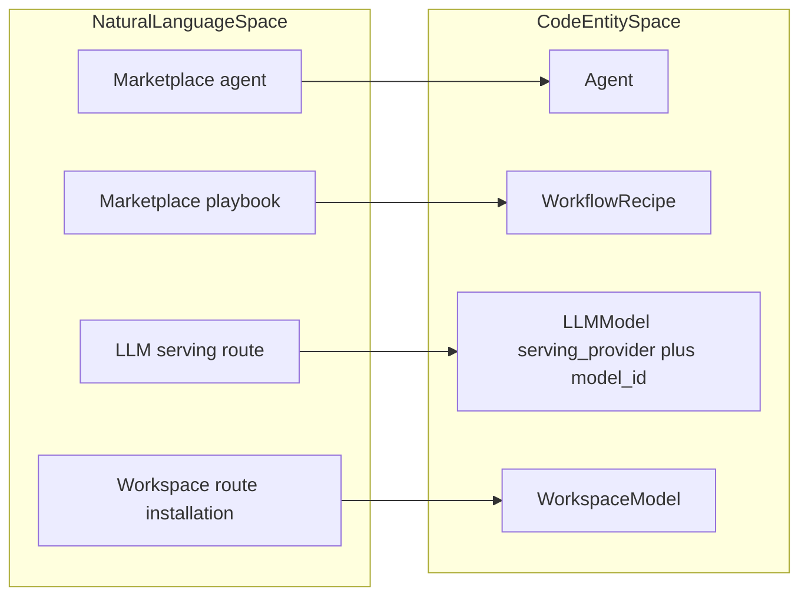
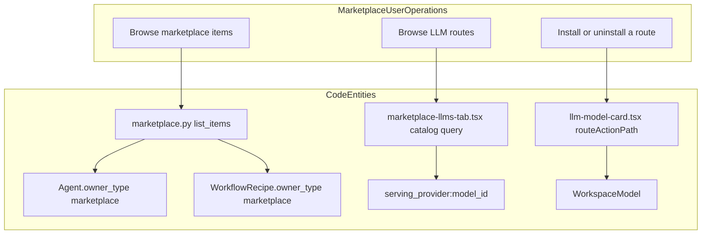
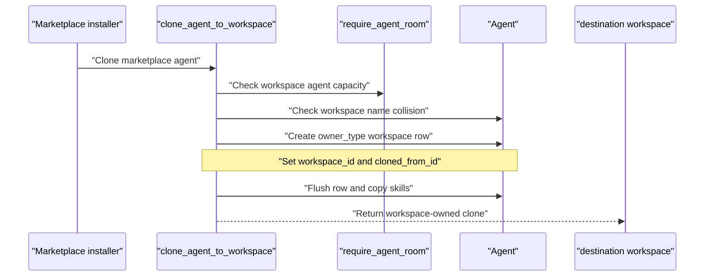
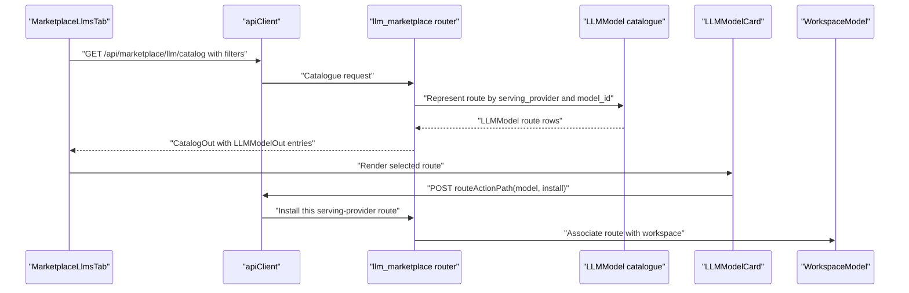
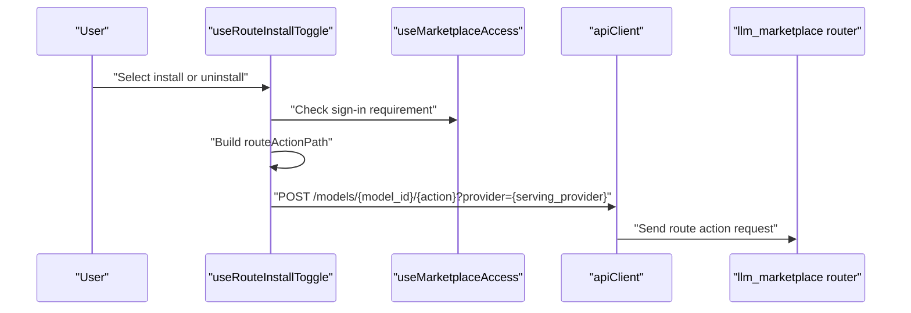

# Marketplace Backend & API

Relevant source files

The following files were used as context for generating this wiki page:

- [frontend/components/agents/model-selector.tsx](frontend/components/agents/model-selector.tsx)
- [frontend/components/marketplace/llm-model-card.tsx](frontend/components/marketplace/llm-model-card.tsx)
- [frontend/components/marketplace/llm-model-detail-modal.tsx](frontend/components/marketplace/llm-model-detail-modal.tsx)
- [frontend/components/marketplace/marketplace-llms-tab.tsx](frontend/components/marketplace/marketplace-llms-tab.tsx)
- [frontend/hooks/use-marketplace-api.ts](frontend/hooks/use-marketplace-api.ts)
- [frontend/hooks/use-model-api.ts](frontend/hooks/use-model-api.ts)
- [frontend/hooks/use-openrouter-api.ts](frontend/hooks/use-openrouter-api.ts)
- [frontend/hooks/use-playbook-api.ts](frontend/hooks/use-playbook-api.ts)
- [frontend/lib/__tests__/socials-media-lane.test.ts](frontend/lib/__tests__/socials-media-lane.test.ts)
- [orchestrator/alembic/versions/agents_public_id_default.py](orchestrator/alembic/versions/agents_public_id_default.py)
- [orchestrator/api/agent_endpoints.py](orchestrator/api/agent_endpoints.py)
- [orchestrator/api/llm_analytics.py](orchestrator/api/llm_analytics.py)
- [orchestrator/api/llm_marketplace.py](orchestrator/api/llm_marketplace.py)
- [orchestrator/api/marketplace.py](orchestrator/api/marketplace.py)
- [orchestrator/api/openrouter_marketplace.py](orchestrator/api/openrouter_marketplace.py)
- [orchestrator/core/database/migrations/042_openrouter_models_cache.sql](orchestrator/core/database/migrations/042_openrouter_models_cache.sql)
- [orchestrator/core/llm/anthropic_ids.py](orchestrator/core/llm/anthropic_ids.py)
- [orchestrator/core/llm/openrouter_analytics.py](orchestrator/core/llm/openrouter_analytics.py)
- [orchestrator/core/llm/usage_tracker.py](orchestrator/core/llm/usage_tracker.py)
- [orchestrator/core/services/anthropic_catalog_sync.py](orchestrator/core/services/anthropic_catalog_sync.py)
- [orchestrator/core/services/provider_catalog_sync.py](orchestrator/core/services/provider_catalog_sync.py)
- [orchestrator/modules/tools/discovery/actions_packages.py](orchestrator/modules/tools/discovery/actions_packages.py)
- [orchestrator/modules/tools/discovery/cascade_installer.py](orchestrator/modules/tools/discovery/cascade_installer.py)
- [orchestrator/modules/tools/discovery/handlers_assignments.py](orchestrator/modules/tools/discovery/handlers_assignments.py)
- [orchestrator/modules/tools/discovery/handlers_marketplace.py](orchestrator/modules/tools/discovery/handlers_marketplace.py)
- [orchestrator/modules/tools/discovery/handlers_packages.py](orchestrator/modules/tools/discovery/handlers_packages.py)
- [orchestrator/modules/tools/discovery/not_found_candidates.py](orchestrator/modules/tools/discovery/not_found_candidates.py)
- [orchestrator/scripts/seed_llm_marketplace.py](orchestrator/scripts/seed_llm_marketplace.py)
- [orchestrator/tests/test_829_anthropic_models_refresh_from_the_owners_key.py](orchestrator/tests/test_829_anthropic_models_refresh_from_the_owners_key.py)
- [orchestrator/tests/test_f184_a_catalogue_miss_names_what_there_is.py](orchestrator/tests/test_f184_a_catalogue_miss_names_what_there_is.py)
- [orchestrator/tests/test_f200_a_package_name_installs_the_package.py](orchestrator/tests/test_f200_a_package_name_installs_the_package.py)
- [orchestrator/tests/test_f208_a_the_credit_balance_is_read.py](orchestrator/tests/test_f208_a_the_credit_balance_is_read.py)
- [orchestrator/tests/test_f223_an_installed_playbook_names_no_helper_it_lacks.py](orchestrator/tests/test_f223_an_installed_playbook_names_no_helper_it_lacks.py)
- [orchestrator/tests/test_llm_catalog_a_list_of_capabilities_is_no_500.py](orchestrator/tests/test_llm_catalog_a_list_of_capabilities_is_no_500.py)
- [orchestrator/tests/test_marketplace_pending_items_route.py](orchestrator/tests/test_marketplace_pending_items_route.py)
- [orchestrator/tests/test_prd143_obs_routers_batch2.py](orchestrator/tests/test_prd143_obs_routers_batch2.py)
- [orchestrator/tests/test_prd222_not_found_names_candidates.py](orchestrator/tests/test_prd222_not_found_names_candidates.py)
- [orchestrator/tests/test_prd251w1_media_lane.py](orchestrator/tests/test_prd251w1_media_lane.py)

## Purpose and Scope

This page documents the marketplace backend surfaces evidenced in the supplied code: marketplace-owned agents and recipes, the `owner_type` visibility boundary, workspace-specific agent clones and LLM route installs, the core and LLM marketplace routers, and install-count fields. It also maps frontend marketplace requests to backend entities where the supplied files show that connection. [orchestrator/api/marketplace.py:1-9](), [orchestrator/api/marketplace.py:27-32](), [orchestrator/api/llm_marketplace.py:1-16](), [orchestrator/modules/tools/discovery/cascade_installer.py:118-177]()

Sources: [orchestrator/api/marketplace.py:1-9](), [orchestrator/api/marketplace.py:27-32](), [orchestrator/api/llm_marketplace.py:1-16](), [orchestrator/modules/tools/discovery/cascade_installer.py:118-177]()

---

## 1. Marketplace Routers & API Endpoints

The core marketplace router is mounted at `/api/marketplace`. Its module describes browsing, filtering, installing, submission for approval, and update checks as its responsibilities. [orchestrator/api/marketplace.py:1-9](), [orchestrator/api/marketplace.py:17-32]() The LLM marketplace is a separate router at `/api/marketplace/llm`; it treats a model offering as a serving route, rather than only as a vendor model. [orchestrator/api/llm_marketplace.py:1-16](), [orchestrator/api/llm_marketplace.py:22-37]()

The core marketplace API imports `Agent`, `Skill`, `User`, and `WorkflowTemplate` under the `WorkflowRecipe` name. The shown `GET /api/marketplace/items` endpoint queries marketplace agents and recipes, while its response schema also allows item types such as skill, LLM, and tool. [orchestrator/api/marketplace.py:27-28](), [orchestrator/api/marketplace.py:79-105](), [orchestrator/api/marketplace.py:145-163]()

### Router Overview

| Router or surface | Prefix or path | What the supplied code establishes |
|---|---|---|
| Core marketplace | `/api/marketplace` | Router for marketplace operations; the shown listing endpoint is `GET /items`. [orchestrator/api/marketplace.py:1-9](), [orchestrator/api/marketplace.py:32-32](), [orchestrator/api/marketplace.py:145-163]() |
| LLM marketplace | `/api/marketplace/llm` | Separate route catalogue and installation surface; the module describes routes as keyed by serving provider and model ID. [orchestrator/api/llm_marketplace.py:1-16](), [orchestrator/api/llm_marketplace.py:37-37]() |
| Workspace model hook | `/api/marketplace/llm/installed` | `useWorkspaceModels` fetches models installed for the active workspace. [frontend/hooks/use-model-api.ts:100-114]() |
| LLM catalogue hook | `/api/marketplace/llm/catalog` | `MarketplaceLlmsTab` builds catalogue filters and sends a request with a limit of 500. [frontend/components/marketplace/marketplace-llms-tab.tsx:147-177]() |
| LLM installed-route hook | `/api/marketplace/llm/installed-ids` | The LLM tab fetches installed route IDs and builds a set from the response’s `routes` field. [frontend/components/marketplace/marketplace-llms-tab.tsx:135-145]() |
| Workspace plugin and skill handlers | Platform-action handlers | `handlers_marketplace.py` browses approved plugins, active marketplace agents, and global skills, then cross-references workspace enablement or clones. [orchestrator/modules/tools/discovery/handlers_marketplace.py:12-79](), [orchestrator/modules/tools/discovery/handlers_marketplace.py:82-155](), [orchestrator/modules/tools/discovery/handlers_marketplace.py:158-205]() |

Sources: [orchestrator/api/marketplace.py:1-9](), [orchestrator/api/marketplace.py:27-32](), [orchestrator/api/marketplace.py:79-105](), [orchestrator/api/marketplace.py:145-163](), [orchestrator/api/llm_marketplace.py:1-16](), [orchestrator/api/llm_marketplace.py:22-37](), [frontend/hooks/use-model-api.ts:100-114](), [frontend/components/marketplace/marketplace-llms-tab.tsx:135-177](), [orchestrator/modules/tools/discovery/handlers_marketplace.py:12-79](), [orchestrator/modules/tools/discovery/handlers_marketplace.py:82-155](), [orchestrator/modules/tools/discovery/handlers_marketplace.py:158-205]()

### Natural-Language Concepts Mapped to Code Entities

Marketplace agents and playbooks are backed by `Agent` and `WorkflowRecipe` (an alias for `WorkflowTemplate`) in the core marketplace API. [orchestrator/api/marketplace.py:27-28](), [orchestrator/api/marketplace.py:54-60]() In the LLM marketplace, a route is a row in `llm_models`, identified by `(serving_provider, model_id)`, and installation associates that route with a workspace through `WorkspaceModel`. [orchestrator/api/llm_marketplace.py:5-10](), [orchestrator/api/llm_marketplace.py:31-37]()

**Diagram: Marketplace concepts mapped to code entities**

Sources: [orchestrator/api/marketplace.py:27-28](), [orchestrator/api/marketplace.py:54-60](), [orchestrator/api/llm_marketplace.py:5-10](), [orchestrator/api/llm_marketplace.py:31-37]()

### Natural-Language Operations Mapped to API Functions

The core listing path begins at `list_items`; marketplace agent and recipe queries use `owner_type == 'marketplace'`. [orchestrator/api/marketplace.py:149-183]() LLM route browsing is requested by `MarketplaceLlmsTab`, while route installation and removal paths are assembled by `routeActionPath` in `llm-model-card.tsx`. [frontend/components/marketplace/marketplace-llms-tab.tsx:147-177](), [frontend/components/marketplace/llm-model-card.tsx:147-157]()

**Diagram: Browse and install operations mapped to code identifiers**

Sources: [orchestrator/api/marketplace.py:54-72](), [orchestrator/api/marketplace.py:149-183](), [orchestrator/api/llm_marketplace.py:5-10](), [orchestrator/api/llm_marketplace.py:31-37](), [frontend/components/marketplace/marketplace-llms-tab.tsx:147-177](), [frontend/components/marketplace/llm-model-card.tsx:147-157]()

---

## 2. Data Isolation, Workspace Scoping & The `owner_type` Field

For marketplace agents and recipes, `owner_type == 'marketplace'` identifies catalogue rows. `_find_marketplace_item` selects the model from `_ITEM_MODELS` using the supplied item type, filters by item ID and marketplace ownership, and optionally adds an approval filter. If no row matches, it raises HTTP 404. [orchestrator/api/marketplace.py:54-72]()

The API requires an item type for this lookup because the agent and recipe tables use separate ID sequences; the supported lookup types are `agent` and `recipe`. [orchestrator/api/marketplace.py:54-60]() The shown `list_items` endpoint accepts filters for type, category, search text, featured status, limit, and offset. It determines whether the caller is an admin and begins marketplace-agent queries with the marketplace ownership predicate. [orchestrator/api/marketplace.py:149-183]()

### Core Marketplace Item Visibility

| Field or rule | Implementation |
|---|---|
| `owner_type == 'marketplace'` | Restricts `_find_marketplace_item` to marketplace-owned rows; the listing query applies the same ownership condition to agents. [orchestrator/api/marketplace.py:63-71](), [orchestrator/api/marketplace.py:178-183]() |
| `item_type` | Selects `Agent` or `WorkflowRecipe` from `_ITEM_MODELS`, disambiguating the row ID. [orchestrator/api/marketplace.py:54-60]() |
| `approved_only` | Adds `model.is_approved == True` when requested by `_find_marketplace_item`. [orchestrator/api/marketplace.py:63-69]() |
| Admin context | `is_admin` delegates to `caller_is_admin`; `list_items` computes this status before building its result set. [orchestrator/api/marketplace.py:39-45](), [orchestrator/api/marketplace.py:165-183]() |
| Workspace clone | `clone_agent_to_workspace` writes `owner_type='workspace'`, sets the destination `workspace_id`, and records the marketplace source in `cloned_from_id`. [orchestrator/modules/tools/discovery/cascade_installer.py:118-159]() |

Workspace isolation is explicit in the agent clone path: it checks for a same-name workspace-owned agent within the destination workspace, applies the agent quota check to that workspace, and assigns the new clone to that workspace. [orchestrator/modules/tools/discovery/cascade_installer.py:118-159]() `workspace_clone_of` is documented as finding the workspace’s existing copy of a marketplace agent so an install can reuse it. [orchestrator/modules/tools/discovery/cascade_installer.py:180-187]()

The platform-action marketplace handlers also scope workspace associations: plugin and skill enabled-state queries filter by `workspace_id`, while agent discovery checks clones whose `workspace_id` matches the requesting workspace. [orchestrator/modules/tools/discovery/handlers_marketplace.py:43-53](), [orchestrator/modules/tools/discovery/handlers_marketplace.py:107-119](), [orchestrator/modules/tools/discovery/handlers_marketplace.py:182-192]()

Sources: [orchestrator/api/marketplace.py:39-45](), [orchestrator/api/marketplace.py:54-72](), [orchestrator/api/marketplace.py:149-183](), [orchestrator/modules/tools/discovery/cascade_installer.py:118-159](), [orchestrator/modules/tools/discovery/cascade_installer.py:180-187](), [orchestrator/modules/tools/discovery/handlers_marketplace.py:43-53](), [orchestrator/modules/tools/discovery/handlers_marketplace.py:107-119](), [orchestrator/modules/tools/discovery/handlers_marketplace.py:182-192]()

### Workspace Clone Data Flow

`clone_agent_to_workspace` checks agent quota, handles a name collision by appending `-copy`, and constructs a new `Agent` with workspace ownership and source lineage. [orchestrator/modules/tools/discovery/cascade_installer.py:118-159]() It normalizes the runtime configuration, keeps a persona only when `_shared_persona_id` determines it is global, flushes the new row to obtain its ID, and copies the marketplace agent’s skills relationship. [orchestrator/modules/tools/discovery/cascade_installer.py:78-115](), [orchestrator/modules/tools/discovery/cascade_installer.py:145-177]()

**Diagram: Marketplace agent clone and workspace scoping**

Sources: [orchestrator/modules/tools/discovery/cascade_installer.py:118-177]()

---

## 3. LLM Marketplace Endpoints & Route Management

The LLM marketplace represents an offering as a route keyed by `(serving_provider, model_id)`. The same vendor model ID can therefore appear as separate routes through different serving providers, with route-specific pricing. [orchestrator/api/llm_marketplace.py:5-10]() The API imports `LLMModel` and `WorkspaceModel`, and defines the router at `/api/marketplace/llm`. [orchestrator/api/llm_marketplace.py:22-37]()

### Route Identity & Pricing Engine

`route_key(serving_provider, model_id)` builds a composite key in the form `serving_provider:model_id`. [orchestrator/api/llm_marketplace.py:137-139]() The LLM tab also represents installed routes with route keys, and its installed-ID query reads the `routes` value into a set. [frontend/components/marketplace/marketplace-llms-tab.tsx:135-145]()

`route_price(m)` returns input and output costs per 1,000 tokens and a free-route boolean. When both catalogue cost fields are absent, it consults `list_rates`; that fallback is explicitly not treated as free. [orchestrator/api/llm_marketplace.py:124-135]() `price_tier_for` classifies a cost as `free`, `budget`, `mid`, or `premium` using the module’s configured thresholds. [orchestrator/api/llm_marketplace.py:39-43](), [orchestrator/api/llm_marketplace.py:113-121]()

`route_capabilities` accepts dictionary-shaped capability data. If the database value is a non-empty non-dictionary value, it logs a warning and returns an empty dictionary rather than passing that value through. [orchestrator/api/llm_marketplace.py:141-153]()

### LLM Catalogue Response Schema

`LLMModelOut` provides the catalogue response shape, including vendor and serving provider, route labels, pricing, capabilities, installation status, and route availability fields. [orchestrator/api/llm_marketplace.py:47-85]()

| Schema field | Meaning in the API |
|---|---|
| `provider` / `vendor` | Vendor identity; the schema documents `provider` as the vendor and exposes `vendor` as its UI alias. [orchestrator/api/llm_marketplace.py:47-52]() |
| `serving_provider` | Provider serving the route, distinct from the vendor. [orchestrator/api/llm_marketplace.py:49-53]() |
| `route_label` | Human-readable route label. [orchestrator/api/llm_marketplace.py:51-55]() |
| `input_cost_per_1k` / `output_cost_per_1k` | Input and output prices per 1,000 tokens. [orchestrator/api/llm_marketplace.py:58-64]() |
| `price_known` / `price_tier` | Indicates whether catalogue or list pricing is known and classifies the route’s price tier. [orchestrator/api/llm_marketplace.py:62-65]() |
| `capabilities` | Dictionary of route capability ratings. [orchestrator/api/llm_marketplace.py:63-69](), [orchestrator/api/llm_marketplace.py:141-153]() |
| `install_count` | Route-level install-count field in the response schema. [orchestrator/api/llm_marketplace.py:75-80]() |
| `is_installed` | Indicates installation of this route in the workspace. [orchestrator/api/llm_marketplace.py:75-80]() |
| `key_available` | Indicates whether the workspace can call the route according to the schema description. [orchestrator/api/llm_marketplace.py:77-80]() |

`CatalogOut` wraps the model list with a total, serving-provider counts and labels, vendor counts, last-sync information, and a list of syncable providers. [orchestrator/api/llm_marketplace.py:87-95]()

Sources: [orchestrator/api/llm_marketplace.py:5-16](), [orchestrator/api/llm_marketplace.py:22-37](), [orchestrator/api/llm_marketplace.py:39-43](), [orchestrator/api/llm_marketplace.py:47-95](), [orchestrator/api/llm_marketplace.py:113-153](), [frontend/components/marketplace/marketplace-llms-tab.tsx:135-145]()

### LLM Catalogue and Route Installation Data Flow

The frontend constructs catalogue query parameters from provider, vendor, category, price tier, search, sorting, and capability filters, then requests `/api/marketplace/llm/catalog`. [frontend/components/marketplace/marketplace-llms-tab.tsx:147-177]() The model card builds install or uninstall paths that encode the model ID and, when present, pin the request to `serving_provider`. [frontend/components/marketplace/llm-model-card.tsx:147-152]()

**Diagram: LLM marketplace route from catalogue to workspace install**

Sources: [orchestrator/api/llm_marketplace.py:5-10](), [orchestrator/api/llm_marketplace.py:31-37](), [orchestrator/api/llm_marketplace.py:47-95](), [frontend/components/marketplace/marketplace-llms-tab.tsx:147-177](), [frontend/components/marketplace/llm-model-card.tsx:147-152]()

---

## 4. Installation, Cloning & Install Stats

The core marketplace API defines `InstallRequest` and `InstallResponse` schemas. The response can report cloned items, installed dependencies, and warnings. [orchestrator/api/marketplace.py:115-125]() The cascade installer provides the agent clone implementation: it checks workspace quota, sets workspace ownership and source lineage, flushes the clone, and copies the source agent’s skills relationship. [orchestrator/modules/tools/discovery/cascade_installer.py:118-177]()

The LLM marketplace describes installation as creating a `WorkspaceModel` row for a particular route; the route identity includes both serving provider and model ID. [orchestrator/api/llm_marketplace.py:5-10]() The frontend constructs install and uninstall URLs for that route using `routeActionPath`. [frontend/components/marketplace/llm-model-card.tsx:147-152]()

### LLM Route Installation Sequence

The LLM model card’s install helper checks sign-in requirements, selects install or uninstall based on `model.is_installed`, and posts to the route-specific path. [frontend/components/marketplace/llm-model-card.tsx:165-182]() The supplied lines establish the frontend request path; they do not show the backend route handler implementation or its transaction details.

**Diagram: Route action request and UI state**

Sources: [frontend/components/marketplace/llm-model-card.tsx:147-182](), [orchestrator/api/llm_marketplace.py:22-37]()

### Install Statistics & Tracking

The core marketplace item response includes `install_count`, and the LLM route response schema also includes `install_count`. [orchestrator/api/marketplace.py:79-94](), [orchestrator/api/llm_marketplace.py:47-80]() The platform-action agent browser orders marketplace agents by `Agent.install_count` and returns the count in each result. [orchestrator/modules/tools/discovery/handlers_marketplace.py:104-148]()

The supplied code establishes that install counts are exposed or used for ordering. It does not show the complete core install handler or the LLM install handler, so the count-increment mechanism and its transaction semantics are not specified here.

Sources: [orchestrator/api/marketplace.py:79-94](), [orchestrator/api/llm_marketplace.py:47-80](), [orchestrator/modules/tools/discovery/handlers_marketplace.py:104-148]()

---

## 5. Admin Moderation & Approval

`is_admin(ctx)` returns false when there is no user context; otherwise it delegates to `caller_is_admin`. `assert_admin(ctx)` raises HTTP 403 when that check fails. [orchestrator/api/marketplace.py:39-51]() `MarketplaceItemOut` includes `is_approved` and `is_featured` fields, and `_find_marketplace_item` can enforce approval when called with `approved_only=True`. [orchestrator/api/marketplace.py:63-72](), [orchestrator/api/marketplace.py:79-94]()

The plugin discovery handler independently limits its query to plugins with `approval_status == "approved"` and `is_active == True`. [orchestrator/modules/tools/discovery/handlers_marketplace.py:12-22]() The marketplace item listing endpoint computes admin status before constructing queries; the supplied excerpt shows the start of its agent-query branch but not the complete approval-filter behavior for all item types. [orchestrator/api/marketplace.py:149-183]()

Sources: [orchestrator/api/marketplace.py:39-51](), [orchestrator/api/marketplace.py:63-72](), [orchestrator/api/marketplace.py:79-94](), [orchestrator/api/marketplace.py:149-183](), [orchestrator/modules/tools/discovery/handlers_marketplace.py:12-22]()

---