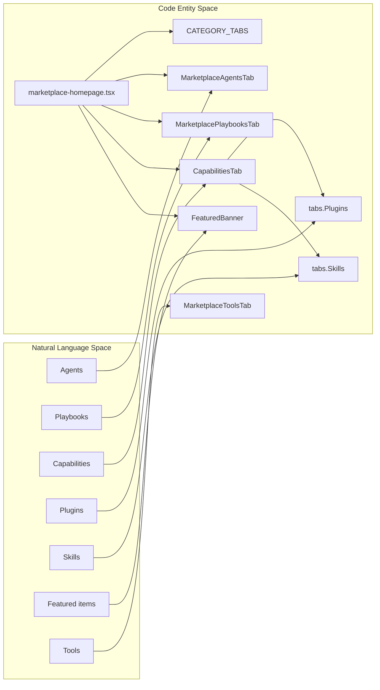
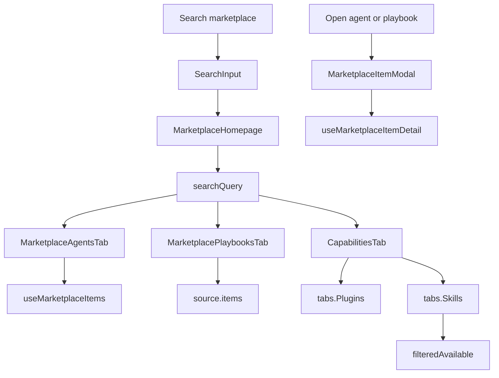

# Marketplace Overview

Relevant source files

The following files were used as context for generating this wiki page:

- [docs/PRDS/42-PLUGIN-SKILLS-MARKETPLACE.md](docs/PRDS/42-PLUGIN-SKILLS-MARKETPLACE.md)
- [frontend/components/agents/agent-plugins-tab.tsx](frontend/components/agents/agent-plugins-tab.tsx)
- [frontend/components/marketplace/__tests__/marketplace-item-modal.type.test.tsx](frontend/components/marketplace/__tests__/marketplace-item-modal.type.test.tsx)
- [frontend/components/marketplace/featured-showcase-card.tsx](frontend/components/marketplace/featured-showcase-card.tsx)
- [frontend/components/marketplace/github-import-modal.tsx](frontend/components/marketplace/github-import-modal.tsx)
- [frontend/components/marketplace/marketplace-agent-cards.tsx](frontend/components/marketplace/marketplace-agent-cards.tsx)
- [frontend/components/marketplace/marketplace-agents-tab.tsx](frontend/components/marketplace/marketplace-agents-tab.tsx)
- [frontend/components/marketplace/marketplace-card.tsx](frontend/components/marketplace/marketplace-card.tsx)
- [frontend/components/marketplace/marketplace-grid.tsx](frontend/components/marketplace/marketplace-grid.tsx)
- [frontend/components/marketplace/marketplace-homepage.tsx](frontend/components/marketplace/marketplace-homepage.tsx)
- [frontend/components/marketplace/marketplace-item-modal.tsx](frontend/components/marketplace/marketplace-item-modal.tsx)
- [frontend/components/marketplace/marketplace-item-ref.ts](frontend/components/marketplace/marketplace-item-ref.ts)
- [frontend/components/marketplace/marketplace-item-sections.tsx](frontend/components/marketplace/marketplace-item-sections.tsx)
- [frontend/components/marketplace/marketplace-playbooks-tab.tsx](frontend/components/marketplace/marketplace-playbooks-tab.tsx)
- [frontend/components/marketplace/marketplace-plugin-detail-modal.tsx](frontend/components/marketplace/marketplace-plugin-detail-modal.tsx)
- [frontend/components/marketplace/marketplace-plugins-tab.tsx](frontend/components/marketplace/marketplace-plugins-tab.tsx)
- [frontend/components/marketplace/marketplace-skills-tab.tsx](frontend/components/marketplace/marketplace-skills-tab.tsx)
- [frontend/components/marketplace/marketplace-tools-tab.tsx](frontend/components/marketplace/marketplace-tools-tab.tsx)
- [orchestrator/api/marketplace_plugins.py](orchestrator/api/marketplace_plugins.py)

## Purpose and Scope

The marketplace frontend is organized around `MarketplaceHomepage`, which imports category-tab definitions and components for agents, playbooks, and packages, as well as theme, cloud, access, and featured-item modules. This page describes the implementation visible in the supplied code: the homepage’s component relationships, search and filtering paths, item details, and admin-related controls. It does not infer behavior from files whose contents were not provided. [frontend/components/marketplace/marketplace-homepage.tsx:16-34]()

Sources: [frontend/components/marketplace/marketplace-homepage.tsx:16-34]()

---

## System Architecture & Data Flow

`MarketplaceHomepage` imports `CATEGORY_TABS`, `TAB_ICONS`, and `openedMarketplaceTab`, and uses `useMarketplaceTabs` to obtain the Plugins and Skills tab components. `CapabilitiesTab` renders these as nested tabs and passes each the shared `searchQuery` and `workspaceId` props. Agents and playbooks have dedicated tab components, and the item modal is used to show agent or playbook details. [frontend/components/marketplace/marketplace-homepage.tsx:16-25](), [frontend/components/marketplace/marketplace-homepage.tsx:55-84](), [frontend/components/marketplace/marketplace-agents-tab.tsx:31-33](), [frontend/components/marketplace/marketplace-playbooks-tab.tsx:18-25]()

### Diagram: Marketplace Categories Mapped to Frontend Components

Sources: [frontend/components/marketplace/marketplace-homepage.tsx:16-25](), [frontend/components/marketplace/marketplace-homepage.tsx:55-84](), [frontend/components/marketplace/marketplace-homepage.tsx:86-92](), [frontend/components/marketplace/marketplace-agents-tab.tsx:83-96](), [frontend/components/marketplace/marketplace-playbooks-tab.tsx:18-25](), [frontend/components/marketplace/marketplace-tools-tab.tsx:63-67]()

### Diagram: Search and Item-Detail Paths

Sources: [frontend/components/marketplace/marketplace-homepage.tsx:15-16](), [frontend/components/marketplace/marketplace-homepage.tsx:55-80](), [frontend/components/marketplace/marketplace-agents-tab.tsx:31-33](), [frontend/components/marketplace/marketplace-agents-tab.tsx:94-103](), [frontend/components/marketplace/marketplace-playbooks-tab.tsx:18-25](), [frontend/components/marketplace/marketplace-playbooks-tab.tsx:43-46](), [frontend/components/marketplace/marketplace-skills-tab.tsx:153-167](), [frontend/components/marketplace/marketplace-item-modal.tsx:21-39]()

---

## Marketplace Item Types and Tab Structure

The homepage imports `MarketplaceAgentsTab`, `MarketplacePlaybooksTab`, and `MarketplacePackagesTab`, and imports `THEMES_TAB_VALUE` alongside the category-tab definitions. The supplied code also shows `CapabilitiesTab` rendering Plugins and Skills through the components returned by `useMarketplaceTabs`. These details establish the visible component structure, but the supplied homepage excerpt does not include its complete tab-rendering logic. [frontend/components/marketplace/marketplace-homepage.tsx:16-25](), [frontend/components/marketplace/marketplace-homepage.tsx:55-84]()

| Marketplace surface | Code entity | Behavior established by supplied code |
|---|---|---|
| Agents | `MarketplaceAgentsTab` | Requests marketplace items with `type: 'agent'` and applies category filtering on the client. [frontend/components/marketplace/marketplace-agents-tab.tsx:83-103]() |
| Playbooks | `MarketplacePlaybooksTab` | Requests items using `PLAYBOOK_TYPE`, the supplied search string, and a limit of 50. [frontend/components/marketplace/marketplace-playbooks-tab.tsx:22-46]() |
| Plugins | `tabs.Plugins` | Rendered inside `CapabilitiesTab` with `searchQuery` and `workspaceId`. [frontend/components/marketplace/marketplace-homepage.tsx:55-80]() |
| Skills | `tabs.Skills` | Rendered inside `CapabilitiesTab` with `searchQuery` and `workspaceId`. [frontend/components/marketplace/marketplace-homepage.tsx:55-80]() |
| Tools | `MarketplaceToolsTab` | Loads cached marketplace apps from `/api/tools/marketplace` and workspace-connected apps from `/api/tools/connected`. [frontend/components/marketplace/marketplace-tools-tab.tsx:103-164]() |
| Themes | `THEMES_TAB_VALUE` | The homepage imports the theme tab value; its rendering behavior is not shown in the supplied excerpt. [frontend/components/marketplace/marketplace-homepage.tsx:19-20]() |

Sources: [frontend/components/marketplace/marketplace-homepage.tsx:16-25](), [frontend/components/marketplace/marketplace-homepage.tsx:55-84](), [frontend/components/marketplace/marketplace-agents-tab.tsx:83-103](), [frontend/components/marketplace/marketplace-playbooks-tab.tsx:22-46](), [frontend/components/marketplace/marketplace-tools-tab.tsx:103-164]()

### Capabilities Tabs: Plugins and Skills

`CapabilitiesTab` maintains local `subTab` state initialized from `initialSubTab`. Its nested tabs select `plugins` or `skills`, and each rendered component receives the same `searchQuery` and `workspaceId`. The homepage imports `useMarketplaceTabs`, which provides the component references used by this nested view. [frontend/components/marketplace/marketplace-homepage.tsx:55-84]()

Sources: [frontend/components/marketplace/marketplace-homepage.tsx:55-84]()

---

## Search, Filtering & Pagination Implementation

Search handling differs across the supplied tab implementations:

- **Agents:** `MarketplaceAgentsTab` passes `searchQuery || undefined` to `useMarketplaceItems` with `type: 'agent'` and `limit: 100`. It then filters the returned agents by the selected category using `normalizeCategory`. [frontend/components/marketplace/marketplace-agents-tab.tsx:94-103]()
- **Playbooks:** `MarketplacePlaybooksTab` includes `searchQuery || undefined` in the `source.items` request, along with `PLAYBOOK_TYPE` and `PLAYBOOKS_LIMIT` (50). Its React Query key includes the selected type, search string, and `source.kind`. [frontend/components/marketplace/marketplace-playbooks-tab.tsx:22-46]()
- **Skills:** `MarketplaceSkillsTab` uses `searchQuery || localSearch`, lowercases and trims it, excludes already-enabled skills, and matches against skill name, description, category, or tags. [frontend/components/marketplace/marketplace-skills-tab.tsx:153-167]()
- **Tools:** `MarketplaceToolsTab` fetches tool categories and reloads marketplace apps when `selectedCategory` changes. It builds a request to `/api/tools/marketplace` with `limit=1000` and an optional category; the shown effect does not include `searchQuery` in its request construction. [frontend/components/marketplace/marketplace-tools-tab.tsx:87-101](), [frontend/components/marketplace/marketplace-tools-tab.tsx:103-139]()

Sources: [frontend/components/marketplace/marketplace-agents-tab.tsx:94-103](), [frontend/components/marketplace/marketplace-playbooks-tab.tsx:22-46](), [frontend/components/marketplace/marketplace-skills-tab.tsx:153-167](), [frontend/components/marketplace/marketplace-tools-tab.tsx:87-139]()

---

## Item Details and Installation

For agents and playbooks, `MarketplaceItemModal` takes both `itemId` and `itemType`, then calls `useMarketplaceItemDetail(itemId, itemType)` and `useInstallMarketplaceDetailItem(itemType, onClose)`. The modal derives the corresponding marketplace tab for sign-in handling (`recipes` for playbooks, otherwise `agents`); its install handler calls `requireSignIn` before attempting installation. [frontend/components/marketplace/marketplace-item-modal.tsx:18-39](), [frontend/components/marketplace/marketplace-item-modal.tsx:64-89]()

The agents tab opens the modal using the selected agent’s ID and `itemType="agent"`. The playbooks tab uses its own `useInstallPlaybookFromMarketplace` mutation for installation, displays warnings returned by that mutation, and invalidates the `marketplacePlaybooks` query after success. [frontend/components/marketplace/marketplace-agents-tab.tsx:107-107](), [frontend/components/marketplace/marketplace-agents-tab.tsx:138-140](), [frontend/components/marketplace/marketplace-playbooks-tab.tsx:53-75]()

Plugin detail loading is separate: `MarketplacePluginDetailModal` fetches `/api/marketplace/plugins/${pluginId}` when opened and guards against stale responses using `requestIdRef`. Its admin approval and rejection handlers post to `/api/admin/plugins/{id}/approve` and `/api/admin/plugins/{id}/reject`, respectively. [frontend/components/marketplace/marketplace-plugin-detail-modal.tsx:125-157](), [frontend/components/marketplace/marketplace-plugin-detail-modal.tsx:159-187]()

Skills are enabled and disabled through workspace-scoped endpoints. `enableSkill` posts a `skill_id` to `/api/workspaces/${workspaceId}/skills`, while `disableSkill` deletes `/api/workspaces/${workspaceId}/skills/${skillId}`; both refresh enabled and available skill data afterward. [frontend/components/marketplace/marketplace-skills-tab.tsx:109-151]()

Sources: [frontend/components/marketplace/marketplace-item-modal.tsx:18-39](), [frontend/components/marketplace/marketplace-item-modal.tsx:64-89](), [frontend/components/marketplace/marketplace-agents-tab.tsx:107-107](), [frontend/components/marketplace/marketplace-agents-tab.tsx:138-140](), [frontend/components/marketplace/marketplace-playbooks-tab.tsx:53-75](), [frontend/components/marketplace/marketplace-plugin-detail-modal.tsx:125-187](), [frontend/components/marketplace/marketplace-skills-tab.tsx:109-151]()

---

## Admin Gating & Authorization

Frontend role checks use `useSystemRole()` in the agents, playbooks, plugins, tools, and skills tabs. In the agents and plugins tabs, comments describe the intended admin control as following the backend `system_role` convention, with `super_admin` included in the admin gate. These are frontend checks; the supplied files do not establish that they replace backend authorization. [frontend/components/marketplace/marketplace-agents-tab.tsx:88-92](), [frontend/components/marketplace/marketplace-plugins-tab.tsx:69-72](), [frontend/components/marketplace/marketplace-playbooks-tab.tsx:37-42](), [frontend/components/marketplace/marketplace-tools-tab.tsx:67-73](), [frontend/components/marketplace/marketplace-skills-tab.tsx:72-77]()

Visible admin-specific paths include:

- The homepage passes `isAdmin` to `FeaturedShowcaseCard` and displays admin-only featured controls in the featured side rail. The `FeaturedBanner` mutation uses `useToggleFeatured`. [frontend/components/marketplace/marketplace-homepage.tsx:88-90](), [frontend/components/marketplace/marketplace-homepage.tsx:117-148]()
- The plugins tab conditionally fetches `/api/admin/plugins/pending` and merges pending plugin summaries into the listed items when `isAdmin` is true. [frontend/components/marketplace/marketplace-plugins-tab.tsx:128-189]()
- The plugin detail modal posts approval or rejection actions to admin endpoints. [frontend/components/marketplace/marketplace-plugin-detail-modal.tsx:159-187]()
- `GitHubImportModal` submits the repository URL to `/api/admin/plugins/import-github` and reports import results. The supplied modal excerpt does not show the parent-side role gate, so this endpoint should not be treated as protected solely by the modal UI. [frontend/components/marketplace/github-import-modal.tsx:21-48]()

Sources: [frontend/components/marketplace/marketplace-homepage.tsx:88-90](), [frontend/components/marketplace/marketplace-homepage.tsx:117-148](), [frontend/components/marketplace/marketplace-agents-tab.tsx:88-92](), [frontend/components/marketplace/marketplace-plugins-tab.tsx:69-72](), [frontend/components/marketplace/marketplace-plugins-tab.tsx:128-189](), [frontend/components/marketplace/marketplace-plugin-detail-modal.tsx:159-187](), [frontend/components/marketplace/github-import-modal.tsx:21-48]()

---