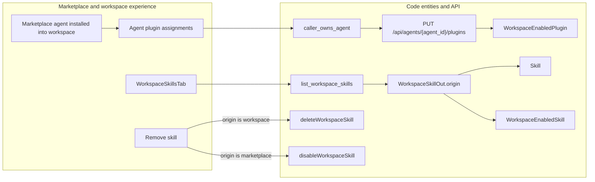
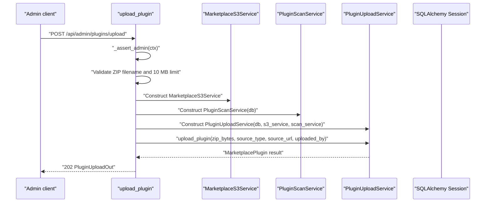
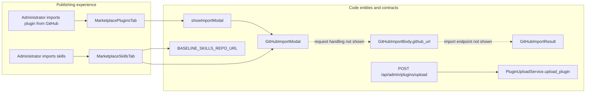

# Publishing & Plugin Uploads

Relevant source files

The following files were used as context for generating this wiki page:

- [docs/PRDS/128-UNIFIED-NOTIFICATION-SYSTEM.md](docs/PRDS/128-UNIFIED-NOTIFICATION-SYSTEM.md)
- [docs/PRDS/129-WORKSPACE-OUTPUTS-HUB.md](docs/PRDS/129-WORKSPACE-OUTPUTS-HUB.md)
- [docs/PRDS/42-PLUGIN-SKILLS-MARKETPLACE.md](docs/PRDS/42-PLUGIN-SKILLS-MARKETPLACE.md)
- [frontend/components/agents/agent-plugins-tab.tsx](frontend/components/agents/agent-plugins-tab.tsx)
- [frontend/components/agents/skills/skill-editor-modal.tsx](frontend/components/agents/skills/skill-editor-modal.tsx)
- [frontend/components/agents/skills/workspace-skills-tab.tsx](frontend/components/agents/skills/workspace-skills-tab.tsx)
- [frontend/components/knowledge/memory-tab.tsx](frontend/components/knowledge/memory-tab.tsx)
- [frontend/components/marketplace/__tests__/marketplace-item-modal.type.test.tsx](frontend/components/marketplace/__tests__/marketplace-item-modal.type.test.tsx)
- [frontend/components/marketplace/featured-showcase-card.tsx](frontend/components/marketplace/featured-showcase-card.tsx)
- [frontend/components/marketplace/github-import-modal.tsx](frontend/components/marketplace/github-import-modal.tsx)
- [frontend/components/marketplace/marketplace-agent-cards.tsx](frontend/components/marketplace/marketplace-agent-cards.tsx)
- [frontend/components/marketplace/marketplace-agents-tab.tsx](frontend/components/marketplace/marketplace-agents-tab.tsx)
- [frontend/components/marketplace/marketplace-card.tsx](frontend/components/marketplace/marketplace-card.tsx)
- [frontend/components/marketplace/marketplace-grid.tsx](frontend/components/marketplace/marketplace-grid.tsx)
- [frontend/components/marketplace/marketplace-homepage.tsx](frontend/components/marketplace/marketplace-homepage.tsx)
- [frontend/components/marketplace/marketplace-item-modal.tsx](frontend/components/marketplace/marketplace-item-modal.tsx)
- [frontend/components/marketplace/marketplace-item-ref.ts](frontend/components/marketplace/marketplace-item-ref.ts)
- [frontend/components/marketplace/marketplace-item-sections.tsx](frontend/components/marketplace/marketplace-item-sections.tsx)
- [frontend/components/marketplace/marketplace-playbooks-tab.tsx](frontend/components/marketplace/marketplace-playbooks-tab.tsx)
- [frontend/components/marketplace/marketplace-plugin-detail-modal.tsx](frontend/components/marketplace/marketplace-plugin-detail-modal.tsx)
- [frontend/components/marketplace/marketplace-plugins-tab.tsx](frontend/components/marketplace/marketplace-plugins-tab.tsx)
- [frontend/components/marketplace/marketplace-skills-tab.tsx](frontend/components/marketplace/marketplace-skills-tab.tsx)
- [frontend/components/marketplace/marketplace-tools-tab.tsx](frontend/components/marketplace/marketplace-tools-tab.tsx)
- [frontend/hooks/use-skills-api.ts](frontend/hooks/use-skills-api.ts)
- [orchestrator/alembic/versions/prd128_notifications.py](orchestrator/alembic/versions/prd128_notifications.py)
- [orchestrator/api/admin_plugins.py](orchestrator/api/admin_plugins.py)
- [orchestrator/api/agent_plugins.py](orchestrator/api/agent_plugins.py)
- [orchestrator/api/marketplace_plugins.py](orchestrator/api/marketplace_plugins.py)
- [orchestrator/api/personas.py](orchestrator/api/personas.py)
- [orchestrator/api/rag_feedback.py](orchestrator/api/rag_feedback.py)
- [orchestrator/api/workspace_plugins.py](orchestrator/api/workspace_plugins.py)
- [orchestrator/api/workspace_skills.py](orchestrator/api/workspace_skills.py)
- [orchestrator/core/auth/workspace_agent.py](orchestrator/core/auth/workspace_agent.py)
- [orchestrator/core/seeds/marketplace_personas.py](orchestrator/core/seeds/marketplace_personas.py)
- [orchestrator/core/seeds/seed_shopify_agents.py](orchestrator/core/seeds/seed_shopify_agents.py)
- [orchestrator/core/services/marketplace_s3.py](orchestrator/core/services/marketplace_s3.py)
- [orchestrator/core/services/plugin_upload_service.py](orchestrator/core/services/plugin_upload_service.py)
- [orchestrator/tests/test_prd251w1_rvw1_persona_tenancy.py](orchestrator/tests/test_prd251w1_rvw1_persona_tenancy.py)

## Purpose & Scope

Section 14.3 covers the publishing and import paths visible in this code cluster: marketplace items and workspace skills, the plugin GitHub-import entry point, and ZIP uploads through the admin plugin API. These are related marketplace operations, but they are not one shared installation pipeline: plugin uploads use `PluginUploadService`, while workspace skills have their own enablement API and ownership model. [orchestrator/api/admin_plugins.py:139-192](), [orchestrator/api/workspace_skills.py:132-143]()

Sources: [orchestrator/api/admin_plugins.py:139-192](), [orchestrator/api/workspace_skills.py:132-143]()

---

## Clone-to-Workspace & Entity Publishing

The plugin-assignment API describes marketplace agent installation as copying a marketplace agent’s plugin assignments and skills into each installing workspace. Plugin assignments are then managed against the workspace’s enabled plugins: `update_agent_plugins` deduplicates requested plugin IDs and validates that each requested plugin is enabled for the agent’s workspace before replacing assignments. [orchestrator/api/agent_plugins.py:67-79](), [orchestrator/api/agent_plugins.py:144-189]()

Workspace skills use a distinct model. `list_workspace_skills` returns both marketplace skills enabled through `WorkspaceEnabledSkill` and workspace-owned skills represented by `Skill`; the response distinguishes them with `origin`. Marketplace-origin skills are read-only, while workspace-origin skills are editable. [orchestrator/api/workspace_skills.py:63-79](), [orchestrator/api/workspace_skills.py:132-143]()

The workspace skills UI loads the active workspace’s skills and branches on `origin` when removing an item: it deletes workspace-owned skills and disables marketplace skills, preserving the marketplace catalogue entry. [frontend/components/agents/skills/workspace-skills-tab.tsx:90-106](), [frontend/components/agents/skills/workspace-skills-tab.tsx:142-155]()

### Marketplace Item Identity & Workspace Scope

| Concern | Implementation detail |
|---|---|
| Plugin assignment ownership | `caller_owns_agent` checks that the agent belongs to the caller’s workspace before assignment updates. [orchestrator/api/agent_plugins.py:67-79]() |
| Assignment authorization | `PUT /api/agents/{agent_id}/plugins` requires `agents:update` permission and the `caller_owns_agent` dependency. [orchestrator/api/agent_plugins.py:144-153]() |
| Assignment validation | Requested plugin IDs are deduplicated in order and checked against `WorkspaceEnabledPlugin` rows for the agent’s workspace. [orchestrator/api/agent_plugins.py:172-189]() |
| Skill origin | `WorkspaceSkillOut.origin` distinguishes marketplace skills from workspace-owned skills; forked workspace skills can record `forked_from_skill_id`. [orchestrator/api/workspace_skills.py:63-79]() |
| Removal behavior | Workspace-owned skills are deleted; marketplace skills are disabled for the workspace. [frontend/components/agents/skills/workspace-skills-tab.tsx:142-155]() |

Sources: [orchestrator/api/agent_plugins.py:67-79](), [orchestrator/api/agent_plugins.py:144-189](), [orchestrator/api/workspace_skills.py:63-79](), [frontend/components/agents/skills/workspace-skills-tab.tsx:142-155]()

### Dependency Handling & Workspace Skills

The marketplace item detail modal reads skills from `item.metadata.skills`, falling back to `item.dependencies.skills`, and passes the resulting list to its skills section. This is a frontend display path; the available code does not establish that it is the backend dependency-cloning implementation. [frontend/components/marketplace/marketplace-item-modal.tsx:64-86]()

For workspace skills, `WorkspaceSkillsTab` loads workspace content through `listWorkspaceSkills`. The API’s response shape includes the skill’s origin, fork source, and assigned-agent count, allowing the UI to present workspace-owned and marketplace-origin entries differently. [frontend/components/agents/skills/workspace-skills-tab.tsx:46-59](), [frontend/components/agents/skills/workspace-skills-tab.tsx:90-106](), [orchestrator/api/workspace_skills.py:63-79]()

### Diagram: Workspace Installation and Skill Ownership

Sources: [orchestrator/api/agent_plugins.py:67-79](), [orchestrator/api/agent_plugins.py:144-189](), [orchestrator/api/workspace_skills.py:63-79](), [orchestrator/api/workspace_skills.py:132-149](), [frontend/components/agents/skills/workspace-skills-tab.tsx:142-155]()

---

## Plugin Upload Service & Marketplace S3 Storage

The admin upload endpoint is `POST /api/admin/plugins/upload`. It accepts a multipart ZIP file and optional `source_type` and `source_url` fields, then calls `_assert_admin` before processing the upload. [orchestrator/api/admin_plugins.py:43-43](), [orchestrator/api/admin_plugins.py:139-149]()

The route rejects a missing filename, files whose names do not end in `.zip`, and content larger than 10 MB. It then constructs `MarketplaceS3Service`, `PluginScanService`, and `PluginUploadService`, and calls `upload_plugin` with the ZIP bytes, source metadata, and uploader identity. The endpoint returns HTTP 202 with plugin metadata, an optional scan ID, and a `"scanning"` status. [orchestrator/api/admin_plugins.py:139-192]()

The route’s service construction shows that S3 storage and scanning are dependencies of `PluginUploadService`. The available code does not show the implementation details of `MarketplaceS3Service` or `PluginUploadService`, so it does not establish the exact S3 bucket layout, object-key format, or internal scan sequence. [orchestrator/api/admin_plugins.py:165-181]()

### Upload Request & Response Lifecycle

| Stage | Behavior |
|---|---|
| Authorization | `_assert_admin(ctx)` gates the upload route. [orchestrator/api/admin_plugins.py:139-149]() |
| Input validation | A filename is required, the filename must end in `.zip`, and the content limit is 10 MB. [orchestrator/api/admin_plugins.py:151-164]() |
| Service construction | The route constructs `MarketplaceS3Service`, `PluginScanService(db)`, and `PluginUploadService(db, s3_service, scan_service)`. [orchestrator/api/admin_plugins.py:165-173]() |
| Upload invocation | `upload_plugin` receives ZIP bytes, source type, source URL, and uploader ID. [orchestrator/api/admin_plugins.py:174-181]() |
| API result | The response includes plugin and optional scan IDs, slug, name, version, security and approval statuses, and `"scanning"` status. [orchestrator/api/admin_plugins.py:183-192]() |
| Validation errors | A `ValueError` becomes HTTP 400; unexpected exceptions trigger rollback and HTTP 500. [orchestrator/api/admin_plugins.py:194-202]() |

Sources: [orchestrator/api/admin_plugins.py:139-202]()

### Diagram: ZIP Upload Route and Service Dependencies

Sources: [orchestrator/api/admin_plugins.py:139-192]()

---

## GitHub Import Modal & Baseline Repositories

The plugin tab imports `GitHubImportModal`, maintains `showImportModal` state, and obtains the administrator state through `useSystemRole`. The plugin tab also fetches the marketplace plugin list from `/api/marketplace/plugins`; when the user is an administrator, it separately fetches pending plugins from `/api/admin/plugins/pending`. [frontend/components/marketplace/marketplace-plugins-tab.tsx:43-47](), [frontend/components/marketplace/marketplace-plugins-tab.tsx:69-88](), [frontend/components/marketplace/marketplace-plugins-tab.tsx:128-178]()

The admin API defines `GitHubImportBody.github_url` and a `GitHubImportResult` shape with a slug, optional plugin ID, security and approval statuses, status, and optional error. The provided route excerpt shows ZIP upload handling, but does not show the GitHub-import endpoint implementation or the modal’s request handler. Therefore, the exact repository-cloning, archive-download, and request-to-upload sequence cannot be verified from the available lines. [orchestrator/api/admin_plugins.py:69-80](), [orchestrator/api/admin_plugins.py:139-181](), [frontend/components/marketplace/marketplace-plugins-tab.tsx:43-47]()

The skills tab also imports `GitHubImportModal` and the baseline-skill repository label and URL constants. The shown lines establish those imports, but do not show the modal behavior or how the baseline repository is processed. [frontend/components/marketplace/marketplace-skills-tab.tsx:21-26]()

### Diagram: GitHub Import Entry Points and Visible API Contract

Sources: [frontend/components/marketplace/marketplace-plugins-tab.tsx:43-47](), [frontend/components/marketplace/marketplace-plugins-tab.tsx:69-88](), [frontend/components/marketplace/marketplace-skills-tab.tsx:21-26](), [orchestrator/api/admin_plugins.py:69-80](), [orchestrator/api/admin_plugins.py:139-181]()

---

## Security Scanning & Moderation Workflow

The upload endpoint constructs `PluginScanService` and passes it to `PluginUploadService`; the upload response exposes the plugin’s current security and approval statuses. The shown route does not expose the scanner’s internal checks or the storage service’s persistence details. [orchestrator/api/admin_plugins.py:165-192]()

The admin API excerpt defines approval and rejection operations, and the plugin detail modal calls `/api/admin/plugins/{plugin.id}/approve` and `/api/admin/plugins/{plugin.id}/reject` from its admin handlers. The modal reports success or failure through notifications and closes after a successful operation. [orchestrator/api/admin_plugins.py:205-208](), [frontend/components/marketplace/marketplace-plugin-detail-modal.tsx:159-187]()

The plugin detail response model includes security and approval status fields. The modal renders security badges for statuses including `safe`, `blocked`, and `review_required`, with a pending fallback. [frontend/components/marketplace/marketplace-plugin-detail-modal.tsx:58-90](), [frontend/components/marketplace/marketplace-plugin-detail-modal.tsx:191-225]()

Sources: [orchestrator/api/admin_plugins.py:165-192](), [orchestrator/api/admin_plugins.py:205-208](), [frontend/components/marketplace/marketplace-plugin-detail-modal.tsx:58-90](), [frontend/components/marketplace/marketplace-plugin-detail-modal.tsx:159-187](), [frontend/components/marketplace/marketplace-plugin-detail-modal.tsx:191-225]()

---