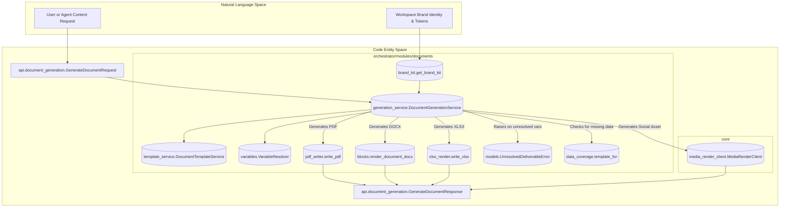
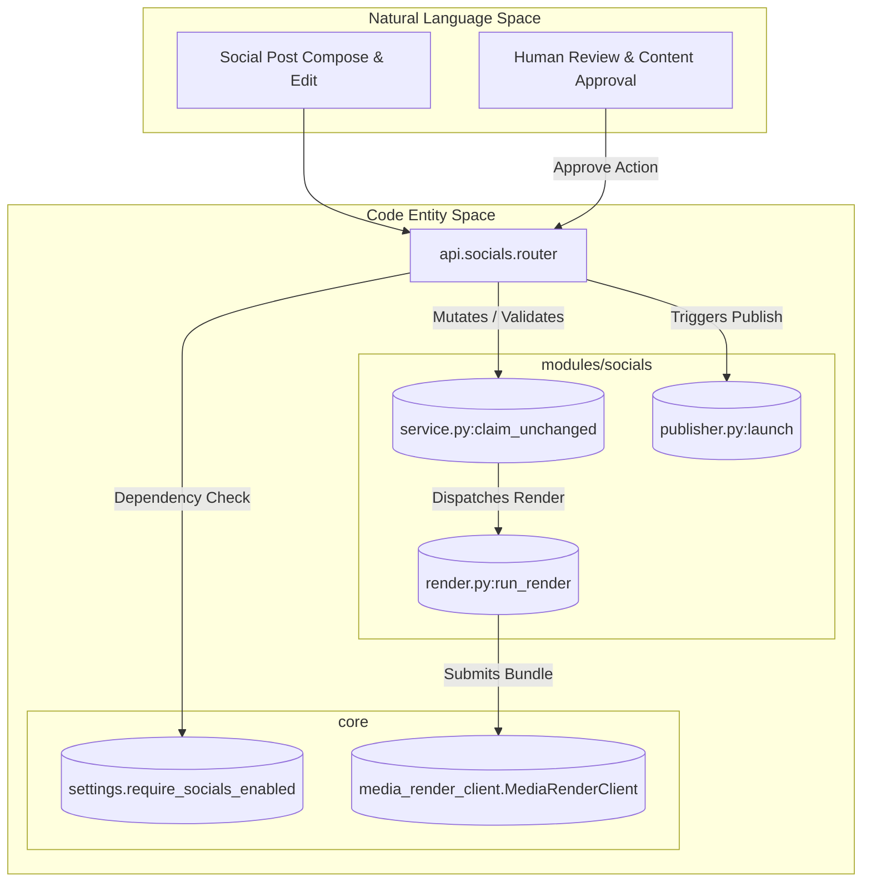

# Content, Documents & Socials

Relevant source files

The following files were used as context for generating this wiki page:

- [frontend/components/deliverables/socials/__tests__/socials-template-made-for.test.ts](frontend/components/deliverables/socials/__tests__/socials-template-made-for.test.ts)
- [frontend/components/documents/blocks/__tests__/promptSnippets.test.ts](frontend/components/documents/blocks/__tests__/promptSnippets.test.ts)
- [frontend/components/documents/blocks/promptSnippets.ts](frontend/components/documents/blocks/promptSnippets.ts)
- [frontend/lib/api-client.ts](frontend/lib/api-client.ts)
- [orchestrator/api/document_generation.py](orchestrator/api/document_generation.py)
- [orchestrator/api/socials.py](orchestrator/api/socials.py)
- [orchestrator/config.py](orchestrator/config.py)
- [orchestrator/consumers/chatbot/socials_turn_note.py](orchestrator/consumers/chatbot/socials_turn_note.py)
- [orchestrator/main.py](orchestrator/main.py)
- [orchestrator/modules/documents/blocks/data_details.py](orchestrator/modules/documents/blocks/data_details.py)
- [orchestrator/modules/documents/blocks/schema.py](orchestrator/modules/documents/blocks/schema.py)
- [orchestrator/modules/documents/data_coverage.py](orchestrator/modules/documents/data_coverage.py)
- [orchestrator/modules/documents/generation_service.py](orchestrator/modules/documents/generation_service.py)
- [orchestrator/modules/documents/models.py](orchestrator/modules/documents/models.py)
- [orchestrator/modules/documents/template_formats.py](orchestrator/modules/documents/template_formats.py)
- [orchestrator/modules/documents/template_lookup.py](orchestrator/modules/documents/template_lookup.py)
- [orchestrator/modules/documents/template_preview.py](orchestrator/modules/documents/template_preview.py)
- [orchestrator/modules/documents/template_service.py](orchestrator/modules/documents/template_service.py)
- [orchestrator/modules/documents/template_summary.py](orchestrator/modules/documents/template_summary.py)
- [orchestrator/modules/socials/__init__.py](orchestrator/modules/socials/__init__.py)
- [orchestrator/modules/socials/render.py](orchestrator/modules/socials/render.py)
- [orchestrator/modules/socials/service.py](orchestrator/modules/socials/service.py)
- [orchestrator/modules/tools/discovery/social_post_checks.py](orchestrator/modules/tools/discovery/social_post_checks.py)
- [orchestrator/modules/tools/discovery/social_post_results.py](orchestrator/modules/tools/discovery/social_post_results.py)
- [orchestrator/modules/tools/discovery/template_tools.py](orchestrator/modules/tools/discovery/template_tools.py)
- [orchestrator/reports/config-surface.json](orchestrator/reports/config-surface.json)
- [orchestrator/reports/route-manifest.json](orchestrator/reports/route-manifest.json)
- [orchestrator/tests/security/test_template_security.py](orchestrator/tests/security/test_template_security.py)
- [orchestrator/tests/test_f348_a_template_previews_its_own_sample_and_says_what_it_makes.py](orchestrator/tests/test_f348_a_template_previews_its_own_sample_and_says_what_it_makes.py)
- [orchestrator/tests/test_f379_a_autos_post_is_checked_and_its_answer_is_honest.py](orchestrator/tests/test_f379_a_autos_post_is_checked_and_its_answer_is_honest.py)
- [orchestrator/tests/test_f379_c_auto_knows_how_socials_works.py](orchestrator/tests/test_f379_c_auto_knows_how_socials_works.py)
- [orchestrator/tests/test_f379_d_social_media_work_goes_to_the_director.py](orchestrator/tests/test_f379_d_social_media_work_goes_to_the_director.py)
- [orchestrator/tests/test_f383_b_a_named_template_is_kept_or_refused.py](orchestrator/tests/test_f383_b_a_named_template_is_kept_or_refused.py)
- [orchestrator/tests/test_prd190_deliverables.py](orchestrator/tests/test_prd190_deliverables.py)
- [orchestrator/tests/test_prd251_api.py](orchestrator/tests/test_prd251_api.py)

The Content, Documents & Socials subsystem governs autonomous and user-driven content production within Automatos AI. It orchestrates structured document generation (PDF, DOCX, XLSX) [orchestrator/modules/documents/generation_service.py:1-12](), dynamic brand styling and enforcement [orchestrator/api/document_generation.py:35-41](), markdown-driven blog deliverables, and the comprehensive PRD-251 social media composition, rendering, and publishing pipeline [orchestrator/api/socials.py:1-40]().

As a parent page, this document provides a high-level overview of the architectural components, service boundaries, and workflows. For in-depth technical specifications, consult the respective child pages.

---

## 28.1 Document Generation & Templates

The document generation engine converts structured data and templates into professional output files across multiple formats. Handled primarily by `DocumentGenerationService` [orchestrator/modules/documents/generation_service.py:109-114](), the system resolves variables via `VariableResolver` [orchestrator/modules/documents/generation_service.py:55-55](), validates block schemas, and dispatches rendering to dedicated engines (WeasyPrint for PDF, `python-docx-template` for DOCX, and XlsxWriter for XLSX) [orchestrator/modules/documents/generation_service.py:1-8]().

Generated assets are persisted to object storage (S3) to guarantee availability across ephemeral container instances [orchestrator/modules/documents/generation_service.py:9-12](), and exposed to agents and users through the `generate_document` tool and `/api/documents` REST endpoints [orchestrator/api/document_generation.py:38-41](). Social media formats (`social_image`, `social_video`) are handled by the `media-render` service [orchestrator/modules/documents/generation_service.py:4-7](). The `UnresolvedDeliverableError` [orchestrator/modules/documents/models.py:47-47]() is raised if a document contains unresolved variables, preventing delivery of incomplete content [orchestrator/modules/documents/generation_service.py:134-143]().

For details, see [Document Generation & Templates](#28.1).

Sources: `orchestrator/modules/documents/generation_service.py:1-12`, `orchestrator/modules/documents/generation_service.py:55-55`, `orchestrator/modules/documents/generation_service.py:109-114`, `orchestrator/api/document_generation.py:38-41`, `orchestrator/modules/documents/generation_service.py:4-7`, `orchestrator/modules/documents/models.py:47-47`, `orchestrator/modules/documents/generation_service.py:134-143`

---

## 28.2 Brand Kit & Brand Rules

To maintain visual and editorial consistency across all generated artifacts and social posts, Automatos AI integrates a centralized brand kit subsystem (PRD-255). The brand model manages logos, color palettes, typography, and regional locale/currency settings, exposing update actions and rendering styles [orchestrator/api/document_generation.py:35-41]().

Brand rules hooks scan template structures to prevent hardcoded literals outside design system tokens, automatically signing generated documents with appropriate brand sign-offs and legal notices [orchestrator/modules/documents/generation_service.py:49-67](). Brand configuration interfaces are surfaced through dedicated UI tabs and designer proposal cards.

For details, see [Brand Kit & Brand Rules](#28.2).

Sources: `orchestrator/api/document_generation.py:35-41`, `orchestrator/modules/documents/generation_service.py:49-67`

---

## 28.3 Blog & Content Deliverables

The blog and content deliverables subsystem empowers agents to draft, refine, and publish long-form content adhering to strict typographic and editorial standards. Powered by specialized blog platform actions, the `BlogService`, and dedicated playbook seeds, the platform formats markdown content with proper author bylines, structural hierarchies, and automated preview generation.

Deliverables are tracked within the workspace state machine and rendered in the deliverables UI, bridging raw agent output with production-ready publishing formats. The `/api/blog` endpoints [orchestrator/main.py:74-74]() manage blog-related operations.

For details, see [Blog & Content Deliverables](#28.3).

Sources: `orchestrator/reports/route-manifest.json:1-100`, `orchestrator/api/document_generation.py:38-41`, `orchestrator/main.py:74-74`

---

## 28.4 Socials Subsystem (PRD-251)

The socials subsystem manages the end-to-end lifecycle of social media content creation, review, asset rendering, and multi-channel publication [orchestrator/api/socials.py:1-86](). Core entities include `SocialPost` and `SocialPostTarget` models [orchestrator/tests/test_prd251_api.py:69-69]() backed by strict status machines and content hashing (D6) to guarantee that approvals are cryptographically bound to exact content payloads [orchestrator/modules/socials/service.py:13-22]().

The pipeline integrates automated media generation (via `media-render` and `MediaRenderClient`) [orchestrator/modules/socials/render.py:1-38](), voice synthesis, footages/music credit appending [orchestrator/modules/socials/service.py:54-58](), and schedule-driven publishing through Composio adapters [orchestrator/modules/socials/__init__.py:38-41](). All `/api/socials` endpoints [orchestrator/main.py:75-75]() are protected by the `require_socials_enabled` dependency [orchestrator/api/socials.py:5-8](), ensuring the platform master switch and workspace-specific settings are active.

For details, see [Socials Subsystem (PRD-251)](#28.4).

Sources: `orchestrator/api/socials.py:1-86`, `orchestrator/tests/test_prd251_api.py:69-69`, `orchestrator/modules/socials/service.py:13-22`, `orchestrator/modules/socials/render.py:1-38`, `orchestrator/modules/socials/service.py:54-58`, `orchestrator/modules/socials/__init__.py:38-41`, `orchestrator/main.py:75-75`

---

## Architecture Diagrams

### Document Generation & Brand Pipeline

This diagram bridges natural language requests for content generation to the underlying Python classes and rendering clients responsible for producing final documents and media assets.

Sources: `orchestrator/modules/documents/generation_service.py:109-151`, `orchestrator/api/document_generation.py:79-108`, `orchestrator/modules/documents/generation_service.py:31-67`, `orchestrator/modules/documents/generation_service.py:112-113`, `orchestrator/modules/documents/template_service.py:1-163`, `orchestrator/modules/documents/models.py:47-47`, `orchestrator/modules/documents/data_coverage.py:1-131`

### Socials Publishing & Render Pipeline

This diagram illustrates how social post lifecycle commands transition from API calls through state validation and media rendering executors.

Sources: `orchestrator/api/socials.py:1-86`, `orchestrator/modules/socials/service.py:1-69`, `orchestrator/modules/socials/render.py:1-50`, `orchestrator/modules/socials/publisher.py:1-30`, `orchestrator/modules/socials/settings.py:1-40`

---